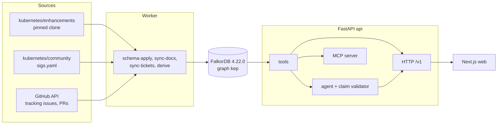

# KEP Brain

KEP Brain audits Kubernetes decision records (KEPs, Kubernetes Enhancement Proposals) for contradictions. It finds KEPs whose `kep.yaml`, tracking issue and replaces/superseded-by data disagree, shows who decided each state and from which evidence, and drafts the fix. Every answer cites a graph node with a public GitHub URL, or the system abstains.

Built for the WeMakeDevs x FalkorDB Graph Hacks hackathon (October 2026). Track 3 (Company Brain) is the master track. Track 1 (agent tools: path and ranking tools, an MCP server, a draft-issue action) and Track 2 (memory: per-user memory graphs, shared Finding memory, a freshness agent) are layers on top of it. Scope: three SIGs, sig-node, sig-scheduling and sig-apps, about 234 KEPs.

## Architecture



## Run it

```bash
cp .env.example .env        # set FALKORDB_PASSWORD (required) and OPENAI_API_KEY (a Groq key)
docker compose up -d falkordb api web
```

Build the graph with the worker, which runs in the api image:

```bash
docker compose run --rm worker all
# or one step: schema-apply | sync-docs | sync-tickets | derive
```

- Web: http://localhost:3000
- API: http://localhost:8000 (`/health`, `/ready`, `/v1/meta`)
- FalkorDB: 127.0.0.1:6380 (browser UI on 127.0.0.1:3001)

Local development:

```bash
cd apps/api && uv sync && uv run pytest -m "not integration"
cd apps/web && pnpm install && pnpm dev
```

## Data sources and pins

| Source | Pin | Used for |
|---|---|---|
| kubernetes/enhancements | `8659e382efab7340d70de52432ee8f3d9979b797` | `kep.yaml`, KEP READMEs, PRR files, git history |
| kubernetes/community | `53c338ecba4a2a9240f6654cca1d6a9dac25c785` | `sigs.yaml` (SIGs, working groups) |
| GitHub API | as of the sync date shown in `/v1/meta` | tracking issues, label and milestone timelines, PRs and reviews |
| FalkorDB | `falkordb/falkordb:v4.22.0` | graph store |

Only public GitHub logins are stored; no email addresses.

## Why a graph

A contradiction is a disagreement between records of the same fact held in different linked entities: the KEP file, its tracking issue, the commits and pull requests that changed its status, and the KEPs it replaces. "Who decided this state, when, and on what evidence" is a path from a KEP through a status change and a pull request to a person. Temporal edges (`valid_from` / `valid_to`) make "what was true then" a query rather than a reconstruction, and each hop carries a public URL, which is what lets every answer be cited.

## Results

Evaluation numbers have not been measured yet. This table will be filled from the eval run and will not contain estimates.

| Metric | Result |
|---|---|
| Answer accuracy on the eval set | not yet measured |
| Citation validity | not yet measured |
| Correct abstention | not yet measured |
| Contradiction recall | not yet measured |

## Provenance

The design notes in `docs/design` were written on 2026-10-11 to 2026-10-14, which the event rules allow before the start. A generic template was also prepared before the event; it was archived outside the repository, never used and never copied in. The repository's code starts after 2026-10-15 00:01 IST: the first commit in `git log` is "Pre-event notes" and contains documentation only, and the scaffold comes from the public `uv init` and `create-next-app` generators. See ADR-0001 in `docs/DECISIONS.md`.

## AI usage

AI coding assistants are used to draft code under human direction and review. Each use is recorded in `docs/AI_USAGE.md`.

## License

MIT, see `LICENSE`.
