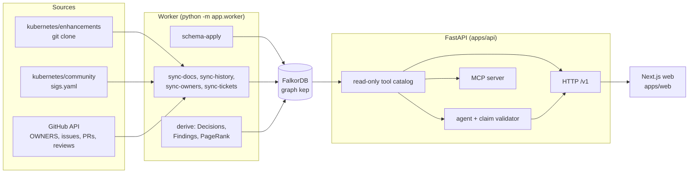
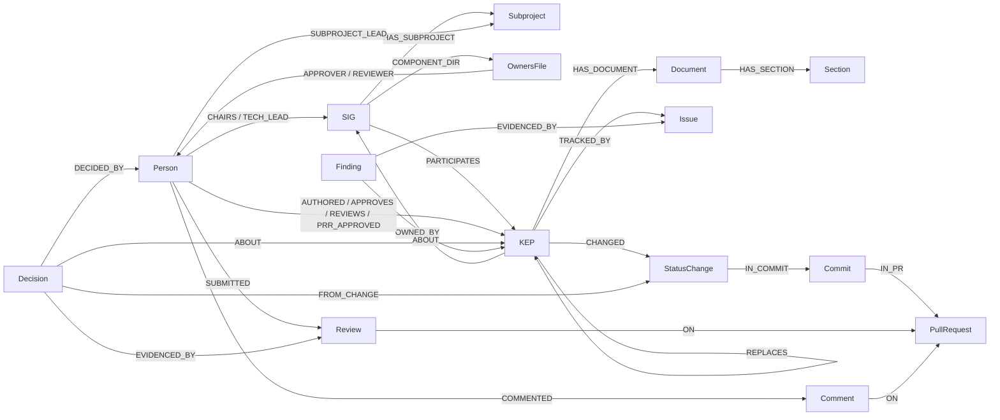

# KEP Brain

Every significant change to Kubernetes goes through a KEP, a Kubernetes Enhancement Proposal: a design document with a metadata file and a tracking issue, owned by a SIG. KEP Brain is a company brain for that process. It loads KEPs, SIG rosters, tracking issues and pull request history from public GitHub into one FalkorDB graph, works out who decided what and on which evidence, flags records that contradict each other, and answers questions with citations or abstains.

[](https://github.com/akshat-lakhera/kep-brain/actions/workflows/ci.yml)
[](LICENSE)
[](apps/api/pyproject.toml)
[](apps/web/package.json)
[](docker-compose.yml)

**Live:** https://kep-brain.duckdns.org (one AWS EC2 VM running the compose stack behind Caddy). It follows the default-branch heads of its source repositories, and the worker re-syncs every source daily, so its counts move with GitHub.

**Demo video:** https://youtu.be/5ht6jMg8Ou8 (2:25) · **Track:** Graph Hacks Track 3, Company Brain; see [How it covers the Company Brain brief](#how-it-covers-the-company-brain-brief).


## Table of contents

- [The problem](#the-problem)
- [What it does](#what-it-does)
- [How it covers the Company Brain brief](#how-it-covers-the-company-brain-brief)
- [Screenshots](#screenshots)
- [How it works](#how-it-works)
  - [Architecture](#architecture)
  - [Graph data model](#graph-data-model)
  - [Graph features used](#graph-features-used)
  - [Cypher the product depends on](#cypher-the-product-depends-on)
- [Quick start](#quick-start)
  - [Try the live instance](#try-the-live-instance)
  - [Run it locally](#run-it-locally)
  - [Use it from another agent (MCP)](#use-it-from-another-agent-mcp)
- [Development](#development)
- [Configuration](#configuration)
- [Project layout](#project-layout)
- [API overview](#api-overview)
  - [Tool catalog](#tool-catalog)
- [Status](#status)
- [Contributing](#contributing)
- [AI assistance](#ai-assistance)
- [License](#license)
- [Acknowledgments](#acknowledgments)

## The problem

Every significant change to Kubernetes goes through a KEP, a Kubernetes Enhancement Proposal. A KEP is a folder in [kubernetes/enhancements](https://github.com/kubernetes/enhancements) with the proposal text and a `kep.yaml` metadata file, plus a tracking issue in the same repository; the issue number is the KEP number. The [KEP process](https://github.com/kubernetes/enhancements/blob/master/keps/sig-architecture/0000-kep-process/README.md) makes `kep.yaml` the record of a KEP's state: `status` is required, must be one of seven values, and the metadata is "critical to clearly communicate the status of a KEP" and "used to support tooling around filtering and display". The same document pairs `replaces` with `superseded-by` on the other KEP and with the `replaced` status.

Nothing enforces that. The state of a KEP is written in several places by different people at different times: `kep.yaml` in a pull request, the tracking issue's state, labels and milestone by the release team, and the replacement declarations in two KEPs. They drift apart, and the drift is invisible to anyone reading one record. In the 15 October 2026 snapshot of the three SIGs loaded here, 59 pairs of records disagree, across 50 of the 238 KEPs. Forty of those KEPs have a `kep.yaml` that still says `implementable` or `provisional` while their tracking issue is closed, some as far back as 2019. Anyone who filters KEPs by status, as the process says the metadata is for, gets a wrong answer for those.

The questions behind that drift are the questions anyone joining a SIG, running a release or reviewing a proposal asks and cannot answer from one file: who decided this KEP's current state and on what evidence, who approved it, who actually knows this area, what replaced what, what changed since the last release, and which records are stale.

**How KEP Brain tackles it.** It reads every source live from public GitHub into one FalkorDB graph and keeps the history: each state edge carries the interval it was valid for, so the current state is a filter on the same edges that hold the history, and every metadata change is a dated `StatusChange` that the timelines and "what changed since a release" read. From the kep.yaml history it derives who decided each state and links each decision to the commit, the pull request and the approvers. Five predicates written from the process rules above compare the records pairwise and write each disagreement as a `Finding` with both sides, their source URLs and a suggested fix, and the audit page drafts the issue text from that evidence. Questions are answered by an agent that may only use read-only graph tools; a deterministic validator checks every citation against the records returned in that request and replaces the answer with an abstention if one is invalid or none is left. Every citation is a graph node with a public GitHub URL, so the answer can be checked in one click.

## What it does

A KEP's state lives in several places at once: the `kep.yaml` file, the tracking issue with its labels and milestones, the pull requests that changed the file, and the KEPs it replaces or is replaced by. KEP Brain puts them in one graph and reads them together.

- **Live ingest from public GitHub.** The worker clones `kubernetes/enhancements` and `kubernetes/community`, reads OWNERS files from `kubernetes/kubernetes` through the GitHub API, and fetches tracking issues, timelines, pull requests and review threads. Every run upserts into the same FalkorDB graph, so re-running is safe.
- **Who decided what, from which evidence.** Every `kep.yaml` revision is diffed field by field. Each status, stage or milestone change becomes a `StatusChange` linked to its commit and pull request. From these, the worker derives `Decision` nodes and attaches the people who approved them and the records that prove it.
- **Review discussion as the conversation layer.** In this project the design debate happens in pull request review, not in a chat tool. For each enhancement pull request whose commits changed a KEP's status, stage, milestones or replacement fields, the worker keeps the review summaries and inline review-thread comments written by people that are longer than 200 characters once Prow command lines are removed (`Comment {kind: review_comment}`: a 600-character excerpt, author, date, file, GitHub link). Conversation comments on those pull requests are kept only for the Prow commands they carry, and the deciders' `/approve` and `/lgtm` comments are cited as decision evidence. The `contested_points` tool returns a KEP's review discussion oldest first, each comment with its GitHub link for citation. Tracking-issue comment text, short replies, Slack and mailing lists are not loaded.
- **Contradiction audit.** Five predicates compare a KEP's `kep.yaml` with its tracking issue and its replacement declarations. Each hit is a `Finding` that carries both sides with their public URLs and a lifecycle (`open`, `resolved_upstream`, human verdicts). The audit page can draft an issue body from the evidence. Nothing is ever posted to GitHub.
- **Answers with citations, or abstention.** `POST /v1/ask` runs an agent over a read-only tool catalog. A deterministic validator checks that every inline citation points to a record returned in that request and that the answer carries at least one; otherwise the answer is replaced by an abstention. Explicit mentions (`KEP-n`, `#n`, `@login`) of returned records are linked to them automatically. Every citation is a graph node with a public GitHub URL. The Ask page puts the question box first and shows each answer's evidence chain as a force-directed diagram, coloured by node label with the cited nodes ringed, or as a list. Questions about the KEP process and about KEP Brain itself are in scope: both are answered from document sections stored in the graph and cited like any other record.
- **Explore pages.** Search KEPs, open a KEP with its facts, status history, decisions and lineage (drawn with the same diagram), and browse SIGs and people. The Tools page calls any catalog tool directly and draws the records it returned.
- **Per-browser memory.** An anonymous memory id (header `X-Kep-Memory-Id`) selects a small per-user graph that can be inspected and deleted as a unit.
- **MCP server.** The same read-only tools are exposed over Streamable HTTP behind a bearer token, so other agents can query the graph (`/mcp` on the local port in development and through Caddy in the production deploy).

On 18 October 2026 (about 11:55 UTC) the running instance reported 238 KEPs, 674 people and 60 open findings on 51 KEPs (41 of them `active_status_closed_issue`), plus 1 already resolved upstream, in 39,430 nodes and 127,234 edges, for `sig-node`, `sig-scheduling` and `sig-apps`, read from the default-branch heads (`GET /v1/meta`, `GET /v1/findings`, `GET /v1/sync/status`). The counts move with each daily re-sync.

## How it covers the Company Brain brief

Track 3 asks for an agent that understands how a company works, with people, teams, projects, documents and decisions in one graph. KEP Brain treats the Kubernetes project as that company: its org chart (`sigs.yaml`, OWNERS files), its project records (KEPs, tracking issues, pull requests) and its review discussion are public. Counts are from the live instance on 18 October 2026 (`GET /v1/sync/status`).

| The brief asks for | In the graph | Try it |
|---|---|---|
| People | `Person` (674; public GitHub logins only), with roles from `sigs.yaml`, `kep.yaml` and OWNERS files | [`GET /v1/people/dom4ha`](https://kep-brain.duckdns.org/v1/people/dom4ha) |
| Teams | `SIG` (24 in `sigs.yaml`; KEPs loaded for `sig-node`, `sig-scheduling`, `sig-apps`), `WorkingGroup` (10), `Committee` (3), `Subproject` (241), OWNERS files (140) and aliases (29) | [`GET /v1/sigs/sig-node`](https://kep-brain.duckdns.org/v1/sigs/sig-node) |
| Projects | `KEP` (238), each `OWNED_BY` a SIG, with feature gates (269) and target releases | [`GET /v1/keps/4671`](https://kep-brain.duckdns.org/v1/keps/4671) |
| Documents | `Document` (824) and `Section` (4,920): `kep.yaml`, KEP READMEs, PRR files, OWNERS files and the KEP process documents | `POST /v1/tools/why_designed` |
| Decisions | `Decision` (2,677), derived from the git history of the KEP metadata, linked to the people who decided (`DECIDED_BY`) and to evidence (`EVIDENCED_BY`): the commit or PRR file, the pull request when there is one (2,293), and the deciders' reviews and `/approve` or `/lgtm` comments | [`GET /v1/keps/4671/decisions`](https://kep-brain.duckdns.org/v1/keps/4671/decisions) |

- **Knowledge from docs, tickets and chats in one graph.** Docs: KEP READMEs split into sections, `kep.yaml` revisions, PRR files and the KEP process documents. Tickets: tracking issues (233) with their label and milestone timelines, and pull requests (837). Chats: the review discussion on the pull requests behind status changes (review summaries and inline review comments), read by `contested_points` (KEP-4671: 413 comments from 22 people on 6 pull requests). Slack, mailing lists, meeting notes and tracking-issue comment text are not loaded.
- **Who owns what, and who knows what.** `who_owns` (owning SIG and its leads, `kep.yaml` approvers; OWNERS approvers and reviewers for a source directory; feature gates through the KEP that introduces them), `who_approves`, `who_knows` (weighted involvement: authored 3, approves 3, PRR-approved 2, reviews 2, a review or `/approve` or `/lgtm` comment behind a decision 1, with PageRank reported), `rank_people` (stored `algo.pageRank` over `DECIDED_BY`) and `knowledge_risk` (`GET /v1/risk`: active KEPs with a single `kep.yaml` approver, the busiest approvers, approvers and authors with no recent decision).
- **Tracing decisions back to their source.** `trace_decision` returns each `Decision` with its deciders, its evidence and the `StatusChange` → `Commit` → `PullRequest` chain behind it; `path_to_decision` and `path_between` (`algo.SPpaths`) show how a person is connected to a KEP's decisions. Each step links to GitHub.
- **Keeping knowledge current.** The worker re-syncs daily from the default branches (`GET /v1/sync/status` shows the last run and the next tick). A changed fact closes its state edge with `valid_to` instead of overwriting it, and a finding moves to `resolved_upstream` when upstream fixes it, or back to `open` if the drift returns. Example from the live instance: on 17 October upstream PR kubernetes/enhancements#6466 marked KEP-5328 implemented. When the instance re-synced against the default branch on 18 October, KEP Brain recorded the status change in the KEP's history and moved its `active_status_closed_issue` finding to `resolved_upstream` without anyone editing the finding. The stale side stays visible with its old commit link.
- **Answers with clear sources.** `POST /v1/ask` returns citations that are graph nodes with public GitHub URLs, the tool calls with the Cypher each one ran (`tool_calls[].template`), and the evidence subgraph. A citation that does not match a record returned in that request, or an answer without one, becomes an abstention.
- **Getting work done.** After each daily sync, three worker agents take the open findings through leased tasks in the `ops` graph: a triage agent reads each finding's evidence rows and writes a verdict (`confirmed`, `false_positive` or `needs_human`) with an assessment that must cite those rows, an action agent drafts the GitHub issue that would fix a confirmed finding (never posted), and a verifier checks that the draft cites only that finding's evidence. Verdicts are advice shown on the audit page; a finding becomes `confirmed` only by a human. Progress, handoffs and drafts are at [`GET /v1/agents/board`](https://kep-brain.duckdns.org/v1/agents/board), and the run stops at a daily spend cap (`FINDINGS_AGENT_DAILY_USD`). The audit page can also draft the issue for any finding on demand (`draft_stale_doc_issue`), and other agents get the same read-only tools over [MCP](#use-it-from-another-agent-mcp).

## Screenshots

| Landing | Explore |
|---|---|
|  |  |

| KEP detail | Audit |
|---|---|
|  |  |

## How it works

### Architecture



1. **Ingest.** `sync-docs` reads every `kep.yaml`, KEP README and PRR file from the enhancements clone and replays each revision so that state edges get `valid_from` and `valid_to` from commit dates. It also stores the two KEP process documents and the product document shipped with the API (`apps/api/src/app/data/kep_brain.md`, `ingest/product.py`) as `Document` nodes with one `Section` per heading, so "what is a KEP" and "what is KEP Brain" are answered from cited sections. `sync-history` diffs `kep.yaml` revisions into `StatusChange` nodes and maps commits to the pull requests that merged them. `sync-owners` loads OWNERS files and aliases. `sync-tickets` loads tracking issues, their label and milestone timelines, and the pull requests and review discussion behind status changes.
2. **Graph.** Everything lands in one FalkorDB graph named `kep`. Node and relationship names come from an allow-list (`apps/api/src/app/schema/labels.py`), and `schema-apply` creates the indexes and `UNIQUE` and `MANDATORY` constraints.
3. **Derive.** `derive` turns metadata changes into `Decision` nodes (`status_transition`, `withdrawal`, `stage_graduation`, `milestone_retarget`), adds PRR approval and replacement decisions, links each to the people who decided it (`DECIDED_BY`) and the evidence (`EVIDENCED_BY`), evaluates the five contradiction predicates into `Finding` nodes, and stores PageRank on `Person` nodes.
4. **Serve.** The API reads the `kep` graph with `GRAPH.RO_QUERY` only; its writes go to other graphs: `POST /v1/ask` stores validated answers in the `ops` graph (answer cache) and episodes in the caller's `mem:<id>` graph, and the `DELETE` memory and cache routes remove from those. The cache is keyed by question and graph version and serves every caller, with or without a memory id; a hit replays the recorded tool calls, evidence graph and citations instead of calling the model. The web app, the answering agent and the MCP server all go through the same parameterised tool catalog.

### Graph data model

Node labels (`NODE_LABELS` in `labels.py`):

| Group | Labels |
|---|---|
| Organisation | `SIG`, `WorkingGroup`, `Committee`, `Subproject`, `Person`, `Alias`, `OwnersFile` |
| Documents | `KEP`, `Document`, `Section`, `FeatureGate`, `Release`, `Label`, `ExternalRef` |
| Activity | `Commit`, `PullRequest`, `Issue`, `Ticket`, `Review`, `Comment`, `StatusChange` |
| Derived | `Decision`, `Finding`, `AnswerCache` |
| Operations | `SyncRun`, `WorkerHeartbeat` |

`OwnersFile` is an extra label on the `Document` node of an OWNERS file. The core of the model:



`EVIDENCED_BY` from a `Decision` also points at its pull request, commit, status change and the deciders' command comments; from a `Finding`, at the documents and status changes it compares. The live list of relationship types is returned by `POST /v1/tools/get_graph_schema`. They split into two families:

- **State relationships** (`STATE_RELS`) carry a validity interval (`valid_from`, `valid_to`). Teams and ownership: `CHAIRS`, `TECH_LEAD`, `EMERITUS_LEAD`, `LIAISON`, `STAKEHOLDER`, `SUBPROJECT_LEAD`, `APPROVER`, `REVIEWER`, `EMERITUS_APPROVER`, `MEMBER_OF`, `APPLIES_LABEL`, `COMPONENT_DIR`. KEPs: `OWNED_BY`, `PARTICIPATES`, `AUTHORED`, `REVIEWS`, `APPROVES`, `EDITS`, `PRR_APPROVED`, `REPLACES`, `SUPERSEDED_BY`, `SEE_ALSO`, `REFERS_TO`, `GATED_BY`, `TARGETS`, `LATEST`. Tickets: `TRACKED_BY`, `LABELED`, `MILESTONED`.
- **Other relationships** (`OTHER_RELS`) describe structure and provenance: `HAS_SUBPROJECT`, `PARENT_OWNERS`, `HAS_DOCUMENT`, `HAS_SECTION`, `NEXT`, `CHANGED`, `HAS_EVENT`, `IN_COMMIT`, `IN_PR`, `PREVIOUS`, `PRECEDES`, `TO_RELEASE`, `ACTED`, `OPENED`, `MERGED`, `SUBMITTED`, `COMMENTED`, `ON`, `ABOUT`, `DECIDED_BY`, `EVIDENCED_BY`, `FROM_CHANGE`, `REVERSES`.
- The allow-lists in `schema/labels.py` also reserve names the current ingest does not write, for example `ENABLED_IN`, `EXPOSES_METRIC`, `MENTIONS`, `REFERENCES`, `IMPLEMENTS`, `RELATED_KEP`, `REPLIES_TO`, `RECORDED_IN`, `HAS_OWNERS`, `PARENT_SECTION`, `TOUCHED`, `MODIFIES`, `AUTHORED_COMMIT`, `COLLABORATED`, `CONTRIBUTED_TO`, and the labels `Component` and `Metric`.

Review discussion and Prow commands are stored as `Comment` and `Review` nodes on pull requests:

- `Comment {kind: review_comment}` (`source` is `review_body` or `review_thread`) is a review summary or inline review comment by a person (not a bot) that is longer than 200 characters once Prow command lines are removed. It stores a 600-character `excerpt` (e-mail addresses removed; the full body is not stored), the file `path` for inline comments, `pr_number`, `created_at` and the GitHub `url`. Up to 20 comments per review thread are read, and comments are stored flat with no reply edge (`ingest/discussion.py`).
- `Comment {kind: issue_comment}` is a pull request conversation comment kept only for the Prow `commands` it carries (`/approve`, `/lgtm`, `/hold`, ...), with no text (`ingest/tickets.py`).
- `Review` is a pull request review that approved, requested changes, was dismissed or carries Prow commands, with its `state`, `commands`, author and date, but no text; a substantive review body becomes a `review_comment`.
- A derived `Decision` cites as evidence (`EVIDENCED_BY`) its deciders' reviews that approved or carry Prow commands and their `/approve` or `/lgtm` comments, made before the merge (`ingest/derive.py`). Review discussion is returned by `contested_points` and is not decision evidence.

KEP statuses are `provisional`, `implementable`, `implemented`, `deferred`, `rejected`, `withdrawn`, `replaced`. Stages are `alpha`, `beta`, `stable`, `deprecated`, `disabled`, `removed`.

Finding kinds (`FINDING_KINDS`):

| Kind | Meaning |
|---|---|
| `active_status_closed_issue` | `kep.yaml` says the KEP is active, but its tracking issue is closed |
| `terminal_status_future_targets` | The KEP is in a terminal status but still targets a future release |
| `one_sided_replacement` | One KEP declares `replaces` or `superseded-by` and the other side does not agree |
| `stage_mismatch` | The stage in `kep.yaml` and the stage label on the issue differ |
| `milestone_mismatch` | The milestone in `kep.yaml` and the milestone on the issue differ |

The checks are rule-based, and some hits are tolerated conventions rather than mistakes, so the suggested fix on a `Finding` says so instead of prescribing a value (`ingest/findings.py`). A tracking issue closed by the lifecycle bot for inactivity, or closed before 2022-05-19 (when GitHub introduced close reasons and backfilled every older closure as `completed`), gets `review_status` rather than a status to set, and the issue side of such an older finding reads "closed (reason not recorded)". A stage label on a closed issue when `kep.yaml` changed after the close, and any milestone on a closed issue, are frozen history: `none_historical_label`. An open issue milestoned to the release in development or the one after it is the normal mid-cycle state, so the fix is `in_flight_wait_for_freeze`.

### Graph features used

| Feature | Where | Why |
|---|---|---|
| Validity intervals on state edges (`valid_from`, `valid_to`) | `db/batch.py`, `ingest/*.py`, `api/*.py` | "Current" is `coalesce(r.valid_to, $open) = $open` with the open sentinel `2100-01-01T00:00:00Z`. History is the same edges without the filter. Edges that disappear from a source are closed, not deleted. `kep.yaml` state is dated from git history, and tracking-issue labels and milestones from the issue timeline; snapshot sources (`sigs.yaml`, OWNERS files) start their interval when this instance first saw them, so a fresh build dates them to the build. |
| `MERGE` upserts in `UNWIND` batches | `db/batch.py` | Deterministic keys make every sync idempotent. |
| `UNIQUE` and `MANDATORY` constraints, range indexes | `schema/apply.py` | The database enforces idempotent ingest and keeps key lookups indexed. |
| `GRAPH.RO_QUERY` with per-query timeouts | `db/falkordb.py` | Request handlers cannot write, and a slow question cannot hold a connection. |
| `algo.pageRank` over `DECIDED_BY` | `ingest/derive.py` (`write_pagerank`) | Stores an influence score on each `Person` at derive time so `rank_people` reads it instead of recomputing. |
| `algo.SPpaths` | `tools/t01/graph_algos.py` (`path_between`) | Shortest explainable connection between two entities. |
| Pattern comprehensions | `api/findings.py`, `api/keps.py`, `tools/` | One query returns a KEP with its issue, owners and evidence as lists. |
| One graph per memory id | `memory/store.py` | Per-user memory is isolated from the shared `kep` graph and deletable as a unit. |
| `GRAPH.COPY` | `scripts/graph_swap.py` | Blue-green reload: a graph loaded as `kep_fresh` is copied in as `kep`, the previous graph is kept as `kep_old` and the answer cache is cleared. |

### Cypher the product depends on

The queries below are copied from the code. Where the source builds them from a template, they are shown as rendered with the default parameters (named under each heading).

Current state of a state edge bound as `r` (`schema/labels.py`, `CUR`; `$open` is `4102444800`, 2100-01-01T00:00:00Z):

```cypher
coalesce(r.valid_to, $open) = $open
```

Contradiction predicate `active_status_closed_issue` (`ingest/findings.py`, `_Q_ACTIVE`, with `_KEP_OK` expanded):

```cypher
MATCH (k:KEP)-[t:TRACKED_BY]->(i:Issue)
WHERE t.valid_to = $open AND k.status IN $active AND i.state = 'closed' AND coalesce(k.stub, false) = false AND coalesce(k.archived, false) = false
OPTIONAL MATCH (k)-[:HAS_DOCUMENT]->(d:Document {kind: 'kep_yaml'})
OPTIONAL MATCH (k)-[:CHANGED]->(sc:StatusChange {kind: 'metadata', field: 'status'})
WHERE sc.valid_to = $open
RETURN k.key, k.number, k.status, k.source_url, k.url, d.key, d.url,
       i.key, i.number, i.state_reason, i.closed_at_iso, i.url, sc.key, sc.source_url, i.labels_current
```

Contradiction predicate `one_sided_replacement` (`ingest/findings.py`, `_Q_ONE_SIDED`):

```cypher
MATCH (s:KEP)-[r:REPLACES]->(p:KEP)
WHERE r.valid_to = $open AND coalesce(p.stub, false) = false AND coalesce(p.archived, false) = false
  AND coalesce(s.archived, false) = false
OPTIONAL MATCH (p)-[sb:SUPERSEDED_BY]->(s) WHERE sb.valid_to = $open AND coalesce(sb.derived, false) = false
WITH s, p, r, count(sb) AS declared
WHERE declared = 0
OPTIONAL MATCH (s)-[:HAS_DOCUMENT]->(sd:Document {kind: 'kep_yaml'})
OPTIONAL MATCH (p)-[:HAS_DOCUMENT]->(pd:Document {kind: 'kep_yaml'})
RETURN s.key, s.number, s.source_url, s.url, sd.key, sd.url, r.raw,
       p.key, p.number, p.source_url, p.url, pd.key, pd.url
```

Decision trace (`tools/t03/history.py`, `trace_decision`, limit 20):

```cypher
MATCH (d:Decision {kep_path: $key})
WHERE size($kinds) = 0 OR d.kind IN $kinds
WITH d ORDER BY d.decided_at, d.key LIMIT 20
RETURN d AS decision,
 [(d)-[r:DECIDED_BY]->(p:Person) | {person: p, role: r.role}] AS people,
 [(d)-[r:EVIDENCED_BY]->(e) | {node: e, evidence_kind: r.evidence_kind}] AS evidence,
 [(d)-[:FROM_CHANGE]->(c:StatusChange) | c] AS change,
 [(d)-[:FROM_CHANGE]->(:StatusChange)-[:IN_COMMIT]->(cm:Commit) | cm] AS commits,
 [(d)-[:FROM_CHANGE]->(:StatusChange)-[:IN_COMMIT]->(:Commit)-[:IN_PR]->(pr:PullRequest) | pr] AS pull_requests
ORDER BY d.decided_at, d.key
```

A person's part in a decision through its evidence (`tools/t01/decision_path.py`, `VIA_EVIDENCE`, used by `path_to_decision`):

```cypher
MATCH (p:Person {key: $login})-[r:SUBMITTED|COMMENTED]->(x)<-[e:EVIDENCED_BY]-(d:Decision {kep_path: $key})
WHERE size($kinds) = 0 OR d.kind IN $kinds
RETURN d AS decision, type(r) AS rel, x AS via, e.evidence_kind AS evidence_kind
ORDER BY d.decided_at DESC, d.key, x.key
LIMIT 50
```

Who knows (`tools/t01/who_knows.py`, `who_knows`, limit 10):

```cypher
CALL {
  MATCH (p:Person)-[r:AUTHORED|APPROVES|PRR_APPROVED|REVIEWS]->(k:KEP)
  WHERE k.key IN $keys
  RETURN p, type(r) AS rel, k, null AS via, null AS d
  UNION ALL
  MATCH (p:Person)-[:SUBMITTED]->(x:Review)<-[:EVIDENCED_BY]-(d:Decision)-[:ABOUT]->(k:KEP)
  WHERE k.key IN $keys
  RETURN p, 'SUBMITTED' AS rel, k, x AS via, d
  UNION ALL
  MATCH (p:Person)-[:COMMENTED]->(x:Comment)<-[:EVIDENCED_BY]-(d:Decision)-[:ABOUT]->(k:KEP)
  WHERE k.key IN $keys
  RETURN p, 'COMMENTED' AS rel, k, x AS via, d
}
WITH p, rel, k, collect(via)[0] AS via, collect(d)[0] AS d
WHERE coalesce(p.is_bot, false) = false
WITH p, rel, k, via, d, CASE rel WHEN 'AUTHORED' THEN 3 WHEN 'APPROVES' THEN 3 WHEN 'PRR_APPROVED' THEN 2 WHEN 'REVIEWS' THEN 2 WHEN 'SUBMITTED' THEN 1 WHEN 'COMMENTED' THEN 1 ELSE 0 END AS w
ORDER BY w DESC, k.key
WITH p, sum(w) AS score, count(DISTINCT k) AS keps, collect(rel) AS rels,
     collect({rel: rel, kep: k, via: via, decision: d.key})[0..4] AS edges
RETURN p AS person, score, keps,
       [t IN ['AUTHORED', 'APPROVES', 'PRR_APPROVED', 'REVIEWS', 'SUBMITTED', 'COMMENTED'] | {rel: t, n: size([x IN rels WHERE x = t])}] AS by_rel, edges
ORDER BY score DESC, keps DESC, p.key
LIMIT 10
```

Review discussion for a KEP (`tools/t03/discussion.py`, `contested_points`, limit 50):

```cypher
MATCH (k:KEP {key: $key})-[:CHANGED]->(:StatusChange)-[:IN_COMMIT]->(:Commit)-[:IN_PR]->(pr:PullRequest)
WITH DISTINCT k, pr
MATCH (p:Person)-[:COMMENTED]->(c:Comment {kind: 'review_comment'})-[:ON]->(pr)
WHERE (c.path IS NULL OR c.path STARTS WITH (k.path + '/')) AND coalesce(p.is_bot, false) = false
RETURN c AS comment, p AS person, pr AS pull_request, c.excerpt AS excerpt, c.source AS source, c.path AS path,
 c.created_at_iso AS created_at_iso, c.url AS url
ORDER BY c.created_at, c.key
LIMIT 50
```

Influence, computed once per derive (`ingest/derive.py`, `PAGERANK_Q`):

```cypher
CALL algo.pageRank(null, 'DECIDED_BY') YIELD node, score WITH node, score WHERE node:Person SET node.pagerank = score RETURN count(node)
```

Shortest explainable connection (`tools/t01/graph_algos.py`, `_path_template`, shown for Person to KEP with 3 paths and `maxLen` 2; `path_between` deepens `maxLen` from 2 to 4 and stops at the first length that finds a path, and `pathCount` is 4 times the requested count):

```cypher
MATCH (a:Person {key: $from_key}), (b:KEP {key: $to_key})
CALL algo.SPpaths({sourceNode: a, targetNode: b, relTypes: ['AUTHORED', 'REVIEWS', 'APPROVES', 'PRR_APPROVED', 'OWNED_BY', 'PARTICIPATES', 'CHAIRS', 'TECH_LEAD', 'REPLACES', 'SUPERSEDED_BY', 'SEE_ALSO', 'GATED_BY', 'TRACKED_BY', 'DECIDED_BY', 'ABOUT', 'EVIDENCED_BY', 'MERGED', 'MEMBER_OF', 'APPROVER', 'REVIEWER'], relDirection: 'both',
  pathCount: 12, maxLen: 2}) YIELD path, pathWeight
WITH path, pathWeight
WHERE none(n IN nodes(path) WHERE coalesce(n.is_bot, false) = true)
RETURN path, length(path) AS length,
 [r IN relationships(path) | {type: type(r), from: startNode(r).key, to: endNode(r).key, stage: r.stage,
   role: r.role}] AS edges
ORDER BY pathWeight, length, [n IN nodes(path) | n.key]
LIMIT 3
```

Process and product questions (`tools/t03/process.py`, `SEARCH`, used by `explain_process`):

```cypher
CALL db.idx.fulltext.queryNodes('Section', $term) YIELD node AS s, score
MATCH (d:Document)-[:HAS_SECTION]->(s)
WHERE d.kind IN ['process', 'product'] AND toLower(s.heading) <> 'table of contents'
RETURN d AS document, s AS section, s.text AS text, score
ORDER BY score DESC, s.order
LIMIT 8
```

A `POST /v1/ask` response lists the Cypher of each tool call that ran under `tool_calls[].template`, and `POST /v1/tools/{name}` returns it as `template`.

## Quick start

### Try the live instance

These calls against the live instance need no token:

```bash
curl -s https://kep-brain.duckdns.org/v1/meta
curl -s -X POST https://kep-brain.duckdns.org/v1/tools/who_knows -H 'content-type: application/json' -d '{"topic_or_kep":"gang scheduling","limit":5}'
curl -s -X POST https://kep-brain.duckdns.org/v1/tools/trace_decision -H 'content-type: application/json' -d '{"kep_ref":"4671","limit":10}'
curl -s -X POST https://kep-brain.duckdns.org/v1/tools/get_graph_schema -H 'content-type: application/json' -d '{}'
```

Each tool response includes the Cypher it ran under `template`.

### Run it locally

You need Docker with the Compose plugin.

```bash
git clone https://github.com/akshat-lakhera/kep-brain.git
cd kep-brain
cp .env.example .env
```

Edit `.env`. The variables that matter for a first run:

- `FALKORDB_PASSWORD` and `MCP_TOKEN` (both required; compose refuses to run any service, the worker included, while either is empty): long random values, for example `openssl rand -hex 32`.
- `ADMIN_TOKEN` (optional): protects `DELETE /v1/answers/cache`; while it is empty that route always answers unauthorized.
- `GITHUB_TOKEN` (required by `worker all`): a read-only token; a classic token with no scopes is enough. `sync-owners` and `sync-tickets` read the GitHub API and stop with an error without it (unless the `gh` CLI is logged in, which the image does not have).
- `GITHUB_CACHE`: the default `auto` records GitHub responses in `dev` and replays them on later runs. Set `GITHUB_CACHE=off` if you keep the scheduled `worker` running, so tracking-issue data follows GitHub.
- `OPENAI_API_KEY`, `OPENAI_BASE_URL` and `LLM_MODEL` (any OpenAI-compatible endpoint): needed for `POST /v1/ask`. Everything else works without them.
- `SIGS`: the SIG directories in scope. The default is `sig-node,sig-scheduling,sig-apps`.

Start the stack and build the graph:

```bash
docker compose up -d falkordb api web mcp
docker compose run --rm worker all
```

The first `all` run clones the public repositories into the worker volume and takes about 17 minutes; the clones and the GitHub ticket sync take most of it (measured in [docs/ops/DEPLOY.md](docs/ops/DEPLOY.md#measured-cold-start)). Later runs fetch and only re-read changed sources, in about a minute. To keep the graph current, set `GITHUB_CACHE=off` in `.env` and start the scheduler:

```bash
docker compose up -d worker
```

It runs a sync at start and then every 24 hours (`schedule --interval-minutes 1440`).

- Web: http://localhost:3000
- API: http://localhost:8000 (`/health`, `/ready`, `/docs`, `/v1/meta`)
- MCP: http://localhost:8765/mcp (bearer `MCP_TOKEN`; in the production deploy Caddy serves it at `https://<PUBLIC_HOST>/mcp`)
- FalkorDB: `127.0.0.1:6380`, browser UI at http://localhost:3001

Worker commands: `schema-apply`, `sync-docs`, `sync-history`, `sync-owners`, `sync-tickets`, `derive`, `all`, `stats`, `schedule`, `freshness`, `coordinate`. Add `--force` to re-read sources whose commits are unchanged. `--graph <name>` loads into another graph; `scripts/graph_swap.py` then swaps a `kep_fresh` graph in as `kep` with `GRAPH.COPY`, keeping the previous one as `kep_old`.

### Use it from another agent (MCP)

With the stack running, point an MCP client at `http://localhost:8765/mcp` (Streamable HTTP) with the header `Authorization: Bearer <MCP_TOKEN>`, or launch the server over stdio with `uv run python -m app.mcp --transport stdio` from `apps/api`; it reads the same `.env` to reach FalkorDB, and the stdio transport does not check `MCP_TOKEN`. The server exposes the read-only catalog plus `get_graph_schema` (see [Tool catalog](#tool-catalog)), and every result carries `untrusted_content: true`. The public deployment serves `/mcp` too, behind a token that is not published; every tool listed there can also be called without a token through `POST https://kep-brain.duckdns.org/v1/tools/{name}`.

## Development

API (Python 3.12, [uv](https://docs.astral.sh/uv/)):

```bash
cd apps/api
uv sync
uv run ruff check .
uv run ruff format --check .
uv run pytest -m "not integration"
```

Integration tests need a running FalkorDB. With the compose `falkordb` service up, set `FALKORDB_HOST=localhost`, `FALKORDB_PORT=6380` and `FALKORDB_PASSWORD` in the environment, then:

```bash
uv run python -m app.worker schema-apply
uv run pytest -m integration -q
```

To run the API outside Docker: `uv run uvicorn app.main:create_app --factory --reload`. It reads the same environment variables.

Web (Next.js 16, [pnpm](https://pnpm.io/)):

```bash
cd apps/web
pnpm install
pnpm dev          # http://localhost:3000, proxies /api/v1/* to API_INTERNAL_URL (default http://localhost:8000)
pnpm lint
pnpm exec next typegen   # generates the route types tsc needs
pnpm exec tsc --noEmit
pnpm build
```

The web app uses the Geist typefaces and a light and a dark theme (the system preference by default, `t` switches). Keyboard shortcuts are listed in a dialog (`?`) and on the About page; the list lives in `src/lib/shortcuts.ts`. `src/app` also serves `sitemap.xml`, `robots.txt`, a web manifest and an Open Graph image, the landing page carries JSON-LD, and the KEP, SIG and person pages carry breadcrumbs with a matching `BreadcrumbList`.

CI (`.github/workflows/ci.yml`) runs the same commands in four jobs: `api`, `integration` (with a FalkorDB service container), `web` and `compose` (`docker compose config`). A pre-commit config is included.

## Configuration

All settings are read from the environment; `.env.example` lists every one with its default. The important ones:

| Variable | Default | Purpose |
|---|---|---|
| `ENV` | `dev` | `dev`, `test` or `prod` |
| `LOG_LEVEL`, `LOG_FORMAT` | `INFO`, `console` | Logging; `json` for machines |
| `CORS_ORIGINS` | `http://localhost:3000` | Allowed browser origins, comma-separated |
| `PUBLIC_BASE_URL` | `http://localhost:3000` | Public URL of the web app |
| `FALKORDB_HOST`, `FALKORDB_PORT` | `localhost`, `6380` | Compose overrides these to the `falkordb` service |
| `FALKORDB_PASSWORD` | empty | Required |
| `FALKORDB_ACL_MODE` | `single` | `single` (one password) or `aclfile` (per-role users and passwords) |
| `ENHANCEMENTS_REPO_URL`, `COMMUNITY_REPO_URL`, `OWNERS_REPO_URL` | the public Kubernetes repositories | Sources |
| `ENHANCEMENTS_PIN_SHA`, `COMMUNITY_PIN_SHA`, `OWNERS_PIN_SHA` | empty | Pin a reproducible snapshot; empty means the default-branch head |
| `REPO_CACHE_DIR` | `./repo_cache` | Where the worker keeps its clones |
| `SIGS` | `sig-node,sig-scheduling,sig-apps` | SIG directories in scope |
| `GITHUB_TOKEN` | empty | Read-only token for the GitHub API; required by `sync-owners`, `sync-tickets` and `all` |
| `GITHUB_CACHE` | `auto` | Disk cache of GitHub responses: `auto` (record in `dev`/`test`, off in `prod`), `off`, `record`, `replay` |
| `LLM_MODEL`, `LLM_MODEL_CHEAP`, `LLM_FALLBACK_MODELS` | see `.env.example` | Models for the answering agent (OpenAI-compatible endpoint); the fallbacks are tried in order when the primary answers 429/503 |
| `LLM_DAILY_BUDGET_USD`, `LLM_REQUESTS_PER_MINUTE`, `LLM_MAX_RETRIES`, `LLM_TIMEOUT_SECONDS` | `5`, `25`, `4`, `60` | Spend and pacing limits |
| `FINDINGS_AGENT_ENABLED`, `FINDINGS_AGENT_DAILY_USD` | `true`, `1` | Switch and daily spend cap for the findings agents: the scheduled worker runs one coordination tick (triage, draft, verify) after each sync, and `python -m app.worker freshness` / `coordinate` run them by hand |
| `ASK_RATE_LIMIT_PER_10M`, `ASK_DAILY_CAP` | `30`, `150` | Per-client and global limits on `POST /v1/ask` |
| `TOOLS_RATE_LIMIT_PER_10M` | `300` | Per-client limit on `POST /v1/tools/{name}`; 429 answers carry `Retry-After` |
| `MEMORY_RATE_LIMIT_PER_10M`, `MEMORY_MAX_GRAPHS` | `120`, `2000` | Per-client limit on `/v1/memory/*`; cap on stored memory graphs (new memories are refused with 429 at the cap) |
| `TRUST_PROXY` | `false` | Honour `X-Forwarded-For` only behind a trusted proxy |
| `MAX_BODY_BYTES` | `65536` | Request body limit |
| `ADMIN_TOKEN` | empty | Protects admin endpoints such as `DELETE /v1/answers/cache` |
| `MCP_TOKEN`, `MCP_PORT` | empty, `8765` | Bearer token and port for the MCP server |

Production deployment on one VM behind Caddy is described in [docs/ops/DEPLOY.md](docs/ops/DEPLOY.md), with the compose override in `deploy/`.

## Project layout

```
apps/
  api/                 FastAPI service, worker and MCP server (uv, Python 3.12)
    src/app/
      agent/           answering loop, provider adapter, claim validator, answer cache
      api/             /v1 routes
      data/            kep_brain.md, the product document ingested by sync-docs
      db/              FalkorDB pool, batch writer
      eval/            question set loader
      ingest/          sigs, docs, history, owners, tickets, discussion, findings, derive
      mcp/             MCP server (python -m app.mcp)
      memory/          per-user memory graphs and routes
      schema/          label allow-list and schema-apply
      tools/           read-only tool catalog shared by the agent, the API and MCP
      worker/          CLI (python -m app.worker), scheduler, freshness, coordinate
    tests/
  web/                 Next.js 16 app (pnpm)
    src/app/           pages: /, /ask, /explore, /explore/kep/[number], /explore/sig/[key],
                       /explore/person/[login], /audit, /tools, /memory, /about;
                       sitemap, robots, manifest and Open Graph image
    src/components/    UI, including the evidence chain and its graph drawing
    src/lib/           API client, formatting, routes, keyboard shortcuts
    public/shots/      product screenshots shown on the landing page
deploy/                production compose override and Caddy config
docs/                  README.md (index), DECISIONS.md, AI_USAGE.md, ops/DEPLOY.md, screenshots/
evals/                 question set (questions.yaml), audit-check.yaml, load-test results, and one partial smoke run
                       (1 question; not a scored evaluation)
scripts/               graph_swap.py, the blue-green graph swap
docker-compose.yml     falkordb, api, worker, mcp, web
.github/               CI workflow, issue and PR templates, dependabot
```

## API overview

All routes are under `/v1`. Request handlers never write the `kep` graph. `GET /v1/sync/status` and `GET /v1/agents/board` read the `ops` graph, `GET /v1/memory/me` reads the caller's memory graph, and `GET /v1/eval/*` reads the question set and the recorded runs under `evals/`. `POST /v1/ask` writes the answer cache (`ops`) and the caller's memory graph, and the `DELETE` routes below remove from those two. Interactive docs are at `/docs` when the API runs outside production.

| Method and path | Purpose |
|---|---|
| `GET /v1/meta` | Graph counts, the source commits the graph was built from, SIGs, releases, LLM status |
| `GET /v1/keps?q=&sig=&status=&limit=` | Search or list KEPs (`q` accepts a number or free text) |
| `GET /v1/keps/{number}` | KEP facts, owners, tracking issue, findings |
| `GET /v1/keps/{number}/history` | Status, stage and milestone changes over time |
| `GET /v1/keps/{number}/decisions` | Derived decisions with deciders and evidence |
| `GET /v1/findings?kind=&sig=&state=` | Findings with a summary by kind and SIG |
| `GET /v1/findings/{key}` | One finding with both sides and evidence |
| `GET /v1/people/{login}` | A person's roles, decisions and activity |
| `GET /v1/sigs`, `GET /v1/sigs/{key}` | SIGs in scope with leadership, KEP and finding counts |
| `GET /v1/changes?since=&sig=&limit=` | What changed since a release |
| `GET /v1/risk?sig=` | Knowledge risk: areas that depend on few people |
| `GET /v1/graph/neighborhood?key=&depth=&limit=` | Nodes and edges around one key, for the lineage graph |
| `GET /v1/tools`, `POST /v1/tools/{name}` | The read-only tool catalog and direct tool calls |
| `POST /v1/ask`, `POST /v1/ask/stream` | Cited answer or abstention; the stream variant uses server-sent events |
| `DELETE /v1/answers/cache` | Clear the answer cache (needs `ADMIN_TOKEN`) |
| `GET /v1/memory/me`, `DELETE /v1/memory/me`, `DELETE /v1/memory/me/facts/{key}`, `DELETE /v1/memory/me/playbooks/{key}` | Per-browser memory, selected by `X-Kep-Memory-Id` |
| `GET /v1/agents/board` | Agents, tasks, handoffs and drafts written by the coordination tick (after each scheduled sync, or `worker coordinate` by hand) |
| `GET /v1/sync/status` | Last worker run, step by step |
| `GET /v1/eval/questions`, `GET /v1/eval/latest` | The question set and the latest recorded run (so far one partial smoke run) |

`GET /health` and `GET /ready` sit outside `/v1`.

The MCP server (`python -m app.mcp`) serves the same tool catalog, minus memory recall and the draft action, plus `get_graph_schema`. Every result is flagged `untrusted_content: true` because graph text comes from public GitHub content. In development it listens on `127.0.0.1:8765`; in the production deploy only Caddy is public and proxies `/mcp` to it (`deploy/Caddyfile`).

### Tool catalog

One registry (`tools/registry.py`) serves the answering agent (planner), `GET /v1/tools` and MCP. Every tool is read-only and can be called directly with `POST /v1/tools/{name}`; `GET /v1/tools` lists all but `get_graph_schema`.

| Tool | Purpose | Planner | MCP |
|---|---|---|---|
| `find_entities` | Resolve free text to KEPs, people, SIGs, feature gates, issues, pull requests and README sections | yes | yes |
| `get_kep` | The KEP card: status, stage, milestones, SIGs, people, feature gates, tracking issue, related KEPs, open findings | yes | yes |
| `who_approves` | Who decides for a KEP: `kep.yaml` and PRR approvers, SIG leads, and who approved its past decisions | yes | yes |
| `who_owns` | Owners of a KEP, of a feature gate (through its KEP) or of a source directory (OWNERS files) | yes | yes |
| `trace_decision` | A KEP's decisions in time order, with deciders, evidence, status change, commit and pull request | yes | yes |
| `status_history` | A KEP's metadata timeline interleaved with its tracking issue's label and milestone events | yes | yes |
| `whats_changed` | Changes across the corpus since a release or a date, grouped by KEP, with the decisions in the window | yes | yes |
| `find_contradictions` | The five contradiction predicates over the corpus, a SIG or one KEP | yes | yes |
| `kep_relations` | A KEP's family and replacement lineage over `REPLACES`, `SUPERSEDED_BY` and `SEE_ALSO` | yes | yes |
| `why_designed` | Why a KEP is designed as it is: README excerpts (motivation, goals, alternatives, risks) with links | yes | yes |
| `explain_process` | The KEP process and KEP Brain itself, from document sections stored in the graph | yes | yes |
| `contested_points` | The review discussion on the pull requests behind a KEP's status changes, oldest first | yes | yes |
| `knowledge_risk` | Active KEPs with a single approver, the busiest approvers, and approvers or authors with no recent decision | yes | yes |
| `path_between` | Shortest explainable connections between two entities (`algo.SPpaths`, up to 4 hops) | yes | yes |
| `rank_people` | Who is most central in a SIG or a set of KEPs (stored PageRank, else degree) | yes | yes |
| `who_knows` | People ranked by weighted involvement in a topic, KEP or SIG, with the evidence edges | yes | yes |
| `impact_of_change` | Blast radius of changing a KEP: related KEPs, shared feature gates, owners and open issues by hop | yes | yes |
| `path_to_decision` | Shortest explainable path from a person to the decisions about a KEP | yes | yes |
| `changed_since` | Status, stage and milestone changes after a release shipped, newest first | yes | yes |
| `recall_memory` | What this user asked before, from their own memory graph | only with a memory id | no |
| `recall_findings` | Findings already recorded, with both sides, state, verdict and evidence | yes | yes |
| `draft_stale_doc_issue` | Draft, never post, the GitHub issue that would fix a finding (used by the audit page) | no | no |
| `get_graph_schema` | Node labels, relationship types, indexes and constraints | no | yes |

## Status

- Data scope is the SIGs listed in `SIGS`; the default instance covers `sig-node`, `sig-scheduling` and `sig-apps`.
- Sources are read live from the default branch unless the `*_PIN_SHA` variables pin them. The running instance is unpinned, and `GET /v1/meta` (`sources`) shows the commits its graph was built from.
- The chat-like source is the review discussion on pull requests (review summaries and inline review threads). Tracking-issue comment text is not loaded, and pull request conversation comments are kept only for their Prow commands; Slack, mailing lists and meeting notes are not ingested.
- `evals/` holds the question set (`questions.yaml`), a hand-check of findings (`audit-check.yaml`), load-test results and one partial smoke run (1 question). It is not a scored evaluation.
- Only public GitHub logins are stored. E-mail addresses in `sigs.yaml` are never read into the graph.
- The draft action writes an issue body for a human to paste. The system never writes to GitHub.
- In `single` ACL mode, read-only enforcement relies on `GRAPH.RO_QUERY` in the application. Per-role users are supported through `FALKORDB_ACL_MODE=aclfile`.
- Design decisions are recorded as ADRs in [docs/DECISIONS.md](docs/DECISIONS.md). Open work is tracked in GitHub issues.

## Contributing

Issues and pull requests are welcome. The project has a single maintainer, so small, focused changes are easiest to review.

1. Open an issue first for anything larger than a small fix. Use the bug report or UI suggestion templates.
2. Run the checks listed in [Development](#development) before opening a pull request. The pull request template lists them.
3. Any fact shown to users must come from the graph with a source URL.
4. Record new design decisions as an ADR in `docs/DECISIONS.md`.

See [CONTRIBUTING.md](CONTRIBUTING.md). Report vulnerabilities as described in [SECURITY.md](SECURITY.md).

## AI assistance

AI coding assistants were used under human review; see [docs/AI_USAGE.md](docs/AI_USAGE.md).

## License

MIT. See [LICENSE](LICENSE).

The 404 page shows a third-party GIF loaded from Tenor at view time; it is not in this repository and not covered by its licence.

## Acknowledgments

- [FalkorDB](https://www.falkordb.com/) for the graph database and its graph algorithms.
- The Kubernetes community, whose public enhancement, community and OWNERS records make this possible.
- Built solo for Track 3, Company Brain, of the WeMakeDevs x FalkorDB Graph Hacks hackathon, October 2026.
