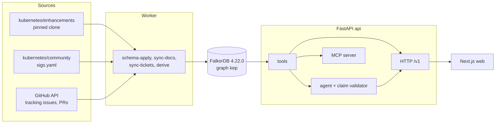

# KEP Brain

KEP Brain audits Kubernetes decision records (KEPs, Kubernetes Enhancement Proposals) for contradictions. It finds KEPs whose `kep.yaml`, tracking issue and replaces/superseded-by data disagree, shows who decided each state and from which evidence, and drafts the fix. Every answer cites a graph node with a public GitHub URL, or the system abstains. On the data pinned below it holds 238 KEPs from sig-node, sig-scheduling and sig-apps and reports 59 findings across 50 KEPs.

Live demo: <to be filled>
Video: <to be filled>

Built for the WeMakeDevs x FalkorDB Graph Hacks hackathon (October 2026).

## Try it in 60 seconds

On the live site:

1. Open `/audit`. The table lists every finding with filters for kind and SIG; the counts come from the API.
2. Click a row. It expands to the two disagreeing values, each with a link to the source file or issue, and the evidence records.
3. Press `d` on the row (or use the draft button) to open the draft fix. It is a ready-to-paste issue body listing every evidence URL. Nothing is posted to GitHub.
4. Follow the KEP link to `/explore/kep/<number>`: facts, status history, who decided each state, and the lineage graph.
5. Open `/` and pick one of the suggested questions (they are the eval set's judge-path questions, served by the API). The answer cites graph nodes or abstains.

The same path against the API, with every value read from the API itself (needs `curl` and `jq`; no key for the first five calls):

```bash
API=http://localhost:8000
curl -s "$API/v1/meta" | jq '.graph'
FINDING=$(curl -s "$API/v1/findings" | jq -r '.items[0].key')
KEP=$(curl -s "$API/v1/findings" | jq -r '.items[0].kep_number')
curl -s "$API/v1/findings/$FINDING" | jq '{kind, a_value, a_url, b_value, b_url}'
curl -s -X POST "$API/v1/tools/draft_stale_doc_issue" -H 'content-type: application/json' \
  -d "{\"finding_key\":\"$FINDING\"}" | jq -r '.rows[0].body'
curl -s "$API/v1/keps/$KEP/decisions" | jq '.items[0]'
QUESTION=$(curl -s "$API/v1/eval/questions" | jq -r '.questions[0].text')
curl -s -X POST "$API/v1/ask" -H 'content-type: application/json' \
  -d "{\"question\":\"$QUESTION\"}" | jq '{answer_markdown, citations, abstained}'
```

The last call needs the LLM key configured on the server and is rate-limited.

## Architecture



## Run it

```bash
cp .env.example .env        # set FALKORDB_PASSWORD (required) and OPENAI_API_KEY (a Groq key)
docker compose up -d falkordb api web
```

Build the graph with the worker, which runs in the api image:

```bash
docker compose run --rm worker all
# or one step: schema-apply | sync-docs | sync-tickets | derive
```

- Web: http://localhost:3000
- API: http://localhost:8000 (`/health`, `/ready`, `/v1/meta`)
- FalkorDB: 127.0.0.1:6380 (browser UI on 127.0.0.1:3001)

Local development:

```bash
cd apps/api && uv sync && uv run pytest -m "not integration"
cd apps/web && pnpm install && pnpm dev
```

## Data sources and pins

| Source | Pin | Used for |
|---|---|---|
| kubernetes/enhancements | `8659e382efab7340d70de52432ee8f3d9979b797` | `kep.yaml`, KEP READMEs, PRR files, git history |
| kubernetes/community | `53c338ecba4a2a9240f6654cca1d6a9dac25c785` | `sigs.yaml` (SIGs, working groups) |
| GitHub API | as of the sync date shown in `/v1/meta` | tracking issues, label and milestone timelines, PRs and reviews |
| FalkorDB | `falkordb/falkordb:v4.22.0` | graph store |

Only public GitHub logins are stored; no email addresses.

## How FalkorDB is used

FalkorDB 4.22.0 is the only store. Everything the UI, the API, the agent and the MCP server show is a Cypher query on it.

| Capability | Where | Why |
|---|---|---|
| `MERGE` upserts in `UNWIND` batches | `apps/api/src/app/db/batch.py`, `ingest/*.py` | The worker can be re-run without duplicating nodes or edges; stale edges are closed or deleted per run |
| `GRAPH.RO_QUERY` on every read path | `apps/api/src/app/db/falkordb.py`, `tools/base.py`, `api/*.py` | Request handlers cannot write to the graph |
| Per-query timeouts | `db/falkordb.py` (`READ_TIMEOUT_MS = 2000`, `WRITE_TIMEOUT_MS = 30000`) | A bad question cannot hold a connection |
| Range indexes on `key` and on filtered properties | `schema/apply.py` | Key lookups and finding filters stay index-backed |
| `UNIQUE` constraints on `key` for every label, `MANDATORY` constraints on required properties | `schema/apply.py` (`GRAPH.CONSTRAINT CREATE`) | Idempotent ingest is enforced by the database, not only by the writer |
| Pattern comprehensions | `api/findings.py`, `api/keps.py`, `tools/t03/audit.py`, `tools/t01/draft_issue.py` | One query returns a KEP with its current issue, owners and evidence as lists |
| Temporal edges (`valid_from`, `valid_to`) | `api/keps.py`, `api/misc.py`, `tools/base.py`, `db/batch.py` | "Current" is `coalesce(r.valid_to, $open) = $open`; history is the same edges without the filter |
| `algo.SPpaths` | `tools/t01/graph_algos.py` (`path_between`) | Shortest explainable connection between two entities, up to 4 hops, both directions |
| One graph per memory id (`select_graph("mem:<ULID>")`) | `memory/store.py`, `db/falkordb.py` | Per-user memory is isolated from the shared `kep` graph and deletable as a unit |
| Unique pattern-comprehension variables | `tools/cypher.py` | Works around a 4.22.0 bug, see "Feedback on FalkorDB" |

## Why a graph, not a vector database

A contradiction is a disagreement between records of the same fact held in different linked entities: the KEP file, its tracking issue, the commits and pull requests that changed its status, and the KEPs it replaces. Finding one means comparing values along edges, which a similarity search over text chunks does not do. "Who decided this state, when, and on what evidence" is a path from a KEP through a status change and a pull request to a person. Temporal edges make "what was true then" a query rather than a reconstruction, and each hop carries a public URL, which is what lets every answer be cited.

## Track coverage

| Track | Feature | Where |
|---|---|---|
| T03 Company Brain | Contradiction audit with both sides and evidence | web `/audit`; API `GET /v1/findings`, `GET /v1/findings/{key}` |
| T03 | KEP page: facts, status history, decisions, lineage | web `/explore/kep/[number]`; API `GET /v1/keps/{number}`, `/history`, `/decisions`, `GET /v1/graph/neighborhood` |
| T03 | Cited question answering with abstention | web `/`; API `POST /v1/ask`, `POST /v1/ask/stream` |
| T01 Agents on connected data | Tool catalog (`path_between`, `rank_people`, `draft_stale_doc_issue`, others) | API `GET /v1/tools`, `POST /v1/tools/{name}`; MCP server `python -m app.mcp` at `/mcp` (read-only tools, bearer token) |
| T01 | Draft fix as an action that never posts | web `/audit` draft dialog; API `POST /v1/tools/draft_stale_doc_issue` |
| T02 Memory | Per-user memory graph and the memory page | web `/memory`; API `GET /v1/memory/me`, `DELETE /v1/memory/me`, header `X-Kep-Memory-Id` |
| T02 | Shared finding memory and freshness agent | `apps/api/src/app/worker/freshness.py`, `worker/coordinate.py`; API `GET /v1/agents/board`; tools `recall_findings`, `recall_memory` |

## Results

Evaluation numbers have not been measured yet. This table will be filled from the eval run and will not contain estimates.

| Metric | Result |
|---|---|
| Answer accuracy on the eval set | not yet measured |
| Citation validity | not yet measured |
| Correct abstention | not yet measured |
| Contradiction recall | not yet measured |

## Feedback on FalkorDB

- In 4.22.0, when two pattern comprehensions in one projection reuse a local variable name (for example `[(p:Person)-[r:APPROVES]->(k) | p]` and `[(p:Person)-[r:PRR_APPROVED]->(k) | p]`), the later one returns an empty list without an error. `tools/cypher.py` renames local variables at import time so each comprehension has unique names.
- Graph names cannot be query parameters. `memory/store.py` validates the id against a ULID pattern before building `mem:<id>`.
- `UNIQUE` constraints need the exact-match index to exist first, so `schema/apply.py` creates indexes, then `UNIQUE`, then `MANDATORY`, and applies `MANDATORY` only when every existing node already satisfies it.
- With a single password (ADR-0004 in `docs/DECISIONS.md`), read-only enforcement relies on the application using `GRAPH.RO_QUERY`, not on database permissions. Per-role ACL users are supported by the settings but not used in development.
- `rank_people` falls back to degree when stored `pagerank` or `betweenness` values are absent; the analytics run that fills them is not part of the current worker.


## Provenance

The design notes in `docs/design` were written on 2026-10-11 to 2026-10-14, which the event rules allow before the start. A generic template was also prepared before the event; it was archived outside the repository, never used and never copied in. The repository's code starts after 2026-10-15 00:01 IST: the first commit in `git log` is "Pre-event notes" and contains documentation only, and the scaffold comes from the public `uv init` and `create-next-app` generators. See ADR-0001 in `docs/DECISIONS.md`.

## AI usage

AI coding assistants are used to draft code under human direction and review. Each use is recorded in `docs/AI_USAGE.md`. At runtime, a Groq-hosted model plans tool calls and writes answers; a claim validator rejects any claim without a graph node behind it.

## License

MIT, see `LICENSE`.
