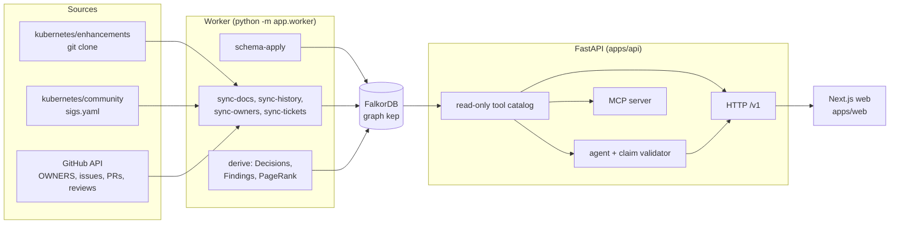

# KEP Brain

A company brain for the Kubernetes enhancement process. It loads KEPs, SIG rosters, tracking issues and pull request history from public GitHub into one FalkorDB graph, works out who decided what and on which evidence, flags records that contradict each other, and answers questions with citations or abstains.

[](https://github.com/akshat-lakhera/kep-brain/actions/workflows/ci.yml)
[](LICENSE)
[](apps/api/pyproject.toml)
[](apps/web/package.json)
[](docker-compose.yml)


## Table of contents

- [What it does](#what-it-does)
- [Screenshots](#screenshots)
- [How it works](#how-it-works)
  - [Architecture](#architecture)
  - [Graph data model](#graph-data-model)
  - [Graph features used](#graph-features-used)
- [Quick start](#quick-start)
- [Development](#development)
- [Configuration](#configuration)
- [Project layout](#project-layout)
- [API overview](#api-overview)
- [Status](#status)
- [Contributing](#contributing)
- [AI assistance](#ai-assistance)
- [License](#license)
- [Acknowledgments](#acknowledgments)

## What it does

A KEP (Kubernetes Enhancement Proposal) is a decision record. Its state lives in several places at once: the `kep.yaml` file, the tracking issue with its labels and milestones, the pull requests that changed the file, and the KEPs it replaces or is replaced by. These records drift apart. KEP Brain puts them in one graph and reads them together.

- **Live ingest from public GitHub.** The worker clones `kubernetes/enhancements` and `kubernetes/community`, reads OWNERS files from `kubernetes/kubernetes` through the GitHub API, and fetches tracking issues, timelines, pull requests and review threads. Every run upserts into the same FalkorDB graph, so re-running is safe.
- **Who decided what, from which evidence.** Every `kep.yaml` revision is diffed field by field. Each status, stage or milestone change becomes a `StatusChange` linked to its commit and pull request. From these, the worker derives `Decision` nodes and attaches the people who approved them and the records that prove it.
- **Contradiction audit.** Five predicates compare a KEP's `kep.yaml` with its tracking issue and its replacement declarations. Each hit is a `Finding` that carries both sides with their public URLs and a lifecycle (`open`, `resolved_upstream`, human verdicts). The audit page can draft an issue body from the evidence. Nothing is ever posted to GitHub.
- **Answers with citations, or abstention.** `POST /v1/ask` runs an agent over a read-only tool catalog. A deterministic validator checks that every claim cites a record returned in that request. If it cannot, the answer is replaced by an abstention. Every citation is a graph node with a public GitHub URL.
- **Explore pages.** Search KEPs, open a KEP with its facts, status history, decisions and lineage graph, and browse SIGs and people.
- **Per-browser memory.** An anonymous memory id (header `X-Kep-Memory-Id`) selects a small per-user graph that can be inspected and deleted as a unit.
- **MCP server.** The same read-only tools are exposed over Streamable HTTP behind a bearer token, so other agents can query the graph.

On 2026-10-17 the running instance reported 238 KEPs, 705 people and 59 findings across 50 KEPs in 39,492 nodes and 127,494 edges, for `sig-node`, `sig-scheduling` and `sig-apps` (`GET /v1/meta`, `GET /v1/findings`; ticket data as of 2026-10-14).

## Screenshots

| Home | Explore |
|---|---|
|  |  |

| KEP detail | Audit |
|---|---|
|  |  |

## How it works

### Architecture



1. **Ingest.** `sync-docs` reads every `kep.yaml`, KEP README and PRR file from the enhancements clone and replays each revision so that state edges get `valid_from` and `valid_to` from commit dates. `sync-history` diffs `kep.yaml` revisions into `StatusChange` nodes and maps commits to the pull requests that merged them. `sync-owners` loads OWNERS files and aliases. `sync-tickets` loads tracking issues, their label and milestone timelines, and the pull requests and review discussion behind status changes.
2. **Graph.** Everything lands in one FalkorDB graph named `kep`. Node and relationship names come from an allow-list (`apps/api/src/app/schema/labels.py`), and `schema-apply` creates the indexes and `UNIQUE` and `MANDATORY` constraints.
3. **Derive.** `derive` turns metadata changes into `Decision` nodes (`status_transition`, `withdrawal`, `stage_graduation`, `milestone_retarget`), adds PRR approval and replacement decisions, links each to the people who decided it (`DECIDED_BY`) and the evidence (`EVIDENCED_BY`), evaluates the five contradiction predicates into `Finding` nodes, and stores PageRank on `Person` nodes.
4. **Serve.** The API reads the graph with `GRAPH.RO_QUERY` only. The web app, the answering agent and the MCP server all go through the same parameterised tool catalog.

### Graph data model

Node labels (`NODE_LABELS` in `labels.py`):

| Group | Labels |
|---|---|
| Organisation | `SIG`, `WorkingGroup`, `Committee`, `Subproject`, `Person`, `Alias`, `OwnersFile` |
| Documents | `KEP`, `Document`, `Section`, `FeatureGate`, `Component`, `Metric`, `Release`, `Label`, `ExternalRef` |
| Activity | `Commit`, `PullRequest`, `Issue`, `Ticket`, `Review`, `Comment`, `StatusChange` |
| Derived | `Decision`, `Finding`, `AnswerCache` |
| Operations | `SyncRun`, `WorkerHeartbeat` |

Relationship types split into two families:

- **State relationships** (`STATE_RELS`) carry a validity interval. Examples: `CHAIRS`, `TECH_LEAD`, `APPROVER`, `REVIEWER`, `MEMBER_OF`, `OWNED_BY`, `AUTHORED`, `APPROVES`, `PRR_APPROVED`, `REPLACES`, `SUPERSEDED_BY`, `GATED_BY`, `ENABLED_IN`, `TARGETS`, `TRACKED_BY`, `LABELED`, `MILESTONED`.
- **Other relationships** (`OTHER_RELS`) describe structure and provenance. Examples: `HAS_DOCUMENT`, `HAS_SECTION`, `NEXT`, `MENTIONS`, `CHANGED`, `HAS_EVENT`, `IN_COMMIT`, `IN_PR`, `PREVIOUS`, `REVERSES`, `DECIDED_BY`, `EVIDENCED_BY`, `FROM_CHANGE`, `OPENED`, `MERGED`, `COMMENTED`, `REPLIES_TO`, `REFERENCES`, `IMPLEMENTS`, `RELATED_KEP`.

KEP statuses are `provisional`, `implementable`, `implemented`, `deferred`, `rejected`, `withdrawn`, `replaced`. Stages are `alpha`, `beta`, `stable`, `deprecated`, `disabled`, `removed`.

Finding kinds (`FINDING_KINDS`):

| Kind | Meaning |
|---|---|
| `active_status_closed_issue` | `kep.yaml` says the KEP is active, but its tracking issue is closed |
| `terminal_status_future_targets` | The KEP is in a terminal status but still targets a future release |
| `one_sided_replacement` | One KEP declares `replaces` or `superseded-by` and the other side does not agree |
| `stage_mismatch` | The stage in `kep.yaml` and the stage label on the issue differ |
| `milestone_mismatch` | The milestone in `kep.yaml` and the milestone on the issue differ |

### Graph features used

| Feature | Where | Why |
|---|---|---|
| Validity intervals on state edges (`valid_from`, `valid_to`) | `db/batch.py`, `ingest/*.py`, `api/*.py` | "Current" is `coalesce(r.valid_to, $open) = $open` with the open sentinel `2100-01-01T00:00:00Z`. History is the same edges without the filter. Edges that disappear from a source are closed, not deleted. |
| `MERGE` upserts in `UNWIND` batches | `db/batch.py` | Deterministic keys make every sync idempotent. |
| `UNIQUE` and `MANDATORY` constraints, range indexes | `schema/apply.py` | The database enforces idempotent ingest and keeps key lookups indexed. |
| `GRAPH.RO_QUERY` with per-query timeouts | `db/falkordb.py` | Request handlers cannot write, and a slow question cannot hold a connection. |
| `algo.pageRank` over `DECIDED_BY` | `ingest/derive.py` (`write_pagerank`) | Stores an influence score on each `Person` at derive time so `rank_people` reads it instead of recomputing. |
| `algo.SPpaths` | `tools/t01/graph_algos.py` (`path_between`) | Shortest explainable connection between two entities. |
| Pattern comprehensions | `api/findings.py`, `api/keps.py`, `tools/` | One query returns a KEP with its issue, owners and evidence as lists. |
| One graph per memory id | `memory/store.py` | Per-user memory is isolated from the shared `kep` graph and deletable as a unit. |

## Quick start

You need Docker with the Compose plugin.

```bash
git clone https://github.com/akshat-lakhera/kep-brain.git
cd kep-brain
cp .env.example .env
```

Edit `.env`. The variables that matter for a first run:

- `FALKORDB_PASSWORD` (required): a long random password.
- `MCP_TOKEN` (required by the `mcp` service): at least 32 random bytes.
- `GITHUB_TOKEN`: a read-only token. Without it the tracking issue and pull request sync hits the unauthenticated GitHub rate limit.
- `LLM_PROVIDER`, `LLM_MODEL` and the matching API key and base URL variables: needed for `POST /v1/ask`. Everything else works without them.
- `SIGS`: the SIG directories in scope. The default is `sig-node,sig-scheduling,sig-apps`.

Start the stack and build the graph:

```bash
docker compose up -d falkordb api web mcp
docker compose run --rm worker all
```

The first `all` run clones the public repositories into the worker volume and takes a while. Later runs fetch and only re-read changed sources. The `worker` service in `docker-compose.yml` runs `schedule --interval-minutes 1440` to keep the graph fresh.

- Web: http://localhost:3000
- API: http://localhost:8000 (`/health`, `/ready`, `/docs`, `/v1/meta`)
- MCP: http://localhost:8765/mcp (bearer `MCP_TOKEN`)
- FalkorDB: `127.0.0.1:6380`, browser UI at http://localhost:3001

Worker commands: `schema-apply`, `sync-docs`, `sync-history`, `sync-owners`, `sync-tickets`, `derive`, `all`, `stats`, `schedule`, `freshness`, `coordinate`. Add `--force` to re-read sources whose commits are unchanged.

## Development

API (Python 3.12, [uv](https://docs.astral.sh/uv/)):

```bash
cd apps/api
uv sync
uv run ruff check .
uv run ruff format --check .
uv run pytest -m "not integration"
```

Integration tests need a running FalkorDB. With the compose `falkordb` service up, set `FALKORDB_HOST=localhost`, `FALKORDB_PORT=6380` and `FALKORDB_PASSWORD` in the environment, then:

```bash
uv run python -m app.worker schema-apply
uv run pytest -m integration -q
```

To run the API outside Docker: `uv run uvicorn app.main:create_app --factory --reload`. It reads the same environment variables.

Web (Next.js 16, [pnpm](https://pnpm.io/)):

```bash
cd apps/web
pnpm install
pnpm dev          # http://localhost:3000, proxies /api/v1/* to API_INTERNAL_URL (default http://localhost:8000)
pnpm lint
pnpm exec tsc --noEmit
pnpm build
```

CI (`.github/workflows/ci.yml`) runs the same commands in four jobs: `api`, `integration` (with a FalkorDB service container), `web` and `compose` (`docker compose config`). A pre-commit config is included.

## Configuration

All settings are read from the environment; `.env.example` lists every one with its default. The important ones:

| Variable | Default | Purpose |
|---|---|---|
| `ENV` | `dev` | `dev`, `test` or `prod` |
| `LOG_LEVEL`, `LOG_FORMAT` | `INFO`, `console` | Logging; `json` for machines |
| `CORS_ORIGINS` | `http://localhost:3000` | Allowed browser origins, comma-separated |
| `PUBLIC_BASE_URL` | `http://localhost:3000` | Public URL of the web app |
| `FALKORDB_HOST`, `FALKORDB_PORT` | `localhost`, `6380` | Compose overrides these to the `falkordb` service |
| `FALKORDB_PASSWORD` | empty | Required |
| `FALKORDB_ACL_MODE` | `single` | `single` (one password) or `aclfile` (per-role users and passwords) |
| `ENHANCEMENTS_REPO_URL`, `COMMUNITY_REPO_URL`, `OWNERS_REPO_URL` | the public Kubernetes repositories | Sources |
| `ENHANCEMENTS_PIN_SHA`, `COMMUNITY_PIN_SHA`, `OWNERS_PIN_SHA` | empty | Pin a reproducible snapshot; empty means the default-branch head |
| `REPO_CACHE_DIR` | `./repo_cache` | Where the worker keeps its clones |
| `SIGS` | `sig-node,sig-scheduling,sig-apps` | SIG directories in scope |
| `GITHUB_TOKEN` | empty | Read-only token for the GitHub API |
| `LLM_PROVIDER`, `LLM_MODEL`, `LLM_MODEL_CHEAP` | see `.env.example` | Provider adapter and models for the answering agent |
| `LLM_DAILY_BUDGET_USD`, `LLM_REQUESTS_PER_MINUTE`, `LLM_MAX_RETRIES`, `LLM_TIMEOUT_SECONDS` | `5`, `25`, `4`, `60` | Spend and pacing limits |
| `FINDINGS_AGENT_ENABLED`, `FINDINGS_AGENT_DAILY_USD` | `true`, `1` | The freshness agent that triages findings |
| `ASK_RATE_LIMIT_PER_10M`, `ASK_DAILY_CAP` | `30`, `150` | Per-client and global limits on `POST /v1/ask` |
| `TRUST_PROXY` | `false` | Honour `X-Forwarded-For` only behind a trusted proxy |
| `MAX_BODY_BYTES` | `65536` | Request body limit |
| `ADMIN_TOKEN` | empty | Protects admin endpoints such as `DELETE /v1/answers/cache` |
| `MCP_TOKEN`, `MCP_PORT` | empty, `8765` | Bearer token and port for the MCP server |

Production deployment on one VM behind Caddy is described in [docs/ops/DEPLOY.md](docs/ops/DEPLOY.md), with the compose override in `deploy/`.

## Project layout

```
apps/
  api/                 FastAPI service, worker and MCP server (uv, Python 3.12)
    src/app/
      agent/           answering loop, provider adapter, claim validator, answer cache
      api/             /v1 routes
      db/              FalkorDB pool, batch writer
      eval/            question set loader
      ingest/          sigs, docs, history, owners, tickets, discussion, findings, derive
      mcp/             MCP server (python -m app.mcp)
      memory/          per-user memory graphs and routes
      schema/          label allow-list and schema-apply
      tools/           read-only tool catalog shared by the agent, the API and MCP
      worker/          CLI (python -m app.worker), scheduler, freshness, coordinate
    tests/
  web/                 Next.js 16 app (pnpm)
    src/app/           pages: /, /explore, /explore/kep/[number], /explore/sig/[key],
                       /explore/person/[login], /audit, /tools, /memory, /eval, /about
    src/components/    UI
    src/lib/           API client, formatting
deploy/                production compose override and Caddy config
docs/                  DECISIONS.md (ADRs), AI_USAGE.md, design/, engineering/, ops/, product/
evals/                 question set and hand-check records read by the API
docker-compose.yml     falkordb, api, worker, mcp, web
.github/               CI workflow, issue and PR templates, dependabot
```

## API overview

All routes are under `/v1` and read the graph only. Interactive docs are at `/docs` when the API is running.

| Method and path | Purpose |
|---|---|
| `GET /v1/meta` | Graph counts, pinned source SHAs, SIGs, releases, LLM status |
| `GET /v1/keps?q=&sig=&status=&limit=` | Search or list KEPs (`q` accepts a number or free text) |
| `GET /v1/keps/{number}` | KEP facts, owners, tracking issue, findings |
| `GET /v1/keps/{number}/history` | Status, stage and milestone changes over time |
| `GET /v1/keps/{number}/decisions` | Derived decisions with deciders and evidence |
| `GET /v1/findings?kind=&sig=&state=` | Findings with a summary by kind and SIG |
| `GET /v1/findings/{key}` | One finding with both sides and evidence |
| `GET /v1/people/{login}` | A person's roles, decisions and activity |
| `GET /v1/sigs`, `GET /v1/sigs/{key}` | SIGs in scope with leadership, KEP and finding counts |
| `GET /v1/changes?since=&sig=&limit=` | What changed since a release |
| `GET /v1/risk?sig=` | Knowledge risk: areas that depend on few people |
| `GET /v1/graph/neighborhood?key=&depth=&limit=` | Nodes and edges around one key, for the lineage graph |
| `GET /v1/tools`, `POST /v1/tools/{name}` | The read-only tool catalog and direct tool calls |
| `POST /v1/ask`, `POST /v1/ask/stream` | Cited answer or abstention; the stream variant uses server-sent events |
| `DELETE /v1/answers/cache` | Clear the answer cache (needs `ADMIN_TOKEN`) |
| `GET /v1/memory/me`, `DELETE /v1/memory/me`, `DELETE /v1/memory/me/facts/{key}`, `DELETE /v1/memory/me/playbooks/{key}` | Per-browser memory, selected by `X-Kep-Memory-Id` |
| `GET /v1/agents/board` | Coordination board for the background agents |
| `GET /v1/sync/status` | Last worker run, step by step |
| `GET /v1/eval/questions`, `GET /v1/eval/latest` | The question set and the latest recorded run |

`GET /health` and `GET /ready` sit outside `/v1`.

The MCP server (`python -m app.mcp`) serves the same tool catalog, minus memory recall and the draft action, plus `get_graph_schema`. Every result is flagged `untrusted_content: true` because graph text comes from public GitHub content.

## Status

- Data scope is the SIGs listed in `SIGS`; the default instance covers `sig-node`, `sig-scheduling` and `sig-apps`.
- Sources are read live from the default branch unless the `*_PIN_SHA` variables pin them. The pins used by the running instance are shown in `GET /v1/meta`.
- Only public GitHub logins are stored. E-mail addresses in `sigs.yaml` are never read into the graph.
- The draft action writes an issue body for a human to paste. The system never writes to GitHub.
- In `single` ACL mode, read-only enforcement relies on `GRAPH.RO_QUERY` in the application. Per-role users are supported through `FALKORDB_ACL_MODE=aclfile`.
- Design decisions are recorded as ADRs in [docs/DECISIONS.md](docs/DECISIONS.md). Open work is tracked in GitHub issues.

## Contributing

Issues and pull requests are welcome. The project has a single maintainer, so small, focused changes are easiest to review.

1. Open an issue first for anything larger than a small fix. Use the bug report or UI suggestion templates.
2. Run the checks listed in [Development](#development) before opening a pull request. The pull request template lists them.
3. Any fact shown to users must come from the graph with a source URL.
4. Record new design decisions as an ADR in `docs/DECISIONS.md`.

## AI assistance

AI coding assistants were used under human review; see [docs/AI_USAGE.md](docs/AI_USAGE.md).

## License

MIT. See [LICENSE](LICENSE).

## Acknowledgments

- [FalkorDB](https://www.falkordb.com/) for the graph database and its graph algorithms.
- The Kubernetes community, whose public enhancement, community and OWNERS records make this possible.
- Built during the WeMakeDevs x FalkorDB Graph Hacks hackathon, October 2026.
