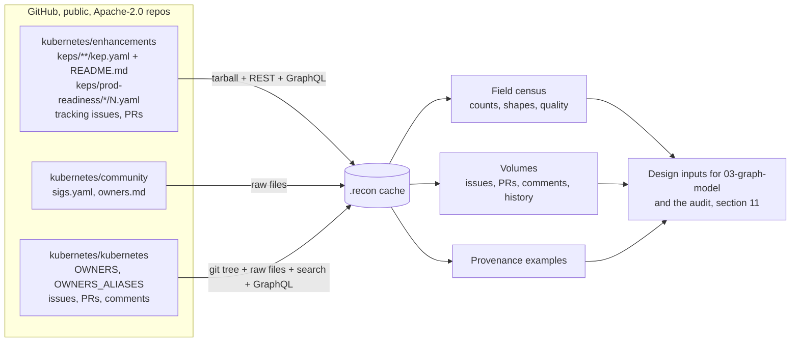
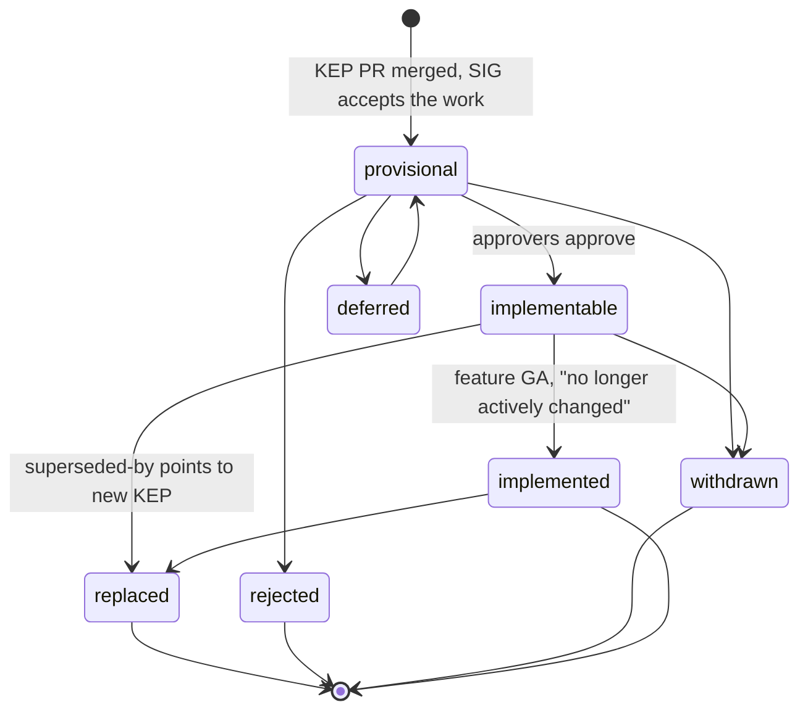

# 01 · Data reconnaissance: Kubernetes as the company for KEP Brain

| | |
|---|---|
| Status | **v2, 2026-10-12 (IST): revised after the 2026-10-12 design review (index in §0).** Pre-kickoff notes only (Rule 8). This recon wrote no source files, manifests or scripts. Its raw downloads live in `D:\kep-brain\.recon\` and are treated as untrusted data. That folder is git-ignored, never committed and outside the "pre-event notes" commit (D14). The v1 header said "No source files … were created under `D:\kep-brain`". That holds for this recon but not for the folder: another workflow branch wrote a template there between 2026-10-11 22:30 and 2026-10-12 08:39 IST (file times). ADR 0023 archives that template before Oct 15 and regenerates the scaffold after 00:01 IST. Nothing in this document depends on it. |
| Authorship and human owner | Drafted by an AI assistant (Fable 5.1 / Claude) from the cache below. **Human owner: H-Data/Eval** (ADR 0026). Before CP1 this person re-runs the counts (D12), opens every §8 chain and §11 demo case at its URL, and hand-writes the normalisation map from §3.5 Q4/Q8 (`06` HUM-14). Until a human ratifies them at HUM-00d, every DECISION here is Proposed (§12). |
| Date of all measurements | 2026-10-11 (IST), between 22:20 and 23:40. §6.4, §8.6 and §11 were re-checked on 2026-10-12 against the GraphQL fetches in `.recon/eval/` (`tracking-issues-three-sigs.json`, fetched 2026-10-12 08:48 IST). GitHub numbers move daily, so re-run the counts on Oct 15 before publishing any figure (D12). |
| Tooling used | `gh` CLI 2.89.0 (authenticated, scopes `repo read:org gist workflow`), `curl`, GNU `tar`, Python 3.11.4 + PyYAML 6.0.3 run with `-I` against the cache. The analysis scripts lived in the session scratchpad, not in the project. |
| Chosen SIGs | **sig-node**, **sig-scheduling**, **sig-apps** (rationale in §7; adopted by ADR 0019). |
| Graph scale | Default (P0) graph: ~21k–25k nodes and ~30k–35k edges. With the P1 switch on (off by default, ADR 0019): ~55k–60k nodes and ~100k edges (§7.3). `03` §16 is the canonical scale table, and `03` is authoritative for every label and edge name. |
| Event rules relied on | Rule 6 (data) and Rule 8 (timing), https://www.wemakedevs.org/hackathons/falkordb/rules. FAQ "Can I continue an existing project?" on the main event page: "You may reuse general libraries, templates, and infrastructure" and "The submission and its main FalkorDB implementation must be new work completed during the event" (https://www.wemakedevs.org/hackathons/falkordb, VERIFIED 2026-10-12 per ADR 0023 and `03` R1). |

How to read the tags used below:

- **VERIFIED** — opened the source (file in the cache, API response, or docs page) and the figure or quote comes from it. URLs are given.
- **OBSERVED** — measured behaviour of a live system today; may change, cause not documented.
- **INFERENCE** — judgement derived from verified facts.
- **UNVERIFIED** — could not be confirmed; do not rely on it without checking.
- **DECISION (veto-able)** — a design choice this recon forces or recommends, with its one-line reason and the alternative.

Cache inventory (everything downloaded, nothing executed):

| Path under `D:\kep-brain\.recon\` | Content |
|---|---|
| `enhancements/enhancements-master.tar.gz`, `enhancements/src/` | kubernetes/enhancements at `master` (tarball dated 2026-10-09, 33,829,075 bytes) |
| `enhancements/kep-census.json` | Field census over all 684 parseable `kep.yaml` files |
| `enhancements/labels.json`, `issue-*-timeline.json`, `issue-1287-events*.json`, `kep1287-commits.txt` | Label set and tracking-issue timelines (REST), commit list for one `kep.yaml` |
| `enhancements/OWNERS_ALIASES` | Enhancements repo aliases (47; the `sig-*-leads` and `prod-readiness-approvers` groups) |
| `community/sigs.yaml`, `sig-list.md`, `owners.md`, `generator-README.md` | kubernetes/community at `main` |
| `kubernetes/tree-master.json`, `OWNERS`, `OWNERS_ALIASES`, `owners-files/` (578 files), `samples/` | kubernetes/kubernetes at `master`: full git tree listing and every non-vendor OWNERS file |
| `search/counts.jsonl`, `search/graphql-history.json` | Every search total and GraphQL history count quoted in §6 |
| `samples/` | 100 most recent sig-labelled issues/PRs per candidate SIG; two 25-PR GraphQL samples |
| `github-docs/*.html` | GitHub docs pages for rate limits, search, issue events/timeline, Terms of Service, Acceptable Use Policies |

Total cache size: 121 MB at 2026-10-11 23:40 IST. `.recon/eval/` was added on 2026-10-12. It holds the tracking-issue GraphQL fetch, the per-KEP timelines, and `contradiction-counts.json`, the snapshot behind §11.

## 0. Review resolution (2026-10-12)

The seven cross-cutting findings of the 2026-10-12 review, and what changed in this document. This table is only an index: the changes themselves are made in the sections it names.

| Finding (severity) | Outcome for `01` | Where |
|---|---|---|
| Pre-event scaffolding coded before the event (blocker) | **Accepted.** The header no longer claims the folder is code-free. The recon cache is kept out of git and out of the first commit (D14). The FAQ clause is quoted as VERIFIED. The decision to archive the template and regenerate it is ADR 0023's, and this document does not change it | header, §10 D14 |
| Rules 11–13: thin human record (blocker) | **Accepted.** Named human owner. §3.5 Q4/Q8 are now labelled as the *evidence* for a map the human writes by hand, not the map itself. New §12 lists the human checks, each producing a concrete `AI_USAGE.md` row, and the CP1 explain-back content for this area | header, §3.5, §12 |
| T02 thin, agents mostly cron roles (major) | **Accepted at the data level.** §11.3 shows from the cache why findings go stale: KEP-4671's stage label was set five times in 16 months (alpha, beta, back to alpha, beta, stable), and REST missed two of those changes. That data is why a second agent rechecks findings and why each row carries `observed_at`. Where `Finding` is stored is an open conflict between `02`/ADR 0024 and `03`, listed in §12.3 | §6.4, §11.3, §12.3 |
| Differentiation from NodeOps weaker than claimed (major) | **Accepted.** §8.3 approver concentration is reframed as ground truth for `who_approves` and `DECIDED_BY` (who decided each state), not an expertise ranking or reviewer routing. §5 OWNERS data stays in scope but off the judge path and out of the video. §11 states the checkable differentiator: 47 KEPs whose own records disagree | §5.2, §8.3, §11 |
| A platform, not one narrow job (major) | **Accepted.** §7.2 no longer plans P1 as the next step: P0 is the default and P1 is an off-by-default switch (ADR 0019). P2 is out of scope. §11 opens with the one-sentence job | §7.2, §11 |
| Agents' input contracts contradict each other (major) | **Accepted.** §7.3 uses `03`'s names; the v1 working labels for metadata commits, label events, tracking issues, enhancements PRs and OWNERS files are retired. The v1 §3.1 decision to read the tree through the API is superseded by ADR 0007's clone. D3 and D11 now match ADR 0007 and `06` B32. The diagram pointer now names `03` as the graph-model document. **Reviewed: rejected because** the review wants every card to cite only a `CONTRACTS.md` plus `03`. `01` holds data facts, not contract values: it has no port, environment variable name, file layout or embedding dimension (checked by grep on 2026-10-12), and HUM-14/ING-02 must cite §3.5 for the normalisation evidence. Cards keep citing `01` for facts | §3.1, §7.3, §9.1, §10 |
| Rule 8 exposure with no schedule fallback (major) | **Accepted.** The fallback (INF-00b) and the separate notes commit are `06`'s and ADR 0023's. For this document: the `.recon` cache is research data, not template code. It never enters git, and every count the README publishes is re-measured from the graph built after kickoff (D12) | §10 D12, D14 |
| *(own correction, `03` §17.1 delta R3)* | **The v1 §8.6 claim that KEP-4671's tracking label contradicts `kep.yaml` is retracted.** It came from a REST timeline that missed two later label events (§6.4). §8.6 now shows the correction, and §11 lists the real demo cases (583, 5832, 5978) | §6.4, §8.6, §11 |

---

## 1. Summary

1. kubernetes/enhancements holds **686 `kep.yaml` files in 22 `sig-*` directories plus `provider-aws`** (684 parse; 2 have invalid dates), each with a `README.md` beside it; the schema is defined in Go at `api/proposal.go` and every field, its real-world shape and its fill rate is tabulated in §3.4. Metadata quality is good but not clean: duplicate KEP numbers, stale path references, free-text placeholders and inconsistent handle casing all exist and are listed in §3.5 so ingestion can normalise them deliberately.
2. kubernetes/community `sigs.yaml` is the authoritative org chart (24 SIGs, 9 WGs, 3 committees; chairs and tech leads with GitHub handle and company; 238 subprojects pointing at 528 OWNERS files). It contains **205 e-mail addresses (145 unique)** plus 32 meeting URLs with embedded passwords; §4.4 fixes the Rule 6 scrub list.
3. kubernetes/kubernetes has **578 non-vendor OWNERS files** (340 carry a `sig/*` label) and one root `OWNERS_ALIASES` with 74 aliases over 154 unique handles; the resolution rules (aliases, parent inheritance, `no_parent_owners`, `filters`, emeritus) are documented in §5 from the official guide.
4. Ticket volume for the chosen SIGs over 24 months is **1,651 issues + 6,859 PRs in k/k** (of which **2,609 reference a KEP tracking issue**), **655 tracking issues** and **1,760 PRs** in kubernetes/enhancements. Comment density is ~6 per item on recent items and ~13 comments + ~5 reviews per merged PR. GitHub limits (verified from docs and the live `rate_limit` endpoint): REST 5,000 req/h, GraphQL 5,000 points/h, search 30 req/min, code search 10 req/min. **OBSERVED: the REST timeline silently omitted label events after 2022 on an old issue while GraphQL returned all 96**, and on #4671 (opened 2024) REST missed the two most recent stage changes, so the gap is not limited to old issues. Status history must be read through GraphQL (§6.4).
5. Five verified provenance chains are documented in §8: replaced KEPs, a status flip with its PR and diff, who approved a SIG's KEPs, cross-SIG participation, and stage transitions on tracking issues. §8.6 retracts v1's sixth chain, a KEP-4671 label-vs-metadata contradiction, which was an artefact of the REST gap.
6. The audit the product performs (§11): on the 2026-10-12 snapshot, the five contradiction predicates of `03` §7.5 flag **47 distinct KEPs** in the three SIGs (39 + 1 + 3 + 8 + 5 hits). The demo cases are KEP-583, KEP-5832 and KEP-5978. None of the hits has been hand-checked yet; H-Data/Eval labels every one before CP7.

---

## 2. Sources and method



Repository facts (VERIFIED via `GET /repos/{owner}/{repo}`, 2026-10-11):

| Repo | Default branch | License (`license.spdx_id`) | Size | Last push | Open issues+PRs |
|---|---|---|---|---|---|
| kubernetes/enhancements | `master` | Apache-2.0 | 61,996 KB | 2026-10-08 | 409 |
| kubernetes/community | `main` | Apache-2.0 | 100,194 KB | 2026-10-11 | 110 |
| kubernetes/kubernetes | `master` | Apache-2.0 | 1,532,188 KB | 2026-10-11 | 3,261 |

All-time search totals for kubernetes/enhancements (VERIFIED, `GET /search/issues`): **1,543 issues, 4,869 PRs**.

Rate-limit snapshot from `GET /rate_limit` at start of work (VERIFIED): `core` 5000/h (used 3), `search` 30/min, `graphql` 5000/h, `code_search` 10/min. The whole recon used fewer than 120 core requests, 45 search requests, 6 code-search requests and 6 GraphQL queries (each cost 1 point).

---

## 3. kubernetes/enhancements

### 3.1 `keps/` directory layout (VERIFIED from the tarball)

Top level of `keps/`: 25 directories and 2 files.

- Files: `keps/OWNERS` (approvers `enhancements-approvers`, reviewers `enhancements-reviewers`, auto-label `kind/kep`), `keps/README.md`.
- Process directories: `NNNN-kep-template/` (template `kep.yaml` + `README.md`), `prod-readiness/` (PRR approvals, §3.9).
- 22 SIG directories: `sig-api-machinery, sig-apps, sig-architecture, sig-auth, sig-autoscaling, sig-cli, sig-cloud-provider, sig-cluster-lifecycle, sig-contributor-experience, sig-docs, sig-etcd, sig-instrumentation, sig-multicluster, sig-network, sig-node, sig-release, sig-scheduling, sig-security, sig-storage, sig-testing, sig-ui, sig-windows`.
- One non-SIG directory: `provider-aws/` (6 KEPs whose `owning-sig` is `sig-cloud-provider`).
- Normal KEP path: `keps/<sig-dir>/<number>-<slug>/{kep.yaml, README.md}`. **37 KEPs sit one level deeper**: `sig-cloud-provider/{azure,providers}/…` and `sig-cluster-lifecycle/{addons,clusterapi,etcdadm,generic,image-builder,kubeadm,wgs}/…`. Ingestion must walk recursively, not glob two levels.
- **8 symbolic links** remain for pre-2019 filenames (`sig-architecture/20190731-production-readiness-review-process.md → 1194-prod-readiness/README.md`, `sig-auth/20190711-external-credential-providers.md`, six under `sig-release/`). GNU tar on Windows could not create them because the account has no symlink privilege; the rest of the extraction completed. DECISION (veto-able; **revised 2026-10-12 to match ADR 0007 and `02` §9**): ingestion reads a full `git clone` in the Linux worker container. `git ls-tree -r` rooted at `keps/` records mode `120000` entries as aliases of their target and never parses them, so the Windows limitation does not apply. Reason: the clone also gives `git log`/`git show` history with zero API calls. Alternative: v1 of this document read the tree through the API. ADR 0007 rejected that because it loses the history.
- Outside `keps/` the repository holds **23 more `kep.yaml` files**, all Go test fixtures under `pkg/*/testdata/` (VERIFIED: 709 `kep.yaml` in the tarball = 686 under `keps/` + 23 under `testdata/`). Rooting the walk at `keps/` keeps them out (`02` §9).
- `keps/README.md` line 64 (VERIFIED): "KEPs are now prefixed with their associated tracking issue number." The directory prefix is the KEP number, which is the issue number in kubernetes/enhancements.

Counts (VERIFIED):

| Item | Count |
|---|---|
| `kep.yaml` files under `keps/` | **686** (684 parse with PyYAML; 2 fail on invalid dates, §3.5) |
| `README.md` under `keps/` | **688** = 686 beside a `kep.yaml` + `keps/README.md` + `keps/prod-readiness/README.md` |
| KEP directories with `kep.yaml` but no `README.md` | 0 |
| `prod-readiness/<sig>/<N>.yaml` files | **481** |
| Labels defined on the repo | 140 (§3.8) |

Sanity on the README count: the `NNNN-kep-template` and `0000-*` process KEPs are included in the 686, which is why "KEP README" counts in §7 use 684 real KEPs minus templates.

### 3.2 The canonical schema (VERIFIED: `api/proposal.go`)

Source: <https://github.com/kubernetes/enhancements/blob/master/api/proposal.go> (cached at `.recon/enhancements/src/api/proposal.go`). The `kepctl`/`kepval` tooling validates `kep.yaml` against this struct.

| YAML key | Go type | Validation tag | Notes |
|---|---|---|---|
| `title` | string | required | |
| `kep-number` | string | required | Go reads it as string; in files it is usually an unquoted int (§3.4) |
| `authors` | []string | required | GitHub IDs, by convention `"@handle"` |
| `owning-sig` | string | required | `sig-abc-def`, matching the kubernetes/community directory name |
| `participating-sigs` | []string | omitempty | special value `kubernetes-wide` is defined in KEP-0000 but used by 0 files today |
| `reviewers` | []string | | `TBD` allowed |
| `approvers` | []string | required | approvers "are the individuals who decide when to move this KEP to the implementable state" (KEP-0000) |
| `editor` | string | omitempty | |
| `creation-date` | string | | `yyyy-mm-dd` |
| `last-updated` | string | | `yyyy-mm-dd` |
| `status` | Status | required | enum below |
| `see-also` | []string | omitempty | "In the form KEP-123" per KEP-0000; in practice paths/URLs (§3.5) |
| `replaces` | []string | omitempty | "Those KEPs should list this KEP in their superseded-by" |
| `superseded-by` | []string | omitempty | "Use of this should be paired with this KEP moving into the Replaced status" |
| `stage` | Stage | | enum below |
| `latest-milestone` | string | | e.g. `"v1.38"` |
| `milestone` | struct | | keys `alpha, beta, stable` and omitempty `deprecated, removed, disabled` |
| `feature-gates` | []{`name`, `components`[]} | | PRR requirement at alpha |
| `disable-supported` | bool | | PRR requirement at alpha |
| `metrics` | []string | | PRR requirement at beta |

Enumerations in the source:

- `Status`: `provisional`, `implementable`, `implemented`, `deferred`, `rejected`, `withdrawn`, `replaced`.
- `Stage`: `alpha`, `beta`, `stable`, `deprecated`, `disabled`, `removed`.

KEP-0000 (`keps/sig-architecture/0000-kep-process/README.md`, VERIFIED) defines the workflow:



The `stage` axis (alpha → beta → stable, or deprecated → disabled → removed) is independent of `status`; `milestone.<stage>` records the release each stage shipped or is targeted for, `latest-milestone` the most recent release with work.

### 3.3 Sampled files

The census parsed all 684 files; these 21 were read individually and are the ones to use as fixtures and in the eval set. Paths are relative to `keps/`.

| Path | Why it matters |
|---|---|
| `sig-node/1287-in-place-update-pod-resources/kep.yaml` | Full modern shape: 6 authors, 9 reviewers, 5 approvers, participating `sig-autoscaling, sig-scheduling`, milestones v1.27/v1.33/v1.35, 2 feature gates, `disable-supported: false`; 28 commits of history (§8.2) |
| `sig-node/4381-dra-structured-parameters/kep.yaml` | `see-also` → withdrawn predecessor `3063`; stable v1.35 |
| `sig-node/3063-dynamic-resource-allocation/kep.yaml` | `status: withdrawn`, stage alpha, latest v1.32 |
| `sig-node/2133-kubelet-credential-providers/kep.yaml` | `replaces` a stale `.md` filename in another SIG; same number as the replaced KEP |
| `sig-cloud-provider/2133-out-of-tree-credential-provider/kep.yaml` | `status: replaced # replaced by keps/sig-node/2133-…` (pointer only in a YAML comment) |
| `sig-node/281-dynamic-kubelet-configuration/kep.yaml` | Invalid `status: removed`, `stage: removed`, `milestone.stable: "never"`, `deprecated: v1.22`, `removed: v1.24` |
| `sig-node/2625-cpumanager-policies-thread-placement/kep.yaml` | `status: imlpemented` (typo) |
| `sig-node/4960-container-stop-signals/kep.yaml` | `kep-number: "4960"` quoted; single-quoted handles with inline comments; `approvers: '@sergeykanzhelev'` in lower case vs `SergeyKanzhelev` elsewhere; `milestone.stable: ""`; lists itself in `participating-sigs` |
| `sig-scheduling/4671-gang-scheduling/kep.yaml` | `replaces: [583-coscheduling, 5832-decouple-podgroup-api]`, `stage: stable`, latest v1.38 while the tracking issue label is `stage/alpha` (§8.6) |
| `sig-scheduling/583-coscheduling/kep.yaml` | `status: provisional`, never marked replaced although 4671 replaces it |
| `sig-scheduling/5832-decouple-podgroup-api/kep.yaml` | `replaces: 583` and `see-also: 4671` (which in turn replaces it) |
| `sig-scheduling/5075-dra-consumable-capacity/kep.yaml` | `creation-date: 2025-30-01` (unparseable); metrics written as PromQL selectors |
| `sig-apps/3329-retriable-and-non-retriable-failures/kep.yaml` | Cross-SIG approval: approvers from apps, scheduling and api-machinery, plus `dchen1107` (node) |
| `sig-apps/3017-pod-healthy-policy-for-pdb/kep.yaml` | participating `sig-node, sig-scheduling`; empty `see-also:` / `replaces:` keys (null) |
| `sig-auth/1205-bound-service-account-tokens/kep.yaml` | `replaces` a KEP in **another SIG** (`sig-storage/2451`) |
| `sig-storage/2451-service-account-token-volumes/kep.yaml` | `status: replaced`, `see-also` → pre-KEP design proposal URL pinned to a commit |
| `sig-auth/3130-kms-observability/kep.yaml` ↔ `sig-auth/3299-kms-v2-improvements/kep.yaml` | Clean replaced/replaces pair inside one SIG |
| `sig-network/536-topology-aware-routing/kep.yaml` ↔ `sig-network/2433-topology-aware-hints/kep.yaml` | Replaced/replaces pair; 2433 also `see-also` three sibling KEPs and a Google Doc |
| `sig-instrumentation/1753-logs-sanitization/kep.yaml` | `status: implemented (alpha)`, `stage: alpha (deprecated)`, `latest-milestone: "1.24"` (no `v`) |
| `sig-api-machinery/4355-coordinated-leader-election/kep.yaml` | `creation-date: 2023-14-05` (unparseable) |
| `NNNN-kep-template/kep.yaml` | Pipe-separated enum placeholders; two real KEPs (`sig-api-machinery/5000-…`, partly `sig-node/5365-…`) still carry template text |

### 3.4 Field census over all 684 parseable `kep.yaml` (VERIFIED)

"Present" counts the key existing; "non-empty" excludes `null`, `""`, `[]`, `{}`. Shapes are PyYAML's view (unquoted `2018-11-06` becomes a `date`, unquoted `1287` an `int`).

| Field | Present | % | Non-empty | Observed shapes |
|---|---:|---:|---:|---|
| `title` | 684 | 100 | 684 | str |
| `kep-number` | 684 | 100 | 684 | int 674, str 10 (`"4960"`, `"563"`, `NNNN`, …) |
| `authors` | 684 | 100 | 684 | list of str (`"@handle"`, occasionally bare handle) |
| `owning-sig` | 684 | 100 | 684 | str, 23 distinct values (incl. template `sig-xyz`) |
| `status` | 684 | 100 | 684 | str, 12 distinct values (7 valid) |
| `approvers` | 684 | 100 | 683 | list of str; 1 empty list; `TBD` occurs |
| `creation-date` | 681 | 99.6 | 681 | date 631, str 50 (quoted) |
| `reviewers` | 680 | 99.4 | 674 | list of str; null 5; empty 1 |
| `latest-milestone` | 638 | 93.3 | 634 | str; 99 files carry the placeholder `"0.0"`; `v1.19` vs `1.19` both occur; `TBD` once |
| `stage` | 636 | 93.0 | 633 | str; 9 distinct values (6 valid) |
| `participating-sigs` | 542 | 79.2 | 420 | list of str 420; null 80; empty 42 |
| `milestone` | 515 | 75.3 | 508 | map: `{alpha,beta,stable}` 370, `{alpha}` 37, `{alpha,beta}` 33, `{stable}` 31, `{beta,stable}` 21, `{beta}` 6, `{deprecated}` 4, `{alpha,stable}` 3, 3 variants with `deprecated/removed/disabled`, empty 1, null 6 |
| `disable-supported` | 450 | 65.8 | 450 | bool |
| `feature-gates` | 446 | 65.2 | 394 | list of `{name, components[]}` 387; `{name}` only 3; mixed 4; null 22; empty 30 |
| `see-also` | 417 | 61.0 | 290 | list of str (paths, URLs, `n/a`); null 90; empty 37 |
| `metrics` | 375 | 54.8 | 248 | list of str 246; 2 lists containing null; null 64; empty 63 |
| `replaces` | 260 | 38.0 | 46 | list of str 46 (only ~20 are KEP paths); null 140; empty 74 |
| `last-updated` | 241 | 35.2 | 241 | date 227, str 14 |
| `editor` | 157 | 23.0 | 153 | str; null 4 |
| `superseded-by` | 56 | 8.2 | 13 | list of str 13 (11 are `n/a`; 2 real); null 43 |
| `prr-approvers` | **0** | 0 | 0 | Removed from `kep.yaml` in 2022 (commit `313ad8b59c`, "Cleanup prr-approvers from kep.yaml for which corresponding prod-readiness file already exists"); PRR approvers now live in `keps/prod-readiness/<sig>/<N>.yaml` (§3.9) |
| `name` | 4 | 0.6 | 4 | stray tooling field |
| `id` | 1 | 0.1 | 1 | stray tooling field |

Nested keys: `milestone` subkeys alpha 445, beta 431, stable 426, deprecated 7, removed 2, disabled 1. `feature-gates[].name` 480 entries, `.components` 469.

Value distributions:

- `status`: implemented 301, implementable 295, provisional 61, withdrawn 11, replaced 6, rejected 3, deferred 1; invalid: template pipe-string 2, `superseded` 1 (`sig-api-machinery/4153`), `implemented (alpha)` 1, `imlpemented` 1, `removed` 1.
- `stage`: stable 365, alpha 152, beta 106, absent/null 51, deprecated 4, disabled 2; invalid: pipe-string 2, `alpha (deprecated)` 1, `removed` 1.
- `latest-milestone` top values: `"0.0"` 99, v1.38 88, absent 49, v1.37 49, v1.24 34, v1.36 34, v1.35 27, v1.34 26, v1.33 24, v1.27 23, v1.22 20, v1.30 19. Of the 99 `"0.0"` files, 37 are `implementable`, 4 `implemented`, 1 `provisional` (checked on the 42 double-quoted instances; the remainder use another quoting form).
- People: 752 distinct handles across authors+reviewers+approvers repo-wide (case-sensitive, `@` stripped); 312 across the three chosen SIGs after lower-casing.

### 3.5 Data-quality findings that drive ingestion rules (VERIFIED, each with a file)

| # | Finding | Evidence | DECISION (veto-able) |
|---|---|---|---|
| Q1 | `kep-number` is not unique | `2133` exists in `sig-node/` and `sig-cloud-provider/`; `0`/`0000` is used by 4 process KEPs | KEP node key = repository path (`keps/<sig-dir>/<dir>`); `kep-number` is an indexed property. Alternative: number + owning-sig composite, which breaks on 2133 (same number, different SIGs, same feature). |
| Q2 | Directory prefix ≠ `kep-number` | `sig-network/0752-endpointslices` (752), `sig-node/2043-pod-resource-concrete-assigments` has `kep-number: 1884` | Store both; tracking issue = `kep-number`, never the directory prefix. |
| Q3 | `owning-sig` ≠ directory | 10 files: all 6 `provider-aws/*` (owning `sig-cloud-provider`), `sig-cloud-provider/2392` (owning `sig-api-machinery`), `sig-cluster-lifecycle/kubeadm/995` (`sig-windows`), `sig-scheduling/986` (`sig-api-machinery`), template | `OWNED_BY` comes from `owning-sig`; directory is a property. |
| Q4 | Invalid enum values | §3.4 lists 5 bad statuses, 4 bad stages | Normalise with an explicit map (`imlpemented→implemented`, `superseded→replaced`, `removed→(status implemented, stage removed)`, `implemented (alpha)→implemented`), keep the raw string as `status_raw`, and flag the KEP `metadata_invalid=true`. **This row is the evidence; the map itself is hand-written and unit-tested by H-Data/Eval (`06` HUM-14, ADR 0026)**, and it covers the rest of the census values too. |
| Q5 | Unparseable dates | `4355`: `2023-14-05`; `5075`: `2025-30-01`; 50 files quote the date (string) | Parse `creation-date`/`last-updated` with a tolerant parser (try `yyyy-mm-dd`, then `yyyy-dd-mm`), store ISO string or null plus `date_raw`. |
| Q6 | Handle casing and `@` | `'@sergeykanzhelev'` vs `"@SergeyKanzhelev"`; `patricklang`/`PatrickLang`; `directxman12`/`DirectXMan12` | Person key = lower-cased GitHub login without `@` (GitHub logins are case-insensitive); display the canonical casing from the API when fetched. |
| Q7 | `participating-sigs` noise | 36 node KEPs list `sig-node` itself; values `TBD` (`sig-node/2008`), `committee-security-response` (`sig-network/5707`), `Kubelet garbage collection WG` (`sig-node/4216`) | Drop self-references; accept `sig-*`, `wg-*`, `committee-*` only; everything else → `participating_raw` property. |
| Q8 | `see-also`/`replaces`/`superseded-by` are free text | Shapes seen: `/keps/sig-x/NNNN-slug`, `keps/sig-x/NNNN-slug` (no slash), `/keps/sig-x/20191004-old-name.md`, `"/keps/sig-cli/993-…/README.md"`, bare `"6090"`, `KEP-3`, Google Docs URLs, `kubernetes/community/pull/N`, `design-proposals-archive` URLs, `n/a`, `none`, `N/A`, `TBD`, template path `/keps/sig-ccc/3456-replaced-kep` (in two real KEPs) | Resolve in order: path → exact dir; path with old filename → the KEP whose README is the symlink target or whose number matches; bare digits → `kep-number`; otherwise create an `ExternalRef` node with the URL. Never drop the raw string. **The resolution order is hand-written by H-Data/Eval with one unit case per shape in this row (HUM-14).** |
| Q9 | `replaces` without reciprocal `superseded-by` | 46 `replaces` entries vs 2 real `superseded-by`; `583-coscheduling` still `provisional` though replaced by 4671 | The graph derives the inverse edge (`derived = true`). A one-sided declaration is a finding of kind `one_sided_replacement` (`03` §7.5; 3 hits in the three SIGs, §11). |
| Q10 | Placeholder milestones | `latest-milestone: "0.0"` ×99; `milestone.stable: "never"`, `"TBD"`, `""` | Treat `0.0`, `TBD`, `never`, `""` as null; keep raw. |
| Q11 | Template text in real KEPs | `sig-api-machinery/5000-…` (status/stage pipe strings), `sig-node/5365-…` (`replaces: /keps/sig-ccc/3456-replaced-kep`) | Covered by Q4 and Q8; also flag `metadata_invalid`. |
| Q12 | Case-insensitive filesystem trap | On this Windows host, `kubernetes/OWNERS` (file) collided with a planned `owners/` directory | Cache layout uses distinct names (`owners-files/`); the ingest container runs on Linux, but tests on the host must not rely on case-only differences. |

### 3.6 KEPs per `owning-sig` (VERIFIED, n=684)

| owning-sig | KEPs | with `participating-sigs` | with `milestone` map | with `feature-gates` | PRR files | implemented / implementable / provisional / other |
|---|---:|---:|---:|---:|---:|---|
| sig-node | **139** | 83 | 129 | 116 | 129 | 51 / 82 / 2 / 4 |
| sig-api-machinery | 86 | 49 | 57 | 48 | 55 | 35 / 35 / 11 / 5 |
| sig-storage | 69 | 56 | 54 | 48 | 52 | 37 / 30 / 0 / 2 |
| sig-network | 62 | 24 | 58 | 39 | — | 47 / 10 / 2 / 3 |
| sig-scheduling | **58** | 36 | 50 | 46 | 51 | 18 / 37 / 3 / 0 |
| sig-auth | 36 | 24 | 30 | 26 | 28 | 23 / 9 / 1 / 3 |
| sig-apps | **35** | 18 | 32 | 32 | 32 | 19 / 14 / 2 / 0 |
| sig-cli | 35 | 25 | 20 | 5 | — | 16 / 12 / 5 / 2 |
| sig-cloud-provider | 31 | — | — | — | — | — |
| sig-cluster-lifecycle | 28 | 15 | 4 | 2 | — | 5 / 14 / 8 / 1 |
| sig-instrumentation | 20 | 17 | 17 | 8 | — | 9 / 8 / 2 / 1 |
| sig-architecture | 17 | 12 | 9 | 1 | — | 11 / 3 / 2 / 1 |
| sig-windows | 15 | 13 | 10 | 7 | — | 7 / 7 / 0 / 1 |
| sig-release | 15 | 13 | 8 | 0 | — | 4 / 7 / 4 / 0 |
| sig-autoscaling | 10 | 2 | 8 | 7 | — | 5 / 5 / 0 / 0 |
| sig-testing | 9 | — | — | — | — | — |
| sig-etcd | 5 | — | — | — | — | — |
| sig-multicluster | 5 | 3 | 4 | 0 | — | 0 / 2 / 2 / 1 |
| sig-contributor-experience | 3 | — | — | — | — | — |
| sig-security | 3 | — | — | — | — | — |
| sig-docs | 1 | — | — | — | — | — |
| sig-ui | 1 | — | — | — | — | — |
| sig-xyz (template) | 1 | — | — | — | — | — |

PRR file counts come from `keps/prod-readiness/<sig>/` (481 total). Cells marked — were not broken out for SIGs outside the candidate set; `kep-census.json` has every SIG.

### 3.7 Cross-SIG structure (VERIFIED)

420 KEPs declare `participating-sigs`. Most frequent (owning → participating) pairs, excluding self-references: `sig-api-machinery→sig-scalability` 14, `sig-node→sig-scheduling` 14, `sig-node→sig-auth` 14, `sig-scheduling→sig-node` 14, `sig-storage→sig-node` 13, `sig-api-machinery→sig-architecture` 10, `sig-storage→sig-cluster-lifecycle` 10, `sig-node→sig-api-machinery` 9, `sig-scheduling→sig-apps` 9, `sig-apps→sig-scheduling` 8, `sig-network→sig-node` 8, `sig-node→sig-autoscaling` 8, `sig-storage→sig-auth` 8, `sig-windows→sig-node` 8.

How often each SIG is *named as participant* by other SIGs' KEPs: sig-node 102, sig-api-machinery 70, sig-auth 52, sig-scheduling 46, sig-storage 43, sig-architecture 36, sig-cluster-lifecycle 33, sig-cli 32, sig-network 29, sig-apps 27.

Cross-KEP references: 46 `replaces`, 13 `superseded-by`, 290 `see-also` lists. Within the chosen SIGs there are **200 KEP-to-KEP path references**, 5 of which point outside the three SIGs. Only 6 KEPs carry `status: replaced` (`sig-auth/3130`, `sig-cloud-provider/2133`, `sig-cluster-lifecycle/kubeadm/1177`, `sig-multicluster/5339`, `sig-network/536`, `sig-storage/2451`); the other side of most replacements is declared only by the successor (Q9).

The DRA (Dynamic Resource Allocation) family is the richest cross-SIG cluster for the demo: 7 directories under `sig-node/` (`3063, 3695, 4381, 5304, 5677, 5945, 6072`) and 14 under `sig-scheduling/` (`4815, 4816, 5004, 5027, 5055, 5075, 5234, 5491, 5517, 5690, 5941, 5981, 6080, 6406`), linked by `see-also`, shared reviewers (`pohly`, `johnbelamaric`, `dom4ha`) and a withdrawn predecessor.

### 3.8 Tracking issues and labels (VERIFIED)

- Every KEP has a tracking issue in kubernetes/enhancements whose number is the KEP number (`keps/README.md` line 64; confirmed for 1287, 3063, 4381, 4671).
- Repository labels (140): `stage/alpha`, `stage/beta`, `stage/stable`; `tracked/yes`, `tracked/no`, `tracked/out-of-tree`; `lead-opted-in`; 26 `sig/*`; 21 `wg/*`; `kind/kep`, `kind/feature`, `kind/api-change`, …; `lifecycle/{active,frozen,rotten,stale}`; `priority/*`. There is no `status/*` label: **KEP status lives only in `kep.yaml`**, release-cycle tracking lives on the issue.
- Tracking issues per SIG label (all time, search): sig/node **380**, sig/api-machinery 177, sig/storage 175, sig/scheduling **165**, sig/apps **110**, sig/auth 96. Multi-labelled: node+scheduling 40, scheduling+apps 23, node+apps 19.
- Recent sig/node tracking-issue sample (24 issues created since late 2026-09): labels `stage/alpha` 11, `lead-opted-in` 11, `tracked/yes` 8, `wg/node-lifecycle` 6; milestone `v1.38` on 8; comments mean 6.6, median 6.5, max 14. Old issues are much deeper: #1287 has 301 comments, #3063 167, #4671 155, #4381 128.
- Cross-references on tracking issues (REST timeline `cross-referenced` events): #1287 109 (67 from PRs; 35 from kubernetes/kubernetes, 29 from kubernetes/enhancements, 12 from kubernetes/website, 8 from kubernetes/autoscaler), #4381 71, #4671 84, #3063 42. These are the implementation PRs and docs PRs for free.
- Label history is written mainly by `k8s-ci-robot` (release team automation) and release-team members; the pattern per cycle is `milestoned vX.Y` → `lead-opted-in` → `tracked/yes` → (`demilestoned` when the feature slips) — a clean, machine-readable "did this ship in the release it targeted" signal.

### 3.9 Production-readiness approvals (VERIFIED)

`keps/prod-readiness/<sig>/<kep-number>.yaml`, 481 files; schema observed on every file opened:

```yaml
kep-number: 1287
alpha:
  approver: "@ehashman"
beta:
  approver: "@jpbetz"
stable:
  approver: "@jpbetz"
```

`keps/prod-readiness/README.md` states PRRs "are done by the Production Readiness subproject of SIG Architecture". The approver pool is the `prod-readiness-approvers` alias in the repo's `OWNERS_ALIASES` (today `deads2k, johnbelamaric, jpbetz, soltysh, wojtek-t, kannon92`). Counts for the chosen SIGs: sig-node 129, sig-scheduling 51, sig-apps 32 files. This is a second, independent "who approved what, at which stage" source, and the approvers are deliberately *outside* the owning SIG.

### 3.10 History depth (VERIFIED, GraphQL `history(path:…).totalCount` on `master`)

| Path | Commits |
|---|---:|
| whole repo | 11,787 |
| `keps/sig-node` | 2,291 |
| `keps/sig-scheduling` | 844 |
| `keps/sig-apps` | 381 |
| `keps/prod-readiness/sig-node` / `sig-scheduling` / `sig-apps` | 478 / 164 / 121 |
| `keps/sig-node/1287-…/kep.yaml` | 28 |
| `keps/sig-scheduling/4671-gang-scheduling/kep.yaml` | 11 |

`GET /repos/{r}/commits?path=<kep.yaml>` lists the commits that touched one metadata file, and `GET /repos/{r}/commits/{sha}/pulls` returns the merged PR for each (verified on 4 commits of KEP-1287, §8.2). INFERENCE: ~8–12 `kep.yaml` commits per KEP → roughly 2,000–2,800 metadata commits for the three SIGs, i.e. the entire status/stage/milestone history is reconstructable from ~2.5k cheap REST calls or a few hundred GraphQL calls. **Superseded 2026-10-12 (ADR 0007, D3):** the worker reads this history with `git log`/`git show` on a full clone at zero API cost, and only commit → PR lookups that lack a merge subject go to GraphQL.

### 3.11 README structure (VERIFIED, chosen SIGs)

| Section present in README | sig-node (139) | sig-scheduling (60 dirs) | sig-apps (35) |
|---|---:|---:|---:|
| `## Summary` | 139 | 59 | 35 |
| `## Motivation` | 137 | 59 | 35 |
| `## Proposal` | 137 | 57 | 35 |
| `## Design Details` | 130 | 55 | 30 |
| `### Graduation Criteria` | 131 | 55 | 30 |
| `### Upgrade / Downgrade Strategy` | 125 | 44 | 27 |
| `### Version Skew Strategy` | 126 | 45 | 28 |
| `## Production Readiness Review Questionnaire` | 129 | 51 | 32 |
| `## Implementation History` | 137 | 58 | 35 |
| `## Drawbacks` | 119 | 44 | 28 |
| `## Alternatives` | 122 | 48 | 30 |

Heading counts: `##` 1,346 / 546 / 330 and `###` 2,649 / 1,053 / 631 (node / scheduling / apps). Sizes: median README 32 KB (node), 39 KB (scheduling), 32 KB (apps); max 151 KB / 201 KB / 116 KB; totals 5.9 MB / 2.8 MB / 1.3 MB. `## Implementation History` sections contain dated bullets (400 / 142 / 166) and explicit PR links (126 / 29 / 75) — e.g. KEP-1287's history runs from "2018-11-06 initial KEP draft" to "2025-10-15 Update in-place pod resize for GA" with per-release change lists. DECISION (veto-able): chunk READMEs at `##` boundaries (2,222 sections for the three SIGs) and split a section further at `###` only when it exceeds ~6 KB; alternative is uniform `###` chunking (6,555 sections), which fragments the PRR questionnaire into near-empty answers.

---

## 4. kubernetes/community `sigs.yaml`

### 4.1 Authority and generation (VERIFIED)

`generator/README.md`: "The authoritative source for SIG information is the `sigs.yaml` file in the project root. All updates must be done there." `sig-list.md` and each `sig-*/README.md` are generated from it by `generator/app.go`. URL: <https://github.com/kubernetes/community/blob/master/sigs.yaml> (GitHub redirects `master` to `main`).

### 4.2 Schema (VERIFIED from the 4,237-line file)

Top-level keys and sizes: `sigs` 24, `workinggroups` 9, `usergroups` 0, `committees` 3, `gb_rep` 4.

Every one of the 24 SIG entries has exactly these 9 keys: `dir`, `name`, `mission_statement`, `charter_link`, `label`, `leadership`, `meetings`, `contact`, `subprojects`.

| Key | Shape | Notes |
|---|---|---|
| `dir` | `sig-node` | matches `keps/<dir>` and `owning-sig` |
| `name` | `Node` | |
| `mission_statement` | multi-line string | |
| `charter_link` | `charter.md` (relative to `<dir>/`) | |
| `label` | `node` | GitHub label is `sig/<label>` on all kubernetes repos |
| `leadership.chairs[]` / `tech_leads[]` / `emeritus_leads[]` | `{github, name, company?, email?}` | 208 leader entries across SIGs: `github` 208, `name` 208, `email` 118, `company` 115. Roles present: chairs 24/24, tech_leads 20/24, emeritus_leads 20/24 |
| `meetings[]` | `{description, day, time, tz, frequency, url?, archive_url?, recordings_url?, calendar_url?}` | 59 meetings; 32 `url` values embed `pwd=` |
| `contact` | `{slack, mailing_list, teams[]{name, description}, liaison{github, name}, private_mailing_list?}` | `teams` are GitHub teams (e.g. `sig-node-api-reviews`, `sig-node-pr-reviews`), `liaison` is the Steering liaison |
| `subprojects[]` | `{name, owners[], description?, contact?, meetings?, leads[]?}` | 238 subprojects, **528 `owners` URLs** to raw OWNERS files: kubernetes/kubernetes 159, kubernetes/community 16, kubernetes/test-infra 6, kubernetes/website 5, many `kubernetes-sigs/*` repos |

Companies among leaders: Google 29, Red Hat 25, Microsoft 10, Independent 8, VMware 5, Defense Unicorns 4, Amazon 3, …; 93 entries have no `company`.

Chosen SIGs:

| SIG | label | chairs | tech leads | emeritus | subprojects | OWNERS refs | meetings | Slack |
|---|---|---|---|---|---|---|---|---|
| sig-node | `node` | SergeyKanzhelev (Google), haircommander (Red Hat), mrunalp (Red Hat) | dchen1107 (Google), derekwaynecarr (Red Hat), mrunalp | 0 | 17 (`kubelet`, `cri-api`, `node-feature-discovery`, `resource-management`, `dra-driver-*`, …) | 42 | 2 | `#sig-node` |
| sig-scheduling | `scheduling` | macsko (Google), sanposhiho (Independent) | dom4ha (Google), sanposhiho | 5 | 10 (`scheduler`, `kueue`, `descheduler`, `kwok`, `scheduler-plugins`, …) | 11 | 4 | `#sig-scheduling` |
| sig-apps | `apps` | janetkuo (Google), kow3ns (Snowflake), soltysh (Defense Unicorns) | same three | 2 | 9 (`workloads-api`, `kjob`, `kompose`, `agent-sandbox`, …) | 35 | 2 | `#sig-apps` |

Note the overlap with KEP approvers: the sig-node tech leads are the top three KEP approvers of sig-node (§8.3); soltysh is sig-apps chair, sig-cli tech lead and a PRR approver.

### 4.3 Working groups and committees

`workinggroups` (9) and `committees` (3) share the leadership/contact/meetings shape; WGs additionally list `stakeholder_sigs`. The enhancements label set has 21 `wg/*` labels (e.g. `wg/batch`, `wg/device-management`, `wg/workload-aware-scheduling`) that appear on tracking issues in the chosen SIGs, so WG nodes earn their place.

### 4.4 Personal data in the file and the Rule 6 handling (VERIFIED locations)

E-mail-like strings: **205 occurrences, 145 unique**, by location: `sigs.leadership.chairs.email` 60, `sigs.leadership.tech_leads.email` 55, `workinggroups.leadership.chairs.email` 35, `sigs.subprojects.leads.email` 23, `committees.leadership.chairs.email` 22, `sigs.leadership.emeritus_leads.email` 3, `committees.contact.private_mailing_list` 3, `sigs.contact.private_mailing_list` 1 (sig-release; sig-k8s-infra also has the key), `gb_rep.email` 1, one inside a `mission_statement` and one in a `calendar_url`. Domains: gmail.com 83, google.com 40, redhat.com 25, microsoft.com 7, …

DECISION (veto-able): the ingester drops every `email` key, every `private_mailing_list`, and every meeting `url` (the Zoom links carry passwords; the `archive_url`/`recordings_url` are public and kept), and runs an e-mail regex over `mission_statement` and all free text. GitHub login, display name and company are kept because they are the published org chart; display name is the only field a reviewer could call "personal", so it is behind a single config switch for easy removal. Alternative: keep logins only — cheaper to defend but makes "who is X" answers read like usernames.

---

## 5. kubernetes/kubernetes `OWNERS` and `OWNERS_ALIASES`

### 5.1 Format (VERIFIED: `contributors/guide/owners.md`, <https://go.k8s.io/owners>)

An `OWNERS` file is YAML with these keys:

- `approvers`: GitHub usernames or aliases that can `/approve`.
- `reviewers`: usernames or aliases that are "good candidates to `/lgtm`".
- `emeritus_approvers`: usernames formerly in `approvers`; "can no longer approve code".
- `labels`: GitHub labels auto-applied to PRs touching the directory (e.g. `sig/node`, `area/kubelet`).
- `options.no_parent_owners`: default false; if true, parent `OWNERS` files are excluded.
- `filters`: a map of Go regular expressions to simple OWNERS configurations; "If you set `filters` you must not set a simple OWNERS configuration outside of `filters`" (except `options`).

`OWNERS_ALIASES` is a single root file: `aliases: {alias-name: [usernames]}`. Resolution rules (from the guide): aliases expand to their member lists; approval for a changed file requires one approver from *each* OWNERS file on the path from the file up to the root unless `no_parent_owners` stops inheritance; `filters` pick the block whose regex matches the changed path; emeritus members are not approvers.

Observed examples:

```yaml
# pkg/kubelet/OWNERS
approvers: [sig-node-approvers]          # alias
emeritus_approvers: [dashpole, vishh]
reviewers: [sig-node-reviewers]
labels: [area/kubelet, sig/node]
```

```yaml
# pkg/scheduler/OWNERS
approvers: [sig-scheduling-maintainers]
reviewers: [sig-scheduling]
labels: [sig/scheduling]
```

The root `OWNERS` uses `filters` with `".*"`, `"go\\.(mod|sum|work|work\\.sum)$"` and `"metrics\\.go$"` blocks, including `required_reviewers` and nine `emeritus_approvers` (`bgrant0607, brendandburns, dchen1107, jbeda, lavalamp, liggitt, smarterclayton, thockin, wojtek-t`).

### 5.2 Counts (VERIFIED)

- Git tree of `master` (`GET /repos/kubernetes/kubernetes/git/trees/master?recursive=1`): 37,517 entries, `truncated: false`. Blobs named `OWNERS`: **591** (578 outside `vendor/`; 193 of those under `staging/`). `OWNERS_ALIASES`: 2 (root, and one vendored copy).
- All 578 non-vendor OWNERS files were downloaded and parsed: 0 parse failures; 8 use `filters`; 57 set `no_parent_owners: true`; 142 list `emeritus_approvers`.
- Labels: 340 files carry at least one `sig/*` label. Per SIG: sig/auth 75, sig/api-machinery 48, sig/apps **39**, sig/node **38**, sig/network 31, sig/instrumentation 27, sig/storage 21, sig/scheduling **18**, sig/testing 11, sig/cli 9, sig/cloud-provider 7, sig/autoscaling 6, sig/release 5, sig/etcd 5, sig/cluster-lifecycle 5, sig/architecture 5, sig/windows 4, sig/scalability 1, sig/contributor-experience 1.
- References inside approver/reviewer lists: **659 alias references** (66 distinct aliases) and **1,793 direct handle references** (151 distinct handles). Most-used aliases: `api-approvers` 60, `api-reviewers` 44, `sig-node-reviewers` 33, `sig-node-approvers` 28, `sig-instrumentation-reviewers` 27, `sig-network-reviewers` 24, `sig-apps-reviewers` 22, `sig-apps-approvers` 21.
- Root `OWNERS_ALIASES`: **74 aliases, 449 member entries, 154 unique handles**. Largest: `feature-approvers` 45, `sig-node-reviewers` 30, `api-reviewers` 24, `sig-scheduling` 14, `sig-storage-reviewers` 11, `sig-node-approvers` 9. 63 aliases are `sig-*` prefixed, typically `<sig>-approvers`/`<sig>-reviewers` plus `<sig>-api-approvers`/`-api-reviewers` and subproject-level aliases for sig-auth.
- kubernetes/enhancements has its own `OWNERS_ALIASES` (47 aliases): `sig-<name>-leads` for every SIG (e.g. `sig-node-leads: SergeyKanzhelev, dchen1107, derekwaynecarr, mrunalp, haircommander`), `prod-readiness-approvers`, `enhancements-approvers/reviewers`, `committee-*`, `wg-*-leads`. These are the people who approve KEP PRs.

Sample OWNERS paths for the chosen SIGs (from labels): sig/node → `cmd/kubelet`, `pkg/kubelet` (+ 12 subdirs), `pkg/controller/nodelifecycle`, `pkg/controller/resourceclaim`, `pkg/registry/core/{node,pod,podtemplate}`, `pkg/scheduler/framework/plugins/dynamicresources`; sig/scheduling → `cmd/kube-scheduler`, `pkg/scheduler`, `pkg/apis/scheduling`, `pkg/controller/{tainteviction,devicetainteviction}`, `staging/src/k8s.io/{kube-scheduler,component-helpers/scheduling}`; sig/apps → `pkg/apis/{apps,batch,core,policy}`, `pkg/controller/{cronjob,daemon,deployment,disruption,job,replicaset,statefulset,…}`.

DECISION (veto-able): ingest only the 95 OWNERS files labelled with a chosen SIG plus the 74 root aliases (not all 578), and the 47 enhancements aliases. Each OWNERS file is a `Document {kind: owners}` with secondary label `OwnersFile`, keyed `<repo>:<path>` (`03` §3.1). `APPROVER`/`REVIEWER` edges point to `Person` or `Alias` nodes, and `MEMBER_OF` is expanded at query time. Alternative: pre-expand aliases into direct person edges, which loses the "approved via alias X" provenance judges can check.

Why this data stays in scope after the review (DECISION, veto-able): the enhancements aliases are needed for the audit itself. Ten sig-node `kep.yaml` files list the alias string `sig-node-tech-leads` as an approver, and only enhancements `OWNERS_ALIASES` line 228 turns that string into people (VERIFIED by grep in the cache). The k/k OWNERS files answer the T03 focus point "who owns what" for ≈96 cheap REST contents requests. **Directory ownership stays off the judge path and out of the video** (ADR 0025, `02` §1): it is the input to reviewer routing, which NodeOps already does. Alternative: drop the k/k OWNERS files. That saves about a minute of loading and loses the only ownership source below the SIG level.

---

## 6. Issues, PRs and comments

### 6.1 Volumes for six candidate SIGs (VERIFIED, `GET /search/issues` totals on 2026-10-11; "24 mo" = `created:>=2024-10-11`)

| SIG label | k/k issues 24 mo | k/k PRs 24 mo | k/k PRs merged 24 mo | k/k items 24 mo linking a KEP issue¹ | k/k items 24 mo with "KEP" in title/body | enhancements tracking issues (all) | enhancements PRs (all / 24 mo) |
|---|---:|---:|---:|---:|---:|---:|---:|
| sig/node | 1,079 | 3,607 | 2,097 | 1,251 | 2,342 | 380 | 1,045 / 368 |
| sig/scheduling | 423 | 1,688 | 1,012 | 750 | 1,245 | 165 | 398 / 173 |
| sig/apps | 149 | 1,564 | 876 | 608 | 1,046 | 110 | 317 / 69 |
| sig/api-machinery | 741 | 3,614 | — | 1,123 | 2,245 | 177 | — |
| sig/storage | 196 | 1,135 | — | 344 | 692 | 175 | — |
| sig/auth | 131 | 1,163 | — | 425 | 739 | 96 | — |

¹ search phrase `"kubernetes/enhancements/issues"` in the item text, i.e. an explicit link to a tracking issue.

Cross-labelled k/k PRs in 24 months: node+scheduling 782, node+apps 632, scheduling+apps 409 — the three SIGs overlap heavily in practice (DRA, Job/Pod lifecycle, in-place resize).

### 6.2 Comment density (VERIFIED samples)

- 100 most recent sig-labelled items per SIG (mostly open, 1–6 weeks old): comments per PR mean 6.1 (node), 6.7 (scheduling), 6.9 (apps), 8.6 (auth), 8.0 (storage), 4.7 (api-machinery); per issue 3.6–6.1; max 37.
- 25 merged sig/node PRs from March 2026 (GraphQL): issue comments mean 12.8 / median 11 / max 34; reviews mean 5.3 / max 58; review threads mean 2.4 / max 28; files changed median 3; **3 of 25 bodies reference a KEP** — so "all sig-labelled PRs" is mostly non-KEP maintenance, which supports scoping to KEP-linked items first.
- Tracking issues: recent ones ~6.6 comments; multi-release ones 128–301.

INFERENCE for the chosen SIGs: KEP-linked k/k items (≈2,600, 24 months) × ~10 comments+reviews ≈ 26k; tracking issues (≈575 unique) × ~20 ≈ 11k; total ≈ 35–40k comment nodes. Ingesting *every* sig-labelled item (8,510) would roughly triple that for little KEP value.

### 6.3 GitHub API limits (VERIFIED on 2026-10-11)

Docs: <https://docs.github.com/en/rest/using-the-rest-api/rate-limits-for-the-rest-api>, <https://docs.github.com/en/graphql/overview/rate-limits-and-query-limits-for-the-graphql-api>, <https://docs.github.com/en/rest/search/search>. Live confirmation: `GET /rate_limit`.

| Limit | Value (quoted) |
|---|---|
| REST primary, authenticated user | "personal rate limit of 5,000 requests per hour" |
| REST primary, unauthenticated | "60 requests per hour" |
| REST, `GITHUB_TOKEN` in Actions | "1,000 requests per hour per repository" |
| REST, GitHub App installation | 5,000/h (15,000/h on Enterprise Cloud) |
| GraphQL primary | "For users: 5,000 points per hour per user" (`GITHUB_TOKEN`: 1,000 points/h/repo) |
| Secondary (both APIs) | "No more than 900 points per minute are allowed for REST API endpoints, and no more than 2,000 points per minute are allowed for the GraphQL API endpoint"; GET/HEAD/OPTIONS = 1 point, writes = 5, GraphQL query = 1, mutation = 5 |
| Search | "up to 30 requests per minute for all search endpoints except for the Search code endpoint"; code search "10 requests per minute"; unauthenticated search 10/min |
| Timeouts | GraphQL: "If a timeout occurs for any of your API requests, additional points will be deducted from your primary rate limit for the next hour" |

Budget check (INFERENCE): fetching ≈2,600 KEP-linked items with their first 50 comments through GraphQL in batches of 50 items costs ≈26 points per query (1 + 50×50/100) → ≈1,400 points; 575 tracking issues with 100 `timelineItems` each in batches of 25 → ≈500 points; ≈2,500 `kep.yaml` commit lookups via REST → 2,500 requests. A full initial load fits inside one hour of a single user token with ETag/`If-None-Match` caching for re-runs. A deployed incremental sync should use a dedicated PAT (not the maintainer's), `since=`/`updatedAt` filters, and persist the `X-RateLimit-Remaining` header. **Superseded 2026-10-12 by ADR 0007 and `02` §9.4**, which plan a clone for `kep.yaml` history plus batched GraphQL for threads (P0 ≈ 130 REST requests + ≈ 340 GraphQL points) and a dedicated bot account. This paragraph is kept as the recon's conservative upper bound.

### 6.4 REST vs GraphQL for event history (OBSERVED, cause UNVERIFIED)

For kubernetes/enhancements issue **#1287** (opened 2019, 301 comments):

- `GET /issues/1287/events` (paginated) returned **310 events, last dated 2022-11-01**, 48 of them label events (last 2022-10-01).
- `GET /issues/1287/timeline` (paginated) returned 720 items; its 48 label events and 19 milestone events also stop in 2022, while its 301 comments and 109 cross-references run to 2026-01-15.
- GraphQL `issue(number:1287).timelineItems(itemTypes:[LABELED_EVENT, UNLABELED_EVENT])` returned **totalCount 96**, including `stage/alpha` 2020-01-14, `stage/beta` 2024-06-04, `stage/stable` 2025-06-09 (reverted to `stage/beta` 15 minutes later), `stage/stable` 2026-01-15 — the events REST never showed. Milestone events: 47 in GraphQL vs 19 in REST.
- For #4381 and #3063, REST and the current label set agreed. **#4671 did not; v1 of this document missed it, and §8.6 was wrong as a result.** The REST timeline in the cache (`enhancements/issue-4671-timeline.json`) has 536 items, the latest dated 2026-10-06. It has 20 label events, and its last stage event is `stage/alpha` on 2026-02-10. GraphQL `timelineItems` fetched on 2026-10-12 (`eval/gql-4671-timeline.json`) has 35 label events, including `stage/alpha → stage/beta` on 2026-05-26 and `stage/beta → stage/stable` on 2026-09-07, both by macsko. The issue's current labels (`eval/issue-4671.json`) are `stage/stable`, `tracked/yes`, `lead-opted-in`, milestone v1.38. The gap therefore hits a 2024 issue too, and recent events can be missing even when older ones come through (OBSERVED).
- Neither REST docs page (<https://docs.github.com/en/rest/issues/events>, <https://docs.github.com/en/rest/issues/timeline>) states a cap; searched for "300", "cap", "truncat", "only the", "most recent" with no hit.

DECISION (veto-able): label, milestone and cross-reference history is read through GraphQL `timelineItems` with typed filters, requesting `id` on every item (ADR 0007). REST is used only for discovery lists, file contents and search totals. A post-load check compares each tracking issue's current `stage/*` labels with the last stage event in its loaded history and fails the sync run on any mismatch, because #4671 shows that a missing *recent* event silently changes the answer. Alternative: REST timeline plus a reconciliation pass against current labels, which cannot recover the dates of the missing transitions.

---

## 7. SIG choice and resulting graph scale

### 7.1 Chosen: `sig-node`, `sig-scheduling`, `sig-apps` — DECISION (veto-able)

One-line reason: they are the largest connected cluster of real decisions with the richest status history, and their cross-SIG edges run between each other rather than off into SIGs we would not load.

| Criterion | sig-node | sig-scheduling | sig-apps |
|---|---|---|---|
| KEPs (with milestone map / feature gates) | 139 (129 / 116) | 58 (50 / 46) | 35 (32 / 32) |
| Status spread (implemented / implementable / other) | 51 / 82 / 6 | 18 / 37 / 3 | 19 / 14 / 2 |
| KEPs with `participating-sigs` | 83 | 36 | 18 |
| Named as participant by other SIGs' KEPs | 102 | 46 | 27 |
| Tracking issues (multi-labelled with another chosen SIG) | 380 (59) | 165 (63) | 110 (42) |
| PRR approval files | 129 | 51 | 32 |
| Commits under `keps/<sig>` | 2,291 | 844 | 381 |
| OWNERS files labelled | 38 | 18 | 39 |
| Subprojects / OWNERS refs in sigs.yaml | 17 / 42 | 10 / 11 | 9 / 35 |
| k/k items linking a KEP, 24 mo | 1,251 | 750 | 608 |
| Unique KEP authors+reviewers+approvers | ≈250 | ≈100 | ≈65 (312 combined after lower-casing) |

What the trio gives the audit and its demo (§11): the gang-scheduling lineage (4671 replaces 583 and 5832. 583 is still `provisional` with its tracking issue closed in 2019, and 5832 is `implementable` with its issue closed 2026-05-18: the lead cases), a withdrawn KEP that still lists future targets (5978), the DRA family (node ↔ scheduling, 21 KEPs, a withdrawn predecessor) for lineage, and in-place pod resize (28 metadata commits, a same-day stage reversal) for decision history. Who decided each state has file-level ground truth: the sig-node tech leads approve most sig-node KEPs, and `soltysh` approves across sig-apps, sig-cli and PRR (§8.3).

Alternatives considered: **sig-api-machinery** (86 KEPs, but 3,614 PRs and 741 issues in 24 months, abstract subject matter, and its cross-SIG edges go to sig-scalability/sig-architecture which we would not load); **sig-storage** (69 KEPs, excellent CSI-migration replacement history, but its 56 participating lists point mostly at sig-node alone and tracking-issue volume is 175); **sig-auth** (36 KEPs, cleanest replaced/replaces pairs, 75 OWNERS files, low ticket volume — the best *swap-in* for sig-apps if the team prefers security-flavoured questions). Swapping sig-apps for sig-auth changes scale by <10%.

### 7.2 Scope of tickets and chats — DECISION (veto-able; revised 2026-10-12, adopted by ADR 0019)

**P0, the default and the only scope in the plan:** all `kep.yaml` files and README sections for the 232 KEPs; all ≈575 unique tracking issues with full comment threads and GraphQL label/milestone history; the full `kep.yaml` commit history with PR mapping; PRR files; `sigs.yaml`; the labelled OWNERS files and aliases. Every one of the five audit predicates (§11) reads only P0 data.

**P1** (the ≈2,600 k/k issues/PRs from the last 24 months that link a tracking issue, with comments and reviews) is a switch, `TICKETS_SCOPE`, **off by default**. When it is on, it is a load-time snapshot (ADR 0007). It adds implementation evidence (`IMPLEMENTS`), not decisions. **P2** (all 8,510 SIG-labelled k/k items) is out of scope. Reason: §6.2 shows 88% of merged sig-node PRs do not mention a KEP, and the narrow job (§11) needs none of them. Alternative: v1 of this document planned P1 as the next step. It was dropped because it widens the load by ≈2,600 items whose threads never refresh incrementally, for a capability that is not on the judge path.

README sections (D8) stay in P0 for two reasons: they are what citations quote, and the retrieval-only baseline arm (`eval_baseline`) chunks the same text.

### 7.3 Approximate graph scale (INFERENCE from the verified counts above; names from `03`)

`03` §16 is canonical; this table keeps the recon basis for each figure. The v1 working labels for tracking issues, enhancements PRs, metadata commits, label events and OWNERS files are retired. They are now `Issue`, `PullRequest`, `Commit`, `StatusChange` and `Document {kind: owners}` (`03` §17).

| Node label (`03`) | P0 (default) | P0 + P1 | Basis |
|---|---:|---:|---|
| `SIG` / `WorkingGroup` / `Committee` | 36 | 36 | `sigs.yaml` (all, cheap) |
| `KEP` | ≈237 | ≈237 | 232 owned + ≈5 stubs referenced outside |
| `Document` (KEP README, `kep.yaml`, PRR file, OWNERS, alias files, `sigs.yaml`) | ≈800 | ≈800 | 232 × 2 + 212 PRR + 95 OWNERS + 2 + 1 |
| `Section` (README chunks) | ≈2,200 | ≈2,200 | §3.11, D8 |
| `Person` | ≈700 | ≈3,000 | 312 KEP people ∪ 154 alias members ∪ 151 direct OWNERS handles ∪ leaders; plus ticket authors and commenters |
| `Subproject` | 36 (chosen SIGs; 238 in all) | same | `sigs.yaml` |
| `Alias` | 121 | 121 | 74 k/k root + 47 enhancements |
| `FeatureGate` / `Metric` / `Release` | ≈220 / ≈340 / ≈31 | same | 228 and 351 entries; v1.8 … v1.38 |
| `Issue` | ≈575 | ≈2,000 | tracking issues (655 label hits minus 82 double-labelled); + k/k issues |
| `PullRequest` | ≈1,600 | ≈2,500 | 1,760 enhancements label hits, overlapping; + k/k PRs |
| `Commit` | ≈2,500 | ≈2,500 | §3.10 |
| `StatusChange` | ≈8,000 | ≈8,000 | ≈3,500 metadata field changes + ≈4,600 label/milestone events (≈8 per tracking issue) |
| `Decision` | ≈1,300 | ≈1,300 | derived by rule (`03` §8.2) |
| `Comment` / `Review` | ≈11,000 | ≈37,000 | §6.2 |
| `Finding` | 47 candidates today | same | §11 |
| **Total nodes** | **≈21k–25k** | **≈55k–60k** | |

| Edge type (`03`; direction) | P0 | P0 + P1 | Basis |
|---|---:|---:|---|
| `OWNED_BY` (KEP→SIG) | 232 | 232 | |
| `PARTICIPATES` (SIG→KEP) | ≈200 | ≈200 | after dropping self-references |
| `AUTHORED` / `REVIEWS` / `APPROVES` (Person→KEP) | 406 / 700 / 433 | same | `kep.yaml` mentions |
| `PRR_APPROVED` (Person→KEP, per stage) | ≈400 | ≈400 | 212 PRR files |
| `SEE_ALSO` / `REPLACES` / `SUPERSEDED_BY` (KEP→KEP) | ≈200 | ≈200 | resolved path refs |
| `HAS_DOCUMENT` / `HAS_SECTION` | ≈700 / ≈2,200 | same | |
| `GATED_BY` / `EXPOSES_METRIC` | 228 / 351 | same | |
| `TARGETS` (per stage) + `LATEST` (KEP→Release) | 543 + 232 | same | |
| `TRACKED_BY` (KEP→Issue) | 232 | 232 | |
| `LABELED` / `MILESTONED` (Issue→…) | ≈800 + ≈575 | same | |
| `CHANGED` (KEP→StatusChange) / `HAS_EVENT` (Issue→StatusChange) / `IN_COMMIT` | ≈3,500 / ≈4,600 / ≈3,500 | same | |
| `IN_PR` (Commit→PullRequest) / `AUTHORED_COMMIT` | ≈2,500 each | same | |
| `OPENED`, `REFERENCES`, `IMPLEMENTS` (k/k tickets) | 0 | ≈2,300 + ≈2,600 + ≈1,000 | P1 only |
| `COMMENTED` / `SUBMITTED` + `ON` | ≈22,000 | ≈74,000 | |
| `APPROVER` / `REVIEWER` (owners Document→Person∣Alias), `MEMBER_OF` (Person→Alias) | ≈760 + ≈600 | same | 95 files × ≈8; 449 + enhancements members |
| `APPLIES_LABEL`, `HAS_OWNERS` (Subproject→owners Document) | 95 + 88 | same | |
| `CHAIRS` / `TECH_LEAD` / `EMERITUS_LEAD` (Person→SIG) | 208 | 208 | all SIGs |
| **Total edges** | **≈30k–35k** | **≈95k–105k** | |

Either size is small for FalkorDB; the design constraint is API time and dedup correctness, not graph capacity.

---

## 8. Verified decision-provenance examples

### 8.1 A KEP that was replaced, and one whose replacement is only half-recorded

- `keps/sig-network/536-topology-aware-routing/kep.yaml`: `status: replaced`, `latest-milestone: "v1.22"`. `keps/sig-network/2433-topology-aware-hints/kep.yaml`: `replaces: ["/keps/sig-network/536-topology-aware-routing"]`, `stage: stable`, `latest-milestone: "v1.33"`, plus `see-also` to `2004`, `2030`, `2086` and a design doc. URLs: <https://github.com/kubernetes/enhancements/blob/master/keps/sig-network/536-topology-aware-routing/kep.yaml>, <https://github.com/kubernetes/enhancements/blob/master/keps/sig-network/2433-topology-aware-hints/kep.yaml>.
- Cross-SIG: `keps/sig-auth/1205-bound-service-account-tokens/kep.yaml` `replaces: ["/keps/sig-storage/2451-service-account-token-volumes"]`; the storage KEP is `status: replaced`.
- Inside the chosen SIGs: `keps/sig-node/2133-kubelet-credential-providers/kep.yaml` (`implemented`, stable v1.26) `replaces: ["/keps/sig-cloud-provider/20191004-out-of-tree-credential-providers.md"]` — a filename that no longer exists; the replaced KEP now lives at `keps/sig-cloud-provider/2133-out-of-tree-credential-provider/kep.yaml` with `status: replaced # replaced by keps/sig-node/2133-kubelet-credential-providers`. Same number, two SIG directories, the pointer only in a YAML comment (Q1, Q8).
- Half-recorded: `keps/sig-scheduling/4671-gang-scheduling/kep.yaml` `replaces: ["/keps/sig-scheduling/583-coscheduling", "/keps/sig-scheduling/5832-decouple-podgroup-api"]`, but `583-coscheduling` is still `status: provisional` with no `superseded-by`, and `5832` is `implementable` and lists 4671 under `see-also`. KEP-0000 says the replaced KEP "should list this KEP in their superseded-by" — the Brain can report the contract violation with both files as evidence.

### 8.2 A status change with the PR and the diff that made it (KEP-1287)

File: `keps/sig-node/1287-in-place-update-pod-resources/kep.yaml` (28 commits on `master`).

| Commit | Date | Change in `kep.yaml` | Merged PR |
|---|---|---|---|
| `6e1c6afec9` | 2025-09-22 | `stage: "beta"` → `"stable"`, `latest-milestone: "v1.34"` → `"v1.35"`, `milestone.stable: "TBD"` → `"v1.35"` | [#5562 "KEP 1287: Graduate InPlacePodVerticalScaling to GA"](https://github.com/kubernetes/enhancements/pull/5562), merged 2025-10-16 by natasha41575 |
| `d47a8df46c` | 2025-12-29 | `status: implementable` → `implemented` | [#5761 "KEP-1287: Mark in-place pod resize as implemented"](https://github.com/kubernetes/enhancements/pull/5761), merged 2026-01-16 02:45:28Z |
| `d9715acce9` | 2026-01-21 | `disable-supported` set to `false` in a mass update of implemented node KEPs | [#5824](https://github.com/kubernetes/enhancements/pull/5824), merged 2026-02-10 by ffromani |

Earlier commits in the same file record every retarget: "Retarget in-place pod resize KEP to 1.27 alpha" (2022-11-29), "Keep … alpha/implementable for v1.28 / v1.29 / v1.30" (2023–2024), "KEP-1287: Bump beta release to v1.33" (2025-01-24). The tracking issue mirrors this: `stage/stable` labelled 2026-01-15 22:47 by k8s-ci-robot, one day before #5761 merged; the issue closed with milestone v1.35. Commit→PR mapping used `GET /repos/kubernetes/enhancements/commits/{sha}/pulls`.

### 8.3 An approver who approved many KEPs in a SIG

From the census of sig-node `approvers` (139 KEPs): **dchen1107 59**, **mrunalp 44**, **derekwaynecarr 34**, haircommander 13, SergeyKanzhelev 11, the alias string `sig-node-tech-leads` 10. sigs.yaml lists `dchen1107` and `derekwaynecarr` as sig-node tech leads and `mrunalp` as both chair and tech lead; the enhancements `OWNERS_ALIASES` puts all three in `sig-node-leads`; k/k `pkg/kubelet/OWNERS` approves via `sig-node-approvers` (9 members). Other SIGs: sig-scheduling dom4ha 22 / Huang-Wei 15; sig-apps **soltysh 23 of 35** (also 19 of 35 sig-cli KEPs, PRR approver for all three stages of KEP-4671, member of `prod-readiness-approvers`); sig-auth liggitt 27 of 36; sig-network thockin 59 of 62; sig-api-machinery deads2k 61 of 86. These are the "who decided" answers with file-level ground truth. They feed `who_approves` and the `DECIDED_BY` edges of each `Decision` (`03` §8.2), which tell the audit who set each side of a contradiction. They are **not** an expertise ranking or a reviewer-routing signal. PageRank over contributions for "who knows" is NodeOps's headline and is deferred here (ADR 0025).

### 8.4 A KEP with participating SIGs, confirmed on both sides

`keps/sig-node/1287-in-place-update-pod-resources/kep.yaml`: `participating-sigs: [sig-autoscaling, sig-scheduling]`; approvers include `ahg-g` (scheduling) and `mwielgus` (autoscaling). Tracking issue [#1287](https://github.com/kubernetes/enhancements/issues/1287) carries `sig/autoscaling`, `sig/node`, `sig/scheduling` (`sig/scheduling` added 2021-05-12 by k8s-ci-robot after the KEP PR changed the metadata). Second example: `keps/sig-apps/3329-retriable-and-non-retriable-failures/kep.yaml` names `sig-scheduling, sig-node` and its approvers are `soltysh` (apps), `alculquicondor` (scheduling), `deads2k` (api-machinery), `dchen1107` (node).

### 8.5 Tracking issues whose labels show stage transitions

- [#4381 DRA: structured parameters](https://github.com/kubernetes/enhancements/issues/4381): `stage/alpha` 2024-01-26 (milestone v1.30) → `stage/beta` 2025-01-31 (v1.33) → `stage/stable` 2025-06-03 (v1.34, later v1.35), each by k8s-ci-robot; closed 2024-12-04 by haircommander and reopened by the bot 4 minutes later; `kep.yaml` now `implemented`, stable v1.35.
- [#3063 DRA: control plane controller ("classic DRA")](https://github.com/kubernetes/enhancements/issues/3063): `stage/alpha` 2022-06-09 (set by dchen1107) → `stage/beta` 2023-09-15 → **back to `stage/alpha` 2024-01-26** → `kep.yaml` `status: withdrawn` with `latest-milestone: v1.32`; superseded in practice by #4381 (`see-also`).
- [#1287](https://github.com/kubernetes/enhancements/issues/1287) via GraphQL: alpha 2020-01-14 → beta 2024-06-04 → stable 2025-06-09 → reverted to beta the same evening (fykaa) → stable 2026-01-15. The 2025-06-09 reversal is exactly the kind of "decision changed" moment a timeline view should surface.

### 8.6 Retracted: the KEP-4671 "label contradicts metadata" example

v1 of this document said that #4671's tracking issue was back at `stage/alpha` (wojtek-t, 2026-02-10) while `kep.yaml` said `stage: stable`. **This was wrong on the day it was written.** That reading came from the REST timeline, which is missing the two later stage events (§6.4). The GraphQL history and the issue's current labels show `stage/alpha` 2025-05-21 (jenshu) → `stage/beta` 2026-01-23 (macsko) → `stage/alpha` 2026-02-10 (wojtek-t) → `stage/beta` 2026-05-26 (macsko) → `stage/stable` 2026-09-07 (macsko). The issue is open with `tracked/yes`, `lead-opted-in` and milestone v1.38. That agrees with `keps/sig-scheduling/4671-gang-scheduling/kep.yaml` (`stage: stable`, `latest-milestone: "v1.38"`) (OBSERVED 2026-10-12, `.recon/eval/gql-4671-timeline.json`, `issue-4671.json`).

What 4671 still offers is decision history: a stage label that moved backwards once and forwards three times in 16 months, each move with a named actor (`04` STA-07). The real contradictions are in §11. This retraction is applied in `03` §7.5 and requested for `02` §6.3 and ADR 0019 by `03` §17.1.

---

## 9. Licence facts and the Rule 6 handling

### 9.1 Licences (VERIFIED)

- kubernetes/enhancements, kubernetes/community and kubernetes/kubernetes are **Apache-2.0** (`license.spdx_id` from the API; `LICENSE` in the enhancements tarball is the Apache License 2.0 text). KEP READMEs, `kep.yaml`, PRR files, `sigs.yaml`, `OWNERS`, `OWNERS_ALIASES` are repository content and may be copied, modified and redistributed with attribution and the licence notice. Contributions enter under the CNCF CLA (every sampled PR carried `cncf-cla: yes`).
- **Issue and PR text, comments and reviews are not repository files.** Copyright stays with each author. GitHub Terms of Service, section D (quoted from <https://docs.github.com/en/site-policy/github-terms/github-terms-of-service>): "You own content you create, but you allow us certain rights to it"; D.5 "License Grant to Other Users": "By making a repository public, you grant other Users a nonexclusive, worldwide license to use, display, perform and reproduce (by forking) Your Content through the Service as permitted by GitHub's functionality." The repo's licence applies to contributions only where the contributor agreed to it (D.6 covers repository content).
- GitHub Acceptable Use Policies §7 "Information Usage Restrictions" (<https://docs.github.com/en/site-policy/acceptable-use-policies/github-acceptable-use-policies>): "Researchers may use public, non-personal information from the Service for research purposes, only if any publications resulting from that research are open access. Archivists may use public information from the Service for archival purposes." "Scraping does not refer to the collection of information through our API." "You may not use information from the Service … for spamming purposes, including … selling personal information." §8 "Privacy": "If you collect any personal information from the Service, you agree that you will only use that personal information for the purpose for which that User has authorized it … and you will respond promptly to complaints, removal requests, and 'do not contact' requests."

DECISION (veto-able): the public repo ships the ingestion pipeline and a NOTICE crediting the Kubernetes Authors (Apache-2.0); it ships the Apache-licensed files (KEP text, `kep.yaml`, PRR, `sigs.yaml`, OWNERS) as a cached snapshot with their licence, but **does not ship a dump of issue/PR comments** — those are fetched at deploy time through the API, stored in FalkorDB, displayed as attributed excerpts with a link to the original, and the README documents a removal-request path. Alternative: publish the comment dataset too, which is defensible under the open-access research clause but adds a takedown surface for no judging benefit.

**Revised 2026-10-12 (adopts `06` B32; veto-able against v1's D11):** the repository *tree* still carries no comment or review text and no raw-response cache. The published graph snapshot (a release asset, not a committed file) carries comment and review bodies **only as excerpts of at most 300 characters, each with its author login and a link to the original**. `Person.name`/`company` are omitted from it, and the PII scan runs on the file before it is published. Reason: a judge without a GitHub token otherwise gets no "chats" layer, and the judge path needs it. Residual risk (INFERENCE): short attributed excerpts with links are closer to quotation than to redistribution, but ToS D.5 licenses use "through the Service". The README's removal-request path therefore covers the snapshot, and a removal triggers a re-published asset.

### 9.2 Exact Rule 6 handling — DECISION (veto-able)

Rule 6 allows only public data and requires stripping e-mails and personal details. The ingester therefore:

1. Drops `email`, `private_mailing_list` and every meeting `url` from `sigs.yaml` (205 e-mails, 4 private lists, 32 password-bearing links); keeps `archive_url`/`recordings_url`.
2. Uses the GitHub login as the only person identifier; never reads or stores commit author/committer e-mails (the `commits` API returns them in `commit.author.email` — read `author.login` only); never calls `/users/{login}` for profile fields beyond `login`, `name`, `company` (and `name`/`company` sit behind one switch, §4.4).
3. Runs an e-mail regex over every free-text field (mission statements, KEP READMEs, issue/PR bodies and comments) and replaces matches with `[email removed]` before storage.
4. Loads nothing that requires a login: Kubernetes Slack, Google Groups archives, Zoom recordings, Google Docs linked from `see-also` are stored as URLs only, never fetched.
5. Ingests only the public repos named in this document; forks (`palnabarun/enhancements` appeared as a cross-reference source) are excluded.
6. Records the API fetch time on every node so excerpts can be re-verified or purged.

---

## 10. What this recon fixes for the next documents (veto-able defaults)

| # | Decision | One-line reason | Alternative |
|---|---|---|---|
| D1 | KEP key = `keps/<sig-dir>/<dir>` path; `kep-number` indexed | numbers collide (2133, 0000) | number+SIG composite (breaks on 2133) |
| D2 | Person key = lower-cased login | casing varies across files; GitHub logins are case-insensitive | raw string (splits people) |
| D3 | Status/stage history from `kep.yaml` commits read by `git log`/`git show` on a full clone (ADR 0007; v1 said REST `commits?path=`). Commit → PR from merge subjects, else GraphQL `associatedPullRequests`. Release-cycle history from GraphQL `timelineItems`, with a post-load check of current labels against the last loaded event | the REST timeline drops label events on old *and* recent issues (§6.4: #1287, #4671); the clone gives the diffs for free | REST only (loses stage events; v1's §8.6 error is the proof) |
| D4 | Three SIGs: node, scheduling, apps. Tickets: P0 only by default; P1 is an off-by-default switch; P2 is out (§7.2, ADR 0019) | §7; the audit reads P0 only | swap apps for auth; P1 on |
| D5 | Enum normalisation map + `*_raw` fields + `metadata_invalid` flag. **The map is hand-written by H-Data/Eval (HUM-14)** | 11 invalid status/stage values exist; Rule 13 wants core artefacts written by people | reject bad files (loses real KEPs); AI-written map |
| D6 | Resolve `see-also`/`replaces`/`superseded-by` by path, old filename, bare number, else `ExternalRef`. **Order hand-written by H-Data/Eval (HUM-14)** | §3.5 Q8 | drop unresolved (loses ~25% of refs) |
| D7 | Derive inverse `SUPERSEDED_BY` (`derived = true`); a one-sided declaration is a `one_sided_replacement` finding | 46 `replaces` vs 2 real `superseded-by` | trust metadata as written |
| D8 | README chunks at `##`, split at `###` above ~6 KB | 2.2k vs 6.5k chunks; PRR answers stay whole | uniform `###` |
| D9 | OWNERS: 95 labelled files + 74 k/k aliases + 47 enhancements aliases, aliases kept as nodes. Directory ownership stays off the judge path and out of the video | provenance of "approved via alias"; ten sig-node KEPs name an alias as approver; NodeOps owns routing | pre-expanded person edges; drop k/k OWNERS |
| D10 | Strip e-mails, private lists, meeting URLs, commit e-mails; keep login, name, company (name/company switchable) | Rule 6; §4.4, §9.2 | logins only |
| D11 | No comment text or raw-response cache in the repository tree. Full bodies are fetched at deploy. The release-asset graph snapshot carries ≤ 300-character attributed excerpts with links (`06` B32) | §9.1; judges need the chats layer without a token | v1's "no excerpts outside the deployment"; publish the dataset |
| D12 | Re-measure every count in §3, §6 and §11 on Oct 15, from the graph built after kickoff, before it goes into the README | numbers drift daily (4671 changed after v1 of this document was written); README numbers must come from event-time work | quote today's numbers |
| D13 | The audit's evidence base is the five predicates of `03` §7.5 over P0 sources. §11's counts are a pre-event snapshot for planning, never a README figure | the checkable outcome must be measured on the frozen graph with human precision labels | publish the snapshot counts |
| D14 | `D:\kep-brain\.recon\` is never committed: git-ignored, excluded from the "pre-event notes" commit (ADR 0023), and deleted after the event. Test fixtures copied from it (`06` ING-02 inputs) are Apache-2.0 repository files only, never comment bodies | it holds issue/PR comment text (D11) and pre-event downloads; the repository's data must come from event-time code | commit the cache for reproducibility (rejected in ADR 0007) |
| D15 | Every fact here that the product or the README relies on is re-checked by a named human, and the result is logged as an `AI_USAGE.md` row (§12) | Rules 11–13 | trust the AI recon |

UNVERIFIED items carried forward: the cause of the REST event truncation (§6.4; now seen on #1287 and #4671); whether GitHub's `advanced_search` default changes any `search/issues` totals (today's numbers came back consistent across repeated calls); exact comment counts for the P1 set (estimated from samples, not enumerated).

---

## 11. The audit job: what the data supports (snapshot 2026-10-12)

### 11.1 The job, and the outcome a judge can check

> **KEP Brain audits Kubernetes' decision records: it finds where KEP metadata, tracking issues and replacement links disagree, shows who decided each state and on what evidence, and drafts the fix.** (`03` §0.1, ADR 0025)

Every input is P0 data documented above: `kep.yaml` status, stage and milestones (§3.2–§3.4), replacement declarations (§3.5 Q8–Q9), tracking-issue state, labels and milestones through GraphQL (§3.8, §6.4), and `kep.yaml` commit history with the PR behind each change (§3.10, §8.2). The checkable outcome is the number of flagged KEPs plus a human precision label on each one.

### 11.2 Hits per predicate (OBSERVED; not yet hand-checked)

Source: `D:\kep-brain\.recon\eval\contradiction-counts.json`, generated 2026-10-12 08:49 IST from `census-three-sigs.json` (`kep.yaml` at enhancements `8659e382efab…`, 2026-10-08) joined with `tracking-issues-three-sigs.json` (GraphQL, all 234 tracking issues of the three SIGs, fetched 2026-10-12). The predicate definitions live in `03` §7.5 and are not repeated here, so they cannot drift apart.

| Kind (`03` §7.5) | Side a / side b (sections of this document) | Hits | Demo case (VERIFIED in the cache) |
|---|---|---:|---|
| `active_status_closed_issue` | `kep.yaml` status (§3.4) / issue state and `state_reason` (§3.8) | 39 (27 completed, 12 not planned) | KEP-583: `provisional`, issue closed `completed` 2019-09-09. KEP-5832: `implementable`, issue closed `completed` 2026-05-18 |
| `terminal_status_future_targets` | `kep.yaml` status / `milestone.*` or release-team labels | 1 | KEP-5978: `withdrawn`, still lists beta v1.38 and stable v1.40 |
| `one_sided_replacement` | successor `replaces` / predecessor `superseded-by` (§3.5 Q9) | 3 | 583 ← 4671, 5832 ← 4671, 583 ← 5832 |
| `stage_mismatch` (closed issues only) | `kep.yaml` stage / final `stage/*` label | 8 | KEP-1923 |
| `milestone_mismatch` | `latest-milestone` / issue milestone | 5 | KEP-961 |
| **Distinct KEPs flagged** | | **47** | |

Not counted, by decision (`03` §7.5): 7 open issues whose `stage/*` label differs from `kep.yaml` are in-flight release-cycle drift, not contradictions. KEP-4381 is a follow-up milestone. KEP-4671 agrees today (§8.6).

Why this differentiates (INFERENCE, checkable): none of the entries listed in `FABLE_CONTEXT.md` §3 compares a design record against its tracking issue. NodeOps's README (read 2026-10-12, `03` §17.1) describes reviewer routing, duplicate grouping and dependency-impact warnings. The README's three-row comparison table is `02` §1.3's.

### 11.3 Why findings go stale, and what that means for the agents (T02, from the data)

- **Records move under a finding.** KEP-4671's stage label was set five times between 2025-05-21 and 2026-09-07 (alpha, beta, back to alpha, beta, stable) (§8.6). KEP-583's issue, closed in 2019, was updated on 2026-01-16. In every release cycle the release team moves labels before or after the KEP PR merges (7 in-flight cases today). A finding that held yesterday can be false tomorrow, and the reverse.
- **The cheapest API path hides exactly the changes that matter.** REST missed #4671's two latest stage changes (§6.4). A finding built on a stale read is a false positive with a confident citation.
- **Consequences adopted elsewhere, not designed here:** each finding carries the `observed_at` of both sides; a second LLM agent rechecks open findings after every sync (`recheck_finding`, ADR 0024); and both the Q&A agent and MCP clients read the shared findings through `recall_findings`. The data facts above are the reason; the mechanism belongs to `02` §10 and `03` §4.7.

---

## 12. Human verification, ownership and open conflicts (Rules 11–13)

### 12.1 Checks the human owner makes, and the record each one leaves

Owner: **H-Data/Eval** (ADR 0026). Every check produces one `docs/AI_USAGE.md` row that names the file and what changed, or the check and its result. A row that only says "reviewed" is sent back.

| # | Check | When | Output |
|---|---|---|---|
| H1 | Open every URL in §8.1–§8.5 and the §11.2 demo cases, and confirm each quoted value (status, label, date, actor) | by Oct 14 (pre-event notes may be corrected) | a corrected value in this document, or "confirmed: N of N" |
| H2 | Hand-write the normalisation map and the reference resolution order from §3.5 Q4/Q8, with one unit case per listed shape | D1 08:00–09:30 (`06` HUM-14) | the human commit of `normalization_map.py` and its tests |
| H3 | Re-run §3.4, §3.6, §6.1 and §11.2 against the graph built at the pinned SHA (D12) | before CP3 | `docs/VERIFICATION.md` diff against this document |
| H4 | Label every `find_contradictions` hit `correct`/`incorrect`, with a one-line reason | before CP7 | `evals/audit/labels.yaml`; precision per kind in the README |
| H5 | Explain back, without notes, at CP1: why the KEP key is a path (Q1), why history comes from GraphQL and git and not REST (§6.4, with the 4671 error as the example), what Rule 6 strips (§9.2), and what each audit predicate compares (§11.2) | CP1 (D1), again at CP4 | an `AI_USAGE.md` row naming who explained what and what was corrected |

### 12.2 What humans decided in this document

As of 2026-10-12, no human decision is recorded against this document. The concept and the master track were the user's decisions (`FABLE_CONTEXT.md` §0, §4). Everything else (the SIG choice in §7.1, the P0-only scope in §7.2, the Rule 6 handling in §9.2 and D1–D15) is an AI proposal and is disclosed as such in `AI_USAGE.md`. At HUM-00d, H-Lead ratifies or vetoes each of these, writes the decider's name into ADR 0019 and ADR 0020 and `docs/DECISIONS.md`, and replaces this paragraph with the list.

### 12.3 Open conflicts between sibling documents (for HUM-00a; `01` depends on neither)

1. **Where `Finding` lives.** `02` §5.4 and ADR 0024 put it in a separate `org_memory` graph. `03` §4.7 and M23 put it in `kep`, which gives one-hop provenance and avoids string pointers. §11.3 holds either way.
2. **v1 tool count.** ADR 0025 and `02` §7.3 list 13 LLM tools, with `who_owns` deferred. `03` §0.2 lists 14, with `who_owns` in v1. The data in §5 supports either choice, and directory ownership stays off the judge path in both.
