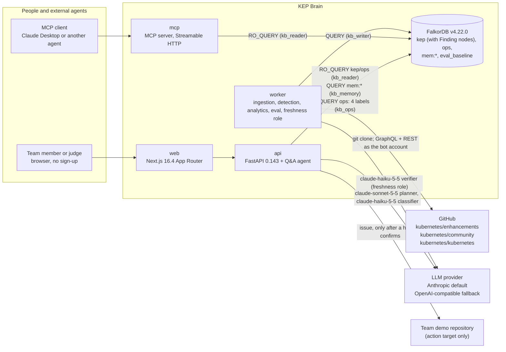
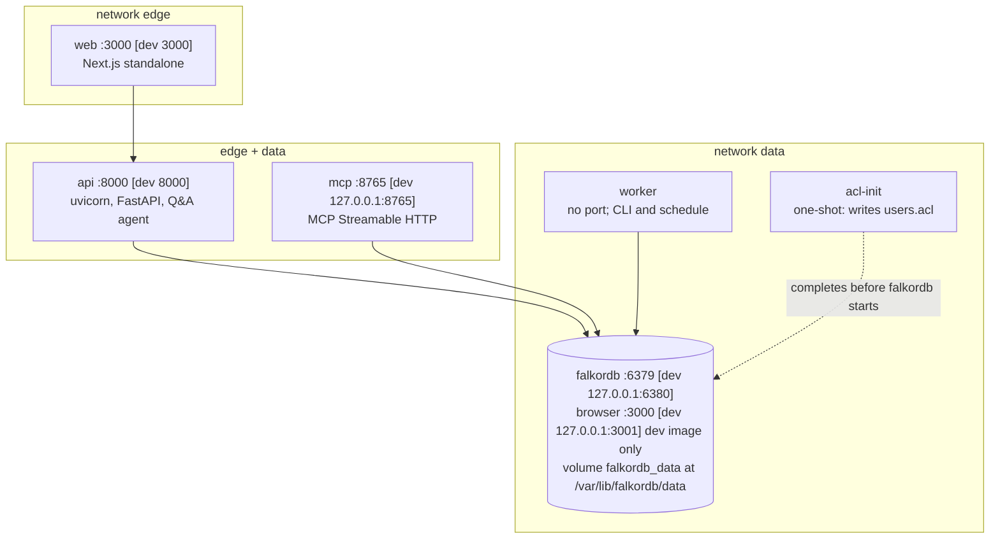
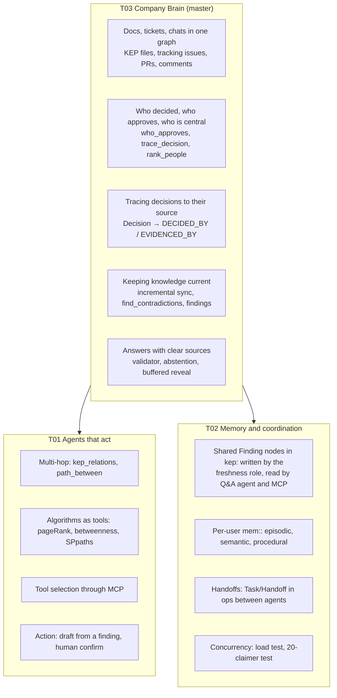
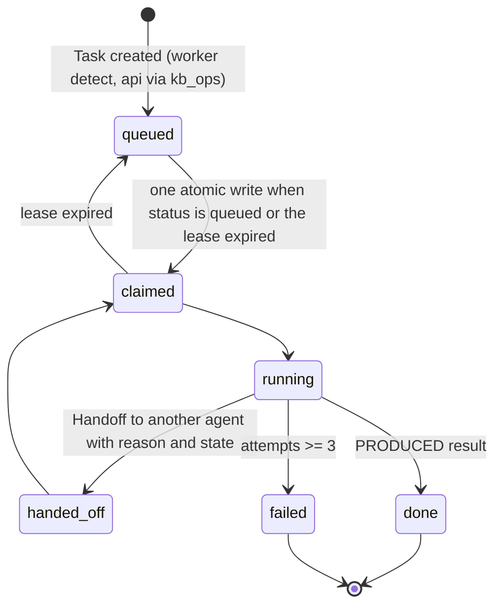
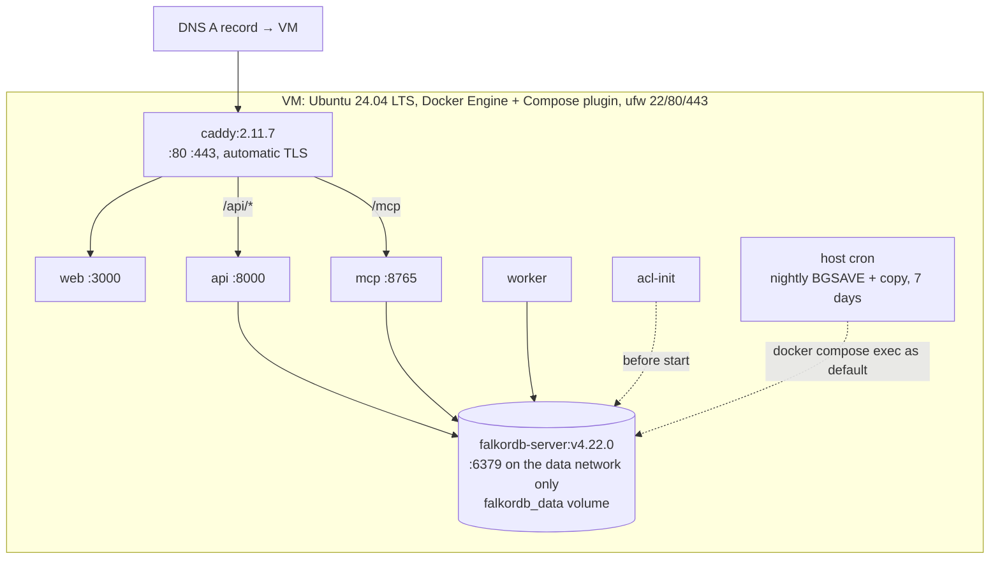

# 02 · KEP Brain — Production Architecture

| | |
|---|---|
| Status | **v2, 2026-10-12 (IST): proposed, AI-drafted, awaiting human ratification.** Design notes only (Rule 8). v2 resolves the 17 findings of the 2026-10-12 design review (index in §0.2): it narrows the product to one job (§1), replaces the circular Rule 3 table with an honest substitution analysis (§14), adds a shared cross-agent memory with a second LLM agent (§10), fixes the ACL table so every role client can connect, forget its memory and create its constraints (§4.5), validates answers before any answer text streams (§6.4), recomputes the GitHub budget (§9.4), and adopts the names of `03-graph-model.md` and the decisions B1–B24 of `06-build-plan.md` throughout. v2.1 2026-10-12: applied 06 §1.6 register (ratified). |
| Who decides | Every "DECISION" below is a proposal until H-Lead ratifies or vetoes it at HUM-00d (Oct 14) and writes the decider's name into the matching ADR's Status line (ADR 0026). Nothing here is "accepted" because an AI wrote it. |
| Event | WeMakeDevs × FalkorDB "Graph Hacks: Context for AI Agents", 2026-10-15 00:01 IST → 2026-10-18 23:59 IST (public API: `start_date 2026-10-14T18:31:00Z`, `end_date 2026-10-18T18:29:00Z`) |
| Master track | T03 Company Brain; T01 and T02 as genuine but smaller layers (§8) |
| Authority | This document is authoritative for processes, identities (ACL users), the HTTP and SSE contracts, ingestion budgets and deployment. `03-graph-model.md` is authoritative for every graph name (B5); where this document introduces a new name (the `Finding` label in `kep`, §5.4), it is a proposal that `03` adopts through HUM-00a (§19). `06-build-plan.md` is authoritative for schedule and task boundaries. |
| Companion docs | `01-recon-kubernetes-data.md` (data facts, D1–D12), `03-graph-model.md` (names, tools), `04-eval-set.md` (questions, arms), `05-ui-brief.md` (screens), `06-build-plan.md` (tasks, B1–B24), `adr/0001…0026` |

> **Rule 8 note (re-verified 2026-10-12).** Rule 8: "The main coding and design work must begin after the hackathon starts. You may discuss ideas, create notes, sketch the graph model, or prepare diagrams beforehand" (https://www.wemakedevs.org/hackathons/falkordb/rules). The event page's FAQ, under "Can I continue an existing project?", says: "You may reuse general libraries, templates, and infrastructure." and "The submission and its main FalkorDB implementation must be new work completed during the event." (https://www.wemakedevs.org/hackathons/falkordb, **VERIFIED** 2026-10-12; the clause is on the main event page, not on `/rules`, which is why v1 of this document could not find it). The team's own prep constraint is stricter: "Not before the start: code, scaffolding, a git repo, or the UI build" (`FABLE_CONTEXT.md` §0). This document and the ADRs are notes and diagrams; they contain no source files, manifests, scripts or paste-ready queries. The pre-event template that sits under `D:\kep-brain` is handled by §2.3 and ADR 0023: it is archived before kickoff and the scaffold is regenerated from public generators after 00:01 IST on Oct 15.

---

## 0. How to read this

### 0.1 Reading order

1. §1: the one job KEP Brain does, its checkable outcome and how it differs from the closest entries.
2. §2: fixed decisions, defaults, the Rule 8 template boundary (§2.3) and who owns what (§2.4, Rules 11–13).
3. §3–§5: system context, containers and identities, graph families.
4. §6–§8: how a question is answered (with the buffered, validated stream), the v1 tool catalog, how the tracks layer.
5. §9–§10: ingestion with a recomputed GitHub budget; memory and coordination with two LLM agents and shared `Finding`s in `kep`.
6. §11–§13: cross-cutting engineering, API contract, deployment and operations.
7. §14: what a relational or vector substitute would lose, tool by tool. §15 budgets. §16 verification ledger. §17 veto list. §18 ADR index. §19 deltas other documents must adopt. §20 retired names.

Tags: **VERIFIED** (opened at the source, URL given), **OBSERVED** (measured), **INFERENCE** (judgement from verified facts), **UNVERIFIED** (could not confirm; a dated check is scheduled), **DECISION (veto-able)** (a choice, its one-line reason and the alternative).

### 0.2 Review resolution index (2026-10-12 review)

The design was changed where the reviewer was right; where the reviewer was wrong or only partly right, the section carries a "Reviewed: rejected because …" note with the evidence.

| # | Finding (short) | Resolution | Where |
|---|---|---|---|
| R1 | Pre-event scaffold breaks the team's own Rule 8 constraint; FAQ clause marked UNVERIFIED | Template archived before Oct 15; scaffold regenerated from public generators at 00:01; FAQ VERIFIED | §2.3, §16, ADR 0023 |
| R2 | Rules 11–13: AI writes almost everything | Human owner per core artefact; humans hand-write the schema module, the normalisation map and the five judge-path templates; agent lanes capped at 3; explain-back at CP1, CP4, CP7; ADRs "Proposed" until a named human ratifies | §2.4, ADR 0026 |
| R3 | §14 Rule 3 test is circular | Replaced by a per-tool "what a relational/vector substitute would lose" table with honest verdicts | §14 |
| R4 | T02 thin; "agents" are cron roles | Shared `Finding` nodes in `kep`, written by the worker's freshness role (as `kb_writer`) and read by the Q&A agent and MCP (`recall_findings`); multi-session memory eval; the task queue is called a job queue | §5.4, §10, ADR 0024 |
| R5 | Differentiation from NodeOps weak | Hero = `find_contradictions` + decision lineage; `impact_of` and its "blast radius" framing removed from v1; directory ownership out of the judge path; comparison table | §1.2–§1.4, ADR 0025 |
| R6 | Reads as a platform | One-sentence job; 14 LLM-callable tools in v1 (13 of `03`'s 29 intents plus `recall_findings`), 14 intents deferred by default; blue/green rebuild, Jaeger, the backup sidecar and 8 endpoints deferred | §1, §7, §12, ADR 0025 |
| R7 | 02/ADRs contradict 03 and 06 | §5, §7, §12 rewritten against `03` and B1–B24; every ADR revised; retired-name docs check | §5, §7, §12, §20, ADRs |
| R8, R10 | `kb_memory` lacks `GRAPH.DELETE` and `GRAPH.CONSTRAINT` | Both granted, still confined by `~mem:*` (key positions verified in FalkorDB source); tests named | §4.5, §10.3, ADR 0002 |
| R9 | Role clients cannot be constructed (falkordb-py `INFO` probe) | `+INFO` on every role user; `/v1/meta` version from the worker's `SyncRun`, not `GRAPH.INFO` | §4.5, §12, ADR 0002 |
| R11 | Streaming defeats the claim validator | Answer buffered and validated; `token` events emitted only from validated text; contract test | §6.4, §12, ADR 0009 |
| R12, R15 | GitHub budget understated | Per-endpoint, per-phase table; reviews/comments/files via batched GraphQL; bot-account identity; VM seeded from a dump; incremental-only second run | §9.4, ADR 0007 |
| R13 | `kb_ops` contradicts 02/ADRs | ADR 0022 adopts B13 and states the weaker guarantee for `ops`; separate module; registry test | §4.2, §6.5, ADR 0022 |
| R14 | Password rotation causes an outage | `ACL LOAD` step, per-role `ACL WHOAMI` check, rollback | §11.2 |
| R16 | Agents' contracts contradict each other | This document and all ADRs aligned now; `CONTRACTS.md` not generated; `06` §4 is the contract register; HUM-00a budget 3 h | §19, §20 |
| R17 | Rule 8 exposure with no fallback | Regeneration is the default, not the fallback; organisers asked in writing; notes committed separately from code | §2.3, ADR 0023 |

---

## 1. Purpose and scope

### 1.1 The one job

**KEP Brain audits the Kubernetes project's decision records: it finds where KEP metadata, tracking issues and replacement declarations disagree, shows who decided each state and the evidence for it, and drafts the fix.**

The Kubernetes project is treated as the company: its public org chart (`sigs.yaml`, `OWNERS`) and its public decision records (KEPs, their tracking issues, the PRs that changed them, the reviews and `/approve` commands on those PRs) are the company knowledge. A new engineer's real question is rarely "what does the KEP say" but "is this still true, and who decided it". KEP Brain answers that with evidence and refuses when the graph has none.

**The checkable outcome.** After each sync, the worker runs the contradiction detector over the three loaded SIGs; the freshness agent verifies every candidate (§10.2); the result is a list of N verified inconsistencies, each with both sides, their dates, the people who set them and links. H-Data/Eval hand-labels every finding (all of them if N ≤ 80, else a seeded random 80) as correct or not, and the README publishes N and the measured precision, with the detector-only precision next to it so the agent's contribution is a number, not a claim. Known examples already verified by the recon and the eval set: KEP-583 is `provisional` in `kep.yaml` while its tracking issue was closed in 2019 and two KEPs declare they replace it (eval STA-04); KEP-5978 is `withdrawn` while its milestone map still targets beta and stable (STA-08); Gang Scheduling's stage label moved backwards on 2026-02-10 (STA-07); KEP-5832 was merged into KEP-4671 but its `kep.yaml` still says `implementable` (DEC-07).

### 1.2 What the product does, in order of importance

1. **Audit** (`find_contradictions`, verified by the freshness agent into `Finding` nodes in `kep`): five contradiction kinds from `03` tool 12: `active_status_closed_issue`, `terminal_status_future_targets`, `one_sided_replacement`, `stage_mismatch`, `milestone_mismatch`.
2. **Decision lineage** (`trace_decision`, `status_history`, `kep_relations`): who changed each state, in which commit and PR, who approved, when a state was reversed, and the replacement and supersession chain (`REPLACES`, `SUPERSEDED_BY`, `SEE_ALSO`) around a KEP.
3. **Fix** (`draft_stale_doc_issue`): a draft issue composed only from a finding's evidence, posted to the team's demo repository after a human confirms (ADR 0021).
4. **Lookups the graph also serves** (`find_entities`, `get_kep`, `who_approves`, `who_owns`, `whats_changed`, `rank_people`, `path_between`): the KEP card, the approvers per stage, what changed since a release, who is central in a SIG, how a person connects to a decision. These are honest supporting tools; §14 says which of them a relational store could serve equally well.

Every answer carries evidence (keys, the traversed path, source URLs) and the system abstains when the graph holds no evidence.

### 1.3 How it differs from the closest entries (README table, one checkable differentiator each)

| Entry | What it does | Checkable differentiator vs KEP Brain |
|---|---|---|
| RAJ-A58/NodeOps (created 2026-10-10; README read 2026-10-12 via `gh api repos/RAJ-A58/NodeOps/readme`) | Calls itself the repository's "Company Brain"; Tracks 01 and 03; reviewer routing by "`algo.pageRank` contributor importance over merged PR file footprints", duplicate grouping, "dependency blast radius"; names Kubernetes as an example | NodeOps routes incoming work to people. KEP Brain audits past decisions: it reports where the project's own records disagree, with both sides cited, and publishes the hand-checked precision of those findings. KEP Brain has no reviewer routing, no triage, no blast radius. |
| A generic Slack/docs company brain (ikrishg/atlas, rihanstranger09/company-brain and similar, `FABLE_CONTEXT.md` §3) | Retrieval Q&A over chat and documents | No ground truth there. KEP Brain is scored against `kep.yaml`, PRR and `OWNERS` ground truth (`04`, 56 questions), against a vector-only and a lexical baseline, with the losses published. |
| Decision-memory entries (volfiros/axon-brain) | "Why did we decide X" from stored notes | KEP Brain derives decisions from the commits, PRs, reviews and `/approve` commands that made them, detects reversals, and flags when the record contradicts itself; a decision is a node with `DECIDED_BY` and `EVIDENCED_BY` edges, not a note. |

### 1.4 Data scope (adopted from `01` §7, veto-able)

`sig-node` (139 KEPs), `sig-scheduling` (58) and `sig-apps` (35): 232 of the 684 parseable `kep.yaml` files in `kubernetes/enhancements` at a pinned commit, plus about 5 stub KEPs they reference; their PRR files; the SIG, working-group and committee entries of `kubernetes/community/sigs.yaml`; the 95 SIG-labelled `OWNERS` files and the root `OWNERS_ALIASES` of `kubernetes/kubernetes`; and, as tickets and chats, the ≈575 KEP tracking issues with comment threads and label/milestone history and the ≈1,600 enhancements PRs that changed KEP files, with their reviews and comments (P0). The ≈2,600 `kubernetes/kubernetes` items that reference a tracking issue (P1) are **off by default** (`TICKETS_SCOPE=p0`); when switched on they are a load-time snapshot (§9.3).

**Out of scope (deliberately):** issue triage, reviewer routing, duplicate detection and "blast radius" (NodeOps covers them, and `FABLE_CONTEXT.md` §3 lists blast radius as the most overused T01 theme); directory-ownership questions in the judge path and the video (`who_owns` is a v1 tool, §7.1, kept out of the judge path); chat-with-your-docs UX; any write to a real Kubernetes repository.

---

## 2. Fixed decisions, defaults, the template boundary and ownership

### 2.1 Fixed by the team (not re-decided here)

| Area | Decision |
|---|---|
| API | Python 3.12, FastAPI, Pydantic v2, `uv` |
| Web | Next.js (App Router), TypeScript, Tailwind |
| Graph | `falkordb/falkordb:v4.22.0` (C engine; 6.x Rust engine is two weeks old with open crash issues), password required |
| Agent tools | Parameterized Cypher behind typed tools, exposed via MCP; no free-form text-to-Cypher in the main path |
| Ops | Docker Compose + GitHub Actions |
| UI | Light, neutral, professional; no dark neon theme; no decorative gradients |
| LLM | Provider adapter; Anthropic default (`claude-sonnet-5-5` planner and answerer, `claude-haiku-5-5` for cheap extraction and the freshness agent); OpenAI-compatible fallback; provider selected by env |
| Host | Windows 11 + Docker Desktop, Python 3.13.7 on the host (the project uses uv-managed 3.12), Node, pnpm, authenticated `gh`. `hopper-redis` and `hopper-postgres` are running: host ports 6379 and 5432 are **never** used and those containers are never touched |

### 2.2 Defaults chosen here (each veto-able; ADR in parentheses)

| Area | Default | One-line reason |
|---|---|---|
| Product focus | The decision-record audit of §1.1; 14 LLM-callable tools in v1, 14 of `03`'s intents deferred (0025) | One narrow job with a checkable outcome is what won past events (`FABLE_CONTEXT.md` §2) |
| Repository shape | `apps/api` (uv project, package `app`, entrypoints `python -m app`, `python -m app.worker`, `python -m app.mcp`), `apps/web` (pnpm, Next.js), `deploy/`, `evals/`, `docs/` (0003; B1) | One image for three Python processes; process separation is the security boundary |
| Scaffold | Regenerated after 00:01 IST Oct 15 from public generators; the pre-event template is archived, not committed (0023) | The team's own constraint forbids pre-event scaffolding; the FAQ requires the main FalkorDB implementation to be new work |
| Graph families | `kep` (with `Finding` nodes), `ops`, `mem:<ULID>`, `eval_baseline` (0006, 0024) | One store; isolation and ACL scoping by graph name |
| Read-only enforcement | `GRAPH.RO_QUERY` + per-process ACL users + per-query `timeout` + `TIMEOUT_MAX` (0005) | Three independent layers for everything an LLM influences |
| Identities | Five ACL users: `default`, `kb_reader`, `kb_memory`, `kb_ops`, `kb_writer`; every role user also holds `+INFO` (0002, 0022) | Least privilege per process; `+INFO` because falkordb-py's constructor probes `INFO server` |
| Ingestion | Local `git clone` for the doc layer; GitHub GraphQL in batches of 25 for threads, reviews, files and timelines; REST only for list pages with `since` and for contents (0007) | Fewer than 400 calls for a full P0 load instead of ≈6,000 |
| GitHub identity | A dedicated bot account with two read-only fine-grained PATs (dev, VM); never a member's token; the VM is seeded from a dev dump (0007) | Isolated budget; the VM never repeats the full load |
| Natural keys | `03` §3.1: one `key` string per label; KEP key = repository path; Person key = lower-cased login (0008) | KEP numbers collide (2133 twice); login casing varies |
| Upserts | `MERGE` on `key`, `UNWIND $rows` batches of 500, content hashes, soft-archive; full rebuild = BGSAVE, export findings, delete and reload offline, re-import findings, then re-seed (0008) | Re-runnable from scratch; blue/green rebuild (`kep_next`, `GRAPH.COPY`) deferred (tier 2) |
| Answer contract | Structured output with claims → evidence ids; deterministic validator; abstain on failure; **no answer text streams before validation** (0009) | The LLM answers only from rows the graph returned, and the viewer only sees validated text |
| Memory | Per-user `mem:<ULID>` graphs (episodic, semantic, procedural) plus shared verified `Finding` nodes in `kep` (0011, 0024) | Per-user isolation and real cross-agent shared state |
| Agents | Two LLM agents: the Q&A agent (`claude-sonnet-5-5`, in `api`) and the freshness agent (`claude-haiku-5-5`, a role inside `worker`); ingestion, analytics, detection and eval are jobs, not agents (0024) | Names that match what runs |
| Coordination | `Task`/`Handoff`/`Agent` nodes in `ops` with atomic lease claims (0012) | No broker; per-graph write serialisation gives single-winner claims |
| MCP | Own server (`mcp` 2.3.0, Streamable HTTP + stdio) over the read-only registry minus `recall_memory` and the draft tool, plus `get_graph_schema`; public read-only judge token (0013; B17) | FalkorDB's MCP server exposes free-form Cypher |
| Algorithms | v1: `algo.pageRank` and `algo.betweenness` precomputed after sync, `algo.SPpaths` live; WCC and label propagation deferred with their tools (0014) | Compute only what a v1 tool reads |
| Config / observability | `pydantic-settings`, **unprefixed** names (B2), structlog JSON, request ids; OpenTelemetry no-op by default, Jaeger deferred (0015) | Fewer moving parts; logs carry the request id end to end |
| Testing / CI | Unit, integration against a real FalkorDB, ACL tests in the compose job, contract, eval harness; required checks on `main` (0016) | Database behaviours cannot be tested with mocks |
| Deployment | Single VM, standalone `deploy/compose.prod.yml`, Caddy TLS, nightly backup by host cron (0017; B16) | Cheapest stable live link |
| Web | Next.js 16.4.0, React 19.3.0, TypeScript 5.9.3, Tailwind 4.3.3, Cytoscape.js 3.34.3 with `cytoscape-dagre` 4.0.1 (0018) | Deterministic left-to-right path layout for the hero |
| Scope | 3 SIGs; P0 tickets (0019) | Largest decision history, cross-SIG edges, user-facing SIG |
| Privacy | Emails never stored; scrub before hash; post-sync invariant scan (0020) | Rule 6 |
| Actions | Draft from a finding, demo repository only, allowlist + denylist, human confirm (0021) | Never touch real Kubernetes repositories |

### 2.3 The Rule 8 boundary and the pre-event template — DECISION (veto-able), ADR 0023

**Facts.** A generic FastAPI + Next.js + FalkorDB template was written into `D:\kep-brain` between 2026-10-11 22:30 and 2026-10-12 08:39 IST (file modification times): `apps/api/src/app/*.py` including `app/db/falkordb.py` (FalkorDB connection with `GRAPH.LIST` readiness), tests that have been run (`.pytest_cache`, `.mypy_cache`, `.venv`, `uv.lock`), `apps/web/src/**`, `docker-compose.yml` with a FalkorDB service, `.github/workflows/ci.yml` with a FalkorDB service container, `.pre-commit-config.yaml` and a template `README.md`. It was written for this event and this fixed stack. The FAQ permits reusing "general libraries, templates, and infrastructure" but requires that "the submission and its main FalkorDB implementation must be new work completed during the event"; the team's constraint forbids "code, scaffolding, a git repo, or the UI build" before the start (`FABLE_CONTEXT.md` §0).

**Decision.**

1. **Before Oct 15 (owner H-Lead, by Oct 14 20:00 IST):** move `apps/`, `docker-compose.yml`, `.github/`, `.pre-commit-config.yaml`, `.prettierignore`, `.editorconfig`, `.gitattributes`, `.gitignore`, `.env.example`, `LICENSE` and the template `README.md` out of `D:\kep-brain` into `D:\kep-brain-template-archive\2026-10-12\`, which is never placed under version control and is not read during the event. `docs/` (notes) and `.recon/` (data cache, never committed) stay.
2. **Ask the organisers (owner H-Lead, by Oct 14 18:00 IST):** in writing (the WeMakeDevs Discord help channel or the event contact address), whether a self-authored, domain-free template prepared on Oct 11–12 is acceptable. Archive the question and the answer verbatim in `docs/organiser-answers.md`.
3. **At 00:01 IST Oct 15 (INF-01):** `git init`; **commit 1** contains `docs/` only, with the message "Pre-event notes (Rule 8: notes, graph-model sketches, diagrams)", so `git log` shows the boundary; **commit 2 onward** is the scaffold built with public generators (`uv init` for `apps/api`, `pnpm create next-app@16.4.0` for `apps/web`) and then, in small commits by humans and at most three agent lanes, the settings, error envelope, request-id middleware, FalkorDB role clients, Compose file and CI workflow, written against the contracts in this document and `06` §4 (notes), not by copying the archive.
4. **Cost:** about 3 hours on the D1 critical path (generators minutes; settings, errors, middleware, logging ≈ 1.5 agent-hours; Compose and Dockerfile ≈ 1.5; CI ≈ 1; web shell ≈ 1.5; three lanes in parallel). CP1 moves from 14:00 to 17:00 IST (delta for `06`, §19).

**Alternative (veto-able only with written organiser approval):** keep the template as the baseline commit (saves ≈ 3 hours), with a dated ADR in `docs/DECISIONS.md` that records the organisers' answer and the residual risk accepted. Without a written "yes" before Oct 14 22:00 IST this alternative is closed.

> **Reviewed: partly rejected because** the reviewer estimated the rebuild at "about 1–2 hours"; the FalkorDB role clients, the five-user ACL init and the CI service container are product-critical and take longer to rewrite carefully, so the plan budgets 3 hours and moves CP1 rather than squeezing it.

### 2.4 Who owns what (Rules 11–13) — DECISION (veto-able), ADR 0026

Rule 13: "Projects that are entirely generated using AI without meaningful participant contribution, verification, or technical understanding may be rejected." Rule 12 requires the team to explain "the graph model, the queries, the project architecture, and the technical decisions behind them". The design series itself was drafted by an AI assistant; that is disclosed, and it is why every ADR stays "Proposed" until a named human ratifies it.

| Core artefact | Human owner (role; names assigned at HUM-00d) | Human contribution that shows in `git log` |
|---|---|---|
| Graph schema module (labels, edge types, `key` builders, property allow-list) | H-Lead | Hand-written by the owner (GR-01 becomes a human card; an agent may add tests in a separate commit) |
| Normalisation map (`01` Q4 status/stage map, Q8 reference resolution order) | H-Data/Eval | Hand-written table and its unit cases |
| Cypher templates of the five judge-path tools: `find_entities`, `find_contradictions`, `kep_relations`, `trace_decision`, `status_history` | split across members, one owner per template | Hand-written templates; agents write the Pydantic models, evidence mappers and tests around them |
| ACL role table and `acl-init` contract (§4.5) | H-Lead | Decided and reviewed; the ACL test results recorded by the owner |
| Claim validator rules (§6.3) | H-Review | Rules and the abstention cases written by the owner |
| Eval ground truth re-verification (56 questions), findings precision labels, judge calibration labels | H-Data/Eval | Labels and signed run |
| README "Why a graph" and the substitution table (§14) | H-Demo | Prose written by the owner from §14 |

Further rules: **at most three agent lanes** run at once (infra/CI, ingestion, web or agent; `06` §3.1 is amended in §19); **explain-back at every major checkpoint** (CP1 on D1, CP4 on D2, CP7 on D4), each member explaining their own area without notes, recorded in `docs/AI_USAGE.md`; **every `docs/AI_USAGE.md` row names a concrete human edit or check** (the PR template already rejects rows that say only "reviewed"); **before the repository goes public at CP4**, H-Lead rewrites the pre-event rows of `docs/AI_USAGE.md` so each states what humans decided (concept, master track, SIG scope, ratified and vetoed ADRs), not "no human decision yet".

---

## 3. System context



**Trust boundaries.** The browser and MCP clients are untrusted. Every LLM is untrusted with respect to the graph: it never produces Cypher, only tool names and typed parameters, and its final text is checked against the rows it saw. GitHub content is untrusted data (comment bodies may contain prompt-injection text): it is stored as data and rendered as text, never interpreted as instructions. **The LLM never writes `kep` directly**: only `worker` (`kb_writer`) writes `kep`, and the freshness role's output is validated before any `Finding` is written (§10.2). FalkorDB is reachable only on the Compose `data` network; in production no FalkorDB port is published.

---

## 4. Containers



Host ports follow `06` C9: nothing binds 6379 or 5432; the database is loopback-only in dev and unpublished in production.

### 4.1 `web` (Next.js 16.4.0, App Router, TypeScript 5.9.3, Tailwind 4.3.3)

- Server components fetch from `api` over the Compose network; the browser talks to `api` same-origin through `/api/*` (Caddy in production, Next.js `rewrites` in dev), so no CORS and no tokens in the browser.
- **v1 routes** (adopting `05` §2.1 minus the deferred pages, §19): **Ask** `/` (question, answer revealed after validation, evidence column with Graph path / Steps / Sources tabs); **Audit** `/audit` (the findings list with both sides of each disagreement, "what changed since vX", last sync, the draft-issue dialog); **KEP** `/explore/kep/{number}` (card, status timeline with who decided each change, lineage graph); **Memory** `/memory` (this user's episodes, facts, procedures, the shared findings board and agent handoffs, "Forget everything"); **Eval** `/eval` (accuracy per question kind against the baselines, audit precision, where the graph loses, latency, load test); **Judge** `/judge` (the five judge-path steps, §6.6); **About** `/about`. The template-era `/status` web route is regenerated with the scaffold; the web app keeps `/healthz`. Deferred with their tools: `/explore` index, `/explore/person/{handle}`, `/explore/sig/{dir}`.
- Graph views: Cytoscape.js 3.34.3 in a small own wrapper; `cytoscape-dagre` 4.0.1 left-to-right for Ask paths and KEP lineage (deterministic, identical in the video); `cytoscape-fcose` 2.2.0 only on the Memory page's findings board (cap 200). Eval charts are plain SVG with `d3-scale` 4.0.2 and `d3-array` 3.2.4.
- Identity: no sign-up. The browser generates a 26-character ULID on first use, keeps it in `localStorage` (`kep.memoryId`), shows it on the Memory page and sends it as `X-Kep-Memory-Id`; the API validates the format with a full match and maps it to graph `mem:<ULID>`. The id is a random key to non-personal memory, not a credential (ADR 0011).

### 4.2 `api` (FastAPI 0.143.0 on uvicorn 0.54.0, Python 3.12)

- Owns: the HTTP and SSE contract (§12), the Q&A agent loop (§6), the tool registry (§7), the claim validator, memory reads and writes for the calling user, the freshness block, action drafting and confirmation, `/health` and `/ready`, OpenAPI.
- Three FalkorDB identities, each in its own module (import-boundary test, §11.7):
  - `kb_reader` for every tool the LLM can call and for reads of `ops`;
  - `kb_memory` for `mem:*` (recall, remember, forget, lazy schema);
  - `kb_ops` for exactly four `ops` labels through fixed templates (ADR 0022, adopting B13): `Task` (create, status `queued`), `ActionDraft` (create, and compare-and-set of `status`), `BudgetDay` (spend counter) and `AuditEvent` (append). The module `app/ops_writes/` is the only importer of the `kb_ops` client; the agent package (`app/agent/`) and the tool registry cannot import it, and a test asserts the planner's registry contains no `kb_ops` caller.
- It never holds `kb_writer`.
- Stateless across requests: durable state is in FalkorDB; in-process state is limited to TTL caches (readiness 5 s, tool registry) and the B18 rate limiters.

> **What the read-only guarantee covers (stated plainly).** For `kep`, `eval_baseline` and every LLM-callable tool, the guarantee is three layers: `GRAPH.RO_QUERY`, an ACL user that cannot run `GRAPH.QUERY`, and server timeouts (ADR 0005). For the four `ops` labels the api writes, the guarantee is weaker and different: the `kb_ops` key scope (`~ops` only), four fixed templates whose parameters come from validated request data, and the import boundary. It is not `RO_QUERY`.

### 4.3 `worker` (same image, separate process)

- Subcommands (`06` C5, B1 naming): `schema apply`, `sync [--layer docs|tickets|all] [--full]`, `derive`, `analytics`, `detect` (runs the contradiction detector corpus-wide and enqueues `verify_finding` tasks, §10.2), `schedule` (long-running: incremental sync every 15 min, then derive, analytics and detect when anything changed; claims queued `sync_incremental` tasks), `eval …`, `memory-gc`, `tools export`, `pii-scan`, `llm-check`.
- Only process holding `kb_writer`. Runs one LLM role, the freshness role (§4.4), whose verdicts pass the validator before any `Finding` is written to `kep`. Eval runner calls go through the provider adapter and are written as eval results by fixed templates, never as graph facts.
- Needs `git` in its image and the `repo_cache` volume (a cache: deleting it costs one clone) and, in dev only, the `github_cache` volume (§9.4).

### 4.4 Freshness role (inside `worker`; the former `agent` service is removed)

- Runs the **freshness agent** (§10.2) as a role of `worker`: claims `verify_finding` and `recheck_finding` tasks from `ops`, verifies each candidate with `claude-haiku-5-5` and the read-only tools, and writes the verdict as `Finding` nodes in `kep`.
- Identity: `kb_writer`, the worker's only identity; no separate user or service.
- Cost guard: `FINDINGS_AGENT_ENABLED` and `FINDINGS_AGENT_DAILY_USD` (default 1.00), accounted on `SyncRun`; when spent, tasks stay queued and the Audit page shows "verification paused".

### 4.5 `falkordb`

| Setting | Dev | Prod | Source |
|---|---|---|---|
| Image | `falkordb/falkordb:v4.22.0` (includes Browser on 3000) | `falkordb/falkordb-server:v4.22.0` | Tags verified on Docker Hub 2026-10-11; https://docs.falkordb.com/operations/docker recommends `-server` for production |
| Host ports | `127.0.0.1:6380`→6379, `127.0.0.1:3001`→3000 (`06` C9) | none published | 6379 is taken by `hopper-redis` |
| Data dir / volume | `falkordb_data` → `/var/lib/falkordb/data` | same | "FalkorDB stores data in `/var/lib/falkordb/data` by default" (https://docs.falkordb.com/operations/durability/persistence); several docs examples mount `/data`, which is not the data dir |
| `REDIS_ARGS` | `--aclfile /var/lib/falkordb/data/users.acl --appendonly yes --appendfsync everysec --save 300 10 --maxmemory 2gb --maxmemory-policy noeviction` | same with `--maxmemory 3gb` | `noeviction` is deliberate (an LRU policy would evict whole graphs); 2 GB dev per `06` §1.3 |
| `FALKORDB_ARGS` | `THREAD_COUNT 3 CACHE_SIZE 200 TIMEOUT_MAX 60000 TIMEOUT_DEFAULT 5000 QUERY_MEM_CAPACITY 268435456 RESULTSET_SIZE 20000 MAX_QUEUED_QUERIES 45` | same | https://docs.falkordb.com/configuration; `MAX_QUEUED_QUERIES 45` with `THREAD_COUNT 3` per B18 |
| Password | required; `default` has a hashed password in `users.acl`; `--requirepass` not used in `aclfile` mode (B4 keeps a `single` fallback mode) | same | https://docs.falkordb.com/operations/durability/acl-persistence |
| Healthcheck | `redis-cli` `PING` as `default` with `REDISCLI_AUTH`, interval 10 s, timeout 3 s, retries 5, start period 20 s | interval 30 s | docs/operations/docker |
| Restart | `unless-stopped` | same | |

**ACL users** (written by `acl-init` as `user <name> on #<sha256> <keys> <commands>` lines; hashes only):

| User | Keys | Commands | Held by |
|---|---|---|---|
| `default` | `~*` | `+@all` | healthcheck, backup cron, rotation (`ACL LOAD`), operators |
| `kb_reader` | `~kep ~ops ~eval_baseline` | `+PING +CLIENT\|SETINFO +INFO +GRAPH.RO_QUERY` | `api`, `mcp` |
| `kb_memory` | `~mem:*` | `+PING +CLIENT\|SETINFO +INFO +GRAPH.QUERY +GRAPH.RO_QUERY +GRAPH.DELETE +GRAPH.CONSTRAINT` | `api` |
| `kb_ops` | `~ops` | `+PING +CLIENT\|SETINFO +INFO +GRAPH.QUERY +GRAPH.RO_QUERY` | `api` |
| `kb_writer` | `~*` | `+PING +CLIENT\|SETINFO +INFO +GRAPH.QUERY +GRAPH.RO_QUERY +GRAPH.LIST +GRAPH.DELETE +GRAPH.COPY +GRAPH.CONSTRAINT +GRAPH.EXPLAIN +GRAPH.PROFILE +GRAPH.SLOWLOG +GRAPH.INFO +GRAPH.MEMORY` | `worker` |

Why each grant, with evidence:

- **`+INFO` on every role user.** falkordb-py 1.7.1's `FalkorDB.__init__` calls `Is_Sentinel(conn)` and `Is_Cluster(conn)`, and each runs `conn.info(section="server")` (VERIFIED at tag v1.7.1: https://raw.githubusercontent.com/FalkorDB/falkordb-py/v1.7.1/falkordb/sentinel.py lines 5–7, `cluster.py` lines 8–10, `falkordb.py` lines 132 and 136). Without `+INFO`, every role connection fails with `NOPERM` before its first query. DECISION (veto-able): grant `+INFO` (read-only server metadata; no key names or values) and keep the documented client constructor. Alternative: build role clients as `redis.Redis(username=…, password=…)` and wrap them as `falkordb.Graph(client, name)`, skipping the constructor (`Graph.__init__(self, client, name)` VERIFIED in `graph.py`); rejected as default because it couples the code to a constructor the client does not document as public. The client's schema refresh calls `DB.LABELS`, `DB.RELATIONSHIPTYPES` and `DB.PROPERTYKEYS` through `call_procedure(..., read_only=True)`, i.e. `GRAPH.RO_QUERY` (VERIFIED, `graph_schema.py` and `graph.py` line 279–282 on `main`, 2026-10-12), so `kb_reader` needs nothing more.
- **`+GRAPH.DELETE +GRAPH.CONSTRAINT` on `kb_memory`.** "Forget everything" is `GRAPH.DELETE mem:<ULID>` (§10.3), and the lazy schema of a new memory graph includes `UNIQUE` constraints on `key` (`03` §13), which are created with `GRAPH.CONSTRAINT CREATE`. FalkorDB v4.22.0 registers `graph.DELETE` with key position 1 and `graph.CONSTRAINT` with key position 2 (VERIFIED: https://github.com/FalkorDB/FalkorDB/blob/v4.22.0/src/module.c, the `RedisModule_CreateCommand` calls at lines 260–266 and 292–298), so Redis applies the `~mem:*` key pattern to both: `kb_memory` can delete or constrain only memory graphs. Runtime behaviour is tested (§11.7).
- **`kb_reader` key scope.** Narrowed from `~*` to the three graphs it reads (TRD-SR-015), so a reader connection cannot read any user's memory.
- Two items stay **UNVERIFIED** until INF-02 on Oct 15: whether FalkorDB's internal `telemetry{<graph>}` keys need a key pattern for restricted users (module-internal key access is not normally ACL-checked; if INF-02 shows otherwise, `~telemetry*` is added to the affected users); and whether the documented fine-grained `%R~` permission exists in 4.22.0 (the design does not use it).

### 4.6 `acl-init`, `caddy`, backups

- **`acl-init`**: one-shot container; creates `users.acl` on the volume if missing (Redis refuses to start when `aclfile` points to a missing file) and writes the five user lines with SHA-256 hashes from env (`FALKORDB_PASSWORD` for `default`, `FALKORDB_READER_PASSWORD`, `FALKORDB_MEMORY_PASSWORD`, `FALKORDB_OPS_PASSWORD`, `FALKORDB_WRITER_PASSWORD`). `falkordb` has `depends_on: acl-init: condition: service_completed_successfully`. In `FALKORDB_ACL_MODE=single` it exits 0 immediately (B4).
- **`caddy:2.11.7`** (prod only): TLS (Let's Encrypt), `/api/*` → `api:8000` except health, readiness, `sync/run` and admin paths (404, B15); `/mcp` → `mcp:8765`; everything else → `web:3000`; `X-Real-IP` from the connection; security headers per `06` INF-05.
- **Backups** (prod): a host cron entry on the VM (no sidecar container, a v2 simplification): nightly 02:00 UTC `BGSAVE` as `default` through `docker compose exec`, wait for `rdb_bgsave_in_progress:0`, copy `dump.rdb` and `appendonlydir/` to `/backups/<UTC timestamp>/`, keep 7. Restore in §13.4.

---

## 5. Graphs and schema summary

FalkorDB holds every piece of durable state in four graph families. Graphs are independent keys: there are no cross-graph edges, and cross-graph references are natural keys resolved by a second read. **Names below are those of `03-graph-model.md` (authoritative, B5)**; this section fixes only what the architecture depends on.

### 5.1 `kep` (knowledge graph; public corpus; single tenant)

- **Labels** (`03` §4): organisation (`SIG`, `WorkingGroup`, `Committee`, `Subproject`, `Person`, `Alias`), documents (`Document`, with `kind: owners` carrying the secondary label `OwnersFile`; `Section`), enhancement core (`KEP`, `FeatureGate`, `Component`, `Metric`, `Release`, `Label`, `ExternalRef`), history and decisions (`Commit`, `StatusChange`, `Decision`), tickets and chats (`Issue`, `PullRequest` with the secondary label `Ticket`, `Review`, `Comment`), and verified findings (`Finding`, §5.4). Every node has one `key` (`03` §3.1) and the provenance envelope `source_url`, `source_repo`, `source_path`, `source_sha`, `observed_at`, `content_hash`.
- **History is reified**: one `StatusChange` per field change from `kep.yaml` commits and one per tracking-issue label or milestone event, chained by `PREVIOUS` with validity intervals; `KEP` → `CHANGED` → `StatusChange` → `IN_COMMIT` → `Commit` → `IN_PR` → `PullRequest`; `Issue` → `HAS_EVENT` → `StatusChange`; `Person` → `ACTED` → `StatusChange`.
- **Decisions are reified**: `Decision` nodes (status transition, stage graduation, PRR approval, replacement, withdrawal) with `DECIDED_BY` → `Person` and `EVIDENCED_BY` → PR, review, comment, commit or section; `REVERSES` between decisions (`03` §8.2).
- **State edges** carry `valid_from`, `valid_to` (sentinel `4102444800` = still valid), `observed_at`, `source_url`, enforced by `MANDATORY` relationship constraints on all 31 state-edge types (`03` §13).
- **Derived** (by the worker, `derived = true` + run id): inverse `SUPERSEDED_BY`, `IMPLEMENTS`, the `COLLABORATED {weight}` projection and `Person.pagerank`, `Person.betweenness`.
- **Indexes and constraints** (`03` §12–§13): range index on `key` for every label plus the secondary range indexes; full-text indexes on nine labels; the vector index on `Section.embedding` only when `EMBEDDINGS_ENABLED=true`, **dimension 1024, cosine** (B6); `UNIQUE` on `key` for every label; `MANDATORY` on `key`, `source_url`, `observed_at` for citable labels. The worker creates indexes, then constraints, then polls `db.constraints()` until every row is `OPERATIONAL` before loading.
- Temporal values: integer epoch seconds (`at`, `valid_from`, `valid_to`) with ISO twins (`*_iso`), because range indexes cover numerics and FalkorDB lists temporal arithmetic as unsupported (https://docs.falkordb.com/cypher/cypher-support).

### 5.2 `ops` (coordination, cursors, evaluation, budgets)

`03` §10 labels `SyncRun`, `SyncCursor`, `Agent`, `Task`, `Handoff`, `ActionDraft`, `EvalRun`, `EvalResult`, `AnalyticsRun`, `LoadTestRun`, plus `BudgetDay` and `AuditEvent` (B13). Edges `CLAIMED`, `HAS_HANDOFF`, `FROM_AGENT`, `TO_AGENT`, `PRODUCED`, `TRIGGERED_BY`, `HAS_RESULT`, `FOLLOWS`. Writers: `worker` (`kb_writer`, everything not listed next, including the freshness role's claims and completions of `verify_finding`/`recheck_finding` tasks, its `Handoff`s and its own `Agent` heartbeat), `api` (`kb_ops`: `Task` create, `ActionDraft`, `BudgetDay`, `AuditEvent`). New `Task.kind` values: `verify_finding`, `recheck_finding`. `ActionDraft` gains `finding_key`. `SyncRun` gains `falkordb_version` (read by the worker from `INFO modules`; feeds `/v1/meta`). The freshness role's spend is accounted on `SyncRun` against `FINDINGS_AGENT_DAILY_USD`.

### 5.3 `mem:<ULID>` (one graph per user, T02)

`03` §11: `User`, `Session`, `Episode` (keyed by `request_id`; stores the full validated answer so `GET /v1/answers/{request_id}` reads it), `Fact` (semantic), `Procedure` (procedural), `EntityRef` (pointer into `kep` by `label|key`); edges `HAS_SESSION`, `HAS_EPISODE`, `NEXT`, `REFERS_TO`, `HAS_FACT`, `LEARNED_FROM`, `HAS_PROCEDURE`, `USED`, `FOCUSES_ON`. Graph names are validated against `^mem:[0-9A-Z]{26}$` (full match) before any `select_graph`; reading a non-existent memory graph never creates it.

### 5.4 `Finding` nodes in `kep` (shared, cross-agent findings; new in v2)

Verified findings that every agent and user reads. Only the worker's freshness role writes them.

| Label | `key` | Properties |
|---|---|---|
| `Finding` | `fd:<kind>:<KEP key>:<sha1 of the sorted evidence keys, first 12 hex>` | `kind` (the five `find_contradictions` kinds), `kep_key`, `status` ∈ `open`, `resolved`, `rejected`, `superseded`; `severity` ∈ `high`, `medium`, `low`; `summary` (≤ 600 chars, written by the freshness agent, validated); `side_a_json`, `side_b_json` (value, date, actor, evidence key of each side); `evidence_keys: string[]` (`label|key` into `kep`); `detector_run_id`; `first_seen_at`, `last_verified_at`, `resolved_at` *opt*; `verifier_model`; `support_count` (how many detector runs produced it) |

| Type | From → To | Notes |
|---|---|---|
| `ABOUT` | `Finding` → `KEP` | the KEP the finding is about |
| `CITES` | `Finding` → `kep` node | every evidence entity (people, PRs, issues, status changes) |
| `SUPERSEDES` | `Finding` → `Finding` | a newer verdict about the same KEP and kind with different evidence |

Writers: the worker's freshness role only (`kb_writer`). Readers: `api` and `mcp` (`kb_reader`) through `recall_findings`; the worker's detector (to skip known findings). Constraints: `UNIQUE` on `key` for `Finding`, created by `worker schema apply`. Findings are exported and re-imported around a full reload (§9.2). Why `kep` rather than a separate graph (DECISION, veto-able, ADR 0024): one store and one write identity for the corpus and its verdicts; the cost is the export and re-import step of §9.2.

### 5.5 `eval_baseline`

`Chunk {key, text, kep_path, url, embedding}` with one vector index and one full-text index (B7) and **no relationships**, rebuilt per eval run. The baselines' query shape is a single kNN or full-text call, which keeps the comparison honest while keeping Rule 3's "no second store" true (`03` §2).

---

## 6. Request flow for a question

```mermaid
sequenceDiagram
  autonumber
  participant B as Browser
  participant A as api (Q&A agent)
  participant F as FalkorDB
  participant L as LLM
  B->>A: POST /v1/ask/stream {question}
  A->>A: request_id, validate X-Kep-Memory-Id, limits (B18)
  A-->>B: status {phase: understanding}
  A->>L: classify scope, extract entities (claude-haiku-5-5)
  A->>F: RO_QUERY mem:<uid> recall (kb_memory, 1000 ms)
  A->>L: plan: system + tool registry + memory context + question
  loop at most 8 tool calls, 30 s wall budget
    L-->>A: tool_use(name, params)
    A->>A: validate params (Pydantic), pick the fixed template
    A->>F: RO_QUERY kep template (kb_reader, 2000 ms)
    F-->>A: rows, keys, paths
    A-->>B: tool_call, path, citation (graph rows, live)
    A-->>L: tool_result(rows, evidence ids, truncated)
  end
  L-->>A: final Answer (structured output, not streamed to the browser)
  A-->>B: status {phase: checking}
  A->>A: claim validator (every claim cites evidence seen this request; URLs from rows)
  alt validation fails or no evidence
    A-->>B: done {abstained: true, abstain_reason} (zero token events)
  else valid
    A-->>B: status {phase: writing}, then token events chunked from the validated answer_markdown
    A->>F: QUERY mem:<uid> remember (kb_memory)
    A->>F: QUERY ops Task verify_finding for unseen contradiction rows (kb_ops)
    A-->>B: memory {recalled, remembered}, done {request_id, abstained: false, ...}
  end
```

### 6.1 Planning

- `claude-sonnet-5-5` via the Anthropic SDK (`anthropic` 1.13.0), Messages API, adaptive thinking (default), `tool_choice: auto`. Forced tool choice (`any`/`tool`) returns HTTP 400 on this model, so the system prompt names the first tool to call and each tool carries `strict: true` (claude-api skill, cached 2026-10-06; re-check at docs.anthropic.com on 2026-10-15).
- The system prompt and the tool registry are static and come first, with a prompt-cache breakpoint after the tools; memory context and the question follow.
- The final answer is requested as structured output (`output_config.format` with the `Answer` JSON schema): `answer_markdown`, `claims[] {text, evidence_ids[]}`, `abstained`, `abstain_reason`, `confidence`.
- Anthropic path: `fallbacks: "default"` with the beta header `server-side-fallback-2026-07-01`; `stop_reason` is checked before `content` is read. OpenAI-compatible path (`LLM_PROVIDER=openai_compatible`): the adapter translates the same tool and schema definitions (`openai` 3.29.0, `base_url` from env).

### 6.2 Tool execution (read-only path)

1. The LLM can only name tools from the registry (§7). Parameters are validated by the tool's Pydantic model (types, enums, ranges such as `depth ≤ 2`, `limit ∈ {5, 10, 20}`).
2. Each tool maps to **one fixed Cypher template per limit variant**, executed with `graph.ro_query(template, params=…, timeout=2000)` as `kb_reader`. `GRAPH.RO_QUERY` "will return an error if you attempt a write query" (https://docs.falkordb.com/commands/graph.ro-query); `kb_reader` cannot run `GRAPH.QUERY`; the per-query timeout is bounded by `TIMEOUT_MAX`. Parameters never reach `LIMIT`/`SKIP`.
3. Every row becomes evidence: `{evidence_id, label, key, title, url}` plus `paths: [[key, REL, key, …]]`; `evidence_id = base32(sha1(label + "|" + key))[:12]` (`03` §3.2). Internal node ids are never returned or cited.
4. At most 200 rows per call; the LLM sees a `truncated` flag and may refine.
5. **Findings are context, not evidence.** `recall_findings` returns `Finding` rows; the api resolves each finding's `evidence_keys` in `kep` with a second `RO_QUERY` and adds those `kep` rows as evidence. A claim may cite the `kep` evidence, never the `Finding` itself, because a finding's summary is LLM-written. Memory (`recall_memory`) is treated the same way.

### 6.3 Evidence and abstention

- Deterministic **claim validator** (no LLM; owner H-Review, §2.4): each claim cites ≥ 1 evidence id produced by a tool result in this request; each URL in `answer_markdown` equals an evidence URL; `abstained = false` requires ≥ 1 claim; no claim may cite a `Finding`, `Episode` or `Fact` id. Any violation turns the answer into an abstention with reason `unsupported_claims`; the rejected text is kept only in the server log at debug level (hashed request id), never sent to the browser.
- **Abstain** when: no tool returned rows (`no_evidence`); out of scope (`out_of_scope`, from the classifier and confirmed by zero matching entities); budget exhausted (`budget_exhausted`); graph unavailable (`graph_unavailable`, HTTP 503). Abstentions are HTTP 200 with `abstained: true`.
- **Freshness block** on every answer (built by code, not by a tool): `graph_synced_at` (last successful `SyncRun`), `upstream_head_sha` vs `ingested_head_sha`, `stale_sources[]` (KEPs whose `upstream_updated_at` is newer than `last_seen_at`, or last seen more than `STALE_AFTER_HOURS` = 24 ago) and `open_findings[]` (open `Finding`s about the KEPs the answer cites, from `kep`).

### 6.4 Streaming contract: validate first, then reveal — DECISION, ADR 0009

The v1 design streamed `token` deltas while the final answer was still unvalidated, so injected or fabricated sentences could reach the screen before the validator turned the answer into an abstention. v2:

- **Live:** `status`, `tool_call`, `path` and `citation` events stream as they happen. They are graph rows and tool metadata, not model prose.
- **Buffered:** the final answer is produced as one structured output and validated on the server. Only after validation does the api emit `token` events, chunked from the validated `answer_markdown` (≈ 40 characters per event, flushed every 15 ms, so the reveal still reads as live). A failed validation emits **zero** `token` events and one `done {abstained: true, abstain_reason: "unsupported_claims"}`.
- **UX:** between the last tool call and the first token the Ask page shows the `checking` phase label ("Checking every claim against the graph"); this is the product's point, so it is shown, not hidden.
- **Contract test** (CP2): a recorded provider transcript whose final answer cites an unseen evidence id produces a stream with zero `token` events and exactly one `done` with `abstained: true, abstain_reason: "unsupported_claims"`; a valid transcript produces `token` events whose concatenation equals the validated `answer_markdown`.

### 6.5 Write paths (complete list)

| Writer | Identity | Graphs | What | Composed by |
|---|---|---|---|---|
| `worker` | `kb_writer` | `kep`, `ops`, `eval_baseline`, `mem:*` (gc only), schema of all | ingestion, derivation, analytics, detector tasks, freshness-role `Finding`s and task state, eval results, memory-gc | code from parsed sources and validated verifier output |
| `api` memory module | `kb_memory` | `mem:<uid>` | `remember` after a valid answer, fact deletion, forget, lazy schema | code from the validated `Answer` |
| `api` ops module | `kb_ops` | `ops` | `Task` create, `ActionDraft` create and status CAS, `BudgetDay`, `AuditEvent` | code from validated requests |

Nothing an LLM writes is executed as a write; LLM text is stored only as validated property values (`Episode.answer_markdown`, `Finding.summary`).

### 6.6 Judge path (five steps, B19 wording "about 60 seconds")

Revised for the narrowed job (delta for `04`, `05`, `06`): (1) **STA-04** "What is the status of KEP-583 Coscheduling, and is that metadata current?" (the contradiction, with both sides); (2) **DEC-07** "Which KEPs does Gang Scheduling replace, and what became of KEP-5832?" (lineage); (3) **DEC-01** "When was KEP-1287 marked implemented, by whom, and in which PR?" (who decided); (4) **MH-07** (reversal; question wording per `04`); (5) **ABS-10** (refusal; question wording per `04`). OWN-01 and MH-04 leave the judge path: OWN-01 is a lookup that does not show the product's job, and MH-04's "if it were reverted" wording is the blast-radius framing removed in §1.4.

---

## 7. Tool catalog

The same registry feeds the Q&A agent, `GET /v1/tools`, `POST /v1/tools/{name}`, the MCP server (with the exclusions of §7.2) and the README's generated query section. Signatures, traversal shapes and result shapes are those of `03` §15, numbered as there; `recall_findings` is new and is added to `03` by HUM-00a.

### 7.1 v1 LLM-callable tools (14)

| # (`03`) | Tool | Job in §1.2 | Graph(s) | MCP | Judge path | Template owner |
|---|---|---|---|---|---|---|
| 1 | `find_entities` | entry point | `kep` | yes | step 5 | human |
| 2 | `get_kep` | lookup | `kep` | yes | | agent, reviewed |
| 5 | `who_owns` | lookup (directory owners) | `kep` | yes | | agent, reviewed |
| 6 | `who_approves` | lineage (who decided) | `kep` | yes | | agent, reviewed |
| 8 | `trace_decision` | lineage | `kep` | yes | steps 2, 3 | human |
| 9 | `status_history` | lineage | `kep` | yes | step 4 | human |
| 10 | `whats_changed` | audit context | `kep` | yes | | agent, reviewed |
| 12 | `find_contradictions` | audit | `kep` | yes | step 1 | human |
| 13 | `kep_relations` | lineage (replacement and supersession chains) | `kep` | yes | steps 1, 2 | human |
| 21 | `path_between` | lineage (person → decision) | `kep` | yes | | agent, reviewed |
| 23 | `rank_people` | lookup (who is central) | `kep` | yes | | agent, reviewed |
| 26 | `draft_stale_doc_issue` | fix | `kep` (reads only) | no (B17) | | agent, reviewed |
| 27 | `recall_memory` | T02 per-user | `mem:<uid>` | no (B17) | | agent, reviewed |
| new | `recall_findings` | T02 shared | `kep` (`Finding` nodes) | yes | step 1 | agent, reviewed |

`recall_findings`: parameters `kep_ref?`, `kinds?`, `status ∈ {open, resolved, all}` (default `open`), `limit ∈ {5, 10, 20}`; traversal: `Finding` by `kep_key` (range) or by `status` ordered by `severity` then `last_verified_at`, → `CITES` → the `kep` nodes it cites; result: `[{finding_key, kind, status, severity, summary, side_a, side_b, evidence_keys[], last_verified_at}]`, after which the api resolves `evidence_keys` in `kep` (§6.2 item 5).

`draft_stale_doc_issue` is pure: given a `finding_key`, it reads the finding and its evidence and returns a draft proposal (title, body listing each evidence item as `label/key → url`, target repository from config). The api's action service persists the `ActionDraft` through `kb_ops` after the answer validates; the tool module cannot import the `kb_ops` client. Posting requires the human confirm (ADR 0021). The previous v1 phrasing for `kep_relations` ("impact") is retired; it is the replacement and supersession lineage tool.

### 7.2 System tools (never LLM-callable)

`remember` (`03` 28; `api`, `kb_memory`), `coordinate` (`03` 29; claim, hand off, complete, heartbeat, board), `record_finding` (new; freshness role in `worker`, `kb_writer`; upsert `Finding` in `kep`, set status). MCP never exposes `recall_memory`, `remember`, `coordinate`, `record_finding` or `draft_stale_doc_issue`; it adds `get_graph_schema` (labels, relationship types, indexes). MCP tool count in v1: 12 + `get_graph_schema` = 13.

### 7.3 Deferred tools (14 of the 29 intents; behind the cut lines by default)

Built only if CP5 passes early, in this order, each behind its own flag: `who_knows` (7), `person_profile` (15), `sig_overview` (14), `get_kep_section` (3), `search_sections` (4; the graph agent's hybrid search; the vector *baseline* arm is unaffected), `freshness` (11; its data is already in every answer's freshness block), `feature_gate_lookup` (16), `release_scope` (17), `thread_digest` (18), `cross_sig_map` (19), `person_to_decision` (22; `path_between` covers the v1 need), `community_of` (24), `bridge_people` (25), `impact_of` (20; if ever built it is renamed `downstream_keps` and never described as "blast radius"). `remember` and `coordinate` are counted in §7.2, not here.

Eval questions whose expected tools are all deferred (OWN-03, OWN-05, MH-05, MH-08 and the EXP set that needs `who_knows`) are reported in a separate "deferred capability" bucket rather than silently dropped (delta for `04`).

Algorithm signatures used in v1 (VERIFIED at https://docs.falkordb.com/algorithms/* and …/cypher/procedures): `algo.pageRank(label, relationship-type) YIELD node, score`; `algo.betweenness({nodeLabels, relationshipTypes, samplingSize, samplingSeed}) YIELD node, score`; `algo.SPpaths({sourceNode, targetNode, relTypes, relDirection, pathCount, maxLen}) YIELD path, pathWeight, pathCost`.

---

## 8. Track layering on one codebase



| Track focus (event wording) | Component | FalkorDB capability (doc) |
|---|---|---|
| T03 "Knowledge from docs, tickets, and chats in one graph" | §9; `Document`, `Section`, `Issue`, `PullRequest`, `Comment` | labels, relationships, full-text indexes |
| T03 "Who owns what, and who knows what" | `who_approves`, `get_kep`, `rank_people` | `algo.pageRank`, `algo.betweenness` |
| T03 "Tracing decisions back to their source" | `trace_decision`, `status_history` | reified `Decision`/`StatusChange`, range index on `at` |
| T03 "Keeping knowledge current as things change" | `schedule`, `SyncCursor`, `find_contradictions`, `Finding` | `MERGE` upserts, validity intervals |
| T03 "Answers with clear sources" | evidence objects, validator, buffered reveal | keys and paths in result sets |
| T01 "Multi-hop reasoning" | `kep_relations`, `path_between`, `find_contradictions` | variable-length patterns, `algo.SPpaths` |
| T01 "Graph queries and algorithms as agent tools" | §7 registry | `CALL algo.*` |
| T01 "Tool selection through MCP" | `mcp` | read-only via `GRAPH.RO_QUERY` |
| T01 "Actions based on what the graph shows" | `draft_stale_doc_issue` from a `Finding` + confirm | `ActionDraft` in `ops` |
| T01 "Explainable results" | paths rendered in web; `evidence[]` | paths returned by Cypher |
| T02 "Episodic, semantic, and procedural memory" | `mem:<ULID>` | graph per key |
| T02 "Persistent conversation history" | `Episode` chain | AOF persistence |
| T02 "Shared state and handoffs between agents" | `Finding` nodes in `kep`; `Task`/`Handoff` in `ops` | per-graph write serialisation |
| T02 "High-concurrency reads and writes" | load test; claim test | reader-writer model, `THREAD_COUNT` |
| T02 "Separate memory per user or tenant" | graph per user + `kb_memory` key pattern | ACL key patterns |

Priority is strict: the T03 audit and lineage path is finished and demoable before T01's action and MCP polish; T01 before T02's findings board and load test. The per-user memory write ships with T03 because the Ask endpoint writes an `Episode` from day one.

---

## 9. Ingestion design

```mermaid
sequenceDiagram
  autonumber
  participant K as worker
  participant G as git (local clone)
  participant Q as GitHub GraphQL
  participant R as GitHub REST
  participant F as FalkorDB (kb_writer)
  K->>F: MERGE SyncRun{kind, status: running} in ops
  K->>G: git fetch; head = rev-parse origin/master
  K->>F: read SyncCursor{key: enhancements_head}
  alt head changed
    K->>G: git diff --name-only old..head -- keps/
    K->>G: parse kep.yaml, README sections, PRR at head; git log/show for history
    K->>F: UNWIND rows MERGE KEP/Document/Section/StatusChange/Commit ...
  end
  K->>R: GET issues?labels=sig/x&since=cursor (If-None-Match): changed tracking issues and KEP PRs
  K->>R: GET issues/comments?since=cursor (repo-wide)
  K->>Q: changed tracking issues x25: timelineItems + comments(first:100)
  K->>Q: changed PRs x25: files, reviews, comments (first:100 each)
  K->>Q: commits without a parsable merge subject x50: associatedPullRequests(first:1)
  K->>K: scrub e-mails, drop trailers, map to rows
  K->>F: UNWIND rows MERGE Issue/PullRequest/Review/Comment/Person/StatusChange, edges
  K->>F: SET cursors; SyncRun succeeded, counts, head_sha, falkordb_version
  K->>F: derive, analytics (pageRank, betweenness), detect -> Task verify_finding
```

### 9.1 Sources and how each is read

| Source | Method | Why | Verified |
|---|---|---|---|
| `kubernetes/enhancements` KEP files, PRR files and their history | full `git clone` on `repo_cache`; `git ls-tree -r` rooted at `keps/` (the 8 mode-`120000` entries recorded as aliases, never parsed; the 23 Go test-fixture `kep.yaml` files under `pkg/*/testdata/` never become KEPs); parse at a pinned `head_sha`; history via `git log --format=%H%x09%at%x09%ct%x09%s -- <path>` (never `%ae`/`%ce`) and `git show <sha>:<path>` | full history with zero API calls; deterministic at a pinned SHA | `01` §3; `06` ING-02 |
| Normalisation of `kep.yaml` values | enum map with `*_raw` twins and `metadata_invalid`; references resolved by path → old filename → bare number → `ExternalRef`; inverse `SUPERSEDED_BY` derived; one-sided declarations flagged | 11 invalid status/stage values and free-text references exist | `01` §3.5 Q1–Q11, D5–D7 (human-owned map, §2.4) |
| Commit → PR linkage | `Merge pull request #N` subjects from `git log --first-parent`; otherwise GraphQL `object(oid:)` `associatedPullRequests(first: 1)`, 50 commits per query | no per-commit REST calls | merge-subject format for tide merges **UNVERIFIED** (measured in ING-02) |
| Tracking issues and enhancements PRs: discovery | REST `GET /repos/kubernetes/enhancements/issues?state=all&labels=sig/<x>&sort=updated&direction=asc&since=…&per_page=100` with `If-None-Match` | `since` and ETags make incremental discovery a handful of requests | https://docs.github.com/en/rest/issues/issues |
| Tracking-issue threads and label/milestone/cross-reference history | GraphQL, 25 issues per query by alias: `timelineItems(first: 100, itemTypes: [LABELED_EVENT, UNLABELED_EVENT, MILESTONED_EVENT, DEMILESTONED_EVENT, CROSS_REFERENCED_EVENT])` requesting `id` on every item, and `comments(first: 100)`; per-issue cursor pagination beyond 100 | REST `events`/`timeline` silently dropped label events after 2022 on #1287 while GraphQL returned all 96 (`01` §6.4) | `01` §6.3–§6.4 |
| Enhancements PR files, reviews and comments | GraphQL, 25 PRs per query by alias: `files(first: 100)`, `reviews(first: 100)`, `comments(first: 100)`; batch size drops to 10 on a GraphQL timeout | replaces three REST calls per PR (≈4,800 requests) | cost formula at https://docs.github.com/en/graphql/overview/rate-limits-and-query-limits-for-the-graphql-api |
| Comments, incremental | REST `GET /repos/kubernetes/enhancements/issues/comments?since=…&sort=updated&direction=asc&per_page=100`, filtered to known items | one or two pages per tick | https://docs.github.com/en/rest/issues/comments |
| `kubernetes/kubernetes` items referencing a tracking issue (P1, off by default) | discovered from `CROSS_REFERENCED_EVENT` sources; GraphQL `nodes(ids: [...50])` with `comments(first: 100)` and, on pull requests, `reviews(first: 100)` | implementation evidence without the 8,510 SIG-labelled items | `01` §6.1–§6.2 |
| `sigs.yaml`, `OWNERS_ALIASES`, the 95 `OWNERS` files | REST contents API with `Accept: application/vnd.github.raw+json` and `If-None-Match` | authoritative org chart and ownership; e-mails, private lists and meeting URLs dropped at parse time | `01` §4–§5 |
| Release dates | `GET /repos/kubernetes/kubernetes/releases?per_page=100`; committed fallback list of GA dates so the doc layer loads without a token | "what changed since v1.33" needs dates | `06` ING-02 |

### 9.2 Idempotency

- Every node is `MERGE`d on `key`, then `ON CREATE SET` the full row and `ON MATCH SET` only when `content_hash` differs (hash after PII scrubbing). Edges are merged in a separate clause after both endpoints are matched (https://docs.falkordb.com/cypher/merge warns that path-`MERGE` duplicates nodes).
- `StatusChange` keys (`sc:<KEP key>:<field>:<sha>`, `ghe:<GraphQL event id>`) make history re-runs duplicate-free.
- Upstream deletions are soft (`archived = true`, `archived_at`); state edges that disappear get `valid_to` set, never deleted.
- Batches: `UNWIND $rows` with 500 rows per query, `timeout = 30000` ms under `TIMEOUT_MAX 60000`; each query is atomic (https://docs.falkordb.com/design/concurrency).
- **Full reload** (schema change during the event): `BGSAVE` as `default` (backup), export the `Finding` nodes, `GRAPH.DELETE kep`, `schema apply`, `sync --full` on the dev machine, re-import the exported findings, then re-seed the VM from the resulting dump (§13.4). DECISION (veto-able): the blue/green `kep_next` rebuild (`GRAPH.COPY`) of v1 is deferred (tier 2); it protects against minutes of downtime that a dump restore already avoids on the VM.

### 9.3 Incremental sync and cursors

- Doc layer: `SyncCursor {key: enhancements_head}` holds the last `head_sha`; `git diff --name-only` finds changed files. Ingestion refuses non-fast-forward upstream history unless an operator flag is set (TRD-SR-045).
- REST list cursors: `since` (max `updated_at` seen minus a 60 s overlap) and `etag` per resource; conditional requests send `If-None-Match` (a 304 "does not count against your primary rate limit", https://docs.github.com/en/rest/using-the-rest-api/best-practices-for-using-the-rest-api).
- GraphQL: only issues and PRs whose `updated_at` moved since the cursor are re-queried; each tracking `Issue` stores its timeline end cursor.
- **P1 is a load-time snapshot** when enabled: new comments on `kubernetes/kubernetes` items do not move the tracking issue's `updated_at`, and polling 2,600 items is not worth the budget; the freshness block and the README say "P1 items as of <date>".
- Schedule: every 15 minutes in `schedule`, plus on demand via `POST /v1/sync/request` (public, rate-limited, B14) or `POST /v1/sync/run` (admin).

### 9.4 GitHub budget, identity and caching — DECISION (veto-able), ADR 0007

**Identity.** All ingestion runs as a dedicated bot GitHub account (the same account HUM-08 creates for the demo repository), with two fine-grained PATs, read-only, public repositories only: `dev` (the seed load on the dev machine) and `vm` (incremental sync on the VM). GitHub states that PAT requests "count towards your personal rate limit of 5,000 requests per hour" (VERIFIED, https://docs.github.com/en/rest/using-the-rest-api/rate-limits-for-the-rest-api), so a member's token would share its budget with that member's `gh` and every developer run; the bot account isolates it. The action PAT (`issues: write` on the demo repository only) is a third token on the same account, at most 10 writes a day (B18). Alternative (veto-able): a GitHub App installation (its own minimum of 5,000 requests per hour, same page), rejected as default because it adds JWT and installation-token handling code for a budget we do not need.

**Budget per endpoint and phase** (INFERENCE from `01` §6; every row is measured in ING-03 and written to `docs/VERIFICATION.md`):

| Phase | Endpoint | Count basis | Requests or points | Serial wall time |
|---|---|---|---|---|
| v1 design, for comparison: P0 all-REST | `issues` list pages | 655 issue and 1,760 PR label occurrences / 100 | ≈ 26 req | |
| | `pulls/{n}/files` + `pulls/{n}/reviews` | 2 × ≈1,600 PRs | ≈ 3,200 req | |
| | `issues/{n}/comments` | ≈2,175 items + extra pages for long threads (#1287 has 301 comments) | ≈ 2,425 req | |
| | contents, releases | 95 `OWNERS` + aliases + `sigs.yaml` + releases | ≈ 100 req | |
| | **total** | | **≈ 5,750 REST + ≈ 500 GraphQL points** | over the 5,000/h limit: 1.5–2 h with one forced reset wait |
| v1 design: P0 + P1 all-REST | add `issues/{n}`, comments, reviews for ≈2,600 k/k items | | **≈ 12,500 REST** | ≈ 3 h |
| **v2: P0 initial load** | REST `issues` list pages | as above | 26 req | < 1 min |
| | REST contents and releases | as above | ≈ 100 req (ETag) | ≈ 1 min |
| | GraphQL tracking issues (timeline + comments) | 575 / 25 = 23 queries + ≤ 180 pagination queries for long threads | ≈ 205 points | ≈ 8 min |
| | GraphQL PRs (files, reviews, comments) | 1,600 / 25 = 64 queries + ≤ 20 pagination | ≈ 85 points | ≈ 5 min |
| | GraphQL commit → PR fallback | ≤ 2,500 commits / 50 = ≤ 50 queries | ≤ 50 points | ≈ 2 min |
| | **total** | | **≈ 130 REST + ≈ 340 GraphQL points** (formula); ≤ 2,600 points even at the recon's conservative pricing of 26 points per 50-item batch | **≈ 15–20 min** |
| v2: P1 (when enabled) | GraphQL `nodes(ids:)` with comments and reviews | 2,600 / 50 = 52 queries + ≈ 100 pagination | ≈ 150 points (formula; ≤ 1,400 conservative) | ≈ 10 min |
| v2: each 15-minute tick | REST list with `since` (mostly 304s), repo-wide comments; GraphQL for changed items | typical day | ≤ 10 req and ≤ 5 points per tick (≤ 40 req/h) | < 30 s |

The point formula: "Add up the number of requests needed to fulfill each unique connection in the call", divide by 100, round, minimum 1 (VERIFIED, GraphQL rate-limits page above). A batch of 25 aliased PRs with three `first: 100` connections is 75 connection requests, i.e. 1 point; pagination queries cost 1 each. The binding limits for v2 are therefore query timeouts ("If a timeout occurs …, additional points will be deducted") and the 2,000 points/minute secondary limit, both of which serial batches of 25 stay far below.

**Pacing and backoff** (unchanged in substance): strictly serial requests; read `x-ratelimit-remaining`/`x-ratelimit-reset` (REST) and `rateLimit { cost remaining resetAt }` (GraphQL) and sleep until reset when remaining < 50; on `403`/`429` with `retry-after`, sleep exactly that long; otherwise exponential backoff 1–60 s (tenacity 9.2.1), 7 attempts, then the `SyncRun` fails with cursors intact.

**Dev cache.** In dev, `GITHUB_RAW_CACHE_MODE=record|replay|off` stores raw responses on a named volume `github_cache`, keyed by method, URL and query hash, so re-running the load while developing costs no budget.

> **Reviewed: rejected because** the review suggested committing the raw-response cache. Issue and PR comments are never committed to the repository (`01` D11, ADR 0020: they are fetched at deploy time and shown as attributed excerpts). The cache is a local named volume, git-ignored, deleted after the event.

**VM seeding.** The VM never repeats the full load: the seed load runs once on the dev machine in a clean Compose project with a fresh volume (`sync --full`, `derive`, `analytics`, `detect`, freshness agent drained), then `BGSAVE` as `default`, and `dump.rdb` is restored on the VM through the backup path (§13.4); the VM's worker then runs incremental sync only. The **second-run test** of ING-03 is redefined as an incremental run: with no upstream change, a `schedule` tick completes in under 30 s using `since` cursors and 304s, not a re-fetch.

### 9.5 PII (Rule 6)

Adopts `01` §9.2 (D10) and `03` §9 (G1–G4): `email`, `private_mailing_list` and meeting `url` keys in `sigs.yaml` dropped at parse time; the GitHub login is the only person identifier; commit e-mails never read; `/users/{login}` never called; all free text scrubbed (addresses → `[email removed]`, `Signed-off-by:`/`Co-authored-by:` lines dropped) **before** hashing; nothing login-gated fetched; forks excluded; a post-sync invariant scan over every text property fails the `SyncRun` on any address. `Person.name`/`company` only for `sigs.yaml` leadership entries while `STORE_PERSON_NAME_COMPANY=true` (veto-able). Licensing (D11): Apache-2.0 files are cloned at a pinned SHA at run time with a `NOTICE`; comments are never committed.

### 9.6 Scale estimate

From `03` §16 (INFERENCE): core P0 graph ≈ 30k nodes and ≈ 60k edges; with P1 ≈ 60k nodes and ≈ 130k edges. Both fit the 2 GB dev / 3 GB prod `maxmemory` with nine full-text indexes. `GRAPH.MEMORY USAGE kep` is recorded in every `SyncRun`; every count is re-measured on Oct 15 before it enters the README.

---

## 10. Memory and coordination (T02)

### 10.1 Who the agents are

Two LLM agents and four jobs. The README uses these words exactly.

| Name | Kind | Model | Process | Reads | Writes |
|---|---|---|---|---|---|
| Q&A agent | LLM agent | `claude-sonnet-5-5` (+ Haiku classifier) | `api` | `kep` (via tools, incl. `Finding`s), `mem:<uid>` | `mem:<uid>` (remember); `ops` tasks (handoff) |
| Freshness agent | LLM agent | `claude-haiku-5-5` | `worker` (freshness role) | `kep` (via tools), its `ops` tasks | `kep` (`Finding` nodes); its task state and handoffs |
| ingest, derive/analytics, detect, eval | jobs | none (eval calls the provider only as the system under test) | `worker` | sources, `kep` | `kep`, `ops`, `eval_baseline` |

### 10.2 Shared findings and handoffs — ADR 0024

```mermaid
sequenceDiagram
  autonumber
  participant D as detect job (worker)
  participant O as ops
  participant FA as freshness agent
  participant KB as kep (Finding nodes)
  participant QA as Q&A agent
  participant M as MCP client
  D->>O: Task{kind: verify_finding, payload: candidate} (skip if a Finding with that key is open)
  FA->>O: claim (atomic lease)
  FA->>FA: re-run find_contradictions for the KEP; status_history, kep_relations, trace_decision (kb_reader)
  FA->>FA: Haiku verdict {holds, severity, summary, side_a, side_b, evidence_ids}; validator checks evidence ids
  FA->>KB: record_finding: Finding open|rejected, CITES kep nodes
  FA->>O: complete task; Handoff{to: qa, reason: "finding available"}
  QA->>KB: recall_findings(kep_ref) during a later question by any user
  QA->>QA: resolves evidence_keys in kep; cites kep rows, not the finding
  QA->>O: Task{verify_finding} when its own find_contradictions rows include an unseen candidate
  M->>KB: recall_findings over MCP (read-only)
  D->>O: Task{recheck_finding} for every open finding after each sync
  FA->>KB: resolved (sources now agree) or superseded (new evidence)
```

- **What the freshness agent adds** (honest scope): the detector's candidates are deterministic joins; the agent decides whether a candidate is a real disagreement or a known benign pattern (for example a milestone moved for follow-up work after GA, as in STA-05), assigns severity, identifies which side is newer and who set it, and writes a summary that cites evidence. Its value is measured, not asserted: the eval reports **audit precision for detector-only vs detector + agent** on the human-labelled findings (§1.1).
- **Shared state**: `Finding` nodes in `kep` are read by both LLM agents, by every user's Q&A session and by external MCP clients, and written by one role through one identity (`kb_writer`). "Shared state and handoffs between agents" is literal: a finding produced by the freshness agent changes what the Q&A agent says to a different user an hour later, and the `Handoff` history and the finding's fields show it.
- **Validation**: the freshness agent's output goes through the same deterministic validator as answers: every evidence id must come from a tool row in its run; `summary` URLs must be evidence URLs; otherwise the verdict is stored with status `rejected` and reason `unsupported_claims`, and no finding opens.

> **Reviewed: rejected because** the review states that per-user memory should be read by the worker's agents too ("worker agents never read mem:*"). T02 also asks for "Separate memory per user or tenant": a system agent reading users' conversations would break that isolation for no product benefit. Memory is "available to every agent that needs it" through two scopes: each user's `mem:*` to the agent serving that user, and the shared `Finding` nodes in `kep` to every agent and MCP client.

### 10.3 Per-user memory

- `X-Kep-Memory-Id` selects `mem:<ULID>` (§4.1). Requests without it get no recall and no memory write; the answer footer says so.
- Every valid `/v1/ask` runs `remember` (one atomic write): `Episode` keyed by `request_id`, `NEXT` from the previous episode, `REFERS_TO` → `EntityRef` for asked-about and cited entities, `Fact`s extracted by `claude-haiku-5-5` (merged with `support_count += 1`, `LEARNED_FROM` → the episode), and the `Procedure` for the question kind (`USED` from the episode; a thumbs-up increments `success_count`).
- Memory influences planning: up to 5 recent episodes, up to 20 facts by `confidence * support_count`, the top 3 procedures for the classified question kind; the prompt states that memory is context, not evidence.
- **Lazy schema**: on the first write to a new memory graph, the memory module creates the `03` §12.4 range indexes (`GRAPH.QUERY`) and the `UNIQUE` constraints on `key` (`GRAPH.CONSTRAINT CREATE`, now granted to `kb_memory`), then proceeds; constraint status is not awaited for the first write (the per-request `MERGE` is serialised by FalkorDB anyway), and a `FAILED` status is logged and retried on the next write.
- **Forget**: `DELETE /v1/memory/me` runs `GRAPH.DELETE mem:<ULID>` as `kb_memory` synchronously and returns `{deleted: true}`; an `AuditEvent {kind: memory_delete}` is written through `kb_ops`. **Retention**: `memory-gc` (worker, `kb_writer`) deletes episodes older than `MEMORY_RETENTION_DAYS` (90) and graphs idle that long.

### 10.4 Coordination in `ops` (a job queue with leases, not "memory")



A claim is one write query that matches the `Task` only if `status = 'queued' OR lease_until < $now`, sets `status`, `lease_until = $now + 300`, `attempts += 1`, and creates `CLAIMED`. FalkorDB serialises writes per graph and each query is atomic (https://docs.falkordb.com/design/concurrency), so two claimers cannot both win (integration test: 20 concurrent claimers, one winner). The Memory page's board shows the two agents, the jobs, open tasks and the last hour of handoffs. The README calls this "the job queue", never "agent memory".

### 10.5 Memory evaluation (delta for `04`: kind `MEM`, 8 items)

Each item is a two-session script run twice, with recall on and with recall off (same model, same graph, same seed questions), reporting accuracy and input tokens per arm:

- **MEM-01–06 (per-user):** session 1 asks about a specific entity (for example "Tell me about Gang Scheduling's history"); session 2, a new `Session` under the same memory id the next "day", asks a follow-up that names nothing ("Who decided its most recent stage change, and was it ever reversed?"). Ground truth comes from the eval set (STA-07, DEC-05, DEC-01, DEC-03, OWN-09, STA-08 targets). Without recall the correct behaviour is to ask which KEP or abstain; with recall the answer must resolve the referent from `Fact {kind: entity_focus}` and cite `kep` evidence.
- **MEM-07–08 (shared):** user A's session triggers a verified finding (KEP-5978's withdrawn status vs its milestone map; KEP-583's provisional status vs its closed tracking issue); user B, with a fresh memory id, asks "Is KEP-5978's metadata current?". Measured with `recall_findings` enabled vs disabled: accuracy, input tokens, and whether the answer names the disagreement.

Results join the Eval page as their own panel; `04` owns the final wording and ground truth.

### 10.6 Concurrency test

`tests/load` (asyncio + httpx): N = 50 simulated users for 60 s, 70/30 mix of `POST /v1/tools/get_kep` (reads) and `POST /v1/memory/me/episodes` (writes to 50 distinct graphs), no LLM calls. Reported: p50/p95/p99, error rate, and FalkorDB running/waiting queries sampled by the operator as `default` with `GRAPH.INFO` during the run. Stored as `LoadTestRun`.

---

## 11. Cross-cutting

### 11.1 Configuration (pydantic-settings 2.15.0; unprefixed names, B2)

`06` C4 is the authoritative settings list. v2 adds: `FALKORDB_IMAGE` (the deployed image tag, echoed by `/v1/meta`), `FINDINGS_AGENT_ENABLED` (true), `FINDINGS_AGENT_DAILY_USD` (1.00), `GITHUB_RAW_CACHE_MODE` (`off` default; `record`/`replay` in dev), `GITHUB_RAW_CACHE_DIR`; and changes the default of `TICKETS_SCOPE` to `p0` (already the C4 default) and of `OTEL_EXPORTER_OTLP_ENDPOINT` to unset (no-op tracer). Settings are typed and validated at start (fail fast); a defined-but-empty value counts as unset; `.env.example` lists names and formats only.

### 11.2 Secrets and rotation

Dev: `.env` (git-ignored). Prod: root-owned `/opt/kepbrain/.env`, mode 600. CI: encrypted secrets; gitleaks CLI v8.30.1 on every PR (B21). The ACL file holds hashes only; every secret is a `SecretStr`.

**Password rotation (RUNBOOK §3; rehearsed once in CI's compose job and once on the VM):**

1. Write the new value(s) into `.env`.
2. `docker compose run --rm acl-init` rewrites `users.acl` on the volume.
3. As `default`, run `ACL LOAD` (a running server keeps the old users in memory until it reloads the file or restarts; if the `default` password itself changed, restart `falkordb` instead, accepting seconds of downtime).
4. Restart the dependents (`api`, `mcp`, `worker`).
5. Verify per role: each service's readiness runs `ACL WHOAMI` and one cheap query under its own identity; all five must match their expected user.
6. Rollback: restore the previous `.env` values, repeat steps 2–4. Because step 3 swaps the whole user set atomically, there is no window in which old and new passwords are both valid.

### 11.3 Logging and request ids

structlog 26.1.0, JSON lines to stdout, UTC. Inbound `X-Request-ID` accepted only if it matches `^[A-Za-z0-9._-]{1,128}$`, else a fresh UUIDv7; echoed and bound to every log line. Per tool call: tool name, parameter digest, rows, FalkorDB execution time, `truncated`. Never logged: parameter values, prompt bodies, secrets, full memory ids (hash prefix only), rejected answer text above debug level.

### 11.4 Error taxonomy

| Code (HTTP) | When | Client guidance |
|---|---|---|
| `validation_error` (400/422) | bad params or body | fix request |
| `unauthorized` (401) / `forbidden` (403) | missing or invalid admin/MCP token; action disabled or repository not allowlisted; `rank_people(refresh=true)` without admin (B20) | |
| `not_found` (404) | unknown KEP, person, draft, finding | |
| `rate_limited` (429) | B18 limits | `Retry-After` |
| `capacity_reached` (503) | daily LLM budget spent (B18) | Audit, KEP and Eval pages keep working |
| `graph_unavailable` (503) | FalkorDB unreachable, auth failure, readiness failing | retry later |
| `graph_timeout` (504) | FalkorDB `Query timed out` | narrow the question |
| `provider_error` (502) / `provider_rate_limited` (503) | LLM provider errors | `Retry-After` when known |
| `abstained` | **not an error**: HTTP 200, `abstained: true` and a reason | |

Envelope `{ "error": { "code", "message", "request_id", "details"? } }`; messages from an allow-list only, never provider, GitHub or Redis text (TRD-SR-025); unknown exceptions become `internal_error` (500) without a stack trace.

### 11.5 Tracing

OpenTelemetry is wired as a no-op provider by default; enabling it is one env value (`OTEL_EXPORTER_OTLP_ENDPOINT`). No Jaeger service in v1 (DECISION, veto-able: `06` cut line L10 becomes the default; the request id in every log line already ties a judge's report to one request).

### 11.6 Health and readiness (B3, B11, B15)

- `GET /health`: process up → 200.
- `GET /ready`: FalkorDB answers as every role this process holds (`ACL WHOAMI` + one `RO_QUERY`) and the schema is applied → 200; `graph_loaded`, `sync`, `findings_agent` reported in `checks` (admin token only) but not gating. Neither path is routed by Caddy.
- Worker and freshness-role liveness: `Agent.last_seen_at` every 60 s, surfaced in `/v1/sync/status` and the board.

### 11.7 Test strategy

| Layer | Tooling (pinned) | What it proves |
|---|---|---|
| Unit | pytest 9.1.1, pytest-asyncio 1.4.0, hypothesis 6.169.0, respx 0.23.1 | parsers, normalisation map, PII scrubber (property-based), claim validator (including "no claim may cite a Finding"), tool parameter models, GitHub pacing and GraphQL batching, provider translation, SSE chunker |
| Integration (real FalkorDB service container) | CI service container `falkordb/falkordb:v4.22.0` | schema and constraints reach `OPERATIONAL`; fixture mini-repo loaded twice → identical counts; a write via `RO_QUERY` is rejected; timeout fires; 20 concurrent claimers → one winner; memory isolation |
| ACL (compose job, real `users.acl`) | the `acl` marker inside the `api` container | **role-client construction**: each of the four role users builds a falkordb-py 1.7.1 client under its real ACL and runs one query (INF-02 check 8b); `kb_reader` cannot `GRAPH.QUERY` or read `mem:*`; **`DELETE /v1/memory/me` as `kb_memory` removes the key from `GRAPH.LIST`** (checked as `default`); `GRAPH.DELETE kep` as `kb_memory` → `NOPERM`; `GRAPH.CONSTRAINT CREATE` on a `mem:` graph as `kb_memory` succeeds and on `kep` fails; `kb_ops` cannot write `kep`; rotation procedure (§11.2) end to end |
| Contract | OpenAPI and `Answer` snapshots; SSE contract tests | §12 shapes do not drift; **invalid transcript → zero `token` events and `done {abstained: true, abstain_reason: "unsupported_claims"}`** (§6.4) |
| Boundaries | import-graph tests | only `app/ops_writes/` imports the `kb_ops` client; only `app/findings/` (in `worker`) writes `Finding`s; the planner registry contains no `kb_ops` or `kb_memory` caller; only `worker` imports `kb_writer` |
| Eval harness | `evals/questions.yaml` (56 questions, `04`) + the 8 MEM items + the findings precision labels; `python -m app.worker eval …`; results under `evals/runs/<utc>/` | accuracy per kind against the baselines, audit precision (detector vs detector + agent), memory with/without recall, citation validity, abstention precision, latency |
| Web | vitest 5.0.3, @playwright/test 1.64.0 | the judge path works |
| Load | `tests/load` (§10.6) | p50/p95/p99 at 50 users |
| "No second store" | dependency and import scan | no `sqlalchemy`, `psycopg`, `pymongo`, `sqlite3`, or `redis` use outside the FalkorDB client |

LLM-dependent tests run only in the eval harness; CI runs the agent loops against a recorded provider double.

### 11.8 CI gates (GitHub Actions)

Jobs `api` (ruff 0.17.0, mypy 2.4.0 strict, unit and integration tests against the service container), `web` (lint, typecheck, format, build), `compose` (`docker compose config`, build, `up --wait`, ACL tests, rotation rehearsal, canary redaction check, prod/dev drift test of B16), `secrets-scan` (gitleaks CLI v8.30.1), `audit` (advisory until CP6), `docs` (Markdown link check and the **retired-names check** of §20). Actions pinned by commit SHA; workflow `permissions: contents: read`. Branch protection on `main`: required checks, squash merges, linear history. The first commit is at or after 2026-10-15 00:01 IST and contains notes only (§2.3).

---

## 12. API contract (v1)

Base path `/v1`; JSON; `X-Request-ID` echoed; errors per §11.4. Authentication: none for reads and ask (the optional `X-Kep-Memory-Id` header selects the caller's memory graph); `Authorization: Bearer <ADMIN_TOKEN>` for admin; `Bearer <MCP_TOKEN>` (public read-only judge token, B17) for MCP.

| Method, path | Request | Response (200) | Backs |
|---|---|---|---|
| `GET /health`, `GET /ready` | – | `{status}`; `checks` with admin token | Compose healthchecks only (not routed) |
| `GET /v1/meta` | – | `{version, git_sha, falkordb_image, falkordb_version, graphs: {kep: {nodes, edges}}, graph_synced_at, ingested_head_sha, last_sync, models: {provider, planner, cheap}, llm: {reachable, checked_at}, findings: {open, last_verified_at}, action_repo, sigs[]}`; `falkordb_image` from `FALKORDB_IMAGE`, `falkordb_version` from the latest `SyncRun` (the api holds no `GRAPH.INFO` grant) | top bar, footer, degraded banner |
| `POST /v1/ask` | `{question: str(3..1000), session_id?, release?}` | `Answer` | Ask (non-streaming clients, eval) |
| `POST /v1/ask/stream` | same | SSE, §12.1 | Ask |
| `GET /v1/answers/{request_id}` | – | `Answer` from the caller's `Episode` | Ask permalink |
| `POST /v1/answers/{request_id}/feedback` | `{helpful: bool}` | `{ok}` | procedural memory |
| `GET /v1/keps/{kep_ref}` | – | `KepCard` (`get_kep`) + `who_approves` + open findings | KEP page |
| `GET /v1/keps/{kep_ref}/history` | `fields?` | `status_history` result | KEP page timeline |
| `GET /v1/keps/{kep_ref}/decisions` | – | `trace_decision` result | KEP page |
| `GET /v1/keps/{kep_ref}/relations` | `depth ∈ {1,2}` | `kep_relations` result (nodes, edges for rendering) | KEP page lineage |
| `GET /v1/findings` | `status?, kind?, sig?, limit ≤ 100, cursor?` | `{items: [Finding with resolved sides], detector: {last_run_at, candidates, verified, rejected}, next_cursor?}` | Audit page |
| `GET /v1/findings/{key}` | – | `Finding` + resolved evidence | Audit detail |
| `GET /v1/changes` | `since` (release or ISO date), `sig?` | `whats_changed` result | Audit page |
| `GET /v1/freshness` | – | the freshness block (§6.3) | Audit page header |
| `GET /v1/tools` | – | `{tools: [{name, description, params_schema, template}]}` | Steps tab, README export |
| `POST /v1/tools/{name}` | tool params | `{rows, evidence, paths, ms, truncated}` | direct invoke (LLM-callable read-only tools only) |
| `POST /v1/actions/stale-doc-issue/draft` | `{finding_key}` | `ActionDraft {id, title, body, evidence, target_repo, status: drafted}` | draft dialog |
| `POST /v1/actions/stale-doc-issue/{id}/confirm` | `{title?, body?, labels?, nonce}` | `ActionDraft {status: posted, external_url}` | confirm (ADR 0021) |
| `GET /v1/memory/me` | – | `{memory_id, sessions, recent_episodes, facts, procedures, graph: {nodes, edges}}` | Memory page |
| `DELETE /v1/memory/me` | – | `{deleted: true}` (synchronous `GRAPH.DELETE` as `kb_memory`) | Forget everything |
| `DELETE /v1/memory/me/facts/{key}` | – | `{deleted: true}` | Memory page |
| `POST /v1/memory/me/episodes` | `{question, answer_summary}` | `{episode_key}` | load test (same write path as Ask) |
| `GET /v1/agents/board` | – | `{agents: [{name, kind ∈ llm_agent\|job, status, current_task?, last_seen_at}], handoffs_last_hour: [...], tasks: [...], findings_recent: [...]}` | Memory page shared tab |
| `GET /v1/eval/questions` | – | `{questions: [{id, kind, text, judge_order?}]}` | Judge page |
| `GET /v1/eval/latest` | – | `EvalRun` + `by_kind`, `per_question`, `audit_precision: {detector, detector_plus_agent, n_labelled}`, `memory: {with_recall, without_recall, tokens}`, `latency_by_stage`, `load_test`, `baseline` | Eval page, README |
| `POST /v1/sync/request` | – | `{task_id}` or 429 `{limited: {requested_at}}` | "Sync now" (B14) |
| `GET /v1/sync/status` | – | redacted last runs, worker and agent `last_seen_at` | Audit page |
| `POST /v1/sync/run` | admin; `{kind ∈ incremental\|analytics\|full}` | `{task_id}` | operators (not routed) |
| MCP `POST /mcp` | Streamable HTTP | tools of §7.2 | external agents |

**Deferred with their tools or pages (8):** `GET /v1/keps` (list), `GET /v1/keps/{n}/impact`, `GET /v1/keps/{n}/sections`, `GET /v1/people`, `GET /v1/people/{login}`, `GET /v1/sigs`, `GET /v1/sigs/{name}`, `GET /v1/graph/neighborhood`. `GET /v1/graph/path` is served by `POST /v1/tools/path_between`.

### 12.1 SSE events (`POST /v1/ask/stream`)

In order where applicable: `status {phase ∈ understanding|querying_graph|checking|writing, label}` → `tool_call {step, name, params, template, ms, rows, truncated, error?}` → `path {nodes: [{id, label, key, name, props}], edges: [{source, target, type}], path_node_ids[], truncated?: {shown, total}}` → `citation {index, evidence_id, source_type, title, locator, url, excerpt}` → (after validation only) `token {text}` (chunks of the validated Markdown with `[^index]` markers) → `memory {recalled[], remembered[]}` → `done {request_id, nodes_read, sources, latency_ms, abstained, abstain_reason?, open_findings[]}`; `error {code, message, request_id}` at any point. `path` and `citation` always precede the first `token`; an abstained answer has no `token` events (§6.4). `id` values on `path.nodes` are evidence ids, never internal node ids.

`Answer` shape: `{request_id, question, answer_markdown, abstained, abstain_reason?, confidence, claims: [{text, evidence_ids[]}], evidence: [{evidence_id, label, key, title, url}], paths: [[key, REL, key, …]], tools_used: [{name, params_digest, ms, rows}], freshness: {graph_synced_at, ingested_head_sha, stale_sources[], open_findings[]}, model, usage: {input_tokens, output_tokens, cache_read_tokens}}`.

---

## 13. Deployment and operations

### 13.1 Dev (Windows 11, Docker Desktop)

Root `docker-compose.yml` (regenerated after kickoff, §2.3): `acl-init`, `falkordb` (dev image, `127.0.0.1:6380`, browser `127.0.0.1:3001`), `api` (8000; `./evals:ro`, B24), `worker` (`repo_cache`, `github_cache`, `./evals:ro`), `mcp` (`127.0.0.1:8765`), `web` (3000); networks `edge` and `data` (C9). `uv run` and `pnpm dev` also work against the containerised FalkorDB on `localhost:6380`. Nothing binds 6379 or 5432; `hopper-*` containers are never referenced.

### 13.2 Production (single VM)



- Default VM: 3 vCPU / 4 GB RAM / 80 GB class (Hetzner CPX21 or equivalent), Ubuntu 24.04 LTS, Docker Engine with the Compose plugin, `ufw` 22/80/443; a domain for Let's Encrypt, fallback `<ip>.sslip.io`. **Veto-able** (ADR 0017).
- `deploy/compose.prod.yml` is standalone (B16): `caddy` is the only service with `ports:`; `web` on `edge`; `falkordb`, `worker` on `data`; `api` and `mcp` on both. Images built in CI, pulled by `sha-<short>` tag; deploy by a manual `workflow_dispatch` job over SSH.
- Live link through judging: `restart: unless-stopped`, healthchecks, `noeviction`, a 5-minute external uptime ping on `/` and `/api/v1/meta`.

### 13.3 Compose topology (prose spec; files are written on 2026-10-15)

Services `acl-init`, `falkordb`, `api`, `worker`, `mcp`, `web` (+ `caddy` in prod). Volumes `falkordb_data`, `repo_cache`, `github_cache` (dev only), `caddy_data`, `caddy_config`. `falkordb` waits for `acl-init`; `api`/`worker`/`mcp` wait for `falkordb` healthy; `web` waits for `api` healthy. Each service receives only its own secrets: `api` gets the reader, memory and ops passwords; `mcp` the reader password; `worker` the writer password. Passwords as `${VAR:?}` with no defaults. Memory limits: `falkordb` 3.5 GB in prod; others 512 MB–1 GB. Logging `json-file`, `max-size 10m`, `max-file 3`.

### 13.4 Seeding, backup and restore

- **Seed** (D2, before CP4): the clean seed load of §9.4 on the dev machine, `BGSAVE` as `default`, copy `dump.rdb` to the VM, restore as below, then start the stack; the VM worker continues with incremental sync. The seed dump must come from a fresh Compose project so no developer `mem:*` graphs travel to the VM.
- **Backup**: nightly 02:00 UTC host cron; also before any full reload.
- **Restore**: stop `api`, `worker`, `mcp`; stop `falkordb`; place `dump.rdb` (and `appendonlydir/` when restoring a backup that has one) into `falkordb_data`; start `falkordb` and wait for healthy; start the rest; let the next `schedule` tick catch up. Whether Redis loads the RDB when `appendonly yes` is set and no AOF directory exists is **UNVERIFIED** for this image; the INF-06 restore drill checks it, and the fallback is to start once with `--appendonly no` and then `CONFIG SET appendonly yes` as `default`. The drill is recorded in `docs/RUNBOOK.md` with before/after `/v1/meta` counts.

---

## 14. What a relational or vector substitute would lose

Rule 3: "The graph has to do real work… A visualisation drawn on top of ordinary storage does not qualify." The v1 table said every component returns `503 graph_unavailable` without FalkorDB. That is true and proves only that FalkorDB is the sole store. The honest question is which features a Postgres schema (with full-text search, pgvector and recursive CTEs) would serve equally well, and which would lose something real.

### 14.1 v1 tools

| Tool | Verdict | What a relational or vector substitute would need, and what it would lose |
|---|---|---|
| `find_entities` | substitutable | Postgres full-text plus exact-match indexes on a few key columns. Nothing lost. |
| `get_kep` | substitutable | Eleven fixed one-hop joins; the `as_of` variant is a range predicate on validity columns. Nothing lost but query length. |
| `who_owns` | **graph-native** | `OWNERS` inheritance walks `PARENT_OWNERS` upward until `no_parent_owners`, then expands aliases; variable-length plus alias expansion with provenance. |
| `who_approves` | substitutable | Four fixed joins and a set difference. Nothing lost. |
| `status_history` | substitutable | A range scan over one change table indexed on `at`, joined to commits and PRs. Nothing lost. |
| `whats_changed` | substitutable | The same range scan grouped by KEP. Nothing lost. |
| `trace_decision` | substitutable at query time | Reading a stored decision with its people and evidence is fixed-depth joins over a decision table and an evidence link table. The derivation (`03` §8.2: change → commit → PR → reviews and `/approve` comments → people) is a multi-hop pattern written once in Cypher; in SQL it is a five-way join, also writable. |
| `find_contradictions` | substitutable | Each of the five kinds is a join or anti-join between two sources about the same KEP. The finding is relational; its explanation is not (next rows). |
| `recall_memory`, `recall_findings` | substitutable | Rows keyed by user or KEP; a key-value or relational store would do. Their point is T02 shared state, not traversal. |
| `draft_stale_doc_issue` | substitutable | Composition from rows. |
| `kep_relations` | **graph-native** | Replacement and supersession chains of unknown length over three edge types in both directions, with the path kept for display (`583 → 5832 → 4671`). SQL needs a recursive CTE with cycle detection (`SEE_ALSO` has cycles) and explicit path accumulation per edge type; it is writable but every new edge type changes the CTE. |
| `path_between` | **graph-native** | `algo.SPpaths` over typed edges in both directions with `maxLen` and `pathCount`: the shortest explainable connection between a person and a decision. SQL has no shortest-path primitive; a breadth-first recursive CTE over a union of every edge table explodes with depth. |
| `rank_people` | **graph-native** | `algo.pageRank` and `algo.betweenness` over the collaboration projection. There is no PageRank or betweenness in SQL; it would move to application code (NetworkX), i.e. out of the database. |

### 14.2 Deferred tools and other parts

| Part | Verdict | Reason |
|---|---|---|
| `cross_sig_map` | **graph-native** | Intersection of two SIG ego networks with each approver attributed to a side by their own edges. |
| `community_of`, `bridge_people` | **graph-native** | `algo.WCC`, `algo.labelPropagation`, betweenness. |
| `person_to_decision`, `impact_of` | **graph-native** | Shortest paths and bounded variable-length reachability with paths kept. |
| `who_owns(kep_ref)`, `sig_overview`, `person_profile` counts, `feature_gate_lookup`, `release_scope`, `get_kep_section`, `thread_digest`, `freshness` | substitutable | Fixed-depth joins, range scans and aggregations. |
| `search_sections` | substitutable | Postgres full-text plus pgvector; the one-hop expansion to KEP and SIG is a join. |
| `ops` task claims | substitutable | The textbook `SELECT … FOR UPDATE SKIP LOCKED`. We use FalkorDB's per-graph write serialisation because it is the one store, not because it is better at this. |
| `mem:*` | substitutable | Schema-per-tenant rows. Graph-per-user gives isolation by key and one-command deletion; a relational store gives the same with a schema per tenant. |

### 14.3 What this means for the README and the video

- **"Why a graph" is built only on the graph-native list**: lineage chains (`kep_relations`), shortest explainable paths (`path_between`), centrality (`rank_people`), and, when built, OWNERS inheritance and the cross-SIG intersection. The hero (§6.6) is arranged so the graph-native steps carry the explanation: the contradiction is a join; showing *why* it exists (the replacement chain, the path from the person who changed the label to the decision) is traversal.
- The substitutable tools are described as **"lookups the graph also serves"**. They are in FalkorDB because one store with one key scheme and one provenance envelope is simpler to run and to cite from, which is a real but modest benefit.
- Rule 3 is still met in the sense the rules state it ("if the product still works once FalkorDB is taken out, the graph is decoration"): nothing works without FalkorDB, and the parts that make the product's job explainable could not be moved to a relational store without reimplementing graph algorithms in application code. The "no second store" CI test (§11.7) keeps it that way.

---

## 15. Budgets

| Budget | Value | Rationale |
|---|---|---|
| `/v1/ask` wall time | 30 s (p95 target 12 s) | ≤ 8 tool calls × ≤ 2 s + 2–3 LLM turns + validation (< 10 ms) |
| Time to first answer token | p95 ≤ 2 s after the final model turn | the buffered reveal (§6.4) adds the validation and chunking time only |
| Per tool query | 2,000 ms, 200 rows | `RESULTSET_SIZE 20000` is the server backstop |
| Worker batch | 500 rows/query, 30,000 ms | under `TIMEOUT_MAX 60000` |
| LLM, Q&A | ≈ $0.02–0.06 per answer at $2/$10 (Sonnet 5.5) and $0.10/$0.50 (Haiku 5.5) per MTok; daily public budget `LLM_DAILY_BUDGET_USD=5` (B18) | claude-api skill cache 2026-10-06 |
| LLM, freshness agent | ≈ 3k input + 400 output tokens per candidate ≈ $0.0005; `FINDINGS_AGENT_DAILY_USD=1.00` | Haiku 5.5 prices above |
| FalkorDB memory | `maxmemory` 2 GB dev / 3 GB prod, `noeviction` | corpus estimate ≤ 600 MB |
| GitHub | full P0 load ≈ 130 REST + ≈ 340 GraphQL points, ≈ 15–20 min; ≤ 40 REST/h steady state | §9.4 |
| Load test | 50 users, 60 s, p95 < 300 ms for tool reads without LLM | §10.6 |

---

## 16. Verification ledger

| Fact relied on | Source | Status |
|---|---|---|
| Event dates, team size, registrations | https://wemakedevs-server.onrender.com/hackathons/falkordb (2026-10-11) | VERIFIED |
| Rule 8, Rule 9 wording | https://www.wemakedevs.org/hackathons/falkordb/rules (2026-10-11) | VERIFIED |
| FAQ "Can I continue an existing project?": "You may reuse general libraries, templates, and infrastructure." / "The submission and its main FalkorDB implementation must be new work completed during the event." | https://www.wemakedevs.org/hackathons/falkordb (main event page, opened 2026-10-12) | **VERIFIED** (v1 had marked it UNVERIFIED because it searched `/rules`) |
| Judging criteria | same page, 2026-10-12: no FAQ entry covers them | not published yet; re-check Oct 14 (HUM-00c) |
| NodeOps README: "Company Brain", Tracks 01 and 03, `algo.pageRank` contributor importance, blast radius, Kubernetes example; created 2026-10-10T10:48:23Z | `gh api repos/RAJ-A58/NodeOps` and `…/readme` (2026-10-12) | VERIFIED |
| Template file dates (2026-10-11 22:30 → 2026-10-12 08:39 IST) | file modification times under `D:\kep-brain` (2026-10-12) | OBSERVED |
| FalkorDB releases v4.22.0 (2026-09-30), v6.0.0–v6.0.2 | GitHub releases API | VERIFIED |
| Docker tags `falkordb/falkordb:v4.22.0`, `falkordb/falkordb-server:v4.22.0`, `caddy:2.11.7` | Docker Hub tags API (2026-10-11) | VERIFIED |
| falkordb-py 1.7.1 constructor calls `INFO server` via `Is_Sentinel`/`Is_Cluster` | https://raw.githubusercontent.com/FalkorDB/falkordb-py/v1.7.1/falkordb/sentinel.py (lines 5–7), `cluster.py` (8–10), `falkordb.py` (132, 136); PyPI latest 1.7.1 (2026-10-12) | VERIFIED |
| falkordb-py schema refresh uses `call_procedure(..., read_only=True)` (`GRAPH.RO_QUERY`); `Graph(client, name)` constructor | https://github.com/FalkorDB/falkordb-py `falkordb/graph.py`, `graph_schema.py` (`main`, 2026-10-12) | VERIFIED |
| `GRAPH.DELETE` key position 1, `GRAPH.CONSTRAINT` key position 2, `GRAPH.RO_QUERY` flagged `readonly` | https://github.com/FalkorDB/FalkorDB/blob/v4.22.0/src/module.c lines 244–298 | VERIFIED (static); runtime ACL behaviour tested in INF-02 |
| `GRAPH.RO_QUERY` rejects writes; `timeout` in ms | https://docs.falkordb.com/commands/graph.ro-query | VERIFIED |
| `TIMEOUT_MAX`, `TIMEOUT_DEFAULT`, `QUERY_MEM_CAPACITY`, `RESULTSET_SIZE`, `MAX_QUEUED_QUERIES`, `THREAD_COUNT`, `CACHE_SIZE`; `FALKORDB_ARGS`/`REDIS_ARGS` | https://docs.falkordb.com/configuration | VERIFIED |
| ACL read-only user via `+GRAPH.RO_QUERY`; `aclfile`; hashed `#<sha256>` lines; file must pre-exist | https://docs.falkordb.com/commands/acl, …/operations/durability/acl-persistence | VERIFIED; `%R~` on 4.22.0 UNVERIFIED (unused) |
| A running server keeps ACL users in memory until `ACL LOAD` or restart | Redis ACL semantics as described in …/acl-persistence | VERIFIED (docs); rehearsed in CI (§11.2) |
| Default data dir; AOF flags; healthcheck; `-server` image for prod | …/operations/durability/persistence, …/operations/docker | VERIFIED |
| Per-graph reader-writer model; query atomicity | https://docs.falkordb.com/design/concurrency | VERIFIED |
| `MERGE` semantics and the path-`MERGE` duplicate warning | https://docs.falkordb.com/cypher/merge | VERIFIED |
| Constraints: syntax, async states, index first, `db.constraints()` | https://docs.falkordb.com/commands/graph.constraint-create | VERIFIED |
| Range, full-text, vector index syntax; dimension 1–4096 | https://docs.falkordb.com/cypher/indexing/{range-index,fulltext-index,vector-index} | VERIFIED |
| Algorithm signatures (pageRank, betweenness, SPpaths; WCC, labelPropagation for deferred tools) | https://docs.falkordb.com/algorithms/*, …/cypher/procedures | VERIFIED |
| Known limitations: `LIMIT` and eager ops, `<>` not indexed, no regex operator, no temporal arithmetic; parameters not allowed in `LIMIT`/`SKIP` | …/cypher/known-limitations, …/cypher/cypher-support; FalkorDB-MCPServer README | VERIFIED |
| MCP spec revision 2026-07-28; `mcp` Python SDK 2.3.0 | https://modelcontextprotocol.io/specification/latest; PyPI | VERIFIED |
| GitHub REST: PAT requests "count towards your personal rate limit of 5,000 requests per hour"; App installations "minimum rate limit of 5,000 requests per hour" | https://docs.github.com/en/rest/using-the-rest-api/rate-limits-for-the-rest-api (2026-10-12) | VERIFIED |
| GitHub REST: serial requests, `retry-after`, 304 not counted | https://docs.github.com/en/rest/using-the-rest-api/best-practices-for-using-the-rest-api (2026-10-11) | VERIFIED |
| GraphQL cost: connection requests summed, divided by 100, rounded, minimum 1; 5,000 points/h per user; ≤ 500,000 nodes per call; timeouts deduct extra points | https://docs.github.com/en/graphql/overview/rate-limits-and-query-limits-for-the-graphql-api (2026-10-12) | VERIFIED |
| REST `events`/`timeline` drop label events after 2022 on #1287; GraphQL returns all 96 | `01` §6.4 | OBSERVED; cause UNVERIFIED |
| Fine-grained PATs work for GraphQL reads of public repositories | – | **UNVERIFIED**; INF-02 check on Oct 15; fallback a classic PAT with no scopes on the bot account |
| `INFO modules` reports the FalkorDB module version on 4.22.0 | – | **UNVERIFIED**; INF-02; fallback `GRAPH.INFO` as `kb_writer` in the worker |
| Redis loads `dump.rdb` when `appendonly yes` and no AOF exists | – | **UNVERIFIED**; INF-06 restore drill; fallback in §13.4 |
| Merge-subject format for tide merges; per-SIG ticket counts at kickoff | – | **UNVERIFIED**; measured in ING-02/ING-03 |
| Anthropic model ids, prices and behaviours | claude-api skill, cached 2026-10-06 | VERIFIED against the skill; re-check docs.anthropic.com on 2026-10-15 |
| Python and npm package versions; `create-next-app` 16.4.0 template ranges | PyPI and npm (2026-10-11/12); `packages/create-next-app/templates/index.ts@v16.4.0` | VERIFIED |

---

## 17. Veto list and open questions

Decisions the team can veto before 2026-10-15 (all have ADRs): the narrowed v1 tool set and judge path (0025); archive-and-regenerate vs keeping the template with written organiser approval (0023); human-written artefacts and the three-lane cap (0026); `Finding` nodes in `kep` written by the worker's freshness role under `kb_writer` (0024); `+INFO` vs the bare-`Graph` client (0002); bot account vs GitHub App (0007); deferring the blue/green rebuild (tier 2; 0008); planner model (`claude-sonnet-5-5` vs `claude-opus-5-5`); SIG scope (swap `sig-apps` for `sig-auth`); storing `Person.name/company`; VM provider and domain; Cytoscape.js vs an SVG layout; OpenTelemetry off by default.

Open questions only the team can answer, each with an owner and a date: the team roster and the mapping of names to the roles in §2.4 (H-Lead, HUM-00d, Oct 14); which LLM API key is paid for (H-Lead, Oct 14); the VM provider and domain (H-Lead, Oct 14); the bot account's name, shared with the demo repository `<team>/kep-brain-demo-actions` (H-Lead, Oct 14); the organisers' written answer on the template (H-Lead, Oct 14 18:00 IST).

---

## 18. ADR index

| ADR | Title | v2 change |
|---|---|---|
| 0001 | Record architecture decisions as MADR files | pre-event ADRs are "Proposed" until a named human ratifies them |
| 0002 | Pin FalkorDB to `v4.22.0` with password and ACL users | five users; `+INFO`; `kb_memory` delete and constraint grants; rotation |
| 0003 | One repository, one Python package with three entrypoints, separate web app | `apps/api` package `app` (B1); no `agent` entrypoint |
| 0004 | Parameterized tool catalog instead of text-to-Cypher | 14 v1 tools; names from `03` |
| 0005 | Read-only execution path for everything the LLM influences | guarantee stated per graph; `ops` exception |
| 0006 | Graph families in FalkorDB and no second datastore | four families; Rule 3 statement made honest |
| 0007 | Ingestion: git clone, GraphQL batches, REST for lists and contents | rewritten budget, identity, cache, seeding |
| 0008 | Idempotent MERGE upserts, reified history, full reload | `StatusChange`; blue/green rebuild deferred (tier 2) |
| 0009 | Evidence-first answers, validator, abstention, validated reveal | buffered streaming |
| 0010 | LLM provider adapter | unprefixed settings; 1024-dimension embeddings; freshness agent role |
| 0011 | Hand-built per-user memory graphs instead of Graphiti | `Episode`/`Procedure`; forget as `kb_memory` |
| 0012 | Coordination through Task/lease nodes in `ops` | `Handoff` nodes; writers per B13; "job queue" wording |
| 0013 | Own MCP server over the tool catalog | `MCP_TOKEN`; B17 exclusions; `recall_findings` |
| 0014 | Graph algorithms: precomputed and live | v1 = pageRank, betweenness, SPpaths; WCC on `RELATED_KEP` deferred |
| 0015 | Configuration, secrets, logging and tracing | unprefixed; `/health`, `/ready`; OTel no-op default |
| 0016 | Test strategy and CI gates | 56 questions, `evals/runs/`, ACL and SSE tests, docs check |
| 0017 | Single-VM deployment | C9 file names and ports; host-cron backups; seeding |
| 0018 | Web stack and UI constraints | seven v1 routes |
| 0019 | Data scope: three SIGs | P1 off by default, snapshot |
| 0020 | Personal data handling under Rule 6 | clone at run time (B10); erasure path fixed |
| 0021 | Action safety: demo repository only, allowlist, human confirmation | drafts come from findings |
| 0022 | `kb_ops`: the api's four `ops` writes | new (supersedes parts of 0005 and 0012) |
| 0023 | Pre-event template: archive and regenerate after kickoff | new |
| 0024 | Shared `Finding` nodes in `kep` and the freshness role | new |
| 0025 | v1 scope: the decision-record audit | new |
| 0026 | Human ownership of core artefacts; AI lane cap | new |

---

## 19. Deltas the sibling documents must adopt (HUM-00a, owner H-Lead, Oct 13–14, budget 3 h)

| Document | Change |
|---|---|
| `03-graph-model.md` | Add `Finding` nodes in `kep` (§5.4: `Finding`; `ABOUT`, `CITES`, `SUPERSEDES`), tool `recall_findings`, system tool `record_finding`; `ops`: `BudgetDay`, `AuditEvent` (B13), `Task.kind` += `verify_finding`, `recheck_finding`, `ActionDraft.finding_key`, `SyncRun.falkordb_version`; §2 writers table (api `kb_ops`; freshness role `kb_writer`); §2 `kep_next` row marked deferred (tier 2); §14 WCC/labelPropagation marked "deferred with `community_of`"; §15 mark tools 3–4, 7, 11, 14–20, 22, 24, 25 deferred and rename tool 20 if ever built; §15 Rule 3 rows replaced by a pointer to `02` §14 |
| `04-eval-set.md` | E10 and §8.2: dimension 1024 (B6); add kind `MEM` (8 items, §10.5) and the audit-precision metric (detector vs detector + agent, §1.1); judge order STA-04, DEC-07, DEC-01, MH-07, ABS-10 (§6.6); "deferred capability" bucket for OWN-03, OWN-05, MH-05, MH-08 and the `who_knows`-dependent EXP items (§7.3); MH-04 reworded without "reverted" |
| `05-ui-brief.md` | Routes per §4.1 (seven routes; Audit at `/audit`; Explore index, person and SIG pages deferred); Ask reveals the answer after a visible `checking` phase (§6.4); Memory page adds the findings board; video cut to three beats (problem; the contradiction hero with its lineage path and Cypher, at least 90 seconds; the honest eval loss); no "blast radius" wording |
| `06-build-plan.md` | INF-01 per §2.3 (notes-only first commit; regenerate scaffold; CP1 → D1 19:00); new HUM-00e (archive the template, Oct 14) and HUM-00c extension (organiser question); §3.1 at most three agent lanes; GR-01 and the five judge-path templates and the normalisation map become human cards (§2.4); explain-back at CP1, CP4, CP7 instead of only HUM-09; HUM-00a budget 3 h; human hours re-estimated (≈ 43 h for one person, ≈ 50 h in total for four; ADR 0026); B13 user list: five users (`kb_agent` removed) and no `agent` service; INF-02 check 8b (role-client construction) and the `kb_memory` delete/constraint checks; ING-03 per §9.4 (GraphQL batching, bot account, incremental second run); INF-05 seeds from a dump instead of a VM full sync; C4 settings per §11.1; C9 services per §13.1/§13.3 (no `backup` service; no `agent` service); CP4 "MCP lists 13 tools"; cut line L10 applied by default; `docs/design/CONTRACTS.md` is not generated (`06` §4 is the contract register), and every card cites only `06` §4 plus `03` |
| `docs/engineering/data-governance.md` | Erasure runs as `kb_memory` with `+GRAPH.DELETE` (§4.5) |
| `docs/AI_USAGE.md` | Pre-event rows rewritten to name human decisions before the public flip (§2.4) |
| `docs/DECISIONS.md` | Its template-era ADR-0001–0003 (template reuse, stack, compose/health contract) marked "Superseded by `docs/design/adr/0023`" when the template is archived; event decisions continue there with the human decider named |
| `README.md` (written during the event) | §1.3 comparison table; "Why a graph" from §14.3; agents named per §10.1; no "agent memory" for the job queue |

---

## 20. Retired names and the docs check

> **Superseded names (kept here only so the docs check can exempt this block).** v1 of this document and the v1 ADRs used: `CHANGED_BY` edges and `LabelEvent` nodes (now `StatusChange` with `CHANGED`, `HAS_EVENT`, `IN_COMMIT`), `Turn` (now `Episode`), `Playbook` (now `Procedure`), `HANDED_TO` (now `Handoff` with `HAS_HANDOFF`/`FROM_AGENT`/`TO_AGENT`), `AUTHORED_BY` (now `AUTHORED_COMMIT`), `OwnersFile` as a primary label (now `Document {kind: owners}`), the settings prefix `KEPBRAIN_` (now unprefixed), API paths `/healthz` and `/readyz` (now `/health`, `/ready`; the web app's own `/healthz` route is unaffected), the package and CLI name `kepbrain` (now package `app`, `python -m app.worker …`), vector dimension 1536 (now 1024), `deploy/compose.dev.yaml` and host ports 16379/13000 (now root `docker-compose.yml`, 6380/3001), `evals/results/` (now `evals/runs/`), and the blast-radius wording of `impact_of`.
>
> Checked identifiers: `CHANGED_BY`, `LabelEvent`, `Turn`, `Playbook`, `HANDED_TO`, `AUTHORED_BY`, `KEPBRAIN_`, `/readyz`, `compose.dev.yaml`, `evals/results`, and the number 1536 next to "dimension".

**Docs check** (CI job `docs`, described here and written on Oct 15): scan `README.md`, `docs/**` and source files for the checked identifiers listed in the block above, in backticks or code context. A hit fails the job unless the line is inside a Markdown blockquote whose first line begins with `> **Superseded`. The phrase "blast radius" is checked only where it would be a product claim: `README.md`, `docs/product/**`, `docs/SUBMISSION.md` and the web app's copy; the design notes may name it to explain why it is excluded. The same check runs locally as a pre-commit hook on `docs/`.
