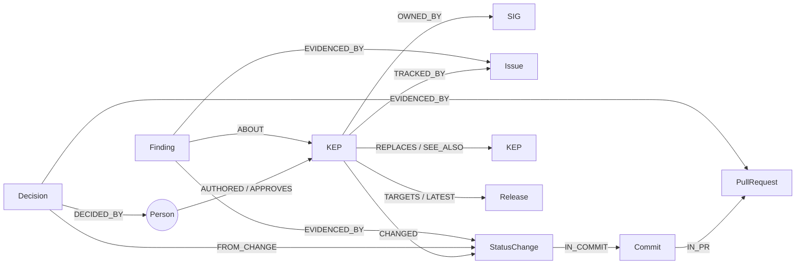
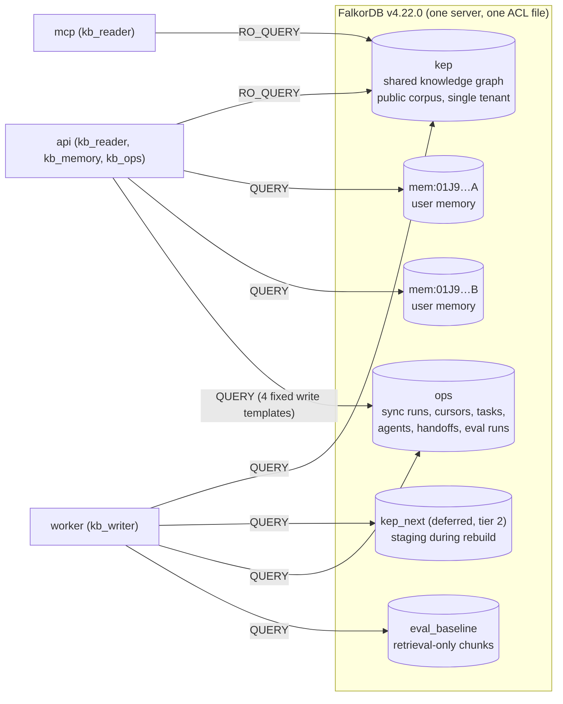
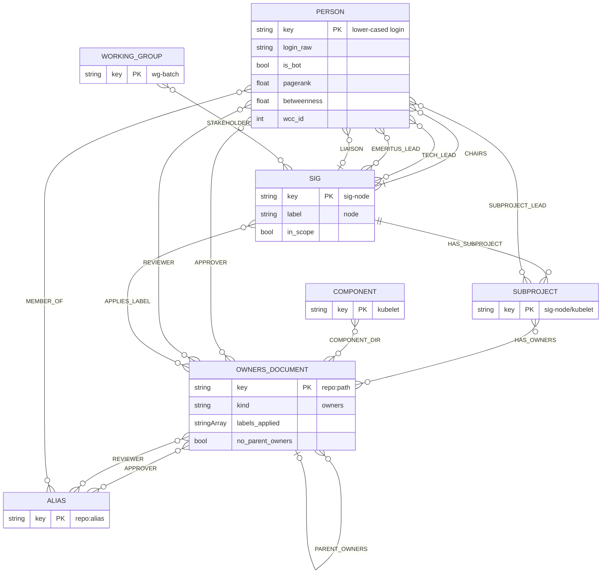
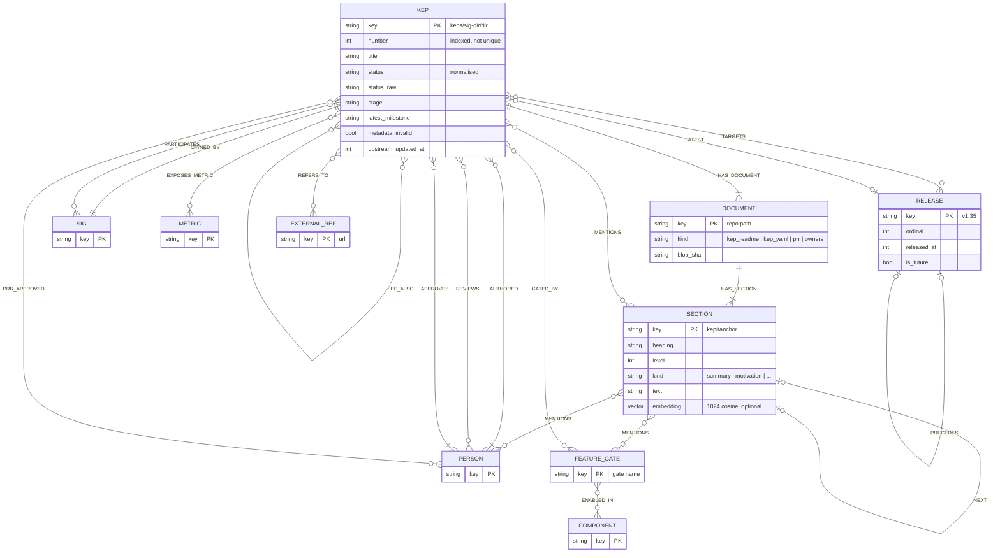
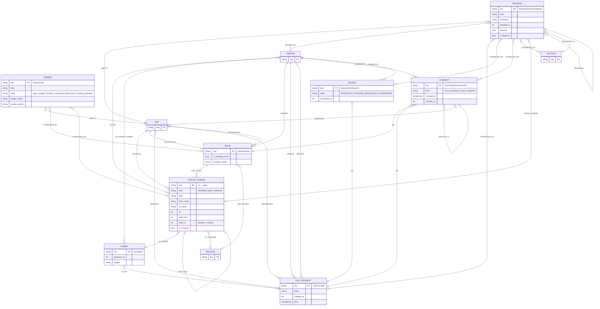
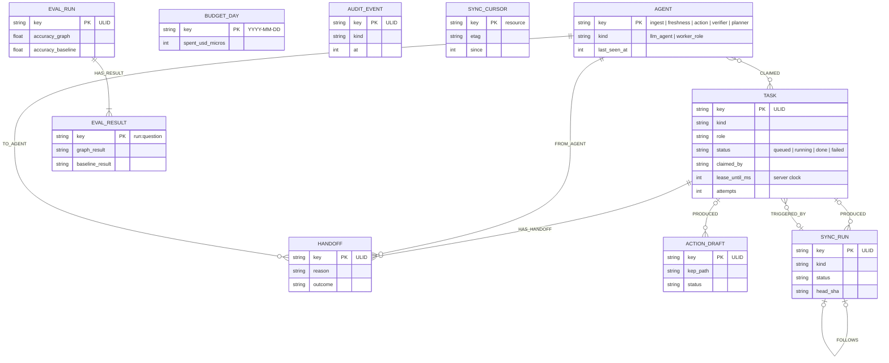
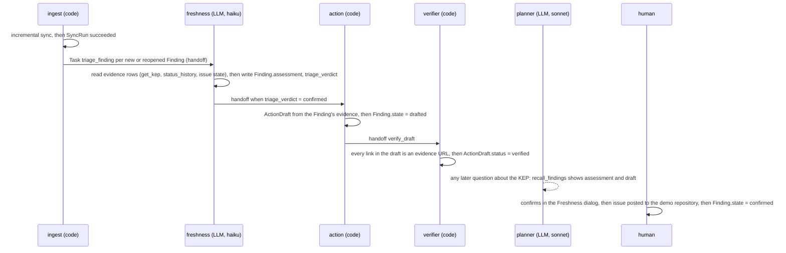
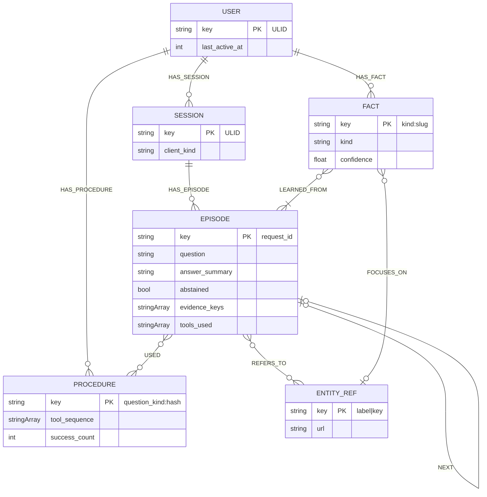

# 03 · KEP Brain — FalkorDB graph model

| | |
|---|---|
| Status | Draft **v1.2** for team review. Graph-model sketch only (Rule 8): no source files, manifests or paste-ready query catalog. v1.1 (2026-10-12) was a consistency pass. **v1.2 (2026-10-12) resolves the second design review** (15 findings; map in §0.5). It changes the design in these places: the narrow job and a v1 tool set of 14 (§0.1, §15.0); the contradiction kinds, recounted against live data (§7.5); graph-level staleness in place of per-node `last_seen_at` (§7.4); validity closure by per-document set difference with interval identity (§3.3); OWNERS/`sigs.yaml` validity from first observation (§7.6); a fenced, single-task lease claim on the server clock (§10.1); hub-penalised path search with deterministic ordering (§5.0, §14, tools 13/20–22); a pre-`MERGE` PII assertion with auto-redaction (§9); a shared organisational memory, `Finding`, written by an LLM triage agent and read by the planner and MCP (§4.7, tool 30); B13/B7/B2/B17 of `06` folded in (`kb_ops`, `BudgetDay`, `AuditEvent`, `Chunk.text` full-text, unprefixed settings, MCP list); human ownership of the core artefacts (§20) 2026-10-12: applied 06 §1.6 register (ratified). |
| Authorship | Drafted by an AI assistant as pre-event notes. Every DECISION here is veto-able by the human owner named by role in §20, and the human owners write the artefacts listed there by hand after 00:01 IST on 2026-10-15 |
| Date | 2026-10-11/12 (IST) |
| Authoritative for | Graph names, node labels, relationship types, property names and types, keys, indexes, constraints, the temporal and provenance conventions, and the tool (query-intent) catalog. `02-architecture.md` §5 and §7 and the ADRs defer to this document for names; §17 lists the deltas they must adopt. |
| Companion docs | `01-recon-kubernetes-data.md` (data facts; its decisions D1–D12 are adopted), `02-architecture.md` (processes, ACL users, API contract), `05-ui-brief.md` (what the UI needs from evidence and paths), `adr/0006` (graph families), `adr/0008` (MERGE discipline) |
| Chosen SIGs | `sig-node`, `sig-scheduling`, `sig-apps` (recon §7) |
| FalkorDB | `falkordb/falkordb:v4.22.0` (C engine). Every syntax form below was opened at docs.falkordb.com on 2026-10-11/12; see the verification ledger in §18. |

Tags used below: **VERIFIED** (opened at the source, URL given), **OBSERVED** (measured on a live system), **INFERENCE** (judgement from verified facts), **UNVERIFIED** (could not confirm; day-one check scheduled), **DECISION (veto-able)** (a choice with its one-line reason and the alternative).

> **Rule 8 note.** This document sketches the graph model and the shape of each query intent in prose and short illustrative patterns. The DDL forms quoted in §12–§13 are the documented FalkorDB syntax with our label and property names substituted so the team can check them; the actual schema module, the ingestion code and the tool templates are written from 2026-10-15 00:01 IST. The event FAQ ("Can I continue an existing project?") reads: "You may reuse general libraries, templates, and infrastructure." and "The submission and its main FalkorDB implementation must be new work completed during the event." (VERIFIED, https://www.wemakedevs.org/hackathons/falkordb, main event page, opened 2026-10-12; it is not on `/rules`). This model *is* the main FalkorDB implementation, so it takes **no dependency on any pre-event code**: the schema module, the tool templates and the FalkorDB access layer are written after 00:01 from this note (§20), and this folder is committed in its own commit labelled "pre-event notes (Rule 8)", separate from any code commit (§17).

---

## 0. Summary and reading guide

### 0.1 The one narrow job (DECISION, veto-able)

> **KEP Brain audits Kubernetes' decision records: it finds where KEP metadata, tracking issues and replacement links disagree, shows who decided each state and on what evidence, and drafts the fix.**

The checkable outcome is a number: on the 2026-10-12 snapshot the five contradiction predicates of §7.5 flag **47 distinct KEPs** in the three loaded SIGs (39 + 8 + 5 + 3 + 1 hits; counts and every hit in `D:\kep-brain\.recon\eval\contradiction-counts.json`, derived from `census-three-sigs.json` and a GraphQL fetch of all 234 tracking issues on 2026-10-12, OBSERVED). The product reports the same predicates over the live graph. A human hand-checks every hit before the freeze and the README publishes precision, not just the count (§20, H3). The hero is **`find_contradictions` + `trace_decision`**: a disagreement between the project's own records, then the people, PR and commit behind each side of it. Everything else in this document either serves that job or carries the T01/T02 layers.

Alternative: the v1.1 framing ("why / who decided / who owns / who knows / is it current" across 29 tools). Rejected because the organisers' advice quoted in the planning notes §2 rewards "one narrow job done end to end", and because "why did we decide X" alone is a T03 cliché (the planning notes §3) that two listed competitors (`volfiros/axon-brain`, `RAJ-A58/NodeOps`) already cover in part.

### 0.2 v1 scope in one table

| | v1 (built first, on the judge path or carrying a track) | Deferred (built only if every v1 card has landed; order in §15.0) |
|---|---|---|
| LLM-callable tools | 14: `find_entities`, `get_kep`, `who_approves`, `who_owns`, `trace_decision`, `status_history`, `whats_changed`, `find_contradictions`, `kep_relations`, `path_between`, `rank_people`, `draft_stale_doc_issue`, `recall_memory`, `recall_findings` | 13: `get_kep_section`, `search_sections`, `who_knows`, `sig_overview`, `person_profile`, `feature_gate_lookup`, `release_scope`, `thread_digest`, `cross_sig_map`, `impact_of`, `person_to_decision`, `community_of`, `bridge_people` |
| System (code-invoked, never LLM-callable) | `freshness` (now the freshness block of every answer, §7.4), `remember`, `coordinate` | — |
| Judge path (five steps, `06` B19) | STA-04, DEC-07, DEC-01, MH-07, ABS-10 (question IDs, `04`). Hand-written templates (§20): `find_contradictions`, `trace_decision`, `kep_relations`, `path_between`, and the `find_entities` nearest match; `get_kep` is agent-written, human-reviewed | directory ownership (`who_owns(directory_path)`) is **not** on the judge path or in the video |
| Algorithms | `algo.pageRank`, `algo.betweenness` (analytics + `rank_people`), `algo.SPpaths` (`path_between`) | `algo.WCC`, `algo.labelPropagation`, `algo.SSpaths`, `algo.bfs` |

### 0.3 The model in one picture (what a team member must be able to explain, Rule 12)

The hero path touches 10 of the 42 labels. Explain-back starts here (§20).

A `Finding` is a contradiction the freshness agent has triaged: it is attached to the KEP and to the two records that disagree. `trace_decision` walks `Decision → DECIDED_BY / EVIDENCED_BY` for each side.

### 0.4 Inventory

1. **Four graph families in one FalkorDB** (§2): `kep` (the shared knowledge graph, one tenant, public corpus, **plus the shared organisational memory `Finding`**), `ops` (coordination, cursors, eval runs, budget and audit), `mem:<ULID>` (one graph per user), `eval_baseline` (vector and full-text chunks for the honest RAG comparison). No second datastore.
2. **Every node has one natural `key` string and a provenance envelope** (§3, §8): `source_url`, `source_repo`, `source_path`, `source_sha`, `observed_at`, `content_hash`. Every state-bearing edge carries `valid_from`/`valid_to`/`valid_from_basis`/`observed_at`/`source_url` (§7). This is what lets every answer cite and every "is this still current" become a one-hop filter.
3. **42 primary node labels (plus 2 secondary) and 84 relationship types** (67 in `kep`, 8 in `ops`, 9 in `mem`) across the four families (§4–§5, §10–§11). v1.2 adds `Finding` (`kep`), `BudgetDay` and `AuditEvent` (`ops`, `06` B13) and no new relationship type (`Finding` reuses `ABOUT` and `EVIDENCED_BY`).
4. **History is reified**: a `StatusChange` node per field change, chained by validity intervals, so "what changed since v1.33" and "is this stage still current" are each a single indexed traversal (§7). **Decisions are reified**: a `Decision` node per status transition, stage graduation, PRR approval or replacement, with `DECIDED_BY` people and `EVIDENCED_BY` PRs, reviews, comments and commits (§8).
5. **Index plan** (§12): a range index on `key` for every label plus 22 secondary range indexes in `kep`; full-text indexes on 9 labels; one vector index (`Section.embedding`, dimension 1024, cosine) behind a switch, plus full-text and vector on `eval_baseline.Chunk`. **Constraints** (§13).
6. **Rule 6 is enforced in the model** (§9): no label has an e-mail-bearing property; the property allow-list is the schema; scrubbing precedes hashing; every row is re-checked before `MERGE` on every path (full and incremental); a post-sync scan redacts in place and alerts.
7. **30 query intents** (§15), of which 14 are v1 LLM tools and 3 are system tools; each with parameters, traversal shape, result shape, why it is graph-native and what breaks without FalkorDB.

Read §0.1–§0.3 first, then §1–§3 (conventions), §4–§8 (the model), §10 (coordination), §12–§14, §15 (tools), §20 (who owns what). §17 lists what the sibling documents must change; §19 lists veto-able decisions and open questions.

### 0.5 Review round 2: where each finding is resolved

| # | Finding (area, severity) | Outcome | Where |
|---|---|---|---|
| R1 | Pre-event scaffolding (cross-cutting, blocker) | 03 takes no code dependency; separate "pre-event notes" commit; archive-and-regenerate is `06`'s decision, recorded as a delta; FAQ clause VERIFIED | Rule 8 note, §17, §18 |
| R2 | Rules 11–13: thin human record (cross-cutting, blocker) | Human owners and hand-written artefacts named; explain-back per checkpoint; model reduced to a one-page core | §0.3, §20 |
| R3 | Freshness flagship cannot detect its demo cases (03, major) | Accepted. Two kinds added, `status_label_conflict` folded in (0 hits today), `declared_approver_never_approved` dropped, `stage_mismatch` restricted to closed issues; counted on live data; 4671 claims removed here and listed for 01/02/adr 0019; 4381 relabelled "follow-up milestone, not a contradiction" | §7.5, tool 12, §17 |
| R4 | T02 thin; agents are cron roles (cross-cutting, major) | Accepted in substance, placement changed: shared memory is `Finding` in `kep` (not a separate `org_memory` graph); LLM triage agent; `recall_findings` on MCP; multi-session memory eval specified; "agent memory" wording rule | §4.7, §10, §11, tool 30, §17 |
| R5 | Weak differentiation from NodeOps (cross-cutting, major) | Accepted. Hero = contradictions + decision lineage; `impact_of` reframed as lineage and deferred; "blast radius" removed; directory ownership off the judge path | §0.1, §0.2, tools 13 and 20, §17 |
| R6 | Platform, not a narrow job (cross-cutting, major) | Accepted with one change: v1 keeps `who_owns` (14 LLM tools, not 12) | §0.1, §0.2, §15.0 |
| R7 | README lacks literal Cypher (03, minor) | Accepted for the README (generated from the registry); 03 itself stays prose under Rule 8 | §15 conventions, §17 |
| R8 | Lease claim re-claims finished tasks and claims many (03, major) | Accepted; plus fencing and attempt cap | §10.1, tool 29 |
| R9 | Everything stale after 24 h (03, major) | Accepted: graph-level staleness; node `last_seen_at` removed | §4.0, §7.4, tool 11 |
| R10 | Validity closure has no mechanism; edge identity breaks history (03, major) | Accepted | §3.3, §5.0, §7.6 |
| R11 | Paths through bots and hubs; nondeterministic truncation (03, major) | Accepted with different weights (SIG edges cost 4, not 50, because org paths are explanatory) | §5.0, §14, tools 13, 20, 21, 22 |
| R12 | PII invariant only protects rebuild (03, minor) | Accepted | §9 G4, G5 |
| R13 | OWNERS/`sigs.yaml` history needs clones never made (03, minor) | Accepted: first observation + snapshot closure | §7.6, §19.2 |
| R14 | Contracts contradict each other (cross-cutting, major) | 03 adopts B2/B7/B13/B17 now; obsolete-name list with per-file counts for the grep check | §2, §10, §12, §15, §17.2 |
| R15 | Rule 8 exposure with no fallback (cross-cutting, major) | Not a 03 change; delta recorded for `06` (HUM-00c question, INF-00b fallback card, separate notes commit) | §17 |

---

## 1. Modelling principles

| # | Principle | Why |
|---|---|---|
| P1 | **Natural keys, never internal ids.** Every node has a `key` string; FalkorDB's `id()` "is not immutable" (VERIFIED, https://docs.falkordb.com/cypher/functions), so ids are never persisted, cited or used across requests. | Idempotent `MERGE`, stable evidence ids, blue/green rebuild without id drift. |
| P2 | **Reify what must be cited or dated.** Status changes, decisions, label events and handoffs are nodes, not edge properties. | An edge cannot be the target of `EVIDENCED_BY`; a node can carry `source_url` and be an evidence object. |
| P3 | **Two time axes.** Event nodes carry `at`; state edges carry `valid_from`/`valid_to`; everything carries `observed_at` (when we fetched it). Freshness of the graph as a whole is a property of the last successful `SyncRun`, never of a per-node "seen" stamp (§7.4). | "What changed since X" (event axis), "was this true at X" (validity axis), "how fresh is this" (observation axis) are different questions. |
| P4 | **Ints for time, ISO twins for display.** Epoch seconds in `*_at`/`valid_*`, and the same instant as an ISO-8601 string in `*_iso`. | Range indexes cover numerics (VERIFIED, range-index docs); FalkorDB lists "Temporal arithmetic functions" as unsupported (VERIFIED, cypher-support). |
| P5 | **Absence is null; one sentinel.** FalkorDB cannot store `null` or maps as property values (VERIFIED, https://docs.falkordb.com/datatypes). A missing fact is a missing property. The only sentinel is `valid_to = 4102444800` (2100-01-01T00:00:00Z) meaning "still valid". | Lets "valid at T" be one range predicate `valid_from <= T < valid_to`, which "absent means current" cannot express. |
| P6 | **Raw beside normalised.** `status` and `status_raw`, `stage` and `stage_raw`, `participating_raw`, `date_raw`. | 11 invalid enum values and free-text references exist (recon §3.5). The Brain can show the contradiction instead of hiding it. |
| P7 | **Aliases stay as nodes.** `OWNERS` approvers that are aliases point at `Alias` nodes, expanded by `MEMBER_OF` at query time. | "Approved via `sig-node-approvers`" is checkable provenance (recon D9). |
| P8 | **Derived facts are marked.** Inverse `SUPERSEDED_BY`, `COLLABORATED`, `CONTRIBUTED_TO`, centrality properties and extracted decisions carry `derived = true` and the run id that produced them. | Judges can tell what the data says from what we computed. |
| P9 | **The property allow-list is the schema.** Only the properties named in §4–§5, §10–§11 may be written; the writer validates rows against the generated allow-list before `MERGE`. | Rule 6 by construction (§9); no stray fields such as the `name`/`id` tooling keys found in 5 `kep.yaml` files. |
| P10 | **Single labels, two optional super-labels.** Each node has one primary label. `Ticket` (on `Issue` and `PullRequest`) and `OwnersFile` (on `Document {kind: owners}`) are the only secondary labels, and no tool template depends on them. | Multi-label nodes and `labels(n)` are documented (VERIFIED, https://docs.falkordb.com/cypher/remove shows `(lori :Player:Admin …)`); `MERGE` onto a two-label pattern is UNVERIFIED on 4.22.0 (day-one test; fallback is the `kind` property). |

Naming: labels `PascalCase`; relationship types `UPPER_SNAKE`; properties `snake_case`; graph names lower-case. Direction reads left to right in every table.

---

## 2. Graph inventory and multi-tenancy

| Graph | Tenancy | Written by | Read by | Contents | Lifetime |
|---|---|---|---|---|---|
| `kep` | shared, one tenant | `worker` only (`kb_writer`), including the `Finding` nodes the freshness agent writes (§4.7) | `api`, `mcp` via `GRAPH.RO_QUERY` as `kb_reader` | §4–§5: the Kubernetes "company": people, SIGs, KEPs, documents, sections, tickets, chats, history, decisions, analytics, and the shared organisational memory (`Finding`) | permanent; replaced atomically by `kep_next` on rebuild (blue/green rebuild deferred, tier 2), with `Finding`s carried across (below) |
| `kep_next` (deferred, tier 2) | staging | `worker` | `worker` verification | a full load during `rebuild`; then every `Finding` and its `ABOUT`/`EVIDENCED_BY` edges are copied from `kep` by natural key (an edge whose target key no longer exists is dropped and the finding's `state` becomes `resolved_upstream`); then swapped with `GRAPH.DELETE kep` → `GRAPH.COPY kep_next kep` → `GRAPH.DELETE kep_next` (ADR 0008) | minutes |
| `ops` | shared | `worker` (`kb_writer`) for every label; `api` (`kb_ops`, ACL key pattern `~ops`, `06` B13) for exactly four fixed write templates: create `Task` (status `queued`), create `ActionDraft` and compare-and-set its `status`, upsert `BudgetDay`, create `AuditEvent` (§10). No tool template the LLM can call writes here | `api` (`kb_reader`, `kb_ops`), `worker` | §10: `SyncRun`, `SyncCursor`, `Task`, `Agent`, `Handoff`, `ActionDraft`, `EvalRun`, `EvalResult`, `AnalyticsRun`, `LoadTestRun`, `BudgetDay`, `AuditEvent` | permanent, pruned by retention |
| `mem:<ULID>` | **one graph per user** | `api` as `kb_memory` (ACL key pattern `~mem:*`) | `api` | §11: `User`, `Session`, `Episode`, `Fact`, `Procedure`, `EntityRef` | until `DELETE /v1/memory/me` or 90 days idle (`memory-gc`) |
| `eval_baseline` | shared | `worker` (eval subcommand) | `worker`, `api` (Eval page reads results from `ops`, not from here) | `Chunk` nodes only: `{key, text, kep_path, url, embedding}` with one full-text index on `text` (arm L) and one vector index on `embedding` (arm V) and **no relationships** (`06` B7) | rebuilt per eval run |

**Naming rules (DECISION, veto-able).** `^mem:[0-9A-Z]{26}$` is validated before any `select_graph` (ADR 0006). Graph names are Redis keys, so `:` is legal; the prefix lets the ACL pattern `~mem:*` scope `kb_memory` to memory graphs only (ACL key patterns VERIFIED at https://docs.falkordb.com/commands/acl). Alternative: `mem_<ULID>` with `~mem_*`; same properties, rejected only because `mem:` is already in the architecture and ADRs.

**Why a graph per user rather than a `User` subtree in one graph.** Isolation by key: `kb_memory` cannot read or write `kep`; a bug in a memory template cannot leak another user's episodes; "forget me" is one `GRAPH.DELETE` (ADR 0006). The cost is that cross-user analytics would need a scan over graphs, which the product never needs.

**Why `eval_baseline` is a graph with no edges (DECISION, veto-able).** The proof page compares "graph agent" against retrieval-only baselines. Putting the baseline's chunks, their full-text index and their vectors in FalkorDB (no edges; one `db.idx.fulltext.queryNodes` call for arm L, one `db.idx.vector.queryNodes` kNN call for arm V) keeps the Rule 3 statement true — there is still no second datastore — while the baselines remain honestly retrieval-only because their *query shape* is a single index call with no traversal. Alternative: a NumPy in-memory index inside the eval process (simpler, but then the comparison runs on two different engines and judges may read it as a second store).

**Cross-graph references** are by natural key only (`kep_path`, `login`, `request_id`); the application resolves them with a second read (ADR 0006). There are no cross-graph edges.

---

## 3. Identity: keys, evidence ids and MERGE discipline

### 3.1 Key formats (the `key` property; one per label; unique)

| Label | `key` format | Example | Why this key |
|---|---|---|---|
| `SIG` | `sigs.yaml` `dir` | `sig-node` | matches `keps/<dir>` and `owning-sig` (recon §4.2) |
| `WorkingGroup` | `dir` | `wg-batch` | same file, same convention |
| `Committee` | `dir` | `committee-steering` | same |
| `Subproject` | `<sig dir>/<name>` | `sig-node/kubelet` | subproject names repeat across SIGs |
| `Person` | lower-cased GitHub login, no `@` | `sergeykanzhelev` | logins are case-insensitive; casing varies across files (recon Q6, D2) |
| `Alias` | `<repo>:<alias>` | `kubernetes/kubernetes:sig-node-approvers` | two repos define aliases (k/k root and enhancements) |
| `Document` | `<repo>:<path>` | `kubernetes/enhancements:keps/sig-node/1287-in-place-update-pod-resources/README.md` | path-stable across commits; the version is `source_sha` |
| `KEP` | `keps/<sig-dir>/<dir>` (repository path, no file) | `keps/sig-node/1287-in-place-update-pod-resources` | `kep-number` is not unique (2133 twice; `0000` shared) and number+SIG breaks on 2133 (recon Q1, D1) |
| `Section` | `<KEP key>#<anchor>` | `keps/sig-node/1287-…#implementation-history` | anchors are GitHub's heading slugs, deduplicated with `-1`, `-2` as GitHub does |
| `FeatureGate` | gate name | `InPlacePodVerticalScaling` | unique by Kubernetes convention |
| `Component` | component name | `kubelet` | |
| `Metric` | metric name, lower-cased, PromQL selector stripped to the metric name | `kubelet_pod_resize_duration_seconds` | recon §3.3: some metrics are written as PromQL selectors |
| `Release` | minor version | `v1.35` | `latest-milestone` and `milestone.*` are minor versions |
| `Label` | label name | `stage/beta` | label names are shared across Kubernetes repos |
| `ExternalRef` | the URL, normalised (scheme+host lower-cased, fragment kept) | `https://docs.google.com/document/d/…` | unresolvable `see-also`/`replaces` targets (recon Q8) |
| `Commit` | `<repo>@<sha>` | `kubernetes/enhancements@d47a8df46c…` (full 40-char sha) | |
| `PullRequest` | `<repo>#<number>` | `kubernetes/enhancements#5761` | |
| `Issue` | `<repo>#<number>` | `kubernetes/enhancements#1287` | tracking issue number == KEP number (recon §3.8) |
| `Review` | `<repo>/pulls/reviews/<id>` | `kubernetes/enhancements/pulls/reviews/2968…` | mirrors the REST resource path; review ids and comment ids are different id spaces |
| `Comment` | `<repo>/issues/comments/<id>` or `<repo>/pulls/comments/<id>` | `kubernetes/enhancements/issues/comments/3123…` | mirrors the REST resource path for issue comments and review comments |
| `StatusChange` | `sc:<KEP key>:<field>:<commit sha>` for metadata changes; `ghe:<GraphQL event id>` for label/milestone events | `sc:keps/sig-node/1287-…:status:d47a8df46c…`, `ghe:LE_lADOA3OuhM6…` | one change per field per commit; GitHub timeline events implement `Node` and expose `id: ID!` (VERIFIED by live GraphQL introspection with `gh`, 2026-10-12) |
| `Decision` | `dec:<kind>:<KEP key>:<discriminator>` | `dec:status_transition:keps/sig-node/1287-…:d47a8df46c…`, `dec:prr_approval:keps/sig-node/1287-…:beta`, `dec:design_choice:keps/sig-node/1287-…:alternatives:2` | deterministic from the evidence that defines the decision (§8.2) |
| `Finding` | `fnd:<kind>:<KEP key>` (for `one_sided_replacement` the KEP is the predecessor and the successor key is appended after `:`) | `fnd:active_status_closed_issue:keps/sig-scheduling/583-coscheduling` | one finding per predicate per KEP; re-detection after resolution reopens the same node (§4.7) so the history of a contradiction stays on one node |

`ops` and `mem` keys are in §10 and §11.

### 3.2 Evidence ids

`evidence_id = base32(sha1(label + "|" + key))[:12]`. It is computed by the API from the two strings every row carries, is identical across tool calls in one request and across requests, and never depends on `id()`. The claim validator (architecture §6.3) accepts a claim only if each cited `evidence_id` was produced by a tool result in the same request.

### 3.3 MERGE discipline (adopts ADR 0008)

- Nodes: `MERGE` on `(:Label {key})`, `ON CREATE SET` the full property map, `ON MATCH SET` only when the row's `content_hash` differs from the stored one. The `content_hash` is SHA-256 over the canonical JSON of the row **after** PII scrubbing (§9).
- Edges: merged in a separate clause after both endpoints are matched (FalkorDB warns that merging a whole path creates duplicates when any element is missing; VERIFIED, https://docs.falkordb.com/cypher/merge). A **non-state** edge's identity is `(from key, type, to key)` plus, for multi-instance edge types, the discriminating property listed in §5 (for example `PRR_APPROVED.stage`, `MENTIONS.match_kind`). A **state** edge's identity is one validity *interval*: `(from key, type, to key, discriminator, valid_from)`. The open interval is the one whose `valid_to` is the sentinel; at most one open interval exists per `(from, type, to, discriminator)`.
- Batches: `UNWIND $rows AS r` with 500 rows per query, `timeout = 30000` ms, under `TIMEOUT_MAX 60000`. `LIMIT` does not stop eager operations (VERIFIED, https://docs.falkordb.com/cypher/known-limitations), so batch size is the caller's job.
- Soft deletes: `archived = true`, `archived_at`; hard deletes only on rebuild. Tools filter `archived` out by default (a boolean filter after a keyed lookup; booleans are not among the indexed types, which is fine because every tool starts from a keyed or full-text-matched node).
- **Validity closure (per source document, one atomic query).** `MERGE … ON CREATE/ON MATCH` cannot notice that something is absent, so state edges are never written row by row. The writer groups them by **source document** and edge type: one `kep.yaml` revision, one PRR file revision, one OWNERS file, one alias in `OWNERS_ALIASES`, one `sigs.yaml` entry (SIG, WG, committee or subproject), one issue's current label set and milestone. For each group it sends one write query (FalkorDB queries are atomic, VERIFIED design/concurrency) that does two things with the group's current target set `$current` and the change time `$t`:
  1. **close**: from the document's subject node, every open edge of that type (`valid_to` = sentinel) whose target key is not in `$current` gets `valid_to = $t`;
  2. **open**: for each target in `$current`, `MERGE` the edge *with `valid_to` = sentinel in the pattern*; `ON CREATE SET valid_from = $t` and the rest of the envelope. An open interval already present is matched and untouched; a closed interval is never matched, so a person removed and later re-added gets a **second interval** instead of reopening the first (the gap stays visible).

  `$t` is the commit author date of the revision for the doc layer (§7.6), and the run's `observed_at` for the REST and snapshot layers. An empty `$current` (file deleted, all labels removed) closes every open edge of the group. Nothing that was once true is deleted. The fixture test `test_validity_intervals` removes an approver from an OWNERS file, syncs, re-adds them and syncs again: it expects two `APPROVER` intervals for that person, and `who_owns` returning only the current people at each of the three steps. Whether a relationship `MANDATORY` constraint accepts properties set by `MERGE … ON CREATE SET` is the INF-02 check 12 of `06`; the fallback replaces the `MERGE` in step 2 with "match an open edge; where none exists, `CREATE` it with the full envelope in the pattern", which keeps the same identity rule without relying on `ON CREATE SET` (a `MERGE` that put `valid_from` in the pattern is *not* the fallback: on the snapshot layer `$t` changes every run and would create a duplicate open edge each time).

---

## 4. Node labels in `kep`

### 4.0 The provenance envelope (every node in `kep`)

| Property | Type | Meaning |
|---|---|---|
| `key` | string | natural key (§3.1); unique per label |
| `source_url` | string | the exact public GitHub URL the node was built from: a file at a pinned commit (`https://github.com/<repo>/blob/<sha>/<path>`), an issue, a PR, a comment anchor, a commit |
| `source_repo` | string | `kubernetes/enhancements`, `kubernetes/community`, `kubernetes/kubernetes` |
| `source_path` | string | repository path when the source is a file (absent otherwise) |
| `source_sha` | string | blob/commit sha the node reflects (absent for API objects, which carry `updated_at` instead) |
| `observed_at`, `observed_at_iso` | int, string | when the worker fetched the source that produced the current property values (it changes only when the row is written) |
| `first_seen_at` | int | the first sync that created the node |
| `content_hash` | string | SHA-256 of the scrubbed canonical row |
| `sync_run_id` | string | `SyncRun.key` of the last write |
| `archived`, `archived_at` | bool, int | soft delete (§3.3); `archived_at` absent while live. Doc-layer deletions are detected from `git diff --name-status` (`D` entries), so no per-node "last seen" stamp is needed to archive |

v1.1 also had `last_seen_at` ("most recent sync that saw the source"). **Removed in v1.2** (DECISION, veto-able): under diff-based incremental sync an unchanged node is never written, so the stamp was either false (and made every KEP look stale after 24 h, review finding R9) or cost a write to every node on every 15-minute tick. Staleness is defined at graph level instead (§7.4). Alternative: one bulk `SET last_seen_at` per layer after each successful sync (≈ 3,000 doc-layer writes per tick, and the idempotency test of `06` GR-02 would have to exclude it); rejected because it buys nothing the `SyncRun` does not already say.

For entity nodes that are introduced by a mention rather than by a file of their own (`Person`, `FeatureGate`, `Component`, `Metric`, `Label`, `Release` before its GitHub release exists), `source_url` is the first source that introduced the node in the current graph build (the `kep.yaml` blob, the `sigs.yaml` blob, the OWNERS blob or the ticket), and every later source is reachable through the node's edges, each of which carries its own `source_url`. `Release` switches its `source_url` to the GitHub release page once `released_at` is known.

Properties below are **in addition** to the envelope. Types are FalkorDB's: `string`, `int` (64-bit), `float`, `bool`, `string[]` (array of strings; arrays of scalars are storable and range-indexable, VERIFIED range-index docs), `vector` (`vecf32`). A property marked *opt* is absent when unknown (P5).

### 4.1 Organisation

**`SIG`** — a Special Interest Group from `sigs.yaml` (24; all loaded, cheap). Source: https://github.com/kubernetes/community/blob/master/sigs.yaml.

| Property | Type | From |
|---|---|---|
| `name` | string | `dir` (same as key) |
| `display_name` | string | `name` (`Node`) |
| `label` | string | `label` (`node`); GitHub label is `sig/<label>` |
| `mission` | string | `mission_statement`, scrubbed |
| `charter_url` | string | `https://github.com/kubernetes/community/blob/master/<dir>/<charter_link>` |
| `slack_channel` | string | `contact.slack` (`#sig-node`) |
| `mailing_list_url` | string *opt* | `contact.mailing_list` (public Google Group URL; never the private list) |
| `github_teams` | string[] | `contact.teams[].name` |
| `in_scope` | bool | true for the three chosen SIGs (KEPs, tickets and OWNERS loaded); false for the other 21 (org chart only) |

**`WorkingGroup`** (9) and **`Committee`** (3): same properties as `SIG` minus `in_scope`; `WorkingGroup.stakeholder_sigs: string[]` (SIG keys) in addition. The `wg/*` labels on tracking issues attach to these nodes.

**`Subproject`** (238 total; 36 in the chosen SIGs) — `name`, `description` *opt*, `sig` (owning SIG key), `owners_urls: string[]` (the raw OWNERS URLs as written). Each resolvable URL inside the loaded repos becomes a `HAS_OWNERS` edge to a `Document {kind: owners}`.

**`Person`** — anyone identified by a GitHub login anywhere in the corpus (≈700 core, ≈3,000 with k/k tickets; recon §7.3).

| Property | Type | From / rule |
|---|---|---|
| `login` | string | lower-cased login (same as key) |
| `login_raw` | string | casing as first seen; replaced by the API casing when a ticket author object is seen |
| `name` | string *opt* | `sigs.yaml` leadership `name` only, scrubbed; stored only while `STORE_PERSON_NAME_COMPANY=true` |
| `company` | string *opt* | same rule as `name` |
| `url` | string | `https://github.com/<login>` |
| `is_bot` | bool | login ends with `[bot]` or is in the known-bot list `k8s-ci-robot`, `k8s-triage-robot`, `fejta-bot`, `k8s-merge-robot`, `dependabot`; bots are excluded from centrality |
| `pagerank`, `betweenness` | float *opt* | analytics (§14); absent until the first run |
| `wcc_id`, `lp_community_id` | int *opt* | `algo.WCC` component and `algo.labelPropagation` community (§14) |
| `analytics_run_id` | string *opt* | `AnalyticsRun.key` that wrote the four properties above |
| `kep_edges_count` | int | denormalised count of `AUTHORED`+`REVIEWS`+`APPROVES`+`PRR_APPROVED` edges, refreshed per sync (for cheap sorting on Explore) |

No `email`, no `mail`, no phone, no avatar, no profile text — ever (§9).

**`Alias`** — an entry in a root `OWNERS_ALIASES` (74 in k/k, 47 in enhancements). `name`, `repo`, `member_count`. Members via `MEMBER_OF`.

### 4.2 Documents and sections

**`Document`** — one source file we parse. Primary label for every file-shaped source; the secondary label `OwnersFile` is added when `kind = owners` (P10).

| Property | Type | Notes |
|---|---|---|
| `kind` | string | `kep_readme`, `kep_yaml`, `prr`, `owners`, `owners_aliases`, `sigs_yaml`, `kep_template` |
| `repo`, `path` | string | components of the key |
| `title` | string | KEP title for `kep_readme`/`kep_yaml`; path basename otherwise |
| `blob_sha` | string | git blob sha at the pinned head |
| `last_commit_sha`, `last_commit_at` | string, int | last commit touching the path (doc layer, from `git log`) |
| `byte_size`, `section_count` | int, int | |
| `labels_applied` | string[] *opt* | `owners` only: the `labels:` list (`sig/node`, `area/kubelet`) |
| `no_parent_owners` | bool *opt* | `owners` only: `options.no_parent_owners` |
| `has_filters` | bool *opt* | `owners` only: file uses `filters:` (8 files; the `.*` block is ingested, other regex blocks are stored in `filters_raw`) |
| `filters_raw` | string *opt* | `owners` only |
| `raw_hash` | string | SHA-256 of the raw file (pre-scrub) so re-fetch decisions do not depend on scrubbing changes |

**`Section`** — a README chunk at a `##` boundary, split at `###` only when the `##` block exceeds 6 KB (recon D8; ≈2,200 sections for the three SIGs).

| Property | Type | Notes |
|---|---|---|
| `kep_path` | string | owning KEP key (denormalised for one-hop filters) |
| `anchor` | string | GitHub heading slug |
| `heading` | string | heading text |
| `level` | int | 2 or 3 |
| `order` | int | position in the document |
| `text` | string | scrubbed Markdown body, fenced code kept |
| `char_count` | int | |
| `url` | string | `source_url` of the parent document + `#` + anchor |
| `kind` | string | normalised heading class: `summary`, `motivation`, `goals`, `non_goals`, `proposal`, `design_details`, `graduation_criteria`, `upgrade_downgrade`, `version_skew`, `prr_questionnaire`, `implementation_history`, `drawbacks`, `alternatives`, `other` (recon §3.11 heading census) |
| `embedding` | vector *opt* | `vecf32` of dimension 1024 (§12.2); present only when `EMBEDDINGS_ENABLED=true` |
| `embedding_model` | string *opt* | provider model id that produced `embedding` |
| `dated_bullets` | int *opt* | `implementation_history` only: count of `- YYYY-MM-DD` bullets (feeds extracted decisions, §8.2) |

### 4.3 Enhancement core

**`KEP`** — one directory `keps/<sig-dir>/<dir>` with a `kep.yaml` (232 owned by the chosen SIGs plus ≈5 stubs referenced from outside, `stub = true`). A stub is a KEP owned by another SIG that a loaded KEP names in `replaces`, `superseded-by` or `see-also`; because the whole enhancements repository is cloned (ADR 0007), the stub is read from its own `kep.yaml` and carries the envelope plus `path`, `dir_prefix`, `number`, `title`, `owning_sig`, `sig_dir`, `status`, `status_raw`, `stage`, `stage_raw`, `metadata_invalid`, `url` and `upstream_updated_at`, which satisfies every `MANDATORY` constraint in §13. It has no sections, people edges, tickets or history; `summary` is absent, and tools label it "outside the loaded SIGs". A referenced path that does not exist in the clone becomes an `ExternalRef` instead.

| Property | Type | From / rule |
|---|---|---|
| `path` | string | same as key |
| `dir_prefix` | string | directory number prefix (`0752`, `2043`), kept separately because it can differ from `kep-number` (recon Q2) |
| `number` | int *opt* | `kep-number`; absent when not an integer (`NNNN` template); **indexed, not unique** |
| `title` | string | |
| `owning_sig` | string | `owning-sig` as written; the `OWNED_BY` edge comes from this, not from the directory (recon Q3) |
| `sig_dir` | string | the directory's SIG segment |
| `status`, `status_raw` | string | normalised enum (`provisional`, `implementable`, `implemented`, `deferred`, `rejected`, `withdrawn`, `replaced`) and the raw string; map from recon Q4 |
| `stage`, `stage_raw` | string *opt* | normalised (`alpha`, `beta`, `stable`, `deprecated`, `disabled`, `removed`) and raw |
| `latest_milestone` | string *opt* | normalised `v1.NN`; placeholders `0.0`, `TBD`, `never`, `""` become absent (recon Q10) with the raw string in `latest_milestone_raw` |
| `milestone_alpha`, `milestone_beta`, `milestone_stable`, `milestone_deprecated`, `milestone_disabled`, `milestone_removed` | string *opt* | normalised `v1.NN` (also edges `TARGETS {stage}`) |
| `creation_date`, `last_updated` | string *opt* | ISO date after tolerant parsing; `creation_date_raw`, `last_updated_raw` keep the original (recon Q5) |
| `editor` | string *opt* | login |
| `disable_supported` | bool *opt* | |
| `participating_raw` | string[] *opt* | values that are not `sig-*`, `wg-*`, `committee-*` (recon Q7) |
| `see_also_raw`, `replaces_raw`, `superseded_by_raw` | string[] *opt* | the strings as written, always kept (recon Q8) |
| `metadata_invalid` | bool | any normalisation hit (recon Q4, Q11) |
| `metadata_invalid_reasons` | string[] *opt* | machine-readable reasons |
| `stub` | bool | referenced but outside the loaded SIGs; only `path`, `number`, `title` *opt* |
| `url` | string | `https://github.com/kubernetes/enhancements/tree/<sha>/<path>` |
| `upstream_updated_at` | int | last commit time touching the directory at the ingested head (display only: "last changed upstream"; staleness uses §7.4, not this) |
| `summary` | string *opt* | the `## Summary` section text, truncated to 2,000 chars, for the card and full-text index; absent on stubs |
| `pagerank_topic` | float *opt* | analytics (§14): `algo.pageRank('KEP', 'RELATED_KEP')` over the `RELATED_KEP` projection (§5.6), for "most central KEPs" |
| `wcc_id`, `lp_community_id`, `analytics_run_id` | int, int, string *opt* | as for `Person` |

**`FeatureGate`** — `name`, `components: string[]` (from `feature-gates[].components`), `kep_count` (denormalised). **`Component`** — `name` (`kubelet`, `kube-apiserver`, `kube-scheduler`, `kube-controller-manager`, `kube-proxy`, `cloud-controller-manager`, plus any other string that appears; a curated map links components to OWNERS directories via `COMPONENT_DIR`). **`Metric`** — `name`, `raw: string[]` (the PromQL forms seen). **`Release`** — `name` (`v1.35`), `major`, `minor` (ints), `ordinal` (int, `minor` for v1), `released_at`/`released_at_iso` *opt* (the `published_at` of the first non-prerelease `v1.NN.0` in `kubernetes/kubernetes` releases; the recon cache shows tags such as `v1.37.0`, `v1.37.1`, `v1.38.0-alpha.2` with `published_at` and `prerelease`), `is_future` (bool, no GA release yet), `url`, `milestone_number` *opt* (int) and `milestone_url` *opt* (string). **Release and milestone are one entity** (DECISION, veto-able): a GitHub milestone on `kubernetes/enhancements` is titled with the same minor version, e.g. tracking issue #4671 carries milestone `{title: "v1.38", number: 40, html_url: "https://github.com/kubernetes/enhancements/milestone/40", state: "open"}` (VERIFIED in `.recon/eval/issue-4671.json`), so `MILESTONED`, `TARGETS`, `LATEST` and `TO_RELEASE` all point at the same `Release {key: "v1.38"}`, and "did it ship in the release it targeted" is a comparison on one node. A milestone title that is not `v1.NN` is not mapped to a `Release` and is kept only in `Issue.milestone_current`. Alternative: a separate `Milestone` label joined to `Release`, rejected because it adds a hop to every release question and has no property of its own that the tools use. **`Label`** — `name`, `category` (`sig`, `wg`, `stage`, `tracked`, `kind`, `lifecycle`, `priority`, `area`, `other`), `repos_seen: string[]`. **`ExternalRef`** — `url`, `host`, `ref_kind` (`google_doc`, `design_proposal_archive`, `community_pr`, `other`); never fetched.

### 4.4 History and decisions

**`StatusChange`** — one reified change event. Two sources, one label, so "everything that changed since T" is one indexed scan (DECISION, veto-able; the architecture draft split these into `CHANGED_BY` edge properties and `LabelEvent` nodes, which cannot both be cited and cannot be ordered in one query).

| Property | Type | Notes |
|---|---|---|
| `kind` | string | `metadata` (a `kep.yaml` field changed in a commit), `label` (tracking-issue label added/removed), `milestone` (tracking-issue milestone set/unset) |
| `kep_path` | string | owning KEP key; set for label/milestone events through the tracking issue so one hop from the KEP reaches every change |
| `field` | string | `metadata`: `status`, `stage`, `latest_milestone`, `milestone.alpha`, `milestone.beta`, `milestone.stable`, `milestone.deprecated`, `milestone.disabled`, `milestone.removed`, `approvers`, `reviewers`, `authors`, `participating_sigs`, `replaces`, `superseded_by`, `feature_gates`; `label`: the label name (`stage/beta`); `milestone`: `milestone` |
| `op` | string | `set` (metadata; `from_value` may be absent on first appearance), `added`, `removed` (label), `milestoned`, `demilestoned` |
| `from_value`, `to_value` | string *opt* | normalised scalar values; list-valued fields store the canonical JSON of the list |
| `from_raw`, `to_raw` | string *opt* | raw strings |
| `at`, `at_iso` | int, string | commit author date (metadata) or event `createdAt` (label/milestone) |
| `actor_login` | string *opt* | commit author's login when resolvable through the merged PR (never from the commit e-mail), or the event `actor.login` |
| `seq` | int | order of this change among all changes of the same `kep_path` and `field` |
| `valid_from`, `valid_to` | int | `at` and the next change's `at` for the same `kep_path`+`field`, or the sentinel (P5). The current value of a field is the single `StatusChange` whose `valid_to` is the sentinel |
| `is_reversal` | bool | `to_value` equals the `from_value` of the previous change of the same field (e.g. KEP-1287 `stage/stable` → `stage/beta` 15 minutes later, recon §8.5) |
| `event_id` | string *opt* | GraphQL `id` for `label`/`milestone` kinds |
| `commit_sha` | string *opt* | for `metadata` |

**`Decision`** — a reified "someone decided something about a KEP", derived deterministically from evidence, or extracted from the KEP's own text and marked as such.

| Property | Type | Notes |
|---|---|---|
| `kind` | string | `status_transition` (status field changed), `stage_graduation` (stage or `milestone.*` changed), `milestone_retarget` (`latest-milestone` or a milestone moved to a later release), `prr_approval` (a stage approver in `keps/prod-readiness/<sig>/<n>.yaml`), `replacement` (`replaces`/`superseded-by` declared), `withdrawal` (status became `withdrawn`/`rejected`/`deferred`), `design_choice` (extracted), `alternative_rejected` (extracted) |
| `summary` | string | derived kinds: a deterministic template ("KEP-1287 status changed from implementable to implemented in PR #5761, approved by …"); extracted kinds: ≤ 400 chars written by `claude-haiku-5-5` from one `Section` only |
| `decided_at`, `decided_at_iso` | int, string | merge time of the evidencing PR, PRR file commit time, or the dated bullet's date for extracted decisions (absent if undated) |
| `derived` | bool | true for the six deterministic kinds |
| `human_decider` | bool | false when every `DECIDED_BY` target is a bot (`Person.is_bot`), so answers can say "merged by automation" (§8.2); always true for extracted kinds, which have no `DECIDED_BY` edges and are never attributed to a bot |
| `extraction_model` | string *opt* | model id for extracted kinds |
| `confidence` | float *opt* | 0–1 for extracted kinds (the extractor's self-report; the UI shows it) |
| `stage` | string *opt* | `prr_approval` and `stage_graduation` |
| `from_value`, `to_value` | string *opt* | mirrors the originating `StatusChange` |
| `kep_path` | string | |
| `url` | string | the primary evidence URL (PR, PRR file blob, or section anchor) |

Derivation rules are in §8.2. Extracted decisions are **P1** and switchable (`EXTRACT_DECISIONS`); every extracted decision must have an `EVIDENCED_BY` edge to the `Section` it came from or the worker discards it.

**`Commit`** — a commit in `kubernetes/enhancements` that touched a loaded `kep.yaml`, `README.md` or PRR file (≈2,500; recon §3.10). `sha`, `repo`, `authored_at`, `committed_at` (ints + ISO twins), `subject` (first line, scrubbed; `Signed-off-by`/`Co-authored-by` trailers dropped), `url`, `pr_number` *opt* (parsed from a `Merge pull request #N` first-parent subject or resolved via `GET /repos/{r}/commits/{sha}/pulls`), `author_login` *opt* (only when resolvable from the PR author or a login-bearing API object; the commit's e-mail is never read), `files_changed: string[]` (loaded paths only).

### 4.5 Tickets and chats

**`Issue`** and **`PullRequest`** (secondary label `Ticket` on both, P10). Issues: the ≈575 KEP tracking issues in `kubernetes/enhancements` (P0) and the KEP-linked `kubernetes/kubernetes` issues (P1). PRs: the ≈1,600 enhancements PRs that changed loaded files (P0) and the KEP-linked k/k PRs (P1).

| Property | Type | Notes |
|---|---|---|
| `repo`, `number` | string, int | |
| `title`, `body` | string | scrubbed; `body` truncated at 20,000 chars with `body_truncated = true` |
| `state` | string | `open`, `closed` |
| `state_reason` | string *opt* | `completed`, `not_planned`, `reopened` |
| `author_login` | string | |
| `created_at`, `updated_at`, `closed_at` | int (+`_iso`) | `closed_at` absent while open |
| `comments_count` | int | from the API |
| `labels_current` | string[] | snapshot at `observed_at` (history lives in `StatusChange`) |
| `milestone_current` | string *opt* | |
| `is_tracking_issue` | bool | `Issue` only: carries `kind/kep` or is referenced as `TRACKED_BY` |
| `timeline_cursor` | string *opt* | `Issue` only: GraphQL `timelineItems` end cursor (incremental history) |
| `merged_at`, `merged_by_login`, `merge_commit_sha`, `base_ref`, `head_ref_name` | PR only | `merged_at` absent unless merged |
| `additions`, `deletions`, `changed_files` | int | PR only |
| `files` | string[] | PR only: changed paths that fall inside loaded directories |
| `url` | string | |

**`Review`** — a PR review (`pulls/{n}/reviews`): `repo`, `id`, `state` (`APPROVED`, `CHANGES_REQUESTED`, `COMMENTED`, `DISMISSED`, `PENDING`), `body` (scrubbed), `submitted_at` (+ISO), `commit_sha`, `author_login`, `url`.

**`Comment`** — an issue comment or a review comment: `repo`, `id`, `kind` (`issue_comment`, `review_comment`), `body` (scrubbed; ≤ 20,000 chars), `created_at`, `updated_at` (+ISO), `author_login`, `url` (with the `#issuecomment-<id>` / `#discussion_r<id>` anchor), `commands: string[]` (Prow commands found on their own line: `/approve`, `/lgtm`, `/hold`, `/retest`, `/milestone`, `/label`, `/stage`), `has_command` (bool), `in_reply_to_id` *opt* (review comments), `path`, `line` *opt* (review comments).

### 4.6 Derived (analytics) nodes

No separate node labels are introduced for analytics; results are properties on `Person` and `KEP` (§4.1, §4.3) and the projection edges `COLLABORATED`, `CONTRIBUTED_TO` and `RELATED_KEP` (§5.6), all carrying `analytics_run_id`. The `AnalyticsRun` node lives in `ops` (§10).

### 4.7 Shared organisational memory: `Finding` (T02 shared state, T03 currency)

A `Finding` is what the system has *learned* about a contradiction in the project's records, and it is the memory every agent shares. The deterministic predicates of §7.5 detect a candidate. The **freshness agent**, an LLM agent (`claude-haiku-5-5`, `LLM_MODEL_CHEAP`), triages it from evidence rows only and writes its assessment onto the node. The **planner** (the Q&A LLM agent in `api`) reads it before answering about that KEP. The **action** role drafts an issue from it, the **verifier** role checks the draft and a human confirms it. Each step moves `state` and leaves a `Handoff` in `ops` that names the finding (§10). Because the node lives in `kep`, it sits one hop from the KEP and from the two records that disagree. That is what makes it graph memory rather than a row.

| Property | Type | Notes |
|---|---|---|
| `kind` | string | one of the five predicates of §7.5 |
| `kep_path` | string | the KEP the finding is about (the predecessor for `one_sided_replacement`) |
| `rule_version` | int | version of the predicate that produced it (a predicate change re-evaluates every open finding) |
| `state` | string | `open` (detected, not triaged) → `triaged` → `drafted` (an `ActionDraft` exists) → `confirmed` (a human posted the issue in the demo repository); or `dismissed` (triage verdict `false_positive`, or a human said so); or `resolved_upstream` (the predicate no longer holds after a sync), which returns to `open` if it recurs (`reopened_count` += 1) |
| `reopened_count` | int | 0 on creation |
| `a_label`, `a_value`, `a_url`, `b_label`, `b_value`, `b_url` | string | the two disagreeing sides, e.g. `kep.yaml status = provisional` vs `issue #583 state = closed (completed)` |
| `detected_at`, `last_confirmed_at`, `resolved_at` *opt* | int (+`_iso`) | `last_confirmed_at` is written only by the freshness pass when the predicate still holds: at most ≈ 50 writes per sync, not one per node |
| `triage_verdict` *opt* | string | `confirmed`, `false_positive`, `needs_human` (the LLM's verdict; never final on its own) |
| `assessment` *opt* | string | ≤ 600 chars written by the freshness agent from the evidence rows it was given; it must cite their `evidence_id`s and passes the same deterministic claim validator as answers (`02` §6.3), or it is discarded and the finding stays `open` |
| `suggested_fix` *opt* | string | enum: `set_status_implemented`, `set_status_withdrawn_or_deferred`, `add_superseded_by`, `update_latest_milestone`, `update_stage`, `remove_future_milestones`, `other` |
| `triage_model`, `triage_confidence`, `triaged_at` *opt* | string, float, int | |
| `action_draft_key` *opt* | string | `ActionDraft.key` in `ops` (cross-graph reference by key, §2) |
| `human_verdict` *opt* | string | `correct`, `incorrect`: the human precision label (§20 H3), loaded by the worker from the committed `evals/audit/labels.yaml` (still loaded into `Finding.human_verdict`); the README's precision number is computed from it |
| `source_url` | string | `a_url` (the citable primary side) |

Edges: `(:Finding)-[:ABOUT]->(:KEP)` (one) and `(:Finding)-[:EVIDENCED_BY {evidence_kind, locator, source_url}]->` the records that disagree (the current `StatusChange` of the field, the tracking `Issue`, the `kep_yaml` `Document`, the successor `KEP`'s document for replacements). Both types already exist (§5.4), so v1.2 adds no relationship type.

Who reads it: `recall_findings` (tool 30; LLM-callable and on MCP), the planner's context assembly (open and triaged findings for every KEP the question resolves to, labelled "known issues, not evidence"), the freshness block of every answer (§7.4) and the Freshness page. Who writes it: only the worker (`kb_writer`), in the freshness and action roles.

**Reviewed: partly rejected because …** the review proposed a separate `org_memory` graph. Placement in `kep` is chosen instead (DECISION, veto-able) because a separate graph can only point at KEPs by string key (no cross-graph edges, §2). That is exactly the "no traversal value, a key-value store would substitute" weakness the same review found in `mem:*`. In `kep`, "what does the organisation already know about KEP-583, and from which records" is a one-hop pattern. Cost: findings must survive the blue/green rebuild, which `kep_next` (deferred, tier 2) handles by copying them by key (§2).

---

## 5. Relationship types in `kep`

### 5.0 Edge envelopes

Every edge carries `observed_at` (int) and `sync_run_id`. Three further envelopes apply by edge class:

| Class | Extra properties | Meaning |
|---|---|---|
| **state** | `valid_from`, `valid_from_iso`, `valid_to`, `valid_to_iso`, `valid_from_basis`, `source_url` | the edge asserts a fact that is true over an interval; `valid_to` is the sentinel while current (P5); one edge per interval (§3.3). `valid_from_basis` ∈ `git_history` (doc layer: the commit that introduced the value), `event` (GraphQL timeline event), `first_observed` (snapshot sources: OWNERS, aliases, `sigs.yaml`, labels without fetched history), so an answer can say "approver since at least 2026-10-15 (first observed)" instead of inventing a start date |
| **event** | `at`, `at_iso`, `source_url` | the edge records something that happened at an instant |
| **structural** | — | containment and ordering; valid as long as both endpoints are live |
| **derived** | `derived = true`, `analytics_run_id`, `weight` | computed by the worker; rebuilt on every analytics run |

**Path weight `w` (every edge type a path search may cross; DECISION, veto-able).** `algo.SPpaths` can filter only by relationship type, length and cost. It has no parameter to exclude nodes or labels (VERIFIED, https://docs.falkordb.com/algorithms/sppath: the keys are `sourceNode`, `targetNode`, `relTypes`, `relDirection`, `pathCount`, `maxLen`, `weightProp`, `costProp`, `maxCost`). The batch writer therefore sets an integer `w` on every edge of the path allow-list when it creates the edge. The value is deterministic from the endpoints, so no analytics pass is needed:

| `w` | Edge touches | Why |
|---|---|---|
| 50 | a `Person {is_bot: true}`, a `Release` or a `Label` | "both were merged by `k8s-ci-robot`", "both target v1.35" and "both carry `stage/beta`" explain nothing |
| 4 | a `SIG`, `WorkingGroup` or `Committee` | organisational proximity is a real but weak explanation (MH-07's ground truth includes "chair of sig-apps, which 4671 lists as participating") |
| 1 | anything else | |

Path tools call `algo.SPpaths` with `weightProp: 'w', costProp: 'w', maxCost: 30` (§14). A single bot, release or label edge (50) exceeds the cost cap, so such a path is never returned unless an endpoint is itself that node. In that case the tool binds the endpoint's own edges as the first hop and the cap is raised by 50 for that call only. Six organisational hops (24) still fit. `is_bot` is fixed when the `Person` is created (login rule, §4.1), so `w` never needs rewriting. The review proposed 50 for SIG edges with `maxCost 20`. **Reviewed: partly rejected because** that would cut every org-chart path, including the expected answer to MH-07.

Cardinality is written `from : to` as seen from one instance of each side; `1` exactly one, `?` zero or one, `*` zero or more, `+` one or more.

### 5.1 Organisation and ownership

| Type | From → To | Cardinality | Class | Properties beyond the envelope | Source |
|---|---|---|---|---|---|
| `CHAIRS` | `Person` → `SIG` \| `WorkingGroup` \| `Committee` | `* : +` | state | — | `sigs.yaml` `leadership.chairs` |
| `TECH_LEAD` | `Person` → `SIG` \| `WorkingGroup` | `* : *` | state | — | `leadership.tech_leads` |
| `EMERITUS_LEAD` | `Person` → `SIG` \| `WorkingGroup` \| `Committee` | `* : *` | state | — | `leadership.emeritus_leads` |
| `LIAISON` | `Person` → `SIG` | `* : ?` | state | — | `contact.liaison` (Steering liaison) |
| `STAKEHOLDER` | `WorkingGroup` → `SIG` | `* : *` | state | — | `stakeholder_sigs` |
| `HAS_SUBPROJECT` | `SIG` → `Subproject` | `1 : *` | structural | — | `subprojects[]` |
| `SUBPROJECT_LEAD` | `Person` → `Subproject` | `* : *` | state | — | `subprojects[].leads[]` (e-mail dropped) |
| `HAS_OWNERS` | `Subproject` → `Document {kind: owners}` | `* : *` | structural | `owners_url` (as written) | `subprojects[].owners[]` |
| `APPROVER` | `Document {kind: owners}` → `Person` \| `Alias` | `* : *` | state | `via_filter` *opt* (regex of the `filters` block), `required_reviewer` bool *opt* | `approvers:` |
| `REVIEWER` | `Document {kind: owners}` → `Person` \| `Alias` | `* : *` | state | `via_filter` *opt* | `reviewers:` |
| `EMERITUS_APPROVER` | `Document {kind: owners}` → `Person` \| `Alias` | `* : *` | state | — | `emeritus_approvers:` |
| `MEMBER_OF` | `Person` → `Alias` | `* : *` | state | `position` int | `OWNERS_ALIASES` |
| `APPLIES_LABEL` | `Document {kind: owners}` → `Label` \| `SIG` \| `WorkingGroup` | `* : *` | state | — | `labels:` (a `sig/<x>` label resolves to the `SIG`; others to `Label`) |
| `PARENT_OWNERS` | `Document {kind: owners}` → `Document {kind: owners}` | `* : ?` | structural | `inherits` bool (false when the child sets `no_parent_owners: true`) | directory nesting; computed |
| `COMPONENT_DIR` | `Component` → `Document {kind: owners}` | `* : *` | state | `curated = true` | a small curated map (`kubelet` → `pkg/kubelet`, `cmd/kubelet`; `kube-scheduler` → `pkg/scheduler`, `cmd/kube-scheduler`; …) kept in the schema module and cited as such |

### 5.2 Documents

| Type | From → To | Cardinality | Class | Properties | Source |
|---|---|---|---|---|---|
| `HAS_DOCUMENT` | `KEP` → `Document` | `1 : +` | structural | `role` ∈ `readme`, `metadata`, `prr` | directory contents + `keps/prod-readiness/<sig>/<n>.yaml` |
| `HAS_SECTION` | `Document {kind: kep_readme}` → `Section` | `1 : +` | structural | `order` int | README chunking |
| `NEXT` | `Section` → `Section` | `? : ?` | structural | — | document order |
| `PARENT_SECTION` | `Section {level: 3}` → `Section {level: 2}` | `* : 1` | structural | — | heading nesting |
| `MENTIONS` | `Section` \| `Comment` \| `Issue` \| `PullRequest` → `KEP` \| `Person` \| `FeatureGate` \| `Component` \| `SIG` \| `WorkingGroup` \| `Metric` \| `PullRequest` \| `Issue` | `* : *` | event-like (uses `source_url`) | `match_kind` ∈ `kep_number` (`KEP-1287`, `#1287`, enhancements issue URL), `handle` (`@login`), `feature_gate` (exact catalogue match), `component`, `sig`, `metric`, `pr_url`, `issue_url`; `count` int; `first_offset` int | deterministic entity linking, no LLM |
| `TOUCHED` | `Commit` → `Document` | `* : *` | event | `change_kind` ∈ `added`, `modified`, `renamed`, `deleted` | `git log --name-status` |
| `MODIFIES` | `PullRequest` → `Document` \| `KEP` | `* : *` | event | `paths: string[]` | `pulls/{n}/files` (enhancements PRs) |

### 5.3 Enhancement metadata (from `kep.yaml` and PRR files; all **state** edges except `PRECEDES`, validity from git history)

| Type | From → To | Cardinality | Properties | Source |
|---|---|---|---|---|
| `OWNED_BY` | `KEP` → `SIG` | `1 : 1` | — | `owning-sig` |
| `PARTICIPATES` | `SIG` \| `WorkingGroup` \| `Committee` → `KEP` | `* : *` | — | `participating-sigs` after dropping self-references (recon Q7) |
| `AUTHORED` | `Person` → `KEP` | `+ : *` | `position` int | `authors` |
| `REVIEWS` | `Person` → `KEP` | `* : *` | — | `reviewers` |
| `APPROVES` | `Person` → `KEP` | `+ : *` | — | `approvers` |
| `EDITS` | `Person` → `KEP` | `? : *` | — | `editor` |
| `PRR_APPROVED` | `Person` → `KEP` | `* : *` | `stage` ∈ `alpha`, `beta`, `stable` (edge identity includes `stage`) | `keps/prod-readiness/<sig>/<n>.yaml` |
| `REPLACES` | `KEP` → `KEP` | `* : *` | `declared_by` ∈ `successor`, `predecessor`, `both`; `raw` string | `replaces` (successor side) and `superseded-by` (predecessor side) |
| `SUPERSEDED_BY` | `KEP` → `KEP` | `* : *` | `derived` bool (true when only the successor declared it), `raw` *opt* | inverse of `REPLACES`; one-sided declarations are flagged (recon D7) |
| `SEE_ALSO` | `KEP` → `KEP` | `* : *` | `raw` string | `see-also` resolved by path, old filename or bare number (recon D6) |
| `REFERS_TO` | `KEP` → `ExternalRef` | `* : *` | `field` ∈ `see_also`, `replaces`, `superseded_by`; `raw` | unresolvable targets |
| `GATED_BY` | `KEP` → `FeatureGate` | `* : *` | — | `feature-gates[].name` |
| `ENABLED_IN` | `FeatureGate` → `Component` | `* : *` | — | `feature-gates[].components` |
| `EXPOSES_METRIC` | `KEP` → `Metric` | `* : *` | `raw` | `metrics` |
| `TARGETS` | `KEP` → `Release` | `* : *` | `stage` ∈ `alpha`, `beta`, `stable`, `deprecated`, `disabled`, `removed` (edge identity includes `stage`) | `milestone.<stage>` |
| `LATEST` | `KEP` → `Release` | `* : ?` | — | `latest-milestone` |
| `TRACKED_BY` | `KEP` → `Issue` | `1 : ?` | — | `kep-number` → enhancements issue of the same number (recon §3.8) |
| `PRECEDES` | `Release` → `Release` | `? : ?` | none (the one **structural** edge in this table; no validity) | `ordinal` order |

### 5.4 History and decisions

| Type | From → To | Cardinality | Class | Properties | Source |
|---|---|---|---|---|---|
| `CHANGED` | `KEP` → `StatusChange` | `1 : *` | structural | — | every change of any kind, including label/milestone events via the tracking issue |
| `HAS_EVENT` | `Issue` → `StatusChange {kind: label \| milestone}` | `1 : *` | structural | — | GraphQL `timelineItems` |
| `IN_COMMIT` | `StatusChange {kind: metadata}` → `Commit` | `* : 1` | structural | — | `git log -- <kep.yaml>` |
| `PREVIOUS` | `StatusChange` → `StatusChange` | `? : ?` | structural | — | same `kep_path` + `field`, by `seq` |
| `TO_RELEASE` | `StatusChange` → `Release` | `* : ?` | structural | — | when `to_value` is a release (milestone fields, `latest_milestone`, `milestoned` events) |
| `ACTED` | `Person` → `StatusChange` | `* : *` | event | `at` | `actor_login` |
| `IN_PR` | `Commit` → `PullRequest` | `* : ?` | structural | — | merge-subject parse or `commits/{sha}/pulls` |
| `AUTHORED_COMMIT` | `Person` → `Commit` | `? : *` | event | `at` | resolvable login only |
| `ABOUT` | `Decision` \| `Finding` → `KEP` | `* : 1` | structural | — | |
| `DECIDED_BY` | `Decision` → `Person` | `* : *` | event | `role` ∈ `approver` (PR review `APPROVED`), `lgtm` (`/lgtm` comment), `approve_command` (`/approve` comment), `merger`, `prr_approver`, `author` (PR author), `actor` (label/milestone actor); `at` | §8.2 |
| `EVIDENCED_BY` | `Decision` \| `Finding` → `PullRequest` \| `Review` \| `Comment` \| `Commit` \| `StatusChange` \| `Section` \| `Document` \| `Issue` | `* : +` | event-like | `evidence_kind` ∈ `pr`, `review`, `command_comment`, `commit`, `status_change`, `section`, `prr_file`, `kep_yaml`, `tracking_issue`; `locator` (anchor, line or sha); `source_url` | §8.2 (decisions), §7.5 (findings) |
| `FROM_CHANGE` | `Decision` → `StatusChange` | `* : ?` | structural | — | the originating change for derived kinds |
| `REVERSES` | `Decision` → `Decision` | `* : ?` | structural | — | a later decision undoing an earlier one (`StatusChange.is_reversal`) |
| `RECORDED_IN` | `Decision` → `Section` | `* : ?` | structural | `bullet_date` *opt* | the `## Implementation History` bullet that mentions the same PR or date |

### 5.5 Tickets and chats

| Type | From → To | Cardinality | Class | Properties | Source |
|---|---|---|---|---|---|
| `OPENED` | `Person` → `Issue` \| `PullRequest` | `1 : *` | event | `at` | `user.login` |
| `MERGED` | `Person` → `PullRequest` | `? : *` | event | `at` | `merged_by.login` |
| `COMMENTED` | `Person` → `Comment` | `1 : *` | event | `at` | `user.login` |
| `SUBMITTED` | `Person` → `Review` | `1 : *` | event | `at` | `user.login` |
| `ON` | `Comment` \| `Review` → `Issue` \| `PullRequest` | `* : 1` | structural | — | |
| `REPLIES_TO` | `Comment` → `Comment` | `* : ?` | structural | — | `in_reply_to_id` |
| `LABELED` | `Issue` \| `PullRequest` → `Label` \| `SIG` \| `WorkingGroup` | `* : *` | state | — | current labels, written by the per-issue close/open query of §3.3 (source document = the issue's label set); interval times from `StatusChange {kind: label}` where history was fetched (`valid_from_basis = event`), else `observed_at` (`first_observed`) |
| `MILESTONED` | `Issue` \| `PullRequest` → `Release` | `* : ?` | state | — | current milestone, same mechanism; history in `StatusChange {kind: milestone}` |
| `REFERENCES` | `Issue` \| `PullRequest` \| `Comment` → `KEP` \| `Issue` \| `PullRequest` | `* : *` | event | `at`, `via` ∈ `cross_reference_event` (GraphQL `CrossReferencedEvent`, fields `id`, `source`, `target`, `isCrossRepository`, `referencedAt`, `url` VERIFIED by introspection), `body_mention`; `event_id` *opt* | k/k implementation PRs reach the KEP through the tracking issue's cross-references (recon §3.8) |
| `IMPLEMENTS` | `PullRequest` → `KEP` | `* : *` | derived | `derived = true`, `basis` ∈ `cross_reference`, `body_mention`, `title_kep_number` | a k/k PR that references the tracking issue or names `KEP-NNNN` in its title; this is the "implementation evidence" edge the impact and decision tools walk |

### 5.6 Derived projections (rebuilt by every analytics run; `derived = true`)

| Type | From → To | Cardinality | Properties | Built from |
|---|---|---|---|---|
| `COLLABORATED` | `Person` → `Person` (both directions written, so PageRank over it behaves as undirected) | `* : *` | `weight` float (sum of: co-author 3, approver↔author 2, reviewer↔author 1.5, PRR-approver↔author 2, co-commenter on the same ticket 0.25 capped at 2 per ticket), `kinds: string[]`, `kep_paths: string[]` (≤ 20) | `AUTHORED`, `REVIEWS`, `APPROVES`, `PRR_APPROVED`, `COMMENTED`→`ON` |
| `CONTRIBUTED_TO` | `Person` → `KEP` | `* : *` | `weight` float (author 3, approver 2, PRR approver 2, reviewer 1.5, PR author via `IMPLEMENTS` 1, comment on the tracking issue 0.1 each capped at 2), `kinds: string[]`, `last_at` int | the same edges plus `OPENED`/`IMPLEMENTS` and tracking-issue comments |
| `RELATED_KEP` | `KEP` → `KEP` (both directions written, as for `COLLABORATED`) | `* : *` | `weight` float (`REPLACES` 3, `SEE_ALSO` 2, shared `FeatureGate` 2, shared approver 0.5 each capped at 3, shared `participating` SIG 0.5) | the enhancement edges |

Bots (`Person.is_bot`) are excluded from all three projections.

---

## 6. ER-style diagrams (`kep`)

Mermaid's ER notation is used for cardinality; the "entities" are node labels and the relationship lines are relationship types. Properties shown are the identifying and most-queried ones; §4–§5 are complete.

### 6.1 Organisation and ownership

### 6.2 Enhancement, documents and provenance

### 6.3 History, decisions, tickets and chats

---

## 7. Temporal model

### 7.1 Three clocks

| Clock | Where | Question it answers |
|---|---|---|
| **Event time** `at` | `StatusChange`, `Decision.decided_at`, event edges (`COMMENTED`, `ACTED`, `DECIDED_BY`, …) | "What happened, and when?" "What changed since release X?" |
| **Validity** `valid_from`/`valid_to` | `StatusChange` (per field) and every state edge (ownership, roles, metadata relationships, `TARGETS`, `LATEST`, `LABELED`, `MILESTONED`) | "Is this still current?" "Who were the approvers as of v1.30?" |
| **Observation** `observed_at` (nodes and edges), `KEP.source_sha` vs the upstream head, `SyncRun.finished_at`, `SyncCursor` (`ops`) | graph level, plus the per-KEP check of §7.4 | "How fresh is the graph?" "Has this KEP changed upstream since we ingested it?" |

### 7.2 Status history as a chain

For each `kep_path` and `field`, the worker emits one `StatusChange` per commit that changed the value (doc layer, from `git log --follow -- <kep.yaml>` and a field-level diff of `git show <sha>:<path>` against the previous commit), and one per label/milestone timeline event on the tracking issue (GraphQL). Each gets `seq`, `valid_from = at`, `valid_to = next.at` (or the sentinel), a `PREVIOUS` edge, and `is_reversal` when it undoes the previous change.

Worked example (recon §8.2 and §8.5, KEP-1287):

| `kind` | `field` | `from_value` → `to_value` | `at_iso` | actor | evidence |
|---|---|---|---|---|---|
| metadata | `stage` | beta → stable | 2025-09-22 | natasha41575 (PR author) | PR #5562, merged 2025-10-16 |
| label | `stage/stable` | added | 2025-06-09 | k8s-ci-robot | timeline event |
| label | `stage/beta` | added (`is_reversal = true`) | 2025-06-09 (+15 min) | fykaa | timeline event |
| label | `stage/stable` | added | 2026-01-15 22:47 | k8s-ci-robot | timeline event |
| metadata | `status` | implementable → implemented | 2025-12-29 (merged 2026-01-16) | natasha41575 | PR #5761 |

### 7.3 "What changed since release X" — one traversal

Start at `Release {key: $release}` (range index on `key`), read `released_at`, then scan `StatusChange` with `at >= released_at` (range index on `StatusChange.at`), optionally filtered by `kind`/`field` and by `kep_path` prefix (`STARTS WITH 'keps/sig-node/'`, which the range index supports as a string-prefix operation, VERIFIED range-index FAQ), then one hop `(:KEP)-[:CHANGED]->(sc)` to group by KEP and one hop `(sc)-[:IN_COMMIT]->(:Commit)-[:IN_PR]->(:PullRequest)` for the evidence. No date arithmetic in Cypher; the API computes nothing — the graph returns the rows.

When `$release` is given as a date instead of a release name the same scan runs with the parsed epoch; the API converts ISO to epoch before the call (parameters are typed by the tool's Pydantic model).

### 7.4 "Is this still current" — one filter

The current value of any field is the `StatusChange` of that `kep_path` and `field` whose `valid_to` equals the sentinel; the current approvers of a KEP are the `APPROVES` edges whose `valid_to` equals the sentinel; "as of time T" replaces the equality with `valid_from <= T AND valid_to > T`. The KEP node also carries the denormalised current `status`/`stage`/`latest_milestone` so cards need no history hop; the two are reconciled on every sync and a mismatch is a `SyncRun.warning` (it must never happen, so it is a bug signal).

**Staleness is defined at graph level (DECISION, veto-able; replaces the v1.1 rule "`upstream_updated_at > last_seen_at` or `last_seen_at < now − 24 h`", which marked every unchanged KEP stale after 24 hours because incremental sync never rewrites unchanged rows; review finding R9).**

- **Upstream check.** On every scheduler tick (15 min) the worker fetches `kubernetes/enhancements` anonymously and computes `git diff --name-only <ingested_head>..<upstream_head> -- keps/`. It writes the result to `ops` `SyncCursor {key: enhancements_head}`: `value` = ingested head, `upstream_sha`, `upstream_checked_at`, `pending_kep_paths: string[]` (the KEP directories touched upstream and not yet ingested). The incremental sync normally runs in the same tick, so the list is normally empty.
- **A KEP is stale** iff its key is in `pending_kep_paths`. Equivalently, its `source_sha` (the `kep.yaml` blob it was built from) is not the blob at the upstream head. The rule never looks at the wall clock.
- **The graph is stale** iff the last `SyncRun {status: succeeded}` of the doc layer finished more than `STALE_AFTER_HOURS` (24) ago, or `upstream_checked_at` is that old. The ticket layer has the same rule on its own cursor. Graph staleness is one flag on the freshness block. It never turns into a list of 232 KEPs.
- **The freshness block on every answer** (`02` §6.3, as amended in §17): `graph_synced_at`, `ingested_head_sha`, `upstream_head_sha`, `upstream_checked_at`, `graph_stale` (bool), `stale_keps` (only the KEPs **this answer cites** that are in `pending_kep_paths`), and `known_issues` (open or triaged `Finding`s about the cited KEPs, §4.7).
- **Test** (`tests/integration/test_staleness.py`): two syncs 25 simulated hours apart with no upstream change give `stale_keps == []` and `graph_stale == false`. A third read 25 h after the last sync with no sync in between gives `graph_stale == true` and still `stale_keps == []`. One upstream commit to a fixture KEP before a check without a sync gives exactly that KEP in `stale_keps`.

### 7.5 Contradiction detection: the five predicates (the product's narrow job)

Each predicate compares two **differently sourced** records about the same KEP. Each runs as a template over current state only: edges and `StatusChange`s with `valid_to` = sentinel. It starts from a range-indexed KEP filter (`owning_sig`, `status`). Every hit carries both sides with their `source_url`s, and becomes a `Finding` (§4.7).

| Kind | Predicate (shape) | Side a / side b | Hits on 2026-10-12 (OBSERVED) | Demo case |
|---|---|---|---|---|
| `active_status_closed_issue` | current `status` ∈ {`provisional`, `implementable`} and `(:KEP)-[:TRACKED_BY]->(:Issue {state: closed})`. `state_reason` chooses the suggested fix (`completed` → `set_status_implemented`; `not_planned` → `set_status_withdrawn_or_deferred`) | `kep.yaml` status / issue state, reason, `closed_at` | **39** (27 completed, 12 not planned) | KEP-583 (`provisional`, issue closed 2019-09-09) and KEP-5832 (`implementable`, issue closed 2026-05-18, merged into 4671) |
| `terminal_status_future_targets` | current `status` ∈ {`withdrawn`, `rejected`, `deferred`, `replaced`} and either (i) `(:KEP)-[:TARGETS]->(:Release)` with `is_future = true` or `ordinal` > the `LATEST` release's `ordinal`, or (ii) the tracking issue is open and currently `LABELED` `tracked/yes` or `lead-opted-in`, or `MILESTONED` to a `Release {is_future: true}`. Clause (ii) is v1.1's `status_label_conflict`, folded in | `kep.yaml` status / the future targets or the release-team signals | **1** (clause i: 1; clause ii: 0) | KEP-5978 (`withdrawn`; `latest-milestone` v1.37, but beta v1.38 and stable v1.40 still listed) |
| `one_sided_replacement` | a `REPLACES` edge whose inverse `SUPERSEDED_BY` has `derived = true` (the predecessor never declared `superseded-by`) | successor `kep.yaml` `replaces` / predecessor `kep.yaml` | **3** | 583 ← 4671, 5832 ← 4671, 583 ← 5832 |
| `stage_mismatch` | `KEP.stage` is set, the tracking issue is **closed**, and its current `stage/*` labels do not include that stage | `kep.yaml` stage / final issue label | **8** | KEP-1923 (`stable` in `kep.yaml`, issue closed with `stage/beta`) |
| `milestone_mismatch` | `(:KEP)-[:LATEST]->(a:Release)` and `(:KEP)-[:TRACKED_BY]->(:Issue)-[:MILESTONED]->(b:Release)` with `a <> b` (both bound by key, so the `<>` needs no index) | `latest-milestone` / issue milestone | **5** | KEP-961 (`latest-milestone` v1.37, open issue milestoned v1.39) |

**47 distinct KEPs** are flagged by at least one predicate. Method: the predicates were evaluated in Python over `census-three-sigs.json` (`kep.yaml` at enhancements `8659e382ef…`, 2026-10-08) joined with all 234 tracking issues fetched through `gh api graphql` on 2026-10-12. The latest GA release is v1.37 (`kk-releases-p1.json`). Every hit is listed in `D:\kep-brain\.recon\eval\contradiction-counts.json`, and the fetch is in `tracking-issues-three-sigs.json`. The two inputs are four days apart, and none of these hits has been hand-checked for precision yet. The numbers in the README come from the ingested graph at the frozen SHA, together with the human precision labels (§20 H3), not from this table.

Not contradictions, by decision:

- **In-flight stage drift.** An **open** tracking issue whose `stage/*` label differs from `kep.yaml` (7 today, e.g. KEP-5304 labelled `stage/stable` while `kep.yaml` says `beta`) is the normal state of a release cycle: the release team moves the label before or after the KEP PR merges. `get_kep` reports it as `in_flight` and `find_contradictions` does not. Alternative: flag it too (rejected: a false positive by design during every cycle).
- **KEP-4381 is a follow-up milestone, not a contradiction.** `milestone.stable` is v1.34, and both `latest-milestone` and the closed issue's milestone are v1.35 because of follow-up work (`04` STA-05). None of the five predicates fires (OBSERVED). The product explains it through `status_history`/`trace_decision`.
- **KEP-4671 no longer contradicts itself.** Its labels today are `stage/stable`, `tracked/yes` and `lead-opted-in` with milestone v1.38, which agrees with `kep.yaml` (OBSERVED 2026-10-12; `04` §5.9). It stays the *history* example (the 2026-02-10 label reversal, STA-07). v1.1's `stage_mismatch` was built for it and is redefined above.

Retired kinds: `status_label_conflict` (folded into `terminal_status_future_targets` (ii); 0 hits today). `declared_approver_never_approved` is dropped from v1 (DECISION, veto-able): its precision depends on approval evidence spread across enhancements and k/k PRs, P0 loads only enhancements, and no hit could be hand-checked before kickoff. Alternative: keep it behind a flag; rejected because an unmeasured predicate would sit next to measured ones in the headline number.

**Reviewed: partly rejected because …** the review said `stage_mismatch` "cannot flag" anything now that 4671 agrees. On today's data it fires on 8 closed issues once in-flight drift is separated out, so it stays, redefined.

### 7.6 Validity on edges by source

- **Doc layer** (`kep.yaml`- and PRR-derived edges: `AUTHORED`, `REVIEWS`, `APPROVES`, `EDITS`, `PRR_APPROVED`, `PARTICIPATES`, `OWNED_BY`, `GATED_BY`, `ENABLED_IN`, `EXPOSES_METRIC`, `TARGETS`, `LATEST`, `TRACKED_BY`, `REPLACES`, `SUPERSEDED_BY`, `SEE_ALSO`, `REFERS_TO`): the history replay walks the `kep.yaml` and PRR commits oldest first. It runs the close/open query of §3.3 once per revision, with `$t` = the commit author date, so `valid_from` is the commit that introduced a value and `valid_to` the commit that removed it (`valid_from_basis = git_history`). The history comes from the `kubernetes/enhancements` clone the worker already makes (ADR 0007): no API calls, reproducible at a pinned head.
- **Snapshot sources** (`OWNERS`, `OWNERS_ALIASES`, `sigs.yaml`: `APPROVER`, `REVIEWER`, `EMERITUS_APPROVER`, `MEMBER_OF`, `APPLIES_LABEL`, `COMPONENT_DIR`, `CHAIRS`, `TECH_LEAD`, `EMERITUS_LEAD`, `LIAISON`, `STAKEHOLDER`, `SUBPROJECT_LEAD`): **validity starts at first observation** (`valid_from = observed_at`, `valid_from_basis = first_observed`) and is closed by the snapshot set difference of §3.3 when a later fetch no longer lists the person (DECISION, veto-able). Reason: v1.1 assumed `git log --follow` over `kubernetes/kubernetes` and `kubernetes/community`. ADR 0007 clones neither, `06` ING-03 reads OWNERS through the contents API, and the recon measured the kubernetes/kubernetes repository at 1,532,188 KB, too large for the worker image and the dev host's time budget. Alternative, if dated ownership history is wanted after the event: a blob-less, path-limited fetch (`git clone --filter=blob:none --sparse` plus `sparse-checkout` of the 95 OWNERS directories and the alias file). Its size and duration must then be measured and recorded in `docs/VERIFICATION.md` before it is enabled. It is not planned for the event.
- **REST layer** (`LABELED`, `MILESTONED`): the close/open query runs per issue with `$t = observed_at`. Where GraphQL timeline events were fetched, `valid_from`/`valid_to` are taken from the events instead (`valid_from_basis = event`).

---

## 8. Provenance model: every answer can cite

### 8.1 Four layers of provenance

1. **Node provenance.** Every node carries `source_url` (an exact public URL), `source_sha` or `updated_at`, and `observed_at`. A tool row becomes an evidence object `{evidence_id, label, key, title, url}` directly from these properties; the API adds nothing.
2. **Text-to-entity provenance: `Section -[:MENTIONS]-> entity`.** Built deterministically during ingestion (no LLM): `KEP-NNNN`, `#NNNN`, enhancements issue/PR URLs, `@login`, exact feature-gate names from the catalogue, component names, `sig-*`/`wg-*` names, metric names and k/k PR URLs. `match_kind`, `count` and `first_offset` let the UI highlight the span. Also emitted for `Comment`, `Issue` and `PullRequest` bodies, so a comment that says "see KEP-4381" links to the KEP without an LLM in the loop.
3. **Decision provenance: `Decision -[:EVIDENCED_BY]-> PullRequest | Review | Comment | Commit | StatusChange | Section | Document`, `Decision -[:DECIDED_BY {role}]-> Person`.** A derived decision always has at least one `EVIDENCED_BY` edge to a PR, a PRR document or a commit; an extracted decision always has one to its `Section`.
4. **Path provenance.** Every tool returns the traversed path(s) as ordered `[node key, rel type, node key, …]` lists built from the Cypher path (`nodes(path)`, `relationships(path)`, VERIFIED functions page); the UI renders them (UI brief §4.1) and the claim validator requires that cited evidence be on a returned path or row.

### 8.2 Decision derivation rules (deterministic; worker, after each sync)

| `kind` | Trigger | `DECIDED_BY` (role) | `EVIDENCED_BY` | `decided_at` |
|---|---|---|---|---|
| `status_transition` | a `StatusChange {kind: metadata, field: status}` | reviewers whose `Review.state = APPROVED` on the merging PR (`approver`); authors of comments on that PR containing `/approve` (`approve_command`) or `/lgtm` (`lgtm`); `PullRequest.merged_by_login` (`merger`, usually `k8s-ci-robot`, kept because it is the fact); PR author (`author`) | the `PullRequest` (`pr`), each `Review` (`review`), each command `Comment` (`command_comment`), the `Commit` (`commit`), the `StatusChange` (`status_change`) | `PullRequest.merged_at`, else the commit date |
| `stage_graduation` | `StatusChange` with `field ∈ {stage, milestone.*}` and a later or higher stage | same as above | same | same |
| `milestone_retarget` | `StatusChange` with `field ∈ {latest_milestone, milestone.*}` where `to_value` is a later release than `from_value` | same | same | same |
| `prr_approval` | an `<stage>.approver` entry in `keps/prod-readiness/<sig>/<n>.yaml` | the approver (`prr_approver`) | the PRR `Document` (`prr_file`), the commit that added the line (`commit`) and its PR when resolvable | commit date of the line |
| `replacement` | a `REPLACES` edge | approvers of the successor KEP at `valid_from` (`approver`) | the successor's `kep_yaml` `Document` and the merging commit/PR | `REPLACES.valid_from` |
| `withdrawal` | `status` → `withdrawn` \| `rejected` \| `deferred` | as `status_transition` | as `status_transition` | as `status_transition` |
| `design_choice`, `alternative_rejected` (**extracted**, P1) | `Section.kind ∈ {alternatives, design_details, proposal, implementation_history}` | none (people are never inferred) | the `Section` (`section`) and, when the extractor cites a PR or date that resolves to a loaded node, that `PullRequest` or `StatusChange` | the dated bullet or `Document.last_commit_at` |

A `Decision` whose only `DECIDED_BY` candidate is a bot still gets the bot edge (role `merger`) and is flagged `human_decider = false`, so "who decided" answers can say "merged by automation after approval by X" with both edges shown. Reversals: when `StatusChange.is_reversal` is true, the new decision gets `REVERSES` → the earlier decision.

### 8.3 What the claim validator can check (architecture §6.3, restated at the model level)

- A claim "X approved KEP N" must cite an `APPROVES` row (edge provenance `source_url` = the `kep.yaml` blob at `source_sha`) or a `Decision` with `DECIDED_BY {role: approver}` to X.
- A claim "the status is implemented" must cite the `StatusChange` with `valid_to = sentinel` for `field = status` (or the `KEP` node, whose `status` is reconciled to it).
- A claim "this changed in PR #N" must cite the `PullRequest` reached through `IN_COMMIT`→`IN_PR` or `EVIDENCED_BY`.
- A claim quoting text must cite a `Section` or `Comment`; the UI shows the excerpt and the anchored URL.
- Any URL in the answer must equal a `url`/`source_url` from a returned row.

---

## 9. Rule 6 at the model level: e-mail and personal data can never enter the graph

Rule 6 (verified wording in the planning notes §0): only public data; strip e-mails and personal details. The architecture's scrubber (§9.5 there) is necessary but it is code; the model adds five guarantees (G1–G5) that hold even if the scrubber has a bug.

| # | Guarantee | Mechanism |
|---|---|---|
| G1 | **No property can hold an e-mail by design.** | The property allow-list in §4–§5, §10–§11 is the schema module from which the writer's row validator is generated (P9). There is no `email`, `mail`, `e_mail`, `private_mailing_list`, `phone`, `address`, `avatar_url`, `bio`, `location`, `twitter`, `meeting_url` property on any label. A row with any key outside the allow-list fails validation before `MERGE`; the `SyncRun` records the rejected key name (not the value). |
| G2 | **Sources that carry e-mails are never mapped.** | `sigs.yaml` `leadership[].email`, `subprojects[].leads[].email`, `contact.private_mailing_list`, `gb_rep.email`, every `meetings[].url` (32 carry `pwd=`) have no target property (recon §4.4). The git layer reads only `%H %at %ct %s` from `git log` (never `%ae`/`%ce`); the REST `commits` object's `commit.author.email` is never read; `/users/{login}` is never called. `Person` identity is the login. `Person.name`/`company` exist only from the public org chart and only while `STORE_PERSON_NAME_COMPANY=true`. |
| G3 | **Scrub before hash, hash before write.** | Every string property passes the scrubber before `content_hash` is computed, so an unscrubbed row can never match a stored hash and silently skip the scrub on re-sync. The scrubber replaces RFC-5322-ish addresses **and** the common obfuscated forms (`name at domain dot com`, `name [at] domain [dot] org`, `name(at)domain(dot)io`, and an address split by Markdown emphasis or a soft line break, which is matched after Markdown markers and line breaks are normalised) with `[email removed]`. It drops `Signed-off-by:`/`Co-authored-by:` trailer lines and `mailto:` URLs. |
| G4 | **Pre-`MERGE` assertion on every write path.** | The batch writer runs the full detector set (the same patterns as G3) over every string property of every row **after** scrubbing and allow-list validation, and **before** `MERGE`. This applies to the full load, the rebuild, every incremental sync, `Decision.summary`, and `Finding.assessment` written by the freshness agent. A hit can only mean a scrubber bug. The row is rejected and not written. The `SyncRun` records the label, the key and the property name (never the value) in `pii_rejected: string[]` and logs it at error level, which the uptime alarm watches. The run continues with the other rows. The check runs in Python on rows the validator already holds, so it costs no graph round trip. |
| G5 | **Post-sync scan of the live graph, with auto-redaction.** | After every sync (incremental included) the worker runs a bounded read over each text-bearing property (`Section.text`, `Section.heading`, `Comment.body`, `Issue.body`, `Issue.title`, `PullRequest.body`, `PullRequest.title`, `Review.body`, `Commit.subject`, `SIG.mission`, `Person.name`, `Decision.summary`, `Finding.assessment`, `KEP.summary`, `Document.filters_raw`) using `string.matchRegEx` (VERIFIED, https://docs.falkordb.com/cypher/functions) with the e-mail pattern, and over `db.propertyKeys()` for the forbidden key names. On a hit in the live `kep` graph, the worker **redacts in the same run**: it re-scrubs the value in Python and sets the property to the scrubbed text. If scrubbing still leaves a match, it sets `archived = true` on the node. It then records `pii_redacted` on the `SyncRun` and raises the alert. On a hit in `kep_next` (tier 2) the swap does not happen (`error = pii_invariant`). The integration suite `test_pii_invariant` runs on **both paths**: a rebuild fixture and an incremental fixture, each with planted addresses (plain, obfuscated and Markdown-split) in every field type. The rows must be rejected by G4, and a value planted directly into the graph must be redacted by G5 in the same run. |

Additional Rule 6 consequences carried by the model: `ExternalRef` nodes store URLs only and are never fetched (Google Docs may be login-gated); forks are excluded (`source_repo` is constrained to the three repos by G1's allow-list of values); `Comment`/`Issue`/`PullRequest` text is displayed as an attributed excerpt with its `url` (recon D11), and the per-node `observed_at` lets a removal request be honoured by `archived = true` on the next sync.

---

## 10. The `ops` graph (coordination, cursors, evaluation)

Two writers, each scoped by ACL (`06` B13, adopted here; v1.1's worker-owned internal `enqueue` call is **dropped**). The worker (`kb_writer`) writes every label. The api (`kb_ops`, key pattern `~ops`) writes exactly four fixed templates: create `Task` (status `queued`), create `ActionDraft` and compare-and-set its `status` on confirm, upsert `BudgetDay`, create `AuditEvent`. No Cypher template behind an LLM-callable read tool writes to `ops`, which the literal-template AST test enforces (`06` GR-02). The one write an LLM can trigger is `draft_stale_doc_issue` (tool 26). Its parameter is a `finding_key` that code validates against `kep` before the fixed create-`Task` template runs; the LLM supplies no other value. The api reads `ops` (`kb_reader`) for `/v1/meta`, `/v1/sync/status`, `/v1/agents/board` and `/v1/eval/latest`. Alternative (v1.1): the internal enqueue listener. Rejected because it needs its own service token and still leaves the confirm compare-and-set and the spend counter without a write identity.

**Wording rule (for the README and the video).** `ops` is **coordination state**: tasks, leases, handoffs, cursors and run records. It is not "agent memory". The memory the product claims is the shared `Finding` layer in `kep` (§4.7) and the per-user `mem:*` graphs (§11).

**Agents, honestly labelled.** Two are LLM agents: `planner` (Q&A, `claude-sonnet-5-5`, in `api`) and `freshness` (triage, `claude-haiku-5-5`, in `worker`). Three are deterministic worker roles: `ingest`, `action` (composes the draft from the finding's evidence rows) and `verifier` (checks that every link in a draft is an evidence URL). v1.1 called the verifier `qa` and listed it as an agent. That role is renamed (`02` §10.2 delta, §17).

| Label | `key` | Properties |
|---|---|---|
| `SyncRun` | ULID | `kind` ∈ `full`, `incremental`, `rebuild`, `analytics`, `eval`, `memory_gc`, `freshness`; `layer` ∈ `docs`, `tickets`, `all` *opt*; `started_at`, `finished_at` (+ISO); `status` ∈ `running`, `succeeded`, `failed`; `head_sha` (enhancements), `community_sha`, `kubernetes_sha`; `items_upserted`, `nodes_total`, `edges_total`; `findings_open`, `findings_new`, `findings_resolved` *opt* (freshness runs); `warnings: string[]`; `error` *opt*; `pii_rejected: string[]` (`label|key|property` of rows refused by G4), `pii_redacted: string[]` (G5) |
| `SyncCursor` | resource name (`enhancements_head`, `issues:kubernetes/enhancements:sig/node`, `comments:kubernetes/enhancements`, `timeline:kubernetes/enhancements#1287`) | `etag` *opt*, `since` int *opt*, `value` string *opt* (ingested head for `enhancements_head`), `updated_at`, `remaining_hint` int *opt* (last `x-ratelimit-remaining`); on `enhancements_head` only: `upstream_sha`, `upstream_checked_at`, `pending_kep_paths: string[]` (§7.4) |
| `Agent` | role name (`ingest`, `freshness`, `action`, `verifier`, `planner`) | `kind` ∈ `llm_agent`, `worker_role`; `model` *opt* (LLM agents); `host`, `pid`, `last_seen_at`, `version` (git sha) |
| `Task` | ULID (time-ordered, so `ORDER BY key` is creation order) | `kind` ∈ `sync_incremental`, `analytics`, `eval`, `triage_finding`, `draft_stale_issue`, `verify_draft`, `post_draft`; `role` (the `Agent` role that may claim it); `status` ∈ `queued`, `running`, `done`, `failed`; `payload_json` string; `finding_key` *opt*; `created_at` (+ISO); `attempts` int; `claimed_by` *opt*; `lease_until_ms`, `heartbeat_at_ms` *opt* (**milliseconds on the FalkorDB server clock**, §10.1); `finished_at` *opt*; `result_json` *opt*; `error` *opt* |
| `Handoff` | ULID | `at` (+ISO), `reason`, `from_role`, `to_role`, `finding_key` *opt*, `state_json` (what the sending agent knew, ≤ 8 KB), `outcome` *opt* ∈ `accepted`, `rejected`, `expired` |
| `ActionDraft` | ULID | `kind` = `stale_doc_issue`; `kep_path`, `finding_key`, `title`, `body` (Markdown with the evidence list), `evidence_keys: string[]`, `target_repo`, `status` ∈ `drafted`, `verified`, `confirmed`, `posted`, `failed`; `created_by` (memory id hash prefix or `worker`); `confirmed_at`, `posted_at` *opt*; `external_url` *opt* |
| `BudgetDay` | UTC date `YYYY-MM-DD` | `spent_usd_micros` int, `asks` int, `updated_at` (`06` B18 spend breaker) |
| `AuditEvent` | ULID | `at` (+ISO), `kind` ∈ `confirm`, `admin_call`, `memory_delete`, `auth_failure`; `actor_hash`, `ip_hash` (salted hashes, never raw values), `request_id`, `outcome` (`06` B13; cut line L12) |
| `EvalRun` | ULID | `at`, `git_sha`, `planner_model`, `cheap_model`, `embedding_model` *opt*, `embedding_dimension` *opt*, `falkordb_version`, `questions`, `accuracy_graph`, `accuracy_baseline`, `citation_validity`, `abstain_precision`, `p50_ms`, `p95_ms`, `p99_ms`, `data_snapshot` (enhancements `head_sha`) |
| `EvalResult` | `<EvalRun key>:<question id>` | `question_id`, `kind`, `graph_result` ∈ `correct`, `wrong`, `abstained`, `errored`; `baseline_result`; `reason`; `latency_ms`; `tools_used: string[]`; `evidence_keys: string[]` |
| `AnalyticsRun` | ULID | `at`, `algorithms: string[]`, `seed` int, `duration_ms`, `people_ranked`, `communities`, `sync_run_id` |
| `LoadTestRun` | ULID | `at`, `users`, `duration_s`, `p50_ms`, `p95_ms`, `p99_ms`, `error_rate`, `graph_info_json` |

| Type | From → To | Properties | Notes |
|---|---|---|---|
| `CLAIMED` | `Agent` → `Task` | `at_ms`, `lease_until_ms`, `attempt` | one edge per successful claim, written by the claim query of §10.1 |
| `HAS_HANDOFF` | `Task` → `Handoff` | — | |
| `FROM_AGENT` | `Handoff` → `Agent` | — | |
| `TO_AGENT` | `Handoff` → `Agent` | — | |
| `PRODUCED` | `Task` → `ActionDraft` \| `EvalRun` \| `AnalyticsRun` \| `SyncRun` | — | |
| `TRIGGERED_BY` | `Task` → `SyncRun` \| `Task` | — | the sync that spawned a triage task; the triage task that spawned a draft task |
| `HAS_RESULT` | `EvalRun` → `EvalResult` | — | |
| `FOLLOWS` | `SyncRun` → `SyncRun` | — | chain for "last N runs" |
| *(none)* | `ActionDraft` / `Handoff` / `Task` → `KEP` / `Finding` | — | not edges: graphs cannot be joined, so `kep_path` and `finding_key` are resolved in `kep` with a second read |

`BudgetDay` and `AuditEvent` have no edges.

### 10.1 The lease protocol (replaces v1.1's "`status = 'queued' OR lease_until < $now`")

v1.1's predicate had three defects (review finding R8). A `done` or `failed` task keeps its old `lease_until`, so after 300 s it matched again and was re-run on every tick. Nothing limited the claim to one task. And `$now` came from two different container clocks. The protocol below fixes all three and adds fencing. Shapes are described, not pasted (Rule 8).

| Operation | One write query that … | Returns |
|---|---|---|
| **claim** | matches `Task {role: $role}` where `attempts < 3` **and** (`status = 'queued'` **or** (`status = 'running'` **and** `lease_until_ms < timestamp()`)); then `WITH t ORDER BY t.key LIMIT 1`; only then `SET status = 'running'`, `claimed_by = $agent`, `attempts = attempts + 1`, `lease_until_ms = timestamp() + 300000`, `heartbeat_at_ms = timestamp()`; and `CREATE (:Agent {key: $agent})-[:CLAIMED {at_ms, lease_until_ms, attempt}]->(t)` | the task and its `attempt` number, or zero rows |
| **heartbeat** (every 60 s while working) | matches `Task {key, status: 'running', claimed_by: $agent, attempts: $attempt}` and sets `lease_until_ms = timestamp() + 300000`, `heartbeat_at_ms = timestamp()` | one row; **zero rows means the lease was lost**, and the agent stops and discards its work |
| **complete** / **fail** | same fence (`key`, `status: 'running'`, `claimed_by`, `attempts`); sets `status = 'done'` or `'failed'`, `finished_at`, `result_json` or `error`; removes `lease_until_ms` and `claimed_by`; creates `PRODUCED` | one row, or zero if fenced out |
| **handoff** | same fence; sets `role = $to_role`, `status = 'queued'`, `attempts = 0`, removes the lease; creates `Handoff {from_role, to_role, reason, finding_key, state_json}` with `HAS_HANDOFF`, `FROM_AGENT`, `TO_AGENT` | the `Handoff` key |
| **reap** (each scheduler tick) | matches `status = 'running'`, `lease_until_ms < timestamp()`, `attempts >= 3`; sets `status = 'failed'`, `error = 'lease_expired'` | count |

Rules:

- **Time.** Every lease comparison uses `timestamp()` inside the query: "the current system timestamp (milliseconds since epoch)" on the FalkorDB server (VERIFIED, https://docs.falkordb.com/cypher/functions). No client clock enters a lease. The `_ms` suffix marks the only millisecond fields in the model; every other `*_at` is epoch seconds (P4).
- **Atomicity.** Each query is atomic and writes to one graph are serialised (VERIFIED, https://docs.falkordb.com/design/concurrency), so of N simultaneous claimers exactly one sees a given queued task.
- **Exactly one task per claim.** The `LIMIT 1` sits on the `WITH` **before** the `SET`. FalkorDB's documented limitation is that a `LIMIT` on a `WITH`/`RETURN` *after* an eager operation (`CREATE`, `SET`, `DELETE`, `MERGE`) is not respected by the operations before it (VERIFIED, https://docs.falkordb.com/cypher/known-limitations, example `UNWIND [1,2,3] AS value CREATE (a {property: value}) RETURN a LIMIT 1` creates three nodes). A `SET` placed after the limiting `WITH` is outside that case, but this is **UNVERIFIED on 4.22.0**, and test (b) below is its day-one check. Fallback if (b) fails: two queries, a read that picks the oldest eligible key, then the claim with `{key}` in the pattern plus the same eligibility predicate. That is still correct under serialisation, because a lost race returns zero rows.
- **Tests** (`06` GR-07, replacing the single 20-claimer test): (a) a `done` task and a `failed` task, both with an expired `lease_until_ms`, are never claimed again; (b) 3 queued tasks and 20 concurrent claimers give exactly 3 successful claims, one task each, with 3 `CLAIMED` edges; (c) a `sync_incremental` task that runs 420 s with heartbeats is never claimed by a second agent; (d) fencing: an agent whose lease expired and was re-claimed by another gets zero rows on heartbeat and on complete, and the task's result is the second agent's; (e) a task at `attempts = 3` with an expired lease is reaped to `failed`, not re-claimed.

### 10.2 One finding's journey (the T02 handoff demo)

---

## 11. The `mem:<ULID>` graphs (T02: episodic, semantic, procedural memory)

One graph per user; the user id is the 26-character ULID from `X-Kep-Memory-Id` (architecture §4.1). Written and read by the API as `kb_memory`. Names follow the brief: `Episode` (the architecture draft called it `Turn`) and `Procedure` (draft: `Playbook`); §17 records the rename.

| Label | `key` | Properties | Memory type |
|---|---|---|---|
| `User` | the ULID (exactly one node per graph) | `created_at`, `last_active_at`, `episode_count`, `display_label` (the first 6 characters of the ULID for the Memory page; never personal) | — |
| `Session` | ULID | `started_at`, `last_active_at`, `client_kind` ∈ `web`, `mcp`, `load_test`; `episode_count` | episodic |
| `Episode` | `request_id` (UUIDv7, architecture §11.3) | `idx` int (position in session), `question`, `answer_markdown`, `answer_summary` (≤ 300 chars), `claims_json`, `evidence_keys: string[]` (`label|key` strings into `kep`), `paths_json`, `abstained` bool, `abstain_reason` *opt*, `confidence`, `tools_used: string[]`, `question_kind`, `release_context` *opt*, `model`, `latency_ms`, `input_tokens`, `output_tokens`, `created_at` (+ISO), `helpful` bool *opt* (feedback), `memory_mode` ∈ `on`, `off` (off only in the memory eval's control arm), `recalled_keys: string[]` (the `Episode`/`Fact`/`Procedure`/`Finding` keys injected into the planner for this answer, so the effect of recall is auditable per answer) | episodic (persistent conversation history; `GET /v1/answers/{request_id}` reads it) |
| `Fact` | `<kind>:<slug>` (`interest:sig-node`, `role:newcomer`, `preference:short_answers`, `context:release:v1.35`) | `kind` ∈ `interest`, `role`, `preference`, `context`, `entity_focus`; `value` string; `confidence` float; `first_seen_at`, `last_seen_at`, `support_count` int; `extractor_model` | semantic |
| `Procedure` | `<question_kind>:<tool sequence hash>` | `question_kind` ∈ `who_owns`, `who_knows`, `why_decided`, `status_history`, `whats_changed`, `impact`, `freshness`, `path`, `section_lookup`, `other`; `tool_sequence: string[]`; `success_count`, `failure_count`, `last_used_at`, `avg_latency_ms`, `description` (deterministic text: "For who_owns questions: find_entities → who_owns → get_kep") | procedural |
| `EntityRef` | `<label>|<key>` | `label`, `ref_key`, `title`, `url`, `mention_count`, `last_mentioned_at` | pointer into `kep` by natural key (no cross-graph edge) |

| Type | From → To | Properties | Notes |
|---|---|---|---|
| `HAS_SESSION` | `User` → `Session` | — | |
| `HAS_EPISODE` | `Session` → `Episode` | `idx` | |
| `NEXT` | `Episode` → `Episode` | — | conversation order across sessions as well (the user's timeline) |
| `REFERS_TO` | `Episode` → `EntityRef` | `role` ∈ `asked_about`, `cited` | what the question and the answer were about |
| `HAS_FACT` | `User` → `Fact` | — | |
| `LEARNED_FROM` | `Fact` → `Episode` | `at` | every fact is traceable to the episodes that produced it |
| `HAS_PROCEDURE` | `User` → `Procedure` | — | |
| `USED` | `Episode` → `Procedure` | `outcome` ∈ `answered`, `abstained`, `errored`; `helpful` bool *opt* | thumbs-up increments `Procedure.success_count` |
| `FOCUSES_ON` | `Fact {kind: entity_focus}` → `EntityRef` | — | "this user keeps asking about KEP-4671" |

How memory shapes the next answer (architecture §10.1, restated): the planner receives the 5 most recent `Episode`s along `NEXT`, up to 20 `Fact`s ordered by `confidence * support_count`, and the top 3 `Procedure`s for the classified `question_kind` ordered by `success_count`, and (from `kep`, as `kb_reader`) the open and triaged `Finding`s about every KEP the question resolves to; the prompt says memory and findings are context, not evidence. Retention: `Episode` older than 90 days deleted by `memory-gc`; a `Fact` whose every `LEARNED_FROM` episode is gone is deleted with them.

**What is shared and what is private.** Per-user memory is private by design (Rule 6 and T02's "separate memory per user"). The planner reads it, and so does the user through the Memory page. It is not exposed on MCP (`06` B17: MCP has no memory id). Memory shared *across agents* is the `Finding` layer in `kep` (§4.7): written by the freshness agent, read by the planner and by MCP clients (`recall_findings`), and moved along by the action and verifier roles. The handoff records live in `ops` (§10.2).

**Honest limits of `mem:*` (review finding R4).** `Episode`, `Fact` and `Procedure` are mostly rows. Their graph value is small: one hop from a fact to the episodes that taught it, and `REFERS_TO` to `EntityRef`. `EntityRef` is a string pointer into `kep`, not an edge. A relational store could hold them. The product therefore does not use per-user memory as its Rule 3 argument; the T02 claim rests on the `Finding` layer and on the per-user isolation by graph key. Per-user memory is kept because T02 names it, and because it is measured (below) rather than asserted.

**Multi-session memory eval (adopted for `04`; DECISION, veto-able).** Eight two-session items: session 1 asks about an entity (for example "Who approves KEP-4671?"); session 2, in a new `Session` of the same user, asks a follow-up that names it only implicitly ("And who did the PRR review for it?", "Has its status changed since I last asked?"). Each item runs twice, with `memory_mode = on` and `off`, against the same frozen graph. Reported: accuracy on session 2 with and without recall, input tokens with and without recall, and the share of `recalled_keys` that appear among the answer's cited entities. Expected (pre-registered): recall wins on implicit references and costs tokens; without recall the right behaviour is to abstain (`no_evidence`, from the existing enum of ADR 0009) and say which entity is unclear, not to guess. Alternative: no memory eval (rejected: unmeasured memory is the T02 weakness the review named).

---

## 12. Index plan (FalkorDB v4.22.0 syntax, verified)

### 12.1 Verified syntax forms

| Index kind | Documented form (quoted) | Notes from the docs | Source (opened 2026-10-11/12) |
|---|---|---|---|
| Range, node | `CREATE INDEX FOR (p:Person) ON (p.age)` | "Each index covers a single property." Types: String, Numeric, Geospatial, Arrays of scalars. Handles `=`, `<`, `>`, `<=`, `>=` and string prefix; "does not optimize `<>`". Drop: `DROP INDEX ON :Person(age)` | https://docs.falkordb.com/cypher/indexing/range-index |
| Range, relationship | `CREATE INDEX FOR ()-[f:FOLLOW]-() ON (f.created_at)` | Drop: `DROP INDEX ON :FOLLOW(created_at)` | same |
| Full-text, node | `CREATE FULLTEXT INDEX FOR (n:Movie) ON (n.title)`; with options `… OPTIONS { language: 'German', stopwords: ['a', 'ab'] }`; multi-field via procedure `CALL db.idx.fulltext.createNodeIndex('Person', 'firstName', 'lastName')`; phonetic per field `{field: 'title', phonetic: 'dm:en'}` | Query: `CALL db.idx.fulltext.queryNodes(label, term) YIELD node, score`; prefix `Jun*`, fuzzy `%term%`. Drop: `DROP FULLTEXT INDEX FOR (n:Movie) ON (n.title)`. `weight`/`nostem` are listed as options but their syntax is not shown (**UNVERIFIED**; not relied on) | https://docs.falkordb.com/cypher/indexing/fulltext-index |
| Full-text, relationship | `CREATE FULLTEXT INDEX FOR ()-[m:Manager]-() on (m.name)` | Query: `db.idx.fulltext.queryRelationships(relType, term) YIELD relationship, score` | same; procedure list at https://docs.falkordb.com/cypher/procedures |
| Vector, node | `CREATE VECTOR INDEX FOR (p:Product) ON (p.description) OPTIONS {dimension:128, similarityFunction:'euclidean'}` | `dimension` required (1–4096); `similarityFunction` required, `'euclidean'` or `'cosine'`; optional `M` (default 16), `efConstruction` (200), `efRuntime` (10). Query: `CALL db.idx.vector.queryNodes(label, attribute, k, query) YIELD node, score`; vectors created with `vecf32([...])`. Drop: `DROP VECTOR INDEX FOR (p:Product) ON (p.description)` | https://docs.falkordb.com/cypher/indexing/vector-index |
| Listing | `CALL db.indexes()` yields `label, properties, types, options, language, stopwords, entitytype, status, info` | | https://docs.falkordb.com/cypher/procedures |

### 12.2 `kep` graph indexes

**Range (node), one per label on `key`** — 25 labels (23 primary + 2 secondary): `SIG`, `WorkingGroup`, `Committee`, `Subproject`, `Person`, `Alias`, `Document`, `Section`, `KEP`, `FeatureGate`, `Component`, `Metric`, `Release`, `Label`, `ExternalRef`, `Commit`, `PullRequest`, `Issue`, `Review`, `Comment`, `StatusChange`, `Decision`, `Finding`, plus the secondary labels `Ticket` and `OwnersFile` (an index on a secondary label's `key` is what makes `MATCH (t:Ticket {key})` fast; UNVERIFIED whether an index declared on a secondary label is used when the node also has a primary label — day-one `GRAPH.EXPLAIN` check; the fallback is to query by primary label). Each `key` index is the exact-match prerequisite for the `UNIQUE` constraint (§13).

**Range (node), secondary** — 22, DECISION (veto-able; each earns its place by a tool in §15). v1.2 removes `KEP.upstream_updated_at` (staleness no longer scans it, §7.4) and adds `Finding.kep_path` and `Finding.state`:

| Label.property | Used by |
|---|---|
| `KEP.number` | every `kep_ref` lookup; ambiguity detection (2133) |
| `KEP.owning_sig` | SIG-scoped lists, `whats_changed(sig)`, `find_contradictions(sig)` entry |
| `KEP.status` | `find_contradictions` entry (`active_status_closed_issue`, `terminal_status_future_targets`), status filters on Explore |
| `Finding.kep_path` | `recall_findings(kep_ref)`, the freshness block's `known_issues`, planner context |
| `Finding.state` | `recall_findings(state)`, the Freshness page, the freshness pass (open findings to re-check) |
| `Person.pagerank`, `Person.betweenness` | `rank_people`, `bridge_people` ordering |
| `Person.wcc_id`, `Person.lp_community_id` | `community_of` |
| `StatusChange.at` | `whats_changed`, `status_history` ordering |
| `StatusChange.kep_path` | one-hop-free lookup of all changes of a KEP when the tool starts from a path string |
| `StatusChange.valid_to` | "current value" filter (`= sentinel`) and "as-of" ranges |
| `Decision.decided_at` | `trace_decision`, `whats_changed` (decision view) |
| `Decision.kep_path` | `trace_decision` entry |
| `Section.kep_path` | `get_kep_section`, `search_sections` post-filter |
| `Comment.created_at` | `thread_digest` windows |
| `PullRequest.merged_at` | `release_scope`, `impact_of` recency |
| `Issue.number`, `PullRequest.number` | number lookups when the repo is implied |
| `Release.released_at`, `Release.ordinal` | release ordering |
| `Document.kind` | OWNERS and PRR scans |

**Range (relationship)** — none (DECISION, veto-able). Every tool starts from a keyed or full-text-matched node and walks at most a few hundred edges, so edge filters on `valid_to`/`at` run on already-bound edges. The alternative (indexes on `TARGETS.valid_to`, `APPROVES.valid_to`, `COMMENTED.at`) is added only if `GRAPH.PROFILE` on the eval questions shows an edge scan above 50 ms.

**Full-text (node)** — one index per label, multi-field where listed:

| Label | Fields | Used by |
|---|---|---|
| `KEP` | `title`, `summary` | `find_entities`, `who_knows(topic)` entry |
| `Section` | `heading`, `text` | `get_kep_section`, `search_sections` (lexical leg of the hybrid) |
| `Issue` | `title` | `find_entities` |
| `PullRequest` | `title` | `find_entities`, `impact_of` labels |
| `Comment` | `body` | `thread_digest`, `who_knows` (who discussed X) |
| `Person` | `login`, `name` | `find_entities` (handles and names) |
| `SIG` | `display_name`, `mission` | `find_entities` |
| `FeatureGate` | `name` | `find_entities`, `feature_gate_lookup` (prefix `InPlace*`) |
| `Decision` | `summary` | `trace_decision(topic)` |

Default language and stopwords (English); no phonetic indexes (handles are not English words, and the docs warn phonetic search "increases index size and query time").

**Vector (node)** — `Section.embedding`: `dimension 1024`, `similarityFunction 'cosine'`, `M 16`, `efConstruction 200`, `efRuntime 10` (the documented defaults), created only when `EMBEDDINGS_ENABLED=true`.

DECISION (veto-able) — **dimension 1024, cosine, provider-neutral.** Anthropic "does not offer its own embedding model" and documents Voyage AI, whose current models (`voyage-4-large`, `voyage-4`, `voyage-4-lite`, `voyage-code-4`, `voyage-context-4`) all default to 1024 dimensions with `output_dimension` ∈ {256, 512, 1024, 2048} and are "normalized to length 1, which means that cosine similarity is equivalent to dot-product similarity" (VERIFIED, https://platform.claude.com/docs/en/docs/build-with-claude/embeddings, with the same table at https://docs.voyageai.com/docs/embeddings). The OpenAI-compatible fallback supports a `dimensions` request parameter, "Only supported in `text-embedding-3` and later models" (VERIFIED in the official SDK source, https://github.com/openai/openai-python, `src/openai/resources/embeddings.py`), so `text-embedding-3-small`/`-large` can emit 1024 as well. One fixed dimension means the index never has to be dropped and rebuilt when the provider switches; `Section.embedding_model` records which model filled each vector, and vectors from a different model than the active one are re-embedded on the next sync. Alternative: 1536 (`02-architecture.md` §5.1, the `text-embedding-3-small` default), rejected because Voyage cannot produce it. Default model ids by provider: `voyage-4` (Anthropic path; the general-purpose balanced model the docs recommend), `text-embedding-3-small` with `dimensions: 1024` (OpenAI-compatible path).

### 12.3 `eval_baseline` graph indexes

Range on `Chunk.key`; full-text on `Chunk.text` (default English, the arm-L baseline, `06` B7); vector on `Chunk.embedding` with the same options as `Section.embedding` (arm V, only when embeddings are enabled). Still no relationships (§2).

### 12.4 `ops` and `mem:*` indexes

`ops`: range on `key` for every label (including `BudgetDay` and `AuditEvent`); `Task.role` (claim entry), `Task.status` (claim and reap filters; `lease_until_ms` is compared only on the handful of bound tasks, so it needs no index), `SyncRun.started_at`, `EvalRun.at`, `Agent.last_seen_at`, `AuditEvent.at`.
`mem:<ULID>`: range on `key` for every label; `Episode.created_at`, `Episode.question_kind`, `Fact.kind`, `Procedure.question_kind`, `Procedure.success_count`. Created by the API on first write to a new memory graph (idempotent: `CREATE INDEX` on an existing index is a no-op error the client ignores; UNVERIFIED whether 4.22.0 returns an error or `OK`, day-one check, either is handled).

---

## 13. Constraints

Syntax (VERIFIED, https://docs.falkordb.com/commands/graph.constraint-create and …/graph.constraint-drop): `GRAPH.CONSTRAINT CREATE <graph> UNIQUE|MANDATORY NODE <label>|RELATIONSHIP <type> PROPERTIES <count> <prop> […]`; "A unique constraint requires the existence of an exact-match index prior to its creation"; creation is asynchronous (`PENDING` → `UNDER CONSTRUCTION` → `OPERATIONAL`, or `FAILED` in which case "the constraint is not enforced"); `CALL db.constraints()` yields `type, label, properties, entitytype, status`; `GRAPH.CONSTRAINT DROP` mirrors the create form.

| Constraint | Labels | Why |
|---|---|---|
| `UNIQUE NODE <label> PROPERTIES 1 key` | all 23 primary `kep` labels (and the two secondary labels), all 12 `ops` labels, all `mem` labels | idempotent `MERGE`; duplicates become constraint violations rather than silent double nodes. Single-property keys sidestep the UNVERIFIED question of which index a multi-property `UNIQUE` needs |
| `MANDATORY NODE <label> PROPERTIES 3 key source_url observed_at` | the citable `kep` labels: `KEP`, `Document`, `Section`, `Person`, `SIG`, `WorkingGroup`, `Committee`, `Subproject`, `Alias`, `FeatureGate`, `Metric`, `Release`, `Commit`, `PullRequest`, `Issue`, `Review`, `Comment`, `StatusChange`, `Decision`, `Finding` | a node without a public source URL cannot be cited, so it must not exist |
| `MANDATORY NODE KEP PROPERTIES 2 status owning_sig` | `KEP` | the two facts every tool assumes |
| `MANDATORY NODE Finding PROPERTIES 4 kind kep_path state rule_version` | `Finding` | a finding without its predicate, subject, state and rule version cannot be re-checked or counted |
| `MANDATORY NODE StatusChange PROPERTIES 4 kind field at valid_to` | `StatusChange` | the temporal chain (§7) depends on them |
| `MANDATORY NODE Decision PROPERTIES 3 kind kep_path derived` | `Decision` | derived vs extracted must always be distinguishable |
| `MANDATORY RELATIONSHIP <type> PROPERTIES 3 valid_from valid_to source_url` | every **state** edge (§5.0), 31 types: `CHAIRS`, `TECH_LEAD`, `EMERITUS_LEAD`, `LIAISON`, `STAKEHOLDER`, `SUBPROJECT_LEAD`, `APPROVER`, `REVIEWER`, `EMERITUS_APPROVER`, `MEMBER_OF`, `APPLIES_LABEL`, `COMPONENT_DIR` (§5.1); `OWNED_BY`, `PARTICIPATES`, `AUTHORED`, `REVIEWS`, `APPROVES`, `EDITS`, `PRR_APPROVED`, `REPLACES`, `SUPERSEDED_BY`, `SEE_ALSO`, `REFERS_TO`, `GATED_BY`, `ENABLED_IN`, `EXPOSES_METRIC`, `TARGETS`, `LATEST`, `TRACKED_BY` (§5.3); `LABELED`, `MILESTONED` (§5.5) | "is this current" is only answerable, and the edge only citable, if validity and source are always present; one rule for the whole class means no state edge is silently exempt |
| `MANDATORY RELATIONSHIP EVIDENCED_BY PROPERTIES 2 evidence_kind source_url` | `EVIDENCED_BY` | evidence edges must themselves be citable |

Order of operations in the worker (both for `kep` and `kep_next`, the latter deferred, tier 2): create range indexes → create constraints → poll `db.constraints()` until every row is `OPERATIONAL` (fail the run on `FAILED`) → load. On rebuild, `GRAPH.COPY` carries indexes and constraints to the new `kep` (VERIFIED, https://docs.falkordb.com/commands/graph.copy).

---

## 14. Algorithms: projections and configuration

All signatures VERIFIED at https://docs.falkordb.com/algorithms/* and …/cypher/procedures on 2026-10-11/12.

| Procedure (documented signature) | Our call shape | Writes | Used by |
|---|---|---|---|
| `algo.pageRank(label, relationship-type) YIELD node, score` (both may be null = all) | `algo.pageRank('Person', 'COLLABORATED')` on the symmetric projection (§5.6); and `algo.pageRank('KEP', 'RELATED_KEP')` | `Person.pagerank`, `KEP.pagerank_topic`, `analytics_run_id` | `who_knows` ordering, `rank_people(pagerank)`, Explore "most connected people" |
| `algo.betweenness({nodeLabels, relationshipTypes, samplingSize, samplingSeed}) YIELD node, score` (defaults: all labels/types, `samplingSize 32`, `samplingSeed 0` = time-based) | `{nodeLabels: ['Person'], relationshipTypes: ['COLLABORATED'], samplingSize: 256, samplingSeed: 42}` — fixed seed for reproducible runs; 256 samples because ≈3,000 people and the docs say a size above the eligible sources means "all are used" | `Person.betweenness` | `bridge_people`, `rank_people(betweenness)` |
| `algo.WCC({nodeLabels, relationshipTypes}) YIELD node, componentId` | `{nodeLabels: ['Person'], relationshipTypes: ['COLLABORATED']}` and `{nodeLabels: ['KEP'], relationshipTypes: ['RELATED_KEP']}` | `wcc_id` on `Person` and `KEP` | `community_of` (connected clusters), isolation detection ("this person is in a component of 1") |
| `algo.labelPropagation({nodeLabels, relationshipTypes, maxIterations}) YIELD node, communityId` (default `maxIterations 10`; the docs name only `algo.labelPropagation`, no `algo.CDLP` alias) | same projections, `maxIterations: 20` | `lp_community_id` | `community_of` (finer communities inside a component: the DRA cluster inside the node+scheduling component) |
| `algo.SPpaths({sourceNode, targetNode, relTypes, relDirection, pathCount, maxLen, weightProp?, costProp?, maxCost?}) YIELD path, pathWeight, pathCost` (`relDirection` default `outgoing`, `pathCount` default 1; `weightProp` is the property "to minimize along the path", `costProp`/`maxCost` an "upper bound on total cost"; **no node or label exclusion and no documented result order**, VERIFIED https://docs.falkordb.com/algorithms/sppath 2026-10-12) | `relDirection: 'both'`, `pathCount: 3`, `maxLen: 6` (4 if the `06` B20 bound test fails), `weightProp: 'w'`, `costProp: 'w'`, `maxCost: 30`, `relTypes` from the tool's allow-list; results then `ORDER BY pathWeight, length(path)` and a tiebreak on the joined node keys, before the fixed `LIMIT`, so two runs return identical rows | nothing | `path_between` (v1), `person_to_decision` (deferred) |
| `algo.SSpaths({sourceNode, relTypes, relDirection, pathCount, maxLen, …}) YIELD path, pathWeight, pathCost` | deferred with `impact_of` | nothing | — |
| `algo.bfs(start_node, max_depth, relationship) YIELD nodes, edges` (relationship may be null) | deferred | nothing | — |
| `shortestPath()` / `allShortestPaths()` (functions; endpoints must be bound, no property filters) | not used in templates (DECISION: `algo.SPpaths` gives `relTypes`, direction and `maxLen` control the function lacks) | | |

Projections are rebuilt and the four properties rewritten by the worker's `analytics` step after every sync that changed a `Person`, `KEP` or ticket (architecture ADR 0014). Live calls are allowed from `rank_people(refresh=true)` within the 2,000 ms tool timeout, on the worker or with the admin token only (`06` B20; public api and MCP get `forbidden`); on timeout the tool returns the precomputed values with `stale_analytics = true` and the `AnalyticsRun.at`. `algo.WCC` and `algo.labelPropagation` run only if their deferred tools (`community_of`, `bridge_people`) are built; v1 analytics writes `pagerank` and `betweenness` only.

Why projections rather than running the algorithms on the raw edges: `algo.pageRank` takes one label and one relationship type, so a heterogeneous "who knows" signal (author, approve, review, comment) must be folded into one typed edge; the weights in §5.6 are the fold, and they are documented so a judge can question them.

---

## 15. Query intents: the tool catalog

Conventions shared by every tool (architecture §6.2, §7): one fixed Cypher template per tool, typed parameters validated by a Pydantic model, executed with `GRAPH.RO_QUERY` as `kb_reader` with `timeout 2000` ms; `LIMIT`/`SKIP` are never parameters (fixed per template variant); ≤ 200 rows per call with a `truncated` flag; every row carries `label` and `key`, every path is returned as `[key, REL, key, …]`; `kep_ref` means a KEP number or path, and an ambiguous number returns the candidate paths instead of a guess. `archived` nodes are excluded unless `include_archived = true`. Every template that returns more rows than it shows ends with an explicit `ORDER BY` on stable keys (`depth`, `label`, `key` or the tool's score and then `key`) **before** its fixed `LIMIT`, so truncation is deterministic. A contract test runs each v1 tool twice on the same graph and asserts identical rows. The v1 LLM-callable catalog is exposed to the planner and to `POST /v1/tools/{name}`. The MCP server gets the same catalog **minus `recall_memory`** (MCP has no memory id, `06` B17) plus `get_graph_schema`. `remember`, `coordinate` and `draft_stale_doc_issue` are never on MCP.

**Rule 10 in the README (DECISION, adopted from review finding R7).** The README prints the **literal Cypher** of the five judge-path templates (`find_entities`, `get_kep`, `trace_decision`, `find_contradictions`, `kep_relations`) and the `algo.pageRank`, `algo.betweenness` and `algo.SPpaths` calls with their configuration, plus the claim query of §10.1. All of it is generated by `tools export --format markdown` from the registry, so it cannot drift. `docs/QUERIES.md` holds the rest. This document stays prose (Rule 8).

### 15.0 v1 and deferred order (DECISION, veto-able; review findings R5, R6)

v1 = the 14 LLM-callable tools marked **(v1)** below plus the three system tools (11, 28, 29). Every other intent is **deferred**: it keeps its number and its design here, but it is built only after every v1 card has landed, in this order: 3 `get_kep_section`, 7 `who_knows`, 14 `sig_overview`, 4 `search_sections`, 22 `person_to_decision`, 15 `person_profile`, 16 `feature_gate_lookup`, 20 `impact_of`, 24 `community_of`, 25 `bridge_people`, 17–19. The review proposed 12 tools without `who_owns`. **Reviewed: partly rejected because** "who owns what" is a T03 focus point, and 6 of the 10 OWN questions in `04` (OWN-03, 04, 05, 07, 08, 10) need `who_owns`. It stays in v1. Directory ownership is kept off the judge path and out of the video, which is the part of the finding about NodeOps overlap.

"Rule 3" below answers: what does this tool do if FalkorDB is removed? In every case the honest answer is "nothing", because the template *is* the implementation; the row explains why no non-graph fallback could be written in the time or would be worth writing.

### 15.1 T03 — Company Brain

**1. `find_entities`** (v1) — resolve free text to graph entities.

| | |
|---|---|
| Parameters | `query: str(2..200)`, `kinds: [KEP\|Person\|SIG\|Section\|FeatureGate\|Issue\|PullRequest]` (default all), `limit ≤ 20` (fixed variants 5/10/20) |
| Traversal | Exact first: `KEP.number` (range), `Person.key` (lower-cased), `SIG.key`/`label`, `FeatureGate.key`; then `db.idx.fulltext.queryNodes` per requested label with the term (prefix `*` appended to the last token when ≥ 3 chars), scores merged per kind. Zero hops after the index hit; `KEP` rows add `OWNED_BY` → `SIG` for display. |
| Result | `[{label, key, title, score, url, hint}]` grouped by kind; `ambiguous_numbers: [{number, paths[]}]` |
| Graph-native | The entry point for every other tool; exact-match on five different keys plus nine full-text indexes in one call, with the KEP→SIG hop giving disambiguation context. |
| Rule 3 | Full-text and range indexes are FalkorDB's; without the graph there is no index to query and no `key` to hand to the next tool. |

**2. `get_kep`** (v1) — the KEP card with its one-hop context.

| | |
|---|---|
| Parameters | `kep_ref`, `as_of: release\|iso_date?` |
| Traversal | `KEP` by key → `OWNED_BY` → `SIG`; ← `PARTICIPATES` ← `SIG\|WorkingGroup`; ← `AUTHORED\|REVIEWS\|APPROVES\|EDITS\|PRR_APPROVED` ← `Person` (state edges filtered by `valid_to = sentinel`, or by the `as_of` interval); → `GATED_BY` → `FeatureGate` → `ENABLED_IN` → `Component`; → `TARGETS\|LATEST` → `Release`; → `TRACKED_BY` → `Issue`; → `HAS_DOCUMENT` → `Document`; → `REPLACES\|SUPERSEDED_BY\|SEE_ALSO` → `KEP`; → `REFERS_TO` → `ExternalRef`. One hop in each direction, grouped in the projection. |
| Result | `{kep, sig, participating[], people: {authors[], reviewers[], approvers[], prr_approvers: {alpha, beta, stable}}, gates[{name, components[]}], releases{alpha, beta, stable, latest}, tracking_issue, documents[], related[], metadata_invalid_reasons[], freshness: {stale, in_flight_stage?, known_issues[]}}` + paths |
| Graph-native | Eleven relationship types from one node in one query; the `as_of` variant answers "who approved this as of v1.30" from edge validity, which a document store would need a history table per field to emulate. |
| Rule 3 | Every field of the card is an edge or a reconciled property; the `kep.yaml` on disk cannot answer `as_of`, PRR approvers or the tracking issue. |

**3. `get_kep_section`** (deferred, §15.0) — a section of a KEP by heading, with neighbours and what it mentions.

| | |
|---|---|
| Parameters | `kep_ref`, `heading_query: str` (or `kind` enum from §4.2), `include_neighbours: bool` |
| Traversal | `KEP` → `HAS_DOCUMENT {role: readme}` → `Document` → `HAS_SECTION` → `Section` filtered by `kind` or by full-text on `Section` restricted with `kep_path`; optional neighbours over `NEXT` in both directions (one hop each way) and `PARENT_SECTION`; then `Section` → `MENTIONS` → entities (one hop) so the answer can link "KEP-3063" or "@pohly" to nodes. |
| Result | `{section: {key, heading, level, text, url}, neighbours[], mentions: [{label, key, match_kind, count}]}` |
| Graph-native | The section is a node with an anchored URL; its `MENTIONS` edges are pre-resolved provenance. |
| Rule 3 | Sections and their mention links exist only as graph nodes and edges; the README text on disk has no anchors resolved and no entity links. |

**4. `search_sections`** (deferred, §15.0) — hybrid lexical + semantic search over KEP text, expanded through the graph.

| | |
|---|---|
| Parameters | `query: str(3..300)`, `sig?`, `kinds?: [section kinds]`, `k ≤ 20`, `mode: lexical\|vector\|hybrid` (vector modes only when embeddings are enabled) |
| Traversal | Lexical leg: `db.idx.fulltext.queryNodes('Section', q) YIELD node, score`. Vector leg: `db.idx.vector.queryNodes('Section', 'embedding', k, vecf32($v)) YIELD node, score` where `$v` is the query embedding computed by the API's provider adapter. Both legs: filter by `kep_path` prefix / `kind`, then one hop ← `HAS_SECTION` ← `Document` ← `HAS_DOCUMENT` ← `KEP` → `OWNED_BY` → `SIG` and → `MENTIONS` → entities. Scores fused by reciprocal rank (k = 60) in the API. |
| Result | `[{section, kep, sig, score_lexical?, score_vector?, mentions[]}]` |
| Graph-native | The hit is one node; the two hops to the KEP and SIG and the `MENTIONS` fan-out are what a vector store cannot return with the chunk. This tool is also the honest comparison surface: the `eval_baseline` graph answers the same question with the vector leg alone and no hops. |
| Rule 3 | Both legs are FalkorDB index procedures over `Section`; nothing else holds the text or the vectors. |

**5. `who_owns`** (v1) — owners of a KEP, a directory or a feature gate, with the file that says so.

| | |
|---|---|
| Parameters | exactly one of `kep_ref`, `directory_path: str` (k/k path), `feature_gate: str`; `include_emeritus: bool` |
| Traversal | From a KEP: → `OWNED_BY` → `SIG` ← `CHAIRS\|TECH_LEAD` ← `Person` (valid now); and ← `APPROVES` ← `Person` (valid now). From a directory: `Document {kind: owners}` by key, else walk `PARENT_OWNERS` upward until a file exists (stopping where `inherits = false`), then → `APPROVER\|REVIEWER` → `Person`, or → `Alias` ← `MEMBER_OF` ← `Person` (alias kept in the path), and → `APPLIES_LABEL` → `SIG`. From a feature gate: `FeatureGate` ← `GATED_BY` ← `KEP` (then as KEP) and → `ENABLED_IN` → `Component` → `COMPONENT_DIR` → `Document {kind: owners}` (then as directory). 2–4 hops. |
| Result | `{owners: [{person, role ∈ chair\|tech_lead\|approver\|reviewer\|kep_approver, via_alias?, source: {label, key, url}}], sig, owners_files[]}` + paths |
| Graph-native | Ownership in Kubernetes is a chain: gate → KEP → SIG → leaders, and directory → OWNERS → alias → people with parent inheritance. Each is a hop; the alias and the parent file are evidence nodes on the path. |
| Rule 3 | The OWNERS/alias/parent resolution and the SIG leadership join are edges; a file-based lookup would reimplement OWNERS semantics without provenance. |

**6. `who_approves`** (v1) — who decides for a KEP, per stage, from three independent sources.

| | |
|---|---|
| Parameters | `kep_ref`, `stage?: alpha\|beta\|stable` |
| Traversal | `KEP` ← `APPROVES` ← `Person` (kep.yaml approvers, valid now); `KEP` ← `PRR_APPROVED {stage}` ← `Person` (PRR file); `KEP` → `OWNED_BY` → `SIG` ← `TECH_LEAD\|CHAIRS` ← `Person`; plus the enhancements-repo alias that approves KEP PRs for the owning SIG: the template binds `Alias` by the key `'kubernetes/enhancements:' + sig.key + '-leads'` (string concatenation inside the template; the alias naming `sig-<name>-leads` for every SIG is VERIFIED in recon §5.2, e.g. `sig-node-leads`) and expands `Alias` ← `MEMBER_OF` ← `Person` (who approves the KEP PR itself); a missing alias yields an empty list, not an error. Also the `Decision {kind: prr_approval|status_transition}` nodes → `DECIDED_BY` → `Person` to show who *actually* approved past transitions. 1–3 hops. |
| Result | `{declared_approvers[], prr_approvers: {alpha, beta, stable}, sig_leads[], kep_pr_approvers[], past_decisions: [{decision, people[], at, evidence[]}]}` |
| Graph-native | Four sources, four edge types, one node; the comparison "declared approver who never actually approved a transition" is a set difference across two edge types. |
| Rule 3 | The PRR and `OWNERS_ALIASES` facts are only joined to the KEP in the graph. |

**7. `who_knows`** (deferred, §15.0) — the people who actually know a topic or KEP, ranked.

| | |
|---|---|
| Parameters | `topic: str` or `kep_ref`, `sig?`, `limit ≤ 20`, `since?: release\|iso_date` |
| Traversal | Entry KEPs: by `kep_ref`, or `find_entities`-style full-text over `KEP` and `Section` (then ← `HAS_SECTION` ← `Document` ← `HAS_DOCUMENT` ← `KEP`), capped at 15 KEPs. From each KEP: ← `AUTHORED\|REVIEWS\|APPROVES\|PRR_APPROVED` ← `Person`; → `TRACKED_BY` → `Issue` ← `ON` ← `Comment` ← `COMMENTED` ← `Person`; ← `IMPLEMENTS` ← `PullRequest` ← `OPENED\|MERGED` ← `Person`; `Review` → `ON` → the same PRs ← `SUBMITTED` ← `Person`. Counted per person per edge type (excluding bots), optionally filtered by `at >= since`, then ordered by `Person.pagerank` × evidence count. 2–4 hops with aggregation. |
| Result | `[{person, score, pagerank, evidence: {authored, reviewed, approved, prr_approved, commented, implemented}, sample_evidence: [{label, key, url}]}]` + paths from the KEPs to the top 5 people |
| Graph-native | "Knows" is a multi-relational neighbourhood plus a global centrality: both are graph quantities. A keyword search over comments returns the loudest, not the most connected. |
| Rule 3 | `pagerank` is computed by `algo.pageRank` on the `COLLABORATED` projection, which exists only in the graph; the per-type counts are edge counts. |

**8. `trace_decision`** (v1) — why and by whom a KEP's state changed, with evidence.

| | |
|---|---|
| Parameters | `kep_ref`, `kinds?: [Decision.kind]`, `since?`, `limit ≤ 50` |
| Traversal | `Decision` by `kep_path` (range) ordered by `decided_at` → `DECIDED_BY` → `Person` (with `role`); → `EVIDENCED_BY` → `PullRequest\|Review\|Comment\|Commit\|Section\|Document`; → `FROM_CHANGE` → `StatusChange` (+ `PREVIOUS` for the prior value); → `REVERSES` → `Decision`; → `RECORDED_IN` → `Section`. 1–2 hops per decision. |
| Result | `[{decision: {kind, summary, decided_at, derived, confidence?}, change: {field, from, to, at}, people: [{person, role}], evidence: [{label, key, url, evidence_kind, locator}], reverses?}]` + paths |
| Graph-native | A decision is a hub node joining a change, its PR, the reviews and commands on that PR, the people, and the section that records it; the chain KEP→change→commit→PR→review→person is the T03 "tracing decisions back to their source" focus made literal. |
| Rule 3 | The `Decision` nodes and `EVIDENCED_BY` edges are derived once and stored; recomputing them per request from git and the GitHub API is seconds to minutes per KEP and has no provenance ids. |

**9. `status_history`** (v1) — the full timeline of one field, or of everything, for a KEP.

| | |
|---|---|
| Parameters | `kep_ref`, `fields?: [status\|stage\|latest_milestone\|milestone.*\|label\|milestone]`, `include_label_events: bool` |
| Traversal | `KEP` → `CHANGED` → `StatusChange` filtered by `field`, ordered by `at`; each → `IN_COMMIT` → `Commit` → `IN_PR` → `PullRequest`; ← `ACTED` ← `Person`; → `TO_RELEASE` → `Release`. The current value is the row with `valid_to = sentinel`. 1–3 hops. |
| Result | `{timeline: [{kind, field, from, to, at, actor, is_reversal, evidence: {commit?, pr?, event_url}}], current: {status, stage, latest_milestone, labels[]}}` |
| Graph-native | The chain is stored with validity intervals, so "current" and "as of" are filters, and the metadata and label axes interleave by `at` in one ordered result. |
| Rule 3 | The reconstruction needs ≈8–12 `kep.yaml` commits per KEP plus GraphQL timeline events (recon §3.10, §6.4) joined and ordered; that join is the graph. |

**10. `whats_changed`** (v1) — what changed across the corpus since a release or date.

| | |
|---|---|
| Parameters | `since: release\|iso_date`, `sig?`, `kinds?: [metadata\|label\|milestone]`, `fields?`, `limit ≤ 200` |
| Traversal | `Release` by key → `released_at` (or the parsed date) → `StatusChange` with `at >= $t` (range on `at`), filtered by `kind`/`field`/`kep_path` prefix → ← `CHANGED` ← `KEP` (→ `OWNED_BY` → `SIG` for the `sig` filter) → group by KEP; each change → `IN_COMMIT` → `Commit` → `IN_PR` → `PullRequest` or ← `HAS_EVENT` ← `Issue`. Also `Decision` with `decided_at >= $t` for the decision view. 1–3 hops after one range scan. |
| Result | `{since: {release, at}, keps: [{kep, sig, changes: [{field, from, to, at, evidence}], decisions[]}], counts: {keps_changed, status_transitions, new_keps, ownership_changes}}` (the Freshness page's stat tiles) |
| Graph-native | One indexed scan over a single event label replaces per-KEP history reconstruction; grouping by KEP and SIG is two hops. |
| Rule 3 | Without the stored `StatusChange` nodes the question needs a `git log` over 3,500 commits and 575 GraphQL timelines per request. |

**11. `freshness`** (v1, system) — how current the graph and one KEP are.

| | |
|---|---|
| Parameters | `kep_keys: [str]` (the KEPs the answer cites; may be empty) — code-invoked by the API for every answer, never by the LLM |
| Traversal | In `ops`: the latest `SyncRun {status: succeeded}` per layer (range on `started_at`) and `SyncCursor {key: enhancements_head}` (`value`, `upstream_sha`, `upstream_checked_at`, `pending_kep_paths`). In `kep`: the `Finding`s with `kep_path IN $kep_keys` and `state IN ['open', 'triaged', 'drafted']` (range on `Finding.kep_path`). The rule is §7.4: no wall-clock comparison per node. 0–1 hops. |
| Result | `{graph_synced_at, ingested_head_sha, upstream_head_sha, upstream_checked_at, graph_stale, stale_keps: [kep], known_issues: [{finding_key, kind, kep, state, a, b}]}` (the freshness block on every answer; replaces `02` §6.3's `stale_sources[]`/`inconsistencies[]`, §17) |
| Graph-native | `known_issues` is one indexed hop into the shared `Finding` memory; staleness is a property of the sync, read from `ops`. |
| Rule 3 | The sync cursors, run history and findings are FalkorDB nodes; without them the system cannot know what it has or what it already found. |

**12. `find_contradictions`** (v1) — where the sources disagree (the "is this still true" tool at corpus scale).

| | |
|---|---|
| Parameters | `sig?`, `kep_ref?`, `kinds?: [active_status_closed_issue\|terminal_status_future_targets\|one_sided_replacement\|stage_mismatch\|milestone_mismatch]` (default all five), `limit ∈ {20, 50, 100}` |
| Traversal | The five predicates of §7.5, one template variant per kind, each starting from a range-indexed `KEP` filter (`owning_sig`, `status`) or the bound `kep_ref`, over current state only (`valid_to` = sentinel). For each hit it returns the two sides with their evidence keys and, when it exists, the `Finding` for that `kind` and KEP (one hop `(:Finding)-[:ABOUT]->(k)` with the matching `kind`) with `state`, `triage_verdict`, `assessment` and `human_verdict`. Ordered by `kind`, `kep.key` before the fixed `LIMIT`. 2–3 hops. |
| Result | `{hits: [{kind, kep, sig, a: {label, value, at, url, evidence_id}, b: {…}, suggested_fix, finding?: {key, state, triage_verdict, assessment, human_verdict}}], counts_by_kind}` |
| Graph-native | Each hit is a pattern between two differently sourced subgraphs about the same node (the `kep.yaml` history chain and the tracking issue's current state, or two KEPs' declarations of one replacement); the finding it links to is one more hop. |
| Rule 3 | The two sources are aligned only in the graph; this is the tool that makes "keeping knowledge current" a counted, checkable result (§0.1) rather than a claim. |
| Judge path | STA-04 (KEP-583: `active_status_closed_issue` + `one_sided_replacement`); `06` CP3's "lists KEP-583 and KEP-5978" holds (5978 via `terminal_status_future_targets`, OBSERVED on the 2026-10-12 data, §7.5) |

**13. `kep_relations`** (v1) — the KEP family: replaced, superseding, related, external references.

| | |
|---|---|
| Parameters | `kep_ref`, `depth ∈ {1, 2}`, `types?: [REPLACES\|SUPERSEDED_BY\|SEE_ALSO]` (default all three), `direction: outgoing\|incoming\|both` (default `both`) |
| Traversal | **Decision lineage** (the v1.2 reframing of "what is affected", review finding R5): variable-length `-[:REPLACES\|SUPERSEDED_BY\|SEE_ALSO*1..depth]-` from the `KEP` in the requested direction (variable-length syntax VERIFIED, https://docs.falkordb.com/cypher/match; type alternation inside a variable-length pattern is a day-one check with per-type unions as the fallback). **Expansion is KEP → KEP only**: a SIG is never a traversal hop. Each reached KEP gets its owning SIG (`OWNED_BY`) and participating SIGs (`PARTICIPATES`) as one-hop *attributes*, plus its current `status`/`stage` and any open `Finding`. Rows are aggregated `DISTINCT` per `(depth, kep)` and ordered by `depth`, `kep.key` before the fixed `LIMIT 200`. Also `REFERS_TO` → `ExternalRef` for unresolvable references. Flags `SUPERSEDED_BY.derived` (one-sided). |
| Result | `{root, hops: [{depth, kep, sig, participating[], status, stage, via: {type, direction, declared_by, derived, raw}, finding?}], external_refs[], sigs_touched[]}` + paths |
| Graph-native | A replacement chain (`583` ← `5832` ← `4671`, recon §8.1) and a "builds on" fan-in (`SEE_ALSO` → 4381) are paths; one-sidedness is an edge property. |
| Rule 3 | The resolution of free-text `see-also`/`replaces` strings into KEP nodes (recon Q8) is done once at ingest; nothing else holds the resolved edges. |
| Judge path | MH-04: `kep_relations(4381, types [SEE_ALSO], direction incoming, depth 1)` returns the 15 KEPs and their owning SIGs. MH-01: `kep_relations(4671, types [REPLACES], direction outgoing, depth 1)` returns 583 and 5832 with `sig-scheduling`, `sig-apps`, `sig-api-machinery` in `sigs_touched`. Contract test: two runs return identical rows. |

**14. `sig_overview`** (deferred, §15.0) — a SIG as an organisation: leaders, subprojects, directories, KEP portfolio.

| | |
|---|---|
| Parameters | `sig: str` |
| Traversal | `SIG` by key ← `CHAIRS\|TECH_LEAD\|EMERITUS_LEAD\|LIAISON` ← `Person`; → `HAS_SUBPROJECT` → `Subproject` → `HAS_OWNERS` → `Document {kind: owners}`; ← `APPLIES_LABEL` ← `Document {kind: owners}`; ← `OWNED_BY` ← `KEP` grouped by `status`/`stage`; → `PARTICIPATES` → `KEP` → `OWNED_BY` → other `SIG` (the KEPs of other SIGs this SIG participates in, counted per owning SIG); ← `STAKEHOLDER` ← `WorkingGroup`. 1–2 hops. |
| Result | `{sig, leadership: {chairs[], tech_leads[], emeritus[], liaison}, subprojects: [{name, owners_files[]}], directories[], kep_counts_by_status, participating_in: {count, top_sigs[]}, working_groups[]}` |
| Graph-native | The SIG page is an ego network of six edge types; counts by status are a one-hop aggregation. |
| Rule 3 | `sigs.yaml`, OWNERS labels and `kep.yaml` are joined only here. |

**15. `person_profile`** (deferred, §15.0) — a person's roles, involvement and position in the network.

| | |
|---|---|
| Parameters | `login: str`, `limit_keps ≤ 50` |
| Traversal | `Person` by key → `CHAIRS\|TECH_LEAD\|EMERITUS_LEAD\|SUBPROJECT_LEAD` → org nodes; → `MEMBER_OF` → `Alias` ← `APPROVER\|REVIEWER` ← `Document {kind: owners}` (directories owned via alias); ← `APPROVER\|REVIEWER` ← `Document` (direct); → `AUTHORED\|REVIEWS\|APPROVES\|PRR_APPROVED\|EDITS` → `KEP` → `OWNED_BY` → `SIG` (counts per role per SIG); ← `DECIDED_BY` ← `Decision` (count by kind); `COMMENTED`/`SUBMITTED`/`OPENED` counts; `pagerank`, `betweenness`, `wcc_id`, `lp_community_id` properties; top 10 `COLLABORATED` neighbours by `weight`. 1–3 hops. |
| Result | `{person, roles[], owns_directories: [{path, role, via_alias?}], keps: {authored[], reviewed[], approved[], prr_approved[]}, decisions_by_kind, activity: {comments, reviews, prs}, rank: {pagerank, betweenness, community}, collaborators: [{person, weight, kinds[]}]}` |
| Graph-native | A person's standing is the union of eight relationship types plus centrality; the collaborators list is the projection edge. |
| Rule 3 | Centrality and the collaboration projection do not exist outside the graph. |

**16. `feature_gate_lookup`** (deferred, §15.0) — from a gate to its KEP, components, owners and history.

| | |
|---|---|
| Parameters | `gate: str` (exact or prefix via full-text `InPlace*`) |
| Traversal | `FeatureGate` by key or full-text ← `GATED_BY` ← `KEP` (→ `OWNED_BY` → `SIG`, current `stage`, `TARGETS` → `Release`); → `ENABLED_IN` → `Component` → `COMPONENT_DIR` → `Document {kind: owners}` → `APPROVER` → `Person\|Alias`; the KEP's `StatusChange {field: feature_gates}` for when the gate was added. 2–4 hops. |
| Result | `{gate, keps: [{kep, sig, stage, releases}], components: [{name, owners_files[], approvers[]}], added_at}` |
| Graph-native | Gate → KEP → SIG and gate → component → directory → owners are two different chains that meet at people. |
| Rule 3 | The component-to-directory map and OWNERS edges are graph-only. |

**17. `release_scope`** (deferred, §15.0) — what a release shipped, graduated or slipped.

| | |
|---|---|
| Parameters | `release: str`, `sig?`, `view: targeted\|graduated\|slipped` |
| Traversal | `Release` by key ← `TARGETS {stage}` ← `KEP` (targeted); `StatusChange {kind: metadata, field ∈ milestone.*}` → `TO_RELEASE` → `Release` with `at` inside the release window (`released_at` of the previous `Release` via `PRECEDES` to this one) (graduated); `StatusChange {kind: milestone, op: demilestoned}` → `TO_RELEASE` → `Release` (slipped); each KEP → `OWNED_BY` → `SIG`. 2–3 hops. |
| Result | `{release, window: {from, to}, keps: [{kep, sig, stage, event, at, evidence}]}` |
| Graph-native | The release window is the `PRECEDES` chain; slips are event nodes pointing at the release they left. |
| Rule 3 | The label/milestone event history is in the graph only (REST drops it, recon §6.4). |

**18. `thread_digest`** (deferred, §15.0) — what was discussed around a change (the "chats" part of T03).

| | |
|---|---|
| Parameters | `kep_ref`, `around: iso_date\|status_change_key`, `window_days ≤ 60` (fixed variants 7/30/60), `commands_only: bool`, `limit ≤ 100` |
| Traversal | `KEP` → `TRACKED_BY` → `Issue` ← `ON` ← `Comment` with `created_at` in the window (range on `created_at`) ← `COMMENTED` ← `Person`; plus `Comment` → `MENTIONS` → `KEP\|PullRequest\|Person`; optionally the merging PR's comments and reviews via `StatusChange` → `IN_COMMIT` → `Commit` → `IN_PR` → `PullRequest` ← `ON` ← `Comment\|Review`. 3–5 hops, time-windowed. |
| Result | `[{comment: {key, url, created_at, excerpt, commands[]}, person, on: {label, key}, mentions[]}]` |
| Graph-native | The window is anchored on a graph event and spans two threads (tracking issue and PR) that are only linked through the KEP. |
| Rule 3 | Comments are stored only in the graph (never in the repo, recon D11), and the link from a comment to the change it discusses is a path. |

**19. `cross_sig_map`** (deferred, §15.0) — how two SIGs work together.

| | |
|---|---|
| Parameters | `sig_a: str`, `sig_b: str`, `limit ≤ 50` |
| Traversal | `KEP` → `OWNED_BY` → `SIG a` and `KEP` ← `PARTICIPATES` ← `SIG b` (and the same with `a` and `b` swapped); for each shared KEP, its approvers `KEP` ← `APPROVES` ← `Person`, each attributed to a side by the person's own edges in this order: `CHAIRS\|TECH_LEAD` → `SIG`; `SUBPROJECT_LEAD` → `Subproject` ← `HAS_SUBPROJECT` ← `SIG`; `Document {kind: owners}` → `APPROVER` → the person (directly, or via `Alias` ← `MEMBER_OF`) where that document → `APPLIES_LABEL` → `SIG`; failing all three, the owning SIG of the majority of KEPs they approve. Also `Issue` → `LABELED` → `SIG a` and `Issue` → `LABELED` → `SIG b` (tracking issues labelled with both), and `FeatureGate`s reached by `GATED_BY` from KEPs of both SIGs. 2–3 hops with a two-way intersection. |
| Result | `{shared_keps: [{kep, owner, participant, approvers_from_a[], approvers_from_b[]}], double_labelled_issues, bridge_people[]}` |
| Graph-native | The intersection of two ego networks, with people attributed to a side by their own edges; this is recon §8.4 (KEP-1287 approvers from node, scheduling and autoscaling) as a query. |
| Rule 3 | The SIG attribution of an approver is a hop through `sigs.yaml` edges. |

### 15.2 T01 — Agents that act on connected data

**20. `impact_of`** (deferred, §15.0) — the implementation footprint of a KEP: gates, components and implementing PRs. The *lineage* half of the v1.1 tool ("which KEPs build on or replace this one") moved to `kep_relations` (13). The v1.1 framing as "blast radius" is dropped: it is the most overused T01 theme (the planning notes §3) and NodeOps already ships it.

| | |
|---|---|
| Parameters | `kep_ref`, `depth ∈ {1, 2}`, `edge_set: gates\|implementation\|all` |
| Traversal | From the `KEP`: `gates` = `GATED_BY` → `FeatureGate` → `ENABLED_IN` → `Component` and the other KEPs on the same gate (← `GATED_BY`); `implementation` = ← `IMPLEMENTS` ← `PullRequest` (k/k, P1 tickets) and `TRACKED_BY` → `Issue` ← `REFERENCES` ← open `Issue\|PullRequest`. **A `SIG` is terminal**: it may appear as the owning or participating attribute of a reached KEP, but nothing expands through `OWNED_BY`/`PARTICIPATES`. In v1.1, depth 2 through the SIG hub reached all 139 sig-node KEPs. Rows are aggregated `DISTINCT` per hop and ordered by `depth`, `label`, `key` before the fixed `LIMIT 200`, so truncation is deterministic. |
| Result | `{root, hops: [{depth, nodes: [{label, key, title}], via: [REL types]}], affected: {keps[], feature_gates[], components[], open_prs[], open_issues[]}, sigs_touched[]}` + paths |
| Graph-native | Typed reachability with the path kept for explanation. |
| Rule 3 | Reachability over heterogeneous edges is the definition of a graph query. |
| Tests (when built) | two runs identical; no row reached through a SIG; `06` B20 bound test at `depth 2` |

**21. `path_between`** (v1) — the shortest explainable connection between any two entities.

| | |
|---|---|
| Parameters | `from: {label, key}`, `to: {label, key}`, `max_len ∈ {4, 6}`, `path_count ∈ {1, 3}`, `rel_types?` (subset of the allow-list; default: all non-derived types except `MENTIONS`, `NEXT`, `TOUCHED` and `ACTED`; `ACTED` is excluded because most label events are bot actions) |
| Traversal | Bind both endpoints by key, then `algo.SPpaths({sourceNode, targetNode, relTypes, relDirection: 'both', pathCount, maxLen, weightProp: 'w', costProp: 'w', maxCost: 30}) YIELD path, pathWeight, pathCost` (signature VERIFIED, https://docs.falkordb.com/algorithms/sppath). Edges touching a bot, a `Release` or a `Label` cost 50 and so exceed the cap; edges touching a `SIG`/`WorkingGroup`/`Committee` cost 4 (§5.0). If an endpoint is itself such a node, the cap is raised by 50 for that call only. Results are ordered by `pathWeight`, then `length(path)`, then the joined node keys, before the fixed `LIMIT`. `nodes(path)`/`relationships(path)` are projected to keys and types. |
| Result | `{paths: [[{label, key, title}, {type, props}, …]], length, weight}` or `not_connected_within(max_len)` |
| Tests | no returned path contains a `Person {is_bot: true}`, a `Release` or a `Label` node unless an endpoint is one; two runs return identical rows; MH-07 (`soltysh` → KEP-4671) returns the `PRR_APPROVED` edge as path 1 |
| Graph-native | Shortest path is the canonical graph question; the result is directly the "Graph path" tab. |
| Rule 3 | `algo.SPpaths` is a FalkorDB procedure; there is no path search outside the graph. |

**22. `person_to_decision`** (deferred, §15.0) — how a person is connected to a decision (the "why is their name on this" tool).

| | |
|---|---|
| Parameters | `login`, `decision_key` or `kep_ref` (then: all decisions about that KEP, nearest first), `max_len ≤ 6` |
| Traversal | Bind `Person` and `Decision` (or the `Decision`s via `kep_path`), then `algo.SPpaths` restricted to `DECIDED_BY\|ABOUT\|APPROVES\|REVIEWS\|AUTHORED\|PRR_APPROVED\|EVIDENCED_BY\|SUBMITTED\|COMMENTED\|ON\|IN_PR\|OPENED\|MEMBER_OF\|APPROVER\|CHAIRS\|TECH_LEAD`, direction both, `pathCount 1`, with the same `w` weights, cost cap and ordering as tool 21. Length 1 means "decided directly"; 2–3 means "approved the PR / commented / owns the directory"; longer means organisational proximity only. |
| Result | `{person, decision, path, relation_kind ∈ decided\|approved_pr\|reviewed\|commented\|owner\|org_proximity\|none}` |
| Graph-native | The semantics of the shortest path *type sequence* is the answer; the length alone separates "decided" from "nearby". |
| Rule 3 | As 21. |

**23. `rank_people`** (v1) — who matters most in a SIG or topic, by PageRank or betweenness.

| | |
|---|---|
| Parameters | `scope: {sig?} \| {kep_refs?}`, `metric: pagerank\|betweenness`, `limit ≤ 20`, `refresh: bool` |
| Traversal | Default: read precomputed `Person.pagerank`/`betweenness` (range) restricted to people with any edge into the scope: `Person` → `APPROVES\|REVIEWS\|AUTHORED\|PRR_APPROVED` → `KEP`, or `Person` → `COMMENTED` → `Comment` → `ON` → `Issue` ← `TRACKED_BY` ← `KEP`, where the `KEP` → `OWNED_BY` → the scoped `SIG` (or is one of `kep_refs`); return the `AnalyticsRun` key. `refresh = true`: run `algo.pageRank('Person', 'COLLABORATED')` or `algo.betweenness({nodeLabels: ['Person'], relationshipTypes: ['COLLABORATED'], samplingSize: 256, samplingSeed: 42})` live inside the 2,000 ms timeout and intersect with the scope; on timeout fall back to stored values with `stale_analytics = true`. |
| Result | `[{person, score, metric, evidence_counts, sigs[]}]`, `analytics_run: {key, at, seed}` |
| Graph-native | T01 "graph algorithms as agent tools" and T03 "who knows what": the ranking is a centrality over the collaboration projection, not a count. |
| Rule 3 | `algo.pageRank`/`algo.betweenness` are the implementation. |

**24. `community_of`** (deferred, §15.0) — the cluster a KEP or person belongs to, and its members.

| | |
|---|---|
| Parameters | `kep_ref` or `login`, `granularity: component\|community` (WCC vs label propagation), `limit ≤ 50` |
| Traversal | Read `wcc_id` or `lp_community_id` on the start node, then all nodes of the same label with the same id: `Person` through the range index on the id property (≈3,000 nodes); `KEP` by a label scan with an equality filter, because ≈237 nodes need no index (so the §12.2 count stays at 22). Members ordered by `pagerank`/`pagerank_topic`; the top `COLLABORATED`/`RELATED_KEP` edges inside the community for rendering; the SIGs the community spans via `OWNED_BY`/`CHAIRS`. |
| Result | `{community_id, size, members: [{label, key, title, score}], sigs_spanned[], sample_edges[]}` |
| Graph-native | Communities are a structural property (`algo.WCC`, `algo.labelPropagation`, VERIFIED signatures §14); the DRA cluster across sig-node and sig-scheduling (recon §3.7) is the demo. |
| Rule 3 | Community ids are written by graph algorithms over the projections. |

**25. `bridge_people`** (deferred, §15.0) — who connects otherwise separate groups.

| | |
|---|---|
| Parameters | `between: [sig_a, sig_b]?` or `community_ids?`, `limit ≤ 20` |
| Traversal | Top `Person` by `betweenness` (range) whose `COLLABORATED` neighbours fall into ≥ 2 distinct `lp_community_id`s (or who have role/approval edges into both SIGs' KEPs); for each, the two strongest neighbours on each side as evidence. 2 hops after the ranked scan. |
| Result | `[{person, betweenness, sides: [{community_or_sig, neighbours[]}], evidence[]}]` |
| Graph-native | Betweenness is literally "lies on many shortest paths"; the side attribution is a neighbourhood partition. |
| Rule 3 | As 23. |

**26. `draft_stale_doc_issue`** (v1) — the action: draft an issue (team demo repo only) when a KEP's sources disagree or are stale.

| | |
|---|---|
| Parameters | `finding_key` (a `Finding` from `find_contradictions` or `recall_findings`) |
| Traversal | Reads the `Finding` and its `EVIDENCED_BY` targets (one hop), and the KEP's `status_history`. Writes: the api creates a `Task {kind: draft_stale_issue, role: action, finding_key}` through `kb_ops` (§10); the action role then writes an `ActionDraft` in `ops` with `title`, a Markdown `body` that lists each evidence item as `label/key → url` together with the finding's `suggested_fix`, `evidence_keys`, `kep_path`, `finding_key`, `status = drafted`, and sets `Finding.state = drafted`. If the freshness agent has already drafted it (§10.2), the existing draft is returned. No external effect until `POST /v1/actions/stale-doc-issue/{id}/confirm`, which the human edits and confirms; the target repo owner must be allowlisted (ADR 0021). |
| Result | `{draft_id, title, body_preview, evidence[], target_repo, finding_key}` |
| Graph-native | T01 "actions based on what the graph shows": the draft is composed entirely from the finding's evidence rows and contains their URLs; the handoff `freshness → action → verifier` is a path in `ops` (§10.2). |
| Rule 3 | The evidence and the draft both live in FalkorDB; the confirm step re-reads the draft from `ops` before posting. |

### 15.3 T02 — Memory and coordination

**27. `recall_memory`** (v1) — what this user asked and learned before (LLM-callable, read-only).

| | |
|---|---|
| Parameters | `kind: episodic\|semantic\|procedural\|all`, `query?: str`, `question_kind?`, `limit ≤ 20` |
| Traversal | In `mem:<uid>`: episodic = `User` → `HAS_SESSION` → `Session` → `HAS_EPISODE` → `Episode` ordered by `created_at` (range), optionally filtered by `question_kind` or by `REFERS_TO` → `EntityRef {ref_key}`; semantic = `User` → `HAS_FACT` → `Fact` ordered by `confidence * support_count`, each → `LEARNED_FROM` → `Episode` (provenance of the fact); procedural = `User` → `HAS_PROCEDURE` → `Procedure {question_kind}` ordered by `success_count`. 1–3 hops. |
| Result | `{episodes: [{request_id, question, answer_summary, abstained, evidence_keys[], created_at}], facts: [{key, value, confidence, learned_from[]}], procedures: [{question_kind, tool_sequence[], success_count}]}` |
| Graph-native | Facts point at the episodes that taught them and at the `kep` entities they are about; a procedure is an ordered tool path with outcomes. |
| Rule 3 | The memory graphs are the only session store (ADR 0006, 0011); the browser holds only a random id. |

**28. `remember`** (v1, system) — system tool (code-invoked after validation; never LLM-callable).

| | |
|---|---|
| Parameters | the validated `Answer` plus `{session_id, question_kind, facts: [{kind, slug, value, confidence}], tool_sequence}` |
| Traversal | In `mem:<uid>`: `MERGE User`, `MERGE Session`, `CREATE Episode` keyed by `request_id`, `NEXT` from the previous episode, `REFERS_TO` → `EntityRef` merged by `label|key` for every asked-about and cited entity, `MERGE Fact` with `support_count += 1` and `LEARNED_FROM` → the episode, `MERGE Procedure` by `question_kind:hash(tool_sequence)` with `USED` from the episode. One write query per answer (atomic). |
| Result | `{episode_key}` |
| Graph-native | Episodic, semantic and procedural memory share one graph so a fact is one hop from the conversation that produced it and from the entity it concerns. |
| Rule 3 | As 27; `kb_memory` can write only `mem:*` keys. |

**29. `coordinate`** (v1, system) — system tool over `ops`: claim, hand off, complete.

| | |
|---|---|
| Parameters | `op: claim\|heartbeat\|complete\|fail\|handoff\|reap\|board`, `agent`, `role?`, `task_key?`, `attempt?`, `to_role?`, `reason?`, `state_json?` |
| Traversal | The lease protocol of §10.1: `claim` picks at most one task for the role (`queued`, or `running` with an expired lease, `attempts < 3`), with `LIMIT 1` on a `WITH` before the `SET` and lease times from `timestamp()`. `heartbeat`, `complete`, `fail` and `handoff` are fenced on `(key, status: running, claimed_by, attempts)`; `handoff` re-queues the task for `to_role` and creates `Handoff` + `HAS_HANDOFF`/`FROM_AGENT`/`TO_AGENT`. `reap` fails expired tasks at the attempt cap. `board` (read): `Agent`s with `kind` and `last_seen_at`, `Task`s by `status`, `Handoff`s in the last hour (with their `finding_key`) → the Memory page's shared-state tab. |
| Result | `{task, attempt}` or `{claimed: false}` / `{fenced_out: bool}` / `{board: {agents[], tasks[], handoffs[]}}` |
| Tests | (a)–(e) of §10.1 |
| Graph-native | T02 "shared state and handoffs between agents": the handoff chain `Task → Handoff → Agent` is inspectable history, not a queue message that disappears. |
| Rule 3 | There is no broker, queue or table; the lease semantics rest on FalkorDB's per-graph write serialisation and server clock (VERIFIED, design/concurrency, cypher/functions). |

**30. `recall_findings`** (v1) — what the organisation already knows is wrong or inconsistent about a KEP (read-only; LLM-callable and on MCP).

| | |
|---|---|
| Parameters | exactly one of `kep_ref`, `sig`, `state ∈ {open, triaged, drafted, confirmed, dismissed, resolved_upstream}`; `kinds?`; `limit ∈ {10, 50}` |
| Traversal | In `kep` as `kb_reader`: `Finding` by `kep_path` or `state` (range), or `KEP {owning_sig}` ← `ABOUT` ← `Finding`; each → `ABOUT` → `KEP` → `OWNED_BY` → `SIG`, and → `EVIDENCED_BY` → the disagreeing records with their `source_url`. Ordered by `state`, `detected_at` descending, `key` before the fixed `LIMIT`. Then, by `finding_key`, a second read in `ops` for the `Handoff`s and `ActionDraft` (cross-graph by key, §2). 1–2 hops. |
| Result | `[{finding: {key, kind, state, a, b, assessment, triage_verdict, suggested_fix, human_verdict, detected_at, resolved_at}, kep, sig, evidence[], handoffs: [{from_role, to_role, at, outcome}], draft?: {key, status, external_url}}]` |
| Graph-native | The memory is attached to the entity and the evidence it is about; "what is known about KEP-583" is one indexed hop, and the evidence is one more. |
| Rule 3 | The findings, their evidence edges and their handoff history are FalkorDB nodes and edges; an MCP client and the planner read the same state the freshness agent wrote, which is the T02 "available to every agent that needs it" requirement. |

### 15.4 Coverage check against the track focus points

| Focus (event wording) | Tools |
|---|---|
v1 tools only; deferred tools would add depth, not coverage.

| Focus (event wording) | v1 tools |
|---|---|
| T03 docs, tickets, chats in one graph | 12 (`kep.yaml` vs tracking issue), 8 (PR, reviews and `/approve` comments on one decision), 2 |
| T03 who owns what, who knows what | 5, 6, 23 |
| T03 tracing decisions back to their source | 8, 9 (the hero, with 12) |
| T03 keeping knowledge current | 12, 10, 11 (freshness block), 30 |
| T03 answers with clear sources | every tool returns `label, key, url` rows and paths (§8) |
| T01 multi-hop reasoning | 13 (lineage), 12, 21 |
| T01 graph queries and algorithms as tools | 23 (`algo.pageRank`, `algo.betweenness`), 21 (`algo.SPpaths`) |
| T01 tool selection through MCP | the v1 catalog minus `recall_memory`, plus `get_graph_schema` (`06` B17) |
| T01 actions based on what the graph shows | 26 (from a `Finding`) |
| T01 explainable results | paths on every tool; 21 is a path by definition |
| T02 episodic, semantic, procedural memory | 27, 28 |
| T02 persistent conversation history | 27 (`Episode` chain) |
| T02 shared state and handoffs | 30 (`Finding`, shared by two LLM agents and MCP), 29 (`Task`/`Handoff`) |
| T02 high-concurrency reads and writes | 28 and 2 under the load test (architecture §10.3); 29 under the 20-claimer test |
| T02 separate memory per user | §2 graph-per-user; the multi-session memory eval (§11) |

---

## 16. Scale and memory check (INFERENCE from recon §7.3 counts)

| Label | Core (P0) | Full (P0+P1) | Basis |
|---|---:|---:|---|
| `KEP` | ≈237 | ≈237 | 232 owned + stubs |
| `Document` | ≈800 | ≈800 | 232 × (readme + kep_yaml) + 212 PRR + 95 OWNERS + 2 alias files + sigs.yaml |
| `Section` | ≈2,200 | ≈2,200 | `##` chunks, `###` split above 6 KB |
| `Person` | ≈700 | ≈3,000 | |
| `SIG`+`WorkingGroup`+`Committee`+`Subproject`+`Alias` | ≈400 | ≈400 | 36 + 238 + 121 |
| `FeatureGate`+`Component`+`Metric`+`Release`+`Label`+`ExternalRef` | ≈750 | ≈750 | |
| `Commit` | ≈2,500 | ≈2,500 | `kep.yaml`/README/PRR commits |
| `Issue` | ≈575 | ≈2,000 | tracking issues; + k/k issues |
| `PullRequest` | ≈1,600 | ≈2,500 | enhancements PRs; + k/k PRs |
| `Review`+`Comment` | ≈11,000 | ≈37,000 | |
| `StatusChange` | ≈8,000 | ≈8,000 | ≈3,500 metadata field changes + ≈4,600 label/milestone events |
| `Decision` | ≈1,300 derived (+≈500 extracted, P1) | same | status/stage transitions ≈700, PRR ≈400, replacement ≈50, withdrawal ≈20 |
| `Finding` | ≈50 | ≈50 | 47 distinct KEPs flagged on 2026-10-12 (§7.5; up to 56 nodes, one per kind per KEP) |
| **Nodes** | **≈30k** | **≈60k** | |
| **Edges** | **≈60k** (of which `MENTIONS` ≈18k, `COMMENTED`/`ON` ≈22k) | **≈130k** | |

FalkorDB stores this comfortably inside the 2 GB dev (`06` §1.3) / 3 GB prod `maxmemory` budget even with nine full-text indexes and one 1024-dimension vector index over ≈2,200 sections (≈9 MB of vectors). `GRAPH.MEMORY USAGE kep` is recorded in `SyncRun` after each run (VERIFIED command, https://docs.falkordb.com/commands/graph.memory). A rebuild (deferred, tier 2) needs the graph twice (`kep` + `kep_next`).

---

## 17. Deltas the architecture and ADRs must adopt (this document is authoritative for names)

| Architecture / ADR item | Change | Reason |
|---|---|---|
| `02-architecture.md` §5.1 `CHANGED_BY {field, from, to, at}` edge and `LabelEvent` node; ADR 0008 "Temporal edges and events" | Replaced by the single `StatusChange` label (§4.4) with `CHANGED`, `HAS_EVENT`, `IN_COMMIT`, `PREVIOUS`, `TO_RELEASE`, `ACTED` edges | an edge cannot be cited or ordered with label events in one query; one label makes "since release X" one scan (§7.3) |
| §5.1 `OwnersFile` label | `Document {kind: owners}` with secondary label `OwnersFile` | uniform provenance envelope for every source file |
| §5.1 relationship list: `AUTHORED` (Person→Issue\|PullRequest), `COMMENTED`, `SUBMITTED`, `ON`, `LABELED`, `MILESTONED`, `REFERENCES`, `MODIFIES`, `IN_PR`, `AUTHORED_BY` | `OPENED` replaces `AUTHORED` for tickets (so `AUTHORED` means KEP authorship only); `AUTHORED_COMMIT` replaces `AUTHORED_BY`; `MERGED` added; `IMPLEMENTS` added as the derived k/k-PR→KEP edge | one meaning per type name |
| §5.1 `PARTICIPATES` direction (SIG\|WorkingGroup→KEP) | kept | |
| §5.1 "`Section.embedding` dimension 1536" | 1024, cosine (§12.2) | provider-neutral: Voyage default and OpenAI `dimensions` |
| §5.1 `Review.state`, `Comment.kind` | kept; `Comment.commands[]` added | Prow commands are decision evidence |
| New labels | `Document`, `Decision`, `StatusChange`, `Handoff`, `EvalResult`, `LoadTestRun`, `EntityRef`, `Chunk` (in `eval_baseline`) | required by the brief or by the eval page |
| §5.2 `ops`: `HANDED_TO {at, reason}` edge; `PRODUCED` (Task→Artifact) | `Handoff` node with `HAS_HANDOFF`/`FROM_AGENT`/`TO_AGENT`; `PRODUCED` targets named labels | handoffs carry state and outcome and appear on the board |
| §5.3 `mem`: `Turn`, `Playbook` | `Episode`, `Procedure` (brief's names); `Episode` keyed by `request_id` and storing the full answer so `GET /v1/answers/{request_id}` reads it | naming required by the task; one store for answers |
| §7 tool catalog (13 tools) | 30 intents (§15): 14 v1 LLM-callable, 3 system, 13 deferred (§15.0); `get_kep_section`, `who_owns`, `who_knows`, `trace_decision`, `whats_changed`, `freshness`, `impact_of`, `path_between`, `rank_people`, `community_of`, `draft_stale_doc_issue`, `recall_memory`, `find_entities` keep their names | |
| §2.2 "`kb_memory` for T02 writes" | unchanged for `mem:*`; `ops` writes by the API use the fifth ACL user `kb_ops` with four fixed templates (§10; `06` B13). v1.1's worker-owned enqueue is dropped | one write identity per graph, checked by ACL |
| ADR 0008 "index on `CHANGED_BY.at`" | range index on `StatusChange.at` | follows from the reification |
| ADR 0008 "edges keyed by (kep path, commit sha, field)" | now the `StatusChange.key` format `sc:<path>:<field>:<sha>` | same identity, as a node |
| §5.1 timestamps "ISO string (`at_iso`) and epoch seconds (`at`)" | kept, plus the `valid_to` sentinel convention (P5) | "as-of" as one range predicate |
| New graph `eval_baseline` | added (§2), with full-text on `Chunk.text` and vector on `Chunk.embedding` (`06` B7) | honest retrieval-only baselines without a second store |

### 17.1 v1.2 deltas for the sibling documents (review round 2)

`03` is authoritative for names (`06` B5); `06` for schedule and cards. Each row is a change the owning branch makes. None of it is done here, because this pass edits only `03`.

| Document · place | Change | Finding |
|---|---|---|
| `01` §8.6; `02` §6.3 ("the signal the recon documents on KEP-4671"); `adr/0019` ("its tracking label contradicts `kep.yaml`, a built-in freshness demo") | Remove the KEP-4671 contradiction claim. The demo cases are KEP-583 and KEP-5832 (`active_status_closed_issue`, `one_sided_replacement`) and KEP-5978 (`terminal_status_future_targets`). 4671 stays as the label-reversal *history* example | R3 |
| `02` §6.3 freshness block | Replace `stale_sources[]` (the `last_synced_at` + 24 h rule) and `inconsistencies[]` with the §7.4 block: `graph_stale`, `stale_keps` (cited KEPs only), `known_issues` (`Finding`s) | R3, R9 |
| `02` §1 and §8 ("If KEP X were reverted, what is affected") | Reframe as decision lineage (`kep_relations`, tool 13); drop "blast radius" wording | R5 |
| `02` §10.1–§10.2, `adr/0011`, `adr/0012` | `Turn`/`Playbook` → `Episode`/`Procedure`. Claim predicate → §10.1 (server-clock lease in ms, `LIMIT 1` before `SET`, fencing, attempt cap). Task statuses `queued`/`running`/`done`/`failed` (`claimed` and `handed_off` removed; a handoff re-queues for another role). `HANDED_TO` → `Handoff` node. Roles `ingest`, `freshness` (LLM), `action`, `verifier` (was `qa`), `planner` (LLM). Findings in the planner context | R4, R8, R14 |
| `02` §16 and §0 Rule 8 note | The FAQ clause is VERIFIED on the main event page (quote and URL in this document's Rule 8 note), not UNVERIFIED | R1 |
| `adr/0013` | `KEPBRAIN_MCP_TOKEN` → `MCP_TOKEN`; tool list = v1 catalog minus `recall_memory`, plus `get_graph_schema` (and `recall_findings` is on it) | R14 |
| `04` E11, §5.9 item 3, STA-04/05/08 | Replace "583, 5832, 4381, 5978" with the §7.5 table and its counts (39/1/3/8/5; 47 distinct KEPs; the snapshot method and files). Relabel 4381 as "follow-up milestone, not a contradiction" (agrees with STA-05) | R3 |
| `04` new metric | Precision of `find_contradictions`: the human labels every hit in `evals/audit/labels.yaml` (`correct`/`incorrect`, with a one-line reason) before CP7. The README reports hits, labelled and precision per kind | R3, R6 |
| `04` new set | The multi-session memory eval of §11 (8 items × `memory_mode` on/off; accuracy and tokens) | R4 |
| `04` E10, §8.2 | 1536 → 1024 (`06` B6) | R14 |
| `05` §4.3 | The Freshness page leads with a **Findings** table (kind, KEP, side a, side b, state, triage verdict, human verdict) above the change table. Its stale indicators use §7.4 | R3, R9 |
| `05` §8 video | Three beats: problem (≤ 20 s); the hero, `find_contradictions` on KEP-583 then `trace_decision` on its successor, with the path and the Cypher visible (≥ 90 s); the honest eval loss and the precision number (≤ 40 s). Memory and handoff appear inside the hero as `recall_findings`. Directory ownership is not shown | R5, R6 |
| `06` GR-01, GR-03a/b, §7.3, HUM-09 | Human-written artefacts and per-checkpoint explain-back as in §20 (GR-01's schema module and the hand-written templates (§20 H4) become human cards, with agents reviewing). Agent lanes capped at three at any time (recommendation; `06` owns the schedule) | R2 |
| `06` GR-03a | `freshness` is a system read for the freshness block, not an LLM tool | R6, R9 |
| `06` GR-03b, CP3 | The five kinds of §7.5. "Lists KEP-583 and KEP-5978" stays true (OBSERVED); add "and reports `counts_by_kind`" | R3 |
| `06` GR-04, GR-05, CP5, L4/L5 | Deferred tools (§15.0) leave the default plan. CP5's `impact_of(4381, depth 1)` becomes `kep_relations(4381, [SEE_ALSO], incoming, 1)`. `path_between` gets the §21 tests. `community_of`/`bridge_people` lines removed from CP5 | R5, R6, R11 |
| `06` GR-02, ING-02, ING-03 | The per-document close/open writer (§3.3) and `test_validity_intervals`. `valid_from_basis` on every state edge. `w` set on path-eligible edges at creation | R10, R11 |
| `06` GR-07 | Claim protocol and tests (a)–(e) of §10.1 replace "20 claimers → one winner" | R8 |
| `06` ING-04 | `test_pii_invariant` on both rebuild and incremental paths. G4 (pre-`MERGE`) and G5 (auto-redaction) | R12 |
| `06` ING-05 | Remove `last_seen_at`. Add the per-tick upstream check and `pending_kep_paths` (§7.4) and `test_staleness` | R9 |
| `06` ING-02/ING-03 and §19.2 item 6 | No `git log` over `kubernetes/community` or `kubernetes/kubernetes`. OWNERS/`sigs.yaml` validity from first observation | R13 |
| `06` DOC-01 | README prints the literal Cypher of the five judge-path templates, the `algo.*` calls with configuration and the claim query, generated from the registry. It also adds a three-row differentiation table with one checkable differentiator each: NodeOps (its README, read with `gh api` on 2026-10-12, VERIFIED: "smart reviewer routing, structural duplicate grouping, and dependency blast radius warnings", `algo.pageRank` over merged-PR file footprints, Tracks 01 and 03 plus a bonus T02 claim, repository created 2026-10-10; checkable: no comparison of a design record against its tracking issue), a generic Slack/docs company brain (no ground truth; checkable: no published precision), and KEP Brain (47 flagged contradictions, hand-labelled precision, each linked to its two records and the decision trail) | R5, R7 |
| `06` HUM-00a | Its `03` part is done here (B2, B7, B13, B17 folded in). The remaining work is `02` and the ADRs. Budget 3 h, not 1.5 h, ending with the grep check of §17.2 | R14 |
| `06` HUM-00c, new INF-00b | Ask the organisers on Discord by Oct 14, in writing, whether a self-authored, domain-free template prepared on Oct 11–12 is acceptable, and archive the answer in `docs/`. Fallback card INF-00b: regenerate the scaffold at 00:01 with public generators (`uv init`, `create-next-app@16.4.0`), CP1 moved to 18:00. Recommendation from this document (veto-able): **archive the pre-event scaffold before Oct 15 and regenerate it at 00:01 regardless of the answer** (≈ 1–2 h). This model is the "main FalkorDB implementation" the FAQ names, and it is easiest to defend when no pre-event code that touches FalkorDB (the template's connection module, readiness probe, compose service and CI service container) sits in the first commit | R1, R15 |
| `06` INF-01 | Commit `docs/design/` alone, as "pre-event notes (Rule 8)", separate from any code commit | R1, R15 |
| `docs/AI_USAGE.md` | Every row names a concrete human edit or check. The pre-event rows are rewritten to state what humans decided before the repository goes public | R2 |

### 17.2 Obsolete names: the grep check for HUM-00a

`grep -rnE` over `docs/design/` for each pattern must return nothing outside this section and §17's "was" column. Counts were taken on 2026-10-12 **before** this v1.2 pass edited `03` (files with zero hits omitted):

| Obsolete | Now | Hits per file (2026-10-12) |
|---|---|---|
| `KEPBRAIN_` prefix | unprefixed (`06` B2) | 02: 11, 03: 8 (fixed in v1.2), 04: 4, 06: 2, adr 0007: 1, 0010: 2, 0013: 1, 0015: 3, 0019: 1, 0020: 1, 0021: 1 |
| `Turn` (memory label) | `Episode` | 02: 6, 03: 2 (rename notes only), 04: 1, 06: 1, adr 0011: 4 |
| `Playbook` | `Procedure` | 02: 4, 03: 2 (rename notes only), 06: 1, adr 0011: 2 |
| `1536` | 1024 | 02: 1, 03: 3 (as the rejected alternative), 04: 3, 06: 1, adr 0010: 1 |
| `compose.dev.yaml` | `docker-compose.yml` (`06` C9) | 02: 1, 06: 1, adr 0017: 1 |
| `CHANGED_BY`, `LabelEvent` | `StatusChange` | 01: 1/1, 02: 7/7, 06: 1/1, adr 0008: 2/2 (03 only in §17) |
| `HANDED_TO`, `handed_off` | `Handoff` node; statuses of §10.1 | 02: 2/2, adr 0012: 2/1 |
| `lease_until < $now` | §10.1 protocol | 02: 1, 06: 1, adr 0012: 1 |
| `last_seen_at` on `kep` nodes (not `Fact.last_seen_at` or `Agent.last_seen_at`, which stay) | removed (§4.0) | 02: 4, 06: 3, adr 0012: 1 (the `Agent` one is still valid there) |
| `status_label_conflict`, `declared_approver_never_approved` | §7.5 kinds | 06: 2/1 |
| `blast radius` | decision lineage (tool 13) | 02: 1 |
| `qa` as an agent role | `verifier` | 02 §10.2, adr 0012 |

Recommendation for HUM-00a (veto-able): once the rows above are applied, `06` §4's contracts C1–C10 already name their single sources. A separate `CONTRACTS.md` would be a third copy, so this document does not create one.

---

## 18. Verification ledger

| Fact relied on | Source (opened) | Date | Status |
|---|---|---|---|
| Range index syntax (node and relationship), single-property rule, indexed types (String, Numeric, Geospatial, scalar Arrays), `<>` not optimised, prefix operations, `db.indexes()` | https://docs.falkordb.com/cypher/indexing/range-index | 2026-10-11 | VERIFIED |
| Full-text index DDL and procedure forms, `OPTIONS {language, stopwords}`, phonetic `dm:en`, `queryNodes`/`queryRelationships` yielding `score`, prefix `*`, fuzzy `%`, drop forms | https://docs.falkordb.com/cypher/indexing/fulltext-index; https://docs.falkordb.com/cypher/procedures | 2026-10-11 | VERIFIED; `weight`/`nostem` syntax UNVERIFIED (not used) |
| Vector index DDL, `dimension` 1–4096, `similarityFunction` euclidean\|cosine, `M`/`efConstruction`/`efRuntime` defaults 16/200/10, `queryNodes(label, attribute, k, query)`, `vecf32`, drop form | https://docs.falkordb.com/cypher/indexing/vector-index | 2026-10-11 | VERIFIED |
| `GRAPH.CONSTRAINT CREATE/DROP` syntax, exact-match index prerequisite, `PENDING`/`UNDER CONSTRUCTION`/`OPERATIONAL`/`FAILED`, `db.constraints()` | https://docs.falkordb.com/commands/graph.constraint-create; …/graph.constraint-drop | 2026-10-11/12 | VERIFIED; which index a multi-property `UNIQUE` requires UNVERIFIED (sidestepped by single-property keys) |
| `algo.pageRank(label, rel)`; `algo.betweenness({nodeLabels, relationshipTypes, samplingSize 32, samplingSeed 0})`; `algo.WCC({nodeLabels, relationshipTypes})`; `algo.labelPropagation({…, maxIterations 10})` (no `algo.CDLP` alias); `algo.SPpaths`/`algo.SSpaths` config keys and YIELD; `algo.bfs(start_node, max_depth, relationship)` | https://docs.falkordb.com/algorithms/{pagerank,betweenness-centrality,wcc,cdlp,sppath,sspath,bfs}; …/cypher/procedures | 2026-10-11/12 | VERIFIED |
| Property types: no `null`, no maps as property values, arrays of serialisable values (nested allowed), booleans stored as numerics, temporal types storable, `point()` | https://docs.falkordb.com/datatypes | 2026-10-12 | VERIFIED |
| "Temporal arithmetic functions" unsupported; regex operator unsupported; `REMOVE` modifies labels | https://docs.falkordb.com/cypher/cypher-support | 2026-10-11 | VERIFIED |
| Multi-label nodes `(lori :Player:Admin …)`, `REMOVE n:Label1:Label2`, `labels(n)` | https://docs.falkordb.com/cypher/remove | 2026-10-12 | VERIFIED; `MERGE` onto two labels UNVERIFIED (day-one test) |
| Variable-length `-[:TYPE*minHops..maxHops]->`; undirected patterns | https://docs.falkordb.com/cypher/match | 2026-10-12 | VERIFIED; `TYPE1\|TYPE2` in one pattern not shown on that page (day-one check) |
| `SET n += {map}`, `SET n.prop = NULL` removes | https://docs.falkordb.com/cypher/set | 2026-10-12 | VERIFIED; `SET n:Label` not shown (day-one check) |
| `id()` "is not immutable"; `labels`, `nodes`, `relationships`, `length`, `shortestPath` constraints, `vecf32`, `vec.cosineDistance`, `string.matchRegEx`, `string.replaceRegEx` | https://docs.falkordb.com/cypher/functions | 2026-10-12 | VERIFIED |
| `LIMIT` does not stop eager ops; relationship uniqueness; `<>` not indexed; no aggregation in pattern comprehensions | https://docs.falkordb.com/cypher/known-limitations | 2026-10-11 | VERIFIED |
| `MERGE` semantics and path-MERGE duplicate warning | https://docs.falkordb.com/cypher/merge | 2026-10-11 (architecture ledger) | VERIFIED |
| `GRAPH.COPY` carries indexes and constraints; `GRAPH.RO_QUERY` rejects writes; ACL key patterns and `+GRAPH.RO_QUERY`; per-graph write serialisation and query atomicity; `GRAPH.MEMORY USAGE` | https://docs.falkordb.com/commands/{graph.copy,graph.ro-query,acl,graph.memory}; https://docs.falkordb.com/design/concurrency | 2026-10-11 (architecture ledger) | VERIFIED |
| v4.22.0 release notes (2026-09-30): A*, Yen's k-shortest paths, all-shortest-paths procedures, CCH path index; no constraint/multi-label/vector changes | https://github.com/FalkorDB/FalkorDB/releases/tag/v4.22.0 | 2026-10-12 | VERIFIED (the new path procedures are not relied on; `algo.SPpaths` is) |
| GitHub GraphQL `LabeledEvent`, `UnlabeledEvent`, `MilestonedEvent`, `DemilestonedEvent`, `CrossReferencedEvent` implement `Node` with `id: ID!`, `createdAt`, `actor`; `label`/`milestoneTitle`/`source`/`target`/`isCrossRepository`/`referencedAt`; `IssueComment.databaseId`, `PullRequestReview.state/submittedAt` | live schema introspection via authenticated `gh api graphql` (`__type(name:…)`) | 2026-10-12 | VERIFIED |
| Recon GraphQL sample omitted `id` on timeline items | `D:\kep-brain\.recon\eval\gql-4671-timeline.json` | 2026-10-12 | OBSERVED (the ingestion query must request `id`) |
| REST issue/PR shapes (`id`, `node_id`, `number`, `state`, `state_reason`, `merged_at`, `merged_by`, `merge_commit_sha`, `additions`, `changed_files`) | `.recon/eval/issue-4671.json`, `pr-5761.json` | 2026-10-12 | VERIFIED |
| Enhancements milestone shape on issues (`title: "v1.38"`, `number: 40`, `html_url`, `state`, `due_on: null`) | `.recon/eval/issue-4671.json` | 2026-10-12 | VERIFIED |
| Kubernetes release list shape (`tag_name`, `published_at`, `prerelease`; tags `v1.37.0`, `v1.37.1`, `v1.38.0-alpha.2`) | `.recon/eval/kk-releases-p1.json` | 2026-10-12 | VERIFIED |
| `sigs.yaml` leadership/subproject/contact shape; `OWNERS_ALIASES` shape | `.recon/community/sigs.yaml`, `.recon/enhancements/OWNERS_ALIASES` | 2026-10-12 | VERIFIED |
| `kep.yaml` field shapes, counts, quality findings, provenance examples, SIG choice, scale | `01-recon-kubernetes-data.md` | 2026-10-11 | adopted; re-measured 2026-10-15 (recon D12) |
| Anthropic has no embeddings model; Voyage models default 1024 with `output_dimension` {256, 512, 1024, 2048}; normalised vectors (cosine = dot) | https://platform.claude.com/docs/en/docs/build-with-claude/embeddings; https://docs.voyageai.com/docs/embeddings | 2026-10-12 | VERIFIED |
| OpenAI `dimensions` parameter "Only supported in `text-embedding-3` and later models" | https://github.com/openai/openai-python `src/openai/resources/embeddings.py` (platform docs returned 403) | 2026-10-12 | VERIFIED (SDK source) |
| Hackathon Rule 3, 6, 8, 10 wording; track focus wording | the planning notes §0–§1 (quoting https://www.wemakedevs.org/hackathons/falkordb and …/rules) | 2026-10-11 | adopted |
| Whether an index on a secondary label's `key` is used when the node has two labels; whether `CREATE INDEX` on an existing index errors; `MERGE` onto `(:Ticket:Issue {key})`; `SET n:Label`; `[:A\|B*1..3]` | — | — | UNVERIFIED; each has a day-one `GRAPH.EXPLAIN`/integration check and a stated fallback |
| `timestamp()` "Returns the current system timestamp (milliseconds since epoch)" | https://docs.falkordb.com/cypher/functions | 2026-10-12 | VERIFIED (the lease clock, §10.1) |
| `LIMIT` limitation wording: "When a WITH or RETURN clause introduces a LIMIT value, this value ought to be respected by all preceding operations"; example `UNWIND [1,2,3] AS value CREATE (a {property: value}) RETURN a LIMIT 1` creates three nodes; affects `CREATE`, `SET`, `DELETE`, `MERGE` and aggregating projections | https://docs.falkordb.com/cypher/known-limitations | 2026-10-12 | VERIFIED; whether a `SET` *after* `WITH … LIMIT 1` touches one row on 4.22.0 is UNVERIFIED (test (b) of §10.1, fallback stated) |
| `algo.SPpaths` keys (`weightProp` "Property to minimize along the path", `costProp` "Property to constrain the total value", `maxCost` "Upper bound on total cost", `pathCount` "0 = all shortest, 1 = default, n = max number of results"); no node/label exclusion; result order not documented | https://docs.falkordb.com/algorithms/sppath | 2026-10-12 | VERIFIED (hence `w`, the cost cap and the explicit `ORDER BY`, §5.0, §14) |
| Event FAQ "Can I continue an existing project?": "You may reuse general libraries, templates, and infrastructure." / "The submission and its main FalkorDB implementation must be new work completed during the event." | https://www.wemakedevs.org/hackathons/falkordb (main page, not `/rules`) | 2026-10-12 | VERIFIED |
| Tracking-issue state, `stateReason`, `closedAt`, labels and milestone for all 234 KEP numbers in the three SIGs (234 resolved, one is a PR: #2043) | `gh api graphql` (aliased `issueOrPullRequest`, 40 per query) → `D:\kep-brain\.recon\eval\tracking-issues-three-sigs.json` | 2026-10-12 | OBSERVED |
| Contradiction counts 39 / 1 / 3 / 8 / 5, 47 distinct KEPs; 7 in-flight stage drifts; latest GA v1.37; #5978 closed 2026-06-16 with `sig/node`, `stage/alpha`, `wg/device-management` and no milestone; #4381 milestone v1.35 = `latest-milestone`; #4671 open with `stage/stable`, `tracked/yes`, `lead-opted-in`, milestone v1.38 | `D:\kep-brain\.recon\eval\contradiction-counts.json` (computed from the census and the fetch above with Python 3.11 `-I`; script kept in the session scratchpad, not in the project) | 2026-10-12 | OBSERVED; precision not yet hand-checked (§20 H3) |
| NodeOps README: "Company Brain", Tracks 01 and 03, reviewer routing by `algo.pageRank`, duplicate grouping, "dependency blast radius"; repository created 2026-10-10T10:48:23Z | `gh api repos/RAJ-A58/NodeOps` and `/readme` | 2026-10-12 | VERIFIED |
| kubernetes/kubernetes repository size 1,532,188 KB (why no `git log` over k/k for OWNERS history) | recon measurement quoted by the review; `01` | 2026-10-11 | adopted (not re-measured here) |

---

## 19. Decisions (veto-able) and open questions

### 19.1 Decisions made here

| # | Decision | One-line reason | Alternative |
|---|---|---|---|
| M1 | Reify `StatusChange` (one label for metadata and label/milestone events) | citable, orderable, one scan for "since X" | `CHANGED_BY` edge props + `LabelEvent` (architecture draft) |
| M2 | Reify `Decision` with deterministic derivation; extracted decisions P1 and flagged | "who decided" needs a hub node with evidence edges | infer decisions at query time from PR reviews |
| M3 | `valid_to` sentinel `4102444800` for "current" | one range predicate for "as of T" | absent property = current |
| M4 | Every node carries `source_url`, enforced by `MANDATORY` constraints | citation by construction | API-side URL building |
| M5 | `Document` label for all source files; `OwnersFile` secondary | uniform provenance; OWNERS semantics kept queryable | separate `OwnersFile` label only |
| M6 | `Ticket` secondary label; templates never depend on it | convenience for the UI and MCP schema readers | none |
| M7 | Vector dimension 1024, cosine; `voyage-4` / `text-embedding-3-small(dimensions=1024)` | provider-neutral; no index rebuild on provider switch | 1536 |
| M8 | `eval_baseline` graph with `Chunk` nodes and no edges; full-text on `text` and vector on `embedding` | honest retrieval-only baselines, no second store | NumPy/BM25 in the eval process |
| M9 | No relationship range indexes initially | tools start from keyed nodes; add on `GRAPH.PROFILE` evidence | index `*.valid_to` on state edges |
| M10 | Secondary range indexes: the 22 listed in §12.2 | each named by a tool | key-only |
| M11 | `COLLABORATED` written in both directions; weights in §5.6 | `algo.pageRank` takes one type; symmetric projection | single direction |
| M12 | Betweenness `samplingSize 256`, `samplingSeed 42`; label propagation `maxIterations 20` | reproducible runs; corpus of ≈3k people | defaults 32 / time seed / 10 |
| M13 | API writes to `ops` use `kb_ops` (`~ops`) with four fixed templates (v1.2, adopting `06` B13; v1.1 had a worker-owned enqueue) | one ACL-scoped write identity; closes the confirm and spend-counter gaps | the v1.1 enqueue listener |
| M14 | `Episode` keyed by `request_id` stores the full validated answer | one store for `GET /v1/answers/{id}` | separate answer cache |
| M15 | Bots excluded from projections and centrality, kept as `Person {is_bot}` | "who knows" must not rank `k8s-ci-robot` first; mergers still cited | drop bots |
| M16 | Keys mirror GitHub resource paths (`repo#number`, `repo/issues/comments/id`) | human-readable, collision-free across repos | opaque hashes |
| M17 | No `Meeting` nodes | 32 of 59 meeting URLs embed passwords; meetings add no answerable question | keep meetings minus `url` |
| M18 | GitHub milestone and Kubernetes release are one `Release` node keyed `v1.NN` | milestone titles are the minor version (VERIFIED, #4671 → `v1.38`); one node makes "shipped where targeted" a single comparison | separate `Milestone` label |
| M19 | `MANDATORY valid_from valid_to source_url` on all 31 state edge types | validity and citation hold for the whole class, not a hand-picked subset | constrain only the 13 most-queried types |
| M20 | The narrow job of §0.1; hero `find_contradictions` + `trace_decision` | one checkable outcome (counted, hand-labelled) beats a platform | v1.1's broad "why/who/owns/knows/current" framing |
| M21 | v1 = 14 LLM tools + 3 system tools; 13 intents deferred in a fixed order (§15.0); `who_owns` kept | narrow scope; "who owns what" is a T03 focus | the review's 12 without `who_owns`; or all 29 |
| M22 | Five contradiction predicates (§7.5); in-flight stage drift excluded; `declared_approver_never_approved` dropped; `status_label_conflict` folded in | each fires on today's data or catches a named demo case, and each can be hand-checked | keep v1.1's five kinds (two fire 0 times or cannot be checked) |
| M23 | `Finding` in `kep` as shared organisational memory, written by an LLM triage agent and read by the planner and MCP | traversal value and one-hop provenance; real state shared by two LLM agents | a separate `org_memory` graph (string pointers only) |
| M24 | Graph-level staleness; node `last_seen_at` removed | true under diff-based sync, no per-tick full-graph write | bulk `SET last_seen_at` per sync |
| M25 | State-edge identity = one validity interval; per-document close/open in one atomic query | absence is detectable; removal and re-adding keeps the gap | per-edge `MERGE` with `ON MATCH` (cannot see absence) |
| M26 | OWNERS/`sigs.yaml` validity from first observation (`valid_from_basis`) | no clone of k/k (1.5 GB) or community; honest start dates | `git log --follow` over k/k |
| M27 | Lease protocol of §10.1 (server-clock ms, one task per claim, fencing, attempt cap); statuses `queued/running/done/failed` | fixes re-claim of finished tasks, multi-claim and clock skew | v1.1 predicate |
| M28 | Path weight `w` (50 bot/Release/Label, 4 SIG/WG/Committee, 1 otherwise), `maxCost 30`, explicit ordering | `algo.SPpaths` cannot exclude nodes; hub paths explain nothing; deterministic rows | the review's 50 for SIG with `maxCost 20` (cuts org paths) |
| M29 | PII: pre-`MERGE` assertion on every path (G4) + live-graph auto-redaction (G5) | incremental writes go straight to the live graph | post-sync scan that only fails the run |
| M30 | Agents labelled honestly: 2 LLM agents (`planner`, `freshness`), 3 deterministic roles; `qa` → `verifier` | judges can check the T02 claim against the code | call every role an agent |

### 19.2 Open questions (none block the model; each has an owner and a date)

1. **Day-one FalkorDB checks (2026-10-15, worker author):** `MERGE (n:Ticket:Issue {key})` behaviour; `SET n:Label`; `[:A|B*1..3]` type alternation; index use on a secondary label's `key` (`GRAPH.EXPLAIN`); error vs `OK` on duplicate `CREATE INDEX`; constraint creation latency on a 60k-node graph. Fallbacks are stated inline (§1 P10, §12.2, §12.4).
2. **Decision extraction (P1):** whether `design_choice`/`alternative_rejected` extraction with `claude-haiku-5-5` ships inside the event or stays switched off; the model and index plan already accommodate both.
3. **Embeddings provider key:** Voyage (via MongoDB Atlas model API key) on the Anthropic path or an OpenAI-compatible key; the dimension (1024) is fixed either way, so only `EMBEDDINGS_MODEL` changes.
4. **`Person.name`/`company` default:** `STORE_PERSON_NAME_COMPANY=true` keeps the public org chart's display names; the team may set it false before the first public deploy (recon D10).
5. **P1 k/k tickets:** the model holds them (`IMPLEMENTS`, `REFERENCES`); whether they are loaded during the event is a scope call for Oct 16.
6. **Edge validity from git history for `sigs.yaml`/OWNERS:** closed in v1.2 (M26, §7.6). Validity starts at first observation; a sparse, blob-less history fetch is the documented post-event path, and only after it has been measured.
7. **Sibling document update (owner: human lead, HUM-00a, by 2026-10-14):** §17 and §17.1 written back into `01`, `02`, `04`, `05`, `06` and the ADRs, then the §17.2 grep check run with a clean result.
8. **Precision of the 47 flagged KEPs (owner: H-Data/Eval, before CP7):** hand-label every `find_contradictions` hit on the ingested graph (`evals/audit/labels.yaml`); the README publishes per-kind precision, and any kind below 0.8 precision is removed from the headline count, with the reason, instead of being tuned after the fact.
9. **Day-one check added by v1.2 (INF-02, 2026-10-15):** a `SET` after `WITH … ORDER BY … LIMIT 1` touches exactly one row (§10.1 test (b)); relationship `MANDATORY` under `MERGE … ON CREATE SET` (`06` INF-02 check 12; fallback in §3.3).

---

## 20. Human ownership and explain-back (Rules 11–13)

Rule 13: "Projects that are entirely generated using AI without meaningful participant contribution, verification, or technical understanding may be rejected." (the planning notes §0). This document was drafted by an AI assistant before the event. The table below states what the humans own and **write by hand** after 00:01 IST on 2026-10-15. Agents may review these artefacts but never author them. The commit author is the human named in `docs/AI_USAGE.md`. Roles are those of `06` §3.2; names are filled in when the roster is known (`06` HUM-00d).

| # | Artefact (from this document) | Human owner (role) | Hand-written? | Explain-back at |
|---|---|---|---|---|
| H1 | The schema module: labels, edge types and classes, key builders, the property allow-list (§1, §3–§5, §10, §11) | H-Lead | yes: the agent card for GR-01 becomes index/constraint plumbing around the human's module | CP1 (D1 19:00): the owner explains the keys, the envelope, the interval identity and the `Finding` label, without notes |
| H2 | The normalisation map: status/stage enums (recon Q4), tolerant dates (Q5), reference resolution order (Q8), bot list (§4.1) | H-Data/Eval | yes | CP1 |
| H3 | The five contradiction predicates (§7.5) and the precision labels for every hit (`evals/audit/labels.yaml`) | H-Data/Eval | yes, both | CP3 (D2 14:00): the owner walks one hit of each kind from the two records to the predicate |
| H4 | The hand-written Cypher templates: `find_contradictions`, `trace_decision`, `kep_relations`, `path_between`, and the `find_entities` nearest match (`get_kep` is agent-written, human-reviewed) | H-Review | yes; agents write the Pydantic wrappers and tests around them | CP4 (D2 21:00): the owner reads each template aloud and says why it is graph-native |
| H5 | The path weights `w` and the `maxCost` (§5.0), and the projection weights (§5.6) | H-Lead | yes (they are constants with reasons) | CP5 |
| H6 | The lease protocol queries (§10.1) and the freshness agent's triage prompt (§4.7) | H-Review (queries), H-Lead (prompt) | yes | CP6 (D3 22:00) |

Rules: (1) explain-back happens at **every** checkpoint from CP1, by the owner of that checkpoint's artefacts. It replaces a single session on D4, which `06` HUM-09 keeps as the final rehearsal only. (2) Every `docs/AI_USAGE.md` row names a concrete human edit or check ("rewrote the claim query's fencing predicate", "labelled 39 `active_status_closed_issue` hits, 3 incorrect"). A row that says only "reviewed" is rejected (`06` §7.2). (3) The one-page model of §0.3 is what every member must be able to draw from memory by CP4. The other 32 labels are lookups behind the tools and are explained from this document when asked.

