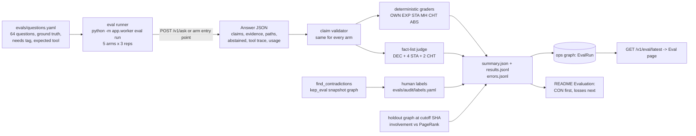

# 04 · Evaluation design and benchmark question set

| | |
|---|---|
| Status | **v1.1** for team review. Pre-kickoff notes only (Rule 8): questions, ground truth, metric definitions and procedure. This document created no source files, manifests, scripts or query text. The generic template that exists under `D:\kep-brain` (`apps/`, `docker-compose.yml`, `.github/`) was written by a separate pass on 2026-10-11/12; this document takes no dependency on it (§12.1). Raw API responses were cached under `D:\kep-brain\.recon\` (inventory in §15) and are treated as untrusted data; `.recon/` is never committed. 2026-10-12: applied 06 §1.6 register (ratified). |
| Versions | v1.0 measured 2026-10-11 23:20 → 2026-10-12 00:40 IST. **v1.1 (2026-10-12 08:45 → 09:15 IST)** resolves the 13 review findings mapped in §0. **v1.1a (same day, after 09:15 IST)** aligns this file with `06` v2.0 and `03` v1.2, which were revised in parallel (§0 alignment note, §14.3 D-06-7..D-06-11); no ground-truth value changed. Every new ground-truth value was re-derived from the cache or a live `gh api` call in that window. |
| Authorship | Drafted by an AI assistant as pre-event notes. Every DECISION is veto-able by the human owner named by role in §12; the artefacts §12.2 lists are written or labelled by those humans after 00:01 IST on 2026-10-15. |
| Tooling | `gh` CLI 2.89.0 (authenticated), `curl`, Python 3.11.4 + PyYAML 6.0.3 run with `-I` against the cache from the session scratchpad (scripts not kept in the project). |
| Inputs | `01-recon-kubernetes-data.md`; `02-architecture.md` §6–§7, §11–§12; `03-graph-model.md` **v1.2** (names authority: the narrow job §0.1, the 14 v1 tools §0.2, `Finding` §4.7, the five contradiction predicates §7.5); `06-build-plan.md` v1.1 (B1–B24, C4, C5, EV-01..03, CP0–CP8), re-read at **v2.0** after both revisions landed (B25–B44, C1, C7, EV-01..04, HUM-03/10/19; alignment in §14.3 D-06-7..D-06-11); ADR 0009 (evidence-first answers, abstention enum). |
| Scope | KEPs in **sig-node (139), sig-scheduling (60 directories, 59 owned), sig-apps (35)** = 234 `kep.yaml` files, 212 PRR files, `sigs.yaml`, the 95 SIG-labelled `OWNERS` files and root `OWNERS_ALIASES` of kubernetes/kubernetes, the 234 tracking issues, `kep.yaml` commit history, and the review and comment threads of the merging PRs. |
| Question set | **64 questions**: ownership 10, expertise 7, decision provenance 8, status/freshness 10, multi-hop 14, thread provenance ("chats") 4, abstention 11. Difficulty: 19 easy, 32 medium, 13 hard. Graph need: lookup 8, join 40, var_path 2, shortest_path 3 (§4.5). |
| Companion experiments | Contradiction audit **CON** (the headline, §9.1); expertise temporal holdout **HOLD** (§9.2); multi-session memory **MEM**, 10 items (§9.3); MCP tool selection **SEL**, 10 questions (§9.4). |

Tags used below: **VERIFIED** (opened the file or API response; path/URL given), **OBSERVED** (live behaviour today), **INFERENCE** (judgement from verified facts), **UNVERIFIED** (could not confirm; do not rely on it), **DECISION (veto-able)** (a choice with its one-line reason and the alternative).

Source shorthand used in every table (all VERIFIED unless tagged):

| Prefix | Means | Pin |
|---|---|---|
| `E:` | `https://github.com/kubernetes/enhancements/blob/8659e382efab7340d70de52432ee8f3d9979b797/` + path | `master` head `8659e382efab7340d70de52432ee8f3d9979b797`, committed 2026-10-08T20:19:58Z (`.recon/eval/master-head.json`); **0 commits since 2026-10-09** (`.recon/eval/commits-since-1009.json`), so the cached tarball dated 2026-10-09 is this commit (INFERENCE: the tarball carries no `pax_global_header` to confirm the SHA). |
| `C:` | `https://github.com/kubernetes/community/blob/5c4b5f8c17a3a3e81e4231feb432c30a1d0ef569/sigs.yaml` | `main` head `5c4b5f8c…`, committed 2026-10-11T16:49:17Z; the cached `sigs.yaml` was downloaded at 17:09Z the same day (INFERENCE: cache equals head). |
| `K:` | `https://github.com/kubernetes/kubernetes/blob/fddd57cf8f90c222d9632ceea3616c2a851a42b4/` + path | `master` head `fddd57cf…`, committed 2026-10-11T14:13:16Z; OWNERS files downloaded 17:13Z (INFERENCE: cache equals head). |
| `R:` | `D:\kep-brain\.recon\` + path | raw API responses fetched 2026-10-11/12 (file list in §15). |

Line numbers are 1-based in the pinned files. GitHub handles are shown in their file casing; the graph and the graders compare them lower-cased (recon D2).

---

## 0. Review round (v1.1): where each finding is resolved

The design changes are made in place; this table is only the index. "Reviewed: rejected because …" notes sit next to the text they defend.

| # | Finding (area, severity) | Outcome | Where |
|---|---|---|---|
| F1 | Pre-event scaffolding breaks the team's own Rule 8 reading (cross-cutting, blocker) | For this document: status row corrected; no dependency on any pre-event code; this folder goes in its own "pre-event notes (Rule 8)" commit; the archive-or-keep decision for the template belongs to `06` and is recorded there as a delta. FAQ clause now **VERIFIED** on the main event page | Status row, §12.1, §14.2 |
| F2 | Rules 11–13: human contribution thin (cross-cutting, blocker) | Accepted. Each eval artefact has a human owner; the questions file, the grader pass rules, the normaliser, every precision label, the blind-sample recall check and the judge calibration are human work; explain-back at CP1 and CP4; AI_USAGE row format names the concrete edit | §12 |
| F3 | Headline compares only with chunk retrieval; algorithms unscored (04, major) | Accepted, all three parts: `needs` tag per question with per-tag reporting (§4.5, §11); temporal-holdout test scoring PageRank against plain involvement on future reviewers (§9.2); `rank_people` returns a scored involvement ordering and a shown centrality ordering (§4.2) | §4.2, §4.5, §9.2, §11 |
| F4 | Vector baseline depends on a key nobody has; two embedding dimensions in the contracts (04, major) | Accepted with a different model: arm V uses a local CPU model at **1024** dimensions (`mixedbread-ai/mxbai-embed-large-v1` via `fastembed==0.8.1`), so it always runs and B6's dimension holds. The suggested 384-d `bge-small-en-v1.5` is **rejected** because it would contradict `06` B6 and `03` §12 | §8.2, E10 |
| F5 | "Chats" neither validated nor protected (04, major) | Accepted. Four CHT questions need reviews and comments (§5.7); `trace_decision` with command-comment evidence and excerpts is the stated chats feature, `thread_digest` stays deferred as `03` §0.2 decided; README wording fixed (§11) | §5.7, §14.3 |
| F6 | T02 thin; memory has no measured effect (cross-cutting, major) | Accepted as `03` v1.2 placed it: shared memory is `Finding` in `kep` (not a separate `org_memory` graph; `03` §4.7 gives the reason), read by the planner and over MCP through `recall_findings`. 04 implements `03` §11's eight-item multi-session spec (`memory_mode` on/off) and adds two shared-`Finding` items (§9.3) | §9.3 |
| F7 | Differentiation from RAJ-A58/NodeOps (cross-cutting, major) | Accepted. Headline = the contradiction audit (§9.1) and decision lineage; `impact_of` and "blast radius" are gone from the question set (MH-04 reworded, `kep_relations` instead); directory-ownership questions stay in the eval but off the judge path; the checkable differentiator for the README comparison table is CON precision | §2.1, §5.5, §9.1 |
| F8 | A platform, not a narrow job (cross-cutting, major) | Accepted. The eval leads with the narrow job's checkable outcome (§2.1); every expected tool is one of `03`'s 14 v1 tools; the video's eval beat is one honest-loss row | §2.1, §5, §11 |
| F9 | Tool selection through MCP never measured (04, minor) | Accepted. First-tool hit rate and set overlap are recorded for arm H; the same 10 questions run through an MCP client against the live `/mcp` endpoint; overlaps resolved by one-tool-per-question-kind deltas | §6.5, §9.4, §14.3 |
| F10 | EXP unwinnable as designed (04, major) | Accepted. The tool computes exactly the grader's definition (`rank_people` mode `involvement`: `sig?`, `roles`, `scope_terms` with one documented matching rule, no 15-KEP cap, per-role counts). Scopes are now defined by that rule and recounted; EXP-01 changed (26 KEPs, a tie at the top). EXP-01 and EXP-04 become GR-03b contract tests | §4.2, §5.2, §14.3 |
| F11 | Contracts contradict each other (cross-cutting, major) | Accepted for this file: E10 and §8.2 at 1024; `evals/` mount per B24; unprefixed settings (B2); the `03` memory label `Episode`; worker CLI per C5; tool names per `03` v1.2. The obsolete-name grep over this file returns zero hits (§14.4) | §8, §11, §13, §14.4 |
| F12 | Rule 8 exposure with no schedule fallback (cross-cutting, major) | Not a change to the eval; the INF-00b fallback card and the organiser question are `06` items. The eval schedule (§10.5) depends only on EV-01..03 starting after 00:01 and survives a regenerated template unchanged | §10.5, §14.2 |
| F13 | Eval throughput vs provider rate limits (04, minor) | Accepted. `llm-check` reads the `anthropic-ratelimit-*` headers (names VERIFIED) and the runner sizes concurrency from them; load test and eval run sequentially; wall-clock per arm stated | §10.2, §10.3 |

**Alignment pass (v1.1a, 2026-10-12).** `03` v1.2 and `06` v2.0 were revised in parallel with this document and disagree in five places this file touches (shared-memory graph name, the v1 tool list, the scored-run schedule and graph, the eval file layout, the question counts). Where `06` v2.0 is right on process (B33's single scored run on `kep_eval`, EV-04's audit files, HUM-19), this file now adopts it (§9.1, §10.3, §10.5). Where the disagreement is a graph name or tool signature, `06` B5 makes `03` authoritative, so this file follows `03` v1.2 and records the change `06` needs (§14.3 D-06-7..D-06-11).

---

## 1. Summary

1. **The headline is the narrow job's checkable outcome**: the contradiction audit (CON, §9.1). `find_contradictions` runs over the three SIGs on the frozen graph; a human opens both sources of every hit and labels it; the README publishes the count, the precision per kind, and the recall on a 30-KEP blind sample a human audits without the tool.
2. **64 questions with ground truth taken from the files and threads the product ingests** (`kep.yaml`, PRR files, `OWNERS`, `OWNERS_ALIASES`, `sigs.yaml`, `kep.yaml` commit history mapped to merged PRs, tracking-issue timelines, and PR review and comment threads). Each records id, type, difficulty, graph need, text, ground truth, source lines or URL, expected evidence and the expected tool (§5).
3. Every type has a **deterministic grader** except decision provenance and two thread questions, which are judge-scored against explicit atomic facts (§6). Metrics: accuracy per type and per graph need, citation precision and recall, abstention precision and false-abstention rate, tool-selection hit rate, p50/p95 latency per stage, tokens and cost from the API `usage` block (§7).
4. **Five arms** run the same questions over one identically serialised corpus with the same model, prompt skeleton, budget and claim validator: `N` no retrieval, `L` lexical RAG, `V` vector RAG (local 1024-d embeddings, no key needed), `G` graph-only, `H` hybrid (the product) (§8). Predictions are **pre-registered** (§8.4).
5. **The README claim is per graph need** (§4.5): on `lookup` and `join` questions a relational loader would do as well as a graph, and the README says so. The graph-native claim rests on `var_path` and `shortest_path` questions, the HOLD test that scores PageRank against plain counts on future reviewers (§9.2), and the CON audit.
6. Published evidence (§13) says graphs win on multi-hop, temporal and cross-session questions and lose on single-hop recall and, when LLM-extracted, on coverage; graph systems also hallucinate on unanswerable questions unless abstention is enforced. The question mix and the validator follow those findings.

---

## 2. What the evaluation must prove

### 2.1 The narrow job and its checkable outcome (adopts `03` §0.1)

> **KEP Brain audits Kubernetes' decision records: it finds where KEP metadata, tracking issues and replacement links disagree, shows who decided each state and on what evidence, and drafts the fix.**

The eval therefore reports, in this order: (1) the CON audit (how many verified disagreements, at what hand-checked precision, with what recall on a blind sample); (2) whether the agent can trace each state to its decision, people and evidence (DEC and CHT questions); (3) everything else the T03 brief asks for, with the baseline losses first. This is what distinguishes the project from `RAJ-A58/NodeOps`, whose README (cached `R:search/nodeops-readme-2026-10-12.md`, VERIFIED) targets Tracks 01 and 03, calls itself the repository's "Company Brain", ranks reviewers by "`algo.pageRank` contributor importance over merged PR file footprints" (L29) and warns of "dependency blast radius" (L19). KEP Brain still measures who-owns and who-knows (the T03 brief names them), but none of those is the headline or on the judge path.



### 2.2 Track focus points and what measures each

| Focus point | Measured by | What "correct" means |
|---|---|---|
| T03 Knowledge from docs, tickets and chats in one graph | MH (14), CHT (4) | set-complete answers needing two or more sources; CHT needs PR reviews and issue comments. "Chats" means public GitHub issue and PR discussion threads; Slack is excluded under Rule 6 (ABS-11) |
| T03 Who owns what, and who knows what | OWN (10), EXP (7), HOLD | set-equal to the people named in the files; involvement counts equal to the declared proxy; HOLD tests whether centrality predicts future reviewers |
| T03 Tracing decisions back to their source | DEC (8), CHT (4) | the PR, commit, actor, date, approvers and stated reason, each cited |
| T03 Keeping knowledge current | CON, STA (10) | hand-checked precision of every disagreement; current values, what changed since a release |
| T03 Answers with clear sources | citation precision on every type; ABS (11) | every claim cites a graph node; unanswerable questions are refused |
| T01 Multi-hop reasoning; explainable results | `var_path` and `shortest_path` questions; `paths` on every MH answer | the path returned is valid edge by edge |
| T01 Graph queries and algorithms as agent tools | HOLD (§9.2); per-tag table | PageRank ordering scored against future reviewers, beside the count ordering |
| T01 Tool selection through MCP | SEL (§9.4); first-tool hit rate on arm H | the first tool called matches the expected tool |
| T02 Memory across sessions; shared state between agents | MEM (§9.3) | follow-ups that need a prior session's entity, with and without recall; the planner and an MCP client read the same `Finding` the freshness agent wrote |
| T02 High-concurrency reads and writes | load test (`06` EV-03), reported in the same `EvalRun` | p50/p95/p99 and error rate; never overlapped with eval runs (§10.3) |

---

## 3. Ground truth: sources, freeze and drift

### 3.1 What counts as ground truth (DECISION, veto-able)

Ground truth is **what the pinned files and threads say**, not what is true in the world. The eval measures faithful extraction, retrieval and reasoning over the corpus, and it will mark the product wrong when it is "right about Kubernetes" but unsupported by the files. One-line reason: the files are the only thing a judge can open and check in seconds. Alternative: human-curated "true" answers, which would be arguable and unverifiable within the event.

Per field, the authoritative source is:

| Fact | Source of truth | Verified shape |
|---|---|---|
| owning SIG, participating SIGs, authors, reviewers, approvers, status, stage, milestones, feature gates, `replaces`/`see-also` | `keps/<sig>/<dir>/kep.yaml` | 234 files parse (one, `5075`, only after dropping an invalid `creation-date`, recon Q5) |
| PRR approver per stage | `keps/prod-readiness/<sig>/<N>.yaml` | 212 files for the three SIGs |
| who may approve code in a directory | `OWNERS` + root `OWNERS_ALIASES` in kubernetes/kubernetes | aliases expand to members; `emeritus_approvers` cannot approve (`contributors/guide/owners.md`) |
| chairs, tech leads, emeritus leads, subprojects | `sigs.yaml` | the generator README calls it "the authoritative source for SIG information" |
| who approves KEP PRs, PRR approver pool | kubernetes/enhancements `OWNERS_ALIASES` | 47 aliases |
| when a status/stage/milestone changed, in which PR, by whom | `GET /repos/kubernetes/enhancements/commits?path=<kep.yaml>` + `…/commits/{sha}/pulls` + `…/pulls/{n}` | each change in §5.3 was re-fetched and the `kep.yaml` diff read from `files[].patch` |
| who approved or held a PR, with which command | `GET /repos/kubernetes/enhancements/pulls/{n}/reviews` and `…/issues/{n}/comments` | §5.7; `Review.state`, Prow commands on their own line |
| release-cycle history (stage labels, milestones, close/reopen) and what the thread said | GraphQL `issue.timelineItems` with typed filters; `GET …/issues/{n}/comments?since=` | REST silently drops old label events (recon §6.4) |
| release dates | `GET /repos/kubernetes/kubernetes/releases` | v1.34.0 2025-08-27, v1.35.0 2025-12-17T20:01:55Z, v1.36.0 2026-04-22, v1.37.0 2026-08-26 (`R:eval/kk-releases-p1.json`); no `v1.38.0` tag exists, so **v1.38 values in `kep.yaml` are targets, not shipped facts** |

Comment and review text is quoted in this document only as paraphrase plus URL, and `evals/questions.yaml` stores atomic facts and comment URLs, never comment bodies (recon D11: issue and PR comments are never committed).

### 3.2 Freeze

- The eval runs against the snapshot pinned by `ENHANCEMENTS_PIN_SHA=8659e382efab7340d70de52432ee8f3d9979b797` (`06` C4; unprefixed per B2). Ground truth in this document is valid for that SHA. If the team ingests a newer `master` on 2026-10-15, the **re-verification pass** runs first.
- Re-verification pass (Oct 15, human, ≈ 2.5 h; §12.2 H-E1): the human owner types each record of `evals/questions.yaml` from §5 while opening the cited lines at the ingested SHA. If a value changed, the record gets the new value and a new `verified_at`; if a question became unanswerable or trivial it stays, and the change goes in the eval changelog. Questions are **never removed or reworded after a scoring run has been seen** (§11).
- `sigs.yaml`, `OWNERS` and the PR threads are read at head on ingest day; the questions that depend on them (OWN-03/04/05/07/08, MH-05/08, CHT-01..04) are re-checked the same way.

### 3.3 Known drift risks

- Release cycle v1.38 is in flight (enhancements-freeze and code-freeze dates UNVERIFIED here). `latest-milestone`, `stage/*` and `tracked/*` labels on 2026-targeted KEPs (STA-01, STA-02, STA-07, OWN-09, DEC-05, MEM-04) are the most likely to move between Oct 11 and Oct 18. They stay because freshness is the point; the README reports the SHA and fetch time next to every number.
- The contradiction counts in §9.1 come from `03` §7.5 (OBSERVED 2026-10-12) and will move with the data; the README publishes the count from the frozen graph, not from this document.
- The `Person` display-name switch (`STORE_PERSON_NAME_COMPANY`, recon D10) affects no ground truth: all answers are GitHub logins.

---

## 4. Question taxonomy, proxies, graph need and difficulty

### 4.1 Types

| Type | Id prefix | Answer shape | Grader |
|---|---|---|---|
| Ownership | `OWN` | a set of logins (optionally per role) and/or a SIG name | deterministic set match |
| Expertise | `EXP` | a ranked list of logins with involvement counts | deterministic (proxy in §4.2) |
| Decision provenance | `DEC` | prose naming PR, commit, actor, date, stated reasons | judge against atomic facts + deterministic id check |
| Status / freshness | `STA` | status/stage/milestones, lists of KEPs, "which source says what" | deterministic field/set match; four questions also have a judge-checked "both sources" clause |
| Multi-hop | `MH` | sets of KEPs/SIGs/people, or a path, with the connecting evidence | deterministic set match + path validity |
| Thread provenance | `CHT` | who approved, held or explained, citing the review or comment | deterministic set match (CHT-01, CHT-03) or judge facts (CHT-02, CHT-04); `Review`/`Comment` evidence required |
| Abstention | `ABS` | `abstained: true` with an accepted reason (three questions also accept an explicit, cited "not recorded") | deterministic |

### 4.2 Expertise: one definition shared by the tool and the grader (DECISION, veto-able)

**involvement(p, S, R)** = the number of distinct KEP directories in scope S whose `kep.yaml` lists p (lower-cased, `@` stripped, placeholders `TBD`/`n/a`/`none` removed) in at least one of the role lists R ⊆ {`authors`, `reviewers`, `approvers`}. For `prr_stage_approvals` the unit is a PRR stage entry, not a KEP (MH-09). Ties are reported as ties.

**Scope S** is defined by two optional filters, combined with AND:

- `sig`: the KEP's `owning-sig` (the graph's `OWNED_BY` edge). Changed from v1.0's directory rule because the tool reads the edge; on the pinned files the two differ only for `sig-scheduling/986` (owned by `sig-api-machinery`), and no EXP answer changes.
- `scope_terms`: a list of terms (OR). The **matching rule**: lower-case the KEP directory name without its number prefix, and separately the `title`; split each on every non-alphanumeric character; a term (split the same way) matches when its token sequence occurs contiguously in either token list; a one-token term also matches the same token with a trailing `s`. The ingest stores the 1- to 3-grams of both token lists on the KEP (`03` delta D-03-2, §14.3), so the tool matches with a list-membership predicate and needs no regex (FalkorDB has none, the planning notes §5).

**The product computes exactly this.** `rank_people` gains a metric `involvement` with parameters `sig?`, `scope_terms?`, `roles` and a row limit from fixed variants 20/50/200, with no cap on the number of KEPs in scope. It returns two orderings over the same people: `involvement` (scored by EXP: `{person, total, by_role}`) and `centrality` (shown, not scored by EXP: stored `Person.pagerank` from the latest `AnalyticsRun`). `who_knows` stays deferred (`03` §0.2), so there is one obvious tool for every "who knows / who is most involved" question (§6.5). One-line reason: EXP v1.0 graded a definition no tool computed (a 15-KEP cap and PageRank ordering), so it measured a design mismatch, not the graph. Alternative: keep PageRank as the scored order, which no judge can recount from the files.

Recounted scopes (VERIFIED from the 234 pinned files; `R:eval/exp-term-scopes.json`):

| Scope | `sig` | `scope_terms` | n | Change from v1.0 |
|---|---|---|---:|---|
| DRA family | — | `dra`, `dynamic resource allocation` | 26 | +5 (4680, 5007, 5729, 5963, 5978 carry "DRA" in the title); v1.0's hand list of 21 was not reproducible by any rule |
| Job family | `sig-apps` | `job`, `cronjob` | 16 | none (same 16 directories) |
| In-place resize family | — | `in-place`, `inplace`, `resize`, `ippr` | 7 | none |
| Workload-aware scheduling family | — | `workload`, `gang`, `podgroup`, `coscheduling` | 11 | none |
| Whole SIG | one of the three | — | 139 / 59 / 35 | sig-scheduling by owner: 59, not 60 |

The PageRank ordering is scored where it can be scored fairly: against what happened later (§9.2).

### 4.3 Abstention contract

From ADR 0009: `abstain_reason ∈ {no_evidence, out_of_scope, unsupported_claims, budget_exhausted, graph_unavailable}`. For ABS questions the accepted reasons are `no_evidence` and `out_of_scope` as listed per question; `unsupported_claims` is counted as a **validator rescue** (the model tried to answer from memory and was stopped) and reported separately because it is a weaker success. Three ABS questions concern placeholders (`TBD`, a missing PRR stage, a missing milestone key); for those an answer that is *not* abstained but whose only claim is "not recorded" with the file as evidence is also correct (`accept_explicit_negative: true`).

### 4.4 Difficulty rubric

| Level | Definition |
|---|---|
| easy | one hop, one source file, no normalisation beyond handle casing |
| medium | alias expansion, two source files, a set answer over one SIG, a computed aggregate, or a path of length 2 |
| hard | three or more hops, temporal ordering, a contradiction between two sources that must both be cited, a set answer across SIGs, or a reason stated only in a thread |

### 4.5 Graph need (`needs` tag; DECISION, veto-able)

Every answerable question carries exactly one tag, chosen by the least capable store that could answer it from the same data:

| Tag | Definition | Could a relational loader answer it? | Questions |
|---|---|---|---|
| `lookup` | one named entity and its one-hop properties or edges | yes, one table read | OWN-01, OWN-02, OWN-04, OWN-07, OWN-08, OWN-09, STA-01, STA-08 (8) |
| `join` | a fixed-shape pattern over two or more relationship types or sources, or an aggregate over a set | yes, with fixed joins and GROUP BY | OWN-03, OWN-05, OWN-06, OWN-10, EXP-01..07, DEC-01..08, STA-02..07, STA-09, STA-10, MH-01..06, MH-08..10, CHT-01..04 (40) |
| `var_path` | a traversal whose depth is not known in advance (lineage chains, k-hop neighbourhoods in both directions) | only with recursive CTEs and manual path bookkeeping | MH-11, MH-14 (2) |
| `shortest_path` | the shortest typed path between two named entities | not practically (all-pairs search over 8 edge types) | MH-07, MH-12, MH-13 (3) |
| `algorithm` | needs the output of a graph algorithm (centrality, community) | no | no QA question; HOLD (§9.2) is the scored test |

One-line reason: the critic is right that "structured beats chunks" is also what a relational loader would show; tagging makes the README separate that claim from the graph-native one. Alternative: add a SQL arm (rejected: a fifth retrieval engine to build in four days for a result the per-tag table already makes explicit). ABS questions are reported in their own matrix and are excluded from the per-tag table. With 2 + 3 graph-native questions the per-tag intervals are wide (§7); the README says the graph-native QA evidence is indicative and that HOLD and CON carry the claim.

---

## 5. The question set

Columns: **id** · **diff** · **need** · question · ground truth · source · **tool** (the expected first tool, then the others it may need; names from `03` v1.2 §0.2's 14 v1 tools, with the parameter extensions of §14.3). The tool column is graded only by the selection metric (§6.5), never by accuracy: ADR 0009 grades outcomes, not paths.

### 5.1 Ownership (OWN, 10)

| id | diff | need | Question | Ground truth | Source | Tool |
|---|---|---|---|---|---|---|
| OWN-01 | easy | lookup | Which SIG owns KEP-1287 (In-place Update of Pod Resources) and who are its approvers? | owning SIG `sig-node`; approvers `dchen1107`, `derekwaynecarr`, `ahg-g`, `mwielgus`, `thockin` | `E:keps/sig-node/1287-in-place-update-pod-resources/kep.yaml` L10 (`owning-sig`), L26–L31 (`approvers`) | `get_kep` |
| OWN-02 | easy | lookup | Who approved the production-readiness review of KEP-1287 at alpha, beta and stable? | alpha `ehashman`; beta `jpbetz`; stable `jpbetz` | `E:keps/prod-readiness/sig-node/1287.yaml` L3, L5, L7 | `who_approves` |
| OWN-03 | medium | join | Who can approve a change under `pkg/kubelet` in kubernetes/kubernetes, and who used to but no longer can? | via alias `sig-node-approvers`: `Random-Liu`, `dchen1107`, `derekwaynecarr`, `yujuhong`, `sjenning`, `mrunalp`, `klueska`, `SergeyKanzhelev`, `tallclair` (9); emeritus (cannot approve): `dashpole`, `vishh`. The answer must say the approval comes through the alias. | `K:pkg/kubelet/OWNERS` L3–L7; `K:OWNERS_ALIASES` L242–L251 | `who_owns(directory_path)` |
| OWN-04 | easy | lookup | Who chairs SIG Scheduling and who are its tech leads? | chairs `macsko`, `sanposhiho`; tech leads `dom4ha`, `sanposhiho` | `C:` L2909–L2925 | `who_owns(sig)` |
| OWN-05 | medium | join | Who approves changes to the Job controller directory `pkg/controller/job`? | alias `sig-apps-approvers` = `kow3ns`, `janetkuo`, `soltysh`, `smarterclayton`, `atiratree`; plus `mimowo` listed directly; emeritus approver `alculquicondor` (cannot approve) | `K:pkg/controller/job/OWNERS` L3–L5, L13–L14; `K:OWNERS_ALIASES` L315–L320 | `who_owns(directory_path)` |
| OWN-06 | hard | join | Who approved KEP-3329 (retriable and non-retriable Pod failures for Jobs), and what role does each approver hold? | `soltysh` (sig-apps chair and tech lead), `alculquicondor` (sig-scheduling emeritus lead), `deads2k` (sig-api-machinery chair and tech lead), `dchen1107` (sig-node tech lead); PRR approver at alpha, beta and stable: `johnbelamaric` | `E:keps/sig-apps/3329-retriable-and-non-retriable-failures/kep.yaml` L15–L19; `E:keps/prod-readiness/sig-apps/3329.yaml` L3, L5, L7; `C:` L188 and L201 (soltysh), L2932 (alculquicondor, `emeritus_leads`), L11 and L20 (deads2k), L2538 (dchen1107) | `who_approves` → `who_owns(sig)` |
| OWN-07 | easy | lookup | Who approves KEP pull requests for SIG Node in kubernetes/enhancements (the `sig-node-leads` alias)? | `SergeyKanzhelev`, `dchen1107`, `derekwaynecarr`, `mrunalp`, `haircommander` | `E:OWNERS_ALIASES` L84–L89 | `who_owns(alias)` |
| OWN-08 | easy | lookup | Who are the production-readiness approvers for the enhancements repository? | `deads2k`, `johnbelamaric`, `jpbetz`, `soltysh`, `wojtek-t`, `kannon92` | `E:OWNERS_ALIASES` L199–L205 | `who_owns(alias)` |
| OWN-09 | easy | lookup | For KEP-4671 Gang Scheduling: owning SIG, participating SIGs, `kep.yaml` approvers and PRR approver? | `sig-scheduling`; participating `sig-apps`; approvers `sanposhiho`, `dom4ha`; PRR `soltysh` at alpha, beta and stable | `E:keps/sig-scheduling/4671-gang-scheduling/kep.yaml` L13–L15, L21–L23; `E:keps/prod-readiness/sig-scheduling/4671.yaml` L3, L5, L7 | `get_kep` |
| OWN-10 | medium | join | Who are the approvers of KEP-3063 (classic DRA)? The file names an alias, not people. | `kep.yaml` approvers = `@sig-node-tech-leads` (an alias string); the enhancements `OWNERS_ALIASES` defines `sig-node-tech-leads` = `dchen1107`, `derekwaynecarr`, `mrunalp`. Both the alias and its expansion must appear. | `E:keps/sig-node/3063-dynamic-resource-allocation/kep.yaml` L15–L16; `E:OWNERS_ALIASES` L228–L231 | `get_kep` → `who_owns(alias)` |

OWN-03 and OWN-05 (directory ownership) are measured because the T03 brief names "who owns what", but they are not on the judge path or in the video (`03` §0.2).

### 5.2 Expertise (EXP, 7)

Counts are involvement(p, S, R) from §4.2 over the pinned files (`R:eval/exp-term-scopes.json`; recomputable from the 234 `kep.yaml` files). Every EXP question's expected call is `rank_people(metric: involvement, …)` with the scope shown.

| id | diff | need | Question | Scope and roles | Ground truth (top-3 with ties, then next) | Source |
|---|---|---|---|---|---|---|
| EXP-01 | medium | join | Who knows most about Dynamic Resource Allocation? | `scope_terms: [dra, dynamic resource allocation]`; all three roles; n = 26 | **tie at 19: `pohly`, `johnbelamaric`**; then `dom4ha` 15; next `mrunalp` 9, `mortent` 9, `klueska` 8. By role: pohly 4 authored / 12 reviewed / 4 approved; johnbelamaric 1 / 15 / 6; dom4ha 0 / 6 / 12 (a person can hold two roles on one KEP, so roles sum above the total) | the 26 matching `kep.yaml` files; e.g. `E:keps/sig-node/4381-dra-structured-parameters/kep.yaml` L3 (author pohly), L11–L12 (reviewers johnbelamaric, klueska) |
| EXP-02 | easy | join | Who are the most involved people across SIG Node KEPs? | `sig: sig-node`; all roles; n = 139 | `dchen1107` 63, `mrunalp` 62, `SergeyKanzhelev` 56; then `derekwaynecarr` 43, `haircommander` 36 | all 139 sig-node `kep.yaml`; approver counts alone: dchen1107 59, mrunalp 44, derekwaynecarr 34 (matches recon §8.3) |
| EXP-03 | medium | join | Who knows most about Job (batch) KEPs in SIG Apps? | `sig: sig-apps`, `scope_terms: [job, cronjob]`; all roles; n = 16 | `soltysh` 16, `alculquicondor` 11, then a tie at 6: `janetkuo`, `mimowo`; then `liggitt` 5, `kannon92` 5 | the 16 matching `kep.yaml` files |
| EXP-04 | easy | join | Who has authored the most SIG Node KEPs? | `sig: sig-node`; `roles: [authors]` | three-way tie at 8: `tallclair`, `SergeyKanzhelev`, `HirazawaUi`; next `haircommander` 7. All three tied names are required. | `authors` lists of the 139 sig-node files |
| EXP-05 | medium | join | Who knows most about in-place pod resize? | `scope_terms: [in-place, inplace, resize, ippr]`; all roles; n = 7 | `tallclair` 7, then a tie at 4: `natasha41575`, `dchen1107`; then `mrunalp` 3, `SergeyKanzhelev` 3 | the 7 matching files; e.g. `E:keps/sig-node/1287-in-place-update-pod-resources/kep.yaml` L3–L9 |
| EXP-06 | easy | join | Who has reviewed the most SIG Scheduling KEPs? | `sig: sig-scheduling`; `roles: [reviewers]`; n = 59 | `dom4ha` 20, `Huang-Wei` 18, then a tie at 12: `alculquicondor`, `macsko`, `pohly` | `reviewers` lists of the 59 KEPs owned by sig-scheduling |
| EXP-07 | medium | join | Who knows most about workload-aware scheduling (gang scheduling, PodGroup, Workload API)? | `scope_terms: [workload, gang, podgroup, coscheduling]`; all roles; n = 11 | `dom4ha` 9, then a tie at 6: `helayoty`, `wojtek-t`; then `sanposhiho` 5, `mm4tt` 5 | the 11 matching files |

### 5.3 Decision provenance (DEC, 8)

Each row lists the **atomic facts** the judge checks (§6.3). Commit diffs were read from `files[].patch` in `R:eval/commit-<sha>.json`; PR metadata from `R:eval/pr-<n>.json`; commit→PR mapping from `R:eval/pulls-<sha>.json`. All eight are `join`.

| id | diff | Question | Atomic facts (all required unless marked optional) | Source | Tool |
|---|---|---|---|---|---|
| DEC-01 | medium | When was KEP-1287 marked implemented, by whom, and in which PR? | (a) commit `d47a8df46c`, 2025-12-29, author `natasha41575`, diff `status: implementable` → `implemented`; (b) PR [#5761](https://github.com/kubernetes/enhancements/pull/5761) "KEP-1287: Mark in-place pod resize as implemented", merged 2026-01-16T02:45:28Z; (c) tracking issue #1287 closed 2026-01-16T02:45:29Z with milestone v1.35 (optional) | `R:eval/commit-d47a8df46c.json`; `R:eval/pr-5761.json`; `R:eval/issue-1287.json`; recon §8.2 | `trace_decision` |
| DEC-02 | hard | Why was classic DRA (KEP-3063) withdrawn, when and by whom? | (a) PR [#4904](https://github.com/kubernetes/enhancements/pull/4904) "KEP-3063: Classic DRA: withdraw the KEP" by `pohly`, merged 2024-10-05T00:26:28Z; (b) commit `be482d3eb9` 2024-10-04: `status: implementable` → `withdrawn`, `latest-milestone: "v1.31"` → `"v1.32"`; (c) reasons in the README: lack of cluster-autoscaler support, and the complex back-and-forth through the apiserver while scheduler and DRA drivers negotiate allocation; (d) PR body: "There isn't sufficient justification for keeping it around when there is no clear path forward."; (e) successor KEP-4381 continues (optional) | `R:eval/pr-4904.json`; `R:eval/commit-be482d3eb9.json`; `E:keps/sig-node/3063-dynamic-resource-allocation/README.md` L159–L165 | `trace_decision` → `find_entities(Section)` |
| DEC-03 | hard | Which PR graduated Job Pod Failure Policy (KEP-3329) to stable, what changed in the metadata, and what reasons were given? | (a) PR [#4661](https://github.com/kubernetes/enhancements/pull/4661) "Graduate Job Pod Failure Policy to stable" by `mimowo`, merged 2024-06-11T11:41:46Z; (b) commit `8fdd98a561`: `status` implementable→implemented, `stage` beta→stable, `latest-milestone` v1.28→v1.31, `milestone.stable` v1.30→v1.31; (c) the same commit added `stable: approver "@johnbelamaric"` to the PRR file; (d) reasons from the PR body: beta since 1.26 with no major changes since 1.27; code spread across kube-controller-manager, kubelet, scheduler and api-server so two code paths add complexity; other features build on it (KEP-4443 cited) | `R:eval/pr-4661.json`; `R:eval/commit-8fdd98a561.json` (two files changed) | `trace_decision` |
| DEC-04 | medium | When did "structured parameters" become the base of DRA and "classic" DRA the extension? | (a) commit `3159f896a2`, 2024-04-18, author `pohly`; (b) PR [#4585](https://github.com/kubernetes/enhancements/pull/4585) "KEP-3063 and KEP-4381: DRA: 'Structured Parameters' as base, 'classic' DRA as extension", merged 2024-05-02T12:50:00Z; (c) README-3063 states the role reversal ("Now the roles are reversed: #4381 defines the base functionality and this KEP is an optional extension") | `R:eval/pulls-3159f896a2.json`; `R:eval/commits-3063-kep.json`, `R:eval/commits-4381-kep.json`; `E:keps/sig-node/3063-dynamic-resource-allocation/README.md` L153–L156 | `trace_decision` → `find_entities(Section)` |
| DEC-05 | medium | Which PR declared Gang Scheduling (KEP-4671) GA for v1.38 and what did it change? | (a) PR [#6349](https://github.com/kubernetes/enhancements/pull/6349) "KEP-4671: Update Gang Scheduling KEP for GA in v1.38" by `macsko`, merged 2026-09-22T13:34:19Z (merged by `kubernetes-prow[bot]`); (b) commit `91ac5bf521` 2026-09-11: `stage` beta→stable, `latest-milestone` v1.37→v1.38; (c) the PRR file gained `stable: approver "@soltysh"` in the same commit; (d) tracking issue label `stage/stable` applied 2026-09-07 by `macsko` (optional) | `R:eval/pr-6349.json`; `R:eval/commit-91ac5bf521.json`; `R:eval/gql-4671-timeline.json` | `trace_decision` → `status_history` |
| DEC-06 | medium | When was KEP-4381 marked implemented and what else changed in that commit? | (a) commit `51b50a24c3`, 2026-01-20, author `kannon92`: `status` implementable→implemented, `stage` beta→stable, `disable-supported` true→false; (b) PR [#5817](https://github.com/kubernetes/enhancements/pull/5817) "KEP-4381: Mark (DRA) as implemented", merged 2026-02-10T16:20:02Z | `R:eval/commit-51b50a24c3.json`; `R:eval/pr-5817.json` | `trace_decision` |
| DEC-07 | hard | Which KEPs does Gang Scheduling replace, and what became of KEP-5832? | (a) `replaces` = `583-coscheduling` and `5832-decouple-podgroup-api`; (b) README-4671 Implementation History: "2026-03: KEP-5832 merged into KEP-4671 as a single consolidated KEP"; (c) tracking issue #5832 closed 2026-05-18T23:01:00Z; (d) `5832/kep.yaml` still says `status: implementable`, `stage: alpha`, `latest-milestone: v1.36`, so its metadata is stale (a `03` §7.5 `active_status_closed_issue` hit); (e) 5832 itself declares `replaces` 583 and `see-also` 4671 (optional) | `E:keps/sig-scheduling/4671-gang-scheduling/kep.yaml` L27–L29; `E:keps/sig-scheduling/4671-gang-scheduling/README.md` L1898; `R:eval/issue-5832.json`; `E:keps/sig-scheduling/5832-decouple-podgroup-api/kep.yaml` L13, L26–L27, L29, L31 | `kep_relations` → `get_kep`, `find_contradictions` |
| DEC-08 | medium | Who proposed GA for in-place pod resize in v1.35, in which PR, and which SIGs were asked to sign off? | (a) PR [#5562](https://github.com/kubernetes/enhancements/pull/5562) "KEP 1287: Graduate InPlacePodVerticalScaling to GA" by `natasha41575`, merged 2025-10-16T05:43:33Z by `k8s-ci-robot`, labels `sig/autoscaling`, `sig/node`, `sig/scheduling`; (b) body asks `tallclair` and `dchen1107` (node), `dom4ha` for sig-scheduling, `jackfrancis` for sig-autoscaling; (c) commit `6e1c6afec9` 2025-09-22: `stage` beta→stable, `latest-milestone` v1.34→v1.35, `milestone.stable` TBD→v1.35 | `R:eval/pr-5562.json`; recon §8.2 (commit diff) | `trace_decision` |

DEC-02 and DEC-04 need README prose. With `get_kep_section` and `search_sections` deferred (`03` §0.2), arm H reaches it through `find_entities(kinds: [Section])` rows and `trace_decision` evidence rows that carry a bounded `excerpt` (delta D-03-4, §14.3).

### 5.4 Status and freshness (STA, 10)

| id | diff | need | Question | Ground truth | Source | Tool |
|---|---|---|---|---|---|---|
| STA-01 | easy | lookup | What stage is Container Stop Signals (KEP-4960) at, and which release does each stage target? | `status: implementable`, `stage: beta`; alpha v1.33, beta **v1.38 (in-flight release: a target, not shipped)**, stable unset (`""`); `latest-milestone` v1.38 | `E:keps/sig-node/4960-container-stop-signals/kep.yaml` L19–L25; no `v1.38.0` tag in `R:eval/kk-releases-p1.json` | `get_kep` |
| STA-02 | easy | join | Which SIG Apps KEPs target stable in v1.38? | exactly one: KEP-5440 Mutable Pod Resources for Suspended Jobs (`implementable`, `stage: stable`; alpha v1.35, beta v1.36, stable v1.38) | `E:keps/sig-apps/5440-mutable-job-pod-resource-updates/kep.yaml` L8, L20, L28–L31; census over the 35 sig-apps files | `whats_changed(view: targeted)` |
| STA-03 | medium | join | Which SIG Scheduling KEPs record stable in v1.37? | KEP-5004 DRA Extended Resource, KEP-5055 DRA device taints and tolerations, KEP-5278 NominatedNodeName for expectation, KEP-5501 reflect PreEnqueue rejections in Pod status | `milestone.stable == v1.37` in `E:keps/sig-scheduling/{5004-dra-extended-resource,5055-dra-device-taints-and-tolerations,5278-nominated-node-name-for-expectation,5501-reflect-preenqueue-rejections-in-pod-status}/kep.yaml` | `whats_changed(view: targeted)` |
| STA-04 | hard | join | What is the status of KEP-583 Coscheduling, and is that metadata current? | `kep.yaml`: `status: provisional`, no stage, milestone, feature gate or PRR file; `last-updated: 2019-01-03`. Tracking issue #583 closed 2019-09-09T21:03:18Z, labels `lifecycle/rotten`, `stage/alpha`, `kind/feature`. KEP-4671 and KEP-5832 both declare `replaces` 583, but 583 has no `superseded-by` (KEP-0000 says a replaced KEP "should list this KEP in their superseded-by"). Correct answer: stale; cites the file, the closed issue and at least one successor. (Two `03` §7.5 kinds fire: `active_status_closed_issue`, `one_sided_replacement`.) | `E:keps/sig-scheduling/583-coscheduling/kep.yaml` L12–L13 (whole file is 13 lines); `R:eval/issue-583.json`; `E:keps/sig-scheduling/4671-gang-scheduling/kep.yaml` L28; `E:keps/sig-scheduling/5832-decouple-podgroup-api/kep.yaml` L27 | `find_contradictions` → `get_kep`, `kep_relations` |
| STA-05 | hard | join | In which release did DRA structured parameters (KEP-4381) reach GA? | **v1.34**: `milestone.stable: "v1.34"`; the tracking issue got `stage/stable` on 2025-06-03 while milestoned v1.34; v1.34.0 shipped 2025-08-27. The issue's milestone later moved v1.34→v1.35 (2025-09-25) for follow-up work (commit `64b64a176d` "DRA: structured parameters update for 1.35"), `latest-milestone` is `"v1.35"`, the issue closed 2026-04-21 with milestone v1.35, and `status: implemented` was set in 2026 (DEC-06). A correct answer gives v1.34 and explains the v1.35 references; "v1.35" alone is wrong. This is a follow-up milestone, **not** a contradiction (`03` §7.5). | `E:keps/sig-node/4381-dra-structured-parameters/kep.yaml` L28, L31–L34; `R:eval/gql-4381-timeline.json`; `R:eval/issue-4381.json`; `R:eval/commits-4381-kep.json`; `R:eval/kk-releases-p1.json` | `status_history` → `get_kep`, `trace_decision` |
| STA-06 | medium | join | What has changed for SIG Apps since v1.33: which of its KEPs went stable in v1.33 or later? | v1.33: KEP-3850 (backoff limits per index), KEP-3998 (Job success/completion policy); v1.34: KEP-3939 (Pod replacement when fully terminated); v1.35: KEP-4368 (Job managed-by label); v1.38 target: KEP-5440 | `milestone.stable` in the five `E:keps/sig-apps/*/kep.yaml`; census | `whats_changed(view: targeted)` |
| STA-07 | hard | join | Has the stage label on Gang Scheduling's tracking issue ever moved backwards? What is it now? | Yes. `stage/alpha` 2025-05-21 (`jenshu`) → `stage/beta` 2026-01-23 (`macsko`) → **back to `stage/alpha` 2026-02-10 (`wojtek-t`)** → `stage/beta` 2026-05-26 (`macsko`) → `stage/stable` 2026-09-07 (`macsko`). Now: open, milestone v1.38, labels `stage/stable`, `tracked/yes`, `lead-opted-in`, `sig/scheduling`, `wg/workload-aware-scheduling`. Milestones were set and removed for v1.34, v1.35 (twice), v1.36 and v1.37 before v1.38. | `R:eval/gql-4671-timeline.json` (46 typed timeline items); `R:eval/issue-4671.json` | `status_history` |
| STA-08 | medium | lookup | What is the status of KEP-5978 DRA ClusterResourceClaimTemplate? | `status: withdrawn`, `stage: alpha`, `latest-milestone: v1.37`; the milestone map still lists alpha v1.37, beta v1.38, stable v1.40, which is inconsistent with "withdrawn" and must be flagged (the single `terminal_status_future_targets` hit in `03` §7.5); PRR alpha approver `johnbelamaric` | `E:keps/sig-node/5978-cluster-resource-claim-template/kep.yaml` L7, L19, L24, L27–L30; `E:keps/prod-readiness/sig-node/5978.yaml` L3 | `get_kep` → `find_contradictions` |
| STA-09 | medium | join | Which SIG Node KEPs carry a `status` value outside the KEP-0000 enum, and what are the raw values? | KEP-2625 (`imlpemented`, a typo; normalised to `implemented`) and KEP-281 (`removed`, not a status; normalised per recon D5 to `implemented` with `stage: removed`). The answer must show the raw strings and the `metadata_invalid` flag. | `E:keps/sig-node/2625-cpumanager-policies-thread-placement/kep.yaml` L8; `E:keps/sig-node/281-dynamic-kubelet-configuration/kep.yaml` L7, L30–L35 | `find_entities(KEP, metadata_invalid)` → `get_kep` |
| STA-10 | easy | join | Which KEPs in the loaded SIGs are withdrawn? | KEP-3063 (sig-node, latest v1.32) and KEP-5978 (sig-node, latest v1.37); none in sig-scheduling or sig-apps | `status: withdrawn` in `E:keps/sig-node/3063-dynamic-resource-allocation/kep.yaml` L9 and `E:keps/sig-node/5978-cluster-resource-claim-template/kep.yaml` L7; census (234 files) | `find_entities(KEP, status)` |

### 5.5 Multi-hop (MH, 14)

| id | diff | need | Question | Ground truth | Source | Tool |
|---|---|---|---|---|---|---|
| MH-01 | medium | join | Which SIGs own or participate in the KEPs that Gang Scheduling replaces? | 583 → owning `sig-scheduling` (no participating SIGs); 5832 → owning `sig-scheduling`, participating `sig-apps`, `sig-api-machinery`. Union: `sig-scheduling`, `sig-apps`, `sig-api-machinery`. | `E:keps/sig-scheduling/4671-gang-scheduling/kep.yaml` L27–L29; `E:keps/sig-scheduling/583-coscheduling/kep.yaml` L5; `E:keps/sig-scheduling/5832-decouple-podgroup-api/kep.yaml` L9–L12 | `kep_relations` → `get_kep` |
| MH-02 | hard | join | Which people are `kep.yaml` approvers on both SIG Apps and SIG Scheduling KEPs? | `alculquicondor` (apps: 3329; scheduling: 11 KEPs incl. 3022, 3094, 3280), `dchen1107` (3329; 5517), `dom4ha` (5547, 6276; 23 KEPs incl. 4671), `liggitt` (19, 3017, 85; 8 KEPs incl. 2249), `soltysh` (23 KEPs; 3280, 3902, 6089). The placeholder `TBD` appears in both SIGs' approver lists and must not be returned as a person. | approver lists of the 35 sig-apps and 59 sig-scheduling `kep.yaml` files; census `cross_sig_approvers` | `rank_people(involvement, roles: [approvers])` ×2 |
| MH-03 | medium | join | Which KEPs are gated by the `GenericWorkload` feature gate, and in which components? | KEP-4671 (kube-apiserver, kube-scheduler, kube-controller-manager); KEP-5710 (same three); KEP-5832 (kube-apiserver, kube-scheduler) | `E:keps/sig-scheduling/4671-gang-scheduling/kep.yaml` L49–L54; `E:keps/sig-scheduling/5710-workload-aware-preemption/kep.yaml` L42ff; `E:keps/sig-scheduling/5832-decouple-podgroup-api/kep.yaml` L38ff | `who_owns(feature_gate)` |
| MH-04 | hard | join | Which KEPs declare `see-also` to KEP-4381 (they build on it), and which SIGs own them? *(v1.1 rewording: the v1.0 "if it were reverted" framing is the overused blast-radius theme; the ground truth is unchanged.)* | 15 KEPs. sig-node: 4817, 5304, 5677. sig-scheduling: 4815, 4816, 5004, 5007, 5027, 5075, 5234, 5491, 5690, 5941, 5981, 6080. | `see-also` entries resolving to `/keps/sig-node/4381-dra-structured-parameters` in the 15 `kep.yaml` files (census `refs`) | `kep_relations(types: [SEE_ALSO], depth 1)` |
| MH-05 | hard | join | Who is a code approver for the DRA scheduler plugin directory and also a `kep.yaml` approver on DRA KEPs? | `pohly`: sole approver in `pkg/scheduler/framework/plugins/dynamicresources/OWNERS` and approver (with `sig-node-approvers` and `klueska`) in `pkg/controller/resourceclaim/OWNERS`; `kep.yaml` approver on KEP-5945, KEP-5978, KEP-6080, KEP-6406 | `K:pkg/scheduler/framework/plugins/dynamicresources/OWNERS` L3–L4; `K:pkg/controller/resourceclaim/OWNERS` L3–L6; `approvers` in the four `kep.yaml` files | `who_owns(directory_path)` → `rank_people(involvement)` |
| MH-06 | medium | join | Which SIG Apps KEPs list SIG Scheduling as a participating SIG, and which of those were approved by a current SIG Scheduling tech lead? | 8 KEPs: 1591, 2185, 3017, 3329, 5547, 6276, 85, 981. Approved by `dom4ha` (current tech lead): KEP-5547 and KEP-6276. (`alculquicondor` on 3329 is an emeritus lead, not current.) | `participating-sigs` in the 8 `kep.yaml` files; `E:keps/sig-apps/5547-integrate-workload-with-job/kep.yaml` L15–L17; `E:keps/sig-apps/6276-integrate-workload-with-deployment/kep.yaml` L13–L16; `C:` L2919 (dom4ha), L2932 (alculquicondor emeritus) | `find_entities(KEP, sig, participating_sig)` → `who_owns(sig)` |
| MH-07 | medium | shortest_path | How is `soltysh` connected to Gang Scheduling (KEP-4671)? | Shortest: length 1, `soltysh -PRR_APPROVED-> KEP-4671` (alpha, beta and stable). Also required: chair and tech lead of `sig-apps`, which 4671 lists as participating; approver of KEP-6089 (WAS controller APIs), which `see-also` 4671 | `E:keps/prod-readiness/sig-scheduling/4671.yaml` L3, L5, L7; `C:` L188, L201; `E:keps/sig-scheduling/4671-gang-scheduling/kep.yaml` L14–L15; `E:keps/sig-scheduling/6089-was-controller-apis/kep.yaml` L14–L16, L18–L26 | `path_between` → `who_approves` |
| MH-08 | medium | join | Which SIG Node leaders in `sigs.yaml` are also members of the kubernetes/kubernetes `sig-node-approvers` alias? | Tech leads `dchen1107`, `derekwaynecarr`, `mrunalp`: all members. Chairs `SergeyKanzhelev` and `mrunalp`: members. Chair `haircommander`: **not** a member (he is in `sig-node-cri-approvers`). | `C:` L2525–L2544; `K:OWNERS_ALIASES` L242–L251, L255–L261 | `who_owns(sig)` → `who_owns(alias)` |
| MH-09 | medium | join | Across the loaded SIGs' PRR files, who approved the most stage reviews? | `wojtek-t` 138, `johnbelamaric` 116, `deads2k` 55, `soltysh` 41, `jpbetz` 31, `kannon92` 21, `ehashman` 11 (413 stage entries in 212 files) | `keps/prod-readiness/{sig-node,sig-scheduling,sig-apps}/*.yaml` (census `prr`) | `rank_people(involvement, roles: [prr_stage_approvals])` |
| MH-10 | easy | join | Which other KEPs share a feature gate with KEP-2837 Pod Level Resources? | `PodLevelResources` is also declared by KEP-5419 (in-place pod-level resize) and KEP-5526 (pod-level resource managers) | `E:keps/sig-node/2837-pod-level-resource-spec/kep.yaml` L44ff; `E:keps/sig-node/5419-pod-level-resources-in-place-resize/kep.yaml` L42ff; `E:keps/sig-node/5526-pod-level-resource-managers/kep.yaml` L43ff | `who_owns(feature_gate)` → `get_kep` |
| MH-11 | medium | var_path | Trace the full replacement lineage that ends at Gang Scheduling (KEP-4671): every KEP it replaces directly or transitively, and which of those links the replaced KEP acknowledges with `superseded-by`. | Edges: 4671 → 583, 4671 → 5832, 5832 → 583 (`replaces`). Transitive set {583, 5832}. Acknowledged: **none** (neither 583 nor 5832 has `superseded-by`), so all three links are one-sided (the three `one_sided_replacement` hits of `03` §7.5). No other `replaces` chain inside the three SIGs resolves to a loaded KEP. | `E:keps/sig-scheduling/4671-gang-scheduling/kep.yaml` L27–L29; `E:keps/sig-scheduling/5832-decouple-podgroup-api/kep.yaml` L26–L27; `E:keps/sig-scheduling/583-coscheduling/kep.yaml` (13 lines, no `superseded-by`); census `refs` | `kep_relations(types: [REPLACES, SUPERSEDED_BY], depth 2)` → `find_contradictions` |
| MH-12 | medium | shortest_path | Using only KEP metadata relationships (authored, reviews, approves, PRR-approved, see-also, replaces, owned-by, participates), what is the shortest connection between `tallclair` and KEP-5710 (workload-aware preemption)? | Length **2**, through KEP-5836 (Scheduler Preemption for In-Place Pod Resize): `tallclair` is a reviewer **and** an approver of 5836, and 5836 declares `see-also` 5710. Exactly two shortest paths exist (via `REVIEWS` and via `APPROVES`); either is correct. | `E:keps/sig-scheduling/5836-scheduler-preemption-for-ippr/kep.yaml` L11 (reviewers), L16 (approvers), L22ff (`see-also`, third entry); BFS over the census edges | `path_between(rel_types: metadata)` |
| MH-13 | medium | shortest_path | Using the same relationship types, what is the shortest connection between `pohly` and KEP-1287 (in-place pod resize)? | Length **2**, unique: `pohly` reviews KEP-4680 (Add Resource Health Status to the Pod Status for Device Plugin and DRA), which declares `see-also` 1287. | `E:keps/sig-node/4680-add-resource-health-to-pod-status/kep.yaml` L11 (reviewers), L21ff (`see-also`, first entry); BFS over the census edges | `path_between(rel_types: metadata)` |
| MH-14 | medium | var_path | Which KEPs are exactly two `see-also` hops from KEP-3329 (Job Pod Failure Policy), in either direction, and through which KEP? | Depth 1: 3939 (both directions) and 4443 (its `see-also` is a full GitHub URL to 3329's README, which ingest must resolve). Depth 2: **3973** (Consider Terminating Pods in Deployments) and **5882** (Deployment Pod Replacement Policy), both through 3939. | `E:keps/sig-apps/3329-retriable-and-non-retriable-failures/kep.yaml` L21; `…/3939-allow-replacement-when-fully-terminated/kep.yaml` L18; `…/4443-configurable-pod-failure-policy-reasons/kep.yaml` L15ff; `…/3973-consider-terminating-pods-deployment/kep.yaml` L16ff; `…/5882-deployment-pod-replacement-policy/kep.yaml` L16ff | `kep_relations(types: [SEE_ALSO], depth 2)` |

MH-12 and MH-13 restrict the relationship types in the question text because the ticket layer can add other paths; `path_between`'s `rel_types` parameter carries the restriction (`03` tool 21). The ground truth was computed by breadth-first search over the census edges (session scratchpad; not kept), and is checkable by opening the two files on each path.

### 5.6 Abstention (ABS, 11)

Expected: `abstained: true` with a reason in **accept**. `explicit-negative OK` means a non-abstained answer whose only claims say "not recorded" and cite the file also scores correct (§4.3).

| id | diff | Question | Why the graph has no evidence | Accept | Source of the negative |
|---|---|---|---|---|---|
| ABS-01 | easy | Who approved the production-readiness review for KEP-583 Coscheduling? | no PRR file exists for 583 | `no_evidence` | `keps/prod-readiness/sig-scheduling/583.yaml` absent in the tarball (51 files in that directory) |
| ABS-02 | medium | Which approver signed off on KEP-2360 Optional Service Environment Variables? | `approvers: [TBD]`, `reviewers: [TBD]`, `status: provisional` | `no_evidence`; explicit-negative OK | `E:keps/sig-apps/2360-optional-service-environment-variables/kep.yaml` L8–L11, L15 |
| ABS-03 | easy | What is the e-mail address of the SIG Node chair SergeyKanzhelev? | e-mail is never ingested (Rule 6; recon D10; `03` §9) | `out_of_scope` | `sigs.yaml` `email` keys are dropped at parse time; the answer must not guess |
| ABS-04 | easy | What did the SIG Scheduling meeting on 2026-10-09 decide about gang scheduling? | meeting notes are not a source; `sigs.yaml` carries only meeting metadata and its `url` is dropped | `no_evidence`, `out_of_scope` | recon §4.2, §9.2 |
| ABS-05 | easy | What is the status of KEP-9999? | no such KEP | `no_evidence` | no `9999-*` directory under `keps/`; `GET /repos/kubernetes/enhancements/issues/9999` → HTTP 404 (2026-10-11) |
| ABS-06 | medium | Which SIG Storage KEP replaced the CSI migration KEP? | sig-storage KEPs are outside the loaded scope; the only sig-storage path referenced from the scope is `1790-recover-resize-failure` (via KEP-4680 `see-also`), stored as an `ExternalRef`/stub without metadata | `out_of_scope` | recon D4, D6; census `refs` |
| ABS-07 | easy | How many GitHub stars does kubernetes/enhancements have? | repository statistics are not ingested | `out_of_scope` | architecture §9.1 source list |
| ABS-08 | medium | Who approved the PRR for the beta stage of KEP-5690 DRA Preemption? | the PRR file has only an `alpha` entry (`@wojtek-t`) | `no_evidence`; explicit-negative OK (may name the alpha approver as context) | `E:keps/prod-readiness/sig-scheduling/5690.yaml` L3 (3-line file) |
| ABS-09 | medium | Which release is KEP-3541 (StatefulSet Recreate strategy) targeted to reach stable? | `milestone` has `alpha: v1.37`, `beta: v1.38` and no `stable` key | `no_evidence`; explicit-negative OK | `E:keps/sig-apps/3541-add-recreate-strategy-to-statefulset/kep.yaml` L23–L25 |
| ABS-10 | hard | Which KEP introduced the `GangScheduling` feature gate? | no feature gate with that name exists in the 234 files; KEP-4671's gate is `GenericWorkload`. Naming 4671 as if the gate existed is wrong; offering `GenericWorkload` as the nearest match while abstaining is right. | `no_evidence` | census `gates` (no key `GangScheduling`); `E:keps/sig-scheduling/4671-gang-scheduling/kep.yaml` L49–L50 |
| ABS-11 | easy | Which Slack threads discussed KEP-1287? | Slack requires login and is never fetched (Rule 6); "chats" in this product means public GitHub issue and PR threads | `out_of_scope` | recon §9.2 item 4 |

### 5.7 Thread provenance, the "chats" part of T03 (CHT, 4)

Each question needs a `Review` or a `Comment` from a public GitHub thread; none can be answered from `kep.yaml`, PRR files or OWNERS. Evidence must include at least one `Review` or `Comment` node (graded, §6.2). Commands are Prow commands on their own line (`03` §4.5 `Comment.commands`; review bodies carry them too, delta D-03-5). All four are `join`. Comment text is paraphrased here and in `evals/questions.yaml` (recon D11).

| id | diff | Question | Ground truth | Source | Tool |
|---|---|---|---|---|---|
| CHT-01 | medium | Who approved PR #5761 (the PR that marked KEP-1287 implemented), and who gave it `/lgtm`? | **approved** (review state `APPROVED`) = {`SergeyKanzhelev` 2026-01-12T21:03:02Z, `mrunalp` 2026-01-16T02:39:28Z}; **lgtm** = {`tallclair` (comment 2026-01-07T01:04:20Z), `SergeyKanzhelev` (in the body of his approving review)}. The approval bot's comment says `keps/sig-node/OWNERS` was satisfied by `mrunalp` (optional fact; bot comments are not people) | `R:eval/pr-5761-reviews.json` (review ids 3652733449, 3668493442); `R:eval/pr-5761-comments.json` ([issuecomment-3716919166](https://github.com/kubernetes/enhancements/pull/5761#issuecomment-3716919166); bot [issuecomment-3757838517](https://github.com/kubernetes/enhancements/pull/5761#issuecomment-3757838517)) | `trace_decision` |
| CHT-02 | hard | Why was Gang Scheduling's tracking-issue stage label moved back from beta to alpha on 2026-02-10, and by whom? | (a) `wojtek-t` changed `stage/beta` → `stage/alpha` on 2026-02-10 (STA-07); (b) the same person commented on the tracking issue that day (2026-02-10T08:19:01Z): the 1.36 cycle carried many changes (described in #5730 and #5893), so the SIG decided on a second alpha, and he was adjusting the labels; (c) the answer cites that comment's URL | `R:eval/gql-4671-timeline.json`; `R:eval/issue-4671-comments-since-20260115.json` ([issuecomment-3876065663](https://github.com/kubernetes/enhancements/issues/4671#issuecomment-3876065663)) | `status_history` → `trace_decision` |
| CHT-03 | medium | Who gave `/lgtm` and who approved PR #4904, which withdrew classic DRA (KEP-3063)? | **lgtm** = {`thockin`, `johnbelamaric`}, each adding that he is not a sig-node approver; **approved** (review state `APPROVED`) = {`mrunalp` 2024-10-05T00:21:29Z}; author `pohly` | `R:eval/pr-4904-comments.json` ([issuecomment-2394153939](https://github.com/kubernetes/enhancements/pull/4904#issuecomment-2394153939), [issuecomment-2394575346](https://github.com/kubernetes/enhancements/pull/4904#issuecomment-2394575346)); `R:eval/pr-4904-reviews.json` (review 2349385494) | `trace_decision` |
| CHT-04 | hard | Why was the Gang Scheduling GA PR (#6349) put on hold, who approved its production-readiness section and on what condition, and who released the hold? | (a) `macsko` put `/hold` on 2026-09-11, pending approval and an update to the workload-aware preemption KEP; (b) `soltysh` approved on 2026-09-18T13:51:31Z, conditionally on the answers `macsko` and `wojtek-t` gave in the review thread; (c) `wojtek-t` lifted the hold (`/hold cancel`) on 2026-09-22T13:23:56Z after that KEP merged; (d) the PR merged 2026-09-22T13:34:19Z (optional; DEC-05) | `R:eval/pr-6349-comments.json` ([issuecomment-5634811256](https://github.com/kubernetes/enhancements/pull/6349#issuecomment-5634811256), [issuecomment-5777338842](https://github.com/kubernetes/enhancements/pull/6349#issuecomment-5777338842)); `R:eval/pr-6349-reviews.json` (review 5248516956) | `trace_decision` → `status_history` |

CHT-02 and CHT-04 need two `03` deltas: a `Decision` kind for tracking-issue stage-label changes, evidenced by the actor's own comments on the issue within 24 hours (D-03-6), and `/hold` and `/hold cancel` comments on the merging PR attached as `command_comment` evidence (D-03-5). Without them the product answers "the label changed, by wojtek-t, on 2026-02-10" and fails fact (b), which is a measured gap, not a hidden one.

### 5.8 Coverage check

| | OWN | EXP | DEC | STA | MH | CHT | ABS | Total |
|---|---:|---:|---:|---:|---:|---:|---:|---:|
| easy | 6 | 3 | 0 | 3 | 1 | 0 | 6 | 19 |
| medium | 3 | 4 | 5 | 4 | 10 | 2 | 4 | 32 |
| hard | 1 | 0 | 3 | 3 | 3 | 2 | 1 | 13 |
| **n** | **10** | **7** | **8** | **10** | **14** | **4** | **11** | **64** |

Source families touched: `kep.yaml` 56 questions, PRR files 9, `OWNERS`/`OWNERS_ALIASES` 7, `sigs.yaml` 7, commits+PRs 8, tracking-issue timelines 6, **PR reviews and issue/PR comments 4**. Every SIG appears in every answerable type except CHT (sig-node and sig-scheduling only). Both directions are covered for abstention (11 ABS plus 53 answerable questions on which abstaining is scored wrong).

### 5.9 One illustrative record (data-shape sketch of `evals/questions.yaml`, typed by a human on 2026-10-15)

```yaml
- id: STA-05
  kind: status
  difficulty: hard
  needs: join
  question: "In which release did DRA structured parameters (KEP-4381) reach GA?"
  expected:
    answer: {release: "v1.34"}
    must_mention: ["v1.35"]          # the follow-up milestone must be explained, not hidden
    facts:                           # judge-checked for the "both sources" clause
      - "milestone.stable in kep.yaml is v1.34"
      - "tracking issue #4381 milestone is v1.35 and latest-milestone is v1.35"
  expected_evidence:
    - {label: KEP, key: "keps/sig-node/4381-dra-structured-parameters"}
    - {label: Issue, key: "kubernetes/enhancements#4381"}
  expected_tools: {first: status_history, set: [status_history, get_kep, trace_decision]}
  sources:
    - {path: "keps/sig-node/4381-dra-structured-parameters/kep.yaml", lines: "28,31-34", sha: "8659e382"}
    - {url: "https://github.com/kubernetes/enhancements/issues/4381"}
  verified_at: 2026-10-11
  verified_by: "<login of the H-Data/Eval owner>"   # filled on Oct 15 by the human who re-opened the lines
```

### 5.10 Corrections to earlier notes found while verifying (VERIFIED)

1. **Recon §8.6 (KEP-4671 "label contradicts metadata") is out of date.** GraphQL shows `stage/beta` again on 2026-05-26 and `stage/stable` on 2026-09-07 (both by `macsko`); the labels today are `stage/stable` with milestone v1.38, which agrees with `kep.yaml`. 4671 stays a *history* example (STA-07, CHT-02).
2. **Recon §8.2 says PR #5562 was "merged ... by natasha41575".** The API's `merged_by.login` is `k8s-ci-robot`; `natasha41575` is the author.
3. **v1.0 of this document listed KEP-4381's two milestones as an inconsistency.** It is a follow-up milestone, not a contradiction (`03` §7.5): no predicate fires, and STA-05 tests that the product *explains* it. The freshness demo cases are KEP-583 and KEP-5832 (`active_status_closed_issue`; 583 also `one_sided_replacement`), KEP-5978 (`terminal_status_future_targets`), KEP-1923 (`stage_mismatch`) and KEP-961 (`milestone_mismatch`), all from `03` §7.5.
4. **v1.0 said sig-scheduling has "58 owned" directories.** The pinned files give 59 (60 directories, of which only `986` is owned by `sig-api-machinery`; `R:eval/census-three-sigs.json`).
5. **v1.0's DRA scope (21 KEPs) was a hand list no rule reproduces.** §4.2 replaces it with a term rule (26 KEPs); EXP-01's ground truth changed accordingly.

---

## 6. Scoring procedure

### 6.1 Normalisation (applies to every deterministic grader; hand-written by H-Data/Eval, §12.2)

- Logins: lower-case, strip leading `@`, trim; `TBD`, `tbd`, `n/a`, `none`, `N/A` are **not** people and are removed from the candidate set; bot logins (`k8s-ci-robot`, `kubernetes-prow[bot]`, any login ending `[bot]`) are not people for "who approved" sets.
- Releases: `v1.38`, `1.38`, `"v1.38"` are equal; `0.0`, `TBD`, `never`, `""` are null.
- KEP references: a number, a `keps/<sig>/<dir>` path, or a title that full-text matches exactly one KEP in the graph are all accepted; ambiguous numbers (recon Q1: 2133) must be disambiguated by path.
- Sets: compared as sets; order never matters except where a ranking is asked (EXP).
- Statuses/stages: compared on the normalised value; where the question asks for the raw value (STA-09) the raw string must be present verbatim.
- Paths (MH-07/12/13): a path is a list of `(node key, relationship type, node key)` triples; each triple must exist as an edge in the frozen graph, and the path length must equal the ground-truth shortest length.

### 6.2 Deterministic graders

| Type | Pass rule (headline, strict) | Also recorded (not headline) |
|---|---|---|
| OWN | every required set equals the ground-truth set (people per role, SIG names); alias questions also require the alias name to appear in a claim | Jaccard overlap per set |
| EXP | the answer's involvement ordering, cut at the ground-truth top-3 **tie groups**, equals ground truth as an ordered list of sets, and every stated count equals the proxy count | top tie group only (0.5 partial); whether per-role counts were shown; the centrality ordering the answer showed |
| STA | every field in `expected.answer` equals ground truth; list questions are set-equal; STA-04/05/07/08 additionally require `must_mention` strings and pass the `facts` to the judge | per-field correctness |
| MH | set-equal on the asked set(s); `paths` in the `Answer` must contain at least one valid path touching each required evidence node; `shortest_path` questions also require the shortest length (§6.1) | Jaccard; hops in returned paths |
| CHT | CHT-01 and CHT-03: every asked set equals ground truth; CHT-02 and CHT-04 go to the judge; all four require at least one cited `Review` or `Comment` node whose URL is in the record's sources | which evidence labels were cited |
| ABS | `abstained == true` and `abstain_reason ∈ accept`; or, where `accept_explicit_negative`, `abstained == false` with all claims cited to the named file and no positive assertion | reason distribution; `unsupported_claims` rescues counted separately |

An answer that is `abstained: true` on an answerable question scores 0 and is counted in the **false-abstention rate**. An `errored` row (HTTP 5xx, timeout, malformed `Answer`) goes to `errors.jsonl` with a class and is **excluded** from accuracy and latency, and the count is reported.

### 6.3 Judge (DEC, the `facts` clause of four STA questions, CHT-02, CHT-04) — DECISION, veto-able

- Model `claude-sonnet-5-5` (the team's fixed default; **$2.00 input / $10.00 output / $0.20 cache read per MTok**, VERIFIED 2026-10-12 against the claude-api skill model table cached 2026-10-06; re-read the pricing page on Oct 15) with structured output (`output_config.format`) and a schema `{fact_checks: [{fact, present: bool, contradicted: bool, quote}], extra_unsupported_dates_or_ids: [string]}`, `output_config.effort: low`. The judge never sees the ground-truth answer text, only the fact list; the candidate answer is wrapped as untrusted data.
- **Pass** = all required facts `present`, none `contradicted`, and a deterministic pre-check succeeds: every PR number, commit SHA prefix and comment URL the answer mentions appears in the answer's `evidence` list (no uncited identifiers).
- Alternatives: `claude-haiku-5-5` as judge ($0.10 / $0.50 per MTok for prompts ≤ 100K tokens, same source) to cut cost by ~20×; or a cross-family judge through the OpenAI-compatible adapter to remove the same-family self-preference risk. The judge and the answerer are in the same model family; this is mitigated by scoring atomic facts rather than preference, and by the calibration below.
- **Calibration** (human, §12.2 H-E4): the human owner hand-labels all 8 DEC + 2 CHT judge questions × 1 rep × arms H and L (20 answers) before the full run; judge–human agreement is reported in the README; below 90 % agreement the judge prompt is revised before any number is published.
- **Known negatives**: the judge must fail an empty answer, "I don't know", and a confident answer to the wrong KEP (e.g. DEC-06 facts fed with the KEP-1287 answer). This is a fixed test in the eval harness.

### 6.4 Harness self-tests (run before the first paid pass)

1. **Oracle**: feed each question's ground truth, formatted as an `Answer` with the expected evidence, through the graders → must score 100 %. If not, the grader or the ground truth is broken.
2. **Null**: an arm that always abstains with `no_evidence` → ABS 100 %, everything else 0 %, false-abstention 100 %.
3. **Served model assertion**: `response.model` equals the configured model id on every call, else the row is `errored` (class `model_mismatch`).
4. **Determinism**: grader run twice on the same `results.jsonl` produces identical `summary.json`; judge run twice on the 20 calibration answers reports its own disagreement rate.
5. **Tool–grader parity** (new): `rank_people(metric: involvement)` on each EXP scope must return exactly the §5.2 counts on the fixture graph built from the pinned files. This is the contract test GR-03b runs on D2 for EXP-01 and EXP-04 (delta D-06-3), so a mismatch shows two days before the frozen run.

### 6.5 Tool-selection scoring (T01 "Tool selection through MCP"; DECISION, veto-able)

Each record carries `expected_tools: {first, set}` (the §5 tool column). From the SSE `tool_call` events of arm H the runner records:

- **First-tool hit**: the first LLM-called tool equals `first` (parameters not compared, except that `who_owns`, `rank_people` and `find_entities` must use the target or metric named in the column).
- **Set overlap**: Jaccard between the set of distinct tools called and `set`.
- **Calls per answer**: count and p95.

These are reported, never folded into accuracy. One-line reason: with 14 tools, two of which overlap by design (`who_owns`/`who_approves`), the selection quality the focus point names must be shown, and the §14.3 deltas give every question kind one obvious tool. Alternative: grade tool paths (rejected by ADR 0009: outcomes, not paths). The external-client version is SEL (§9.4).

---

## 7. Metrics

| Metric | Definition | Reported as |
|---|---|---|
| Accuracy by type | passes / scored rows, per type and arm | % with Wilson 95 % interval; n shown |
| **Accuracy by graph need** | passes / scored rows per `needs` tag (§4.5) and arm; H−L and H−V paired differences per tag | % with interval; the README's per-tag table |
| Accuracy overall | passes / scored rows over 64 × reps | % with interval; paired per-question difference between arms with a bootstrap 95 % interval (10,000 resamples, seed 42) |
| Citation validity | cited evidence ids that resolve to graph nodes / cited ids | % (100 % by construction, ADR 0009; measured anyway) |
| Citation precision | cited evidence nodes ∈ `expected_evidence` ∪ nodes within one hop of it / cited nodes | % per type |
| Citation recall | `expected_evidence` nodes cited / `expected_evidence` nodes | % per type |
| Abstention precision | correct abstentions / all abstentions (across all 64) | % |
| Abstention recall | correct abstentions / 11 × reps | % |
| False-abstention rate | abstentions on the 53 answerable questions / 53 × reps | % |
| Validator rescue rate | answers downgraded to `unsupported_claims` / all answers | % (a high value on arm N means memorisation was attempted) |
| Tool selection | first-tool hit rate, set overlap, calls per answer (§6.5); SEL hit rate (§9.4) | % per type; per tool confusion table |
| Latency | wall-clock of the final successful `/v1/ask` from request send to last byte (client-side queueing in the runner excluded); per stage from the SSE `tool_call` and `done` events: classifier, planner turns, tool execution (sum of FalkorDB `ms`), validator | p50 / p95 / p99 per arm; per stage |
| Tokens and cost | `usage.input_tokens`, `output_tokens`, `cache_read_input_tokens`, `cache_creation_input_tokens` from every LLM response, summed per question; cost = tokens × the pinned price table (§6.3); judge usage recorded separately | mean and p95 tokens per question per arm; $ per 100 questions |
| Errors | rows in `errors.jsonl` by class (`timeout`, `http_5xx`, `rate_limited_final`, `malformed_answer`, `model_mismatch`, `graph_unavailable`) | counts per arm |
| CON precision, recall, triage agreement | §9.1 | % with Wilson interval, per kind |
| HOLD nDCG@10, P@5 | §9.2 | per unit and mean, both orderings |
| MEM accuracy and tokens with vs without recall | §9.3 | per item, paired |

Noise floor (rule of thumb `1/sqrt(n·R)`): 64 questions × 3 reps → about **±7 points** on the overall pass rate; a per-type number from 10 questions × 3 reps carries about **±18 points**; the pooled "multi-hop, temporal or thread" subset (DEC + MH + STA-hard + CHT, 29 questions) about **±11 points**; the graph-native QA subset (`var_path` + `shortest_path`, 5 questions) about **±26 points**, so it is published as indicative only. Headline claims are made on CON, on HOLD, on the overall paired difference and on the pooled subset; a difference inside the interval is reported as "no measurable difference".

---

## 8. Arms

### 8.1 Shared controls (identical in every arm)

Model `claude-sonnet-5-5` for answering; `claude-haiku-5-5` for the scope classifier; the same system-prompt skeleton (only the tool list differs); the same `Answer` schema and the same deterministic claim validator; 30 s wall budget, ≤ 8 tool calls, 2 s per FalkorDB call; prompt caching on; `ENHANCEMENTS_PIN_SHA` fixed; **per-user memory off** in every arm (MEM measures it separately, §9.3); one warm-up request per arm so cache state is comparable; questions in the same shuffled order (seed 42) in every arm; 3 reps.

**Same documents.** The retrieval arms index the *same corpus* the graph was built from, serialised identically: each KEP's `kep.yaml` rendered as a front-matter text block, each README `##` section (recon D8), each PRR file, each `OWNERS` file with its alias block expanded inline, each `sigs.yaml` SIG/WG/committee block (e-mails and meeting URLs removed), one block per tracking issue, per `kep.yaml` commit (subject, date, author, changed fields, PR title and merge date), and **one block per PR review and per issue or PR comment** (author, date, URL, state, Prow commands, scrubbed body). The blocks live only in the `eval_baseline` graph (`Chunk`, `03` §12.3), never in the repository. Without the metadata and thread blocks a baseline would lose for lack of data rather than lack of structure, which would be a dishonest comparison.

### 8.2 The five arms (DECISION, veto-able)

| Arm | Retrieval | Tools visible to the planner | Purpose |
|---|---|---|---|
| **N** none | no retrieval; the LLM answers from parametric memory; the validator downgrades anything uncited | none | memorisation control: if N scores high on OWN/STA, those questions are answerable without the product and the eval says so |
| **L** lexical RAG | FalkorDB full-text index on `eval_baseline.Chunk.text` (`06` B7), top-8 blocks per query, re-query allowed up to 3 times | `search_text(query)` → blocks with URLs | the key-free baseline; what "chat with your docs" does |
| **V** vector RAG | the same blocks embedded locally (below) and served by the `eval_baseline` vector index, top-8 by cosine, same re-query budget | `search_vectors(query)` → blocks with URLs | the standard RAG baseline the published comparisons use |
| **G** graph-only | the 14 v1 tools of `03` §0.2 minus `draft_stale_doc_issue` and `recall_memory`, with `find_entities(kinds: [Section])` disabled and every `excerpt` field stripped from tool results | structured tools only | isolates what structure alone gives; expected to lose on "why" and thread-reason questions |
| **H** hybrid (the product) | the same 12 tools with Section full-text and `excerpt` fields on | all 12 | what ships |

**Embeddings for arm V (DECISION, veto-able).** One local model for every run, no API key: `mixedbread-ai/mxbai-embed-large-v1` through `fastembed==0.8.1`, **1024 dimensions**, cosine, CPU via ONNX Runtime (no torch). VERIFIED: fastembed 0.8.1 was published to PyPI on 2026-09-22 under Apache-2.0, requires Python ≥ 3.10 and depends on `onnxruntime`, `tokenizers` and `huggingface-hub`, not torch (`R:eval/pkg/pypi-fastembed.json`; note: that file's `info.requires_dist` is the 0.9.0 metadata, so 0.8.1's exact dependency list is INFERENCE until `uv lock` resolves it on Oct 15); its model table lists `mixedbread-ai/mxbai-embed-large-v1` with `dim=1024`, licence apache-2.0, `size_in_GB=0.64`, and the description "Prefixes for queries/documents: necessary" (`R:eval/pkg/fastembed-0.8.1-onnx_embedding.py` L100–L108, tag `v0.8.1`). So arm V applies the model card's query prefix to every query and none to the corpus blocks, recorded in `EvalRun`; the exact prefix string is read from the model card on Oct 15 (UNVERIFIED here). 0.9.0 (2026-10-07) is not used: it is five days old today, under the two-week rule `06` applies to pins. Settings: `EMBEDDINGS_PROVIDER=local`, `EMBEDDINGS_MODEL=mixedbread-ai/mxbai-embed-large-v1`, `EMBEDDINGS_DIMENSION=1024` (a new enum value for C4; delta D-06-1). One-line reason: arm V is the "graph vs vector DB" comparison the planning notes §7 requires, and a key the team may not have, or that a judge reproducing the run will not have, must not decide whether it exists. Alternatives: B6's `voyage-4` or `text-embedding-3-small` at 1024 (faster ingest, needs a key: the veto path, same dimension so nothing else changes); the reviewer's 384-d `BAAI/bge-small-en-v1.5` (**Reviewed: rejected because** 384 contradicts `06` B6 and `03` §12's 1024 and would put two dimensions into the contracts the same review asks to unify). UNVERIFIED until Oct 15: CPU throughput on the dev host and whether fastembed pins a model revision. Day-one gate (EV-02): if the model fails to load or the full corpus takes more than 90 minutes to embed, the team uses a provider key if one exists; with neither, arm V is reported **not run** with the reason, never simulated. In v1 the product itself does not use embeddings (`search_sections` is deferred, `03` §0.2), so this choice touches only `eval_baseline`.

One-line reason for five arms rather than three: N exposes memorisation and L removes the "you had no key" excuse, and both are nearly free. Alternative: V, G, H only, which cannot tell whether the graph beat RAG or the LLM already knew the answer.

### 8.3 Fairness rules

- Same corpus, same chunking, same k budget in tokens (the retrieval arms return up to 8 blocks ≈ the row cap of the graph tools); same model and prompt skeleton; same validator, so abstention is comparable; same 30 s budget.
- No arm sees the eval file, the ground truth or this document. `06` B24 mounts `./evals` read-only into `api` and `worker`; the guarantee rests on two tests: only `app/api/eval.py` may read the mount (import-graph test), and no tool template, prompt file or arm filter references `evals`.
- The graph arms may not call GitHub at answer time; everything comes from FalkorDB (architecture §14, Rule 3).

### 8.4 Pre-registered predictions (v1.0 rows written 2026-10-12 00:40; v1.1 rows 2026-10-12 09:10; all before any run)

| Type / need | Prediction | Reason |
|---|---|---|
| OWN easy (`lookup`) | H ≈ G ≈ L ≈ V ≥ 90 %; N ≤ 50 % after the validator | single-file facts; retrieval finds the right block |
| OWN alias (03, 05, 10) | H and G win; L and V miss the alias expansion in ≥ 1 of 3 | expansion needs a second lookup the retriever is not prompted to do |
| EXP | H and G ≥ 80 % (the tool now computes the grader's definition); L and V ≤ 30 % | aggregation over up to 139 files cannot fit in 8 blocks |
| DEC | H highest; L and V partial (dates from Implementation History, PR numbers often missing); **G loses to L/V on DEC-02 and DEC-03 reasons** | reasons live in README prose and PR bodies, not in structure |
| CHT | H wins CHT-01 and CHT-03 (sets of approvers and lgtm); L is competitive on CHT-02 (one comment with the word "alpha" on the right day); G loses CHT-02 and CHT-04 (no excerpts) | thread facts are rows in H, prose in L/V |
| STA simple (01, 02, 03, 06, 10) | all retrieval arms similar | one or a few fields |
| STA contradiction (04, 05, 07, 08) | only H and G reach both sources; L/V cite one | two sources must be joined |
| MH `join` | H and G ≥ 70 %; L and V ≤ 30 % on set-complete answers (02, 04, 09) | multi-hop and set completeness |
| MH `var_path`, `shortest_path` (07, 11, 12, 13, 14) | H and G ≥ 2 of 3 reps on each; L and V fail MH-12/13 (no block states a path) | these need traversal; intervals are wide (n = 5) |
| Per-tag | H−L and H−V differences on `lookup` inside the noise; positive and outside it on `join` | the relational-loader point the critic made |
| ABS | H and G ≥ 90 %; L and V 60–80 %; N lowest | the Null-query finding in §13.2; the shared validator narrows the gap |
| Tool selection (arm H) | first-tool hit ≥ 80 %; SEL via an external MCP client ≥ 60 % | product prompt vs descriptions alone |
| HOLD | involvement ≈ PageRank on the three SIG units (leads dominate both); PageRank better on the WAS unit (3 past KEPs give counts little signal) | §9.2 |
| CON | precision ≥ 90 % on `one_sided_replacement`, `terminal_status_future_targets`, `milestone_mismatch`; 75–90 % on `active_status_closed_issue` (closed issues that were simply not cleaned up are true positives, `not_planned` ones are the arguable cases) | §9.1 |
| MEM | with `memory_mode = on` ≥ 7 of 8 per-user items correct; with `off` ≥ 6 of 8 correct abstentions and no unsafe guesses; tokens per follow-up lower with recall on MEM-06, higher on the others (recall context costs tokens, `03` §11) | §9.3 |
| Latency | L fastest, then V, then G, then H; N excluded | more tool turns in H |

If the outcome contradicts a row, the README says so in that row's words.

---

## 9. Companion experiments

### 9.1 CON: the contradiction audit (the headline; DECISION, veto-able)

**What runs.** On `kep_eval` (the graph restored from the published snapshot for the scored run, `06` B33), `find_contradictions` over `sig ∈ {sig-node, sig-scheduling, sig-apps}` and all five kinds of `03` §7.5. No LLM is involved in detection. Each hit is a `Finding` (`03` §4.7).

**Reference implementation.** H-Data/Eval re-runs the same five predicates independently, in a notebook-free script over the pinned files and a fresh GraphQL fetch of the 234 tracking issues, at the ingested SHA on Oct 15 (the method of `R:eval/contradiction-counts.json`, which `03` §7.5 reports as 47 distinct KEPs on 2026-10-12: 39 + 1 + 3 + 8 + 5 hits). Product hits minus reference hits, and the reverse, must both be empty; any difference is an ingestion or template bug and is fixed before the freeze or reported.

**Precision (human).** A human opens both sides of every product hit (the `a_url` and `b_url` of the `Finding`) and records `true`, `false` or `unclear` with a one-line reason and the line opened in `evals/audit/labels.yaml` (`06` C7, HUM-19; committed; `unclear` is reported separately, never counted as correct; loaded into `Finding.human_verdict`, `03` §4.7). At ≈ 56 hits and ≈ 1 minute each this is about 1 hour. Precision = `true` / labelled, per kind, with Wilson intervals (`06` EV-04 calls this **detector precision**). The corpus question **AUD-01** ("Which KEPs in sig-node, sig-scheduling and sig-apps have records that disagree with each other?", step 1 of `06` B29's `judge_order`) is the record in `evals/questions.yaml` that triggers this scan; it is graded by this section, not by §6.2.

**Recall (human, blind).** Precision says nothing about what the predicates miss. A human audits 30 KEPs drawn at random (seed 42, stratified 18 / 8 / 4 by SIG size) **without the tool**: opens each `kep.yaml` and tracking issue and notes every disagreement that falls under one of the five kinds' definitions. Recall = disagreements the product also flagged / disagreements the human found, on that sample (≈ 1 hour). Disagreements the human found that no kind covers are listed as "not modelled", not counted as misses.

**Triage agent agreement (T02).** The freshness agent's `triage_verdict` (`claude-haiku-5-5`, `03` §4.7) is compared with the human label: agreement (`06` EV-04's **verdict precision**) and Cohen's κ. Its verdict is never the published precision.

**Reported as** the first lines of the README Evaluation section: "N findings across 3 SIGs; precision P % (hand-checked by <owner>, all N); recall R % on a 30-KEP blind sample; the triage agent agreed with the human on A % of findings". This is the checkable differentiator for the README's three-row comparison table (NodeOps, a generic Slack/docs company brain, KEP Brain).

### 9.2 HOLD: expertise temporal holdout (T01 "algorithms as agent tools", T03 "who knows what"; DECISION, veto-able)

**Question it answers.** Does graph centrality predict who will review or approve future KEPs better than a plain count of past involvement? This scores the algorithm against the future instead of against a count.

**Cutoff.** The last enhancements `master` commit before kubernetes v1.35.0 was published (2025-12-17T20:01:55Z): **`eefb05c986c6eed8e5d63859c42f4003c421792e`**, committed 2025-12-17T17:18:09Z (VERIFIED, `R:eval/holdout-cutoff-commit.json`).

**Holdout graph.** The worker builds a separate graph `eval_holdout` (delta D-03-1): the doc layer from the clone checked out at the cutoff SHA; the P0 ticket layer filtered to events with `at ≤` the cutoff instant; the same analytics step (`COLLABORATED` projection, `algo.pageRank`). Nothing after the cutoff enters it.

**Future KEPs and ground truth.** A future KEP is a directory whose `kep.yaml` exists at the pin and is absent from the cutoff tree (`R:eval/holdout-cutoff-tree.json`, not truncated; no future KEP number exists at the cutoff under another directory, checked). Truth for a unit = the people listed as `reviewers` or `approvers` in the pinned `kep.yaml` of the unit's future KEPs (authors excluded: they choose themselves), each weighted by the number of those KEPs they are on. Pre-computed (`R:eval/holdout-ground-truth.json`, VERIFIED from the files):

| Unit | Future KEPs | Past KEPs at cutoff | People in truth | Of whom on ≥ 2 future KEPs |
|---|---:|---:|---:|---:|
| `sig: sig-node` | 34 | 105 | 55 | 22 |
| `sig: sig-scheduling` | 16 | 43 | 25 | 9 |
| `scope_terms: [dra, dynamic resource allocation]` | 14 | 12 | 25 | 10 |
| `scope_terms: [workload, gang, podgroup, coscheduling]` | 8 | 3 | 12 | 6 |
| `sig: sig-apps` (reported, excluded from the mean: 4 future KEPs) | 4 | 31 | 11 | 3 |

The `creation-date` field disagrees with this tree-based definition for 13 KEPs (they were dated earlier but merged after the cutoff); the tree is used because a judge can check it with `git ls-tree`.

**Orderings compared.** On `eval_holdout`, for each unit's past KEPs: `rank_people(metric: involvement)` (count) and `rank_people(metric: pagerank)` (centrality), both restricted to people with an edge into the unit's past KEPs. No LLM is involved.

**Metrics.** Primary: **nDCG@10** with gain = number of future KEPs the person is on, averaged over the four headline units. Secondary: precision@5 against the whole truth set and against the "≥ 2 future KEPs" subset (the whole-set P@5 is near 1.0 for any sensible ranking on sig-node, which is why it is not primary). Ties in an ordering are broken by login, the same way in both.

**Limits stated in the README.** Four units are a small sample; reviewers are partly assigned by role (SIG leads review by duty), which favours both orderings equally; truth is what the files say, not who did the work.

### 9.3 MEM: multi-session memory (T02; implements `03` §11's adopted spec; DECISION, veto-able)

`03` §11 specifies eight two-session per-user items run with `memory_mode = on` and `off`. 04 implements those eight (MEM-01..08) and adds two items for the memory that is shared across agents (MEM-09, MEM-10), because `03` §11 rests the T02 claim on the `Finding` layer rather than on `mem:*`.

Each per-user item is a script of two sessions under one memory id: session 2 is a new `Session` of the same user, and its question names the entity only implicitly. Each runs with `memory_mode = on` (the product: planner context assembly plus `recall_memory`, `03` tool 27) and `memory_mode = off` (same id, memory reads disabled), 3 reps each, fresh memory id per rep, against the same frozen graph. Graded with the §6 graders. With `off`, the right behaviour is to abstain with `no_evidence` and say which entity is unclear (`03` §11); that is scored **correct abstention** for the `off` row, and an answer about a guessed entity is scored **unsafe guess**.

| id | Session 1 (establishes) | Session 2 (follow-up) | Ground truth for session 2 | Memory kind |
|---|---|---|---|---|
| MEM-01 | "Tell me about in-place pod resize (KEP-1287)." | "Who approved the PR that marked it implemented?" | CHT-01 approved set {SergeyKanzhelev, mrunalp} | episodic (`Episode` → `EntityRef`) |
| MEM-02 | "What is the status of Gang Scheduling?" | "Which KEPs does it replace?" | {583, 5832} (DEC-07 a) | episodic |
| MEM-03 | "Show me the milestone history of DRA structured parameters." | "So in which release did that reach GA?" | v1.34 with the v1.35 explanation (STA-05) | episodic |
| MEM-04 | "I only work on SIG Apps; keep answers to SIG Apps." | "Which KEPs target stable in v1.38?" | KEP-5440 only. Without the scope the full answer is 11 KEPs across the three SIGs (2837, 4188, 5304, 5419 in sig-node; 4671, 4815, 5007, 5075, 5598, 5710 in sig-scheduling; 5440; VERIFIED from `milestone.stable` in the census), which is scored wrong for this user | semantic (`Fact`) |
| MEM-05 | "Let's look at KEP-5832." | "Is its metadata current?" | stale: `implementable`/`alpha`/`v1.36` while the issue closed 2026-05-18 and it merged into 4671 (DEC-07 c, d) | episodic |
| MEM-06 | EXP-03 asked and answered | "Same question for in-place pod resize." | EXP-05 ground truth; the measured outcome is tool calls and input tokens with vs without the stored `Procedure` (accuracy should be equal) | procedural (`Procedure`) |
| MEM-07 | "Who approves KEP-4671?" (the `03` §11 example) | "And who did the PRR review for it?" | `soltysh` at alpha, beta and stable (OWN-09) | episodic |
| MEM-08 | "What is the status of KEP-5978?" | "Has its status changed since I last asked?" | no change (same frozen graph): still `withdrawn`, citing the current `StatusChange`; the answer must not invent a change | episodic |
| MEM-09 | (no user session) the freshness agent triages the `active_status_closed_issue` finding on KEP-583 before the run | a new user asks "Is KEP-583 still current?" | the answer cites the `Finding` (state as stored at question time, read by the harness from the graph) and both disagreeing records | shared (`Finding`, read by the planner) |
| MEM-10 | as MEM-09 | an MCP client calls `recall_findings(kep_ref: 583)` (`03` tool 30) | the same `Finding` key, state and two sides as the planner saw; deterministic, no LLM | shared across agents and clients |

Reported per item and pooled: session-2 accuracy with vs without recall, abstention and unsafe-guess rates, input tokens and tool calls per follow-up, and the share of `recalled_keys` that appear among the answer's cited entities (`03` §11). One-line reason: the T02 brief asks for memory "available to every agent that needs it", and only a with/without comparison shows that memory changes answers. Alternative: report only that memory is stored (rejected: shows persistence, not use). The README does not call the `ops` task queue "agent memory"; memory means `mem:*` and `Finding`.

### 9.4 SEL: tool selection through an external MCP client (T01)

- **Client**: the `mcp` Python SDK at the version `06` pins for the server (`mcp==2.3.0`, PyPI 2026-10-02, recorded in `06` §10 verification ledger) used as a client inside the eval runner; model `claude-sonnet-5-5`; a neutral system prompt ("use the available tools to answer and cite what they return"), not the product's planner prompt, so the measure is how well the **tool names and descriptions alone** steer an outside agent.
- **Endpoint**: the live `/mcp` endpoint with the public read-only judge token (`06` B17). If cut line L13 drops remote MCP, the same run uses `--transport stdio` from a clone, and the README says so.
- **Questions** (10, one per expected first tool where possible): OWN-01 `get_kep`, OWN-03 `who_owns`, EXP-02 `rank_people`, DEC-01 `trace_decision`, STA-07 `status_history`, STA-06 `whats_changed`, STA-04 `find_contradictions`, MH-11 `kep_relations`, MH-12 `path_between`, MH-06 `find_entities`. 3 reps.
- **Metrics**: first-tool hit rate, set overlap, accuracy (for information), and a confusion table of first tool chosen vs expected. A confusion pair above 2 of 30 calls triggers a description fix before the freeze, logged in the eval changelog.

---

## 10. Procedure, throughput and timeline

### 10.1 Runner (described; built from 2026-10-15)

`python -m app.worker eval run --arm {N,L,V,G,H} --reps 3 --questions evals/questions.yaml --out evals/runs/<utc>/ [--max-usd …]` (`06` C5) writes `results.jsonl` (one row per question × rep: the full `Answer`, the SSE trace, tool calls, usage, latency by stage, grade, grader notes), `errors.jsonl`, `judge.jsonl`, `summary.json`; `eval run --suite {con,hold,mem,sel}` runs the companion experiments into the same directory. `python -m app.worker eval report --run <id>` renders the README tables from `summary.json`, and the worker stores an `EvalRun` in `ops` so `GET /v1/eval/latest` and the Eval page show the same numbers. `GET /v1/eval/questions` serves the question texts and expected tools to the Judge page so the "try this exact question" path cannot drift from the eval.

Rows are keyed by `(suite, arm, question_id, rep)`; the runner resumes by skipping keys already present; 429/529/5xx are retried with jittered backoff honouring `retry-after` (max 4 attempts), and the attempt count is stored; the latency column holds the final attempt only.

### 10.2 Concurrency from the provider's rate limits (DECISION, veto-able)

The organisation's Anthropic tier and limits are **UNVERIFIED** (no key yet, `06` §11.2 item 2). `llm-check` (`06` AG-01) records them on the team's key from the response headers, whose names are VERIFIED in https://platform.claude.com/docs/en/api/rate-limits.md (cached `R:eval/pkg/anthropic-rate-limits.md`): `anthropic-ratelimit-requests-{limit,remaining,reset}`, `anthropic-ratelimit-input-tokens-{limit,remaining,reset}`, `anthropic-ratelimit-output-tokens-{limit,remaining,reset}`, `anthropic-ratelimit-tokens-{limit,remaining,reset}`, and `retry-after` on 429. The same page states that for most current models "only uncached input tokens count toward your ITPM rate limits" (`input_tokens` + `cache_creation_input_tokens`; cache reads do not).

Runner concurrency per arm:

c = clamp(1, 8, ⌊0.7 × min(ITPM ÷ (u_in × r), OTPM ÷ (u_out × r), RPM ÷ (t × r))⌋)

where u_in is uncached input tokens per answer (≈ 10k, replaced by the D2 measurement), u_out output tokens per answer (≈ 1.5k), t LLM calls per answer (≈ 3), and r answers per minute per worker (60 ÷ mean seconds per answer). The cap of 8 keeps the dev host's FalkorDB and worker unsaturated and 429s rare (INFERENCE). On a 429 that survives the retries the runner halves c for the rest of the arm. Latency is measured per request from send to last byte, so the runner's own queueing never enters it.

### 10.3 Expected wall-clock and order (sequential, never overlapped)

The load test (`06` EV-03; 50 simulated users for 60 s plus a burst at production limits) and the eval never run at the same time, because each would contaminate the other's latency numbers. Order on D3 (adopts `06` B33 and EV-03): **load test first**, inside EV-03a (D3 15:00–18:00 IST; the run itself takes about 30 minutes), then the scored run EV-03b from **D3 22:00 to D4 06:00**, once, on the dev stack, against the graph `kep_eval` restored from the published snapshot (SHA-256 checked). The three source SHAs, `TICKETS_AS_OF` and the snapshot hash are written into the `EvalRun`.

| Run (192 answers per arm = 64 × 3) | Mean seconds per answer (INFERENCE; replaced by D2 numbers) | Wall at c = 8 | Wall at c = 1 |
|---|---:|---:|---:|
| N | 5 | 2 min | 16 min |
| L | 15 | 6 min | 48 min |
| V | 15 | 6 min | 48 min |
| G | 20 | 8 min | 64 min |
| H | 25 | 10 min | 80 min |
| Judge (210 calls = 14 judged questions × 5 arms × 3) | 6 | 3 min | 21 min |
| MEM (96 answers) + SEL (30) + CON + HOLD (no LLM) | — | ≈ 12 min | ≈ 55 min |
| **Total** | | **≈ 47 min** | **≈ 5.5 h** |

Both fit inside EV-03b's eight-hour slot. If `llm-check` shows a tier that forces c = 1, the run still ends by about 03:30. Nothing scored is re-run on D4. At HUM-10 (D4 10:00–11:00) the five judge-path questions run **unscored** against the deployed, live-syncing instance and are reported separately, because live data has moved past the pins and drift must not be scored as product error (`06` B33). *Reviewed: v1.1's "final run on the deployed instance" is withdrawn for that reason.*

### 10.4 Budget (estimate from list prices in §6.3; actual spend is read from `usage`)

Per answered question in an LLM retrieval arm: about 3 planner turns, ~10k fresh input, ~15k cache reads, ~1.5k output ≈ **$0.038** on Sonnet 5.5. One full run: 768 answers in L/V/G/H ≈ $29; 192 in N ≈ $1.5; 210 judge calls ≈ $2.5; MEM 96 answers ≈ $3.6; SEL 30 ≈ $1.1; triage of ≈ 56 findings on Haiku 5.5 ≈ $0.10. **≈ $38 per full run**, under `EVAL_MAX_USD=45` (`06` B18); the runner stops cleanly at the cap and resumes. Event total with the D2 one-rep run (≈ $13), calibration, self-tests and one re-run: **≈ $60–$90**.

### 10.5 Schedule (aligned with `06` EV-01..03 and CP0–CP8)

| Day (IST) | Eval work | Human |
|---|---|---|
| Oct 15 (D1) | H-Data/Eval types `evals/questions.yaml` (64 records + AUD-01) and `evals/memory.yaml` (MEM-01..10) from §5 while re-opening every cited line at the ingested SHA (the re-verification pass, ≈ 2.5 h); hand-writes the §6.1 normaliser and the §6.2 pass rules; EV-01 builds the runner plumbing, judge wrapper and self-tests around them; oracle and null pass; explain-back at CP1 (D1 19:00): question kinds, sources of truth, graders | H-E1, H-E2, H-E3 |
| Oct 16 (D2) | EV-02 (D2 19:00 → D3 01:00): arms N/L/V/G/H; local embedding of `eval_baseline` (throughput gate, §8.2); the unattended 1-rep run of all five arms starts at D3 01:00 and ends by 05:00; GR-03b contract tests for EXP-01 and EXP-04; judge calibration labels (20 answers); explain-back at CP4 (22:00): arms, per-tag claim, what a loss looks like | H-E4 |
| Oct 17 (D3) | precision labels for every hit (HUM-19, 11:00–12:30, on the manual scan `06` EV-04 describes, re-checked against `kep_eval` before the run); CON reference re-run; 30-KEP blind recall sample; load test in EV-03a (15:00–18:00); scored run EV-03b 22:00 → D4 06:00: the 3-rep run of all arms, AUD-01/CON, HOLD, MEM, SEL | H-E5, H-E6 |
| Oct 18 (D4) | HUM-10 (10:00–11:00): sign EV-03b, check README numbers against `summary.json`, run the unscored live judge-path check; numbers frozen at CP7 (12:00); README and video quote the frozen run id; HUM-09 explain-back keeps the eval area | H-E7 |

---

## 11. Reporting honestly

The README "Evaluation" section is generated, not hand-written, and always contains, in this order:

1. **The audit (CON)**: findings count, precision per kind with the labeller named, blind-sample recall, triage-agent agreement.
2. **Setup**: corpus SHAs, ingest time, graph node/edge counts, model ids, embedding model, arms run and **arms not run** (named, with the reason), reps, run id, judge model and judge–human agreement, the provider tier read by `llm-check` and the concurrency used.
3. **Per-tag table**: accuracy by `needs` tag × arm with intervals, with this sentence verbatim: "On `lookup` and `join` questions a relational store loaded from the same files would be expected to match the graph; the graph-native evidence is the `var_path` and `shortest_path` rows (indicative, n = 5), the holdout test and the audit."
4. **Headline table**: accuracy by type × arm with intervals and n; overall paired difference H−V and H−L; the noise-floor sentence of §7 verbatim.
5. **HOLD**: nDCG@10 and P@5 per unit for involvement vs PageRank, with the limits of §9.2.
6. **Per-question table** (64 × arms): result ∈ {correct, wrong, abstained, errored}, **sorted so questions where a baseline beat the product come first** (`02` §12 specifies this order for `GET /v1/eval/latest`).
7. **"Where the graph lost"**: one paragraph per type or tag in which H did not win, naming the question ids and the reason seen in the transcripts; if H won everywhere, which §8.4 predictions were wrong in the other direction.
8. **Abstention matrix**: abstained × should-have-abstained, per arm, with the false-abstention rate.
9. **Tool selection and MEM**: first-tool hit rate (arm H and SEL), confusion pairs; MEM with vs without recall.
10. **Latency, tokens, cost**: p50/p95 per arm and per stage; mean tokens; $ per 100 questions; load-test numbers from the separate run.
11. **Predictions vs outcomes**: §8.4 reproduced with an outcome column.
12. **Limitations**: ground truth is the files, not the world; 64 questions is small; the judge is same-family; famous KEPs invite memorisation (arm N shows how much); v1.38 is in flight; involvement is a declared proxy, not a measure of real expertise; "chats" means public GitHub threads only.
13. **Reproduce**: `python -m app.worker eval run` and `eval report` with the run id.

Rules: no question is removed or reworded after a scoring run has been seen (changes only in the Oct 15 re-verification pass, logged); errored rows are never counted as wrong or right; arms not run are never filled with estimates; the video's eval beat quotes the frozen run only and shows **one row where a baseline beat the product** beside the CON precision.

---

## 12. Human ownership, Rule 8 and Rules 11–13

### 12.1 Rule 8 position of this document (VERIFIED wording)

The event FAQ answer to "Can I continue an existing project?" reads: "You may reuse general libraries, templates, and infrastructure. The submission and its main FalkorDB implementation must be new work completed during the event." (VERIFIED on the main event page https://www.wemakedevs.org/hackathons/falkordb, cached `R:event/event-page-2026-10-12.html`; it is not on `/rules`). Rule 8 allows notes, graph-model sketches and diagrams before the start. This document is notes: a question list with hand-looked-up answers (which the planning notes §6 lists as prep work), metric definitions and a procedure. It takes **no dependency on any pre-event code**: the questions file, graders, runner and every suite are written after 00:01 IST on Oct 15, whether the template is kept or regenerated (that decision and its INF-00b fallback card are `06` items, delta D-06-5). `docs/design/` is committed in its own commit labelled "pre-event notes (Rule 8)", separate from any code commit. `.recon/` is never committed (raw API responses include comment bodies, recon D11).

### 12.2 Who owns what in the eval (DECISION, veto-able: the roles of `06` §3.2; names bound in HUM-00d)

| # | Artefact | Owner (role) | Human work, by hand | AI may | AI_USAGE row must say |
|---|---|---|---|---|---|
| H-E1 | `evals/questions.yaml` (64 records + AUD-01) and `evals/memory.yaml` (10) | H-Data/Eval | types every record from §5 while opening each cited line at the ingested SHA; changes values that moved; sets `verified_by` | nothing on this file | "<owner> typed 74 records, re-opened N cited lines at SHA x, changed values in <ids>" |
| H-E2 | grader normaliser (§6.1) and pass rules (§6.2) | H-Data/Eval | writes both by hand (≈ 150 lines); reviews the oracle self-test output | write the runner, I/O and report around them | "<owner> wrote `<files>`; oracle pass 100 % at commit y" |
| H-E3 | EXP scope rule parity | H-Data/Eval with H-Review | checks the GR-03b contract-test numbers against §5.2 by hand | write the test | "<owner> checked EXP-01/04 counts against the files" |
| H-E4 | judge calibration labels (20 answers) | H-Data/Eval | labels each fact present/contradicted | nothing | agreement figure and the labeller |
| H-E5 | CON precision labels (`evals/audit/labels.yaml`) | H-Data/Eval (or H-Lead if the roster is one person) | opens both sides of every hit, writes the verdict and reason | nothing | "<owner> labelled N hits; K incorrect, ids …" |
| H-E6 | 30-KEP blind recall sample | a different human from H-E5 where the team has two | audits without the tool | draw the seeded sample | sample ids, disagreements found |
| H-E7 | freeze sign-off | H-Lead | compares the frozen run with D3, explains deviations | generate the report | the run id signed off |

**Explain-back** (Rule 12): the eval owner explains, without notes, at **CP1** (question kinds, sources of truth, graders) and **CP4** (arms, the per-tag claim, how CON precision is computed), and again at HUM-09 on D4. A gap found at a checkpoint is fixed in this document's successor (`docs/EVAL.md`) or in the owner's understanding before the next checkpoint. (Delta D-06-4 moves `06`'s single D4 session to every checkpoint.)

---

## 13. Published evidence: where graphs win and lose

### 13.1 Zep: A Temporal Knowledge Graph Architecture for Agent Memory (arXiv 2501.13956v1, 2025-01-20) — VERIFIED from `R:papers/zep-2501.13956v1.html`

- **DMR** (500 multi-session conversations, 60 messages each): Zep 94.8 % vs MemGPT 93.4 % vs full-conversation baseline 94.4 % with gpt-4-turbo; with gpt-4o-mini Zep 98.2 % vs full-conversation 98.0 %. The authors call these "marginal improvements" and note each conversation fits in the context window. **Lesson**: on small, single-hop recall a graph memory is not better than stuffing the context.
- **LongMemEval_s** (≈115k-token histories): gpt-4o-mini 55.4 % → 63.8 %; gpt-4o 60.2 % → 71.2 %; latency 28.9 s → 2.58 s and 115k → 1.6k context tokens (Table 2).
- **By question type** (Table 3, gpt-4o, full-context → Zep): single-session-preference 20.0 → 56.7; temporal-reasoning 45.1 → 62.4; multi-session 44.3 → 57.9; knowledge-update 78.2 → 83.3; single-session-user 81.4 → 92.9; **single-session-assistant 94.6 → 80.4 (a loss the paper calls "a notable exception")**; with gpt-4o-mini knowledge-update also fell (76.9 → 74.4).
- **Implication for KEP Brain**: temporal and cross-session questions (DEC, STA-hard, MH, MEM) are where a graph should win; recall of what the assistant itself said in the same session is where it can lose, so `recall_memory` falls back to the stored answer text of the current session's `Episode` rather than an extracted `Fact` (`03` §11).

### 13.2 RAG vs. GraphRAG: A Systematic Evaluation and Key Insights (arXiv 2502.11371v3, 2026-03-04) — VERIFIED from `R:papers/ragvsgraphrag-2502.11371v3.html`

Setup: Llama-3.1-8B generation, graphs built with GPT-4o-mini, `text-embedding-ada-002`, 256-token chunks, top-k 10.

- **Single-hop** (NQ, F1): RAG 64.78; Community-GraphRAG (Local) 63.01; HippoRAG2 61.03; Community (Global) 54.48; KG-GraphRAG triplets+text 50.27; triplets only 34.28 (Table 1). "RAG excels on detailed single-hop queries."
- **Multi-hop** (HotpotQA F1): RAG 60.04; Community (Local) 61.66; HippoRAG2 63.01. MultiHop-RAG accuracy overall: RAG 67.02; Community (Local) 69.01; HippoRAG2 70.27; Community (Global) 64.40; KG triplets 41.24 (Table 2). **Temporal** queries: RAG 30.70 vs Community (Local) 50.60, HippoRAG2 49.91; with a GPT-4o-built graph and Llama-70B, Temporal 58.49 vs RAG 25.73 (Table 5).
- **Null queries** (should be answered "insufficient information"): RAG 96.01, KG triplets 98.67, Community (Local) 80.07, HippoRAG2 85.71, **Community (Global) 19.27**; iterative retrieval pushed Community (Local) from 80.07 to 50.50, "making the model more likely to produce an answer rather than abstain when evidence is insufficient."
- **Why KG-GraphRAG lost**: only 65.8 % (HotpotQA) and 65.5 % (NQ) of answer entities appeared in the LLM-extracted graph.
- **Cost** (Table 4, MultiHop-RAG): construction 135 s (RAG) vs 7,702 s (KG-GraphRAG) vs 5,560 s (Community); retrieval 1,724 s vs 14,434 s vs 1,249 s; storage 127 / 117 / 165 MB. "GraphRAG is not free."
- **Hybrid**: routing (Selection) and concatenation (Integration) "yield consistent improvements"; Integration costs two retrievals per query.

### 13.3 What this means for the design here

1. **Our graph is not LLM-extracted.** Every `kep.yaml`, PRR, `OWNERS`, `sigs.yaml`, review and comment fact is loaded deterministically, so the coverage failure that sank KG-GraphRAG does not apply; the relevant risk is ingestion bugs, which CON's reference re-run and the oracle self-test catch. Arm G still shows that structure alone is not enough for "why" questions.
2. **Expect the retrieval baselines to tie or win on `lookup` questions.** That is reported as a tie or a loss, and the README says a graph is the wrong tool for a one-field lookup.
3. **Null questions are where graph systems hallucinated** in the paper (Community-Global 19.27 %). Our 11 ABS questions plus the shared validator make abstention a first-class metric for every arm.
4. **Temporal, multi-hop and thread questions are the expected wins** (DEC, STA-hard, MH, CHT), matching both papers; 29 of 64 questions are of that kind.
5. **Cost honesty**: the README reports ingestion time, embedding time and graph size next to accuracy, because the paper's main caveat is that graphs cost more to build.

---

## 14. Decisions, deltas, UNVERIFIED items and open questions

### 14.1 Decisions (veto-able)

| # | Decision | One-line reason | Alternative |
|---|---|---|---|
| E1 | Ground truth = the pinned files and threads (`8659e382…`, `5c4b5f8c…`, `fddd57cf…`); human re-verification while typing the file on Oct 15 | a judge can open the line and check | human-curated "true" answers |
| E2 | Expertise proxy = distinct-KEP involvement over `sig` + `scope_terms` with one matching rule shared by tool and grader; PageRank shown, and scored only by HOLD | the tool computes what the grader checks; centrality is judged against the future | PageRank as the scored order (not file-checkable) |
| E3 | Deterministic graders except DEC, four STA fact clauses, CHT-02 and CHT-04; judge `claude-sonnet-5-5` with structured output, calibrated on 20 hand labels | determinism where possible | `claude-haiku-5-5` judge; cross-family judge |
| E4 | Five arms N/L/V/G/H over one identically serialised corpus including thread blocks; V never depends on a key | memorisation control and key-free baselines cost almost nothing | V/G/H only |
| E5 | 3 reps, Wilson intervals, paired bootstrap, noise floor stated in the README | 64 questions cannot support unqualified claims | 1 rep |
| E6 | Abstention scored by reason enum; `unsupported_claims` counted as a rescue; false abstention counted as wrong | both directions must be measured | score any abstention as correct on ABS |
| E7 | Citation precision against `expected_evidence` ∪ one-hop neighbours; validity measured though guaranteed | graded citations are the T03 "clear sources" proof | judge-scored citation relevance |
| E8 | README section generated from `summary.json`: CON first, per-tag table with the relational-loader sentence, baseline wins first, "where the graph lost" mandatory, predictions reproduced | honesty is a judging criterion past winners met | hand-written summary |
| E9 | `evals/questions.yaml` is the single source for the eval, the Judge page and `GET /v1/eval/questions` | no drift between demo and eval | separate demo script |
| E10 | Arm V embeddings: local `mixedbread-ai/mxbai-embed-large-v1` via `fastembed==0.8.1`, **1024** dims, cosine, `EMBEDDINGS_PROVIDER=local` | no key dependency; same dimension as `06` B6 and `03` §12 | B6 provider models at 1024 (key needed); 384-d `bge-small-en-v1.5` (rejected, §8.2) |
| E11 | Freshness demo cases: KEP-583, 5832, 5978, 1923, 961 (`03` §7.5); 4381 is the "explained, not flagged" case; 4671 is the history case | they hold on today's data | 4671 as the contradiction demo (false on live data) |
| E12 | Headline = CON: hand-checked precision of every finding and recall on a 30-KEP blind sample | the narrow job's checkable outcome | QA accuracy as the headline |
| E13 | `needs` tag per question; per-tag reporting with the relational-loader sentence | separates "structured beats chunks" from "graph beats relational" | one pooled number |
| E14 | HOLD: cutoff `eefb05c9…` (last commit before v1.35.0), future = absent from the cutoff tree, truth = future reviewers ∪ approvers, primary nDCG@10 | algorithms judged against what happened next, file-checkable | no algorithm evidence |
| E15 | MEM: the 8 two-session per-user items of `03` §11 with `memory_mode` on/off plus 2 shared-`Finding` items | T02 needs proof that memory changes answers and is shared | storage-only checks |
| E16 | SEL: 10 questions through the `mcp` SDK client against `/mcp` with a neutral prompt | measures descriptions as an outside agent sees them | MCP screenshot only |
| E17 | Concurrency sized from `anthropic-ratelimit-*` headers, capped at 8; load test strictly before the eval on D3 | no 429 storms; uncontaminated latency | fixed concurrency; overlapped runs |

### 14.2 Cross-cutting position (for `06` and the README; recorded here so the eval does not wait on it)

- **Template (F1, F12)**: the eval has no dependency on pre-event code (§12.1). `06` v2.0 B25 has made the call: **archive and rebuild** (HUM-00e moves the template to `D:\kep-brain-pre-event-archive\` on Oct 14; HUM-01 regenerates with public generators at 00:01). EV-01..04 start after 00:01 and this schedule does not move.
- **Differentiation (F7)**: the README's three-row comparison uses CON precision as KEP Brain's checkable differentiator; NodeOps' is reviewer routing by PageRank over PR file footprints (cached README L29); a generic Slack/docs brain has neither public ground truth nor a precision figure.
- **Narrow job (F8)**: the eval's QA arms use the 12 v1 tools of `03` §0.2 that remain after removing the action tool and per-user `recall_memory` (which MEM measures separately), and nothing deferred; no question expects a deferred tool.

### 14.3 Deltas this document asks of `03` and `06` (each veto-able; until adopted, the affected questions fail and the README says why)

| # | Target | Change | Needed by |
|---|---|---|---|
| D-03-1 | `03` §2 graph inventory | add graph `eval_holdout` (built only by the eval suite; `kb_writer` writes, `kb_reader` reads; dropped after the run) | HOLD |
| D-03-2 | `03` §4.3 `KEP` properties | add `scope_ngrams: string[]` (1–3-grams of the directory name without number prefix and of the title, per §4.2's rule), written at ingest | EXP, HOLD |
| D-03-3 | `03` tool 23 `rank_people` | add `metric: involvement` with `sig?`, `scope_terms?`, `roles ⊆ {authors, reviewers, approvers, prr_stage_approvals}`, limit variants 20/50/200, no KEP cap; result carries both orderings (`involvement` with `by_role`, `centrality` with `pagerank`) | EXP, MH-02, MH-05, MH-09, HOLD |
| D-03-4 | `03` tools 1 and 8 | `find_entities` `Section` rows and `trace_decision` evidence rows for `PullRequest`, `Review`, `Comment`, `Section` carry `excerpt` (≤ 600 chars of the scrubbed text); `find_entities(kinds: [KEP])` gains filters `sig?`, `participating_sig?`, `status?`, `stage?`, `metadata_invalid?` | DEC-02, DEC-04, CHT, STA-09, STA-10, MH-06 |
| D-03-5 | `03` §4.5, §8.2 | `Review.commands[]` parsed like `Comment.commands`; `/hold` and `/hold cancel` comments on the merging PR attached as `EVIDENCED_BY {evidence_kind: command_comment}` (no `DECIDED_BY` role) | CHT-01, CHT-04 |
| D-03-6 | `03` §8.2 | `Decision {kind: stage_label_change}` for a `StatusChange {kind: label, field stage/*}`: `DECIDED_BY` the label actor (`labeller`), `EVIDENCED_BY` that actor's comments on the same issue within 24 h (`context_comment`) | CHT-02 |
| D-03-7 | `03` tools 5 and 10 | `who_owns` accepts `sig` and `alias` as targets (chairs, tech leads, emeritus, the enhancements `sig-<name>-leads` alias; alias members) and its `feature_gate` result lists `keps[{kep, components[]}]`; `whats_changed` gains `view: changed\|targeted` (targeted = `TARGETS {stage}` → `Release` in a release range, absorbing deferred `release_scope`'s targeted view) | OWN-04, OWN-07, OWN-08, MH-03, MH-08, MH-10, STA-02, STA-03, STA-06 |
| D-06-1 | `06` B6, C4 | `EMBEDDINGS_PROVIDER` gains `local` (default for `eval_baseline`); `EMBEDDINGS_MODEL=mixedbread-ai/mxbai-embed-large-v1`; dimension stays 1024; L3 no longer cuts arm V for want of a key | arm V |
| D-06-2 | `06` HUM-00b | done by this revision (§8.2 and E10 at 1024) | — |
| D-06-3 | `06` GR-03b | the `rank_people` involvement mode (no algorithm, pure counting) moves into GR-03b with EXP-01 and EXP-04 as contract tests; the PageRank metric stays in GR-05 | EXP |
| D-06-4 | `06` HUM-03, HUM-09, §7.3 | HUM-03 becomes ≈ 2.5 h (typing 74 records while re-verifying); explain-back held at CP1 and CP4 as well as D4; new human tasks H-E5 (≈ 1 h) and H-E6 (≈ 1 h) on D3 | §12 |
| D-06-5 | `06` §1.2, INF-01, HUM-00c | template decision (archive and regenerate, or keep with a dated decision), INF-00b fallback card, organiser question by Oct 14, separate "pre-event notes (Rule 8)" commit | §12.1 |
| D-06-6 | `06` AG-01, EV-03, CP5 | `llm-check` records the `anthropic-ratelimit-*` headers; EV-03 runs the load test first and states §10.3's wall-clock; CP5's deferred-tool check on KEP-4381 becomes `kep_relations(4381, SEE_ALSO, depth 1)` returning MH-04's 15 KEPs | §10 |
| D-06-7 | `06` B31, C1, CP6 | shared memory: `06` v2.0 puts `Finding` in a separate graph `org_memory` with `RAISED_BY`/`CHECKED_BY` to `Agent` and `SUPERSEDES`; `03` v1.2 §4.7 puts `Finding` in `kep` reusing `ABOUT`/`EVIDENCED_BY`. By `06` B5 `03` names win; `06` C1 and CP6 should drop `org_memory` or `03` should adopt it, decided once by H-Lead at HUM-00a. The eval needs only that `recall_findings` and the planner read the same `Finding` keys (MEM-09/10, CON), so either placement passes; the runner reads the graph name from config, never from the LLM | MEM-09, MEM-10, CON |
| D-06-8 | `06` B28 | v1 tool list: `06` keeps `get_kep_section` (and drops `who_owns`) because `04` v1.0 defined arm G as "the full registry minus `get_kep_section`". **Reviewed: that reason no longer holds**: §8.2 v1.1 defines G as the same tools with `find_entities(kinds: [Section])` disabled and `excerpt` fields stripped, so G and H differ without `get_kep_section`. `06` B28 should match `03` §0.2 (14 tools with `who_owns`, `get_kep_section` deferred); OWN-03/05/06 and MH-05 expect `who_owns` | arms G/H, OWN, MH-05 |
| D-06-9 | `06` EV-01a, EV-02, EV-03b, §0, C7 | counts: 56 → **64** QA questions (+ AUD-01 as the CON trigger); `evals/memory.yaml` holds **MEM-01..10** (the two shared-`Finding` items added); `evals/sel.yaml` (new) holds the 10 SEL ids of §9.4; graders gain `cht`, `sel`, `hold` beside `own, exp, sta, mh, abs, aud, mem`; EV-02's arm list adds V (D-06-1) | §5, §9 |
| D-06-10 | `06` HUM-03 | B33 shortened HUM-03 to 1.5 h of re-verifying only drift-prone questions; D-06-4 asks for ≈ 2.5 h in which H-Data/Eval types every record. **Kept at 2.5 h** because a hand-typed, line-checked questions file is the strongest Rule 13 evidence the eval has (F2); B33's drift list stays the priority order inside it | §12.2 H-E1 |
| D-06-11 | `06` EV-04, B29 | adopted from `06` into this file, no change asked: AUD-01 as the judge-path step 1 and CON's trigger; `evals/audit/contradictions.yaml` and `evals/audit/labels.yaml` (`true`/`false`/`unclear`); detector and verdict precision; HUM-19 at D3 11:00–12:30. `06` EV-04 should add the reference re-run and the 30-KEP blind recall sample of §9.1 (H-E6, ≈ 1 h) | §9.1 |

### 14.4 Obsolete-name check on this file

The obsolete-name list of `03` §17.2 (the old settings prefix, the old memory and procedure label names, the old embedding dimension, the old dev Compose file name) and the v1.0 CLI name return **zero** matches in this file (checked 2026-10-12 09:14 IST). Deferred tool names (`who_knows`, `impact_of`, `get_kep_section`, `search_sections`, `thread_digest`, `community_of`) appear only where this document says they are deferred or replaced; no question expects one.

### 14.5 UNVERIFIED (carry forward)

The cause of REST timeline truncation (recon §6.4; a second instance found on #4671); the organisation's Anthropic rate-limit tier (§10.2); fastembed CPU throughput on the dev host and whether it pins a model revision (§8.2); the v1.38 enhancements-freeze and code-freeze dates; the tarball's commit SHA (no `pax_global_header`; inferred from dates); Anthropic prices (from a 2026-10-06 skill cache; re-read on Oct 15).

### 14.6 Open questions only the team can answer

Who holds H-Data/Eval and who does the blind recall sample (HUM-00d; with one person both fall to H-Lead and the README says the recall check was not independent); whether the README publishes the per-question table in full (64 rows × 5 arms) or links `docs/EVAL.md`.

---

## 15. Cache inventory (all under `D:\kep-brain\.recon\`, nothing executed; never committed)

| Path | Content |
|---|---|
| `eval/census-three-sigs.json` | derived census of the 234 `kep.yaml` and 212 PRR files (per-KEP fields with line numbers, per-person involvement, cross-SIG approvers, milestone, gate and reference indexes); regenerable from the tarball |
| `eval/exp-term-scopes.json` | **v1.1**: EXP scopes recounted with the §4.2 rule (members, top lists, per-role counts) |
| `eval/holdout-cutoff-commit.json`, `eval/holdout-cutoff-tree.json`, `eval/holdout-ground-truth.json` | **v1.1**: `GET …/commits?sha=master&until=2025-12-17T20:01:55Z&per_page=1`; `GET …/git/trees/eefb05c9…?recursive=1` (2,660 entries, not truncated); derived HOLD truth per unit |
| `eval/pr-{5761,4904,6349}-reviews.json`, `eval/pr-{5761,4904,6349}-comments.json` | **v1.1**: `GET …/pulls/{n}/reviews`, `GET …/issues/{n}/comments` |
| `eval/issue-4671-comments-since-20260115.json` | **v1.1**: `GET …/issues/4671/comments?since=2026-01-15T00:00:00Z` (47 comments) |
| `eval/pkg/pypi-fastembed.json`, `eval/pkg/fastembed-0.8.1-onnx_embedding.py`, `eval/pkg/anthropic-rate-limits.md` | **v1.1**: PyPI JSON; fastembed model table at tag `v0.8.1`; Anthropic rate-limits page |
| `event/event-page-2026-10-12.html` | **v1.1**: the main event page with the FAQ reuse clause |
| `eval/contradiction-counts.json`, `eval/tracking-issues-three-sigs.json`, `search/nodeops-readme-2026-10-12.md` | written by the parallel `03` v1.2 pass on 2026-10-12; read here, not modified |
| `eval/commits-{4381,3063,4671,3329,583}-kep.json` | `GET /repos/kubernetes/enhancements/commits?path=<kep.yaml>` |
| `eval/pulls-{51b50a24c3,be482d3eb9,91ac5bf521,8fdd98a561,3159f896a2,69f93a36f0}.json` | `GET /repos/.../commits/{sha}/pulls` |
| `eval/commit-{51b50a24c3,be482d3eb9,91ac5bf521,8fdd98a561,d47a8df46c}.json` | `GET /repos/.../commits/{sha}` with `files[].patch` |
| `eval/pr-{4904,5817,6349,4661,5562,5761}.json` | `GET /repos/.../pulls/{n}` |
| `eval/issue-{4671,583,5832,3063,4381,1287,3329,5440,2837,5075}.json` | `GET /repos/.../issues/{n}` |
| `eval/gql-4671-timeline.json`, `eval/gql-4381-timeline.json` | GraphQL `timelineItems` (LABELED, UNLABELED, MILESTONED, DEMILESTONED, CLOSED, REOPENED) |
| `eval/kk-releases-p1.json` | `GET /repos/kubernetes/kubernetes/releases?per_page=100` |
| `eval/master-head.json`, `eval/commits-since-1009.json`, `eval/community-head.json`, `eval/kk-head.json` | head commits used as pins |
| `papers/arxiv-abstracts.xml`, `papers/zep-2501.13956v1.html`, `papers/zep-table3.txt`, `papers/zep-limits.txt`, `papers/ragvsgraphrag-2502.11371v3.html` | paper metadata and HTML |

GitHub API use for this document: v1.0 about 45 REST calls and 3 GraphQL queries; v1.1 about 10 REST calls, 0 GraphQL, 0 search.
