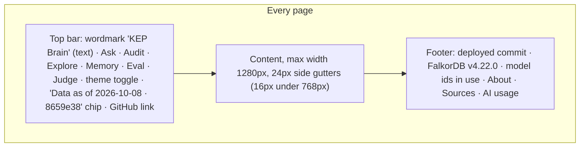
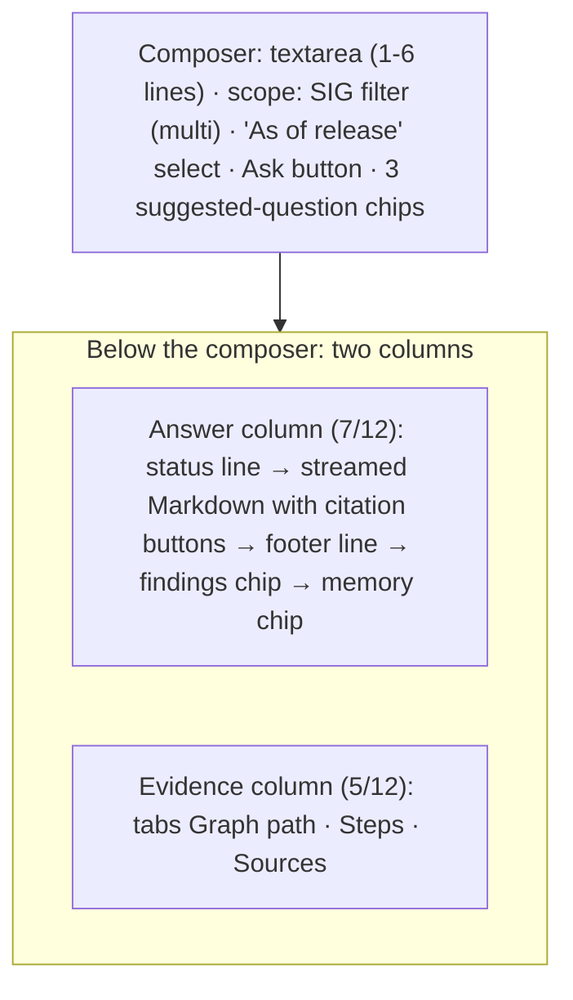

# 05 - UI/UX brief: KEP Brain

| | |
|---|---|
| Status | **v2.0** design notes only. No code, mockups, components, stylesheets or assets exist for the product UI (hackathon Rule 8: coding begins 2026-10-15 00:01 IST). 2026-10-12: applied 06 §1.6 register (ratified). |
| Written | v1.0 2026-10-11 by Fable 5.1 (an AI model). v2.0 2026-10-12 08:50–10:30 IST revision by Claude Opus 5.5 (an AI model), resolving the review findings listed in §12. **Human owner: H-Demo** (the person is named at HUM-00d). Every decision below is a *proposal* until H-Demo accepts or vetoes it in `docs/DECISIONS.md` on 2026-10-15; the acceptance commit is a human commit. |
| Scope | The narrow job on screen, information architecture, visual system, screen specs and states, accessibility, graph-view library decision, the 3-minute video, anti-patterns, human ownership of the UI |
| Depends on | `03-graph-model.md` (authoritative for every label, relationship name and direction), `04-eval-set.md` (question ids, types, metrics), `02-architecture.md` §12 (HTTP and SSE shapes), `06-build-plan.md` §1.3 (B-decisions) and §4 (contracts C3s and C8). This brief states what the UI needs from them; §13 lists the changes this revision asks those documents to adopt. |
| Decisions | Every decision has a one-line reason and an alternative, and all are veto-able (register in §10). |

---

## 0. Rule 8 boundary and human ownership (new in v2)

### 0.1 What exists before the event, and what does not

- This brief is a note. It contains token values, layout rules and copy intent; it contains no component code, no CSS file, no mockup image and no paste-ready query. Rule 8: "The main coding and design work must begin after the hackathon starts. You may discuss ideas, create notes, sketch the graph model, or prepare diagrams beforehand" (https://www.wemakedevs.org/hackathons/falkordb/rules, verified in `FABLE_CONTEXT.md` §0).
- The event page FAQ (https://www.wemakedevs.org/hackathons/falkordb, re-read 2026-10-12 09:10 IST, VERIFIED) says both "You may reuse general libraries, templates, and infrastructure" and "The submission and its main FalkorDB implementation must be new work completed during the event." `FABLE_CONTEXT.md` §0 adds the team's own stricter line: "Not before the start: code, scaffolding, a git repo, or the UI build."
- **DECISION (veto-able): the web app is generated at or after 00:01 IST on Oct 15 from the public generator `create-next-app@16.4.0`** (MIT, published 2026-10-06T18:23Z, VERIFIED on the npm registry 2026-10-12), not copied from the pre-event `apps/web` folder under `D:\kep-brain`. This brief names no file from that folder, so nothing here depends on it. Reason: the UI build is on the team's own "not before" list, and a public generator's output is provably not pre-written by the team. Cost: about 1 hour more in WEB-01 (generator, the security headers and `output: "standalone"` that the archived template already had, re-applied by hand from the ADR, not copied). Alternative: build on the pre-event template, which is allowed by the FAQ's "templates" clause; if the team picks it, H-Lead records a dated ADR naming the accepted risk, and this brief applies unchanged.
- Archiving the pre-event template out of `D:\kep-brain` before Oct 15, and the organiser question on Discord (HUM-00c), are H-Lead actions outside this document's folder; §13 lists them.
- This file is committed in a separate commit labelled "pre-event notes (written 2026-10-11/12)" after the generated scaffold, so `git log` shows the boundary (§13, request to INF-01).

### 0.2 Who owns what in the UI (Rules 11–13)

Rule 13: "Projects that are entirely generated using AI without meaningful participant contribution, verification, or technical understanding may be rejected." The UI contribution of the humans is named, small enough to be real, and visible as human commits.

| Artefact | Human owner | What the human does by hand | Evidence |
|---|---|---|---|
| The narrow-job sentence (§1) and all copy on `/judge` and the `/audit` header | H-Demo | Writes or rewrites it; this brief's wording is a draft | human commit on D1 |
| On-screen explanation of each of the five finding kinds (§4.3) | H-Demo | Writes one plain sentence per kind from `03` §15.1 tool 12 | human commit on D1 |
| The `path` event → path-table mapping (direction rule and traversal-order ranking, §7.4) | H-Demo | Hand-writes this one module (about 1 hour); the agent builds the Cytoscape wrapper around it | human commit on D1; the explain-back covers it |
| Hand-check of every finding shown on `/audit` (the narrow job's checkable outcome) | H-Data/Eval | Opens both sources of each finding and records a verdict in `evals/audit-check.yaml` (§4.3) | the file's git history; precision shown on `/audit` and `/eval` |
| Token contrast record (§3.1) | H-Demo | Re-runs the contrast computation on D1 and signs the result in the PR | the PR description |
| Keyboard-only walk of the judge path and the NVDA pass of Ask (§6) | H-Review | Does both by hand at CP4 | `docs/VERIFICATION.md` row |
| Video script, narration and recording (§8) | H-Demo, second human with a stopwatch | Writes the narration, rehearses on D3 evening, records | `docs/VIDEO.md` |
| Explain-back on the UI | H-Demo | At **CP1, CP4 and HUM-09** (not only D4): explains how SSE events fill the evidence panel, the path direction rule, why the table twin is the accessibility surface, and how audit precision is computed | `docs/AI_USAGE.md` row per session |

- At most **one** AI build lane works on the web app at any time (the `A4` lane of `06` §3.3); the other web cards queue behind it. Reason: one lane is reviewable by one human; parallel web lanes produce more code than the owner can explain.
- Every `docs/AI_USAGE.md` row for a web PR names the concrete human act ("H-Demo rewrote the abstention copy", "H-Review keyboard-walked `/judge`, found the citation popover unreachable, fixed in this PR"). A row that says only "reviewed" is sent back (`06` §7.2).

---

## 1. Audience, job, stance

**The narrow job (draft for H-Demo).** *KEP Brain audits Kubernetes' decision records: it finds where KEP metadata, tracking issues and replacement declarations disagree, shows who decided each state and the evidence, and drafts the fix.* The checkable outcome is the list of disagreements found at the pinned commit, each hand-checked, with the precision of that list stated on screen. Recall is not measured (there is no complete list of disagreements to compare against), and the page says so.

**Audience.** Judges and engineers who open the live deployment cold, with no sign-up, and who may give it two minutes. Many will have watched the three-minute video first. They clone the repository and run it. "If the video does not show it, it does not count" (WeMakeDevs First Commit rules, https://www.wemakedevs.org/aws/first-commit/rules).

**What the screens must prove, in this order.**
1. The audit found real disagreements between independent public records, each shown with both sides, both URLs, who decided each side, and a human verdict.
2. Every answer came from the graph: the path and the sources are on screen, not behind a click.
3. Knowledge stays current: a replay of a real upstream change (v1.37 release → pinned commit) (tier 2, not v1) shows new history arriving, a stored answer turning stale, and the finding count changing (§4.3.4).
4. The team is honest: the Eval page shows where the baselines win, and the audit page states what was hand-checked and what was not.

**What the screens deliberately do not lead with.** Reviewer routing, issue triage, "who to ask" rankings and "blast radius". Another public entry (`RAJ-A58/NodeOps`, created 2026-10-10, README read 2026-10-12, §11) ships PageRank reviewer ranking and blast radius for repositories and names Kubernetes. KEP Brain still has a PageRank "most connected" panel on the Person page, but it is kept out of the judge path and the video.

**Design stance.** Serious engineering tool. The register is a documentation site crossed with an observability console: dense tables, monospace identifiers, one accent colour, hairline borders, no decoration. Visual reference points, used as a register and not copied: the Kubernetes documentation site, Grafana's light theme, GitHub's Primer. If a screen would look at home on a product landing page, it is wrong.

**Five principles** (the test for every screen decision):

1. Evidence before prose. The graph path and the sources are first-class panels, visible by default, never a modal.
2. One accent. Blue marks interaction and the traversed path. Nothing else is coloured unless it carries status.
3. Nothing moves unless it carries information. Streaming text appends; the graph lays out once; no shimmer, no parallax, no decorative transitions.
4. Identifiers are code. KEP numbers, GitHub logins, SIG names, Cypher, commit hashes and timestamps are set in the monospace face, always.
5. Say what the system knows and does not know. "No evidence in the graph for ..." is a success state, rendered calmly, with the attempted steps shown.

---

## 2. Information architecture

### 2.1 Routes (v1: seven routes; the SIG page is one more behind a cut line)

| Route | Screen | Purpose | Track |
|---|---|---|---|
| `/` | Ask | Question, streamed cited answer, evidence panel (graph path, steps, sources) | T03 core, T01 explainability |
| `/audit` | Audit | **The narrow job.** Findings (cross-source disagreements) with both sides, decision trail, hand-check verdict and the draft-fix action; changes since a release; the replay (tier 2); sync status | T03 (decisions, currency), T01 action |
| `/explore` | Explore index (tier 2) | Search KEPs, people, SIGs | T03 |
| `/explore/kep/{number}` | KEP page | Facts, people and roles, decisions, status history, lineage, findings | T03 |
| `/explore/person/{login}` | Person page (tier 2) | Roles, KEP involvement, decisions the person is on, "most connected" score | T03 |
| `/memory` | Memory | Your memory (episodic, semantic, procedural), shared findings between agents, the agent task queue | T02 |
| `/eval` | Eval | Benchmark run, audit precision, load test, memory effect, honest losses | proof |
| `/judge` | Judge path | Five one-click steps (about 60 seconds), then the replay and the audit | presentation |
| `/about` | About | Data sources and licences, what was stripped, AI-assistance disclosure, who did what, FalkorDB depth table, "how this differs" table | Rules 6, 11–13 |
| `/explore/sig/{dir}` | SIG page | **Cut line by default, not built in v1.** SIG facts appear on KEP pages and in search | — |

v1 replaces `/freshness` with `/audit` (§12, findings 3, 5 and 6). Decision: `/` is the Ask screen, not a landing page. Reason: judges are one keystroke from an answer. Alternative: landing page with a "Try it" button (rejected: marketing register, one extra click).

Decision: every screen is reachable without sign-up, login or cookie banner. The only client-side storage is the theme choice and the anonymous memory id (§5.4). Reason: Kunal Kushwaha's tip "a live demo must work without sign-up" and Rule 6. Alternative: GitHub OAuth for memory identity (rejected: friction, and it collects personal data).

**Tools the screens depend on (the 14 v1 tools in `06` §1.3 row B28).** `find_entities`, `get_kep`, `who_approves`, `who_owns`, `trace_decision`, `status_history`, `whats_changed`, `find_contradictions`, `kep_relations`, `path_between`, `rank_people`, `draft_stale_doc_issue`, `recall_memory`, and `recall_findings` (new, read-only, over the `Finding` nodes in the `kep` graph written by the worker; §4.4). Page reads such as `GET /v1/keps/{n}` and `GET /v1/people/{login}` are fixed REST templates owned by `02` §12, not agent tools. No screen depends on `impact_of`, `who_owns(directory)`, `community_of` or `bridge_people`; if `06` keeps them behind cut lines, no screen changes.

### 2.2 Global frame



- The **"Data as of" chip** shows the commit time and short SHA of the ingested `kubernetes/enhancements` head and the last successful sync time in its tooltip (both from `GET /v1/meta`: `ingested_head_sha`, `graph_synced_at`). It links to `/audit#sync`. It is never hidden; on phones it collapses to the date.
- The **footer** states the FalkorDB image tag, the LLM model ids the provider adapter has selected, and the deployed commit.
- A **degraded banner** (warning) appears under the top bar when the provider is unreachable: "Answering is paused: the language-model provider is unavailable. Audit, Explore and Eval are unaffected." Reason: it shows FalkorDB carries the product (Rules 2–3). It is not in the video (§8).
- URL carries state: the Ask question in `?q=`, the "as of release" in `?release=`, the selected evidence node in the hash, the selected finding in `/audit?finding=`. Reason: judges share links; `/judge` deep-links.

### 2.3 Breakpoints

| Width | Layout |
|---|---|
| >= 1280px | Target. Ask is two columns (answer 7/12, evidence 5/12). Tables full width. |
| 1024-1279px | Same; evidence column narrows; graph canvas min height 360px. |
| 768-1023px | Ask stacks: composer, answer, then evidence as tabs. Audit finding rows expand below the row instead of beside it. Tables scroll horizontally inside their card. |
| 360-767px | Readable and functional. Graph views default to their table twin with a "Show graph" toggle. Nav collapses to a menu button (Radix dropdown). No feature is phone-only. |

Zoom: every screen is usable at 200% browser zoom at 1280px without horizontal page scroll (WCAG 1.4.10 Reflow applies at 320 CSS px; met through the 360px layout).

---

## 3. Visual system

### 3.1 Colour tokens

Colours exist in code only as semantic tokens. Raw hex appears in exactly one place (the token definition). Tailwind v4 maps the tokens to utilities through its `@theme` block; dark mode is selected by `data-theme="dark"` on `html` using Tailwind's documented data-attribute override of the `dark` variant (https://tailwindcss.com/docs/dark-mode, read 2026-10-11), with the OS `prefers-color-scheme` honoured when no explicit choice is stored. Light is the default. A three-way toggle (system / light / dark) stores the explicit choice in `localStorage`; an inline head script applies it before first paint (also per the Tailwind page).

All ratios were computed on 2026-10-11 with the WCAG 2.x relative-luminance formula; H-Demo re-runs the computation on D1 and WEB-01 adds a unit test that recomputes them from the hex values (§0.2). Thresholds: WCAG 2.1 SC 1.4.3 Contrast (Minimum), AA: 4.5:1 text, 3:1 large text (https://www.w3.org/WAI/WCAG21/Understanding/contrast-minimum.html); SC 1.4.11 Non-text Contrast, AA: 3:1 for UI boundaries and graphical objects (https://www.w3.org/WAI/WCAG21/Understanding/non-text-contrast.html).

**Light (default)**

| Token | Hex | Role | Contrast evidence |
|---|---|---|---|
| `bg` | `#f6f7f9` | Page plane | - |
| `surface` | `#ffffff` | Cards, panels, table bodies, chart surface | - |
| `surface-subtle` | `#f1f3f5` | Table header rows, code blocks, tool-call blocks | - |
| `border` | `#d9dde3` | Hairline dividers, card edges (decorative) | 1.36:1 on surface; decorative only, never the sole boundary of a control |
| `border-strong` | `#b8c0ca` | Context-node outlines in graph, table rules | 1.84:1; decorative only |
| `border-input` | `#7b8591` | Text inputs, selects, checkboxes, toggles | 3.75:1 on surface, 3.49:1 on bg (passes 1.4.11) |
| `text-primary` | `#15191f` | Body, headings, values | 17.64:1 on surface, 16.45:1 on bg |
| `text-secondary` | `#5b6572` | Labels, captions, table headers | 5.92 / 5.52 / 5.32 on surface / bg / subtle |
| `text-muted` | `#626d7a` | Timestamps, de-emphasised metadata, axis ticks | 5.27 / 4.91 / 4.73 |
| `accent` | `#1f5fc5` | Links, primary button, focus ring, selected state, traversed path | 6.00 on surface, 5.60 on bg |
| `accent-hover` | `#17499a` | Hover and active of accent | 8.55 on surface |
| `accent-subtle` | `#e8eefb` | Selected row, citation chip background, path-node fill | accent on it: 5.16:1 |
| `on-accent` | `#ffffff` | Text on accent fill | 6.00:1 |
| `success` / `success-subtle` | `#167330` / `#e8f5ec` | Implemented, passed, hand-check correct | 5.95 on surface; 5.30 on its tint |
| `warning` / `warning-subtle` | `#875a00` / `#fff4cc` | Stale, degraded, provisional, finding open | 6.01 on surface; 5.46 on its tint |
| `danger` / `danger-subtle` | `#c62828` / `#fdecec` | Errors, rejected/withdrawn, failed checks, hand-check incorrect | 5.62 on surface; 4.92 on its tint |
| `focus` | = `accent` | 2px outline, 2px offset, on every focusable element | 6.00:1 |
| `scrim` | `rgba(21,25,31,0.45)` | Behind dialogs | - |

**Dark (same tokens, re-stepped; not an inversion)**

| Token | Hex | Contrast evidence |
|---|---|---|
| `bg` | `#0f1216` | - |
| `surface` | `#161a20` | - |
| `surface-subtle` | `#1d2229` | - |
| `border` | `#2b323b` | decorative |
| `border-strong` | `#3d4652` | decorative |
| `border-input` | `#6f7a87` | 4.00 on surface, 4.30 on bg |
| `text-primary` | `#e6e9ed` | 14.34 on surface |
| `text-secondary` | `#a9b2bd` | 8.14 on surface |
| `text-muted` | `#8c95a1` | 5.76 on surface, 5.28 on subtle |
| `accent` | `#6ea2f0` | 6.73 on surface |
| `accent-hover` | `#8db6f5` | 8.43 on surface |
| `accent-subtle` | `#1a2a44` | accent on it: 5.55 |
| `on-accent` | `#0f1216` | 7.23 on accent |
| `success` / `success-subtle` | `#3fb950` / `#12261a` | 6.87 on surface; 6.27 on tint |
| `warning` / `warning-subtle` | `#d29922` / `#2a2210` | 6.92 on surface; 6.23 on tint |
| `danger` / `danger-subtle` | `#f0716a` / `#331a1a` | 6.05 on surface; 5.58 on tint |
| `scrim` | `rgba(0,0,0,0.6)` | - |

Rules:

- Status colours never carry meaning alone: every status chip has an icon and a text label (WCAG 1.4.1 Use of Color).
- Links are `accent` and underlined in running text; in tables and nav they are `accent` without underline and gain the underline on hover and focus.
- No gradient token, no glass/blur token, no shadow token except `scrim`. Elevation is `border` plus a `surface` change, never a drop shadow.
- Chart series colours are not UI tokens. They come from the dataviz skill's reference palette, validated against our chart surfaces (§7.5).

### 3.2 Typography

Decision: **Inter** for UI text and **JetBrains Mono** for identifiers and code, both through `next/font/google`, which downloads at build time and self-hosts the files so the browser sends no request to Google (Next.js 16.4.0 docs, https://nextjs.org/docs/app/api-reference/components/font, read 2026-10-11). Reason: both SIL OFL 1.1 (Inter: https://raw.githubusercontent.com/rsms/inter/master/LICENSE.txt; JetBrains Mono: https://raw.githubusercontent.com/JetBrains/JetBrainsMono/master/OFL.txt), both variable (JetBrains Mono wght 100-800 per https://raw.githubusercontent.com/google/fonts/main/ofl/jetbrainsmono/METADATA.pb), designed for small screen sizes, neither reads as a brand. Versions as of 2026-10-11: Inter v4.1 (2024-11-16), JetBrains Mono v2.304 (2023-01-14), GitHub releases API. Alternative: system stack (acceptable fallback if the build host has no network; rejected as default because platform metrics differ and the video should match the judge's screen). Both declare `display: swap` and the CSS-variable method so `--font-sans` and `--font-mono` resolve to them.

Type scale (px / line-height), weights 400, 500 and 600 only; italics only in quoted KEP text:

| Step | Size / line | Use |
|---|---|---|
| xs | 12 / 16 | Table captions, chart axis ticks, footer |
| sm | 13 / 18 | Table cells, chips, tool-call metadata, tooltips |
| base | 14 / 20 | Body, answer text, form controls |
| md | 16 / 24 | Section headings inside cards, lead paragraph of an answer |
| lg | 20 / 28 | Page title (h1) |
| xl | 24 / 32 | KEP and Person page titles |
| 2xl | 30 / 36 | Stat-tile values only |

- Monospace for KEP ids (`KEP-4671`), logins (`@macsko`), SIG dirs (`sig-scheduling`), releases (`v1.38`), commit hashes, timestamps, Cypher and tool parameters; one step smaller than the surrounding sans (13px in 14px body) to match x-height.
- `font-variant-numeric: tabular-nums` on numeric table columns, axis ticks and timestamps; proportional figures on stat-tile values.
- Answer prose wraps at 72ch. Tables are not measure-limited.
- Timestamps display as ISO 8601 in UTC (`2026-10-17 18:40 UTC`); relative times only with the absolute value in a tooltip and `title`.

### 3.3 Spacing, radius, density

- Base unit 4px. Scale: 4, 8, 12, 16, 24, 32, 48, 64. Nothing off-scale.
- Compact density: table rows 36px, controls 32px, buttons 32px (primary) or 28px (inline), nav items 36px. Every pointer target is at least 24 x 24 CSS px (WCAG 2.2 SC 2.5.8, https://www.w3.org/WAI/WCAG22/Understanding/target-size-minimum.html); inline citation markers meet it through padding.
- Radius: 4px on controls and chips, 6px on cards; status chips may be fully rounded; nothing else is rounded.
- Borders 1px `border`; focus rings 2px `accent` with 2px offset; no drop shadows.

### 3.4 Iconography and primitives

- Icons: `lucide-react` 1.55.0 (ISC, npm registry read 2026-10-11), 16px in text and controls, 20px in the top bar, stroke 1.5. An icon never appears without a visible label or an `aria-label`. No emoji anywhere.
- Accessible primitives: `radix-ui` 1.7.0 (MIT; peer `react ^19`) for dialog, tabs, tooltip, popover, dropdown menu and toggle group. Reason: focus trapping, roving tabindex, `Escape` handling and ARIA roles come correct by construction. Alternative: hand-rolled (rejected: the keyboard matrix in §6 is large).
- Framework pins as of 2026-10-11 (npm registry): `next` 16.4.0, `react` / `react-dom` 19.3.0, `tailwindcss` 4.3.3 (all MIT). The generator `create-next-app@16.4.0` matches `next` 16.4.0 (§0.1). Re-read the registry on 2026-10-15 before writing the manifest; pin exact versions.
- Answer rendering: `react-markdown` 10.1.0 with `remark-gfm` 4.0.1 (both MIT), safe rendering (no raw HTML, no images), and a custom renderer that turns citation markers into citation buttons (§4.1). Links render only when the URL equals an evidence URL (TRD-SR-008, `06` WEB-02).

### 3.5 Motion

- State changes: 120-160ms ease-out. Streaming text: no animation, append only, scroll held unless the user is at the bottom.
- Graph: one layout run per result, animated to position over at most 300ms, then static. Fit-to-view on a button.
- Loading: no shimmer. First loads draw static grey bars in the final layout; refetches hold the previous content at 60% opacity.
- `prefers-reduced-motion: reduce` disables the layout animation and all transitions.

---

## 4. Screens

Each screen lists purpose, layout, content, interactions, empty / loading / error states, keyboard behaviour, what the UI needs from the API (prose; shapes are owned by `02` §12 and `06` C3/C3s), and its place in the video.

### 4.1 Ask (`/`)

**Purpose.** A question goes in; a cited, streamed answer and its graph evidence come out together.

**Layout (>= 1280px).**



**Composer.**
- One textarea. `Enter` sends, `Shift+Enter` inserts a newline. Length 3..1,000 characters (TRD-SR-010, `06` AG-02), live counter from 900. The Ask button is disabled while a request is in flight; the question stays visible above the answer.
- Scope controls under the textarea: SIG filter (checkbox dropdown of the ingested SIGs from `GET /v1/meta`, default all) and "As of release" (the minor releases present in the graph, default latest).
- Three suggested-question chips: the first three entries by `judge_order` from `GET /v1/eval/questions` (`06` B24), so the chips, `/judge` and the eval cannot drift. Clicking one fills the composer and sends.

**Streaming contract (what the UI consumes).** Server-sent events over a POST read with `fetch` and a stream reader (not `EventSource`, which is GET-only). Events, field names per `06` C3s: `status`, `tool_call` (name, params, template, ms, rows, truncated, error), `path` (nodes, edges with `source`, `target` and `type` in the **stored** direction, ordered `path_node_ids`), `citation`, `token` (Markdown deltas with `[^index]` markers), `memory` (`recalled[]`, `remembered[]`, and, new in v2, `findings_recalled[]`: keys of shared findings the planner read through `recall_findings`), `done`, `error`. The UI requires that `path` and `citation` may arrive before the first `token`, so the evidence fills while the answer is written. Decision: SSE over WebSocket. Reason: one-directional, proxy-friendly, easy to log. Alternative: WebSocket (rejected: no client-to-server messages mid-answer).

**Answer column.**
- Status line (text-secondary, 13px): phase and elapsed time, "Querying graph · 2 tool calls · 0.8s"; it persists as the footer line.
- Citation markers render as buttons `[1]`, `[2]` in `accent-subtle` with `accent` text, 24px target, `aria-label="Source 1: KEP-583 kep.yaml"`. Hover or focus shows a popover (source type, title, locator, excerpt); click scrolls the Sources tab to the item and highlights the matching node(s).
- Footer line after `done`: "Read 6 nodes and 7 edges · 3 sources · Data as of 2026-10-08 · 8659e38". If a cited node changed after the selected "as of" release, a `warning` badge "May be stale: KEP-4671 changed on 2026-09-11" links to the KEP's status history.
- **Findings chip** (new): when an evidence node is part of a shared finding, a quiet chip "1 open finding on KEP-583: one-sided replacement" links to `/audit?finding=<key>`. When the planner read a finding through `recall_findings`, the chip reads "Used finding written by the freshness agent on 2026-10-17 09:12 UTC".
- Abstention is a first-class result, not an error: a `surface-subtle` block "No evidence in the graph" with the attempted tool calls and "Try narrowing to a SIG or naming a specific KEP."
- Memory chip (T02): "Recalled: you asked about KEP-583 in an earlier session" with "Forget" and a link to `/memory`; or "Remembered: interest in sig-scheduling". Both quiet (text-secondary, 16px icon).
- Actions row: Copy answer (Markdown with sources appended), Copy link (`?q=`), Open in Explore (first path node).

**Evidence column.**
- Tab **Graph path** (default): the graph view (§7). Path in `accent`, one-hop context in grey. A path table below the canvas lists each hop in traversal order, with the arrow drawn in the stored direction: for OWN-01 the hop reads `KEP-1287 ←APPROVES— @dchen1107`, because `03` §5.3 defines `(:Person)-[:APPROVES]->(:KEP)`. Each row carries its citation index. The table is the keyboard surface and the accessible twin; selection mirrors to the canvas. Controls: Fit, Context on/off (default on at <= 60 nodes), Open in Explore, Table only.
- Tab **Steps**: one block per tool call: tool name (mono), parameters, row count, duration, and the parameterized Cypher template, read-only, with Copy. Reason: Rule 10 requires "the Cypher queries or graph algorithms the product depends on"; showing them live is the most convincing form. No free-form Cypher is shown because none runs.
- Tab **Sources**: numbered list matching the citation indices: type icon and label (KEP document, kep.yaml, PRR file, PR, Issue, Comment, Commit), title, locator, excerpt (3 lines, expandable), external GitHub link at the ingested commit, "Show in graph".

**States.**

| State | Rendering |
|---|---|
| Empty (first visit) | Composer focused. One paragraph: "KEP Brain answers questions about Kubernetes Enhancement Proposals from a graph of KEPs, people, SIGs, PRs, issues and their history. Every answer shows the path it took and the sources it used." The three chips. A line on scope ("Only sig-node, sig-scheduling and sig-apps are loaded; no private data; no e-mail addresses"). The evidence column shows an empty canvas with the legend and "The traversed path appears here". |
| Loading | Status line per `status`; Steps per `tool_call`; graph on `path`; answer per `token`. Ask disabled, composer `aria-busy`. After 10s without `done`: "Still working". After 60s: client abort, error state with the steps kept. |
| Partial failure | A failed `tool_call` shows inline in Steps with a `danger` icon and its message; the answer continues or abstains. |
| Error | Inline alert above the answer: title by code (§5.1), one sentence of what to do, Retry, and "Diagnostic id: req_…" in mono. No stack traces. |
| Degraded | Global banner (§2.2); Ask reads "Answering paused" and is disabled; chips link to Explore and Audit instead. |
| Capacity reached / rate limited | The `capacity_reached` and `rate_limited` codes (`06` B18) get their own copy: "Today's answering budget for the public demo is used up. Audit, Explore and Eval still work." / "Too many questions from this address; try again in N minutes." |

**Keyboard.** `/` focuses the composer. `Enter` sends; `Shift+Enter` newline; `Escape` while streaming aborts. Citation buttons are in reading order in the tab sequence. `Alt+1/2/3` switches evidence tabs (Radix tabs also take arrow keys). In the path table: Up/Down move, `Enter` opens the node in Explore, `Space` toggles its context neighbours.

**Video.** The hero question (STA-04) typed live at real speed, Steps and the path filling before the prose ends, one citation hovered, the Cypher shown in Steps (§8, beat 2).

### 4.2 Explore (`/explore`, `/explore/kep/{number}`, `/explore/person/{login}`)

**Purpose.** Browse the decision records with the LLM switched off.

**Index.** A search field (full-text over KEP titles and numbers, logins and names, SIG names; results grouped by type in a listbox per the WAI-ARIA APG pattern, https://www.w3.org/WAI/ARIA/apg/patterns/listbox/) and two columns: KEPs with open findings (from `GET /v1/findings`), recently changed KEPs (from `whats_changed`).

**KEP page.**
- Header: `KEP-4671` (mono) and title; status chip (mapping below); stage; owning SIG (text, mono); latest milestone; open findings count (link to `/audit?kep=`); "Ask about this KEP" (prefills "Trace the decisions on KEP-4671: who decided each stage change, and is the metadata current?").
- Facts grid: authors, reviewers, approvers (logins linked to Person pages), participating SIGs, milestones per stage, see-also, replaces / superseded by, source file at the ingested commit.
- Tabs (each a table with caption, sortable headers, 36px rows; every row's source column links to the exact GitHub artefact):
  - **People and roles**: person, relationship as stored (`AUTHORED`, `REVIEWS`, `APPROVES`, `PRR_APPROVED {stage}`, all `Person → KEP`), valid from, source.
  - **Decisions** (`trace_decision`): decided at, kind, change (from → to), people with role (`approver`, `approve_command`, `lgtm`, `merger`, `prr_approver`, `author`, `actor`), evidence (PR, review, command comment, commit), and a "Reversal" chip when the decision `REVERSES` an earlier one. When `human_decider` is false the row says "merged by automation after approval by …".
  - **Status history** (`status_history`): kind, field, from, to, at, actor, evidence, reversal flag; metadata and label events interleaved by time.
  - **Lineage** (`kep_relations`, depth <= 2): the replacement and reference chains over `REPLACES`, `SUPERSEDED_BY` and `SEE_ALSO`, both directions, with one-sided declarations flagged ("KEP-4671 declares it replaces KEP-583; KEP-583 does not list a successor"). Rendered with the graph component (dagre) and a per-hop table. This replaces v1's "impact" framing (§12, finding 5).
  - **Findings**: the shared findings about this KEP, as on `/audit`.
- The tracking issue and implementing PRs appear as evidence rows inside Decisions and Status history; there is no separate "discussion" table in v1.

Status chip mapping (`03` §4.3 normalised enum): `provisional` warning; `implementable` accent; `implemented` success; `deferred`, `withdrawn`, `rejected`, `replaced` text-secondary on `surface-subtle`. Every chip carries the word; when `metadata_invalid` is true a second chip "raw: imlpemented" shows the source string.

**Person page.**
- Identity: the login (mono, with `@`) always. Display name and company appear **only while the Rule 6 switch `STORE_PERSON_NAME_COMPANY` is true** (`06` C4; `03` §4.1 stores them only from `sigs.yaml` leadership and only under that switch) and only when present; with the switch off the page renders the login alone and no empty "Name" row. The UI reads the switch from `GET /v1/meta` (§13), not from the absence of data, so the About page can state which mode the deployment runs in. E-mail is never stored (`03` §9).
- Roles table (SIG or working group, role: chair / tech lead / emeritus lead / subproject lead, valid from, source).
- KEP involvement tables: authored, reviewed, approved, PRR-approved (number, title, status, SIG).
- Decisions the person is on (role, KEP, decision kind, date, evidence).
- "Most connected" panel: the PageRank score over the `COLLABORATED` projection with a plain-language definition, the rank among ingested people, and the algorithm call named so a judge can match it to the README. It is not on the judge path or in the video (§1).
- v1 drops the OWNERS-directory table (directory ownership is the input to reviewer routing, which another entry ships; §12 finding 5).

**States.**

| State | Rendering |
|---|---|
| Empty search | "Search KEP numbers, titles, GitHub logins or SIG names", with three examples taken from the API, never hardcoded. |
| No results | "No match in the loaded SIGs for 'x'" plus the list of loaded SIGs. |
| Not found (`/explore/kep/99999`) | A 404 page in the frame: "KEP-99999 is not in the graph", with search and the SIG list. Real HTTP 404. |
| Stub KEP (outside the loaded SIGs) | Header plus "This KEP is owned by a SIG that is not loaded; only its own kep.yaml was read." Tabs other than Lineage are hidden. |
| Loading / Error | Static grey bars in the final shapes / card-level alert with Retry; the rest still renders. |

**Keyboard.** Native `<table>` semantics; sortable headers are buttons. The graph follows §6. Search results are a listbox with Up/Down/Home/End and type-ahead.

**Video.** Not a separate shot; the KEP page's Decisions tab appears inside the audit beat (§8).

### 4.3 Audit (`/audit`) - the narrow job

**Purpose.** Show the checkable outcome (cross-source disagreements found and hand-checked), who decided each side, the fix action, and that knowledge stays current.

**Layout.** One filter row (finding kind, SIG) above what it scopes, then four sections in order, each with an anchor:

#### 4.3.1 Header and findings (`#findings`)

- **Summary line and stat tiles** (dataviz stat-tile contract): Findings at the pinned commit; Hand-checked (count and share of findings); **Precision** (hand-checked correct / hand-checked, with n); Fix drafts posted to the demo repository. Under the tiles, one sentence: "Recall is not measured: there is no complete list of disagreements to compare against." All numbers come from `GET /v1/audit/summary` (§13).
- **Findings table**: kind (with the human-written explanation from §0.2 in a tooltip and in the expanded row), KEP, side A (value, date, actor, source), side B (value, date, actor, source), agent classification (the freshness agent's verdict and model id, §4.4), human verdict (`correct`, `incorrect`, `not checked`; with the checker's role and date), fix (none / drafted / posted with the issue link). Sortable; default order: not-yet-posted first, then by KEP.
- The five finding kinds are the ones `03` §15.1 tool 12 defines: `stage_mismatch`, `milestone_mismatch`, `one_sided_replacement`, `declared_approver_never_approved`, `status_label_conflict`.
- **Expanded row** (click or `Enter`): (1) a two-sided graph: the KEP in the centre, side A's path on the left and side B's path on the right (for `one_sided_replacement` on KEP-583: `KEP-4671 —REPLACES→ KEP-583` and `KEP-5832 —REPLACES→ KEP-583` on one side, `KEP-583` with no `SUPERSEDED_BY` declaration and its closed tracking issue on the other); (2) "Who decided each side": `trace_decision` rows for the commits that set each value, with `DECIDED_BY` roles; (3) both source URLs at the ingested commit; (4) the hand-check note; (5) "Draft fix issue".
- **Hand-check record.** H-Data/Eval records verdicts in `evals/audit-check.yaml` (finding key, verdict, checked_by role, checked_at, one-line note), committed by a human, read-only to the API through the same `./evals` mount as the question file (`06` B24). Decision (veto-able). Reason: the human verification is visible in git history, which is the Rule 13 evidence, and no write path or admin UI is needed. Alternative: an admin endpoint that writes verdicts into the graph (rejected: invisible in git, adds an authenticated write surface).

**Draft fix issue (T01 action).** A Radix dialog titled "Draft an issue in the demo repository": target repository in mono (the team's own repository from server configuration, shown verbatim; no picker), proposed title, body (editable textarea prefilled **by code** from the finding's evidence rows, each as `label/key → url`, with no LLM-written prose, TRD-SR-012), labels from a fixed list. Confirm creates the issue through `POST /v1/actions/stale-doc-issue/{id}/confirm` with the confirm nonce and shows the URL. A permanent note: "This never posts to kubernetes/* repositories." Reason: the hard rule to target only the demo repository (ADR 0021).

#### 4.3.2 Changes since a release (`#changes`)

- "Since release" select (default: the previous minor release) and the SIG filter from the row above.
- Four stat tiles from `whats_changed`'s `counts`: KEPs changed, status transitions, new KEPs, ownership changes, each labelled "since v1.37".
- Change table: KEP, field, from, to, changed on, actor, evidence (commit or PR). Default newest first. Rows link to the KEP page's Status history tab.
- **Your stale answers**: the viewer's own stored answers (from their memory graph) whose cited nodes changed after the answer, with Re-ask and Draft issue. Decision (veto-able): this table shows only the viewer's own answers, never other visitors'. Reason: anonymous visitors' question text is not public data (Rule 6 spirit, TRD-SR-047); v1 would have listed every visitor's questions on a public page. Alternative: an aggregate count across all memory graphs with no text (acceptable; adds a cross-graph scan for a number that proves little). With a pinned graph this table is usually empty, and the empty state says so and links to the replay, which is where staleness is demonstrated.

#### 4.3.3 Sync status (`#sync`)

Card from `GET /v1/sync/status` (public, redacted; `06` B14): last successful sync, items by type, GitHub budget remaining, worker last seen, next scheduled tick. "Sync now" calls `POST /v1/sync/request` (one accepted request per 10 minutes globally); when limited it reads "Requested 3 min ago by another visitor". The card states plainly that the judged graph is pinned to `ENHANCEMENTS_PIN_SHA` for the evaluation, so a sync during the event window usually changes nothing, and points to the replay.

#### 4.3.4 Replay: a real upstream change, end to end (`#replay`) - new in v2; tier 2, not v1

**Why.** Upstream rarely changes the loaded SIGs inside a four-day window, and the judged `kep` graph is pinned, so "keeping knowledge current" cannot be shown live on `kep`. The replay re-runs a real past change through the normal incremental sync, on a separate graph, deterministically.

**The window (VERIFIED 2026-10-12 against the GitHub API; raw responses cached under `D:\kep-brain\.recon\replay\`).**

| | Commit in `kubernetes/enhancements` | When | Why this one |
|---|---|---|---|
| From | `a5f009d04fb8258c4adbf73a2e66463111abb1dd` ("KEP-4817: Mark as implemented") | committed 2026-08-25T15:07:57Z | the last `master` commit before Kubernetes v1.37.0 was published (2026-08-26T16:29:12Z, `kubernetes/kubernetes` releases, `.recon/eval/kk-releases-p1.json`) |
| To | `8659e382efab7340d70de52432ee8f3d9979b797` | 2026-10-08T20:19:58Z | `ENHANCEMENTS_PIN_SHA`, the commit the eval ground truth is valid for (`04` §3.2) |

The compare API reports `to` 483 commits ahead of `from`, touching at least 65 `kep.yaml` files in the three loaded SIGs (41 sig-node, 19 sig-scheduling, 5 sig-apps; a lower bound, because the API returns at most 300 changed files; the worker measures the full count when it builds the replay).

**The recorded question and its verified change.** "What stage is Gang Scheduling (KEP-4671) at, and which release does it target?"

| Field in `keps/sig-scheduling/4671-gang-scheduling/kep.yaml` | At `a5f009d` | At `8659e38` | Changed by |
|---|---|---|---|
| `stage` | `beta` | `stable` | commit `91ac5bf521` (2026-09-11, `macsko`, "KEP-4671: Update Gang Scheduling KEP for GA in v1.38"), PR #6349 merged 2026-09-22T13:34:19Z |
| `latest-milestone` | `"v1.37"` | `"v1.38"` | same commit |

A second change in the window backs it up: KEP-5440 (`sig-apps`) moves `stage: beta` → `stable` and `milestone.stable` `v1.39` → `v1.38` in commit `6d8b5d37c9` (2026-09-25, PR #6307).

**Steps the worker runs (tier 2, not v1; admin-triggered; `POST /v1/replay/run` with the admin token; never on the judged `kep` graph).**

```mermaid
sequenceDiagram
  autonumber
  participant Admin
  participant Worker
  participant Replay as FalkorDB graph kep_replay
  participant Ops as FalkorDB graph ops
  participant Shared as FalkorDB graph kep (Finding nodes)
  Admin->>Worker: replay run (from a5f009d, to 8659e38)
  Worker->>Replay: build doc layer at a5f009d (same schema and loaders as kep)
  Worker->>Replay: find_contradictions (count before)
  Worker->>Replay: Ask the recorded question; store the answer with cited node keys and content hashes
  Worker->>Replay: incremental sync over git diff a5f009d..8659e38 (the normal sync path)
  Worker->>Replay: whats_changed since the from-commit time; find_contradictions (count after)
  Worker->>Shared: freshness agent writes a stale_answer finding with the before/after diff
  Worker->>Ops: ReplayRun with step timestamps, counts and the finding key
```

**What the page shows (tier 2, not v1; public, read-only).** The latest `ReplayRun`: from and to commits with dates; each step with its timestamp and duration; "N new `StatusChange` rows" with the change table (a live read-only `whats_changed` over `kep_replay`, filterable like §4.3.2); the recorded answer as it was, flagged **Stale** with the diff (`stage: beta → stable`, `latest-milestone: v1.37 → v1.38`, evidence PR #6349); the finding count before → after per kind; and the `stale_answer` finding it produced, linked to `/memory#findings`. Judges cannot start a replay (each run costs one answer and a rebuild); the README tells a judge who cloned the repository how to run it locally.

Decision (veto-able): replay on a separate graph `kep_replay`, advanced to the pin rather than to upstream head. Reason: the judged graph stays untouched, and pinning the end point makes the replay reproducible on any clone and keeps it consistent with the eval. Alternative: replay to upstream head (rejected: head moves, so the video and a judge's local run would show different numbers). P0 replays the doc layer only; label and milestone events for the window (filtered to the from-commit time) are P1.

**States (Audit).**

| State | Rendering |
|---|---|
| No findings in the filter | "No disagreements between sources in the selected SIGs and kinds at `8659e38`." The tiles show 0, not a dash. |
| Findings not yet hand-checked | The precision tile shows an em dash and "0 of N hand-checked"; it never shows a number computed over zero. |
| No replay run yet | Section explains what the replay does and that an operator starts it; no fabricated example. |
| Replay running | Step list with completed steps ticked, the running step named, the previous run's results at 60% opacity. |
| Replay failed | `danger` card with the failed step and error class; the previous successful run stays visible and labelled with its date. |
| Sync never ran / failed | As in v1: `warning` "No successful sync yet" / `danger` with the error class and the last good time. |
| Draft issue failure | Dialog stays open with an inline alert (actions disabled, repository unreachable, rate limited, daily cap reached) and the body preserved for copy. |

**Keyboard.** The findings table is a grid of rows: Up/Down move, `Enter` expands, `d` opens Draft fix on the focused row; the dialog traps focus and closes on `Escape`; Confirm is the last tab stop.

**Video.** Beat 2 (§8): the KEP-583 finding expanded, who decided each side, the created issue; then the replay section.

### 4.4 Memory (`/memory`) - T02

**Purpose.** Make per-user memory inspectable and deletable, and show **shared memory between agents** separately from the task queue.

**Identity without sign-up.** The browser generates a ULID on first use and stores it in `localStorage` key `kep.memoryId` (`06` C8). The header shows `mem_` plus the first 6 characters, masked by default with a reveal button and never placed in a URL (TRD-SR-003), and two buttons: "New identity" and "Forget everything" (confirm dialog; deletes this id's graph). Tenant separation is visible as "Graph: `mem:01J…` (masked)". Decision: anonymous per-browser identity. Reason: no sign-up, no personal data, and two browser profiles show two tenants. Alternative: a name field (rejected: collects a name, adds nothing). A privacy line: "No personal data in questions; memory is kept up to 90 days; Forget everything deletes it" (TRD-SR-047).

**Tabs.**
- **Your memory** (the per-user graph `mem:<id>`, names per `03` §11): *Episodes* (sessions and questions with answer summaries and "Re-open in Ask", newest first); *Facts* (semantic: kind, value, confidence, the episode it was learned from as a link, last reinforced, Delete with a 5-second Undo in an `aria-live` region); *Procedures* (question kind, the tool sequence that answered it, times used, success count; Delete per row). A line says what is never stored: names, e-mails, free text beyond the questions.
- **Shared findings** (new; `Finding` nodes in the `kep` graph, written by the worker): every finding as a record of who wrote it, who checked it and who read it. Columns: finding key, kind, KEP, written by (agent role `freshness`, model id `claude-haiku-5-5`, at), checked by (`qa` role outcome; human verdict from §4.3.1), read by (count of planner answers and of MCP `recall_findings` calls, with the last time), handoff chain (`freshness → qa → action` with times and outcomes). Read-only. This is the cross-agent shared state for T02: the freshness agent writes, the Q&A planner and any MCP client read through `recall_findings`, and the handoffs are recorded on the finding.
- **Task queue (`ops`)**: the agent board (role, current task, status, last heartbeat, lease holder) and handoffs in the last hour. Labelled "Task queue: coordination state, not memory". Read-only. Reason: v1 called this "shared state" next to memory; the review found that it is a queue (§12, finding 4), and the UI should not call it memory.
- **Graph**: cut line by default (`06` L7); the tables above carry the content.

**States.**

| State | Rendering |
|---|---|
| New identity, nothing stored | Each "Your memory" sub-tab explains in two sentences what will appear and how it is produced; Shared findings and Task queue still show live data (they are not per-user). |
| Memory service degraded | Banner on this page only: "Memory is read-only right now"; Ask continues without recall and says so in its footer line. |
| Deletion | Optimistic removal with a 5-second Undo; the row returns with an error if the server refuses. |

**Keyboard.** Tabs by arrow keys; tables as in Explore; destructive buttons always open a confirm dialog.

**Video.** Beat 3 (§8): two browser profiles with disjoint memories, then the Shared findings row of the KEP-583 finding showing "read by: planner 3, MCP 1".

### 4.5 Eval (`/eval`)

**Purpose.** The proof page: is the graph better, where is it not, how precise is the audit, how does it hold under load, and does memory change answers.

**Header.** Facts grid: run id, run date, commit, question count (56), data snapshot (`ENHANCEMENTS_PIN_SHA`), arms run and arms not run (`04` §8.2: N, L, V, G, H; V is "not run" without an embeddings key, never simulated), answering and classifier model ids, judge model, FalkorDB version, link to `evals/runs/<utc>/summary.json`. The noise-floor sentence from the generated report, verbatim (`04` §7: about ±8 points overall at 56 × 3).

**Stat tiles, row 1 (answers; four tiles).** Accuracy of arm H (the product) with its Wilson 95% interval; accuracy of the strongest baseline actually run (V if run, else L), labelled with its arm letter; paired difference H minus that baseline with its bootstrap 95% interval, and the words "no measurable difference" when the interval spans zero (`04` §7); abstention precision and recall.

**Stat tiles, row 2 (the narrow job and T02; three tiles).** Audit precision (from §4.3.1, with n hand-checked); load-test p95 for tool reads at 50 concurrent users with the error rate (`06` EV-03); memory effect: accuracy and mean input tokens on the multi-session follow-up items with recall versus without (6–10 items defined by `04`, §13).

**Chart 1: accuracy per question type.** Horizontal grouped bars, one row per type in `04` §4.1 order: Ownership (OWN), Expertise (EXP), Decision provenance (DEC), Status and freshness (STA), Multi-hop (MH), Abstention (ABS); each row label carries n. Two series: arm H (categorical slot 1, blue) and the strongest baseline run (slot 2, orange), named by arm letter in the legend; arms N and G appear in the table twin. Each bar carries its Wilson 95% interval as a hairline whisker. Direct value labels at bar tips, bars <= 24px, 4px rounded data-end, 2px surface gap inside a group, solid hairline grid, single axis 0–100%. Tooltip per bar on hover and focus with both series, n and interval. A caption repeats that per-type numbers are indicative (`04` §7: about ±18 points per type).

**Chart 2: where the graph loses.** A table, not a chart: question id, type, arm H result (correct / wrong / abstained), baseline result, why (one line from the run's failure taxonomy). Baseline-wins first. Reason: honesty is scored, and a table carries reasons a chart cannot.

**Chart 3: latency.** One row per stage as `04` §7 defines it (classifier, planner turns, tool execution, validator, end-to-end) for arm H, plus one row for the load test at 50 users; three marks per row at p50, p95 and p99 on a shared linear ms axis, joined by a hairline (dot-range strip), in the ordinal blue ramp of §7.5 (light `#86b6ef`, `#2a78d6`, `#104281`; dark `#6da7ec`, `#2a78d6`, `#184f95`). Markers >= 8px with a 2px surface ring; legend of the three ordered marks; tooltip lists all three values. Cut line `06` L8 turns it into a table.

**Every chart:** a "Table" toggle renders the same data as a `<table>`; tooltips on focus as well as hover; no dual axes; text wears text tokens, never series colour.

**Build-time requirement.** Read the `dataviz` skill before the first chart; run its validator against our chart surfaces and attach the output to the PR. On 2026-10-11 the reference categorical palette passed against light `#ffffff` and dark `#161a20` (adjacent pairs, both modes), the first three slots passed all-pairs, and the ordinal ramps passed `--ordinal`; light mode carries the expected contrast WARN on aqua, yellow and magenta, relieved by the table toggle and direct labels. Charts are plain SVG in React with `d3-scale` 4.0.2 and `d3-array` 3.2.4 (ISC); no charting library. Reason: three chart forms, exact mark control, the table twin from the same data. Alternative: Recharts (rejected: its defaults fight the mark specs).

**States.**

| State | Rendering |
|---|---|
| No run yet | Header explains how the eval is produced and where the question file lives; tiles show an em dash; charts replaced by "No evaluation run has been recorded for this deployment". |
| Run partially failed | A `warning` note: "5 of 56 questions errored (provider timeout); accuracy is computed over 51", with the errored ids listed in Chart 2's table. |
| Arm not run | The tile or series names the arm and says "not run" with the reason (for V: no embeddings key). |
| Loading | Header first; tiles and charts as static grey blocks. |

**Keyboard.** Figures are focusable regions with a description; bars and markers focusable in data order with the tooltip on focus; the Table toggle is a button.

**Video.** Beat 3 (§8): both tile rows, then the "where the graph loses" table with one row read aloud.

### 4.6 Judge path (`/judge`)

**Purpose.** Linked from the README's first lines. A judge finishes the five steps in about 60 seconds (`06` B19; the click count is measured on the final build before it is written anywhere).

**Content.**
1. The narrow-job sentence (§1) and one line of what to look for: "Every answer shows the path it took and its sources; Audit, Explore and Eval work with the language model off."
2. **Five steps**, each a card with a button that performs it (deep link with `?q=`), the expected evidence, and the time it should take. The steps are the eval records carrying `judge_order` in `evals/questions.yaml`, served by `GET /v1/eval/questions` and rendered in `judge_order`, so the page cannot drift from the eval (`06` B19, B24). This brief proposes the order (§13) over the judge-path question IDs **STA-04, DEC-07, DEC-01, MH-07, ABS-10** (defined in `04`): **STA-04** (KEP-583: status and whether the metadata is current; the audit's lead finding) and **DEC-01** (KEP-1287: who marked it implemented, in which PR). OWN-01 is no longer on the judge path; this verified example from `04` §5.1 (sources there: `keps/sig-node/1287-in-place-update-pod-resources/kep.yaml` L10, L26–L31): OWN-01 expects owning SIG `sig-node` and approvers `dchen1107`, `derekwaynecarr`, `ahg-g`, `mwielgus`, `thockin`, with the path table showing `KEP-1287 —OWNED_BY→ sig-node` and `KEP-1287 ←APPROVES— @dchen1107` and the `kep.yaml` cited.
3. **Then**: "See the audit" (`/audit#findings`, about 20 seconds), "See knowledge update" (`/audit#replay`, about 20 seconds), "See where the graph loses" (`/eval`).
4. **Verify it is a graph**: the Steps tab shows the parameterized Cypher of every tool call; link to the README section that lists the queries and algorithms (Rule 10); the README's Rule 3 table ("what stops working if FalkorDB is removed").
5. **Attach your own agent**: the MCP endpoint and the public read-only judge token (`06` B17, `docs/MCP.md`), with one suggested question: "Which KEPs did Gang Scheduling (KEP-4671) replace, and is anything recorded as inconsistent about them?" (expected tools: `kep_relations`, `recall_findings`).
6. Video link (YouTube, <= 3 minutes) and the repository link.
7. Compact FalkorDB depth summary (capability → where used), linking to About's full table.

**States.** Static content plus live steps; if the API is unreachable the static text still renders and the steps appear as plain text with a note.

**Video.** The close (§8, last 5 seconds) shows this page's URL.

### 4.7 About (`/about`)

Static page: data sources and licences (Apache-2.0 attribution to the Kubernetes Authors), what was stripped and how (no e-mail, no meeting URLs), whether the deployment stores leadership names and companies (the Rule 6 switch, read from `GET /v1/meta`), the removal-request path; AI-assistance disclosure from `docs/AI_USAGE.md` at build time and who did what (names from HUM-00d); the full FalkorDB depth table; the keyboard shortcuts; and **"How this differs"**, the same three-row table as the README (owned by DOC-01):

| | What it does | One checkable differentiator |
|---|---|---|
| `RAJ-A58/NodeOps` (public, created 2026-10-10; README read 2026-10-12) | Open-source triage for repositories: reviewer ranking by "`algo.pageRank` contributor importance over merged PR file footprints", duplicate grouping, "dependency blast radius"; targets Tracks 01 and 03 | KEP Brain does no reviewer routing or triage; its output is a list of disagreements between two independent records, each citing two URLs that disagree |
| A generic Slack or docs "company brain" | Answers questions from one corpus with citations | KEP Brain compares two sources about the same fact (`kep.yaml` versus the tracking issue or a successor KEP) and reports the conflict, with a human-checked precision figure |
| KEP Brain | Audits decision records: disagreements, who decided each side, a drafted fix, and a replay of a real upstream change | The findings list at `8659e38` and `evals/audit-check.yaml` can be re-checked by anyone against GitHub |

---

## 5. Cross-cutting rules

### 5.1 Empty, loading and error states (global contract)

- Every list, table and chart has an explicit empty state with a sentence saying why it is empty and what would fill it.
- Loading never blocks the page: frame and header first, grey bars in the final layout, refetches dim rather than clear.
- Every error states what happened (sentence keyed by error code), what the viewer can do, and a diagnostic id in mono. No stack traces, no raw JSON. Errors are inline where the content would have been, except the degraded banner.
- Error codes the UI has copy for (`02` §11.4 as extended by `06` C3): `provider_unavailable`, `provider_error`, `graph_unavailable`, `graph_timeout`, `rate_limited`, `capacity_reached`, `question_too_long`, `not_found`, `forbidden`, `sync_failed`, `replay_failed`, `action_failed`, `memory_unavailable`.
- Timeouts: 10s soft notice and 60s hard abort on Ask; 15s on page data with Retry.

### 5.2 Copy and tone

- Sentence case everywhere. No exclamation marks. No "powered by", "blazing", "seamless", "intelligent", "magic".
- Evidence, not confidence: "Based on 6 nodes and 3 sources", never "I'm 90% sure". The freshness agent's classification is shown as a verdict with its model id, never as a percentage.
- Abstention copy: "No evidence in the graph for this question", then what was searched.
- Numbers: thousands separators, at most one decimal in percentages, `ms` under 1,000 ms and `s` with one decimal above; every percentage shows its n.

### 5.3 Identifiers and links

- GitHub logins always with `@` in mono, linked to the Person page; an external-link icon marks links to GitHub. KEP ids always `KEP-<number>`. SIG names as their `dir` in mono.
- Relationship names are written exactly as `03` defines them, in mono, with the arrow in the stored direction (`←APPROVES—` when the path walks against it).
- Every fact from a file (`kep.yaml`, PRR file, `sigs.yaml`) links to that file at the ingested commit.

### 5.4 Privacy and data

- Nothing personal is displayed beyond the public login and, only while the Rule 6 switch is on, the public `sigs.yaml` name and company. E-mails are never ingested.
- Other visitors' questions are never displayed (§4.3.2). Shared findings contain KEP evidence only, never question text.
- The only client-side storage is the theme choice and the anonymous memory id. No analytics, no third-party scripts, no runtime font requests.

---

## 6. Keyboard and accessibility

Targets: WCAG 2.1 AA throughout, plus WCAG 2.2 SC 2.5.8. Verification: `@axe-core/playwright` with zero violations on every v1 route, a keyboard-only walk of the judge path and an NVDA pass of Ask, both by H-Review at CP4 (§0.2).

**Global.**
- Skip link first. Landmarks: `banner`, `nav`, `main`, `complementary` (evidence column), `contentinfo`.
- Focus always visible: 2px `accent` outline, 2px offset, including graph canvas and chart marks.
- Tab order follows reading order. `Escape` closes any popover, dialog or tooltip and aborts a streaming answer.
- Shortcuts (single keys only when no input is focused): `/` focus composer; `g` then `a` Ask, `u` Audit, `e` Explore, `m` Memory, `v` Eval, `j` Judge; `t` toggle the table view of the focused figure; `?` shortcuts dialog. Listed in that dialog and on About.
- Live regions: one polite region announces phase changes and completion (not individual tokens); one assertive region for errors.
- Colour is never the only carrier: chips have icons and words; path edges are thicker as well as blue; chart series have a legend and direct labels; links are underlined in prose.
- `prefers-reduced-motion` respected. Contrast per §3.1.
- `lang="en"`; page titles "Audit - KEP Brain", "KEP-4671 - KEP Brain".

**Graph view (canvas).** Cytoscape renders to canvas, so accessibility comes from a parallel structure:
- The canvas container has `tabindex=0`, `role="img"`, an `aria-label` summary ("Graph path with 4 nodes and 3 edges from KEP-583 to KEP-4671") and `aria-describedby` pointing at the path table.
- The path table (Ask), per-hop table (Lineage) or node list (Audit expanded row) is the keyboard surface: an APG listbox (Up/Down, Home/End, type-ahead) with `aria-selected`, mirrored to the canvas. `Enter` opens the node in Explore; `Space` toggles context.
- With the canvas focused: arrows move along the path order (Ask) or nearest neighbour (other views); `+`/`-` zoom; `0` fit; `Enter` open; `Escape` clear.
- "Table only" hides the canvas and is the default under 768px.

**Charts (SVG).** Each figure is `role="group"` with a visible title and caption; marks are focusable in data order with the same tooltip on focus; the table twin is one toggle away and is also present as a visually hidden `<table>`.

**Forms.** Visible labels; errors announced and linked with `aria-describedby`; required fields stated in text.

---

## 7. Graph visualisation library decision

### 7.1 Requirements

- Render a traversed path (typically 3–12 nodes) with one-hop context, up to about 200 nodes and 400 edges, in under 300ms layout time on a judge's laptop.
- Deterministic, legible layout: the path reads left to right in traversal order, identically on every run and in the video.
- Node type must not depend on colour (13+ labels; dataviz caps colour identity at three), so distinct shapes and text badges are required.
- Edge labels (relationship type) and arrows in the stored direction.
- Selector styling (path versus context, selected, hovered) without re-rendering.
- Mature, maintained, MIT, works in a Next.js client component, typed.

### 7.2 Candidates (facts read on 2026-10-11)

| | Cytoscape.js | react-force-graph-2d | sigma.js |
|---|---|---|---|
| Version / date | 3.34.3, released 2026-09-07 (GitHub releases API) | 1.29.2 (npm) | 4.0.0, released 2026-10-08 (GitHub releases API) |
| Licence | MIT | MIT | MIT |
| Renderer | Canvas | HTML canvas via `force-graph`; 3D variants use three.js | WebGL 2 only in v4 (release notes) |
| Data model | Own JSON elements | Own `{nodes, links}` | Requires `graphology` |
| Layouts | Built in: null, random, preset, grid, circle, concentric, breadthfirst, cose; extensions `cytoscape-dagre` 4.0.1 (dagre bundled) and `cytoscape-fcose` 2.2.0 | Continuous d3-force; `dagMode` "Only works correctly for DAG graph structures (without cycles)" | Separate graphology layout packages |
| Node shapes | 26 named shapes in style | None built in; custom canvas drawing | v4 notes mention node programs; no documented list read |
| Labels | `label`, `text-wrap: ellipsis`, `text-max-width` | Drawn manually | WebGL labels |
| Edge styles | 9 curve styles incl. `bezier`, `taxi`, `straight`; arrows; edge labels | Straight/curved; particles | Straight by default |
| React integration | `react-cytoscapejs` 2.0.0 last published 2022-09-02 (stale); own thin wrapper | First-party component | `@react-sigma/core` 5.0.6 peers `sigma ^3.0.2` |
| TypeScript | Bundled | Bundled | Bundled |
| Scale | Thousands with viewport options | Thousands | Designed for thousands |

### 7.3 Decision

**Cytoscape.js 3.34.3 with `cytoscape-dagre` 4.0.1 for path, lineage and two-sided finding views and `cytoscape-fcose` 2.2.0 where no order exists, wrapped in our own small React client component.**

Reasons, by weight: (1) deterministic hierarchical layout; (2) shapes and selector styling built in; (3) edge labels and arrows first class; (4) maturity and recency; (5) our scale is small, so WebGL buys nothing.

Rejected: **react-force-graph-2d** (non-deterministic continuous layout; `dagMode` unusable because our subgraphs contain cycles such as mutual `SEE_ALSO` and the both-direction `RELATED_KEP`; shapes and edge labels need custom drawing). **sigma.js 4.0.0** (a rewrite released three days before v1 of this brief, React bindings still on `sigma ^3`). **react-cytoscapejs** (unmaintained since 2022-09-02; a 60-line wrapper avoids it).

UNVERIFIED: dagre layout time for 200 nodes / 400 edges on a mid-range laptop. Measured in WEB-03 on 2026-10-15 and written into `docs/VERIFICATION.md`; above 300ms, context defaults to off above 60 nodes (already the rule) and the budget is restated with the measurement.

### 7.4 Rendering spec

- **Direction rule (hand-written by H-Demo, §0.2).** Arrows are drawn in the stored direction of the relationship (`03` §5). Layout rank follows traversal order: dagre receives layout-only edges built from consecutive `path_node_ids`, so a path that walks `KEP-1287` → `@dchen1107` against `(:Person)-[:APPROVES]->(:KEP)` still lays out left to right while its arrow points from the person to the KEP. The path table uses the same rule (`—TYPE→` or `←TYPE—`).
- **Layouts:** Ask path, KEP Lineage and the Audit two-sided view → dagre left to right (two-sided: side A ranked left of the KEP, side B right); anything without an order → fcose, capped at 50.
- **Node label → shape and badge** (labels per `03` §4 and §11; any other label uses the last row):

| Label | Shape | Badge text |
|---|---|---|
| `KEP` | round-rectangle | `KEP-4671` |
| `Person` | ellipse | `@login` |
| `SIG`, `WorkingGroup`, `Committee` | hexagon | `sig-node` |
| `PullRequest` | diamond | `#6349` |
| `Issue` | triangle | `#583` |
| `Commit` | round-diamond | first 7 characters of the sha |
| `Review` | round-triangle | `review @login` |
| `Comment` | round-tag | first 24 characters |
| `Release` | tag | `v1.38` |
| `StatusChange` | pentagon | `stage: beta→stable` |
| `Decision` | octagon | the decision kind |
| `Document` | cut-rectangle | file kind (`kep.yaml`, `prr`) |
| `Section` | bottom-round-rectangle | heading, 24 characters |
| `FeatureGate` | rhomboid | gate name |
| `Finding` (`kep` graph) | concave-hexagon | finding kind |
| any other | rectangle | the label name in caps, then the display name |

  Fill: `accent-subtle` on the path, `surface-subtle` as context, in both themes.
- **Path emphasis:** path nodes 2px `accent` border, `accent-subtle` fill, `text-primary` labels; path edges 2px `accent` with a filled arrow and the relationship type as a 12px mono `text-secondary` edge label; context nodes 1px `border-strong`, `surface-subtle` fill, `text-muted` labels; context edges 1px `border-strong`, labelled on hover.
- **Size and labels:** node width 28px, growing to fit the badge up to 140px; label below; `text-wrap: ellipsis`, `text-max-width` 140px; full name in the tooltip and the table.
- **Interaction:** hover adds a 2px `surface` ring then a 1px `accent` ring and a tooltip (type, name, two key properties, "Open in Explore"); click selects (mirrored to the table and the hash); double-click opens Explore; wheel zoom with reduced sensitivity; box selection off; panning on.
- **Legend:** always visible in the canvas corner as HTML: the shapes in use with their label names, and the two edge samples (path, context).
- **Truncation:** over 200 nodes the API has already grouped the tail by label ("+37 more PullRequests"); the UI shows "Showing 200 of 237 nodes" with a "Table only" link.

### 7.5 Chart palette validation record (for the Eval page)

Run on 2026-10-11 with the dataviz skill's `validate_palette.js` against our `surface` tokens:

| Check | Light on `#ffffff` | Dark on `#161a20` |
|---|---|---|
| 8-slot categorical, adjacent pairs | PASS; worst CVD pair 9.1, normal-vision 19.6; contrast WARN on aqua, yellow, magenta (relief: direct labels or table view) | PASS; worst CVD 8.4, normal-vision 19.3; all >= 3:1 |
| First 3 slots, all pairs | PASS; worst CVD 9.2, normal-vision 24.0; WARN on aqua | PASS; worst CVD 9.4, normal-vision 20.9 |
| Ordinal ramp for p50/p95/p99 | PASS (`#86b6ef`, `#2a78d6`, `#104281`; light end 2.11:1) | PASS (`#6da7ec`, `#2a78d6`, `#184f95`; light end 2.15:1) |

The Eval page uses at most two categorical series (slots 1 and 2) and the ordinal ramp, inside the validated range. Re-run at build time if any surface token changes.

---

## 8. Demo video: three beats

Three minutes or less, 1920 x 1080, browser at 125% zoom, light theme, cursor visible, no music, captions burned in, real data only, URL bar visible in the first live shot (public URL, no login). Narration names FalkorDB's role in plain words at least twice. The structure is three beats (problem, one continuous hero story, proof) because "one narrow job done end to end scores better than a platform with three half-finished features" (organiser advice, `FABLE_CONTEXT.md` §2). The hero beat runs 100 seconds and passes through the T01 and T02 evidence on the way, so every track's claim is on screen without separate segments.

| Time | Beat | Shot | Must be visible |
|---|---|---|---|
| 0:00–0:15 | 1 · Problem | `/audit` header | "Kubernetes runs on public decision records, and they disagree." The findings tile and the precision tile with its n. |
| 0:15–0:50 | 2 · Hero | Ask, STA-04 | The question typed live, streaming at real speed: Steps filling with tool names and their Cypher; the path (`KEP-4671 —REPLACES→ KEP-583`, `KEP-5832 —REPLACES→ KEP-583`, KEP-583's closed tracking issue) drawing; the cited answer "stale"; one citation hovered. |
| 0:50–1:10 | 2 · Hero | `/audit`, the KEP-583 finding | The expanded two-sided view; "who decided each side" with roles; the human verdict "correct"; Draft fix → Confirm → the created issue (GitHub tab opened beforehand) with evidence links. |
| 1:10–1:30 | 2 · Hero | Claude Desktop attached to the live MCP server | The tool list; Claude choosing `kep_relations` for "Which KEPs did Gang Scheduling replace, and is anything recorded as inconsistent about them?" and then `recall_findings`, returning the freshness agent's KEP-583 finding: T01 tool selection over MCP and T02 memory shared between two agents in one shot. |
| 1:30–1:55 | 2 · Hero | `/audit#replay` (tier 2) | From `a5f009d` (v1.37 release) to `8659e38`: N new `StatusChange` rows; the recorded KEP-4671 answer flagged **Stale** with `beta → stable`, `v1.37 → v1.38`, PR #6349; findings count before → after. |
| 1:55–2:25 | 3 · Proof | `/eval` | Both tile rows (H versus the strongest baseline with the interval; audit precision; load-test p95 at 50 users; memory effect); the "where the graph loses" table with one row read aloud. |
| 2:25–2:40 | 3 · Proof | `/memory` | Two browser profiles with disjoint "Your memory"; the Shared findings row for KEP-583: written by freshness, checked by qa, read by planner and MCP. |
| 2:40–2:55 | 3 · Proof | README top | The depth table, the Rule 3 line ("remove FalkorDB and the audit, the lineage, the replay and the shared findings all stop"), the "How this differs" table. |
| 2:55–3:00 | close | `/judge` | The URL and "about 60 seconds, five steps". |

Not in the video, by decision: the degraded banner (shown in the README and the Rule 3 table instead), the SIG page, the PageRank "most connected" panel, directory ownership. Abstention is shown in the judge path (ABS-05) and as the abstention tile, not as a separate shot.

Rules: no speeding up of the hero (latency is a claim on the Eval page); every on-screen timestamp falls inside the event window; nothing is a mockup; the MCP shot uses the public judge token, not an admin token; the replay shown is the latest real `ReplayRun`, and the narration says it replays a past upstream change. Rehearse the full cut with a stopwatch on **D3 evening** (two humans: one drives, one times) and record a backup take of every row; DOC-03 assembles from the best takes.

---

## 9. Anti-patterns (reject on sight)

Visual:
- Neon or saturated gradients, gradient text, glassmorphism, blurred panels, glow, drop shadows for depth.
- Dark theme as default, or a dark theme that is a plain inversion.
- Decorative illustrations, hero images, animated backgrounds, particle fields, rotating 3D graphs.
- Emoji in headings, buttons, chips or logs. Icons without labels.
- Pill-shaped everything; radius above 6px on containers.
- More than one accent; colour as the only status signal.
- Display or serif typefaces; light (300) or black (900) weights; letter-spaced uppercase labels.

Content:
- Marketing copy, exclamation marks, "powered by" badges.
- Fake or placeholder metrics, lorem ipsum, invented KEPs or people, mockup screenshots presented as the product. A precision figure computed over zero checks.
- Confidence percentages the system cannot justify; "I think" instead of evidence counts.
- Calling the task queue "memory"; calling lineage "blast radius".
- Hiding the Cypher or the path behind a "developer mode" toggle.
- Answers without sources, or sources without a link at the ingested commit.
- Another visitor's question text on any page.

Interaction:
- Spinner-only loading, skeleton shimmer, layout jumps on refetch.
- Toasts for errors that belong inline; modals for content that should be a panel.
- Infinite scroll on tables; hover-only information.
- Keyboard traps; custom controls without roles; `outline: none`.
- Free-form text-to-Cypher input anywhere (fixed decision).
- A repository picker in the draft dialog.

Charts (see the dataviz skill's `anti-patterns.md`):
- Dual y-axes; pies or donuts; rainbow ramps; a value label on every point; dashed gridlines; recolouring on filter; status colours for a series; charts without a table twin; per-type bars without their interval.

---

## 10. Decision register

All rows are proposals until H-Demo records acceptance in `docs/DECISIONS.md` (§0.2).

| # | Decision | Reason | Alternative | Veto-able |
|---|---|---|---|---|
| 1 | `/` is the Ask screen | One keystroke to an answer | Landing page | yes |
| 2 | No sign-up; anonymous per-browser memory id in `localStorage` `kep.memoryId` | Judging tip and Rule 6 | GitHub OAuth | yes |
| 3 | Light default; dark via `data-theme` + OS preference, three-way toggle | Fixed by the team; Tailwind documented mechanism | Class-based toggle | mechanism yes, light-default no |
| 4 | Inter + JetBrains Mono via `next/font/google` | OFL, variable, no runtime third-party requests | System stack | yes |
| 5 | Tokens in §3.1 with the computed contrast record, re-run by H-Demo on D1 | Text >= 4.5:1, controls >= 3:1 | Primer or Radix scales | yes |
| 6 | `radix-ui` 1.7.0 primitives | Correct keyboard and ARIA under time pressure | Hand-rolled | yes |
| 7 | `lucide-react` 1.55.0 icons, always labelled | ISC, consistent stroke | Heroicons | yes |
| 8 | `react-markdown` 10.1.0 + `remark-gfm` 4.0.1, no raw HTML, no images, evidence-only links | Safe Markdown | Custom parser | yes |
| 9 | SSE on a POST read with fetch streams | One-directional, proxy-friendly | WebSocket | yes |
| 10 | Evidence column visible by default, Graph path first | Evidence before prose | Collapsible drawer | yes |
| 11 | Abstention rendered as a normal result | Refusal grounded in rows is praised by FalkorDB's judge | Error state | no (product principle) |
| 12 | Cytoscape.js 3.34.3 + dagre 4.0.1 + fcose 2.2.0, own wrapper | Deterministic layout, shapes, edge labels | react-force-graph-2d; sigma 4 | yes |
| 13 | Node type by shape and badge; colour reserved for path emphasis | 13+ labels exceed colour identity limits | Colour per type | yes |
| 14 | 200-node cap with server grouping; context off above 60 nodes | Legibility and layout time | WebGL, unlimited | yes |
| 15 | Eval charts in plain SVG with d3-scale/d3-array, validated palette, interval whiskers | Exact marks, table twin, `04` intervals | Recharts | yes |
| 16 | SIG page cut by default (v1 change; v1.0 decision 16 "SIG status breakdown as a table" moves with it) | Narrow job; SIG facts are on KEP pages | Build the SIG page | yes |
| 17 | "Sync now" visible to all, one request per 10 minutes globally (`06` B14) | Demonstrable, and harmless next to the 15-minute tick | Admin-only | yes |
| 18 | Draft dialog shows the fixed demo repository, no picker; body composed by code from evidence | Never post to real Kubernetes repositories; no LLM prose in actions | Repository picker | no (safety rule) |
| 19 | Degraded banner when the LLM is down; Audit/Explore/Eval keep working | FalkorDB carries the product | Full-page error | no (Rules 2–3) |
| 20 | Chips and judge steps served from the eval file via the API, ordered by `judge_order` | No drift | Hardcoded strings | yes |
| 21 | Error copy keyed by a fixed code list with diagnostic ids | Honest, debuggable | Raw messages | yes |
| 22 | Compact density (36px rows, 32px controls, 24px minimum targets) | Console register and WCAG 2.5.8 | Comfortable density | yes |
| 23 | `/audit` replaces `/freshness` and leads the nav after Ask; the narrow-job sentence heads `/audit` and `/judge` | The checkable outcome is the product | Keep Freshness as a page | yes |
| 24 | Replay on `kep_replay` from `a5f009d` to the pin, admin-triggered, public read-only | Shows a real update deterministically without touching the judged graph | Replay to head; public trigger | yes |
| 25 | "Your stale answers" shows only the viewer's own answers | Visitors' questions are not public data | Aggregate count only | yes |
| 26 | Hand-check verdicts in `evals/audit-check.yaml`, committed by a human | Human verification visible in git | Admin write endpoint | yes |
| 27 | Judge order STA-04, DEC-01, MH-04, OWN-01, ABS-05 (same five ids as `06` B19) | Lead with the audit and decision trace | B19's OWN-01-first order | yes |
| 28 | KEP page "Lineage" tab over `kep_relations` replaces the impact view | Supersession lineage, not blast radius | Impact tab over `impact_of` | yes |
| 29 | Person name and company shown only while `STORE_PERSON_NAME_COMPANY` is true; the UI reads the switch from `/v1/meta` | Rule 6 switch is honest on screen | Infer from missing data | yes |
| 30 | Web app generated from `create-next-app@16.4.0` after 00:01 IST | The team's own "no UI build before the start" line | Pre-event template | yes |
| 31 | Video in three beats, hero 100 s covering the T01 MCP and T02 shared-memory shots | Narrow job and "if the video does not show it" together | Seven segments | yes |
| 32 | Memory page splits "Your memory", "Shared findings" (`Finding` nodes in `kep`) and "Task queue (ops)" | Shared memory is shown as memory; the queue is not | One "shared state" tab | yes |
| 33 | One AI lane on the web app at a time; H-Demo hand-writes the path mapping | Rules 11–13: reviewable and explainable | Up to two web lanes | yes |

---

## 11. Verification log

| Fact | Source | Read on |
|---|---|---|
| Rules, tracks, judging patterns, FalkorDB version table | `E:\graph-hacks-prep\FABLE_CONTEXT.md` | 2026-10-11 |
| FAQ: "You may reuse general libraries, templates, and infrastructure." and "The submission and its main FalkorDB implementation must be new work completed during the event." | https://www.wemakedevs.org/hackathons/falkordb (FAQ, continuing an existing project) | 2026-10-12 09:10 IST |
| `create-next-app` 16.4.0 exists, MIT, published 2026-10-06T18:23:58Z; `next` 16.4.0 published 2026-10-06T18:35:31Z | `npm view create-next-app`, `npm view next time` (registry.npmjs.org) | 2026-10-12 |
| NodeOps: created 2026-10-10; targets Tracks 01 and 03; "Company Brain"; reviewer ranking by "`algo.pageRank` contributor importance over merged PR file footprints"; "dependency blast radius"; names Kubernetes | `gh api repos/RAJ-A58/NodeOps`; README cached at `D:\kep-brain\.recon\search\nodeops-readme-2026-10-12.md` | 2026-10-12 |
| v1.37.0 published 2026-08-26T16:29:12Z | `D:\kep-brain\.recon\eval\kk-releases-p1.json` | 2026-10-12 |
| Last `kubernetes/enhancements` master commit before that: `a5f009d04fb8258c4adbf73a2e66463111abb1dd`, 2026-08-25T15:07:57Z | `GET /repos/kubernetes/enhancements/commits?sha=master&until=2026-08-26T16:29:12Z`; `.recon\replay\commit-at-v1.37.0.json` | 2026-10-12 |
| Pin `8659e382efab7340d70de52432ee8f3d9979b797`, 2026-10-08T20:19:58Z | `04` §3.2; `.recon\eval\master-head.json` | 2026-10-12 |
| Compare `a5f009d...8659e38`: ahead by 483; at least 65 loaded-SIG `kep.yaml` files changed (41 / 19 / 5) | `GET /repos/kubernetes/enhancements/compare/a5f009d…8659e38`; `.recon\replay\compare-v1.37.0-to-pin.json` | 2026-10-12 |
| KEP-4671 `stage` beta → stable, `latest-milestone` v1.37 → v1.38 between the two commits; changed in `91ac5bf521` (2026-09-11, macsko), PR #6349 merged 2026-09-22T13:34:19Z | contents API at both refs (`.recon\replay\kep-4671-gang-scheduling-*.yaml`); `.recon\replay\commits-4671-kepyaml-replay-window.json`; `.recon\eval\pulls-91ac5bf521.json` | 2026-10-12 |
| KEP-5440 `stage` beta → stable, `milestone.stable` v1.39 → v1.38; commit `6d8b5d37c9` (2026-09-25, PR #6307) | `.recon\replay\kep-5440-*.yaml`; `.recon\replay\commits-5440-kepyaml-replay-window.json` | 2026-10-12 |
| OWN-01, DEC-01, STA-04, MH-04, ABS-05 questions and ground truth | `04-eval-set.md` §5 (sources cited there) | 2026-10-12 |
| `(:Person)-[:APPROVES]->(:KEP)`; `REPLACES`, `SUPERSEDED_BY`, `SEE_ALSO`; finding kinds; `Episode`/`Fact`/`Procedure`; `Person.name`/`company` under the switch | `03-graph-model.md` §4.1, §5.3, §11, §15.1 | 2026-10-12 |
| B14, B17, B18, B19, B24; C3s, C4, C8 | `06-build-plan.md` v1.1 §1.3, §4 | 2026-10-12 |
| WCAG 1.4.3, 1.4.11, 2.5.8; APG listbox | W3C URLs in §3 and §4.2 | 2026-10-11 |
| Tailwind v4 dark mode; `next/font/google` | https://tailwindcss.com/docs/dark-mode ; https://nextjs.org/docs/app/api-reference/components/font | 2026-10-11 |
| Package versions (`next`, `react`, `tailwindcss`, `radix-ui`, `lucide-react`, `react-markdown`, `remark-gfm`, `d3-scale`, `d3-array`, `cytoscape`, `cytoscape-dagre`, `cytoscape-fcose`) | npm registry / GitHub releases API, as listed in v1.0 and re-read by `06` §5.5 on 2026-10-12 | 2026-10-11/12 |
| Cytoscape shapes used in §7.4 (round-rectangle, ellipse, hexagon, diamond, round-diamond, triangle, round-triangle, round-tag, tag, pentagon, octagon, cut-rectangle, bottom-round-rectangle, rhomboid, concave-hexagon, rectangle) | https://raw.githubusercontent.com/cytoscape/cytoscape.js/master/documentation/md/style.md | 2026-10-11 |
| sigma, react-force-graph, react-cytoscapejs, fonts facts | as in §7.2 and §3.2 | 2026-10-11 |
| Token contrast ratios; chart palette checks | WCAG luminance formula; dataviz `validate_palette.js` | 2026-10-11 |

UNVERIFIED (to measure or confirm on or after 2026-10-15):
- Dagre layout time for 200 nodes / 400 edges (§7.3).
- Exact count of loaded-SIG `kep.yaml` files changed in the replay window (the compare API truncates at 300 files; the worker measures it).
- Finding count before and after the replay (computed by the replay; no number is claimed here).
- That `find_contradictions` returns KEP-583 as `one_sided_replacement` on the built graph (`06` CP3 expects it; checked at CP3).
- Whether Claude Desktop selects `kep_relations` for the MCP question in §8 without prompting; if it picks another tool, the shot shows what it picked and the narration says so.
- Judging criteria and any rule change (HUM-00c, 2026-10-14).

---

## 12. Review response (2026-10-12)

The design above already carries every change; this table maps each finding to where it landed, and records the parts rejected with evidence.

| # | Finding (severity) | Verdict | What changed in this brief |
|---|---|---|---|
| 1 | Product scaffolding coded before the event (blocker) | **Accepted** for the UI | §0.1: the web app is generated from `create-next-app@16.4.0` after 00:01 and the brief names no pre-event file; FAQ wording now VERIFIED with the URL; this file goes into a separate "pre-event notes" commit. Archiving `apps/`, `docker-compose.yml`, `.github/` and the template README is outside this folder and is requested of H-Lead in §13. |
| 2 | Rules 11–13: thin human contribution (blocker) | **Accepted** | §0.2 names a human owner per UI artefact and four hand-made human contributions (copy, the path-mapping module, the audit hand-check file, the video); one web agent lane; explain-back at CP1, CP4 and HUM-09; concrete `AI_USAGE` rows; the header states AI authorship and that every decision awaits human acceptance. |
| 3 | No credible live "keeping knowledge current" (major) | **Accepted, one change** | §4.3.4 replay on `kep_replay` with a verified window and a verified changed fact (KEP-4671). Partly rejected: the replay ends at the pin, not at "head", because head moves and the video, the judge and the eval must see the same numbers. |
| 4 | T02 thin; queue called memory (major) | **Accepted for the UI** | §4.4: "Shared findings" (`org_memory`) with writer, checker, readers and handoffs; `recall_findings` in the Ask chip, the MCP shot and `/judge`; the queue renamed "Task queue: not memory"; memory-effect tile on `/eval`. The graph design of `org_memory` and the multi-session items belong to `03` and `04` (§13). |
| 5 | Weak differentiation from NodeOps (major) | **Accepted, one part rejected** | Hero is `find_contradictions` + `trace_decision`; Lineage tab replaces impact; PageRank and directory ownership kept out of `/judge` and the video; "How this differs" table on About, NodeOps claims VERIFIED from its README. Rejected: removing OWN-01 from the judge path. OWN-01 is answered from `kep.yaml` `owning-sig` and `approvers` (`04` §5.1 sources L10, L26–L31), not from `OWNERS` directories, so it is not reviewer routing; it is moved to fourth. |
| 6 | Platform, not a narrow job (major) | **Accepted** | Narrow-job sentence in §1 and on `/audit` and `/judge`; nine routes with the SIG page cut by default; screens depend on 13 tools (the reviewer's 12 plus `recall_findings`, which finding 4 requires); video in three beats with a 100-second hero. |
| 7 | UI brief out of sync with `03`, `04`, B19, Rule 6 switch (minor) | **Accepted** | `APPROVES` with the stored-direction rule (§4.1, §7.4); Chart 1 rows OWN, EXP, DEC, STA, MH, ABS with intervals; five `judge_order` steps; Person page reads the switch; the `/judge` example is now OWN-01 from the eval set; "12 of 60" corrected to the 56-question set; latency stages per `04` §7. |
| 8 | Shot list cannot show T01/T02 claims (major) | **Accepted, structure changed** | §8 now shows MCP tool selection, lineage, shared memory, the replay, the eval with a loss, load-test p95 and the memory effect, with a 100-second hero at real speed; stopwatch rehearsal on D3 evening and backup takes. Partly rejected: the MCP shot uses `kep_relations` on the hero KEP rather than `impact_of` on MH-04, because finding 6 removes `impact_of` from v1 and finding 5 retires "blast radius"; MH-04 stays in the judge path, answered by the lineage tool. The reviewer's seven segments were merged into three beats to satisfy finding 6; the degraded banner is cut. |
| 9 | Contracts contradict each other (major) | **Accepted for this document** | §13 gives the UI's resolved contract values in one block for `06` §4 to lift, the sibling changes this revision needs, and a grep list of obsolete names; this brief was checked against that list with grep, and the names remain only where a change or prohibition is stated (§13.3). |
| 10 | Rule 8 exposure with no schedule fallback (major) | **Accepted for the UI** | The UI no longer depends on the template, so INF-00b (regenerate at 00:01) costs the web lane nothing extra beyond §0.1's hour; this file sits in the separate pre-event-notes commit. The organiser question goes in HUM-00c (§13). |

---

## 13. Contract summary and requests to sibling documents

### 13.1 Resolved UI contract values (for `06` C8; not generated: `06` §4 is the contract register)

- Routes (seven): `/`, `/audit`, `/explore/kep/{number}`, `/memory`, `/eval`, `/judge`, `/about`; tier 2: `/explore`, `/explore/person/{login}`; cut by default: `/explore/sig/{dir}`; generator scaffolding adds nothing user-facing.
- Anchors: `/audit#findings`, `#changes`, `#sync`, `#replay`; `/memory#findings`; query `?q=`, `?release=`, `?finding=`, `?kep=`.
- `GraphView` props: `{elements, layout: 'dagre' | 'fcose', pathNodeIds, layoutOrder, selectedKey, onSelect, onOpen, cap}`; `layoutOrder` carries the traversal order used for ranking (§7.4). `concentric` is dropped with the Memory graph tab.
- Memory id: `localStorage` key `kep.memoryId`, header `X-Kep-Memory-Id`.
- SSE: C3s unchanged except `memory.findings_recalled[]` (finding keys).
- Tokens and type scale: §3.

### 13.2 What this revision asks of other documents (each veto-able; owner in brackets)

| To | Request |
|---|---|
| `06` C8, WEB-05, WEB-06, WEB-07 [human lead] | Routes as §13.1 (`/freshness` → `/audit`; `{handle}` → `{login}`; SIG page behind a cut line). WEB-05 builds Audit (findings, changes, sync, replay view) and Judge/About; WEB-06's "Impact tab" becomes the "Lineage tab" over `kep_relations`, and the draft dialog lives on Audit rows; WEB-07 builds the three Memory tabs of §4.4. One web lane at a time. |
| `06` B19 [human lead] | `judge_order`: STA-04 = 1, DEC-01 = 2, MH-04 = 3, OWN-01 = 4, ABS-05 = 5. |
| `06` AG-04, HUM-05, CP5, DOC-03 [human lead] | The MCP screenshot and video shot use the §8 question (tools `kep_relations`, `recall_findings`), not OWN-03 `who_owns`. DOC-03 follows §8. CP5's `impact_of` line moves with `impact_of`'s cut. |
| `06` HUM-09, §7.3 [human lead] | Explain-back also at CP1 and CP4; the UI owner's topics are listed in §0.2. |
| `06` INF-01, HUM-00c, and the template [H-Lead] | Archive the pre-event template outside `D:\kep-brain` before Oct 15 (`apps/`, `docker-compose.yml`, `.github/`, `.pre-commit-config.yaml`, template README); generate at 00:01; commit `docs/design` separately as "pre-event notes"; ask organisers in writing by Oct 14 and archive the answer in `docs/`. |
| `03` [graph-model owner] | `Finding` nodes in graph `kep`, written by the worker (stable key, kind, `kep_path`, side A and side B evidence keys and URLs, writer role and model, `qa` outcome, created and updated times, `graph_scope ∈ {kep, kep_replay}`) and its handoff and reader records; graph `kep_replay` (same schema as `kep`; tier 2); `ReplayRun` in `ops` (tier 2); tool 30 `recall_findings` (read-only); `kb_reader` access to `kep_replay` (tier 2). |
| `02` §12 [architecture owner] | `GET /v1/audit/summary` (findings by kind, hand-checked, precision with n, drafts posted); `GET /v1/findings`, `GET /v1/findings/{key}`; replay endpoints (tier 2, not v1): `GET /v1/replay/latest`; `GET /v1/replay/changes` (read-only `whats_changed` over `kep_replay`); `POST /v1/replay/run` (admin); `GET /v1/meta` adds `person_name_company: bool`; error code `replay_failed`; `GET /v1/memory/me` stale-answer list scoped to the caller. |
| `04` [eval owner] | `expected_tools` remapped to the v1 tool set (MH-04 → `kep_relations`; STA-04 → `get_kep`, `find_contradictions`, `kep_relations`); 6–10 multi-session follow-up items run with and without recall (accuracy and input tokens); `evals/audit-check.yaml` and the audit precision metric; E10 dimension per `06` B6. |

### 13.3 Obsolete names (grep check before agents read the folder)

`APPROVED_BY`, `/freshness`, `four clicks`, `first four from the evaluation set`, `KEP-2400 -[`, `1536`, `KEPBRAIN_`, `Turn`, `Playbook`, `compose.dev.yaml`, `blast radius` (outside quotations of other projects), `Shared state` (as a Memory tab name). In this brief they appear only where a change or a prohibition is named: the §2.1 change note, decisions 23 and 28, §9's anti-pattern list, §12, §13.2, this list, and the quoted NodeOps README text (checked with grep on 2026-10-12). They never appear as a live contract value.
