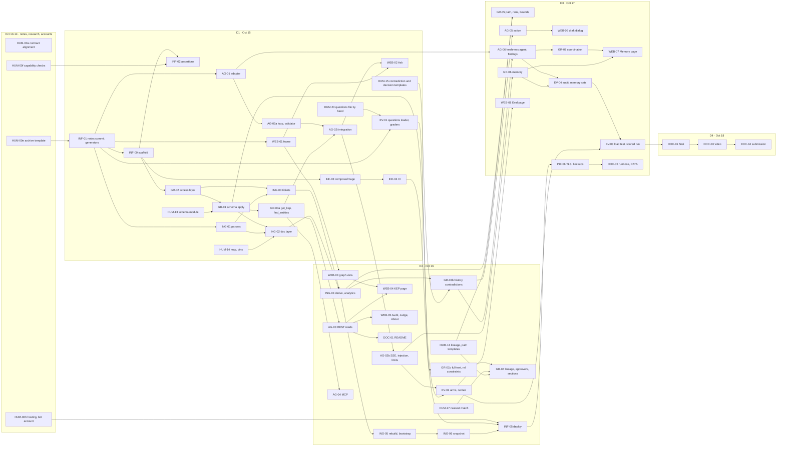

# 06 · KEP Brain — Build plan, 2026-10-15 00:01 IST → 2026-10-18 (task DAG for three parallel build-agent lanes and a human team of 1–4)

| | |
|---|---|
| Status | Complete, **v2.1** (review revision plus cross-document reconciliation). Pre-kickoff planning notes only (Rule 8). This file names the tasks, their order, their interface contracts and their tests; it contains no source, no manifests, no scripts and no paste-ready queries. Everything it describes is written from 2026-10-15 00:01 IST onward. |
| Written | v1.0 2026-10-12 01:13 IST; v1.1 2026-10-12 (sibling alignment, B13–B24); **v2.0 2026-10-12 (IST)**: resolves the 26 findings of the 2026-10-12 design review. The design changed where the reviewer was right; where the reviewer was wrong the place carries a "Reviewed: rejected because …" note with evidence. §12 is an index from each finding to the sections that changed; it is an index, not the change. Task ids, checkpoint ids, B1–B24 and L1–L13 keep their ids so citations in sibling documents still resolve; where a meaning changed the row says "(v2.0)". **v2.1 2026-10-12 (IST)**: the sibling documents (`02` v2 with ADR 0023–0026, `03` v1.2, `04` v1.1, `05` v2.0) were revised against the same review in parallel, within minutes of this file (file times 09:00–09:15 IST), and disagree with v2.0 and with each other on nineteen values; §1.6 decides each one once, the rows and cards below now carry those values (marked "(v2.1)"), and HUM-00a applies the deltas to the other documents. |
| Authorship | Drafted by an AI assistant from decisions the team lead set on 2026-10-11 (§1.1). Every **DECISION (veto-able)** here is a proposal until a human accepts it and records it in `docs/DECISIONS.md` (HUM-02); a human owner is named for every core artefact (§3.2). |
| Inputs (read in full) | the pre-event planning notes (kept outside this repository); `01-recon-kubernetes-data.md`; `02-architecture.md` v2 + `adr/0001–0026`; `03-graph-model.md` v1.2 (authoritative for graph names, B5); `04-eval-set.md` v1.1 (64 questions, 5 arms, companion experiments CON, HOLD, MEM, SEL); `05-ui-brief.md` v2.0; the sibling documents under `docs/product`, `docs/engineering`, `docs/team`, `docs/ops`; the review findings of 2026-10-12. Re-checked for v2.0 on 2026-10-12: the event page FAQ, the NodeOps README, GitHub's package-visibility documentation, npm and PyPI release data, and the file times of the pre-event template under `D:\kep-brain` (§10). |
| Event window | 2026-10-15 00:01 IST → 2026-10-18 23:59 IST (public API: `start_date 2026-10-14T18:31:00Z`, `end_date 2026-10-18T18:29:00Z`, verified in `02-architecture.md` §16). **Internal deadline: submission sent by 18:00 IST on Oct 18; hard stop 19:59 IST.** |
| Order of delivery | T03 audit core demoable, deployed and public by CP4 (Oct 16, 22:00) → T01 (path, ranking, MCP, action) by CP5 (Oct 17, 15:00) → T02 (per-user memory, shared `Finding` memory, LLM freshness agent) by CP6 (Oct 17, 22:00) → scored evaluation overnight → freeze, video and submission on Oct 18 |
| Team | 1–4 humans (roles and owned artefacts in §3.2, hours per person per day in §3.4) plus **at most three** parallel AI build-agent lanes, each card in its own git worktree (B27) |

Tags used below, as in the sibling documents: **VERIFIED** (opened at the source, URL or path given), **OBSERVED** (seen on this machine), **INFERENCE** (judgement from verified facts), **UNVERIFIED** (could not confirm; a check is scheduled), **DECISION (veto-able)** (a choice with its one-line reason and the alternative).

> **Rule 8 note (v2.0).** Rule 8: "The main coding and design work must begin after the hackathon starts. You may discuss ideas, create notes, sketch the graph model, or prepare diagrams beforehand" (https://www.wemakedevs.org/hackathons/falkordb/rules). The event page FAQ, under "Can I continue an existing project?", says: "You may reuse general libraries, templates, and infrastructure." and "The submission and its main FalkorDB implementation must be new work completed during the event." (https://www.wemakedevs.org/hackathons/falkordb, VERIFIED 2026-10-12; the clause is on the main event page, not on `/rules`). the planning notes §0 adds the team's own stricter rule: "Not before the start: code, scaffolding, a git repo, or the UI build." The pre-event template that was written under `D:\kep-brain` on 2026-10-11/12 contains FalkorDB connection code, a Compose file with FalkorDB and CI with a FalkorDB service container, so v2.0 **does not build on it**: a human moves it out of `D:\kep-brain` on Oct 14 (HUM-00e), and the scaffold is regenerated from public generators and the contract in §4 C0 from 00:01 IST (B25). The design notes are committed as a separately labelled "pre-event notes" commit so the boundary is visible in `git log` (INF-01). Only notes, sketches, research and account setup happen before 00:01.

---

## 0. Summary and reading guide

**The narrow job (one sentence, used verbatim in the README, the video and the form):** *KEP Brain audits Kubernetes' decision records: it finds where KEP metadata, tracking issues and replacements disagree, shows who decided each state and the evidence, and drafts the fix.*

**The checkable outcome:** the CON audit (`04` §9.1): the contradictions `find_contradictions` reports at the pinned snapshot (47 distinct KEPs on the 2026-10-12 data, `03` §7.5), every row hand-labelled by a team member (HUM-19) and reported as precision for the detector and for the freshness agent's verdicts, next to the 64-question accuracy evaluation against `kep.yaml`/`OWNERS`/`sigs.yaml` ground truth with its honest losses (`04`).

1. **44 task cards in seven workstreams** (ingestion `ING` 6, graph layer and tools `GR` 9, agent/LLM/MCP `AG` 6, web `WEB` 8, eval `EV` 4, infra/deploy `INF` 6, docs/demo/submission `DOC` 5) and **28 human tasks** (`HUM-00a–h` before kickoff, `HUM-01–20` during and after the event). Seven human tasks are hand-written core artefacts (schema module, normalisation map, the questions file, the Cypher templates of the judge-path tools; §3.2). Every card in §5 carries id, depends-on, owner lane, inputs, outputs, contract, definition of done with the tests that must pass, hours and slot.
2. **v1 scope is narrow by default** (B28): 14 tools (`03` §0.2, from 29), 7 routes (from 10), five eval arms (arm V uses a local embedding model, `04` §8.2), one MCP server, one action. Everything else is a tier-2 add-back list (§8.5), not a fallback.
3. **Nine checkpoints** (§6), CP0 "scaffold" (D1 08:00) to CP8 "submitted" (D4 18:00). CP4 (Oct 16, 22:00) is the hard gate: the audit core demoable on the public repository and the live URL. Every spine edge carries at least 3 hours of slack (§2.3), and a lane × hour table proves no lane holds two cards at once (§2.4).
4. **Humans decide, hand-write the core, review, run the eval, explain it back at every checkpoint, and write the disclosure** (§3.2, §7). Agents write code inside contracts they may not change; pre-approved conditional decisions (§4 C1 fallbacks) let overnight work proceed without a human and without breaking a contract.
5. **A judge needs no GitHub token**: a published graph snapshot restores the full graph in minutes (B32), and CI proves the five judge-path steps pass with no token (ING-06).
6. **Risk register, cut lines and the heavy cut tier** (§8): the heavy tier H is applied before L1 when the D1/D2 spine slips, and at kickoff when the roster is under three people (§3.4).
7. **README and submission checklist** (§9); **verification ledger** (§10); **decisions and open questions** (§11); **review index** (§12).

Read §1 (what is fixed and decided; §1.6 settles every value the sibling documents disagree on), §2 (calendar, critical path, lane table), §3 (how agents and humans work), then §5 for the card you own; §6 before every checkpoint; §8 whenever something slips.

---

## 1. Fixed inputs and reconciliation decisions

### 1.1 Fixed by the team lead (human decisions of 2026-10-11, not re-decided)

Concept KEP Brain with T03 Company Brain as the master track and genuine T01/T02 layers, and not issue triage or reviewer routing (another team has those); Python 3.12 + FastAPI + Pydantic v2 + uv; Next.js App Router + TypeScript + Tailwind; `falkordb/falkordb:v4.22.0` with a password (not 6.x: its Rust engine is two weeks old and crash-prone, the planning notes §5); parameterized Cypher behind typed tools exposed via MCP, no free-form text-to-Cypher in the main path; Docker Compose + GitHub Actions; light, neutral, professional UI; LLM through a provider adapter, Anthropic default (`claude-sonnet-5-5` planner and answerer, `claude-haiku-5-5` for cheap extraction and classification), OpenAI-compatible fallback, provider by env. Host: Windows 11, Docker Desktop, Python 3.13.7 (the project uses uv-managed 3.12), Node 24, pnpm 12, authenticated `gh`; `hopper-redis` (6379) and `hopper-postgres` (5432) are never touched (`02-architecture.md` §2.1). These are recorded in the new `docs/DECISIONS.md` as ADR-0002 "Decisions set by the team lead before the event" at kickoff (HUM-02), attributed to the person who made them.

### 1.2 The pre-event template and why it is not the baseline (v2.0, OBSERVED 2026-10-12)

| What exists under `D:\kep-brain` | File times (local, IST) | Consequence (B25) |
|---|---|---|
| `apps/api` (package `app`, `src/app/*.py`, tests, `uv.lock`, `.venv`, `.pytest_cache`, `.mypy_cache`), `apps/web` (`src/**`, `pnpm-lock.yaml`, `.next`), `docker-compose.yml`, `.github/workflows/ci.yml`, `.github/PULL_REQUEST_TEMPLATE.md`, `.github/dependabot.yml`, `.env.example`, `.pre-commit-config.yaml`, `.prettierignore`, `.editorconfig`, `.gitattributes`, `.gitignore`, `LICENSE`, `README.md`, `docs/DECISIONS.md`, `docs/AI_USAGE.md` | `apps/` 2026-10-11 22:30 → `docker-compose.yml` 2026-10-12 08:19, `README.md` 08:33, `.pre-commit-config.yaml` 08:33 | **Archived outside the repository by a human on Oct 14 (HUM-00e)** to `D:\kep-brain-template-archive\2026-10-12\ (ADR 0023)`. Not opened by any agent during the event; no worktree is given its path |
| `docs/design/**` (this series), `docs/product/**`, `docs/engineering/**`, `docs/team/**`, `docs/ops/**`, `docs/README.md` | 2026-10-11 22:42 → 2026-10-12 | Notes (allowed by Rule 8). Committed at 00:01 as the first, separately labelled commit "Pre-event design notes (written 2026-10-11 to 2026-10-14; Rule 8 notes, no code)" |
| `.recon/` (public-data research cache) | 2026-10-11 | Stays git-ignored; fixtures are copied from it into tests on Oct 15 (ING-01) |

The template's useful choices (package name, unprefixed settings, health paths, error envelope, pinned versions) were *decisions*, and decisions may be prepared as notes. They are carried forward as the **scaffold contract C0** in §4, and the scaffold is rebuilt against it from public generators at kickoff (INF-00, ≈ 45 minutes of human time and 3 agent-hours).

### 1.3 Reconciliation decisions (each veto-able; each becomes an ADR in `docs/DECISIONS.md` on Oct 15, task HUM-02)

B1–B24 are the v1.0/v1.1 decisions with their v2.0 amendments marked; B25–B44 are new in v2.0.

| # | Conflict | Decision | One-line reason | Alternative |
|---|---|---|---|---|
| B1 | `02` names the package `kepbrain` with entrypoints `api`, `worker`, `mcp` | **(v2.0: now part of the C0 scaffold contract.)** Package `app`; `app.worker` and `app.mcp` as `python -m` entrypoints in the same package and image; Compose runs them with `command:` overrides | One lockfile, one Dockerfile, one CI job; "one package, three processes" (ADR 0003) kept | Package `kepbrain` (equally valid now that the scaffold is rebuilt; rejected only to keep the sibling documents' `app.*` paths valid) |
| B2 | `02`/`03`/`04` use `KEPBRAIN_`-prefixed settings | Unprefixed names everywhere (C4) | One convention across `.env.example`, Compose and CI | Prefix only new settings |
| B3 | `02` §11.6 uses `/healthz`, `/readyz` for the api | `GET /health` and `GET /ready` on the api (C0, C3); `/healthz` stays the web app's route | Compose healthchecks, Dockerfile `HEALTHCHECK` and CI probes are written against one name each | Aliases (two names for one thing) |
| B4 | ADR 0002/0005 require ACL users; a single `--requirepass` is simpler | Target the ACL file design with five users (B13) and the v2.0 key patterns: `kb_reader` `~kep ~kep_eval ~ops ~eval_baseline` with `+GRAPH.RO_QUERY` only; `kb_memory` `~mem:*`; `kb_ops` `~ops`; `kb_writer` `~kep ~kep_eval ~ops ~eval_baseline` (v2.1: no `org_memory`, no `kep_next`, §1.6 X1, X11); every role user also holds `+INFO` because falkordb-py 1.7.1's constructor probes `INFO server` (`02` §4.5, C1 check 18); `default` keeps `FALKORDB_PASSWORD` for healthchecks. `FALKORDB_ACL_MODE=aclfile\|single` selects it; in `single` the four role connections still exist in code and share one password, so the fallback is a config change. The mode default is set by the pre-event checks (B26) | Read-only enforcement by ACL is what FalkorDB's own judge praised; the fallback keeps `GRAPH.RO_QUERY` + per-query `timeout` + `TIMEOUT_MAX` | Single password only (cut tier H1) |
| B5 | `02`/ADR 0008 names vs `03` §17 names | `03` is authoritative for every graph name, property, index, constraint and tool signature; `02` for processes, ACL users, HTTP contract and deployment; **this document §4 is the single contract register agents read** (B39) | One vocabulary in code | Two vocabularies |
| B6 | Vector dimension 1536 (`02` §5.1, `04` E10) vs 1024 (`03` §12.2) | 1024, cosine; `voyage-4` on the Anthropic path, `text-embedding-3-small` with `dimensions: 1024` on the OpenAI-compatible path. (v2.1) These apply to the product's own vector index, which serves only the tier-2 `search_sections`; the eval's arm V uses the local 1024-d model of `04` §8.2 and needs no key (§1.6 X7) | Provider-neutral; no index rebuild on provider switch | 1536 |
| B7 | Arm L needs a full-text index over the baseline blocks | `eval_baseline.Chunk` gets a full-text index on `text` and a vector index on `embedding`, and no relationships | Arm L is the key-free baseline; full-text without edges is still retrieval-only | BM25 in Python (reads as a second store) |
| B8 | `04` §8.3 "`evals/` not mounted by the api" | **(Mount amended by B24; v2.0 removes the stale wording from EV-02.)** Repository-root `evals/questions.yaml` and `evals/runs/<utc>/`; the frozen run's `summary.json` and `results.jsonl` are committed | One source for eval, Judge page and README | Package the file into the image |
| B9 | One Compose file vs dev + prod | **(Superseded for production by B16.)** `docker-compose.yml` is what a judge runs | Judges keep one command | — |
| B10 | `01` D11 "cached snapshot"; ADR 0007 clones | **(v2.0, with B32.)** The worker clones `kubernetes/enhancements`, `kubernetes/community` and the `OWNERS` paths of `kubernetes/kubernetes` at the three pinned SHAs (C4) into `repo_cache` when it builds from source. The judge's default path restores the published graph snapshot instead (B32), which is a release asset, not a committed file; the repository carries no data dump | Deterministic either way; the repository stays small | Commit the snapshot (large diffs, licence notices per file) |
| B11 | A judge's first `docker compose up` has an empty graph; `web` waits on `api` healthy | `/ready` = FalkorDB answers **and** the schema is applied; `graph_loaded` is reported, never gating. **(v2.0)** On start with an empty graph the worker bootstraps: if `SNAPSHOT_PATH` exists and its SHA-256 equals `SNAPSHOT_SHA256`, it runs `restore-snapshot`; otherwise it runs a doc-layer sync at the pins. `SYNC_MODE=pinned` (the `.env.example` default) then keeps the graph at the snapshot; `SYNC_MODE=live` (production) runs the 15-minute incremental sync | "Ship a repo a judge can run", with the full graph and no token | Gate readiness on data (first run never healthy) |
| B12 | Repository visibility | Private at 00:05 IST (CI from the first push), public at CP4 with `gh repo edit --visibility public` | CI and branch protection from day one | Public from 00:01 |
| B13 | The api needs synchronous `ops` writes (confirm compare-and-set, spend counter, audit events) | Fifth ACL user `kb_ops` (`~ops`), held by `api` only, writing exactly `Task` (create, `queued`), `ActionDraft` (create, status compare-and-set), `BudgetDay`, `AuditEvent` through fixed templates. The worker stays the only writer of every other `ops` label, of `kep` (including the `Finding` nodes, §1.6 X1) and of `kep_eval`. No enqueue listener | One write identity scoped by ACL is simpler to check than an internal service with its own token | `03` §10's enqueue listener |
| B14 | Public "Sync now" vs admin-only sync | `POST /v1/sync/request` (public, at most one accepted request per 10 minutes globally; `429 {limited: {requested_at}}`; **(v2.0)** `409 {code: pinned_mode}` when `SYNC_MODE=pinned`), `GET /v1/sync/status` (public, redacted), `POST /v1/sync/run` (admin, not routed by Caddy) | Demonstrable currency and the security property together | Admin-only button |
| B15 | Public health paths | Caddy routes no health path; `/ready` per-check reasons only with the admin token; the uptime monitor probes `/` and `/api/v1/meta` | A public readiness map leaks topology | Route health publicly |
| B16 | Production file as override vs standalone | `deploy/compose.prod.yml` is standalone with networks `edge`/`data`, no `ports:` except `caddy`. The CI drift test between the two files stays unless cut tier H2 is applied | Removing ports through an override is easy to get wrong | B9 override |
| B17 | MCP catalog, `recall_memory`, public token | **(v2.0)** MCP tools = the v1 read-only registry (B28) **minus `recall_memory`**, plus `get_graph_schema`: 13 tools. Never exposed: `recall_memory`, `remember`, `coordinate`, `draft_stale_doc_issue`. `recall_findings` (shared `Finding` memory, B31) **is** exposed. `MCP_TOKEN` is a public read-only judge token, rate-limited, rotated after results | Judges attach a client to the live URL; the shared memory is public data | stdio-only MCP (cut line L13) |
| B18 | Abuse and spend numbers | **(v2.0 numbers.)** `LLM_DAILY_BUDGET_USD=5` for public `/v1/ask`, enforced fail-closed by reservation (B35); `EVAL_MAX_USD=45` per eval run (v2.1, `04` §10.4), accounted only on the `EvalRun` (B34); `FINDINGS_AGENT_DAILY_USD=1` for the freshness agent (name per `02` §11.1, §1.6 X14), accounted on `SyncRun` (B31); `ASK_RESERVE_USD=0.12`; `ASK_RATE_LIMIT=30/10m` per IP and per memory id; `ASK_DAILY_LIMIT_PER_IP=100`; `ASK_CONCURRENCY_PER_IP=2`; `ASK_GLOBAL_PER_MINUTE=20`; `MEMORY_CREATE_LIMIT=10/h` per IP; `ACTIONS_DAILY_CAP=10`; `ACTION_CONFIRM_LIMIT=3/h` per IP; `MAX_QUEUED_QUERIES 45` with `THREAD_COUNT 3`. Budget against the $150 console cap: D3 one-rep run (5 arms × 64) ≈ $13; one scored 3-rep run including CON, HOLD, MEM and SEL ≈ $38 (`04` §10.4); freshness agent ≈ $1; public traffic ≈ $15 over three days; development ≈ $20; **total ≈ $87 nominal** | $5/day is ≈ 40–250 answers, far above judge traffic; one scored run instead of two halves the eval spend | Leave the numbers open |
| B19 | Judge-path wording and steps | **(v2.0, with B29.)** Five steps, worded "about 60 seconds"; the click count is measured on the final build and only then written | One wording across README, `/judge`, video and form | Drop the refusal step |
| B20 | When to measure T01 bounds | **(v2.0, with B41.)** Measured inside GR-05 before `path_between` is exposed on `api` and `mcp` (CP5) and inside GR-04 for the `kep_relations` lineage depth. `rank_people(refresh=true)` returns `forbidden` without the admin token | Measures what exists, when it exists | Build T01 tools before CP4 |
| B21 | gitleaks action licence for organisations | gitleaks CLI v8.30.1 in CI, checksum-verified | Same for personal and organisation accounts | `gitleaks-action@v3.0.0` |
| B22 | Judge-answer cache | No answer cache; the `openai_compatible` adapter is smoke-tested live before CP6 when a key exists | A cache needs a shared answer store for five questions; the KEP and Audit pages answer without the LLM | Labelled cache |
| B23 | Branch names; no overnight merges | **(v2.0, with B37.)** Branch `<task-id>-<slug>` (ENG-05). Overnight cards target the night integration branch, not each other's branches | One rule; no stacked branches to rebase after squash | Stacking (v1.1; rejected by B37) |
| B24 | Where the api reads question text | Mount `./evals` read-only into `api` and `worker`; only `app/api/eval.py` and `app/evals/*` may open it (import-graph test); no tool template, prompt or arm filter references it | The guarantee that matters is what the model can reach | Copy question text into `ops` |
| B25 | **Pre-event template vs Rule 8 and the FAQ** (review blocker): the template under `D:\kep-brain` was written 2026-10-11 22:30 → 2026-10-12 08:39 for this event's stack and holds FalkorDB connection code, a FalkorDB Compose file and FalkorDB CI; the planning notes §0 forbids scaffolding before the start; the FAQ requires the main FalkorDB implementation to be new work | **Archive and rebuild.** HUM-00e moves the template (list in §1.2) to `D:\kep-brain-template-archive\2026-10-12\ (ADR 0023)` on Oct 14. At 00:01 HUM-01 runs `uv init` (uv 0.12.5) and `pnpm create next-app@16.4.0` and commits each output; INF-00 then builds the api skeleton, Compose and CI from the C0 contract between 01:00 and 04:00. The archive is never given to an agent and is never copied into the repository | Removes the only Rule 8 exposure the plan had, for ≈ 45 human minutes and 3 agent-hours; the team's own rule (§0 of the context) is met literally | Keep the template as the baseline: allowed only if the organisers confirm in writing that a self-authored, domain-free template prepared on Oct 11–12 is acceptable (HUM-00c asks by Oct 14), recorded as a dated ADR that names the risk accepted; then INF-00 becomes "commit the template" and CP0 moves to 01:00 |
| B26 | **INF-02's fallbacks change contracts overnight**, when TEAM-WA-13 forbids contract changes and no human is awake (review blocker) | (1) The 19 FalkorDB capability checks of INF-02 are **run by hand with `redis-cli` against the public `falkordb/falkordb:v4.22.0` image on Oct 13–14** (HUM-00f) and recorded as a research note `docs/design/07-falkordb-capability-checks.md`. They are experiments, the same kind of research as the recon's API calls; no file from them enters the repository except that note. (2) Each check's fallback is written **now** as a pre-approved conditional decision (§4 C1 fallback table: "if check N fails, fallback X applies automatically"); these are exempt from TEAM-WA-13 because they were decided in daylight before the event. On D1, INF-02 only turns the recorded results into test assertions, off the critical path | Takes a 2.5-hour unknown off the D1 spine and removes the need for an overnight contract decision | Veto (Rule 8 judgement): run INF-02 live on D1 04:00–06:30 on lane A1 with the same pre-approved fallbacks; INF-03 shifts to 06:30–09:00; no spine edge moves |
| B27 | **Rules 11–13: the human contribution on record was thin** (review blocker): six agent lanes, ≈ 30 human hours, explain-back only on D4, four of six pre-event `AI_USAGE.md` rows saying "No human decision yet" | (1) **At most three agent lanes** (`A1` graph/infra, `A2` ingestion/eval, `A3` agent/web). (2) **Humans hand-write and commit** the graph schema module (HUM-13), the status/stage normalisation map of `01` Q4/Q8 (HUM-14), and the Cypher templates of the five judge-path tools (HUM-15, HUM-16, HUM-17); agents wrap them in tools and tests. (3) A **named human owner for every core artefact** (§3.2). (4) **Explain-back at every checkpoint from CP1**, each member on their own area (HUM-09). (5) Every `AI_USAGE.md` row names a concrete human edit or check; the PR template rejects "reviewed" alone. (6) The pre-event disclosure is rewritten by humans to state what they decided (HUM-00g) | "Meaningful participant contribution, verification, or technical understanding" (Rule 13) becomes visible in commits, not only in prose | Six lanes with per-PR review only (v1.1) |
| B28 | **The plan read as a platform** (29 tools, 10 routes, 25+ endpoints, 5 arms, OTel, blue/green, backup sidecar, five ACL users, public MCP): organiser advice "One narrow job done end to end scores better than a platform with three half-finished features" | The narrow job in §0. **v1 tools (14; v2.1 = `03` §0.2, §1.6 X2):** `find_entities`, `get_kep`, `who_approves`, `who_owns` (off the judge path, the video and the Audit page, B30), `trace_decision`, `status_history`, `whats_changed`, `find_contradictions`, `kep_relations` (with the lineage mode of B30), `path_between`, `rank_people`, `recall_memory`, `recall_findings` (B31), and the action `draft_stale_doc_issue`. **v1 routes (7; v2.1 names per `05`, §1.6 X13):** `/` (Ask), `/audit`, `/explore/kep/{number}`, `/memory`, `/eval`, `/judge`, `/about` (plus `/healthz`). **Eval arms run:** N, L, V, G, H (`04` §8). Everything else is on the tier-2 add-back list (§8.5) and is built only if CP5 passes early. *Reviewed: the reviewer's 12-tool list is extended by `recall_findings` (B31; without it the shared memory is unreachable from MCP and from the planner's tool loop) and by `who_owns` (T03 names "who owns what"; OWN-03/05 measure it). v2.0 kept `get_kep_section` instead of `who_owns` so that arms G and H would differ; `04` v1.1 §8.2 now separates them by disabling `find_entities(kinds: [Section])` and stripping excerpts in G, so that reason is gone and `get_kep_section` is tier 2 (§1.6 X2)* | Fewer, finished features with a checkable outcome is what won past events (the planning notes §2) | The 29-tool catalog with cut lines as fallbacks (v1.1) |
| B29 | **The judge path showed nothing graph-native** (OWN-01 one-hop, MH-04 one-hop reverse, DEC-01 fixed join; `04` §8.4 predicts a tie with RAG on OWN easy) | Five steps, carried as `judge_order` in `evals/questions.yaml`: **(1) STA-04** (v2.1, §1.6 X3) "What is the status of KEP-583 Coscheduling, and is that metadata current?" → `get_kep`, `find_contradictions(kep_ref 583)` (`active_status_closed_issue` and `one_sided_replacement`), `recall_findings` (the freshness agent's verdict) and `kep_relations` (who replaced it); this is the hero, and the corpus-wide list (KEP-583, KEP-5978, KEP-5832 and the rest of the CON audit) is the Audit page that `/judge` links right after step 5; **(2) DEC-07** "Which KEPs does Gang Scheduling replace, and what became of KEP-5832?" → `kep_relations` lineage over `REPLACES`/`SUPERSEDED_BY`/`SEE_ALSO` (variable length) plus `find_contradictions(kep_ref 5832)`; **(3) DEC-01** "When was KEP-1287 marked implemented, by whom, and in which PR?" → `trace_decision` (`Decision` → `DECIDED_BY` → `EVIDENCED_BY` PR #5761); **(4) MH-07** "How is `soltysh` connected to KEP-4671?" → `path_between` through `algo.SPpaths`; **(5) ABS-10** "Which KEP introduced the `GangScheduling` feature gate?" → abstains and offers `GenericWorkload` as the nearest match. Steps 1, 2, 3 and 5 are live at CP4; step 4 joins at CP5. *Reviewed: the reviewer's step (1) OWN-03 (`pkg/kubelet` approvers through alias expansion) is rejected for the judge path because directory ownership is the input to reviewer routing, which NodeOps already ships (B30); OWN-03 stays in the scored eval. STA-08 stays in the eval; STA-04's closed-issue side needs the ticket layer, which the snapshot carries (B32). v2.0's step 1 "AUD-01" was not a `04` question and is replaced by STA-04, the hero every sibling document leads with* | Every step now needs a traversal a table lookup cannot do: a join of three sources around one KEP plus the stored finding, a variable-length lineage, a reified decision chain, a shortest-path algorithm, and full-text nearest-match with abstention | OWN-01, DEC-01, STA-04, MH-04, ABS-05 (v1.1); `02` v2's STA-04, DEC-07, DEC-01, STA-07, ABS-05 (no algorithm step; §1.6 X3) |
| B30 | **Differentiation from NodeOps** (README read 2026-10-12: "Company Brain", Tracks 01 and 03, `algo.pageRank` "contributor importance over merged PR file footprints", "highest historical mastery", "dependency blast radius", names Kubernetes) | Lead with what nobody else has: **verified contradictions between the project's own records** and **decision lineage with reversals**; the hero is `find_contradictions` + `trace_decision`. `impact_of` ("if KEP X were reverted, what is affected") is **reframed as replacement and supersession lineage** inside `kep_relations` (`REPLACES`, `SUPERSEDED_BY`, `SEE_ALSO` chains, depth ≤ 3) and the words "blast radius" appear nowhere; `impact_of` itself moves to tier 2. Directory ownership (`who_owns`) stays out of the judge path, the video and the Audit page; (v2.1) it is a v1 tool, because T03 names "who owns what" and OWN-03/05 measure it (§1.6 X2). `rank_people` stays in v1 but out of the judge path and the video. The README carries a three-row table (NodeOps · a generic Slack/docs company brain · KEP Brain) with one checkable differentiator each (DOC-01) | The overlap is real on PageRank people-ranking, OWNERS routing and blast radius; it is absent on cross-source contradiction detection with hand-checked precision and reified decision lineage | Keep `impact_of` and `who_owns` in the story |
| B31 | **T02 was thin**: only the planner was an LLM agent, per-user memory was read only by the planner, memory had no traversal value | (1) **Shared cross-agent memory as `Finding` nodes in `kep`** (v2.1, `03` §4.7, §1.6 X1): one per contradiction, with `state` (`open` → `triaged` → `drafted` → `confirmed`, or `dismissed`, or `resolved_upstream` and back to `open` with `reopened_count` + 1), `triage_verdict`, `assessment` (≤ 600 chars, passed through the answer validator), `suggested_fix`, both disagreeing sides with URLs and timestamps; `ABOUT` the KEP and `EVIDENCED_BY` the records that disagree, so the memory sits one hop from its evidence. It is **written by an LLM freshness agent** (`claude-haiku-5-5`, worker, AG-06) that judges each detected contradiction against the KEP's Implementation History text and the tracking issue, and **read by the Q&A planner (`claude-sonnet-5-5`) and by MCP clients through the read-only `recall_findings` tool**. Handoffs ride on the finding: a confirmed stale-doc finding queues a draft task for the action role; the qa role checks the draft cites the finding's evidence. (2) Per-user `mem:*` graphs stay, and EV-04 runs the **10-item multi-session set MEM-01..10 of `04` §9.3** (MEM-09/10 test the shared findings through the planner and through MCP) with recall on and off, reporting accuracy and input tokens. (3) The README calls the `ops` queue "coordination", never "agent memory" | Two LLM agents now share state that persists and changes over time, which is what the T02 brief asks ("available to every agent that needs it"); a finding is one hop from the KEP and from both records that disagree, which a key-value store would have to re-join by string keys | Per-user memory only (v1.1); a separate `org_memory` graph (`02` v2 §5.4, ADR 0024; v2.0 of this row), rejected in §1.6 X1 |
| B32 | **Without a token a local run lacked the ticket layer** (PRs, reviews, comments, label history), so judge steps and the "chats" layer failed; a token-backed initial load is ≈ 4,000–4,500 serial requests | Publish a **graph snapshot** as a GitHub release asset: gzip JSONL, one line per node and per edge (labels, `key`, allow-listed properties; edges by endpoint keys), built from the dev graph at the three pinned SHAs plus the ticket layer as of `TICKETS_AS_OF`, including the `Finding` nodes with their triage verdicts (v2.1), so a local run shows the agent's verdicts without an LLM key. **Comment and review bodies are reduced to 300-character excerpts with author login and URL; `Person.name`/`company` are omitted; the PII scan runs on the file before publishing.** `python -m app.worker restore-snapshot` loads it through the same batch writer (`MERGE`, idempotent) in a target of under two minutes (measured in ING-06; the README states the measured time). The README marks which judge steps need the ticket layer if someone builds from source without a token. *Reviewed: an RDB file was considered and rejected because restoring `dump.rdb` means stopping FalkorDB and replacing files inside its volume, is tied to the exact module version, and cannot be scanned for PII line by line* | A judge gets the full graph in minutes with no token and no manual step; the snapshot is also the eval's pinned graph (B33) | Keep `01` D11 (no comment text leaves the deployment; then the no-token path has no "chats" layer). Veto-able against D11 |
| B33 | **The scored eval ran on a live-syncing instance** while ground truth is pinned to `8659e382…`; `sigs.yaml`/OWNERS were read at head; two scored runs ≈ $66; `04` §9.3 and `06` disagreed on the time | The scored run happens **once, on D3 22:00 → D4 06:00, on the dev stack, against a dedicated graph `kep_eval` restored from the published snapshot** (SHA-256 checked), with the eval's tool registry pointed at `kep_eval` by the runner (never by the LLM). The three source SHAs (`ENHANCEMENTS_PIN_SHA=8659e382efab7340d70de52432ee8f3d9979b797`, `COMMUNITY_PIN_SHA`, `KUBERNETES_PIN_SHA`), `TICKETS_AS_OF` and the snapshot SHA-256 are written into the `EvalRun`. The run is frozen at CP7. On D4 an **unscored** check of the five judge-path questions runs against the deployed, live-syncing instance and is reported separately. HUM-03 re-verifies only the questions that can drift at the pins (B23 of the review: OWNERS/`sigs.yaml` questions OWN-03/04/05/08, MH-05/08; the ticket-dependent movers STA-01/02/07, OWN-09, DEC-05; and the five judge-path questions), 1.5 h | Data drift can no longer be scored as product error, a rerun is reproducible from public artefacts, and the eval cannot collide with public traffic | Freeze the deployed graph during an eval window (stops the "keeping knowledge current" demonstration) |
| B34 | **Eval spend vs the public budget breaker and the ACL design** | Spend is accounted **by surface**: public `/v1/ask` reserves against `BudgetDay` through `kb_ops` (B35); the eval loop runs in the worker, in-process, and accounts only to its own `EvalRun` and `EVAL_MAX_USD`, written as `kb_writer`; the freshness agent accounts on `SyncRun`. The eval never passes through the public api limits. A test asserts an eval run never changes `BudgetDay` | A judge on submission day can never be locked out by the team's own eval | One shared counter |
| B35 | **Memory quotas did not bound memory**; the spend breaker failed open | (1) `mem:*` gets a **byte budget**: `MEM_TOTAL_BUDGET_MB=600`, `MEM_GRAPH_MAX_BYTES=307200` (300 KB) per graph, enforced with `GRAPH.MEMORY USAGE mem:<id>` before each write, and a global cap `MEM_GRAPH_LIMIT=2000` (600 MB / 300 KB) checked with `GRAPH.LIST` only when a new memory graph is created (rate-limited to 10/h per IP). An `Episode` keeps the full answer for `ANSWER_FULL_RETENTION_HOURS=24`, after which `memory-gc` compacts it to `question`, `question_kind`, `answer_summary` (≤ 280 chars), `evidence_keys`, `tools_used`, `abstained`, dropping `answer_markdown`, `claims_json` and `paths_json`. CP1 checks the budget against the measured `kep` size: `kep` + `kep_eval` + `ops` + 600 MB + 25 % headroom (v2.1: no `kep_next`, §1.6 X11) must fit `maxmemory 3gb`, otherwise `MEM_TOTAL_BUDGET_MB` is lowered and the global cap with it. (2) The spend breaker **fails closed**: before each LLM call the api reserves `ASK_RESERVE_USD` with one conditional write on today's `BudgetDay` (increment only if the result stays at or under the cap; the write either applies or returns no row), and after the answer it reconciles the reservation to the measured cost. FalkorDB runs one write at a time per graph, so concurrent asks cannot both pass the check. If `ops` cannot be written, the ask is refused with `capacity_reached` | Bytes, not counts, are what `noeviction` runs out of; a breaker that fails open stops working exactly when the database is full | Count caps (v1.1) |
| B36 | **Prompt injection could persist through memory** | The planner receives only `question`, `question_kind` and `evidence_keys` of past episodes, never model-written text. `recall_memory` and `recall_findings` output passes through `framing.py` as labelled data with length caps. Injection case (g) is added (AG-02b) | Model-written text never re-enters a prompt as instructions | Rely on the system prompt alone |
| B37 | **Squash merges vs stacked branches**; eight unmerged PRs at 07:00 | **Night integration branches.** From 00:30 to 07:00 each lane's PRs target `night/D<n>`; the build harness merges a PR into the night branch only when CI is green and the card's named tests exist. At 07:00 H-Review reviews the night branch commit by commit and merges it into `main` with a **rebase merge** (linear history, per-card commits kept). By day, PRs target `main` and are squash- or rebase-merged by a human. A kickoff merge window 00:01–01:00 on D1 is the TEAM-WA-13 exception for HUM-01's commits | One human review per night instead of rebasing a chain; nothing reaches `main` without a human | Stacked branches with `--onto` rebases (v1.1) |
| B38 | **Deploy by image pull would fail on GHCR authentication** (packages are private on first publish and do not inherit repository visibility; VERIFIED in GitHub's docs) | **No GHCR in v1.** The VM builds the images from a checkout of a tagged commit (`docker compose -f deploy/compose.prod.yml build`), using a read-only deploy key while the repository is private; `images.yml` and `deploy.yml` are not written. If images are ever pushed later, a `GHCR_PULL_TOKEN` (classic PAT, `read:packages`, bot account) and `docker login ghcr.io` go into the runbook first | Removes a credential and two workflows that a judge never sees | Make each package public after its first push (whether the API supports it is UNVERIFIED in GitHub's page) |
| B39 | **Agents' input contracts contradicted each other** (ADR 0016 15–20 questions, `evals/results/`, testcontainers `falkordb-server`; ADR 0017 `compose.dev.yaml` 16379/13000; ADR 0011 `Turn`/`Playbook`; ADR 0013 `KEPBRAIN_MCP_TOKEN`, full catalog; `04` E10 1536; the old EV-02 "no `evals/` mount") | **§4 of this document is the single contract register (C0–C10, with resolved values)**; every card cites only §4 and `03`. HUM-00a (3 h) puts a one-line "Superseded by 06 §4 Cn / 03 §x" banner on every stale paragraph and runs a grep for `KEPBRAIN_`, `Turn`, `Playbook`, `1536`, `compose.dev.yaml`, `evals/results`, `16379`, `blast radius` and (v2.1) for the values §1.6 overruled: `org_memory`, `kb_agent`, `agent_service`, `FindingNote`, `FRESHNESS_MAX_USD_PER_DAY`, `/freshness`, `MEM-01..08`, `56 questions`, and `kep_replay` outside tier-2 text; each hit is fixed or bannered. *Reviewed: a separate `CONTRACTS.md` was considered and not adopted because §4 already holds C1–C10 and is the section every card cites; a second copy would be one more document to keep in sync during the event. (v2.1) `02` §19 and `05` §13.1 repeat the request; still not adopted: four documents diverged within fifteen minutes on 2026-10-12, which shows that a generated fifth copy would diverge too; §4 plus the §1.6 register is the single source, and the grep gate enforces it* | Agents in three worktrees read one source | A generated `CONTRACTS.md` |
| B40 | **Day 1 had no slack; lanes were double-booked; checkpoints gated on work scheduled after them** | D1 is a thin vertical slice: GR-01 ships `key` range indexes and `UNIQUE` constraints only; the full-text indexes and the 32 relationship `MANDATORY` constraints move to GR-01b (D2 night). GR-03a ships `get_kep` and `find_entities` only. AG-02's CP2 path is non-streaming `POST /v1/ask` with the validator; SSE and the injection set move to AG-02b (D2 night). **CP2 moves to D2 09:00; CP3 tests endpoints with curl; the KEP-page and "Sync now" UI lines move to CP4; CP5 moves to 15:00.** Every spine edge shows its slack in §2.3; §2.4 is the lane × hour table that proves no lane holds two cards at once | A schedule that only fits with zero slack is not a schedule | v1.1 slots |
| B41 | **The B20 bound test reported a "p99" from 20 samples** | The gate is stated as **the maximum of 20 runs per start node**, from the five highest-degree `Person` and `KEP` nodes, with the first (cold) run recorded separately from the 19 warm runs; threshold 2,000 ms; above it `max_len` drops to 4 (`path_between`) and lineage depth to 2 (`kep_relations`) | A maximum of 20 is honest and cheap; 200 runs × 10 nodes could take an hour of the T01 morning | 200 runs per node with a true p99 |
| B42 | **Hosting sat on the CP4 path** | VM (Hetzner CPX21 class, `02` §13.2), domain, DNS record, a plan-B VM account at a second provider, the bot GitHub account and the demo-actions repository are provisioned on Oct 13–14 (HUM-00h); `docker run hello-world` is run on the VM. Account setup is not code under Rule 8. *Reviewed: Railway as plan B was not adopted because its support for a multi-service Compose file with a password-protected FalkorDB volume was not verified; a second plain VM runs the same production file* | INF-05 on D2 only deploys | Provision on D2 |
| B43 | **Human hours were understated (≈ 30 h claimed, ≈ 45 h by the reviewer's count) and the solo mode contradicted per-PR review** | §3.4 publishes a per-role, per-day human-hour table (≈ 96.5 h during the event plus ≈ 14 h before it, with the hand-written artefacts and explain-backs), checked against the actual roster and each member's working hours on Oct 14 (HUM-00d; Oct 15–16 are Thursday and Friday). Review is per PR in every roster profile (night branches are reviewed as one batch of per-card commits). With fewer than three people the roster profile's cuts are applied **before kickoff** | Plans that hide human hours fail on day two | v1.1 totals |
| B44 | **Cut lines were too small and the costly work sat on the never-cut list** | A **heavy cut tier H** (§8.3), applied before L1 when the D1/D2 spine slips by more than 3 hours, and at kickoff when the roster is under three: H1 `FALKORDB_ACL_MODE=single`; H2 drop the B16 drift test; H3 restore drill on D4 only if time remains; H4 coordination reduced to the single-query claim plus one handoff, no role scheduler upgrade; H5 GR-04 reduced to `kep_relations` and `get_kep_section`; H6 the action becomes draft-only if the bot account is not ready by D3 09:00; H7 secondary abuse limits (per-memory-id, global per-minute, MCP per-token) collapse into the per-IP limit. GR-07, WEB-07 and GR-04 now have cut lines. The never-cut abuse set is reduced to: the fail-closed spend breaker, the per-IP limit, admin and health paths unrouted, **and the action guard** (deny list, nonce, compare-and-set). *Reviewed: the reviewer's minimal set omits the action guard; it is kept because the planning notes §4 makes "Never post to real Kubernetes repos" a hard rule and the guard is ≈ 1 hour of a card that exists anyway. The read-only MCP list also stays: it is a property of the registry and costs nothing to keep* | The cut tier now saves ≈ 12 agent-hours and ≈ 4 human hours, enough to recover a three-hour spine slip | v1.1 L1–L13 only |

### 1.4 Pre-kickoff tasks (Oct 13–14; notes, research and account setup only, allowed by Rule 8)

| Task | What | Owner, time |
|---|---|---|
| HUM-00a | **Contract alignment (B39), with banners and a grep check.** `02`: §16 FAQ row and the Rule 8 note → VERIFIED with https://www.wemakedevs.org/hackathons/falkordb (FAQ "Can I continue an existing project?"); §10.1 `Turn`/`Playbook` → `Episode`/`Procedure`; §10.2 roles → freshness is an LLM agent inside the worker writing `Finding` in `kep` (B31, §1.6 X1); §4.2/§4.5 ACL users and key patterns (B4, B13); §12 the B14 endpoints, `GET /v1/findings`, and the v1 route set; §13 no GHCR (B38); §1 "if KEP X were reverted" example → lineage wording (B30). `03`: graph name `kep_eval` (same schema as `kep`), `kep_next` deferred (§1.6 X11), labels path `evals/audit/labels.yaml` (X6), hand-written template list of §3.2 (X18); `ops` labels `BudgetDay {key, spent_usd_micros, reserved_usd_micros, asks, updated_at}` and `AuditEvent` (B13); `Episode` compaction (B35) and the planner context rule (B36); tool 12 `find_contradictions` gains an optional `kep_ref` scope; tool 13 `kep_relations` gains `mode: lineage` with `depth ≤ 3`; tool 30 `recall_findings`; tools 5, 7, 11, 14–20, 22, 24, 25 marked tier 2; §12.3 full-text index on `Chunk.text` (B7). `04`: `judge_order` STA-04:1, DEC-07:2, DEC-01:3, MH-07:4, ABS-10:5 (§1.6 X3); CP times of §10.5 (X8); `expected_tools` of questions whose tool moved to tier 2 rewritten to their v1 path; §9.3 schedule (B33); §3.2 the two new pins and HUM-03's scope; unprefixed setting names. `05`: v1 routes (X13: Explore index and Person page tier 2), the replay tier 2 (X12), `judge_order` (X3), the three-beat video (DOC-03); Audit leads with "Where the records disagree"; the Memory page's Shared tab shows findings and handoffs. ADR banners: 0002, 0005 (ACL users), 0011 (memory names), 0013 (MCP token and list), 0016 (eval size, `evals/runs/`, CI service container `falkordb/falkordb:v4.22.0`), 0017 (Compose files and ports, GHCR). Sibling documents: TEAM-WA-13 night-branch rule (B37); TRD MCP list and endpoints; test-plan checkpoint times. Grep for `KEPBRAIN_`, `Turn`, `Playbook`, `1536`, `compose.dev.yaml`, `evals/results`, `16379`, `blast radius` across `docs/`; record zero unbannered hits. (v2.1) Then every row of §1.6's "Delta for" column, starting with X1 and X3, which change `02`, ADR 0024/0025 and `05` | H-Lead 3.5 h (v2.1, includes the §1.6 deltas); H-Data/Eval 1 h for the `04` items (MEM and AUD records are written as notes, like the 56); H-Demo 1 h for the `05` video beats and the comparison-table facts |
| HUM-00b | `04` E10 and §8.2 (arm V) to dimension 1024 and the two default embedding models (B6) | H-Data/Eval, 15 min |
| HUM-00c | Re-read the event page, `/rules` and the public event API on Oct 14 evening for judging criteria, kickoff session time and rule changes; **ask the organisers on Discord, in writing, whether a self-authored, domain-free template prepared on Oct 11–12 would be acceptable** and archive the answer in `docs/design/` (it informs the B25 veto only; the default does not depend on it) | H-Lead, 30 min |
| HUM-00d | Roster and roles; **each member's available hours per day** (Oct 15–16 are working days for most people); check the §3.4 table against them and pick the roster profile; LLM keys; confirm or veto B18 and the console spend cap | team, 30 min (H-Lead) |
| HUM-00e | **Archive the pre-event template** (§1.2 list) to `D:\kep-brain-template-archive\2026-10-12\ (ADR 0023)`; confirm `D:\kep-brain` then holds only `docs/` and `.recon/`; record the move (date, file list, archive path) in the pre-event disclosure (HUM-00g) | H-Lead, 15 min, by Oct 14 23:00 |
| HUM-00f | **Hand-run the 19 FalkorDB capability checks** (§4 C1 fallback table) with `redis-cli` against `falkordb/falkordb:v4.22.0` on a host port that is neither 6379 nor 5432; write `docs/design/07-falkordb-capability-checks.md` (command typed, observed output, which fallback applies). B26 | H-Review, 4 h |
| HUM-00g | **Rewrite the pre-event disclosure** as a human-authored note `docs/design/08-pre-event-disclosure.md`: what the humans decided before the event (§1.1), what the AI assistant drafted (this design series), what was archived and why (B25), and that no product code predates 00:01. At kickoff it becomes the first section of the new `docs/AI_USAGE.md` | H-Lead, 1 h |
| HUM-00h | **Provision hosting and accounts** (B42): VM, domain and DNS A record, plan-B VM account, SSH key held by H-Lead, `docker run hello-world` on the VM; the dedicated bot GitHub account and the empty public repository `<team>/kep-brain-demo-actions` (no collaborators, notifications muted) | H-Lead, 2 h |

### 1.5 Alignment with the sibling documents

Precedence: `03` wins on names (B5); this plan wins on schedule, task boundaries, contracts (§4) and the decisions in §1.3; the threat model's P0 requirements (`TRD-SR-*`) are adopted as acceptance criteria on the cards below unless a B-decision amends them; the test plan's `TST-*` cases are the detailed checks behind each checkpoint line in §6.

| Sibling requirement | Lands in (card · checkpoint) | Note |
|---|---|---|
| TRD-SR-015, 016, 024 (ACL scoping, `LOAD CSV` under `RO_QUERY`, parameter values in spans) | HUM-00f checks 7, 13, 14 → INF-02 assertions · CP0 | B26 |
| TRD-SR-013 (literal Cypher only), 001 (memory-id `fullmatch`) | GR-02 · CP1 | the human-written templates are literals too |
| TRD-SR-042, 027 (two networks, `${VAR:?}`, per-service secrets) | INF-03, INF-05 · CP0, CP4 | B16 |
| TRD-SR-032, 033, 024 (audits, CI hardening, canary redaction) | INF-04 · CP2 | |
| TRD-SR-029, 014 (fixed egress, path confinement, YAML limits; full-text input reduction) | ING-01, ING-02, ING-03, GR-03a · CP1 | |
| TRD-SR-007, 008, 009, 010, 025 (framing, output controls, injection set, cheap-first gating, error allow-list) | AG-02a (validator, framing), AG-02b (injection set incl. (g)), WEB-02 · CP2, CP3 | B36 |
| TRD-SR-004, 005, 017, 018, 019, 020, 022, 026, 035 | AG-02a/b, AG-03, AG-04, GR-04, GR-05, INF-05 · CP3–CP5 | B14, B15, B17, B18, B35, B41 |
| TRD-SR-031, 034, 043, full-history gitleaks, external port scan | INF-05, HUM-07 · CP4 | B21, B38 |
| TRD-SR-012, 037–041 (action safety, `kb_ops`) | AG-05, HUM-00h, HUM-08 · CP5 | SR-041 is cut line L12 |
| TRD-SR-002 (not scheduled: client ULID stays), 003, 011, 021, 028, 046, 047 | GR-06, WEB-07 · CP6 | SR-021 implemented as bytes (B35) |
| TRD-SR-006, 023, 030, 036, 044, 048 | AG-04, AG-01, INF-06 · CP5, CP6 | B17, B22 |
| TRD-SR-045 (pause sync after the freeze; refuse non-fast-forward history) | ING-05, B33 · CP7 | v2.0 meets the intent differently: the scored eval runs on the pinned `kep_eval`, so the live sync keeps running for the demo; the non-fast-forward refusal is kept |
| TRD-OQ-07/08/09/10/14 | B6 / B3 / B1 / C0 pins / B10 + B32 | OQ-14: a clone needs no token; the snapshot gives the full graph |
| PRD-OQ-06 judge-path wording | DOC-01, WEB-05a | B19, B29 |
| ENG-05 branch names; TEAM-WA-13 no overnight merges | §3.1 | B23, B37 (night branches are not `main`) |
| Sibling settings spelled `KEPBRAIN_*`, `LLM_MODEL_PLANNER`, `GITHUB_REPO_CACHE_DIR` | C4 | read as unprefixed, `LLM_MODEL`, `REPO_CACHE_DIR` (B2) |

### 1.6 Cross-document reconciliation register (v2.1; RATIFIED by the user 2026-10-12, all 19 rows as proposed; applied to the other documents the same day)

**Why this section exists.** On 2026-10-12 each document in this folder was revised against the same review, in parallel, between 09:00 and 09:15 IST (file times, OBSERVED). The revisions agree on the direction (narrow job, contradictions as the hero, an LLM freshness agent, archive and regenerate, human-written core) but disagree on nineteen concrete values. Agents in three worktrees cannot build against four answers, so this register picks one value per row. **Precedence (B5):** `03` for graph names, placement, properties and the tool catalog; `04` for questions, metrics, eval suites and eval budget; `05` for screens, routes and copy; `02` for processes, ACL users and HTTP; this document for schedule, task boundaries and scope tiers. Where a value overrules the document that owns it, the reason is given. Every row stays proposed until H-Lead ratifies it (§11.2 item 10).

| # | Value | What the documents say | Decision (v2.1) | One-line reason | Alternative (veto) | Delta for (HUM-00a) |
|---|---|---|---|---|---|---|
| X1 | Where shared agent memory lives, and who writes it | `02` §5.4 + ADR 0024 + `05` §13.2: a separate graph `org_memory` (`Finding`, `FindingNote`, `Subject`), written by a new `agent` service as a sixth ACL user `kb_agent`. `06` v2.0: `org_memory` with `Agent`/`EntityRef` nodes, written by the worker. `03` §4.7 + `04` §9.1, §9.3: `Finding` nodes **in `kep`**, written by the worker as `kb_writer` | **`Finding` in `kep` (`03` §4.7)**, written only by the worker (`kb_writer`) in the freshness role, through fixed templates, from a validated verdict. No `org_memory` graph, no `agent` service, no `kb_agent`; the five ACL users stay | `03` owns graph placement (B5). In `kep` a finding is one hop from its KEP and from both records that disagree, which answers the review's Rule 3 point that string pointers between graphs (`EntityRef`) have no traversal value. Findings ride in the snapshot (B32), so a judge's local run shows the agent's verdicts without an LLM key. ADR 0024 itself lists "freshness agent inside `worker`" as its fallback | `org_memory` + `agent` service: no process that runs an LLM loop holds a `kep` write grant, at the cost of a service, an ACL user and a string-keyed graph | `02` §3, §4.4, §4.5, §5.4, §10, §11.1, §19; ADR 0024 (superseded in part), ADR 0002 user list; `05` §13.2 row `03` |
| X2 | v1 tool set | `03` §0.2 and `04` §8: 14 with `who_owns`, without `get_kep_section`. `06` v2.0: 14 with `get_kep_section`, without `who_owns`. `02` §7 + ADR 0025 and `05` §2.1: 13 with neither | **`03` §0.2's 14** | `03` owns the catalog. v2.0's reason for `get_kep_section` (arm G would equal H) is gone, because `04` v1.1 §8.2 separates the arms by disabling `find_entities(kinds: [Section])` and stripping excerpts in G. `who_owns` serves T03's "who owns what" and OWN-03/05, and stays off the judge path, the video and the Audit page (B30) | 13 without `who_owns` (`02`); OWN-03/05 then go to `04`'s deferred-capability bucket | `02` §7, ADR 0025, `05` §2.1 |
| X3 | Judge path | `02` §6.6 + ADR 0025: STA-04, DEC-07, DEC-01, STA-07, ABS-05. `05` §4.6, §13.2: STA-04, DEC-01, MH-04, OWN-01, ABS-05. `03` §0.2 names five hand-written templates (`find_entities`, `get_kep`, `trace_decision`, `find_contradictions`, `kep_relations`). `06` v2.0: AUD-01, DEC-07, DEC-01, MH-07, ABS-10 | **STA-04, DEC-07, DEC-01, MH-07, ABS-10** (B29) | STA-04 is the hero every document leads with, and it is a `04` question (AUD-01 was not; the corpus list is the Audit page that `/judge` links next). MH-07 is the one step that runs a graph algorithm (`algo.SPpaths`), which the review asked for. ABS-10 shows abstention with a nearest match, which is more instructive than KEP-9999. OWN-01 ties with RAG (`04` §8.4), MH-04 is one hop, and STA-07's reversal is shown on the KEP page | `02`'s order: no algorithm step, but all five live at CP4 instead of four | `02` §6.6, ADR 0025, `05` §4.6 and §13.2, `03` §0.2 |
| X4 | Question set and companion experiments | `06` v2.0: 56 questions + AUD-01 + MEM-01..08. `04` v1.1: 64 questions + CON (audit) + HOLD (expertise holdout) + MEM-01..10 + SEL (MCP tool selection) | **`04` v1.1** | `04` owns the eval | — | this document (done in v2.1) |
| X5 | Who types `evals/questions.yaml` | `06` v2.0: EV-01a (agent). `04` §10.5, §12: H-Data/Eval by hand, re-opening every cited line | **By hand, HUM-20 (D1 10:00–12:30)**; EV-01a writes only the loader and schema test | ground truth is the eval's core artefact, and a human commit is Rule 13 evidence | agent-typed, human-reviewed | — |
| X6 | Audit labels file | `03` §4.7: `evals/findings-labels.yaml`. `04` and `06`: `evals/audit/labels.yaml` | **`evals/audit/labels.yaml`**, loaded by the worker into `Finding.human_verdict` (`03`'s mechanism) | one directory for every audit artefact | — | `03` §4.7, §20 |
| X7 | Eval arms and eval budget | `06` v2.0: V only with an embeddings key; `EVAL_MAX_USD=35`. `04` v1.1: V always, using local `fastembed==0.8.1` with `mixedbread-ai/mxbai-embed-large-v1` (1024-d); ≈ $38 per full run; `EVAL_MAX_USD=45` | **As `04`**: five arms, `EVAL_MAX_USD=45` | `04` owns the eval; a local model removes the key dependency | four arms | — |
| X8 | CP1 time | ADR 0023: 17:00. `04` §10.5: 14:00. `06`: 19:00 | **D1 19:00** | this document owns the schedule; the thin-slice re-plan (B40) puts the real doc-layer load at 14:00–16:00 | — | ADR 0023 item 4, `04` §10.5 |
| X9 | Archive location and contents | ADR 0023: `D:\kep-brain-template-archive\2026-10-12\`, and `docs/` stays. `06` v2.0: `D:\kep-brain-pre-event-archive\`, and the template's `docs/DECISIONS.md` and `docs/AI_USAGE.md` are archived too | **ADR 0023's path, with §1.2's file list** (the template's two `docs/` files go too, because HUM-00g and INF-01 write new ones by hand) | the ADR is the document a judge reads | — | ADR 0023 item 1 |
| X10 | Explain-back cadence | ADR 0026 and `05`: CP1, CP4, CP7. `06`: every checkpoint from CP1 | **Every checkpoint from CP1.** At CP1 and CP4 each member's topic is their own hand-written artefact (ADR 0026's full session); CP7 is the long session | meets both requirements with no extra hours | three sessions only | ADR 0026 |
| X11 | Blue/green rebuild; backup service | `02` + ADR 0025: both deferred (full reload; host cron). `06` v2.0: `kep_next` + `GRAPH.COPY` in ING-05, and a `backup` Compose service | **Deferred.** `rebuild` = `BGSAVE`, export the findings, delete, reload, re-import the findings by key (ING-05); backups by host cron (INF-06) | narrow v1; findings survive by key either way | blue/green (tier 2, §8.5) | `03` §2 (`kep_next` deferred) |
| X12 | Replay of a real upstream change (`05` §4.3.4: graph `kep_replay`, `ReplayRun`, five endpoints) | `05` v2.0: in v1. The other documents: absent | **Tier 2, first item of §8.5** | the production instance runs `SYNC_MODE=live`, and `whats_changed`, `resolved_upstream` findings and "Sync now" already show currency; a fourth graph and five endpoints are the platform scope that review finding 6 cut | v1 replay (≈ 6 agent-h; `05`'s strongest currency demo) | `05` §2.1, §4.3.4, §13.2 |
| X13 | Routes | `05`: nine (`/audit`, `/explore`, `/explore/person/{login}` …). `06` v2.0: seven, with `/freshness` | **Seven: `/`, `/audit`, `/explore/kep/{number}`, `/memory`, `/eval`, `/judge`, `/about`** (`05`'s name `/audit`; Explore index and Person page tier 2) | `05` owns names; the Person page's "most connected" score is the NodeOps-adjacent view that B30 keeps out of the story | nine routes | `05` §2.1, §13.1 |
| X14 | Freshness-agent budget setting | `02`, ADR 0010, ADR 0024: `FINDINGS_AGENT_DAILY_USD` (1.00), counted in `BudgetDay`. `06` v2.0: `FRESHNESS_MAX_USD_PER_DAY` on `SyncRun` | **Name `FINDINGS_AGENT_DAILY_USD` (1.00), plus `FINDINGS_AGENT_ENABLED`; accounted on `SyncRun`, never on the public `BudgetDay`** | the name is already used in three documents; B34 accounts spend by surface, so a busy agent cannot lock judges out | one shared counter | `02` §4.4 cost-guard line |
| X15 | MCP tool count | `02`: 12. `06`: 13 | **13** (X2's 14 minus `draft_stale_doc_issue` and `recall_memory`, plus `get_graph_schema`) | follows X2 | — | `02` §7.2 |
| X16 | Extra capability checks | `02` §4.5, §15: role-client construction under the real ACL (`+INFO`); `kb_memory` delete and constraint rights | **Adopted as C1 checks 18 and 19** (HUM-00f grows from 17 to 19 checks) | cheap, and either would otherwise fail on D1 | — | — |
| X17 | A generated `docs/design/CONTRACTS.md` | `02` §19 and `05` §13.1: generate it on Oct 14. `06` B39: §4 is the register | **Not generated.** §4 plus this register, enforced by HUM-00a's grep gate | four documents diverged in fifteen minutes; a fifth copy would diverge too | generate it after HUM-00a | `02` §19, `05` §13.1 |
| X18 | Which templates humans hand-write | `03` §0.2, §20: `find_entities`, `get_kep`, `trace_decision`, `find_contradictions`, `kep_relations`. `06`: `find_contradictions`, `trace_decision` (HUM-15); `kep_relations`, `path_between` (HUM-16); the `find_entities` nearest match (HUM-17) | **`06`'s five**, which are the tools of the five judge-path steps (X3); `get_kep` is agent-written and human-reviewed | a judge's explain-back question is "show me the query behind this step" | `03`'s five (no algorithm template written by hand) | `03` §0.2, §20 |
| X19 | Contradiction kinds | `02` §1.2: `stage_mismatch`, `milestone_mismatch`, `one_sided_replacement`, `status_label_conflict`, `declared_approver_never_approved`. `03` §7.5 (counted on live data): `active_status_closed_issue`, `terminal_status_future_targets`, `one_sided_replacement`, `stage_mismatch`, `milestone_mismatch` | **`03` §7.5** | `03` owns names, and its predicates were counted against the 2026-10-12 data (47 KEPs) | — | `02` §1.2 |

---

## 2. Calendar and critical path

### 2.1 Day plan (IST)

| Day | Theme | Lands by end of day | Checkpoints |
|---|---|---|---|
| **D1 · Thu Oct 15** | Scaffold and the thin T03 slice | pre-event notes commit, generator commits, scaffold, Compose and CI; capability assertions; human-written schema module and normalisation map; access layer; `key` indexes and `UNIQUE` constraints; parsers; doc layer loaded at the three pins; `get_kep` and `find_entities`; LLM adapter; non-streaming agent loop with the validator; web frame; human-written `find_contradictions` and `trace_decision` templates; ticket layer code | CP0 08:00 · CP1 19:00 |
| **D2 · Fri Oct 16** | Audit core complete, deployed, public | (night) ticket load, derivations, analytics, rebuild/incremental, full-text indexes and relationship constraints, REST reads, SSE and injection set, Ask page; (day) history and contradiction tools, lineage, snapshot export/restore, graders, KEP page, Audit and Judge pages, first deployment, README skeleton; **repository public**; snapshot release; tag `v0.1-t03` | CP2 09:00 · CP3 16:00 · CP4 22:00 |
| **D3 · Sat Oct 17** | T01 morning, T02 afternoon, scored eval overnight | (night) path and ranking tools with the bound test, MCP server, action draft/confirm, eval arms; one-rep run; (day) draft dialog, memory complete, LLM freshness agent and shared findings, coordination, Memory page, audit and multi-session sets, load test, TLS and backups, Eval page; scored run started at 22:00 on `kep_eval` | CP5 15:00 · CP6 22:00 |
| **D4 · Sun Oct 18** | Proof, polish, video, submission | scored run finished 06:00; README generated; freeze; full explain-back; video recorded and uploaded by 16:00; submission by 18:00 | CP7 12:00 · CP8 18:00 |

### 2.2 Gantt (every card, by lane; IST)

```mermaid
gantt
  title KEP Brain build by lane, IST
  dateFormat YYYY-MM-DD HH:mm
  axisFormat %d %H:%M
  section Human
  HUM-01 notes commit, generators, private repo :h1, 2026-10-15 00:01, 44m
  Night review D1 and CP0                       :h2, 2026-10-15 07:00, 1h
  HUM-13 schema module (H-Lead)                 :h13, 2026-10-15 08:00, 210m
  HUM-14 normalisation map, pins (H-Data)       :h14, 2026-10-15 08:00, 90m
  HUM-20 questions file by hand (H-Data)        :h20, 2026-10-15 10:00, 150m
  HUM-15 contradiction + decision templates     :h15, 2026-10-15 14:00, 4h
  CP1 and explain-back                          :milestone, 2026-10-15 19:00, 0m
  Night review D2                               :h3, 2026-10-16 07:00, 1h
  CP2                                           :milestone, 2026-10-16 09:00, 0m
  HUM-16 lineage + path templates (H-Review)    :h16, 2026-10-16 09:00, 2h
  HUM-17 nearest-match template (H-Data)        :h17, 2026-10-16 09:30, 1h
  CP3                                           :milestone, 2026-10-16 16:00, 0m
  HUM-07 scans, flip                            :h7, 2026-10-16 20:45, 45m
  CP4 public                                    :milestone, 2026-10-16 22:00, 0m
  Night review D3                               :h4, 2026-10-17 07:00, 1h
  HUM-06 calibration, HUM-19 audit labels       :h6, 2026-10-17 11:00, 150m
  CP5                                           :milestone, 2026-10-17 15:00, 0m
  CP6, scored run starts                        :milestone, 2026-10-17 22:00, 0m
  HUM-10 freeze                                 :h10, 2026-10-18 10:00, 1h
  CP7                                           :milestone, 2026-10-18 12:00, 0m
  DOC-03 video                                  :d3, 2026-10-18 12:00, 4h
  DOC-04 submission                             :d4, 2026-10-18 16:00, 2h
  section A1 graph and infra
  INF-00 scaffold                               :a101, 2026-10-15 01:00, 3h
  INF-03 compose and image                      :a102, 2026-10-15 04:00, 150m
  INF-02 capability assertions                  :a103, 2026-10-15 06:30, 90m
  GR-02 access layer                            :a104, 2026-10-15 08:00, 4h
  GR-01 schema apply                            :a105, 2026-10-15 12:00, 2h
  GR-03a registry, get_kep, find_entities       :a106, 2026-10-15 14:00, 4h
  INF-04 CI extension                           :a107, 2026-10-15 18:00, 150m
  WEB-03 graph view                             :a108, 2026-10-15 20:30, 5h
  GR-01b full-text, rel constraints             :a109, 2026-10-16 01:30, 90m
  AG-03 REST reads                              :a110, 2026-10-16 03:00, 4h
  GR-03b history and contradiction tools        :a111, 2026-10-16 08:00, 5h
  GR-04 lineage, approvers, sections            :a112, 2026-10-16 13:00, 3h
  INF-05 first deploy                           :a113, 2026-10-16 16:00, 3h
  AG-04 MCP server                              :a114, 2026-10-16 19:00, 210m
  GR-05 path and ranking, bound test            :a115, 2026-10-17 00:30, 210m
  AG-06 freshness agent, findings             :a116, 2026-10-17 08:00, 5h
  GR-07 coordination                            :a117, 2026-10-17 13:00, 3h
  INF-06 TLS, backups, monitor                  :a118, 2026-10-17 16:00, 3h
  WEB-08 Eval page                              :a119, 2026-10-17 19:00, 270m
  section A2 ingestion and eval
  ING-01 parsers, scrubber                      :a201, 2026-10-15 01:00, 5h
  EV-01a questions file                         :a202, 2026-10-15 06:00, 2h
  ING-02 doc layer                              :a203, 2026-10-15 08:00, 8h
  ING-03 ticket layer                           :a204, 2026-10-15 16:00, 7h
  ING-04 derive and analytics                   :a205, 2026-10-15 23:00, 5h
  ING-05 rebuild and incremental                :a206, 2026-10-16 04:00, 3h
  ING-06 snapshot export and restore            :a207, 2026-10-16 08:00, 4h
  EV-01b graders and judge                      :a208, 2026-10-16 12:00, 5h
  DOC-01a README skeleton                       :a209, 2026-10-16 17:00, 2h
  EV-02 arms and runner                         :a210, 2026-10-16 19:00, 6h
  one-rep run (unattended)                      :a211, 2026-10-17 01:00, 4h
  GR-06 memory complete                         :a212, 2026-10-17 08:00, 4h
  EV-04 audit set, multi-session set            :a213, 2026-10-17 12:00, 3h
  EV-03a load test, report                      :a214, 2026-10-17 15:00, 3h
  DOC-05 runbook, NOTICE, DATA                  :a215, 2026-10-17 19:30, 150m
  EV-03b scored run on kep_eval (unattended)    :a216, 2026-10-17 22:00, 8h
  DOC-01b README final                          :a217, 2026-10-18 06:00, 3h
  section A3 agent and web
  AG-01 provider adapter                        :a301, 2026-10-15 01:00, 270m
  WEB-01 design system, frame                   :a302, 2026-10-15 05:30, 5h
  AG-02a agent loop, validator, ask             :a303, 2026-10-15 10:30, 6h
  WEB-02a Ask page part 1                       :a304, 2026-10-15 16:30, 150m
  AG-02i integration with real tools            :a305, 2026-10-15 19:00, 1h
  WEB-02b Ask page part 2                       :a306, 2026-10-15 20:00, 6h
  AG-02b SSE, injection set, limits             :a307, 2026-10-16 02:00, 4h
  WEB-02c streaming wiring                      :a308, 2026-10-16 08:00, 2h
  WEB-04 KEP page                               :a309, 2026-10-16 10:00, 5h
  WEB-05a Audit and Judge                   :a310, 2026-10-16 15:00, 4h
  WEB-05b About                                 :a311, 2026-10-16 19:00, 2h
  AG-05 action draft and confirm                :a312, 2026-10-17 00:30, 5h
  WEB-06 draft-issue dialog                     :a313, 2026-10-17 08:00, 3h
  WEB-07 Memory page                            :a314, 2026-10-17 15:00, 4h
```

### 2.3 Critical path with slack (INFERENCE)

Slack = latest finish that still meets the next gate − scheduled finish. The gates are the night review at 07:00 (for night work) and the checkpoints. Every spine edge has at least 3 hours; where an edge looks tighter, the reason it is not is stated.

| Spine edge | Scheduled finish | Latest finish | Slack |
|---|---|---|---|
| HUM-01 → INF-00 | 00:45 | 04:00 (INF-00 must still end by 07:00) | 3 h 15 |
| INF-00 → night review D1 → CP0 | D1 04:00 | 07:00 | 3 h |
| HUM-13 schema module → GR-01 | D1 11:30 | 14:30 (GR-01 2 h + ING-02 load 2 h + review 0.5 h before CP1 19:00) | 3 h |
| GR-02 → ING-02 real load | D1 12:00 | 15:30 | 3 h 30 |
| GR-01 → ING-02 real load → CP1 | load ends D1 16:00 | 19:00 | 3 h |
| GR-03a → AG-02i → WEB-02b → night review → CP2 | WEB-02b ends D2 02:00 | 07:00 | 5 h (GR-03a and AG-02i inherit it) |
| ING-03 code → ticket load run → ING-04 → night review → GR-03b | ING-04 ends D2 04:00 | 07:00 | 3 h |
| HUM-15 templates → GR-03b | D1 18:00 | D2 08:00 | 14 h |
| GR-03b → CP3 | D2 13:00 | 16:00 | 3 h |
| ING-06 → CP3 (snapshot round trip) | D2 12:00 | 16:00 | 4 h |
| CP3 → INF-05 → CP4 | D2 19:00 | 22:00 | 3 h |
| WEB-05a → CP4 | D2 19:00 | 22:00 | 3 h |
| HUM-16 → GR-04 → CP4 | GR-04 ends D2 16:00 | 22:00 | 6 h |
| DOC-01a → CP4 | D2 19:00 | 22:00 | 3 h |
| GR-05 → night review D3 → CP5 | D3 04:00 | 07:00 | 3 h |
| AG-05 → WEB-06 → CP5 | WEB-06 ends D3 11:00 | 15:00 (issue posted through the UI by 14:00) | 3 h; AG-05 itself ends 05:30 against a 07:00 review, but WEB-06 is built against recorded responses, so a 3-hour AG-05 slip moves only the 12:00 integration, which still lands before 14:00 |
| AG-06 → GR-07 → WEB-07 → CP6 | WEB-07 ends D3 19:00 | 22:00 | 3 h |
| INF-06 → CP6 | D3 19:00 | 22:00 | 3 h |
| CP6 → EV-03b scored run → DOC-01b → CP7 | DOC-01b ends D4 09:00 | 12:00 | 3 h |
| CP7 → DOC-03 → DOC-04 → CP8 | D4 18:00 | 19:59 internal hard stop; 23:59 close | 2 h to the internal stop, 6 h to the close; the internal stop is itself the slack the team keeps |

Any spine card that slips by more than 3 hours triggers the heavy cut tier H first, then L1 onward (§8.3).

### 2.4 Lane × hour table (the lint: no lane holds two cards in the same hour)

Night integration windows are 00:30–07:00 (B37). "Run" rows are unattended processes on the dev stack; the lane is idle for coding during them and may take a fix card.

| Lane | Day | Slot (IST) | Card | Hours |
|---|---|---|---|---|
| A1 | D1 | 01:00–04:00 | INF-00 | 3 |
| A1 | D1 | 04:00–06:30 | INF-03 | 2.5 |
| A1 | D1 | 06:30–08:00 | INF-02 | 1.5 |
| A1 | D1 | 08:00–12:00 | GR-02 | 4 |
| A1 | D1 | 12:00–14:00 | GR-01 | 2 |
| A1 | D1 | 14:00–18:00 | GR-03a | 4 |
| A1 | D1 | 18:00–20:30 | INF-04 | 2.5 |
| A1 | D1→D2 | 20:30–01:30 | WEB-03 | 5 |
| A1 | D2 | 01:30–03:00 | GR-01b | 1.5 |
| A1 | D2 | 03:00–07:00 | AG-03 | 4 |
| A1 | D2 | 08:00–13:00 | GR-03b | 5 |
| A1 | D2 | 13:00–16:00 | GR-04 | 3 |
| A1 | D2 | 16:00–19:00 | INF-05 | 3 |
| A1 | D2 | 19:00–22:30 | AG-04 | 3.5 |
| A1 | D3 | 00:30–04:00 | GR-05 | 3.5 |
| A1 | D3 | 08:00–13:00 | AG-06 | 5 |
| A1 | D3 | 13:00–16:00 | GR-07 | 3 |
| A1 | D3 | 16:00–19:00 | INF-06 | 3 |
| A1 | D3 | 19:00–23:30 | WEB-08 | 4.5 |
| A2 | D1 | 01:00–06:00 | ING-01 | 5 |
| A2 | D1 | 06:00–08:00 | EV-01a | 2 |
| A2 | D1 | 08:00–16:00 | ING-02 | 8 |
| A2 | D1 | 16:00–23:00 | ING-03 | 7 |
| A2 | D1→D2 | 23:00–04:00 | ING-04 (the ticket load run proceeds unattended 23:00–00:30 alongside) | 5 |
| A2 | D2 | 04:00–07:00 | ING-05 | 3 |
| A2 | D2 | 08:00–12:00 | ING-06 | 4 |
| A2 | D2 | 12:00–17:00 | EV-01b | 5 |
| A2 | D2 | 17:00–19:00 | DOC-01a | 2 |
| A2 | D2→D3 | 19:00–01:00 | EV-02 | 6 |
| A2 | D3 | 01:00–05:00 | run: one-rep eval N, L, V, G, H | — |
| A2 | D3 | 08:00–12:00 | GR-06 | 4 |
| A2 | D3 | 12:00–15:00 | EV-04 | 3 |
| A2 | D3 | 15:00–18:00 | EV-03a | 3 |
| A2 | D3 | 19:30–22:00 | DOC-05 | 2.5 |
| A2 | D3→D4 | 22:00–06:00 | run: EV-03b scored eval on `kep_eval` | — |
| A2 | D4 | 06:00–09:00 | DOC-01b | 3 |
| A3 | D1 | 01:00–05:30 | AG-01 | 4.5 |
| A3 | D1 | 05:30–10:30 | WEB-01 | 5 |
| A3 | D1 | 10:30–16:30 | AG-02a | 6 |
| A3 | D1 | 16:30–19:00 | WEB-02a | 2.5 |
| A3 | D1 | 19:00–20:00 | AG-02i | 1 |
| A3 | D1→D2 | 20:00–02:00 | WEB-02b | 6 |
| A3 | D2 | 02:00–06:00 | AG-02b | 4 |
| A3 | D2 | 08:00–10:00 | WEB-02c | 2 |
| A3 | D2 | 10:00–15:00 | WEB-04 | 5 |
| A3 | D2 | 15:00–19:00 | WEB-05a | 4 |
| A3 | D2 | 19:00–21:00 | WEB-05b | 2 |
| A3 | D3 | 00:30–05:30 | AG-05 | 5 |
| A3 | D3 | 08:00–11:00 | WEB-06 | 3 |
| A3 | D3 | 15:00–19:00 | WEB-07 | 4 |

**Loading (INFERENCE), against each lane's real window D1 01:00 → D4 12:00 (83 h):** A1 63.5 h (77 %), A2 62.5 h (75 %), A3 54 h (65 %); total 180 agent-hours of 249 lane-hours (72 %). The 69 free lane-hours sit in known places (A3 D3 11:00–15:00 and D3 19:00 → D4 12:00; A1 D3 23:30 → D4 12:00; A2 D3 05:00–08:00 and 18:00–19:30; every lane 07:00–08:00 during the night review), which is where fix cards and the add-back list go. v1.1's figure ("≈ 192 agent-hours … about 67 % loaded") was wrong: 192 / (48 × 4) is 100 %, as the reviewer computed.

---

## 3. Operating model

### 3.1 Agents

- **At most three lanes** (B27): `A1` graph and infra (plus the graph view and Eval page, which are graph-rendering work), `A2` ingestion and eval (plus memory and the docs drafts), `A3` agent and web. Each card runs in its own worktree `../wt/<task-id>` on a branch `<task-id>-<slug>` (ENG-05). An agent edits only the files listed under "Outputs" on its card; anything else is a PR comment, never an edit. Agents never touch `.env`, `docs/design/`, `.recon/`, the pre-event archive, or another card's outputs, and are given no path to the archive.
- **Night integration branches** (B37): from 00:30 to 07:00, PRs target `night/D<n>`; the harness merges a PR there only when CI is green and the card's named tests exist. At 07:00 H-Review reviews the night branch commit by commit and rebase-merges it into `main`. By day, PRs target `main`.
- **Contracts are read-only for agents.** §4 is the register (C0–C10); `03` holds graph names and tool signatures. If a contract is wrong or impossible, the agent stops that part of the card, writes the problem into the PR description under "Contract issue" and proposes the change; a human decides and records it. The **only exception** is the pre-approved conditional fallback table in §4 C1: if a check result requires a listed fallback, the agent applies it and cites the row.
- **Human-written artefacts are inputs, not outputs.** Where a card wraps a human-written schema module, map or Cypher template (§3.2), the agent may not edit that file; a proposed change is a PR comment to its owner.
- **Definition of done is the card.** `uv run ruff check . && uv run ruff format --check . && uv run mypy && uv run pytest` (api) and `pnpm check && pnpm build` (web) pass; the named tests exist and pass; the PR body follows the PR template and appends one `docs/AI_USAGE.md` row whose "human part" names a concrete edit or check (who, which file or test, what was found); "reviewed" alone fails the template check.
- **Small commits, real history.** Commit at least every hour of work with the task id in the message. No commit may carry a date before 2026-10-15 00:01 IST.
- **No new infrastructure dependencies without a card.** The dependency allowlist test (GR-02) fails on `graphiti-core`, `graphrag-sdk`, `langchain*`, `cognee`, `sqlalchemy`, `psycopg`, `pymongo`, `sqlite3` imports and on any `redis` use outside the FalkorDB client. A PR adding a dependency names its maintainer, release age and need, and H-Review confirms it exists and is the intended package (TRD-SR-032).
- **Untrusted inputs.** Everything fetched from GitHub and every LLM output is data: stored, scrubbed, rendered as text, validated; never executed, never interpreted as an instruction, never turned into Cypher.
- **Secrets.** Only via `.env` (git-ignored) or CI/VM secrets; gitleaks gates every PR (INF-04); the `kb_writer` password is never given to `api` or `mcp`.

### 3.2 Humans and the artefacts they own

| Role | Owns (decisions, artefacts, reviews) |
|---|---|
| **H-Lead** (required) | Every decision in §1.3 and later ones; `docs/DECISIONS.md`; go/no-go at each checkpoint; **hand-writes** the graph schema module (HUM-13) and the `find_contradictions` and `trace_decision` Cypher templates (HUM-15); deploy (INF-05) and the public flip; the submission form |
| **H-Review** (required; may be H-Lead in the 1-person profile) | Review and merge of every PR and of each night branch; runs every checkpoint smoke test by hand; **hand-writes** the `kep_relations` lineage and `path_between` templates (HUM-16); ran the pre-event FalkorDB checks (HUM-00f) |
| **H-Data/Eval** | **Hand-types** `evals/questions.yaml` (HUM-20) and **hand-writes** the status/stage normalisation map with its tests (HUM-14) and the `find_entities` nearest-match template behind ABS-10 (HUM-17); sets the community and kubernetes pins; re-verification (HUM-03); the audit labels (HUM-19); judge calibration labels (HUM-06); launches and signs the scored run (HUM-10); signs the snapshot (HUM-18) |
| **H-Demo** | README prose, the comparison table, FalkorDB feedback, the 3-minute video, the submission answers; reviews web PRs |

| Core artefact | Human owner | How it is visibly human |
|---|---|---|
| `apps/api/src/app/schema/` (labels, edges, properties, keys, allow-list) | H-Lead | HUM-13 commits authored by H-Lead; agents wrap it (GR-01) and may not edit it |
| `apps/api/src/app/ingest/normalization_map.py` + `tests/unit/test_normalization_map.py` | H-Data/Eval | HUM-14 commit |
| Templates of `find_contradictions`, `trace_decision` | H-Lead | HUM-15 commit to `app/tools/templates/` |
| Templates of `kep_relations` (lineage), `path_between` | H-Review | HUM-16 commit |
| Template of the `find_entities` nearest-match mode | H-Data/Eval | HUM-17 commit |
| `evals/questions.yaml` ground truth, `evals/audit/labels.yaml` | H-Data/Eval | HUM-20, HUM-03, HUM-19 commits |
| `docs/DECISIONS.md`, `docs/AI_USAGE.md` | H-Lead | written by hand, per checkpoint |
| README prose, video, form | H-Demo, H-Lead | DOC-01, DOC-03, DOC-04 |

### 3.3 Task card format

Each card in §5 has: **Id · Workstream · Slot (IST)** · **Depends on** · **Owner** (lane `A1`–`A3`, or `human`) · **Inputs** · **Outputs** · **Contract** (§4 references) · **Done when** (behaviour + tests) · **Hours** (agent wall-clock, human review in brackets).

### 3.4 Human hours per role per day, and roster profiles (INFERENCE; checked against the roster on Oct 14, HUM-00d)

Explain-back (HUM-09) is held at every checkpoint from CP1 (v2.1, §1.6 X10: at CP1 and CP4 each member's topic is their own hand-written core artefact, which is ADR 0026's "full" session): each member speaks 10 minutes, without notes, on what changed in their own area since the last checkpoint; at CP7 each member explains one whole area for 15 minutes. With four people each session is ≈ 40 minutes, counted as 0.67 h per member (1 h at CP7).

| Role | Pre-event (Oct 13–14) | D1 Thu | D2 Fri | D3 Sat | D4 Sun | Event total |
|---|---|---|---|---|---|---|
| H-Lead | 7.75 (HUM-00a 3.5, 00c 0.5, 00d 0.5, 00e 0.25, 00g 1, 00h 2) | 8.75 (HUM-13 3.5, HUM-15 4, HUM-02 0.5, CP1 explain 0.67) | 7.0 (CP2 run 0.5, GR-03b review 0.75, INF-05 2, HUM-07 0.75, HUM-02 0.5, CP4 go/no-go 0.5, explain ×3 2) | 4.5 (HUM-08 0.25, DNS 0.5, AG-06/GR-07 reviews 1.25, HUM-02 0.5, go/no-go 0.5, explain ×2 1.33) | 5.0 (HUM-10 0.5, README approval 1, HUM-11 2, CP7 explain 1, CP8 0.5) | **25.25** |
| H-Review | 4.0 (HUM-00f) | 7.25 (HUM-01 0.75, night review + CP0 1, PR reviews 4, CP1 run 0.75, explain 0.67) | 8.75 (night review 1, HUM-16 2, PR reviews 2.5, CP3 run 0.75, CP4 run 1, explain ×2 1.33) | 6.0 (night review 1, PR reviews 1, CP5 run 1, CP6 run 1, HUM-05 0.5, explain ×2 1.33) | 4.25 (night review 0.5, CP7 run 0.75, video second reader 1.5, CP7 explain 1, CP8 run 0.5) | **26.25** |
| H-Data/Eval | 1.25 (HUM-00a `04` items 1, 00b 0.25) | 6.75 (HUM-14 1.5, HUM-20 2.5, ING-01/EV-01a reviews 1, HUM-03a 1, explain 0.67) | 7.25 (HUM-03b 0.5, HUM-17 1, HUM-18 0.5, ING/EV reviews 3.25, explain ×3 2) | 7.0 (HUM-06 1, HUM-19 1.5, reviews 2.75, scored-run launch 0.5, explain ×2 1.33) | 2.0 (HUM-10 1, CP7 explain 1) | **23.0** |
| H-Demo | 1.0 (HUM-00a `05` items) | 2.25 (web reviews 1, disclosure log 0.5, explain 0.67) | 7.5 (web reviews 2.75, DOC-01a edit 2, HUM-07 0.75, explain ×3 2) | 5.25 (web reviews 1.5, SUBMISSION draft 1.5, video rehearsal 1, explain ×2 1.33) | 7.0 (README edit 2, DOC-03 4, CP7 explain 1) | **22.0** |
| **Total** | **14.0** | **25.0** | **30.5** | **22.75** | **18.25** | **96.5** |

v1.1's "≈ 30 h" omitted the checkpoint runs, the HUM tasks and the review of multi-module PRs; v2.0 also adds ≈ 13 h of hand-written artefacts and ≈ 20 h of explain-backs, which are the Rule 12–13 evidence.

| Roster profile | What changes before kickoff | Human hours (INFERENCE) |
|---|---|---|
| 4 people | Full v1 as planned | ≈ 96.5 h, ≈ 22–26 h each |
| 3 people | H-Demo's duties split between H-Lead (form, README approval) and H-Data/Eval (README edits); video by H-Lead with H-Review as second reader; cut tier H1 and H2 applied at kickoff | ≈ 85 h, ≈ 28 h each |
| 2 people | H-Lead + H-Review; cut tier H applied in full at kickoff, plus L3, L6, L7, L8; explain-back sessions are 2 × 10 minutes; HUM-17 folds into HUM-16 | ≈ 66 h, ≈ 33 h each over four days; feasible only if both have Thu/Fri mostly free |
| 1 person | As 2 people, plus: WEB-07 reduced to the Shared tab (findings and handoffs) and the Episodic tab; hand-written artefacts limited to the schema module, the normalisation map, the questions file and the `find_contradictions`/`trace_decision` templates (the other templates are agent-written and human-reviewed line by line, which the disclosure states) | ≈ 52 h; the person confirms on Oct 14 that this fits their availability, otherwise T02 is entered with per-user memory and `org_memory` only |

---

## 4. Interface contracts (the single register every card is built against, B39)

| Id | Contract | Source of truth |
|---|---|---|
| **C0 Scaffold** (v2.0, B25) | **Generators:** `uv init --package --app` with uv **0.12.5** (PyPI upload 2026-08-14; installed on the host) in `apps/api`, Python 3.12 pinned by `.python-version`; `pnpm create next-app@16.4.0` (npm `latest`, published 2026-10-06) in `apps/web` with TypeScript, Tailwind, ESLint, App Router, `src/` directory. **API pins** (exact): `fastapi==0.143.0`, `uvicorn==0.54.0`, `pydantic==2.14.0`, `pydantic-settings==2.15.0`, `structlog==26.1.0`, `falkordb==1.7.1`, `httpx==0.28.1`; dev `pytest==9.1.1`, `pytest-asyncio==1.4.0`, `ruff==0.17.0`, `mypy==2.4.0` (strict); build backend `uv_build==0.12.5`. **Web pins:** `next 16.4.0`, `react 19.3.0`, `tailwindcss 4.3.3`, `typescript 5.9.3`, `eslint 10.12.0`, `prettier 3.9.10`, `pnpm 12.11.2` (registry re-read at 00:01 before writing manifests; a version yanked since 2026-10-12 is replaced by its predecessor and recorded). **API skeleton:** package `app` (B1); `Settings` from unprefixed env names (B2, C4), a defined-but-empty value counts as unset; `GET /health` (process up) and `GET /ready` (FalkorDB answers `GRAPH.LIST` and the schema is applied, B3, B11); pure-ASGI request-id middleware; error envelope `{error: {code, message, request_id, details}}`; the FalkorDB client is constructed in a worker thread because falkordb-py 1.7.1 probes `INFO server` synchronously in its constructor; Dockerfile on `python:3.12-slim` with `git` installed in the runtime stage. **Web skeleton:** `/healthz`, typed API client under `src/lib/api`, env parser under `src/lib/env`, `output: "standalone"`, security headers, `typedRoutes: true`. **Repository hygiene:** `.gitignore` (`.env*`, `.recon/`), `.gitattributes` (LF), `.editorconfig`, pre-commit (ruff 0.17.0, prettier 3.9.10), MIT `LICENSE` (H-Lead confirms at HUM-01), Dependabot, PR template with the `AI_USAGE.md` row rule of §3.1 | this table; `02` §4, §11 |
| **C1 Graph** | Graph names `kep` (live; holds the `Finding` nodes, `03` §4.7), `kep_eval` (scored-eval graph, restored from the snapshot, B33), `ops`, `mem:<ULID>` (`^mem:[0-9A-Z]{26}$`, `fullmatch`), `eval_baseline`. Labels, `key` formats, provenance envelope, relationship types, edge envelopes, the `valid_to` sentinel `4102444800`, indexes and constraints exactly as `03` (B5) with the HUM-00a deltas (`BudgetDay`, `AuditEvent`, `Episode` compaction). (v2.1) No `org_memory`, no `kep_next` (§1.6 X1, X11). **Index and constraint order:** D1 (GR-01) `key` range indexes and `UNIQUE` constraints on every label, node `MANDATORY` on `key`; D2 (GR-01b) the full-text indexes and the 32 relationship `MANDATORY` constraints (31 state-edge types with `valid_from valid_to source_url`, `EVIDENCED_BY` with `evidence_kind source_url`) | `03` §2–§5, §7, §10–§13 |
| **C1 fallbacks** (pre-approved conditional decisions, B26; results from HUM-00f) | (1) `MERGE` on `(:Ticket:Issue {key})` fails → `kind` property, no secondary labels. (2) `SET n:Label` after create fails → labels fixed at create. (3) `[:A\|B*1..3]` alternation fails → one pattern per type, unioned in the template. (4) `GRAPH.EXPLAIN` shows no index use when matching by a secondary label → match by primary label. (5) Duplicate `CREATE INDEX` errors → treated as success when the index exists. (6) `UNIQUE` creation over 60 s on a 60k-node synthetic graph → constraints applied by the worker after load, never on the request path. (7) ACL file with five users not accepted, or `kb_reader` can read `mem:*`, or the `~kep_eval` pattern not honoured → `FALKORDB_ACL_MODE=single` (cut tier H1 applied automatically). (8) Client needs `+CLIENT\|SETINFO` under a restricted ACL → add it to every role. (9) `TIMEOUT` error text differs from the documented one → the mapped code `graph_timeout` matches on the observed text. (10) Retired in v2.1: the blue/green copy is deferred (§1.6 X11), so `GRAPH.COPY` is no longer on any path; the check is still run and recorded for the tier-2 add-back. (11) A `FALKORDB_ARGS` key is rejected → set through `GRAPH.CONFIG SET` at worker start; if not settable, the value is dropped and recorded. (12) `MERGE … ON CREATE SET` of the state-edge envelope violates relationship `MANDATORY` → the batch writer creates state edges with the envelope inline in a `CREATE` guarded by an existence match. (13) `LOAD CSV` or a non-catalog `CALL` passes under `GRAPH.RO_QUERY` as `kb_reader` → the ACL denies the command category or the import folder is set to an empty read-only path. (14) Parameter values appear in spans or `SLOWLOG` → the OpenTelemetry `db.statement` sanitiser drops parameters. (15) `GRAPH.MEMORY USAGE` granularity is coarser than 50 KB on a small graph → per-graph quota enforced by counts derived from the measured bytes per compacted `Episode` (100 episodes inserted and measured in the check). (16) `kb_memory` cannot run `GRAPH.LIST` → the global memory-graph count is read by `kb_ops` from the key space at creation time. (17) A conditional `SET` that returns no row on a failed predicate does not behave atomically under 20 concurrent writers → `BudgetDay` reservations go through a single-writer asyncio lock in the api process (one api replica). (18, v2.1 from `02` §4.5) A falkordb-py 1.7.1 client cannot be constructed under a role user's real ACL because its constructor probes `INFO server` → `+INFO` on every role user (adopted as the default; the check confirms it). (19, v2.1 from `02` §15) `kb_memory` cannot `GRAPH.DELETE` its own `mem:` graph or create a constraint on it → "Forget everything" queues a `Task {kind: memory_delete}` that the worker runs within one tick, and the UI says "deleted within a minute" | `07-falkordb-capability-checks.md` (HUM-00f); copied into `docs/DECISIONS.md` as ADR-0004 at kickoff |
| **C2 Tool** | Each tool = `name`, one-paragraph `description`, a Pydantic `Params` model (ranges such as `depth ≤ 3`, `limit ∈ {5,10,20}`), one fixed Cypher template **per limit variant** (parameters never reach `LIMIT`/`SKIP`), executed with `GRAPH.RO_QUERY` as `kb_reader`, `timeout 2000`, ≤ 200 rows, projected to `ToolResult {rows, evidence: [{evidence_id, label, key, title, url}], paths: [[key, REL, key, …]], truncated, ms, template}`; `evidence_id = base32(sha1(label + "\|" + key))[:12]`; `kep_ref` accepts a number or a path and returns candidates when a number is ambiguous; `archived` excluded unless asked. **Graph binding:** a `ToolContext.graph ∈ {kep, kep_eval}` set by the surface (api and MCP: `kep`; eval runner: `kep_eval`), never a parameter the LLM can see. **v1 registry (B28):** `find_entities` (with the nearest-match mode of HUM-17), `get_kep`, `who_approves`, `who_owns` (directory path → effective approvers through `OWNERS` inheritance and `OWNERS_ALIASES` expansion; v2.1), `trace_decision`, `status_history`, `whats_changed`, `find_contradictions` (scope `corpus\|sig\|kep_ref`), `kep_relations` (`mode: family\|lineage`, lineage depth ≤ 3 over `REPLACES`/`SUPERSEDED_BY`/`SEE_ALSO`), `path_between`, `rank_people`, `recall_memory`, `recall_findings`; action `draft_stale_doc_issue` (api only, confirm-gated). The same registry feeds the planner, `GET /v1/tools`, `POST /v1/tools/{name}`, the MCP server (C6) and `docs/QUERIES.md` | `03` §15 + HUM-00a deltas; `02` §6.2, §7 |
| **C3 HTTP** | `02` §12 restricted to the v1 routes' needs: `GET /health`, `GET /ready` (`{status}` public; `checks: {falkordb, schema, graph_loaded, sync, rebuild}` only with the admin token, B15); `GET /v1/meta`; `POST /v1/ask`, `POST /v1/ask/stream`; `GET /v1/keps` (search), `GET /v1/keps/{n}`, `/history`, `/sections`, `/relations`; `GET /v1/freshness` (the freshness block, `02` §12), `GET /v1/changes`; `GET /v1/findings` (with the detector summary block that also serves `05`'s requested `/v1/audit/summary`, so no new endpoint), `GET /v1/findings/{key}`; `GET /v1/graph/neighborhood`; `GET /v1/tools`, `POST /v1/tools/{name}`; the B14 sync trio; `GET /v1/eval/questions`, `GET /v1/eval/latest`; `GET/DELETE /v1/memory/me`, `DELETE /v1/memory/me/facts/{key}`, `POST /v1/memory/me/turns`, `GET /v1/answers/{request_id}` (`410 answer_compacted` with the summary after 24 h, B35), `POST /v1/answers/{request_id}/feedback`; `GET /v1/agents/board`; `POST /v1/actions/stale-doc-issue/draft`, `/{id}/confirm`. People and SIG endpoints are tier 2. Error codes of `02` §11.4 plus `capacity_reached` (503), `graph_timeout` (504), `rate_limited` (429 with `Retry-After`), `forbidden` (403), `pinned_mode` (409); messages from an allow-list only (TRD-SR-025); `X-Request-ID` accepted only if it matches `^[A-Za-z0-9._-]{1,128}$` (TRD-SR-004); client address from `X-Real-IP` only when the peer is in `TRUSTED_PROXY_CIDRS`; `X-Kep-Memory-Id` optional; admin endpoints behind `Bearer <ADMIN_TOKEN>`, MCP behind `Bearer <MCP_TOKEN>`, compared with `hmac.compare_digest` | `02` §11.4, §12; TRD-SR-004/005/025/026 |
| **C3s SSE** | `POST /v1/ask/stream` events in this order where applicable: `status` → `tool_call {step, name, params, template, ms, rows, truncated, error?}` → `path {nodes, edges, path_node_ids, truncated?}` → `citation {index, evidence_id, source_type, title, locator, url, excerpt}` → `token {text}` → `memory {recalled[], remembered[], findings_recalled[]}` (`findings_recalled` carries finding keys, `05` §13.1) → `done {request_id, nodes_read, sources, latency_ms, abstained, abstain_reason?}`; `error` at any point; `path` and `citation` may precede the first `token` | `02` §12; `05` §4.1 |
| **C4 Settings** (unprefixed, B2) | Scaffold: `ENV`, `LOG_LEVEL`, `LOG_FORMAT`, `API_HOST`, `API_PORT`, `CORS_ORIGINS`, `SERVICE_NAME`, `FALKORDB_HOST`, `FALKORDB_PORT`, `FALKORDB_PASSWORD`, `FALKORDB_TIMEOUT_SECONDS`. Graph access: `FALKORDB_ACL_MODE` (`aclfile`\|`single`), `FALKORDB_READER_PASSWORD`, `FALKORDB_MEMORY_PASSWORD`, `FALKORDB_OPS_PASSWORD`, `FALKORDB_WRITER_PASSWORD`. **Pins and modes (B32, B33):** `ENHANCEMENTS_PIN_SHA=8659e382efab7340d70de52432ee8f3d9979b797`, `COMMUNITY_PIN_SHA` and `KUBERNETES_PIN_SHA` (set by H-Data/Eval at D1 08:00 from `git ls-remote` heads and never moved), `SYNC_MODE` (`pinned` in `.env.example`, `live` in production), `SNAPSHOT_PATH` (`/snapshot/kep-snapshot.jsonl.gz`), `SNAPSHOT_SHA256`, `TICKETS_SCOPE` (`p0`\|`p1`), `SYNC_INTERVAL_MINUTES` (15), `SIGS` (`sig-node,sig-scheduling,sig-apps`), `REPO_CACHE_DIR`. **Limits and budgets (B18, B34, B35):** `LLM_DAILY_BUDGET_USD` (5), `ASK_RESERVE_USD` (0.12), `EVAL_MAX_USD` (45), `FINDINGS_AGENT_DAILY_USD` (1), `FINDINGS_AGENT_ENABLED` (true), `ASK_RATE_LIMIT` (`30/10m`), `ASK_DAILY_LIMIT_PER_IP` (100), `ASK_CONCURRENCY_PER_IP` (2), `ASK_GLOBAL_PER_MINUTE` (20), `MEMORY_CREATE_LIMIT` (`10/h`), `MEM_TOTAL_BUDGET_MB` (600), `MEM_GRAPH_MAX_BYTES` (307200), `MEM_GRAPH_LIMIT` (2000), `ANSWER_FULL_RETENTION_HOURS` (24), `MEMORY_RETENTION_DAYS` (90), `ACTIONS_DAILY_CAP` (10), `ACTION_CONFIRM_LIMIT` (`3/h`), `ACTION_CONFIRM_SECRET`, `TRUSTED_PROXY_CIDRS`, `STALE_TRACKER_GAP_DAYS` (90). **LLM:** `LLM_PROVIDER` (`anthropic`\|`openai_compatible`), `LLM_MODEL` (`claude-sonnet-5-5`), `LLM_MODEL_CHEAP` (`claude-haiku-5-5`, also the freshness agent's model), `ANTHROPIC_API_KEY`, `OPENAI_API_KEY`, `OPENAI_BASE_URL`; `EMBEDDINGS_ENABLED` (false), `EMBEDDINGS_PROVIDER`, `EMBEDDINGS_MODEL`, `EMBEDDINGS_DIMENSION` (1024), `VOYAGE_API_KEY`. **Other:** `GITHUB_TOKEN` (optional; the worker's read-only PAT for the live sync), `ADMIN_TOKEN`, `MCP_TOKEN` (public judge token, B17; ≥ 32 random bytes each), `MCP_PORT` (8765), `STORE_PERSON_NAME_COMPANY` (true; never exported to the snapshot), `EXTRACT_DECISIONS` (false), `STALE_AFTER_HOURS` (24), `ACTIONS_ENABLED` (false), `ACTION_REPO`, `ACTION_REPO_OWNER_ALLOWLIST`, `ACTION_GITHUB_TOKEN`, `PUBLIC_BASE_URL`; (v2.1, from `02` §11.1) `FALKORDB_IMAGE` (echoed by `/v1/meta`), `GITHUB_RAW_CACHE_MODE` (`off`\|`record`\|`replay`; `off` default), `GITHUB_RAW_CACHE_DIR`. Arm V's local embedding model is fixed in `04` §8.2, not a setting. Every secret is a `SecretStr` | this table; `02` §11.1 |
| **C5 Worker CLI** | `python -m app.worker <cmd>`: `schema apply [--graph kep\|kep_eval\|ops\|eval_baseline]`, `sync [--layer docs\|tickets\|all] [--full]`, `rebuild`, `derive`, `analytics`, `export-snapshot --out <path> [--labels …]`, `restore-snapshot --in <path> [--graph kep\|kep_eval]`, `schedule` (bootstrap of B11, the tick in `live` mode, task claims), `freshness-agent [--once]`, `eval validate`, `eval run --arm … --reps … --questions … --out … [--max-usd …] [--memory on\|off] [--suite con\|hold\|mem\|sel]`, `eval report --run <id>`, `memory-gc`, `tools export --format markdown\|json`, `tools call <name> --params <json>`, `pii-scan [--file <snapshot>]`, `llm-check`. Exit code 0 only on success; each run writes a `SyncRun`/`EvalRun`/`AnalyticsRun` to `ops` | `02` §4.3; `03` §10 |
| **C6 MCP** | `python -m app.mcp [--transport streamable-http\|stdio]`; stateless Streamable HTTP at `/mcp` on `MCP_PORT`; bearer `MCP_TOKEN`; `Origin`/`Host` allow-list and a request-size limit (TRD-SR-035); **13 tools**: the C2 read-only registry minus `recall_memory`, plus `get_graph_schema`; never exposed: `recall_memory`, `remember`, `coordinate`, `draft_stale_doc_issue`; `path_between` and `rank_people` appear only after the B41 measurement; results carry `untrusted_content: true` (TRD-SR-036); `mcp` SDK 2.3.0 | `02` §4.4, ADR 0013 as amended by B17 |
| **C7 Eval files** | `evals/questions.yaml` (64 records typed by hand in HUM-20; `04` §5.8 shape plus `judge_order` on STA-04, DEC-07, DEC-01, MH-07, ABS-10, and `accept`/`accept_explicit_negative` for ABS); `evals/audit/contradictions.yaml` (generated from `find_contradictions` on `kep_eval`) and `evals/audit/labels.yaml` (human labels `true\|false\|unclear` with a note, HUM-19); `evals/memory.yaml` (MEM-01..10 two-turn items, `04` §9.3); `evals/security.yaml` (injection cases a–g); `evals/runs/<utc>/{results.jsonl, errors.jsonl, judge.jsonl, summary.json}`; `EvalRun` records the three SHAs, `TICKETS_AS_OF`, the snapshot SHA-256, the arms run and the arms not run | `04` §5, §9.1 + HUM-00a deltas |
| **C8 Web** | v1 routes `/`, `/audit`, `/explore/kep/{number}`, `/memory`, `/eval`, `/judge`, `/about`, `/healthz`; the top bar's search uses `GET /v1/keps?q=` and opens the KEP page; tokens and type scale of `05` §3; `GraphView` props `{elements, layout: 'dagre'\|'fcose', pathNodeIds, layoutOrder, selectedKey, onSelect, onOpen, cap}`; API access only through `src/lib/api`; memory id in `localStorage` key `kep.memoryId` sent as `X-Kep-Memory-Id`; no raw HTML from Markdown; no third-party runtime requests | `05` §2–§7 + HUM-00a deltas |
| **C9 Compose** | Dev `docker-compose.yml`: `falkordb` (`falkordb/falkordb:v4.22.0` pinned by digest, `127.0.0.1:6380`, browser `127.0.0.1:3001`), `acl-init` (one-shot; exits 0 in `single` mode), `api` (8000; `./evals:ro`), `worker` (no port; volumes `repo_cache`, `./evals:ro`, `./snapshot:/snapshot:ro`), `mcp` (`127.0.0.1:8765`), `web` (3000); networks `edge` (web, api, mcp) and `data` (api, mcp, worker, falkordb); `maxmemory 2gb` (raised to 3 GB on the dev machine for the scored run if CP1's measurement requires it; Docker Desktop memory ≥ 6 GB checked at CP0). Prod `deploy/compose.prod.yml` (standalone, B16): adds `caddy` (only service with `ports:`, 80/443); backups by host cron, no `backup` service (v2.1, §1.6 X11); `falkordb/falkordb-server:v4.22.0`; `maxmemory 3gb`, `noeviction`; images **built on the VM** (B38). Passwords as `${VAR:?}`; per-service secrets as the threat model §6.1 table. Nothing binds 6379 or 5432 | `02` §4, §13 |
| **C10 Disclosure** | Every PR appends a `docs/AI_USAGE.md` row naming the concrete human edit or check; every decision gets an ADR in `docs/DECISIONS.md`; the README's "Provenance" names the pre-event notes commit, the archived template and why it was not used | Rules 11–13 |

---

## 5. Task cards

Slots are IST. "D1 00:30–07:00" is the first night window (agents run on `night/D1`; humans sleep after HUM-01); "08:00–20:00" the working day; "eve" 20:00–23:00. Hours are agent wall-clock estimates (INFERENCE); the bracketed figure is human review time.

### 5.1 INF · Infrastructure and deployment

**INF-01 · INF · D1 00:01–00:45 · Repository starts (= HUM-01)**
- Depends on: HUM-00e (the template is archived; `D:\kep-brain` holds only `docs/` and `.recon/`).
- Owner: human (H-Review), at the keyboard at 00:01.
- Outputs: `git init`; commit 1 "Pre-event design notes (written 2026-10-11 to 2026-10-14; Rule 8 notes, no code)" containing exactly `docs/**`; commit 2 `uv init` output in `apps/api` (uv 0.12.5); commit 3 `pnpm create next-app@16.4.0` output in `apps/web`; commit 4 new `docs/DECISIONS.md` (ADR-0001 "Pre-event notes and the archived template", ADR-0002 "Decisions set by the team lead", ADR-0003 "Scaffold contract = 06 §4 C0") and new `docs/AI_USAGE.md` (its first section is HUM-00g's note; the event table starts with "INF-01: H-Review ran git init and the generators by hand"); private GitHub repository `<team>/kep-brain` (B12); branch protection on `main` (required checks added by INF-00/INF-04; squash and rebase merges allowed; linear history); the `night/D1` branch.
- Contract: C0, C10. The machine clock is checked against an NTP source before commit 1.
- Done when: `git log --format=%cI | tail -1` is at or after `2026-10-14T18:31:00Z`; `git ls-files` shows nothing outside `docs/` and the two generator outputs; the repository is private.
- Hours: 0.75 [human].

**INF-00 · INF · D1 01:00–04:00 · Scaffold from the C0 contract**
- Depends on: INF-01.
- Owner: A1 (target `night/D1`).
- Inputs: §4 C0, C3 (health paths), C4 (scaffold settings), C9 (dev services `falkordb`, `api`, `web` only); `02` §4, §11. The archived template is not an input.
- Outputs: `apps/api` (`pyproject.toml` with the C0 pins, `src/app/{main, settings, errors, middleware, logging}.py`, `src/app/db/falkordb.py`, `Dockerfile`, `.dockerignore`, `tests/unit/test_settings.py`, `tests/unit/test_errors.py`, `tests/unit/test_request_id.py`, `tests/integration/test_ready.py`); `apps/web` additions (`src/lib/env`, `src/lib/api/{client, server, browser, errors}.ts`, `src/app/healthz/route.ts`, `next.config.ts` with standalone output, security headers and `typedRoutes`, `Dockerfile`); `docker-compose.yml` (three services, digest-pinned FalkorDB with `--requirepass`, loopback ports 6380/3001, healthchecks on `/ready` and `/healthz`, named volume `falkordb-data`); `.env.example`; `.github/workflows/ci.yml` (jobs `api` with a `falkordb/falkordb:v4.22.0` service container and a per-run password, `web`, `compose`; actions pinned by full SHA; `permissions: contents: read`); `.github/PULL_REQUEST_TEMPLATE.md` (the §3.1 row rule), `.github/dependabot.yml`; repository hygiene files of C0; `README.md` "Run it" section.
- Contract: C0, C3, C4, C9.
- Done when: `docker compose up --wait` is healthy on the Windows host; CI is green on all three jobs; ruff, mypy strict, pytest, `pnpm check`, `pnpm build` pass.
- Hours: 3 [1, at the D1 night review].

**INF-02 · INF · D1 06:30–08:00 · Capability results as test assertions**
- Depends on: INF-00; HUM-00f's note.
- Owner: A1.
- Inputs: `docs/design/07-falkordb-capability-checks.md`; §4 C1 fallback table.
- Outputs: `apps/api/tests/integration/test_falkordb_capabilities.py` (one assertion per observed behaviour, so a FalkorDB upgrade fails loudly); `docs/VERIFICATION.md` (one row per check: command, observed result, fallback applied).
- Contract: C1 and its fallback table. If HUM-00f was vetoed (B26), this card runs the 19 checks live from 04:00 to 06:30 and INF-03 moves to 06:30–09:00; the fallbacks still apply without a human.
- Done when: every check has an observed result and an assertion; the `FALKORDB_ACL_MODE` default is set in `.env.example`.
- Hours: 1.5 [0.25].

**INF-03 · INF · D1 04:00–06:30 · Compose and image extension**
- Depends on: INF-00.
- Owner: A1.
- Outputs: `docker-compose.yml` (services `acl-init`, `worker`, `mcp`; `FALKORDB_ARGS`; `REDIS_ARGS` switching between `--requirepass` and `--aclfile … --appendonly yes --appendfsync everysec --save 300 10 --maxmemory 2gb --maxmemory-policy noeviction`; volumes `repo_cache`, `./evals:ro` on `api` and `worker`, `./snapshot:/snapshot:ro` on `worker`; networks `edge`/`data`; passwords `${VAR:?}`); `deploy/acl-init/` (writes `users.acl` for the five users with SHA-256 hashes and the B4 key patterns); `.env.example` (every C4 variable, secrets empty); `apps/api/src/app/worker/__main__.py` and `apps/api/src/app/mcp/__main__.py` entrypoints with `--help`.
- Contract: C4, C9; `hopper-*` never referenced.
- Done when: `docker compose config --quiet` passes with a filled `.env` and fails clearly when a required password is empty; `docker compose up --wait` brings all six services healthy; `ACL LIST` shows five users in `aclfile` mode; `web` cannot resolve `falkordb`.
- Hours: 2.5 [0.5].

**INF-04 · INF · D1 18:00–20:30 · CI extension**
- Depends on: INF-03.
- Owner: A1.
- Outputs: `ci.yml` (api job runs `pytest -m "not acl"` with `FALKORDB_ACL_MODE=single`; compose job runs the `acl` tests inside `api`, probes `/v1/meta` and `/mcp` (401 without the token), runs `schema apply` through the worker, runs the TRD-SR-024 canary redaction check, runs the B16 drift test between `docker-compose.yml` and `deploy/compose.prod.yml` (cut tier H2), and runs the no-token judge-path test that ING-06 provides); jobs `secrets-scan` (gitleaks CLI v8.30.1, checksum-verified, B21), `audit` (`pip-audit==2.10.1` over the `uv.lock` export and `pnpm audit`; advisory until CP6, then blocking on high), `docs` (link check on `README.md` and `docs/**`); `.github/CODEOWNERS` for `.github/` and `deploy/`. No `images.yml`, no `deploy.yml` (B38).
- Done when: a PR with a planted fake key fails `secrets-scan`; a planted canary in a log line fails the compose job; all jobs green on `main`.
- Hours: 2.5 [0.25].

**INF-05 · INF · D2 16:00–19:00 · First deployment (live URL)**
- Depends on: INF-04, CP3 passed, HUM-00h (VM, domain, DNS), ING-06 (snapshot file).
- Owner: A1 prepares the files; H-Lead runs the deploy on the VM.
- Outputs: `deploy/compose.prod.yml` (standalone, B16: `caddy:2.11.7` as the only service with `ports:`, `falkordb/falkordb-server:v4.22.0`, `maxmemory 3gb`, `noeviction`, `restart: unless-stopped`, non-root users, `cap_drop: [ALL]`, `no-new-privileges`, images built locally from the checkout); `deploy/Caddyfile` (`/api/*` → `api:8000` except health, `/api/v1/sync/run` and admin paths → 404; `/mcp` → `mcp:8765`; everything else → `web:3000`; `X-Real-IP` from the connection, inbound `X-Forwarded-For` dropped; CSP `default-src 'self'; connect-src 'self'; img-src 'self' data:; frame-ancestors 'none'`, `nosniff`, `Referrer-Policy: no-referrer`, empty `Permissions-Policy`, HSTS without preload; body-size and timeout limits); `deploy/README.md` (VM bootstrap: SSH key-only, `PermitRootLogin no`, non-root deploy user, `unattended-upgrades`; `/opt/kepbrain/.env` mode 600; a read-only deploy key while the repository is private, removed after the flip); `docs/RUNBOOK.md` §1 (deploy = check out a tag, `docker compose -f deploy/compose.prod.yml build`, `up -d`; rollback = check out the previous tag and repeat).
- Contract: C3 (B14, B15), C9, B38. The VM's `GITHUB_TOKEN` is a dedicated fine-grained read-only PAT; `ACTION_GITHUB_TOKEN` is separate; no member's own token is used.
- Done when: **a build and start from a clean checkout on the VM succeeds**; the bootstrap restores the snapshot and then switches to `SYNC_MODE=live`; the public URL serves Ask, the KEP page and Audit; `/api/v1/meta` answers; `/api/ready`, `/api/health` and `/api/v1/sync/run` return 404 from outside; `/mcp` returns 401 without the token; an external port scan shows only 22, 80, 443.
- Hours: 3 [2 human].

**INF-06 · INF · D3 16:00–19:00 · TLS, backups, uptime monitor, restore drill**
- Depends on: INF-05.
- Owner: A1; H-Lead for DNS.
- Outputs: Let's Encrypt via Caddy (staging-CA rehearsal first; `caddy_data` persisted; fallback `<ip>.sslip.io`); `deploy/backup/backup.sh` run by host cron (nightly 02:00 UTC `BGSAVE`, wait for completion, copy `dump.rdb` and `appendonlydir/` to `/backups/<utc>/`, keep 7; also before every `rebuild`); external uptime ping every 5 minutes on `/` and `/api/v1/meta` to the team channel; host cron alarm for disk, `used_memory` above 70 % of `maxmemory`, and container restarts; `DOCKER-USER` rule blocking 169.254.169.254 from containers; `docs/RUNBOOK.md` §2 restore procedure **executed once on the VM** with before/after `/v1/meta` counts (cut tier H3 moves the drill to D4 if time remains).
- Done when: `curl -I https://<domain>/` returns 200 with HSTS; the restore drill is recorded (or H3 is recorded); the monitor alerted once during a deliberate 30-second stop of `web`.
- Hours: 3 [1].

### 5.2 GR · Graph layer and tools

**GR-01 · GR · D1 12:00–14:00 · Schema apply (D1 slice)**
- Depends on: HUM-13 (the human-written schema module, merged by 11:30), INF-02.
- Owner: A1.
- Inputs: `apps/api/src/app/schema/` (human-written; read-only for the agent); `03` §12–§13.
- Outputs: `apps/api/src/app/worker/commands/schema.py` (`schema apply` for every C1 graph except `mem:*`, which GR-06 creates lazily); D1 slice only: `key` range indexes and `UNIQUE` constraints for every label, node `MANDATORY` on `key`, polling `db.constraints()` to `OPERATIONAL` and failing on `FAILED`; `tests/integration/test_schema_apply.py`; `tests/unit/test_schema_allowlist.py` (a row with an `email` key fails with the key name, never the value).
- Contract: C1.
- Done when: `schema apply` twice on an empty graph is idempotent (second run changes nothing); `db.indexes()`/`db.constraints()` equal the D1 slice exactly (set comparison).
- Hours: 2 [0.5].

**GR-01b · GR · D2 01:30–03:00 · Full-text indexes and relationship constraints**
- Depends on: GR-01, ING-02 (to time constraint creation on the real graph).
- Owner: A1.
- Outputs: `schema apply` extended with the `03` §12.2 full-text indexes, the `eval_baseline` full-text index on `Chunk.text` (B7), the 32 relationship `MANDATORY` constraints, and the `Finding` and `ops` secondary indexes; the vector index only when `EMBEDDINGS_ENABLED`; tests extended.
- Done when: idempotent twice on the loaded dev graph; creation times recorded in `docs/VERIFICATION.md`; the doc layer re-sync passes with the constraints present.
- Hours: 1.5 [0.25].

**GR-02 · GR · D1 08:00–12:00 · Access layer: roles, batch writer, results → evidence**
- Depends on: INF-00 (merged at the 07:00 review).
- Owner: A1.
- Inputs: `app/db/falkordb.py`; `02` §4.2–§4.5, §6.2–§6.3; `03` §3.2–§3.3; the schema module's interface (a `Schema` protocol with `validate(label, row)` and `edge_class(type)`, defined in `03` and implemented by HUM-13).
- Outputs: `app/db/roles.py` (`ReaderGraph.ro_query(template, params, timeout_ms=2000)` as `kb_reader` with `ToolContext.graph`; `MemoryGraph` for a validated `mem:<ULID>` as `kb_memory`; `OpsGraph` as `kb_ops` exposing only the B13 templates, including the B35 reservation and reconciliation; `WriterGraph` as `kb_writer`); `app/db/batch.py` (`upsert_rows(label, rows)`: `UNWIND $rows` in batches of 500, `MERGE` on `key`, `ON CREATE SET` everything, `ON MATCH SET` only when `content_hash` differs; edges in a second clause, state-edge envelope in the form C1 fallback 12 dictates; worker timeout 30,000 ms); `app/db/results.py`; `app/db/names.py` (`re.fullmatch` of `^mem:[0-9A-Z]{26}$`; a read, recall or delete of a missing graph returns 404 and never creates it); tests `test_results_projection.py`, `test_evidence_id.py`, `test_memory_names.py`, `test_cypher_literals.py` (AST: every query argument is a string literal or a registry constant, TRD-SR-013), `test_no_second_store.py`, `tests/integration/test_roles.py` (marker `acl`), `tests/integration/test_batch_idempotent.py` (against a small test schema fixture), `tests/integration/test_budget_reservation.py` (20 concurrent reservations against a cap admit exactly the number that fit; a reservation with `ops` made unwritable raises the refusal path).
- Contract: C1, C2, C4.
- Done when: integration tests pass in both ACL modes; 10,000 synthetic rows upsert twice with zero properties set on the second pass.
- Hours: 4 [0.5].

**GR-03a · GR · D1 14:00–18:00 · Tool registry, `get_kep`, `find_entities`**
- Depends on: GR-01, GR-02; ING-02's fixture mini-graph (from 14:00; before that a hand-loaded fixture of the same shape).
- Owner: A1.
- Outputs: `app/tools/base.py` (`Tool`, `Params`, `ToolResult`, `ToolContext`, limit-variant selection, `kep_ref` resolution with the ambiguity return); `app/tools/registry.py` (`REGISTRY`, `get`, `for_arm`, `export_markdown`); `app/tools/t03/{get_kep, find_entities}.py` (`find_entities` on D1 resolves KEP numbers, paths and exact handles through `key` range indexes; its full-text leg arrives with GR-01b and its nearest-match mode with GR-04); worker `tools call`; `tests/contract/test_tools_t03a.py` (`get_kep(1287)` returns `sig-node` and the five approvers; `ambiguous_numbers` for KEP 2133); `tests/unit/test_fulltext_input.py` (TRD-SR-014 input reduction); `tests/contract/test_tool_explain.py` (index scan on the entry label).
- Contract: C2; `03` §15.1 intents 1 and 2.
- Done when: the contract tests pass on the fixture graph and, after 16:00, on the real graph; `tools export --format markdown` lists both tools.
- Hours: 4 [0.75].

**GR-03b · GR · D2 08:00–13:00 · History, decision and contradiction tools**
- Depends on: GR-03a; HUM-15 (templates of `find_contradictions` and `trace_decision`); ING-04 (`Decision` nodes, ticket `StatusChange`s).
- Owner: A1.
- Outputs: `app/tools/t03/{trace_decision, status_history, whats_changed, find_contradictions}.py` (the first and last wrap the human templates without editing them); `tests/contract/test_tools_t03b.py`: `trace_decision(1287, status)` returns `kubernetes/enhancements#5761` (DEC-01); `whats_changed(since v1.33, sig-apps)` returns the STA-06 set; `find_contradictions(scope corpus)` implements the five predicates of `03` v1.2 §7.5 (§1.6 X19) and returns KEP-583's one-sided replacement, KEP-5978's withdrawn status with future milestones and KEP-5832's stale `implementable` state; `find_contradictions(kep_ref 5832)` returns the same row; `status_history(4671)` contains the 2026-02-10 reversal (STA-07).
- Contract: C2; `whats_changed` is one range scan over `StatusChange.at` and at most three hops; EXPLAIN shows that index.
- Done when: the named assertions pass on the real graph at CP3.
- Hours: 5 [0.75, by H-Lead].

**GR-04 · GR · D2 13:00–16:00 · Lineage, approvers, directory owners, nearest match**
- Depends on: GR-03a; HUM-16 (lineage template); HUM-17 (nearest-match template); GR-01b (full-text indexes).
- Owner: A1.
- Outputs: `app/tools/t03/{kep_relations, who_approves, who_owns}.py`; `find_entities` nearest-match mode wired to HUM-17's template; `tests/contract/test_tools_t03c.py`: `kep_relations(4671, mode lineage, depth 3)` returns `REPLACES` 583 and 5832, and 5832's own `REPLACES` 583 and `SEE_ALSO` 4671 (DEC-07); `who_approves(1287)` returns the five approvers with the stage of each source; `who_owns("pkg/kubelet")` returns the approvers through `OWNERS` inheritance and `OWNERS_ALIASES` expansion with the emeritus split (OWN-03, v2.1); `find_entities("GangScheduling", kind feature_gate)` returns no exact match and `GenericWorkload` as nearest (ABS-10); `tests/perf/test_lineage_bound.py` (B41 at depth 3).
- Contract: C2. Cut tier H5 keeps only `kep_relations` and the nearest-match mode.
- Done when: all pass; `tools export` lists the v1 T03 tools.
- Hours: 3 [0.5].

**GR-05 · GR · D3 00:30–04:00 · T01: `path_between`, `rank_people`, bound test**
- Depends on: GR-03a; HUM-16 (`path_between` template); ING-04 (projections and `pagerank`).
- Owner: A1 (target `night/D3`).
- Inputs: `03` §15.2 intents 21 and 23, §14.
- Outputs: `app/tools/t01/{path_between, rank_people}.py`; `tests/contract/test_tools_t01.py` (MH-07: `path_between(Person soltysh, KEP 4671)` has length ≤ 3 through `PRR_APPROVED`; `rank_people(sig-node, pagerank)` top-5 contains `dchen1107`, `mrunalp`, `derekwaynecarr`; `rank_people(refresh=true)` from the public api or MCP returns `forbidden`); `tests/perf/test_t01_bounds.py` (B41: `path_between max_len 6` from the five highest-degree `Person` and `KEP` nodes, 20 runs each; the gate is the **maximum**, cold run recorded separately; results in `docs/VERIFICATION.md`).
- Contract: C2; `algo.SPpaths` with `relDirection: 'both'`, `pathCount ≤ 3`, `maxLen ≤ 6` (4 if the gate fails), bounds in the Pydantic `le` and as template literals; `rank_people(refresh)` runs `algo.pageRank('Person','COLLABORATED')` or `algo.betweenness` with `samplingSize 256`, `samplingSeed 42` on the worker or admin path only.
- Done when: the contract tests pass on the real graph; the bound is recorded **before** the tools are registered for `api` and `mcp`.
- Hours: 3.5 [0.75].

**GR-06 · GR · D3 08:00–12:00 · Per-user memory complete (T02)**
- Depends on: AG-02 (writes a minimal `Episode` since D1), GR-02.
- Owner: A2.
- Inputs: `03` §11 with the HUM-00a deltas; `02` §10.1; B35, B36.
- Outputs: `app/memory/{model, remember, recall, facts, gc, quotas}.py`; lazy `mem:<ULID>` creation only after a validated, answered ask; `claude-haiku-5-5` fact extraction from the visitor's question only (TRD-SR-011), scrubbed (TRD-SR-028); **quotas as bytes** (B35): `GRAPH.MEMORY USAGE` before each write against `MEM_GRAPH_MAX_BYTES` (or the count fallback of C1 check 15), the global graph cap checked at creation, and when any quota or memory pressure blocks a write the answer is still returned unpersisted with `memory.remembered: []`; `memory-gc` compacts episodes after `ANSWER_FULL_RETENTION_HOURS` and deletes graphs idle beyond `MEMORY_RETENTION_DAYS`; **planner context = `question`, `question_kind`, `evidence_keys` of the 5 most recent episodes, up to 20 facts, the top 3 procedures; never model-written text** (B36); `recall_memory` output framed by `framing.py` with length caps; endpoints of C3 for memory and answers; runner support for `--memory on|off`; tests `tests/integration/test_memory_isolation.py` (as v1.1, including the 50-request interleave), `tests/integration/test_memory_quota.py` (fill a graph to its byte quota → the answer is returned unpersisted, and `kep` (including `Finding`) and `ops` writes still succeed), `tests/unit/test_planner_context.py` (no `answer_markdown`/`answer_summary` text in the planner prompt), `tests/unit/test_fact_extraction_schema.py`.
- Contract: C1, C3, C4.
- Done when: two browser profiles show disjoint memories; a follow-up question produces `memory.recalled[]`; GC compacts a synthetic 25-hour-old episode and deletes a 91-day-old one with its orphaned fact.
- Hours: 4 [0.5].

**GR-07 · GR · D3 13:00–16:00 · Coordination: tasks, leases, handoffs, board (T02)**
- Depends on: GR-02, ING-05 (single-loop scheduler), AG-06.
- Owner: A1.
- Outputs: `app/worker/coordinate.py` (`claim`, `handoff`, `complete`, `heartbeat`, `board`); `app/worker/commands/schedule.py` upgraded to roles `ingest`, `freshness` (the LLM agent of AG-06), `action` (deterministic drafting) and `qa` (deterministic check that a draft cites its finding's evidence), each claiming its `Task` kinds with leases and heartbeats; `app/api/agents.py` (`GET /v1/agents/board`, task kinds and ids only); `tests/integration/test_claim_atomicity.py` (20 claimers → one `CLAIMED` edge, `attempts == 1`); `tests/integration/test_handoff_chain.py` (freshness → action → qa with `Handoff` outcomes, and the finding's status follows).
- Contract: C1, C3, C5; the claim is one write query relying on per-graph write serialisation (VERIFIED, https://docs.falkordb.com/design/concurrency). Cut tier H4: the single-query claim plus the freshness → action handoff only, no role upgrade.
- Done when: both tests pass; the Memory page's Shared tab shows a live handoff after a sync.
- Hours: 3 [0.5].

### 5.3 ING · Ingestion

**ING-01 · ING · D1 01:00–06:00 · Parsers, scrubber, entity linker, fixtures**
- Depends on: INF-01 only (pure functions).
- Owner: A2 (target `night/D1`).
- Inputs: `01` §3.2–§3.5, §3.9, §3.11, §4, §5, §9.2; `03` §4.2, §5.2, §9. Fixtures copied verbatim from `D:\kep-brain\.recon` into `apps/api/tests/fixtures/` (the list of v1.1: 17 `kep.yaml` files, three PRR files, five `OWNERS`/`OWNERS_ALIASES` files, a `sigs.yaml` excerpt with its e-mail and meeting-URL lines intact, README excerpts of 1287 and 4671).
- Outputs: `app/ingest/parsers/{kep_yaml, prr, readme, owners, sigs}.py`, `app/ingest/scrub.py`, `app/ingest/mentions.py`, `app/ingest/normalize.py` (tolerant dates, release normalisation, handle lower-casing, `participating-sigs` filter, reference resolution order; **the status/stage normalisation function takes the map as an argument**: the map itself is HUM-14's file); tests `test_kep_yaml_parser.py` (Q1–Q11 except the map cases, which HUM-14 adds), `test_readme_chunker.py`, `test_owners_parser.py`, `test_sigs_parser.py`, `test_scrub.py` (hypothesis), `test_mentions.py`, `test_yaml_limits.py`.
- Contract: C1; YAML only through `safe_load` with a 256 KB file cap, an alias-count cap and a time limit; control, zero-width and bidi characters and HTML stripped (TRD-SR-029, 007); the scrubber runs before `content_hash`.
- Done when: all 686 `kep.yaml` files under `keps/` parse when pointed at the recon cache locally (684 cleanly, two with `date_raw`); the unit suite passes.
- Hours: 5 [0.5, H-Data/Eval].

**ING-02 · ING · D1 08:00–16:00 · Doc layer loader and metadata history**
- Depends on: ING-01, GR-02 (12:00), GR-01 (14:00), HUM-14 (map, 09:30), the two pins set at 08:00.
- Owner: A2. Fixture mini-repository loaded end to end by 14:00 for GR-03a; real load 14:00–16:00.
- Outputs: as v1.1 (`git_layer.py` with anonymous HTTPS clones of `kubernetes/enhancements` and `kubernetes/community` and a sparse checkout of the `OWNERS`/`OWNERS_ALIASES` paths of `kubernetes/kubernetes`, **each at its pinned SHA** in `SYNC_MODE=pinned` and at `origin/master` in `live`; walk rooted at `keps/` (the 23 test-fixture `kep.yaml` files under `pkg/*/testdata/` never become KEPs); symlinks recorded as aliases; stub KEPs; `git log` without author e-mails; `community.py`; `releases.py` with a committed GA-date list so no token is needed; `rows.py`; `sync.py --layer docs` with `SyncRun` + `SyncCursor` recording all three SHAs; the mini-repo builder; `tests/integration/test_doc_layer.py`).
- Contract: C1; `01` D1–D8; `03` P1–P9.
- Done when: the three SIGs load from the pins in under 10 minutes with zero API calls; counts within ±15 % of `03` §16 core estimates, written to `docs/VERIFICATION.md`; `GRAPH.MEMORY USAGE kep` recorded on the `SyncRun`.
- Hours: 8 [1].

**ING-03 · ING · D1 16:00–23:00 · Ticket layer (REST, GraphQL, cursors)**
- Depends on: ING-01, GR-02.
- Owner: A2. At 23:00 the real P0 ticket load runs unattended on the dev stack with a dedicated PAT (≈ 1.5 h), recording `TICKETS_AS_OF`.
- Outputs: as v1.1 (`app/ingest/github/{client, ratelimit, cursors, graphql}.py` with fixed egress, serial requests, ETags, `since`, backoff and GraphQL `timelineItems` requesting `id`; `app/ingest/tickets.py`; `app/ingest/owners_layer.py` reading the pinned `OWNERS` checkout; the curated `COMPONENT_DIR` map; tests `test_github_client.py`, `test_timeline_mapping.py` (STA-07 including the 2026-02-10 reversal), `tests/integration/test_ticket_layer.py`).
- Contract: C1; `02` §9.4 budgets; `02` §9.5 (login only).
- Done when: the real load completes without a secondary-limit error, with request count and duration in `docs/VERIFICATION.md`; a second run is mostly 304s and under two minutes; `Comment` count within ±25 % of `03` §16.
- Hours: 7 [0.75, H-Data/Eval at 08:00 on D2].

**ING-04 · ING · D1 23:00 → D2 04:00 · Derivations, PII invariant, analytics**
- Depends on: ING-02; ING-03 (developed on fixtures; run on the real graph at 03:30 after the ticket load).
- Owner: A2 (target `night/D2`).
- Outputs: as v1.1 (`app/ingest/derive/{decisions, inverses, implements, pii_scan}.py`; `app/ingest/analytics/{projections, centrality}.py`, PageRank and betweenness only in v1 (WCC and label propagation are tier 2); worker `derive`, `analytics`, `pii-scan`; tests `test_decision_rules.py`, `test_projection_weights.py`, `tests/integration/test_pii_invariant.py`, `tests/integration/test_analytics.py`).
- Done when: on the real graph `Decision` count is within ±30 % of ≈ 1,300; DEC-01's PR is `EVIDENCED_BY` of the matching decision; the PII scan reports 0 hits; analytics under 60 s.
- Hours: 5 [0.75].

**ING-05 · ING · D2 04:00–07:00 · Rebuild, incremental sync, bootstrap**
- Depends on: ING-02, ING-03, ING-04.
- Owner: A2.
- Outputs: worker `rebuild` (v2.1, §1.6 X11, no blue/green: `BGSAVE` and wait; `export-snapshot --labels Finding`; `GRAPH.DELETE kep`; `schema apply`; restore from the newest verified snapshot or sync from source at the pins; re-import the findings by key; `/v1/meta` reports `rebuilding` meanwhile, and the command refuses to run inside the windows of §6 marked judge-visible); `schedule` first version (the B11 bootstrap: restore when a verified snapshot is present, else doc-layer sync; in `live` mode the 15-minute tick; `Task {kind: sync_incremental}` rows from `POST /v1/sync/request` taken with the single-query claim); incremental path (doc layer by `git diff --name-only`, REST by cursors, GraphQL only for moved issues); refusal of non-fast-forward upstream history (TRD-SR-045); tests `test_rebuild_keeps_findings.py`, `test_incremental.py`, `test_bootstrap.py` (empty graph + snapshot → restore; empty graph without snapshot → doc-layer sync; `pinned` mode never advances a SHA).
- Done when: `docker compose up` on a clean volume reaches a loaded graph with no human step and no token; a queued `sync_incremental` task is closed by the next tick in `live` mode and refused with `pinned_mode` in `pinned` mode.
- Hours: 3 [0.5].

**ING-06 · ING · D2 08:00–12:00 · Graph snapshot: export, restore, no-token judge-path test (B32)**
- Depends on: ING-05.
- Owner: A2.
- Outputs: worker `export-snapshot` (gzip JSONL; one header line with format version, the three SHAs, `TICKETS_AS_OF`, label and edge counts; node lines with `labels`, `key` and allow-listed properties; edge lines by endpoint keys; comment and review bodies cut to 300-character excerpts with author login and URL; `Person.name`/`company` omitted; runs `pii-scan --file` on the output and fails on any hit; writes the SHA-256); worker `restore-snapshot --graph kep|kep_eval` (verifies the SHA-256 and format version, loads through `upsert_rows`, applies the schema, records a `SyncRun {kind: restore}`); `tests/fixtures/snapshot-mini.jsonl.gz` built by a test from the fixture mini-graph; `tests/integration/test_snapshot_roundtrip.py` (export → restore into a scratch graph → identical counts and identical `content_hash` set); `tests/e2e/test_judge_path_no_token.py` (with `GITHUB_TOKEN` unset in the app containers, restore a snapshot and call the five judge-path steps' tools through `POST /v1/tools/*`, asserting the expected evidence keys; it uses the fixture snapshot until CP4 and the release asset from CP4 on, downloaded by the workflow step with `gh release download` and checked against its published SHA-256).
- Contract: C1, C5, C7; B32.
- Done when: the round trip passes on the real dev graph; restore time and file size are recorded in `docs/VERIFICATION.md` (target restore under two minutes); the e2e test runs in the compose CI job.
- Hours: 4 [0.5, H-Data/Eval].

### 5.4 AG · Agent, LLM and MCP

**AG-01 · AG · D1 01:00–05:30 · LLM provider adapter and the recorded double**
- Depends on: INF-01.
- Owner: A3 (target `night/D1`).
- Inputs and outputs as v1.1 (`app/agent/provider/{base, anthropic, openai_compat, recorded, embeddings}.py`; the Claude API facts of v1.1 re-read on Oct 15: `claude-sonnet-5-5` $2.00/$10.00 per MTok, `claude-haiku-5-5` $0.10/$0.50, `output_config.format`, `strict: true`, forced `tool_choice` returning 400 on Sonnet 5.5 so the system prompt names the first tool, `fallbacks: "default"`; `anthropic==1.13.0`, `openai==3.29.0`, `voyageai==0.5.0`; tests `test_provider_translation.py`, `test_recorded_provider.py`; `llm-check`).
- Done when: `llm-check` succeeds with the configured model id echoed; CI never calls a provider.
- Hours: 4.5 [0.5].

**AG-02 · AG · Agent loop, claim validator, `/v1/ask` (three slots)**
- **AG-02a · D1 10:30–16:30 · non-streaming CP2 path.** Depends on AG-01; built against a contract-double registry that implements C2 with recorded `ToolResult`s (so it does not start on unreviewed tool code). Outputs: `app/agent/{classifier, planner, validator, answer, loop, budget, framing, spend, accounting}.py`; `app/agent/prompts/{system.md, classifier.md, answer_schema.json}`; `app/api/ask.py` (`POST /v1/ask`); `app/api/client_ip.py`. `framing.py` wraps every corpus-derived string **and every memory or finding string** in labelled data blocks with per-field caps (TRD-SR-007, B36). The Haiku scope classifier runs first. The validator rejects claims citing unseen evidence ids and any URL not in evidence (TRD-SR-008). `spend.py` implements the B35 reservation (reserve `ASK_RESERVE_USD` before the first LLM call; reconcile to measured `usage` after; refuse with `capacity_reached` if the reservation fails or `ops` is unwritable). `accounting.py` defines the two strategies of B34: `PublicBudget` (api) and `EvalRunBudget` (worker). Tests: `test_validator.py` (hypothesis), `test_budget.py` (≤ 8 tool calls, 30 s wall, 6 s per call), `test_spend_fail_closed.py`, `test_eval_never_touches_budgetday.py`, `tests/integration/test_ask_recorded.py` (OWN-01 non-abstained; ABS-05 `no_evidence`).
- **AG-02i · D1 19:00–20:00 · integration.** Depends on GR-03a merged (18:30). Swaps the contract double for the real registry; adds the minimal `remember()` (`User`, `Session`, `Episode`, `NEXT`, `REFERS_TO`); re-runs the recorded tests against the fixture graph.
- **AG-02b · D2 02:00–06:00 · streaming, injection set, limits** (target `night/D2`). Outputs: `app/agent/stream.py`, `POST /v1/ask/stream`; `app/api/limits.py` (B18 limits, 2 concurrent asks per IP, a semaphore below `THREAD_COUNT`, SSE duration cap); `tests/contract/test_sse_events.py`; `tests/unit/test_limits.py`; `tests/security/test_injection_set.py` with cases (a)–(f) of v1.1 and **(g)**: turn 1 is answered over a fixture graph holding a planted comment that instructs the model; turn 2, in the same memory id, must select the same tools as a clean run and must not contain any text from the planted comment.
- Contract: C2, C3, C3s, C4; B34, B35, B36.
- Done when: CP2 passes (AG-02a/i) and CP3's SSE, injection and limits lines pass (AG-02b).
- Hours: 6 + 1 + 4 [1 + 0.25 + 0.75].

**AG-03 · AG · D2 03:00–07:00 · REST read endpoints and `/v1/meta`**
- Depends on: GR-03a, GR-02, ING-02, INF-03.
- Owner: A1 (target `night/D2`).
- Outputs: `app/api/{meta, keps, tools, freshness, changes, graph, eval, sync}.py` for the C3 v1 set; `/ready` checks with the admin token only; `/v1/meta` (version, git sha, FalkorDB image and version, counts, `graph_synced_at`, the three SHAs, `SYNC_MODE`, snapshot SHA-256 when restored, models, `llm.reachable` cached 30 s, `action_repo`); the B14 trio; `GET /v1/eval/questions`; tests `test_eval_file_boundary.py`, `test_sync_endpoints.py` (including `pinned_mode`), `test_openapi_snapshot.py`, `test_rest_reads.py`.
- Done when: the tests pass; `docker compose up --wait` still succeeds on an empty graph.
- Hours: 4 [0.5].

**AG-04 · AG · D2 19:00–22:30 · MCP server**
- Depends on: GR-03a (registry), INF-03.
- Owner: A1 (reviewed at the D3 night review).
- Outputs: `app/mcp/{__main__, server, auth, schema_tool, limits}.py`; `docs/MCP.md` (attach instructions, the public read-only judge token stated as public by design, the 13 tools, one worked question using `recall_findings`); `tests/integration/test_mcp_server.py` (lists tools; `get_kep(1287)` returns rows; no token → rejected; the exclusion list is absent; no input field takes a query or Cypher; `rank_people(refresh=true)` → `forbidden`).
- Contract: C2, C6; only the `kb_reader` credential.
- Done when: the test passes; HUM-05 attaches Claude Desktop or the MCP Inspector and records tool selection for MH-07 and for "Is KEP-583 current?" (screenshots for README).
- Hours: 3.5 [0.5].

**AG-05 · AG · D3 00:30–05:30 · Action: draft a stale-doc issue, confirm, post to the demo repository (T01)**
- Depends on: GR-03b, ING-03 (GitHub client), GR-02 (`OpsGraph`), AG-03; HUM-00h (bot account and demo repository).
- Owner: A3 (target `night/D3`), built against recorded GitHub responses.
- Outputs, contract and tests as v1.1 (code-composed title and body from evidence rows only; `confirm_nonce`; sanitiser; owner allow-list and built-in deny list `kubernetes`, `kubernetes-sigs`, `kubernetes-client`, `kubernetes-csi`, `cncf`; compare-and-set `drafted → posting`; marker search before create; redirects disabled; caps and self-disable; `AuditEvent` P1 behind L12; `test_action_guard.py`, `test_action_sanitiser.py`, `test_action_draft.py`, `test_confirm_idempotency.py`), **plus**: a draft is created from a confirmed `Finding` (AG-06) when one exists, and the draft body cites the finding's evidence keys.
- Done when: the tests pass; one real issue exists in `<team>/kep-brain-demo-actions` through the UI flow by CP5; `ACTION_REPO=kubernetes/enhancements` and `Kubernetes/enhancements` are refused. Cut tier H6: draft-only if the bot account is not ready by D3 09:00.
- Hours: 5 [1].

**AG-06 · AG · D3 08:00–13:00 · LLM freshness agent and shared findings (T02, B31)**
- Depends on: GR-03b (`find_contradictions`), AG-01 (Haiku), GR-01/GR-01b (`Finding` constraint and indexes), ING-05 (scheduler and single-query claim).
- Owner: A1.
- Outputs: `app/agents/freshness.py` (after each sync whose evidence changed, runs the `find_contradictions` corpus scan; for each row with no `Finding` or a changed evidence `content_hash` set, calls `claude-haiku-5-5` with the framed evidence rows, the KEP's Implementation History section excerpt and the tracking issue's state; structured output `{triage_verdict ∈ confirmed|false_positive|needs_human, suggested_fix ∈ <the `03` §4.7 enum>, assessment ≤ 600 chars citing the given evidence ids, confidence}`; the answer validator rejects URLs, evidence ids not given, over-length text and unknown enums, and a rejected assessment leaves the finding `open`; code writes the triage onto the `Finding` in `kep` as `kb_writer` through fixed templates (`03` §4.7: `state` → `triaged`; `resolved_upstream` when the predicate stops holding; back to `open` with `reopened_count` + 1 if it recurs); for a `confirmed` stale-doc finding it queues `Task {kind: draft_stale_issue}` = the handoff to the action role; spend accounted on the `SyncRun` and capped by `FINDINGS_AGENT_DAILY_USD`); worker `freshness-agent [--once]`; `app/tools/t02/recall_findings.py` (read-only, `kb_reader`; params `kep_ref` or `evidence_keys` (≤ 20) and `status`; limit variants 5/10/20; summaries returned as framed untrusted data); registry and MCP registration; `app/api/findings.py` (`GET /v1/findings`); `GET /v1/findings/{key}`; the Audit page and the freshness block show verdicts; tests `tests/unit/test_freshness_validator.py`, `tests/integration/test_findings_lifecycle.py` (recorded Haiku double: 583 → `triaged` with verdict `confirmed`; a fixture commit that adds `superseded-by` to 583 → next sync → `resolved_upstream`; reverting it → `open` with `reopened_count` 1), `tests/contract/test_recall_findings.py`, `tests/security/test_findings_injection.py` (a planted instruction inside an evidence comment cannot change the verdict schema, add a URL, or reach the planner as instructions).
- Contract: C1, C2, C4, C5; B31, B36.
- Done when: after a sync on the real graph every contradiction row has a `Finding` with a verdict; the planner answering "Is KEP-583 current?" calls `recall_findings` and cites the finding's evidence (recorded transcript); MCP lists `recall_findings`.
- Hours: 5 [0.75, H-Lead].

### 5.5 WEB · Web application

Package pins read from the npm registry on 2026-10-12 and re-read on Oct 15: `cytoscape 3.34.3`, `cytoscape-dagre 4.0.1`, `cytoscape-fcose 2.2.0`, `react-markdown 10.1.0`, `remark-gfm 4.0.1`, `radix-ui 1.7.0`, `lucide-react 1.55.0`, `d3-scale 4.0.2`, `d3-array 3.2.4`, `ulid 3.0.2`, dev `vitest 5.0.3`, `@playwright/test 1.64.0`, `@axe-core/playwright 4.13.0`; plus the C0 web pins.

**WEB-01 · WEB · D1 05:30–10:30 · Design system pass, frame, primitives**
- Depends on: INF-01 (the generated web app). Owner: A3.
- Outputs, contract and done-criteria as v1.1 (tokens of `05` §3 in `globals.css`, dark mode via `data-theme`, Inter and JetBrains Mono through `next/font/google`, the frame components, Radix primitives, `src/lib/api/kepbrain.ts`, `src/lib/memory-id.ts`, vitest and Playwright set-up, axe zero violations, contrast test), with the frame's navigation listing only the v1 routes.
- Hours: 5 [0.5, H-Demo].

**WEB-02 · WEB · Ask page (three slots)**
- **WEB-02a · D1 16:30–19:00:** composer, scope controls, suggested chips (the five judge-path questions), answer column rendering a non-streamed `Answer`, citation buttons and popovers, abstention block. **WEB-02b · D1 20:00 → D2 02:00:** evidence column with Steps (template text read-only with Copy), Sources and Graph path tabs (WEB-03 integrates when it lands), status line, error copy for every code, `capacity_reached` and `rate_limited` states, memory chip, links only to evidence URLs on `github.com`/`raw.githubusercontent.com` (TRD-SR-008), 360 px layout. **WEB-02c · D2 08:00–10:00:** `src/lib/sse.ts` and streaming wiring (abort on `Escape` and at 60 s, "Still working" at 10 s), path and citations before the first token.
- Owner: A3. Contract: C3s, C8. Tests: `tests/ask/*.test.tsx` as v1.1.
- Done when: OWN-01 renders with two citations and a highlighted path; ABS-10 shows the abstention block with the nearest-match suggestion; the page works at 360 px and at 200 % zoom.
- Hours: 2.5 + 6 + 2 [0.5 + 0.5 + 0.25, H-Demo].

**WEB-03 · WEB · D1 20:30 → D2 01:30 · Graph view component**
- Depends on: WEB-01. Owner: A1 (target `night/D2`).
- Outputs, contract and done-criteria as v1.1 (own wrapper, shape map, path emphasis, table twin as the keyboard surface, dagre layout time on a synthetic 200-node graph recorded in `docs/VERIFICATION.md`).
- Hours: 5 [0.5, H-Demo].

**WEB-04 · WEB · D2 10:00–15:00 · KEP page**
- Depends on: WEB-01, WEB-03, AG-03. Owner: A3.
- Outputs: `src/app/explore/kep/[number]/page.tsx` and `not-found.tsx`; facts grid; tabs **Lineage** (`kep_relations` lineage rendered with `GraphView`, `REPLACES`/`SUPERSEDED_BY`/`SEE_ALSO` labelled, one-sided replacements marked), **Decisions** (`trace_decision` rows with who decided and the PR), **Status history** (with source commit links), **Findings** (open and resolved findings for this KEP, from AG-06 when it lands; empty state before), **People and roles**; "Ask about this KEP" prefill; top-bar search listbox (APG pattern) over `GET /v1/keps?q=`; real HTTP 404.
- Done when: `/explore/kep/1287`, `/explore/kep/583` and `/explore/kep/4671` render from the real graph with the LLM key removed; axe zero violations; a Playwright smoke opens 4671 → Lineage → 583.
- Hours: 5 [0.75, H-Demo].

**WEB-05 · WEB · Audit, Judge, About (two slots)**
- **WEB-05a · D2 15:00–19:00 · Audit and Judge.** Depends on WEB-01, AG-03. `src/app/audit/page.tsx` (`05` §4.3; anchors `#findings`, `#changes`, `#sync`; `#replay` only if the tier-2 replay is built) leads with **"Where the records disagree"**: the `find_contradictions` corpus list (kind, KEP, the two disagreeing sources with links, and the freshness agent's verdict column once AG-06 lands), then the "since release" change table, then the sync card with "Sync now" (B14, including the `pinned_mode` copy). `src/app/judge/page.tsx`: five steps from `GET /v1/eval/questions` by `judge_order`, each a deep link with `?q=`, expected evidence, which steps need the ticket layer when building from source without a token, and a step marked "available from CP5" until `path_between` is registered. Playwright `judge-path.spec.ts`.
- **WEB-05b · D2 19:00–21:00 · About.** Data sources and licences, what was stripped, the three-row comparison table (DOC-01), the AI-assistance disclosure and who did what, the FalkorDB depth table.
- Owner: A3. Contract: C8; `05` decisions 17 and 20.
- Done when: the Playwright judge path passes on the dev stack; Audit lists KEP-583, KEP-5978 and KEP-5832 on the real graph.
- Hours: 4 + 2 [0.5 + 0.25, H-Demo].

**WEB-06 · WEB · D3 08:00–11:00 · Draft-issue dialog (T01)**
- Depends on: AG-05, WEB-05a. Owner: A3.
- Outputs: the Radix dialog on Audit rows and on the KEP page's Findings tab (fixed repository name in mono, editable title/body prefilled by the API, labels, the permanent note "This never posts to kubernetes/* repositories", failure states with the body preserved); `tests/audit/draft-dialog.test.tsx`. The impact view of v1.1 is removed (B30); lineage lives on the KEP page.
- Done when: the dialog creates one issue in the demo repository and shows its URL.
- Hours: 3 [0.5, H-Demo].

**WEB-07 · WEB · D3 15:00–19:00 · Memory page (T02)**
- Depends on: GR-06, GR-07, AG-06, WEB-03. Owner: A3.
- Outputs: `src/app/memory/page.tsx` with tabs **Episodic**, **Semantic** (facts with confidence and provenance, delete with 5-second undo), **Procedural** (cut line L6), **Shared** (the findings with their state history and `reopened_count`, and the agent board with handoffs freshness → action → qa) (the Graph tab is dropped, `05` v2.0, cut line L7 applied by default); identity header masked by default (TRD-SR-003); "New identity", "Forget everything"; the privacy note (TRD-SR-047); `tests/memory/*.test.tsx`. Copy calls the `ops` queue "coordination", never "memory".
- Done when: two profiles show disjoint memories; a handoff row appears within 60 s of a sync; destructive actions need a confirm.
- Hours: 4 [0.5, H-Demo].

**WEB-08 · WEB · D3 19:00–23:30 · Eval page**
- Depends on: EV-02 (shape), the one-rep run (D3 05:00), EV-04 (audit and memory results shape). Owner: A1 (target `night/D4`; reads the `dataviz` skill before the first chart, `05` §4.5).
- Outputs: as v1.1 plus two tiles: **audit precision** (detector and agent verdict, with n) and **memory effect** (MEM accuracy and input tokens, recall on vs off); the frozen run appears automatically when EV-03b writes its `EvalRun`.
- Done when: the page renders the one-rep run with the baseline-wins-first ordering; the palette validator output is attached to the PR.
- Hours: 4.5 [0.5, H-Demo].

### 5.6 EV · Evaluation harness

**EV-01 · EV · Questions file, graders, judge (two slots)**
- **EV-01a · D1 06:00–08:00:** the loader and schema test for `evals/questions.yaml` (64 records typed by hand by H-Data/Eval in HUM-20, D1 10:00–12:30; the agent writes no ground truth) with the `judge_order` of B29, `evals/memory.yaml` (MEM-01..10), `evals/security.yaml` (cases a–g), `app/evals/questions.py`, `tests/unit/test_questions_schema.py`. **EV-01b · D2 12:00–17:00:** `app/evals/{normalize, graders/{own, exp, sta, mh, cht, abs, con, hold, mem, sel}, judge, metrics, store}.py`; `tests/unit/test_graders.py` (oracle 100 %, null-arm behaviour, byte-identical determinism, the judge's known negatives); Wilson intervals and the paired bootstrap (10,000 resamples, seed 42).
- Owner: A2. Contract: C7; `04` E1–E9; judge `claude-sonnet-5-5` with structured output and `effort: low`, candidate wrapped as untrusted data, never seeing the ground-truth text.
- Done when: `eval validate` reports every record valid; HUM-03's diffs are applied with `verified_at: 2026-10-15/16`.
- Hours: 2 + 5 [0.5 + 0.75].

**EV-02 · EV · D2 19:00 → D3 01:00 · Arms N/L/V/G/H and the runner**
- Depends on: EV-01, AG-02, ING-02, GR-01b (`Chunk.text` index), AG-01.
- Owner: A2.
- Outputs: as v1.1 (`app/evals/corpus.py` → `eval_baseline.Chunk`; `app/evals/arms.py`; `app/evals/runner.py` with resume, `--max-usd`, backoff, warm-up, seed-42 order, latency by stage, usage; `app/evals/report.py`), **changed:** the runner runs the loop in-process in the worker with `EvalRunBudget` (B34) and `ToolContext.graph = kep_eval` (B33), restores `kep_eval` from a given snapshot after checking its SHA-256 if it is absent, writes the pins and the snapshot hash to `EvalRun`, and supports `--memory on|off` and the `aud`/`mem` kinds. The api's `./evals` mount is read-only and only `app/api/eval.py` reads it (B24).
- Contract: C7; `04` §8.3 (no arm sees the eval file or GitHub at answer time); arm V with the local model and throughput gate of `04` §8.2.
- Done when: at 01:00 the one-rep run of N, L, V, G, H over the 64 questions starts unattended on the dev graph and finishes by 05:00 with `summary.json`; measured cost written to `docs/VERIFICATION.md`; `test_runner_resume.py` passes (including a stop at `--max-usd`).
- Hours: 6 [0.75].

**EV-03 · EV · Load test, report, scored run (two slots)**
- **EV-03a · D3 15:00–18:00:** `tests/load/run_load.py` (asyncio + httpx; 50 simulated users for 60 s; 70 % `POST /v1/tools/get_kep`, 30 % `POST /v1/memory/me/turns` across 50 memory graphs; no LLM; per-IP limits raised by env for the measurement, then a short burst at production limits to show the 429s; p50/p95/p99, error rate, `GRAPH.INFO` running/waiting; `LoadTestRun` stored); report generator for the README "Evaluation" section in `04` §10 order plus the audit and memory sections; calibration support for HUM-06.
- **EV-03b · D3 22:00 → D4 06:00 · the scored run (B33):** launched by H-Data/Eval right after CP6 on the dev stack: `restore-snapshot --graph kep_eval` from the published snapshot (SHA-256 checked), then the 3-rep run of N, L, V, G, H over the 64 questions and the CON, HOLD, MEM-01..10 (memory on and off) and SEL suites (`04` §10.3); `EvalRun` records the three SHAs, `TICKETS_AS_OF`, snapshot hash, arms run and not run. Nothing is re-run on D4; the D4 unscored live check (HUM-10) is reported separately.
- Owner: A2 (code and launch scripts); H-Data/Eval launches and signs.
- Contract: `04` §10 (no question changes after a scoring run; errored rows excluded and counted).
- Done when: the run finishes by 06:00 with its id; the load test p95 for tool reads is under 300 ms or the measured number is stated; the limits B18 left to the load test are recorded as an ADR.
- Hours: 3 + run [2 human across HUM-06, HUM-10].

**EV-04 · EV · D3 12:00–15:00 · Audit set and multi-session memory set (B31, §0's checkable outcome)**
- Depends on: GR-03b, AG-06, GR-06, EV-02.
- Owner: A2.
- Outputs: `eval audit export` writes `evals/audit/contradictions.yaml` from `find_contradictions` on `kep_eval` (each row: kind, KEP, both sources with URLs, agent verdict); the `con` grader computes **detector precision** (labels `true` / all labelled) and **verdict precision** from HUM-19's `evals/audit/labels.yaml`, with Wilson intervals and `unclear` reported separately; the `mem` grader scores MEM-01..10 second turns against ground truth and reports input tokens per condition; tests `test_audit_grader.py`, `test_memory_eval.py` (with recall off the runner sends no memory id; with recall on it sends the same id for both turns).
- Done when: the audit export runs on the dev graph and HUM-19 can label it from 11:00 onward (the export is first produced by a manual `find_contradictions` scan at 11:00 and re-generated by this card); both graders pass their tests.
- Hours: 3 [0.5].

### 5.7 DOC · Documentation, demo and submission

**DOC-01 · DOC · Skeleton D2 17:00–19:00 (A2) · Final D4 06:00–09:00 (A2) · README**
- Depends on: AG-03 (`tools export`), INF-05 (URL), ING-06 (snapshot), EV-03b (final numbers).
- Owner: A2 drafts; H-Demo edits every sentence; H-Lead approves.
- Outputs: `README.md` in this order: demo video and live URL (no sign-up) · **the narrow-job sentence of §0** · "about 60 seconds" five-step judge path (B19, B29) with the exact questions, expected evidence, and a mark on the steps that need the ticket layer when building from source without a token (v2.1: step 1 is partial, because its `one_sided_replacement` side answers from the doc layer but the closed-issue side needs the ticket layer; step 3's PR number answers from the merge-commit subject but its `DECIDED_BY` reviewers need the ticket layer; the snapshot path has all five) · **"What KEP Brain is not"** (not issue triage, not reviewer routing, not a docs chatbot) and the **three-row comparison table**: NodeOps (reviewer routing by PageRank over PR file footprints; checkable: its README) · a generic Slack/docs company brain (retrieval over chat and documents; checkable: no ground truth) · KEP Brain (cross-source contradictions with hand-checked precision and reified decision lineage; checkable: `evals/audit/labels.yaml` and the Eval page) · tracks entered (T03 primary, T01, T02) with the focus points · architecture diagram · graph data model (Mermaid ER from `03` §6, including `Finding`) · the queries and algorithms (generated `docs/QUERIES.md`, the 14 tools, the `algo.*` calls) · "Why a graph, not a vector DB" with the honest losses · FalkorDB depth table · Rule 3 "remove FalkorDB" table · **Evaluation** (generated: accuracy by arm, audit precision, memory effect, latency, load) · **Run it**: `cp .env.example .env`; set the passwords; download the snapshot (`gh release download v0.1-t03 -p 'kep-snapshot*'` or the same file with `curl -L` from the release page) into `./snapshot/` and set `SNAPSHOT_SHA256` from the release notes; `docker compose up --build --wait`; open the URL; building from source without the snapshot is the second option · MCP attach · data sources, licences, what was stripped, removal-request path · AI-assistance disclosure and who did what · security model · FalkorDB feedback · provenance (pre-event notes commit, archived template, B25) · licence and `NOTICE`. T02 is described as per-user memory plus shared `Finding` memory between two LLM agents; the `ops` task queue is called coordination.
- Done when: a teammate who did not write it follows "Run it" on a clean machine and reaches a cited answer; the `docs` CI job passes; the README top fits one screen at 1280 px.
- Hours: 2 + 3 [2 + 2 human].

**DOC-02 · DOC · continuous · `docs/DECISIONS.md` and `docs/AI_USAGE.md`** — human-owned; HUM-02 and HUM-04.

**DOC-03 · DOC · D4 12:00–16:00 · Demo video (three beats)**
- Depends on: CP7, WEB-08, INF-06.
- Owner: H-Demo; H-Review reads the shot list.
- Outputs: a YouTube upload of at most 3:00 and `docs/VIDEO.md`. **Beat 1, 0:00–0:30, problem:** Kubernetes as a company whose decision records are public and disagree; the narrow-job sentence. **Beat 2, 0:30–2:10 (100 s), the hero on the live URL:** Audit "Where the records disagree" → the KEP-583 row with the freshness agent's verdict → Ask "Is KEP-583 current, what replaced it, and who decided?" streaming: Steps show `find_contradictions`, `recall_findings` (the other agent's finding, T02), `kep_relations` lineage with its Cypher, `trace_decision`; the path 583 ← 4671 and 5832 draws; a citation is opened; "Draft fix" creates the issue in the demo repository (T01 action) and the GitHub issue is shown; one sentence names FalkorDB's role. **Beat 3, 2:10–2:50, the honest result:** the Eval page's audit precision tile and one "where the graph lost" row read aloud. **Close, 2:50–3:00:** live URL, repository, tracks. Directory ownership and people ranking do not appear (B30). The rules of `05` §8 stand (1920×1080, 125 % zoom, light theme, captions, no speed-ups, URL bar visible, timestamps in the window).
- Done when: a teammate confirms every beat; length ≤ 3:00.
- Hours: 4 [human].

**DOC-04 · DOC · D4 16:00–18:00 · Submission form**
- Depends on: DOC-01, DOC-03, HUM-00c.
- Owner: H-Lead. Outputs: `docs/SUBMISSION.md` (drafted by H-Demo on D3: every field, FalkorDB usage and feedback, each member's contribution with the artefacts they hand-wrote, the AI disclosure); the submitted form.
- Done when: confirmation saved by 18:00 IST; repository, video and live URL public.
- Hours: 2 [human].

**DOC-05 · DOC · D3 19:30–22:00 · Runbook, data notice, verification record**
- Depends on: INF-06, ING-06. Owner: A2 drafts; H-Review checks.
- Outputs: `docs/RUNBOOK.md` (deploy and rollback by tag, rotate secrets via `acl-init`, restore, rebuild, provider down, rate limits, VM loss, the kill switches `ACTIONS_ENABLED=false`, the budget breaker, disabling `/mcp` in Caddy, how to re-export the snapshot after a removal request); `NOTICE`; `docs/DATA.md` (sources, the three pins, `TICKETS_AS_OF`, what the snapshot contains and omits, G1–G4, removal-request path); `docs/VERIFICATION.md` completed.
- Hours: 2.5 [0.5].

### 5.8 HUM · Human tasks (Rules 11–13)

Pre-kickoff tasks HUM-00a–h are in §1.4.

| Id | When (IST) | Who | What | Evidence it happened |
|---|---|---|---|---|
| HUM-01 | D1 00:01–00:45 | H-Review | INF-01 | first commit timestamp; `AI_USAGE.md` row |
| HUM-02 | at kickoff and every checkpoint | H-Lead | Record §1.1 as ADR-0002, §4 C1 fallbacks as ADR-0004, B1–B44 and later decisions in `docs/DECISIONS.md` with status, reason, alternative and veto note | file history |
| HUM-03 | **a** D1 19:30–20:30; **b** D2 08:00–08:30 | H-Data/Eval | Re-verification at the pins (B33): (a) the `OWNERS`/`sigs.yaml` questions OWN-03/04/05/08, MH-05/08 and the five judge-path questions against the loaded doc layer; (b) the ticket-dependent movers STA-01/02/07, OWN-09, DEC-05 against the ticket layer as of `TICKETS_AS_OF`. Enhancements-only answers cannot have moved (the pin is the ground truth's SHA) | commit "EV: re-verified at <pins>" |
| HUM-04 | per PR and per night branch | H-Review (web PRs: H-Demo; ingestion and eval PRs: H-Data/Eval) | Review and merge; confirm the `AI_USAGE.md` row names a concrete human edit or check; reject any PR that edits outside its outputs, edits a human-owned artefact, or changes a contract silently | review comments |
| HUM-05 | D3 08:00–08:30 | H-Review | Attach Claude Desktop or the MCP Inspector to the MCP server; record tool selection for MH-07 and for "Is KEP-583 current?"; save screenshots to `docs/img/` | `docs/MCP.md` |
| HUM-06 | D3 11:00–12:00 | H-Data/Eval | Hand-label 16 DEC answers (arms H and L × 8) from the one-rep run for judge calibration; record agreement | `judge.jsonl`, README setup paragraph |
| HUM-07 | D2 20:45–21:30 | H-Lead + H-Demo | Before the flip: gitleaks v8.30.1 over the full history; external port scan of the VM; flip to public at CP4; remove the VM's deploy key; publish the snapshot release (with HUM-18's hash); tag `v0.1-t03` | `docs/VERIFICATION.md`; `gh repo view` |
| HUM-08 | D3 09:00 | H-Lead | Mint `ACTION_GITHUB_TOKEN` (fine-grained, `issues: write` on the demo repository only, expiry after the results date) from the bot account created in HUM-00h; set `ACTIONS_ENABLED=true` on the VM | one issue created through the UI by CP5 |
| HUM-09 | at every checkpoint from CP1; full session at CP7 | whole team | **Explain-back** (§3.4): each member, without notes, on their own area; at CP7 each explains one of (a) the graph model and keys, (b) the five judge-path traversals and why each is graph-native, (c) the architecture, the read-only path and the two agents' shared memory, (d) the eval, the audit precision and where the graph lost; gaps are fixed before the next checkpoint | one `AI_USAGE.md` row per session: who explained what, what was corrected |
| HUM-10 | D4 10:00–11:00 | H-Data/Eval + H-Lead | Freeze: sign the scored run (EV-03b), check the README numbers against `summary.json`, run the **unscored** five judge-path questions on the deployed live instance and record them separately | README "Evaluation" setup paragraph |
| HUM-11 | D4 16:00–18:00 | H-Lead | Submit (DOC-04); verify public visibility; final uptime check, port scan and canary run | submission confirmation |
| HUM-12 | after results | H-Lead | Teardown: revoke the action PAT, rotate `ADMIN_TOKEN` and `MCP_TOKEN`, snapshot then stop the VM or keep it within the funding horizon | `docs/RUNBOOK.md` checklist |
| HUM-13 | D1 08:00–11:30 | H-Lead | **Hand-write the graph schema module** `app/schema/` (labels, edges with classes and endpoint labels, property allow-lists, key builders, the forbidden property names of `03` §9 G1) from `03`, implementing the `Schema` protocol GR-02 consumes; commit with own tests | commits authored by H-Lead |
| HUM-14 | D1 08:00–09:30 | H-Data/Eval | Set `COMMUNITY_PIN_SHA` and `KUBERNETES_PIN_SHA` from `git ls-remote` heads; **hand-write** `normalization_map.py` (`01` Q4/Q8: `imlpemented→implemented`, `superseded→replaced`, `removed→(implemented, stage removed)`, `implemented (alpha)→implemented`, and the rest of the census) with its tests | commit |
| HUM-15 | D1 14:00–18:00 | H-Lead | **Hand-write the Cypher templates** of `find_contradictions` (the five predicates of `03` §7.5, scopes corpus/sig/kep_ref, limit variants) and `trace_decision`, with an EXPLAIN check each, in `app/tools/templates/` | commit |
| HUM-16 | D2 09:00–11:00 | H-Review | **Hand-write** the `kep_relations` lineage template (variable length ≤ 3, typed alternation or the C1 fallback 3 union) and the `path_between` template (`algo.SPpaths` configuration with literal bounds) | commit |
| HUM-17 | D2 09:30–10:30 | H-Data/Eval | **Hand-write** the `find_entities` nearest-match template (full-text over `FeatureGate`, `KEP`, `Person` with input reduction, returning "no exact match" plus candidates) | commit |
| HUM-18 | D2 21:00–21:30 | H-Data/Eval | Snapshot sign-off: re-run `pii-scan --file` on the export, spot-check 20 comment excerpts for attribution and length, record the SHA-256 for the release notes | `docs/VERIFICATION.md` row |
| HUM-19 | D3 11:00–12:30 (with HUM-06 the 2.5 h block of the Gantt) | H-Data/Eval | **Hand-label every row of the contradiction audit** (`true`/`false`/`unclear` with a one-line reason and the line opened); the worker loads the labels into `Finding.human_verdict` (`03` §4.7) | `evals/audit/labels.yaml` commit |
| HUM-20 | D1 10:00–12:30 | H-Data/Eval | **Type `evals/questions.yaml` by hand** (64 records and MEM-01..10) from `04` §5 and §9.3, re-opening every cited line at the pins (`04` §10.5); EV-01a's loader validates it (v2.1, §1.6 X5) | commit authored by H-Data/Eval |

### 5.9 Dependency graph

Totals (INFERENCE): 180 agent-hours on three lanes (72 % of the real window, §2.4); ≈ 96.5 human-hours during the event and ≈ 14 before it (§3.4).

---

## 6. Integration checkpoints and smoke tests

Each checkpoint is run by hand by H-Review (CP2 by H-Lead) on the dev stack (`docker compose up --wait` from a clean clone of `main`, not a worktree) and, from CP4, also on the deployed URL. A checkpoint passes only when every line passes; a failing line triggers §8.3. Results are posted to the team channel with the commit sha and appended to `docs/VERIFICATION.md`. Every checkpoint from CP1 ends with the explain-back (HUM-09). The test plan's `TST-*` cases are the detailed checks behind each line.

| CP | When (IST) | Name | Smoke test (every line must pass) |
|---|---|---|---|
| **CP0** | D1 08:00 | Scaffold | The first commit is the "pre-event notes" commit, at or after 00:01 IST, holding only `docs/**`; the generator commits follow; `git ls-files` shows no file outside `docs/` that predates 00:01; `night/D1` reviewed and rebase-merged; CI green; repository private; `docker compose up --wait` healthy with api `/health` and `/ready` and web `/healthz` 200; Docker Desktop memory ≥ 6 GB; INF-02's assertions merged and the ACL mode set |
| **CP1** | D1 19:00 | Graph loads at the pins | `schema apply` idempotent twice; `sync --layer docs` loads the three SIGs from the three pinned SHAs with zero API calls; counts within ±15 % of `03` §16 and recorded; `pii-scan` 0 hits; `GRAPH.MEMORY USAGE kep` recorded and the B35 memory budget check done (and `MEM_TOTAL_BUDGET_MB` lowered if it fails); the human runs three documented read-only checks with `redis-cli` (`GRAPH.RO_QUERY`): KEP-1287's owning SIG and approvers, KEP-583 has no `superseded-by`, KEP-4671 `REPLACES` 583 and 5832; `/ready` 200 with `schema: ok` |
| **CP2** | D2 09:00 | First cited answer | `POST /v1/ask` with OWN-01 returns `abstained: false`, ≥ 2 evidence ids that resolve through `POST /v1/tools/get_kep`, URLs equal to `source_url`s; ABS-05 returns `abstained: true, abstain_reason: no_evidence`; the Ask page renders both (non-streamed is acceptable at CP2); `X-Request-ID` echoed; the validator suite, `test_spend_fail_closed` and `test_eval_never_touches_budgetday` green; CI green including `secrets-scan`, `audit` (advisory) and the canary check |
| **CP3** | D2 16:00 | Tickets, history, decisions, contradictions (endpoint level, curl) | Ticket layer loaded with a dedicated PAT (request count, duration, `TICKETS_AS_OF` recorded); `StatusChange` of both kinds; `derive` and `analytics` ran; `trace_decision(1287, status)` returns `kubernetes/enhancements#5761` with `DECIDED_BY` people; `whats_changed(since v1.33, sig-apps)` returns STA-06; the `find_contradictions` corpus scan lists KEP-583, KEP-5978 and KEP-5832; `status_history(4671)` shows the 2026-02-10 reversal; `POST /v1/ask/stream` emits `path` and `citation` before the first `token`; injection cases (a)–(g) pass on the recorded double; a burst shows 429 with `Retry-After` per IP and `capacity_reached` with the budget at 0 and with `ops` made unwritable; `POST /v1/sync/request` by curl queues a task and a second call inside 10 minutes returns 429 with `requested_at` (or 409 `pinned_mode` in pinned mode); the snapshot round trip passes on the real graph |
| **CP4** | D2 22:00 | Audit core demoable, public, deployed | Judge-path steps 1 (STA-04), 2 (DEC-07), 3 (DEC-01) and 5 (ABS-10) pass by hand on the dev stack and on the deployed URL (step 4 at CP5); `kep_relations` lineage returns DEC-07's chain; the KEP page, Audit and Judge pages render with the LLM key removed and the degraded banner appears on Ask; "Sync now" in the UI shows the limited state on a second press; the deployment was built from a clean checkout on the VM and bootstrapped from the snapshot; the snapshot is published as a release asset with its SHA-256 and pins (HUM-18); the CI no-token judge-path test is green against the release asset; README skeleton with the narrow-job sentence, judge path with ticket-layer marks, comparison table, model, queries and the snapshot "Run it"; `AI_USAGE.md` has a row per merged PR naming a concrete human check; from outside: port scan 22/80/443 only, `/api/ready`, `/api/health`, `/api/v1/sync/run` → 404, gitleaks full-history clean (HUM-07); **repository public**; tag `v0.1-t03` |
| **CP5** | D3 15:00 | T01 | `path_between(soltysh, 4671)` returns a path through `PRR_APPROVED` (MH-07, judge step 4); `rank_people(sig-node)` top-3 are `dchen1107`, `mrunalp`, `derekwaynecarr` in some order; the B41 bound (maximum of 20 runs, cold run separate) is recorded and the tools were registered on `api`/`mcp` only after it; MCP lists 13 tools including `recall_findings` and rejects a missing token; HUM-05's screenshots saved; one issue created in the demo repository through the Audit dialog with evidence links that resolve; `ACTION_REPO=kubernetes/enhancements` refused, including case variants; the 20-parallel-confirm test yields one issue; the one-rep eval results compared with `04` §8.4's predictions and the surprises listed; tag `v0.2-t01` |
| **CP6** | D3 22:00 | T02 | Two browser profiles show disjoint memories; a follow-up question shows `memory.recalled[]`; `test_planner_context` proves no model-written text reaches the planner; the byte-quota test passes (answer returned unpersisted, `kep`/`ops` writes still succeed); after a sync, every `Finding` in `kep` carries a Haiku `triage_verdict` or a recorded validator rejection; asking "Is KEP-583 current?" shows a `recall_findings` step citing the finding, and the same tool answers over MCP; the Shared tab shows the handoff freshness → action → qa; `test_claim_atomicity` passes; load test numbers stored; the audit export and MEM-01..10 run; HUM-19's labels committed; HTTPS with HSTS after a staging-CA rehearsal; alarm drill fired; `audit` job blocking on high; `openai_compatible` adapter smoke-tested or its absence stated (B22); tag `v0.3-t02`; **H-Data/Eval launches EV-03b** |
| **CP7** | D4 12:00 | Freeze | EV-03b finished; its run id, the three SHAs, `TICKETS_AS_OF` and the snapshot SHA-256 are in the README and `docs/EVAL.md`; audit precision and the memory effect published; HUM-10's unscored live check recorded separately; per-question table sorted baseline-wins first; `AI_USAGE.md` and `DECISIONS.md` complete with concrete human edits; restore drill recorded (or cut tier H3 recorded); full explain-back held; Eval page renders the frozen run; uptime monitor green for 12 h; `git log` has no commit before 00:01 IST Oct 15 |
| **CP8** | D4 18:00 | Submitted | Video public, ≤ 3:00, three beats, quotes the frozen run; submission form sent with all tracks named and each member's contribution (including the artefacts they hand-wrote); the live URL answers the five judge steps; final port scan and canary run clean; repository public with a green `main`; hard stop for late fixes 19:59 IST |

---

## 7. What the humans do (Rules 11–13)

Rule 11–13 wording (the planning notes §0): AI assistants are allowed but must be disclosed; the team must be able to explain "the graph model, the queries, the project architecture, and the technical decisions behind them"; projects "entirely generated using AI without meaningful participant contribution, verification, or technical understanding may be rejected". The FAQ adds: "You remain responsible for the code, architecture, security, and correctness of the project" (VERIFIED 2026-10-12).

### 7.1 Decisions (H-Lead)
Every decision in §1.3 and every later one is recorded in `docs/DECISIONS.md` as an ADR with date, status, veto note, reason and alternative on the day it is made (HUM-02). The decisions the team lead made before the event (§1.1) are recorded as theirs. Agents may propose; only humans decide; the only decisions agents apply without a human are the pre-approved conditional fallbacks of §4 C1, which humans wrote in advance.

### 7.2 Hand-written core (H-Lead, H-Review, H-Data/Eval)
The graph schema module (HUM-13), the normalisation map (HUM-14), the questions file (HUM-20) and the Cypher templates of the five judge-path tools (HUM-15, HUM-16, HUM-17) are written and committed by humans, so the parts a judge asks about first are human commits. Agents wrap them in tools and tests and may not edit them.

### 7.3 Review and verification (H-Review, with H-Data/Eval and H-Demo for their areas)
Every PR and every night branch is reviewed by a human before it reaches `main` (HUM-04): does the diff stay inside the card's outputs, does it honour §4, do the named tests exist and run, does the `AI_USAGE.md` row name a concrete human edit or check. Every checkpoint smoke test is executed by a human by hand and recorded.

### 7.4 Understanding (whole team)
Explain-back at every checkpoint from CP1 (HUM-09): each member, without notes, on their own area; the full session at CP7. Areas and sources: graph model and keys (`03` §3–§5, the schema module); the five judge-path traversals and why each is graph-native (§1.3 B29, `docs/QUERIES.md`, the human-written templates); architecture, the read-only path and the two agents' shared memory (`02` §3–§6, B31); the eval, audit precision and where the graph lost (`04` §8.4, README Evaluation). Each session is an `AI_USAGE.md` row naming what was corrected.

### 7.5 Running the evaluation (H-Data/Eval)
Re-verification (HUM-03), the audit labels (HUM-19), the calibration labels (HUM-06), launching and signing the scored run and the unscored live check (EV-03b, HUM-10), and the snapshot sign-off (HUM-18) are human acts by design. The README states who did them.

### 7.6 Disclosure (H-Lead, H-Demo)
`docs/AI_USAGE.md` opens with the human-written pre-event disclosure (HUM-00g: what humans decided, what the assistant drafted, what was archived and why), then one row per merged PR, per night branch and per human act above. The README's disclosure names the build assistant (Claude Code with Claude models; the exact model ids used are recorded in `AI_USAGE.md` per row), the runtime models, the pre-event notes commit and the archived template; the submission form repeats it with each member's contribution.

---

## 8. Risk register and cut lines

### 8.1 Risks

| # | Risk | Likelihood / impact (INFERENCE) | Mitigation in the plan | Trigger → response |
|---|---|---|---|---|
| R1 | Graphiti / GraphRAG-SDK / LangChain instability or temptation | medium / high | Hand-written memory and ingestion; `test_no_second_store` and the dependency allowlist | a PR adds one → rejected |
| R2 | FalkorDB 4.22 limits and the UNVERIFIED behaviours of §4 C1 | high that one bites / medium | Checked by hand before the event (HUM-00f); every fallback pre-approved | a check fails → its fallback applies automatically and is recorded |
| R3 | FalkorDB memory pressure (`kep` + `kep_eval` + memory graphs) | low / high | Byte budget for `mem:*` (B35); CP1 budget check; `noeviction` with a fail-closed spend breaker; alarm at 70 %; backups | OOM → lower `MEM_TOTAL_BUDGET_MB`, rebuild outside demo hours; crash → restore runbook |
| R4 | GitHub rate limits during the ticket load | medium / medium | Serial requests, ETags, cursors, `retry-after`, dedicated PAT, unattended overnight load with 3 h slack; doc layer needs zero calls | storm → resume next tick; if the ticket layer is not loaded by CP3, the snapshot is published with the doc layer only and steps 1–2 run in their doc-layer form |
| R5 | REST timeline truncation | certain / low | GraphQL `timelineItems` with `id` | — |
| R6 | LLM cost and availability | medium / medium | B18 budget (≈ $87 nominal against the $150 cap); fail-closed breaker; recorded double in CI; fallback adapter; `provider_error` surfaced; KEP and Audit pages work without the LLM | outage during recording → re-record the hero later in the window; switch `LLM_PROVIDER` if over one hour |
| R7 | Scope creep | medium (was high) / high | v1 scope of B28; tier-2 list only after CP5; three lanes; per-edge slack; CP4 hard gate | a spine card > 3 h late → tier H, then L-lines |
| R8 | Ground-truth drift (v1.38 in flight) | high / low (was high / scored as error) | Scored eval on `kep_eval` at the pins (B33); HUM-03 at the pins; live drift shown only in the unscored check | a value moves upstream → the live instance shows it as a freshness finding, which is the product working |
| R9 | Windows dev host quirks | medium / low | `git ls-tree`, LF, Linux containers, memory check at CP0 | reproduce in the container |
| R10 | VM or DNS problems | low (was medium) / high | Provisioned on Oct 13–14 with `hello-world` (B42); plan-B VM account; `sslip.io`; uptime monitor; build from tag | VM dies → rebuild from tag + last backup on the plan-B VM (runbook, ≤ 45 min) |
| R11 | Rule 6 breach (e-mail or meeting secret in the graph, repository or snapshot) | low / high | G1–G4; scan of the snapshot file before publishing (ING-06, HUM-18); excerpts only; names/companies omitted from the snapshot | a hit → export fails by design; fix the mapping; re-export |
| R12 | Rule 8 doubt | low (was medium) / high | Template archived (B25); notes commit labelled; generators run at 00:01; organiser asked in writing (HUM-00c) | a judge asks → the first commit, ADR-0001, README Provenance, the archived-template note |
| R13 | Rule 11–13 doubt | low (was medium) / high | Human-written core artefacts with human commits; explain-back at every checkpoint; concrete `AI_USAGE.md` rows; human-run eval and audit labels | — |
| R14 | dagre layout slow | low / low | Measured in WEB-03; caps | lower the default cap |
| R15 | A judge-path step becomes unanswerable upstream | low / medium | Local runs are pinned to the snapshot (`SYNC_MODE=pinned`); the live instance shows the change as a finding | swap the step only before CP4 |
| R16 | Team fatigue | high / medium | Humans work the checkpoints and the morning reviews, not the night; roster profiles applied before kickoff | a missed checkpoint → the next absorbs it; CP4 and CP8 are fixed |
| R17 | Abuse of the public surface | medium / high | Never-cut guards (§8.2); framing; injection set (a)–(g); kill switches | lower limits by env; `ACTIONS_ENABLED=false`; rotate the MCP token |
| R18 | Snapshot too slow to restore or too large | low / medium | JSONL through the batch writer; measured in ING-06 | over 5 minutes → split by layer and restore the ticket layer in the background; the README states the time |

### 8.2 Never cut

Evidence-only answers with the deterministic validator and explicit abstention; `GRAPH.RO_QUERY` for everything the LLM influences; the PII guarantees G1–G4 (including the snapshot scan); `docker compose up` working on a clean machine without a GitHub token (with the snapshot); the five judge-path steps and the CI no-token test; the human-written core artefacts; explain-back at checkpoints; the eval with its honest losses and the audit precision; the README's model, queries and run sections; the video; submission four hours early. On the public surface: the fail-closed spend breaker, the per-IP limit, admin and health paths unrouted, and the action guard (deny list, nonce, compare-and-set). The read-only MCP list is a property of the registry and is not a cost.

### 8.3 Heavy cut tier H, then cut lines (announce each in the team channel and record it in `docs/DECISIONS.md`)

**Tier H** is applied before L1 when a D1 or D2 spine card slips by more than 3 hours, and at kickoff in the 2- and 1-person roster profiles (§3.4).

| H | Cut | Saves (INFERENCE) | Consequence |
|---|---|---|---|
| H1 | `FALKORDB_ACL_MODE=single` (config change, B4) | ≈ 1.5 agent-h, 0.5 human-h | read-only rests on `GRAPH.RO_QUERY` + timeouts; README says so |
| H2 | Drop the B16 drift test | ≈ 0.5 agent-h | the two Compose files are compared by hand at CP4 |
| H3 | Restore drill on D4 only if time remains | ≈ 1 agent-h, 1 human-h | the restore procedure is documented but marked "not drilled" |
| H4 | Coordination = single-query claim + the freshness → action handoff; no role scheduler upgrade (GR-07) | ≈ 2 agent-h | the board shows one handoff kind |
| H5 | GR-04 reduced to `kep_relations` and the nearest-match mode | ≈ 1 agent-h | `who_approves` answered from `get_kep`'s approver group; `who_owns` moves to tier 2 and OWN-03/05 are reported in `04`'s deferred-capability bucket |
| H6 | Action is draft-only if the bot account is not ready by D3 09:00 | ≈ 1 human-h | the video shows the draft, not a posted issue |
| H7 | Secondary abuse limits (per memory id, global per minute, MCP per token) collapse into the per-IP limit | ≈ 1.5 agent-h | the never-cut set still stands |

| L | Cut (v2.0 meaning) | Saves | Consequence |
|---|---|---|---|
| L1 | P1 `kubernetes/kubernetes` tickets (`TICKETS_SCOPE=p0`, already the default) | ≈ 3 h ING | `IMPLEMENTS` edges absent |
| L2 | Extracted decisions (`EXTRACT_DECISIONS=false`, the default) | ≈ 2 h | derived decisions only |
| L3 | Arm V | ≈ 2 h + key | "not run" |
| L4 | T03 tools 17–19 | applied by default (B28) | — |
| L5 | `bridge_people`, `community_of` | applied by default (B28) | — |
| L6 | `Procedure` memory | ≈ 1.5 h | episodic + semantic; the tab is hidden |
| L7 | Memory page Graph tab (applied by default, `05` v2.0); KEP-page ego graph context nodes | ≈ 1 h | tables and the lineage path only |
| L8 | Eval Chart 3 (latency strip) | ≈ 1 h | latency as a table |
| L9 | GHCR and deploy workflows | applied by default (B38) | — |
| L10 | OpenTelemetry/Jaeger profile | applied by default (tier 2) | structlog only |
| L11 | Caddy TLS | ≈ 1 h | only if Let's Encrypt fails twice: `sslip.io`; never plain HTTP for the judged URL |
| L12 | `AuditEvent` writes (TRD-SR-041, P1) | ≈ 1 h | confirms are in structured logs only |
| L13 | Remote MCP for judges | ≈ 1 h | stdio MCP from a clone; README and video say so |
| L14 | MEM set reduced to 4 items × 1 rep | ≈ $1.5, 0.5 h | wider interval, stated |
| L15 | WEB-07 reduced to the Shared and Episodic tabs | ≈ 1.5 h | facts shown on the Ask memory chip only |

### 8.4 What is never added mid-event
Any tier-2 tool before CP5; any second datastore; any new public endpoint without a card.

### 8.5 Tier-2 add-back list (only if CP5 passes early; in order)
the replay of `05` §4.3.4 (`kep_replay`, `ReplayRun`, its endpoints; §1.6 X12) · Explore index, Person and SIG pages with `person_profile` and `sig_overview` · `feature_gate_lookup` · `get_kep_section`, `search_sections` · the blue/green rebuild (`kep_next`, `GRAPH.COPY`; §1.6 X11) · `impact_of` in its lineage framing only · `who_knows` · `community_of`, `bridge_people` (WCC, label propagation) · P1 tickets · extracted decisions · OpenTelemetry profile · blog post (after CP8 only).

---

## 9. README and submission checklist

| ✓ | Item | Satisfied by | Verified at |
|---|---|---|---|
| ☐ | Public repository with commit history entirely inside Oct 15–18 (the first commit labelled as pre-event notes) | INF-01, HUM-07 | CP0, CP4, CP7 |
| ☐ | README top: video link, live link (no sign-up), the narrow-job sentence, the five-step judge path with exact questions and ticket-layer marks | DOC-01, WEB-05a | CP4, CP8 |
| ☐ | Graph data model (diagram, including `Finding`) + the Cypher queries and algorithms used | DOC-01, `docs/QUERIES.md` | CP4 |
| ☐ | "Why a graph, not a vector DB", FalkorDB depth table, "What KEP Brain is not", three-row comparison table | DOC-01, WEB-05b | CP4, CP7 |
| ☐ | Evaluation: accuracy by arm with intervals, audit precision (hand-labelled), memory effect, latency, load, honest losses, arms not run, pins and snapshot hash | EV-03, EV-04, DOC-01, WEB-08 | CP7 |
| ☐ | Tracks entered + focus points covered | DOC-01 | CP4 |
| ☐ | AI-assistance disclosure + who did what, including the hand-written artefacts | `docs/AI_USAGE.md`, README, `docs/SUBMISSION.md` | CP7 |
| ☐ | Video ≤ 3 min in three beats | DOC-03 | CP8 |
| ☐ | Live deployment up through judging; password on FalkorDB; DB not internet-reachable | INF-05, INF-06 | CP6, CP8 |
| ☐ | Detailed form answers, FalkorDB feedback | DOC-04 | CP8 |
| ☐ | Setup a judge can run without a token: `.env`, snapshot download with checksum, `docker compose up --build --wait` | README "Run it"; CI no-token test | every CI run; CP4 on a clean machine |
| ☐ | MCP attach instructions and screenshots | `docs/MCP.md`, HUM-05 | CP5 |
| ☐ | Security model section | DOC-01 | CP7 |
| ☐ | Data sources, licences, `NOTICE`, what the snapshot contains and omits, removal path | DOC-05 | CP7 |
| ☐ | Rule 3 "remove FalkorDB" table + `no_second_store` test | DOC-01, GR-02 | CP4 |
| ☐ | Provenance: pre-event notes commit, archived template, organiser answer if any | README, ADR-0001, HUM-00c | CP0 |
| ☐ | Rules page re-checked for judging criteria before submission | HUM-00c; again D4 09:00 | CP7 |

---

## 10. Verification ledger for this document

| Fact relied on | Source (opened) | Date | Status |
|---|---|---|---|
| FAQ "Can I continue an existing project?": "You may reuse general libraries, templates, and infrastructure." / "The submission and its main FalkorDB implementation must be new work completed during the event."; "Can I use coding assistants?": "Yes. You remain responsible for the code, architecture, security, and correctness of the project."; a kickoff session is mentioned; no judging criteria on the page | https://www.wemakedevs.org/hackathons/falkordb | 2026-10-12 | **VERIFIED** (on the main event page; `02` line 11 and its §16 row still say "UNVERIFIED (not found)" and are corrected by HUM-00a; the template's `docs/DECISIONS.md` cited `/rules` for this clause, which is the wrong page) |
| Rule 8 and Rules 11–13 wording; track focus points; submission requirements; judging patterns | the planning notes §0–§2, §7 (quoting the event pages) | 2026-10-11 | adopted; re-check Oct 14 (HUM-00c) |
| Pre-event template contents and times (`apps/` 2026-10-11 22:30; `ci.yml` 2026-10-12 00:27; `apps/api/Dockerfile` 08:18; `docker-compose.yml` 08:19; `README.md` and `.pre-commit-config.yaml` 08:33; `.venv`, `.pytest_cache`, `.mypy_cache`, `uv.lock`, `apps/web/.next` present) | directory listing of `D:\kep-brain` | 2026-10-12 | OBSERVED |
| NodeOps (`RAJ-A58/NodeOps`): created 2026-10-10T10:48:23Z; README targets "Track 01 \| Track 03" with Track 02 as a bonus; calls itself the repo's "Company Brain"; "`algo.pageRank` contributor importance over merged PR file footprints"; "highest historical mastery"; "dependency blast radius"; names Kubernetes | `gh api repos/RAJ-A58/NodeOps` and its README | 2026-10-12 | VERIFIED |
| GitHub packages: "When you first publish a package, the default visibility is private"; linked packages inherit "access permissions (but not the visibility)"; changing visibility through the API is not described on that page | https://docs.github.com/en/packages/learn-github-packages/configuring-a-packages-access-control-and-visibility | 2026-10-12 | VERIFIED; API visibility change UNVERIFIED (moot under B38) |
| `create-next-app` 16.4.0 published 2026-10-06T18:23:58Z and tagged `latest` | `npm view create-next-app` | 2026-10-12 | VERIFIED (nine days old at kickoff; preceded by 63 canaries since 2026-08-21) |
| uv 0.12.5 uploaded 2026-08-14 and installed on the host; uv 0.13.0 uploaded 2026-10-09 (not used: three days old) | https://pypi.org/pypi/uv/json; `uv --version` | 2026-10-12 | VERIFIED |
| `gh release download [<tag>] -p <glob>` downloads release assets | `gh release download --help` (gh 2.89.0) | 2026-10-12 | VERIFIED |
| Per-graph write serialisation (basis of the claim, the reservation and the lease) | https://docs.falkordb.com/design/concurrency (cited in `03` §18) | 2026-10-11 | VERIFIED there; atomic behaviour of the conditional reservation under 20 writers is C1 check 17 |
| `GRAPH.MEMORY USAGE` exists | https://docs.falkordb.com/commands/graph.memory (cited in `03` §16) | 2026-10-11 | VERIFIED there; unit and granularity on small graphs UNVERIFIED → C1 check 15 |
| Template-derived scaffold pins (C0) | read from the template manifests on 2026-10-12 00:33 | 2026-10-12 | recorded as decisions; registry re-read at 00:01 Oct 15 (INF-01) |
| Graph names, keys, envelopes, indexes, constraints, tool intents, algorithm shapes | `03-graph-model.md` §1–§19 | 2026-10-12 | adopted (authoritative, B5) |
| Question set, graders, arms, calibration, cost estimate; DEC-07, DEC-01, MH-07, ABS-10, STA-04, STA-08, OWN-03 ground truths; `04` §8.4 predictions ("OWN easy: H ≈ G ≈ L ≈ V ≥ 90 %") | `04-eval-set.md` §3–§10 | 2026-10-12 | adopted with B6–B8, B29, B33 amendments |
| Video rules and shot list | `05-ui-brief.md` §8 | 2026-10-11 | rules adopted; shot list replaced by DOC-03's three beats (HUM-00a carries it into `05`) |
| `anthropic==1.13.0`, `openai==3.29.0`, `mcp==2.3.0`, `tenacity==9.2.1`, `hypothesis==6.169.0`, `respx==0.23.1`, `pyyaml==6.0.3`, `python-ulid==4.0.1`, `voyageai==0.5.0`, `pip-audit==2.10.1`; npm pins of §5.5; gitleaks v8.30.1; `@axe-core/playwright` 4.13.0; Claude model ids and prices | PyPI, npm, GitHub releases, the Claude API reference (as recorded in v1.1) | 2026-10-12 | VERIFIED in v1.1; re-read Oct 15 |
| Sibling revision state used by §1.6: `02` v2 + ADR 0023–0026 (file times 09:08–09:13 IST), `03` v1.2 (09:09), `04` v1.1 (09:14), `05` v2.0 (09:00); each value quoted in §1.6 was read from those files (`02` §5.4, §6.6, §7, §11.1, §19; ADR 0023–0026; `03` §0.2, §4.7, §7.5, §20; `04` §8.2, §9, §10.3–§10.5; `05` §2.1, §4.3.4, §4.6, §13) | directory listing and the files themselves | 2026-10-12 | OBSERVED |
| 47 distinct KEPs flagged by the five predicates on the 2026-10-12 data; eval cost ≈ $38 per full run and `EVAL_MAX_USD=45` | `03` §7.5; `04` §10.4 | 2026-10-12 | adopted (their measurements and estimates) |
| Agent-hour, human-hour, cost, restore-time and snapshot-size estimates | — | — | INFERENCE |

---

## 11. Decisions made here (veto-able) and open questions

### 11.1 Decisions

B1–B44 in §1.3 (B25–B44 new in v2.0), plus these defaults inside cards: memory byte budget 600 MB / 300 KB per graph / 2,000 graphs and 24-hour full-answer retention (B35; reason: bounded by bytes against `maxmemory 3gb`; alternative: count caps); `ASK_RESERVE_USD=0.12` (upper bound of an 8-tool-call Sonnet answer at the B18 prices; recalibrated from EV-02's measured maximum); `FINDINGS_AGENT_DAILY_USD=1`; snapshot comment excerpts of 300 characters with names and companies omitted (B32); three agent lanes (B27); night integration branches (B37); CP times of §6; tier H before L1 (B44); `SYNC_MODE=pinned` for local runs and `live` for production (B11); one scored run on `kep_eval` and an unscored D4 live check (B33); judge path STA-04, DEC-07, DEC-01, MH-07, ABS-10 (B29, §1.6 X3); the nineteen cross-document values of §1.6 (X1–X19); YAML file cap 256 KB; confirm self-disable after 3 GitHub errors; the dedicated bot account (HUM-00h).

### 11.2 Open questions (none block Oct 15; owner and date given)

1. **Team roster, roles and hours per day** (HUM-00d, Oct 14): picks the roster profile of §3.4 before kickoff.
2. **LLM keys** (HUM-00d, Oct 14): Anthropic enables the default path; an OpenAI-compatible key enables the fallback and arm V; a Voyage key enables embeddings on the Anthropic path.
3. **Organiser answer on the template** (HUM-00c, Oct 14): only informs the B25 veto; the default does not wait for it.
4. **Pre-event capability checks** (B26): the team accepts or vetoes the Rule 8 judgement by Oct 13 so HUM-00f can run.
5. **`STORE_PERSON_NAME_COMPANY`** (default true on the live instance; never in the snapshot): the team may switch it off before INF-05.
6. **B18 numbers and the console spend cap** (HUM-00d, Oct 14).
7. **`kb_ops` versus `03` §10** (HUM-00a): if B13 is vetoed, the enqueue listener returns and AG-03/AG-05 call it; nothing else moves.
8. **D11 versus B32** (HUM-00a, Oct 14): the team accepts 300-character comment excerpts in the published snapshot, or vetoes and ships a snapshot without comment text.
9. **Blog post** (after CP8 only).
10. **The §1.6 register** (H-Lead, Oct 13, before HUM-00a edits the other documents): ratify or veto X1 (`Finding` in `kep` vs `org_memory`) and X3 (judge path) first, because `02`, ADR 0024/0025 and `05` must be edited to match whichever value stands.

---

## 12. Review index (v2.0): where each 2026-10-12 finding was resolved

This table points to the changed design; the changes themselves are in the sections named.

| # | Finding (area, severity) | Resolution | Where |
|---|---|---|---|
| 1 | Product scaffolding coded before the event (cross-cutting, blocker) | Adopted: archive and rebuild from public generators; FAQ clause VERIFIED on the main page; keep-template only as a veto with a dated ADR and a written organiser answer | B25, §1.2, HUM-00e, INF-01, INF-00, §10 |
| 2 | Rules 11–13: human contribution thin (cross-cutting, blocker) | Adopted: three lanes, human-written core artefacts, named owners, explain-back at every checkpoint, concrete `AI_USAGE.md` rows, human-rewritten pre-event disclosure | B27, §3.2, HUM-00g, HUM-09, HUM-13–17, §7 |
| 3 | Judge path not graph-native (06, major) | Adopted with two changes (v2.1: step 1 is STA-04, §1.6 X3): OWN-03 rejected for the judge path (NodeOps overlap, finding 5) and kept in the eval | B29, C7, WEB-05a, CP4, CP5 |
| 4 | T02 thin; agents are cron roles (cross-cutting, major) | Adopted: shared findings written by a Haiku freshness agent and read by the planner and MCP via `recall_findings` (v2.1: as `Finding` nodes in `kep` per `03` §4.7, not a separate `org_memory` graph; §1.6 X1); MEM-01..10; README wording | B31, AG-06, EV-04, WEB-07, CP6 |
| 5 | Differentiation from NodeOps weaker than claimed (cross-cutting, major) | Adopted: hero = contradictions + decision lineage; `impact_of` reframed as lineage; no directory ownership in judge path or video; comparison table | B30, DOC-01, DOC-03, §8.5 |
| 6 | Platform, not one narrow job (cross-cutting, major) | Adopted: narrow-job sentence, 14-tool v1 (v2.1 = `03` §0.2: the reviewer's 12 plus `recall_findings` and `who_owns`), 7 routes, three-beat video with a 100-second hero | §0, B28, C2, C8, DOC-03 |
| 7 | No-token local run partly functional (06, major) | Adopted: published snapshot, `restore-snapshot`, README marks; RDB option rejected with reasons | B32, ING-06, B11, DOC-01 |
| 8 | Memory quotas do not bound memory; breaker fails open (06, major) | Adopted: byte budget with `GRAPH.MEMORY USAGE`, compaction, fail-closed reservation, quota test | B35, GR-06, GR-02, AG-02a, C1 checks 15–17 |
| 9 | Final eval on a graph that no longer matches the pinned truth (06, major) | Adopted: scored run on `kep_eval` at the three pins, all SHAs in `EvalRun` | B33, EV-02, EV-03b |
| 10 | Prompt injection persists through memory (06, minor) | Adopted: planner sees no model-written text; framing of recall output; case (g) | B36, GR-06, AG-02b |
| 11 | Image pull fails on GHCR auth (06, minor) | Adopted in a stronger form: no GHCR; build on the VM from a tag; clean-checkout build as INF-05 done-criterion | B38, INF-05 |
| 12 | Day-1 critical path has no slack (06, blocker) | Adopted: thin slice, CP2 at D2 09:00, per-edge slack ≥ 3 h; GR-03a ships `get_kep` + `find_entities` instead of `who_owns` (finding 5) | B40, §2.3, GR-01, GR-01b, GR-03a, AG-02 |
| 13 | Overnight contract changes needed but forbidden (06, blocker) | Adopted both parts: checks by hand on Oct 13–14 as research notes; pre-approved conditional fallbacks | B26, §4 C1 fallbacks, HUM-00f, INF-02 |
| 14 | Lanes double-booked; capacity arithmetic wrong (06, major) | Adopted: re-levelled on three lanes with a lane × hour table and real-window loading; "declare 8 lanes" rejected (finding 2) | §2.2, §2.4 |
| 15 | Checkpoints gate on later work (06, major) | Adopted: UI lines moved to CP4, curl at CP3, GR-03b after ING-04's review, CP5 at 15:00 | §6, §2.3 |
| 16 | Squash merges vs stacked branches (06, major) | Adopted: night integration branches, rebase merge into `main`, kickoff merge window | B37, B23, §3.1 |
| 17 | Human hours understated; solo mode contradicts itself (06, major) | Adopted: per-role per-day table (≈ 94 h), roster profiles with pre-kickoff cuts, per-PR review in every profile | B43, §3.4 |
| 18 | Eval spend collides with the public breaker and ACL (06, major) | Adopted: accounting by surface; eval in-process in the worker; test that eval never touches `BudgetDay` | B34, AG-02a, EV-02 |
| 19 | Judge path breaks without a token (06, major) | Adopted in part: the snapshot and the CI no-token test. *Reviewed: the STA-08 swap is rejected because the snapshot removes the cause; v2.1 puts STA-04 back as step 1 and the CI test asserts it passes with `GITHUB_TOKEN` unset* | B32, ING-06, CP4 |
| 20 | Cut lines too small; costly work never cut (06, major) | Adopted: tier H before L1; cut lines for GR-07, WEB-07, GR-04; action guard kept in the never-cut set with the reason given | B44, §8.2, §8.3 |
| 21 | Input contracts contradict each other (cross-cutting, major) | Adopted: §4 as the single register, banners, grep check, HUM-00a 3 h; separate `CONTRACTS.md` not adopted with the reason given | B39, §1.4, §4 |
| 22 | Rule 8 exposure with no schedule fallback (cross-cutting, major) | Adopted: organiser asked in writing; the rebuild is now the default rather than the fallback; notes commit separate | B25, HUM-00c, INF-01 |
| 23 | HUM-03 under-timed and partly unnecessary (06, minor) | Adopted: scope limited to what can drift at the pins plus the judge path, 1.5 h (the ticket-dependent movers added to the reviewer's list) | HUM-03, B33 |
| 24 | Hosting decision on the CP4 path (06, minor) | Adopted: provisioning on Oct 13–14; Railway plan B not adopted with the reason given | B42, HUM-00h |
| 25 | B20 bound test has no statistical meaning (06, minor) | Adopted: gate on the maximum of 20 runs, cold run separate | B41, GR-05, GR-04 |
| v2.1 | (No reviewer finding.) The sibling revisions of the same review disagree on nineteen values | Register of one decision per value, with reasons and the deltas each document must adopt | §1.6, rows marked (v2.1) |
| 26 | (The review listed 25 distinct findings; the eval-drift finding appeared twice, as #9 and as the "live-syncing instance" finding, and both are resolved by B33) | — | B33 |
