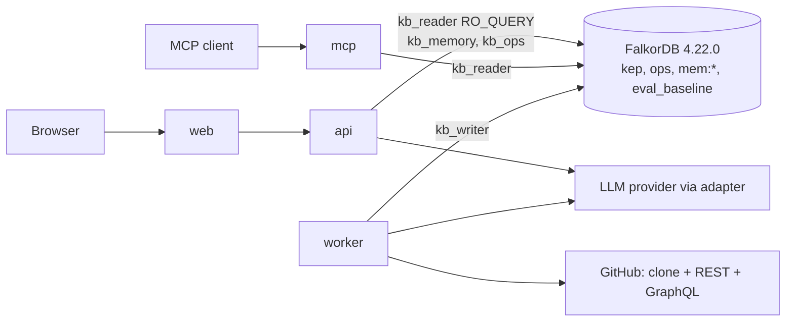

# KEP Brain · Technical requirements document (TRD)

## 0. Document control

| | |
|---|---|
| Document | `docs/engineering/TRD.md` |
| Version / status | v0.1 draft for team sign-off (H-Lead, H-Review). Pre-kickoff note only (Rule 8): no source, scripts or manifests. |
| Date | 2026-10-12 (IST) |
| Upstream | `docs/product/PRD.md` (every `PRD-FR-nnn`, `PRD-G-nn`), `docs/product/project-charter.md`, the planning notes §1, §2, §4 |
| Design inputs (linked, not copied) | [02-architecture](../design/02-architecture.md) §4 containers, §6 flow, §7 tools, §11 cross-cutting, §12 API, §14 Rule 3, §15 budgets; [03-graph-model](../design/03-graph-model.md) §3 keys, §12 indexes, §13 constraints, §14 algorithms, §15 tools; [04-eval-set](../design/04-eval-set.md) §7 metrics, §8 arms; [security-threat-model](security-threat-model.md) §6; [data-governance](data-governance.md) §4 |
| Siblings | `TST-*` test plan, `OPS-*` operations, `RSK-*` risks (`docs/ops/risk-register.md`, cited by id) |
| Authority | Names of labels, edges, tools: 03-graph-model. HTTP shapes: 02 §12 plus the deltas in §9 here. Where this TRD and a design document disagree, the disagreement is listed in §17 and the design document wins until the team decides. |
| Length cap | 700 lines |

### 0.1 Identifier scheme and traceability

| Prefix | Meaning | Defined in |
|---|---|---|
| `TRD-NFR-nnn` | Non-functional requirement with a number and a measurement method | §3 |
| `TRD-TR-nnn` | Technical requirement per component; names the `PRD-FR` ids it realises and how it is verified | §4 |
| `TRD-DR-nnn` | Data requirement (001-014 adopted unchanged from data-governance §4; 015-024 added here) | §5 |
| `TRD-SR-nnn` | Security requirement (001-049 consolidated from the threat model §6, ids unchanged) | §6 |
| `PRD-*`, `ADR nnnn`, `TST-*`, `OPS-*`, `RSK-*`, `THR-*` | Cited, not redefined | other documents |

Conventions.
- Every `TRD-TR` row has a **Realises** column (PRD-FR ids) and a **Verification** column. §4.18 inverts this: every `PRD-FR-001..077` appears in at least one TR or is named as process-only.
- A requirement with a number is a target that must be measured. A number marked **(decided)** is chosen here because no source gives one; it is **veto-able**, no measurement backs it yet, and it is frozen or revised after the first measurement at the checkpoint named in its row.
- Priority P0/P1/P2 follows PRD §0.1 (T03, T01, T02). Security rows carry the threat model's own P0/P1/P2 (before CP4, CP6, CP7/CP8).
- "Rule" means a WeMakeDevs hackathon rule as quoted in the planning notes §0 and §1. Rule 8: all code starts after 2026-10-15 00:01 IST. This file therefore contains prose and tables only.
- LLM defaults (undecided by the user, treated as open): Anthropic `claude-sonnet-5-5` answering, `claude-haiku-5-5` extraction. Team: 1-4 people, roles as a template. Hosting: single VM, Docker Compose, Caddy (ADR 0017).

---

## 1. System overview

The system is specified in [02-architecture §3-§4](../design/02-architecture.md) and is not restated here. Summary for orientation only.

| Process | Role | Holds credentials for |
|---|---|---|
| `web` (Next.js) | Screens; same-origin proxy to `api` | none |
| `api` (FastAPI) | HTTP contract, agent loop, tool registry, validator, memory writes, action draft/confirm | `kb_reader`, `kb_memory`, `kb_ops` (TRD-SR-049), LLM key, action PAT |
| `mcp` | Same tool registry over MCP | `kb_reader` |
| `worker` | Ingestion, analytics, eval, scheduler, memory GC | `kb_writer`, read PAT, LLM key (extraction) |
| `falkordb` | The only datastore (ADR 0006) | ACL file with hashes |
| `caddy`, `backup`, `acl-init` | Edge and operations | none / admin hash |

Data flow in one sentence: sources are parsed by `worker` into `kep`; a question reaches `api`, the planner picks typed tools, each tool runs one fixed Cypher template read-only, rows become evidence objects, a deterministic validator accepts only claims citing evidence seen in this request, and the answer streams with its paths and sources.

---

## 2. Scale reference (inputs to the targets below)

Counts are from the recon and the architecture; all are re-measured on Oct 15 before any number reaches the README (recon D12). None is a measurement of this system.

| Quantity | Value | Source |
|---|---|---|
| In-scope KEPs | 232 of 684 parseable (139 / 58 / 35 for sig-node / sig-scheduling / sig-apps) | PRD §1.2; 02 §16 |
| Core graph (P0) | 21-25k nodes, 30-35k edges (`03` §16 instead says about 30k nodes and 60k edges: the design documents disagree, both are estimates and neither is measured; counts are measured on Oct 15 and only those reach the README, the form and TST-014; RSK-012. Reviewed: partly rejected, since charter A7 carries no node count (it sizes about 3,000 vector blocks); the quoted 30k/60k figures were in charter §3, PRD-A-04 and demo C.2, all now unmeasured) | 02 §9.6 |
| Full graph (P0+P1) | 55-60k nodes, 95-105k edges | 02 §9.6 |
| Tracking issues / enhancements PRs | about 575 / about 1,600 | 02 §9.1 |
| GitHub budget | 5,000 REST requests/h, 5,000 GraphQL points/h per token, serial | 02 §9.4; TRD-DR-003 |
| Initial ticket-layer requests | about 4,000-4,500 REST plus about 1,900 GraphQL points (inference) | 02 §9.4 |
| FalkorDB memory | `maxmemory` 3 GB prod; corpus estimate at most 600 MB | 02 §15 |

---

## 3. Non-functional requirements

Latency is reported in three parts so the LLM does not hide graph performance: **graph time** (sum of FalkorDB `ms` from `tool_call` events), **LLM time** (classifier plus planner turns plus final structured answer, from `llm.call` spans), **end-to-end** (`POST /v1/ask` wall clock, retries and client queueing excluded, 04 §7). Question types are those of 04 §4.1: OWN, EXP, DEC, STA, MH, ABS.

### 3.1 Performance

| Id | Requirement | Target | Measurement method | Pri | PRD link |
|---|---|---|---|---|---|
| TRD-NFR-001 | Single tool call, graph time, no LLM, 50 concurrent users | p95 under 300 ms; p50 under 100 ms **(decided; p50 only; unmeasured, publish if missed)** | Load test of TRD-NFR-010; FalkorDB `ms` from result statistics, quantiles over the 60 s window after a 10 s warm-up | P0 | G-04, US-17 |
| TRD-NFR-002 | Per-ask graph time (sum over tool calls) | p95 under 1,500 ms **(decided)** | `done.latency_ms` minus LLM spans, from the frozen eval run, per type | P0 | G-04 |
| TRD-NFR-003 | Hard bounds per call | 2,000 ms query timeout, 200 rows, 8 tool calls, 30 s ask budget (02 §15) | Integration test with a deliberately slow query returns `graph_timeout`; budget test returns `budget_exhausted` | P0 | FR-013 |
| TRD-NFR-004 | End-to-end `/v1/ask`, all types | p95 at most 12 s (PRD-G-04) | Frozen 3-rep eval, arm H, quantiles over 168 answers | P0 | G-04 |
| TRD-NFR-005 | End-to-end by type, p50 / p95 **(decided; unmeasured, publish if missed; calibrated on the CP2 first run, frozen at CP4, reported as measured at CP7)** | OWN, STA-simple: 4 s / 9 s. EXP, DEC, STA-contradiction: 6 s / 12 s. MH: 7 s / 12 s. ABS: 2.5 s / 6 s (classifier path, no planner when `out_of_scope`) | Eval harness per-type quantiles (04 §7, latency per arm and per stage) | P0 | G-04, FR-046 |
| TRD-NFR-006 | LLM time reported separately | LLM time and graph time shown per type in `/v1/eval/latest.latency_by_stage`; no target on LLM time, which belongs to the provider | `latency_by_stage` rows `classifier`, `planner`, `tools`, `validator` | P0 | FR-046 |
| TRD-NFR-007 | Time to first evidence event | `path` or `citation` SSE event before the first `token`; first event within 5 s of request at p95 **(decided)** | SSE contract test; Playwright judge-path timing | P0 | FR-014 |
| TRD-NFR-008 | Explore pages (no LLM) | Server response p95 under 500 ms **(decided)**; works with the LLM key removed | `GET /v1/keps/{n}`, `/people`, `/sigs` under the load test; run with invalid key | P0 | US-09, G-10 |
| TRD-NFR-009 | Graph view | 200 nodes laid out and interactive within 2 s on a laptop **(decided; the single layout threshold, cited by PRD-FR-038 and TST-074)**; above 200 nodes server-side grouping | Playwright trace on MH-04 (15 KEPs plus context); dagre timing is UNVERIFIED (02 §16) and measured Oct 15 | P0 | FR-038 |

### 3.2 Throughput, concurrency, rebuild

| Id | Requirement | Target | Measurement method | Pri | PRD link |
|---|---|---|---|---|---|
| TRD-NFR-010 | T02 concurrency load shape | 50 simulated users, 60 s, closed loop (one request in flight per user, 1 s think time **(decided)**), 70 % `POST /v1/tools/get_kep`, 30 % `POST /v1/memory/me/turns` each user writing to its own `mem:` graph, no LLM calls (02 §10.3). Error rate at most 1 %; tool-read p95 under 300 ms; memory-write p95 under 500 ms **(decided)** for writes to an existing graph; the first write to a new `mem:` graph (a `GRAPH.COPY`, TRD-DR-019) is measured and reported separately | `tests/load` asyncio client; p50, p95, p99, error rate, and `GRAPH.INFO` running/waiting stored as `EvalRun.load_test` | P2 | G-03, FR-071 |
| TRD-NFR-011 | Atomic claim | 20 concurrent claimers on one `Task` yield exactly one winner, repeated 100 times **(decided count; UNVERIFIED that FalkorDB serialises writes per graph, fallback in TRD-TR-049)** | Integration test against the real container (ADR 0016) | P2 | FR-069, US-16 |
| TRD-NFR-012 | Ingestion throughput into FalkorDB | At least 1,000 nodes+edges per second sustained in `UNWIND` batches of 500 **(decided)** | `SyncRun.items_upserted` over `duration`; measured at CP1 on the doc layer | P0 | FR-004, FR-007 |
| TRD-NFR-013 | Document-layer load | Full load of the three SIGs from the local clone at a pinned SHA in at most 5 minutes with zero GitHub API calls **(decided time)** | `SyncRun` with `requests = 0`; CP1 | P0 | FR-001 |
| TRD-NFR-014 | Ticket-layer load | Complete within one hour of one dedicated token, no secondary-limit rejection, paced automatically (02 §9.4) | `SyncRun.requests`, sleeps, remaining-budget log; CP3 | P0 | FR-002, FR-008 |
| TRD-NFR-015 | Full rebuild at recon scale | From warm clone and response cache (TRD-DR-005): at most 10 minutes to a verified `kep_next` and swap; read unavailability during `GRAPH.DELETE` + `GRAPH.COPY` at most 30 s **(decided)**; from cold: bounded by TRD-NFR-013 plus TRD-NFR-014 | Rebuild rehearsal at CP7 recorded in `docs/RUNBOOK.md`; `/ready` reports the window | P0 | FR-004, FR-075 |
| TRD-NFR-016 | No-change incremental sync | At most 60 s and no non-304 list call (TRD-DR-004) | Replay test; `SyncRun` | P0 | FR-008 |
| TRD-NFR-017 | Sync cadence and freshness | Incremental every 15 minutes (02 §9.3); the "Data as of" chip never older than 24 h without a stale badge (24 h is only the stale-badge threshold; the freshness SLO is TRD-NFR-027) | Scheduler log; `STALE_AFTER_HOURS` | P0 | FR-007, FR-033 |

### 3.3 Availability, cost, quality

| Id | Requirement | Target | Measurement method | Pri | PRD link |
|---|---|---|---|---|---|
| TRD-NFR-018 | Availability for the judging window | The window is CP4 (Oct 16 21:00 IST) to Oct 19 23:59 IST, 75 hours (the event window of OPS §7; judges may open the site after the Oct 18 close); the results date is unpublished (PRD-C-11), so service continues until at least 2026-11-15 (PRD-G-06). Target 99 % of 5-minute external pings returning 200 on the web root and `/api/v1/meta` over the window, which allows 45 minutes in total **(decided; OPS-039 is the same SLO)**. HTTPS (Caddy) and the first backup are live from CP4 (TRD-TR-069). Planned changes (deploy, rebuild swap) are scheduled outside 06:00-23:00 IST on Oct 17-18 | External free monitor (5-minute interval, PRD-G-06); one hourly synthetic judge-path call that includes one Ask | P0 | G-06 |
| TRD-NFR-019 | Degradation order | LLM down or budget breaker open: Explore, Freshness, Eval, Judge keep working; Ask returns `provider_error` or `capacity_reached` with the banner (TRD-SR-022). FalkorDB down: `graph_unavailable` 503 everywhere, static shell stays | Fault-injection tests: invalid key, stopped container | P0 | FR-016, FR-040, US-09 |
| TRD-NFR-020 | Cost per 1,000 questions | Mean at most $60 per 1,000 `/v1/ask` answers on arm H, that is $0.06 per answer, the upper end of 02 §15 ($0.02-0.06 at $2/$10 Sonnet and $0.10/$0.50 Haiku per MTok). Expected range $20-60. At the $150 spend cap (PRD-OQ-01) this is at most 2,500 answers in total, shared by the frozen eval, judging traffic and development | `usage` tokens from every LLM response times the pinned price table (04 §7); reported mean and p95 per question and $ per 100 questions; prices re-read on Oct 15 | P0 | G-04, FR-046 |
| TRD-NFR-021 | Spend control | Per-ask token caps, per-IP daily cap, global daily budget with circuit breaker (TRD-SR-022) | Fault test: set budget to zero, `capacity_reached` | P0 | FR-016 |
| TRD-NFR-022 | Accuracy and citation quality | Pre-registered targets in PRD-G-04 and 04 §8.4; citation validity 100 % measured; false-abstention rate reported | Eval harness, deterministic graders, Wilson 95 % intervals | P0 | G-04, G-09 |
| TRD-NFR-023 | Accessibility | WCAG 2.1 AA on every route plus WCAG 2.2 SC 2.5.8 target size (05-ui-brief §6): text contrast at least 4.5:1, controls and graph marks 3:1, status never colour alone, reflow at 320 CSS px (360 px layout), full keyboard path through `/judge`, `prefers-reduced-motion` honoured | axe on every route with zero violations, recorded in the PR; keyboard-only walk of the judge path; contrast script from the dataviz skill run on chart surfaces | P0 | FR-041 |
| TRD-NFR-024 | Browser support | Current Chrome, Edge, Firefox, Safari and mobile Chrome/Safari at 360 px width **(decided)**; no WebGL | Playwright on Chromium; manual pass on one phone | P0 | A-06, FR-041 |
| TRD-NFR-025 | Reproducible run | `docker compose up --build --wait` yields a loaded graph with no GitHub token (PRD-FR-051) in at most 15 minutes on a 4-core, 16 GB machine **(decided)** | Compose-up CI job on a clean runner; timed in the checkpoint | P0 | FR-051, US-19 |
| TRD-NFR-026 | Backup recovery | Nightly backup; 7-day retention; restore tested once before submission; recovery point at most 24 h; recovery time at most 30 minutes from a local backup on the same VM and at most 60 minutes after VM loss (new VM plus the off-VM copy, or a rebuild; OPS-033) **(decided)** | Restore rehearsal recorded in `docs/RUNBOOK.md` (OPS-*) | P0 | FR-075 |
| TRD-NFR-027 | Freshness SLO | The "Data as of" chip is never more than 30 minutes behind the upstream head in steady state, measured as now minus the last successful sync start, from CP4 until CP7 (CHR-SC-11, OPS-044). The 24 h of TRD-NFR-017 is only the stale-badge threshold. In frozen snapshot mode (TRD-TR-024) no lag SLO applies and the chip reads "frozen snapshot" | Scheduler log; synthetic check compares the chip with the last `SyncRun` start | P0 | FR-007, FR-033 |

---

## 4. Technical requirements by component

Each row names the PRD requirements it realises and how it is verified. `TST-*` ids are assigned by the test plan; the method is stated here.

### 4.1 Ingestion: documents (worker)

| Id | Requirement | Realises | Verification |
|---|---|---|---|
| TRD-TR-001 | Clone `kubernetes/enhancements` to volume `repo_cache`; walk `git ls-tree -r` at a pinned `head_sha`; parse `kep.yaml`, README sections (chunk at `##`, split `###` above about 6 KB), PRR files; symlink entries recorded as aliases; `safe_load` YAML with size, alias and time limits; zero API calls for this layer (ADR 0007) | FR-001, FR-006 | Fixture mini-repo test; DG-Q-01, DG-Q-02; `SyncRun.requests = 0` |
| TRD-TR-002 | Normalise `kep.yaml` values with enum maps and `*_raw`, `metadata_invalid`; resolve `see-also`/`replaces`/`superseded-by` by path, old filename, bare number, else `ExternalRef`; derive inverse `SUPERSEDED_BY`, flag one-sided declarations; KEP key is the repository path, `number` indexed not unique | FR-003, FR-006, FR-028 | Parser property tests on the 11 recon invalid values; DG-Q-03, DG-Q-04, DG-Q-05 |
| TRD-TR-003 | Parse `sigs.yaml` (dropping `email`, `private_mailing_list`, meeting `url`), `OWNERS`, `OWNERS_ALIASES` with alias provenance kept (recon D9) | FR-001, FR-005, FR-018 | Fixture with planted addresses; DG-Q-08, DG-Q-11 |
| TRD-TR-004 | Derive `StatusChange` from `git log -- kep.yaml` and `git show <sha>:<path>` (key `sc:<KEP key>:<field>:<sha>`); link commit to PR from `Merge pull request #N` subjects, fall back to `commits/{sha}/pulls` | FR-024 | Test on the 1287 history: PR `kubernetes/enhancements#5761` (US-04); merge-subject format for tide merges is UNVERIFIED, so the fallback has its own test |
| TRD-TR-005 | Derive `Decision` nodes deterministically (03 §8.2): status or stage transition, PRR approval, replacement, withdrawal, each with evidence. LLM-extracted decisions are off by default (`KEPBRAIN_EXTRACT_DECISIONS=false`, cut line L2) | FR-025 | Derivation unit tests; constraint `MANDATORY Decision(kind, kep_path, derived)` |
| TRD-TR-006 | Scrub all free text before hashing and storing (email regex to `[email removed]`, drop `Signed-off-by:`/`Co-authored-by:` lines); post-sync invariant scan fails the `SyncRun` and blocks the blue/green swap on any hit; `Person.name`/`company` only from `sigs.yaml` leadership and only while `KEPBRAIN_STORE_PERSON_NAME_COMPANY=true` (ADR 0020) | FR-005, FR-009 | Hypothesis property tests; zero hits on every `SyncRun` (PRD-G-07); DG-Q-11 |
| TRD-TR-007 | Ship `NOTICE`, data statement, and a suppression list applied by the writer (TRD-DR-012); comment bodies never committed to the repository (TRD-DR-009) | FR-009 | Repo scan for `Comment` fixtures; suppression integration test |

### 4.2 Ingestion: tickets, chats and incremental sync (worker)

| Id | Requirement | Realises | Verification |
|---|---|---|---|
| TRD-TR-008 | Read tracking issues and enhancements PRs through `GET /repos/kubernetes/enhancements/issues` (labels, `since`, `If-None-Match`, serial, `per_page=100`); per PR `pulls/{n}/files` and `pulls/{n}/reviews`; comments initially per item, incrementally repo-wide with `since` | FR-002, FR-008 | Fake-server replay: second sync makes zero non-304 list calls (TRD-DR-004) |
| TRD-TR-009 | Read label, milestone and cross-reference history only through GraphQL `timelineItems`, 25 issues per query, end cursor stored on the `Issue` node (TRD-DR-006) | FR-002, FR-024 | Parity check on 20 tracking issues (DG-Q-07); `SyncRun` GraphQL cost line |
| TRD-TR-010 | Rate-limit handling per TRD-DR-003: read `x-ratelimit-*` after each response, sleep to reset below the floor, honour `retry-after`, exponential backoff (1, 2, 4, 8, 16, 32, 60 s, 7 attempts); a failed run leaves cursors intact and resumes | FR-008 | Fake server returning low remaining and 429; sync log shows sleeps |
| TRD-TR-011 | Record `SyncRun {id, kind, started_at, finished_at, status, head_sha, items_upserted, requests, duration, rss, pii_hits, error}` and one `SyncCursor` per resource in `ops`; `/v1/meta` and the "Data as of" chip read them | FR-007 | Integration test; `GET /v1/sync/status` contract test |
| TRD-TR-012 | Scheduler: incremental sync every 15 minutes; "Sync now" creates a `Task` the worker claims; after CP7 the schedule is paused and the system is in frozen snapshot mode (TRD-SR-045, TRD-TR-024) | FR-008, FR-034, FR-069 | Scheduler test with a fake clock; Shared-state tab shows the task |
| TRD-TR-013 | Blue/green rebuild: load into `kep_next`, create indexes, create constraints, poll `db.constraints()` until `OPERATIONAL` (fail on `FAILED`), verify counts and PII scan, then `GRAPH.DELETE kep`, `GRAPH.COPY kep_next kep`, `GRAPH.DELETE kep_next`; backup before every rebuild | FR-004, FR-075 | Rebuild rehearsal; node and edge counts equal after rebuild at the same SHA (TRD-DR-008) |

### 4.3 Graph layer

| Id | Requirement | Realises | Verification |
|---|---|---|---|
| TRD-TR-014 | One FalkorDB, four graph families `kep`, `ops`, `mem:<ULID>`, `eval_baseline`; no second datastore; a CI test scans manifests and imports for `sqlalchemy`, `psycopg`, `sqlite3`, `pymongo`, and `redis` used outside the FalkorDB client (ADR 0002, 0006) | FR-072 | CI "no second store" test; 02 §14 table |
| TRD-TR-015 | Index plan of TRD-DR-016..018 and constraint plan of TRD-DR-019..020 created by the worker in `kep` and `kep_next`; `mem:*` indexes created idempotently on first write | FR-073 | `db.indexes()` and `db.constraints()` snapshot test; `GRAPH.EXPLAIN` on every tool template shows an index scan at the entry node |
| TRD-TR-016 | ACL users per 02 §4.5 plus `kb_ops` (TRD-SR-049): `kb_reader` `+GRAPH.RO_QUERY` only, `kb_memory` `mem:*`, `kb_writer` worker only, `default` admin hash only; `acl-init` writes SHA-256 lines; password required; no published host port in production | FR-074 | Day-1 script (TRD-SR-015): reader denied `GRAPH.QUERY`; memory user denied `kep`; external port scan |
| TRD-TR-017 | Server parameters: `REDIS_ARGS --appendonly yes --appendfsync everysec --save 300 10 --maxmemory 3gb --maxmemory-policy noeviction`; `FALKORDB_ARGS THREAD_COUNT 3 CACHE_SIZE 200 TIMEOUT_MAX 60000 TIMEOUT_DEFAULT 5000 QUERY_MEM_CAPACITY 268435456 RESULTSET_SIZE 20000 MAX_QUEUED_QUERIES` per TRD-SR-019 | FR-013, FR-075 | `GRAPH.CONFIG GET` in the readiness test; slow-query timeout test |
| TRD-TR-018 | Analytics step after any sync that changed a `Person`, `KEP` or ticket: PageRank, betweenness (`samplingSeed 42`), WCC, label propagation over documented projections (03 §14), writing `pagerank`, `betweenness`, `wcc_id`, `lp_community_id`, `analytics_run_id`, plus an `AnalyticsRun` in `ops`; live runs only by worker or admin (TRD-SR-018) | FR-057, FR-058, FR-020 | Deterministic top-three check for `rank_people(sig-node)` (US-10); same seed gives same ranks |

### 4.4 Tool registry and read-only execution (shared by api, mcp, eval)

| Id | Requirement | Realises | Verification |
|---|---|---|---|
| TRD-TR-019 | One registry of 29 tools (03 §15: 1-19 T03, 20-26 T01, 27-29 T02). Each tool is a Pydantic parameter model, one or more literal Cypher template variants, a row-to-evidence mapper, and a description. No tool accepts Cypher; variable parts select templates through enums; `LIMIT`/`SKIP` are never parameters (FalkorDB limitation, 02 §6.2) | FR-013, FR-015 | AST test (TRD-SR-013); registry export test generating the README queries section |
| TRD-TR-020 | Execution: `graph.ro_query(template, params, timeout=2000)` as `kb_reader`; 200-row cap with `truncated`; every row carries `label`, `key`, `url`; paths returned as `[key, REL, key, ...]`; evidence id = `base32(sha1(label|key))[:12]` (03 §3.2) | FR-003, FR-013, FR-015 | Integration: write via `RO_QUERY` rejected; `kb_reader` cannot `GRAPH.QUERY`; evidence id stable across calls |
| TRD-TR-021 | T03 tools 1-19 realise: `find_entities` (FR-006), `get_kep` (FR-022, FR-035), `get_kep_section`, `search_sections` (FR-027), `who_owns` (FR-018), `who_approves` (FR-019), `who_knows` (FR-020), `trace_decision`, `status_history` (FR-026), `whats_changed`, `release_scope` (FR-032), `freshness` (FR-030), `find_contradictions` (FR-031), `kep_relations` (FR-028), `sig_overview`, `person_profile` (FR-021), `feature_gate_lookup` (FR-023), `thread_digest` (FR-029), `cross_sig_map` (FR-063). Tools 17-19 are cut line L4 | FR-018 to FR-023, FR-026 to FR-032, FR-035, FR-063 | Per-tool golden test against the fixture graph; the checkpoint calls of PRD §9.1 (`trace_decision(1287, status)` returns `kubernetes/enhancements#5761`; `find_contradictions` lists KEP-583 and KEP-5978) |
| TRD-TR-022 | Ambiguous `kep_ref` (for example 2133, present in two SIG directories) returns candidate paths, never a guess | FR-006 | Test with 2133 and `0000` |
| TRD-TR-023 | As-of semantics: `as_of` takes a release or date and filters state edges by `valid_from <= t < valid_to` (TRD-DR-021) | FR-022, FR-035, FR-017 | Test: `who_approves(1287, as_of v1.30)` differs from current where history differs |
| TRD-TR-024 | Staleness rule, replacing the open threshold of PRD-OQ-07 **(decided, veto-able)**: an answer is `stale` with a stated reason when any cited KEP satisfies (S1) another source contradicts it (`find_contradictions` condition), or (S2) its `upstream_updated_at` is newer than `last_synced_at`, or the last successful sync is older than `KEPBRAIN_STALE_AFTER_HOURS` (24; **suppressed in frozen snapshot mode**, below), or (S3) the latest tracker activity is more than 90 days newer than `kep.yaml` `last-updated`. Alternative to S3: 180 days, or no S3. Reasons are returned in `freshness.stale_sources[]`. **Frozen snapshot mode:** while the schedule is paused (TRD-SR-045) and the graph's `head_sha` equals the frozen `EvalRun` `head_sha`, only the age clause of S2 is suppressed (S1, the `upstream_updated_at` clause of S2 and S3 still apply) and the chip reads "frozen snapshot <short sha> <date>"; otherwise the clause applies | FR-033, FR-030 | STA-04 (KEP-583) must be flagged; a fresh KEP must not be; boundary tests at 89, 90, 91 days (TST-056); frozen-mode test (TST-058) |
| TRD-TR-025 | T01 tools 20-26: `impact_of` (depth at most 3, 200 rows), `path_between` (`algo.SPpaths`, `relDirection both`, `maxLen` at most 6), `person_to_decision`, `rank_people` (reads precomputed; live refresh admin only), `community_of`, `bridge_people` (cut line L5), `draft_stale_doc_issue` (draft only) | FR-055 to FR-058, FR-061 | MH-04 returns the 15 KEPs; `path_between(soltysh, 4671)` goes through `PRR_APPROVED`; p99 of `max_len 6` and `depth 3` from the highest-degree nodes measured before CP4 (TRD-SR-017) |

### 4.5 Agent and LLM adapter (ADR 0010)

| Id | Requirement | Realises | Verification |
|---|---|---|---|
| TRD-TR-026 | Provider interface `complete(messages, tools, output_schema, model_role, stream)` returning normalised events `text`, `tool_use`, `final_json`, `usage`, `stop_reason`; implementations `AnthropicProvider` (Messages API, `anthropic` 1.13.0) and `OpenAICompatibleProvider` (`openai` 3.28.0, `base_url`); selected by `KEPBRAIN_LLM_PROVIDER`; roles `planner` and `cheap` map to env model ids | FR-016 | Adapter translation unit tests; recorded-provider double in CI; OpenAI-compatible path smoke-tested before CP6 |
| TRD-TR-027 | Anthropic path (ADR 0010, 02 §6.1): `tool_choice: auto` (forced choice returns 400 on Sonnet 5.5), `strict: true` tools, final answer through `output_config.format` with the `Answer` schema, one prompt-cache breakpoint after system plus tools, `fallbacks: "default"` with the beta header, `stop_reason` checked before content. **UNVERIFIED:** these API behaviours come from the claude-api skill cache of 2026-10-06; they are re-verified against provider docs in the Oct 15 hour-one check before CP2 (TRD-TR-072) | FR-016, FR-010 | Contract test on the recorded double including a `refusal` stop; re-verification line in `docs/DECISIONS.md` |
| TRD-TR-028 | Errors: SDK exceptions caught most-specific-first and mapped to `provider_error` (502) or `provider_rate_limited` (503, `Retry-After`); provider text never forwarded (TRD-SR-025) | FR-016, FR-040 | Invalid-key test: Explore still renders, Ask returns the degraded banner |
| TRD-TR-029 | Planning loop: Haiku classifier (scope, entities) first (TRD-SR-010), memory recall, then Sonnet plan with at most 8 tool calls, 30 s wall, 6 s per call; tool results wrapped as untrusted data (TRD-SR-007) | FR-013, FR-017 | Injection regression set (TRD-SR-009); budget test |
| TRD-TR-030 | Deterministic validator, no LLM: each claim cites at least one evidence id returned by a tool in this request; every URL in claims and in `answer_markdown` equals an evidence URL, scheme https, allowlisted host; failures downgrade to `abstained` with `unsupported_claims` | FR-011, FR-012 | Validator unit tests; citation validity measured 100 %; arm N rescue rate reported |
| TRD-TR-031 | Abstention reasons: `no_evidence`, `out_of_scope`, `unsupported_claims`, `budget_exhausted`; HTTP 200 with `abstained: true` and a "what was searched" list; `graph_unavailable` is 503. Never fall back to model memory | FR-012 | ABS-05 (KEP-9999) abstains with `no_evidence`; 11 ABS questions in the eval |
| TRD-TR-032 | Answer contract: `{request_id, question, answer_markdown, abstained, abstain_reason?, confidence, claims[], evidence[], paths[], tools_used[], freshness, model, usage}`; each tool step exposes name, parameters digest, the static Cypher template, row count, FalkorDB `ms` | FR-010, FR-015 | OpenAPI snapshot test; Steps tab shows the template |
| TRD-TR-033 | Streaming: SSE events `status`, `tool_call`, `path`, `citation`, `token`, `memory`, `done`, `error`; `path` and `citation` may precede the first `token`; request and stream capped at 35 s **(decided; just above the 30 s budget, TRD-SR-019)** | FR-014 | SSE order contract test; Playwright |

### 4.6 MCP server (ADR 0013)

| Id | Requirement | Realises | Verification |
|---|---|---|---|
| TRD-TR-034 | Own server on the Python `mcp` SDK 2.3.0, Streamable HTTP on `:8765` behind Caddy at `/mcp`, bearer `KEPBRAIN_MCP_TOKEN`, plus `--transport stdio`; tool list generated from the same registry: tools 1-26 plus `get_graph_schema`, which is 27 tools before cut lines L4/L5; `recall_memory`, `remember`, `coordinate` excluded (TRD-SR-035); the action tool returns a draft only | FR-059 | Parity test with an explicit exclusion list; all tools not removed by a cut line are listed and the count is recorded (PRD-US-12); missing token rejected |
| TRD-TR-035 | Same validation, same read-only path and same evidence shape as the web agent; results carry `untrusted_content: true`; no tool named `query_graph` or accepting Cypher ever appears | FR-059, FR-013 | CI assertion over the tool list |
| TRD-TR-036 | `docs/MCP.md` with attach steps for Claude Desktop and the MCP Inspector, the public judge token (TRD-SR-006), and a saved screenshot of a client selecting a tool | FR-060 | Manual run at CP5; screenshot committed under `docs/` |

### 4.7 HTTP API service

| Id | Requirement | Realises | Verification |
|---|---|---|---|
| TRD-TR-037 | FastAPI 0.143.0 on uvicorn 0.54.0, Python 3.12, Pydantic v2, stateless apart from TTL caches (readiness 5 s, tool catalog) and rate-limit buckets; endpoints per §9 | FR-010, FR-014 | Contract tests; OpenAPI snapshot |
| TRD-TR-038 | Request id middleware: accept `^[A-Za-z0-9._-]{1,128}$` else UUIDv7, echo in `X-Request-ID`, bind to every log line and span (TRD-SR-004) | FR-076 | Unit test; header present on error responses |
| TRD-TR-039 | Error envelope `{error: {code, message, request_id, details?}}` from a fixed allowlist of messages; codes in §9.3 | FR-016, FR-040 | Snapshot test of each code; no stack trace in any body |
| TRD-TR-040 | No sign-up, no cookies: optional `X-Kep-Memory-Id` header only; every read route works without it | FR-039 | Clean-browser Playwright run with storage cleared |
| TRD-TR-041 | Health: `GET /health` (liveness) and `GET /ready` (FalkorDB ping, `kep` graph with at least one `KEP`, no rebuild in progress, recent sync not failing three times) as implemented in the shipped `apps/api` template (**decided**: these names, not `/healthz` and `/readyz`; TRD-OQ-08); `web` serves `/healthz`. Used by Compose healthchecks and Caddy's internal upstream check only, not routed at the edge (TRD-SR-026). The external monitor and gate G2 use the web root and `/api/v1/meta` (TRD-NFR-018, OPS-039) | FR-076 | External `GET /ready` returns the web 404; compose healthchecks green |
| TRD-TR-042 | Rate limiting and concurrency controls of TRD-SR-019 and TRD-SR-020 implemented in `api`, with 429 and `Retry-After` | FR-016 | Load-test side assertion; limit test |

### 4.8 Action (T01)

| Id | Requirement | Realises | Verification |
|---|---|---|---|
| TRD-TR-043 | Draft stores an `ActionDraft` in `ops` through `kb_ops`; body composed by code from evidence fields (TRD-SR-012); confirm runs the compare-and-set state machine `drafted -> posting -> posted | failed` (TRD-SR-040); target repository validated against allowlist and denylist (`kubernetes/*`, `kubernetes-sigs/*`, `kubernetes-client/*`, `kubernetes-csi/*`, `cncf/*`, ADR 0021) at startup and on each confirm | FR-061, FR-062 | `ACTION_REPO=kubernetes/enhancements` refused; 20 parallel confirms yield one issue; outgoing payload test with mentions and references |

### 4.9 Memory and coordination (T02, ADR 0011, 0012)

| Id | Requirement | Realises | Verification |
|---|---|---|---|
| TRD-TR-044 | Graph `mem:<ULID>` chosen only after `re.fullmatch('[0-9A-Z]{26}')`; lazy creation after a successful ask, as a `GRAPH.COPY` of the constraint-bearing `mem_template` graph (TRD-DR-019; UNVERIFIED, fallback in TRD-TR-072); reads of missing graphs return 404 and create nothing (TRD-SR-001); writes as `kb_memory` | FR-064 | Malformed-id tests; two-id isolation test |
| TRD-TR-045 | Episodic: `Turn` chain per `Session` written from the validated `Answer` by code; `GET /v1/answers/{id}` reads from the caller's graph | FR-065 | Persistence across API restart; read by id |
| TRD-TR-046 | Semantic: `Fact {key, value, confidence, first_seen, last_seen}` extracted by Haiku from the **question only** (TRD-SR-011), short labels, scrubber re-applied (TRD-SR-028) | FR-066 | Property test: no e-mail-shaped string stored |
| TRD-TR-047 | Procedural: `Playbook {question_kind, tool_sequence, success_count}`; thumbs-up increments; cut line L6 | FR-067 | Repeat-question test increments `success_count` |
| TRD-TR-048 | `recall_memory` is LLM-callable read-only; `remember` is invoked by code after validation and is not in the LLM tool list; answer lists `memory.recalled[]` (up to 5 turns, 20 facts, 3 playbooks) labelled "context, not evidence" | FR-068 | Tool-list test; recall appears in `memory` SSE event |
| TRD-TR-049 | `coordinate` over `ops` **(UNVERIFIED single-writer atomicity; fallback in TRD-TR-072)**: one write query claims a `Task` when `status = 'queued' OR lease_until < $now`, sets lease `now + 300`, `attempts += 1`, creates `CLAIMED`; agents `ingest`, `freshness`, `qa`, `action` use it; handoff via `HANDED_TO` | FR-069 | TRD-NFR-011 test; Shared-state tab shows lease, heartbeat, handoff |
| TRD-TR-050 | Deletion and retention: per-fact delete, `DELETE /v1/memory/me` runs `GRAPH.DELETE mem:<uid>`; `memory-gc` removes turns older than 90 days (`MEMORY_RETENTION_DAYS`) and graphs idle for more than 14 days (`MEMORY_IDLE_DAYS`; 30 days from Oct 18 until the results date, data-governance §7) (TRD-SR-021) | FR-070 | Delete then `GET` returns 404; GC fake-clock test |
| TRD-TR-051 | Load test per TRD-NFR-010, result stored as `EvalRun.load_test` and shown on `/eval` | FR-071 | Stored row; README quote generated from it |

### 4.10 Web (Next.js, ADR 0018)

| Id | Requirement | Realises | Verification |
|---|---|---|---|
| TRD-TR-052 | Next.js 16.4.0 App Router, React 19.3.0, TypeScript 5.9.3, Tailwind 4.3.3, Cytoscape.js 3.34.3 (dagre for Ask, fcose for Explore, concentric for Memory), SVG charts with d3-scale and d3-array, no WebGL; same-origin `/api/*` proxy, no tokens in the browser, no CORS | FR-036, FR-038 | `next build`, typecheck, lint in CI; dependency list vs ADR 0018 |
| TRD-TR-053 | Routes: `/` Ask, `/explore`, `/explore/kep/{n}`, `/explore/person/{handle}`, `/explore/sig/{dir}`, `/freshness`, `/memory`, `/eval`, `/judge`, `/about`. Ask has composer with SIG and release filters, three suggested questions, streamed answer with inline citation buttons, evidence panel (Path, Steps, Sources), "Data as of" and stale badges | FR-034, FR-036, FR-037, FR-042, FR-049 | Playwright judge-path smoke; route list test |
| TRD-TR-054 | Graph view: cap 200 nodes (Explore ego view 50), server-side grouping above the cap, table fallback; impact view and draft-issue dialog showing the exact body before posting | FR-038, FR-062 | MH-04 view; dialog test |
| TRD-TR-055 | States: empty, loading, error and degraded banner defined for every screen; driven by `/v1/meta.llm.reachable` | FR-040 | Storybook-free component tests (vitest 5.0.3) per state |
| TRD-TR-056 | Browser storage limited to `localStorage` for theme and anonymous memory id, wrapped in try/catch; the page renders without it; no cookie banner; no third-party scripts (TRD-SR-047) | FR-039 | Network panel test: only same-origin requests |
| TRD-TR-057 | Render safety: sanitising Markdown renderer, raw HTML and images disabled, links only to evidence URLs on allowlisted hosts, `rel="noopener noreferrer"` (TRD-SR-008) | FR-036 | Component test with hostile Markdown |
| TRD-TR-058 | Accessibility per TRD-NFR-023; target size at least 24 x 24 CSS px; focus order and ARIA live region for streamed answers | FR-041 | axe in Playwright on each route |
| TRD-TR-059 | Memory page with Episodic, Semantic, Procedural, Shared-state and Graph tabs, per-item delete, "Forget everything", "New identity"; id masked by default (TRD-SR-003) | FR-070 | Two browser profiles show disjoint memories (PRD-US-14) |

### 4.11 Evaluation harness

| Id | Requirement | Realises | Verification |
|---|---|---|---|
| TRD-TR-060 | `evals/questions.yaml` with 56 questions (OWN 10, EXP 7, DEC 8, STA 10, MH 10, ABS 11) each with ground truth, source and expected tools; not mounted in the `api` container | FR-043 | Schema validation; count test; HUM-03 re-verification on Oct 15 |
| TRD-TR-061 | Deterministic graders for OWN, EXP, STA, MH, ABS; judge model only for DEC and two STA clauses, calibrated on 16 human labels (agreement at least 90 %); harness self-tests before the first paid pass | FR-044 | 04 §6.4 self-tests; calibration record |
| TRD-TR-062 | Five arms N, L, V, G, H with shared controls (04 §8.1); arm V is "not run" if no embedding key; arm L uses FalkorDB full-text, arm V the vector index in `eval_baseline` | FR-045 | Fairness checks; arm table shows "not run" rather than a simulated number |
| TRD-TR-063 | Metrics per 04 §7: Wilson 95 % intervals, paired bootstrap (10,000 resamples, seed 42), citation validity/precision/recall, abstention precision/recall, false-abstention rate, validator rescue rate, latency per stage, tokens and cost, errors | FR-046 | Metric unit tests on synthetic result sets |
| TRD-TR-064 | Run through the deployed instance; frozen 3-rep run committed as `evals/summary.json`; `/v1/eval/latest` serves it; `/eval` sorts baseline wins first with a "where the graph lost" block and predictions versus outcomes; re-run as regression gate | FR-047, FR-048 | CP7 freeze check; README section generated from `summary.json` |
| TRD-TR-065 | Injection regression set (TRD-SR-009) runs as eval kind `security` against the recorded double | FR-044 | CI job |

### 4.12 Presentation artefacts, deployment and observability

| Id | Requirement | Realises | Verification |
|---|---|---|---|
| TRD-TR-066 | `/judge` is served from `GET /v1/eval/questions`: five steps (STA-04, DEC-07, DEC-01, MH-07, then ABS-10), one-click deep links, expected evidence and expected time | FR-049 | Playwright: five steps from a clean browser |
| TRD-TR-067 | README generated pieces: Cypher templates and algorithm calls exported from the registry, evaluation section from `summary.json`, FalkorDB depth table (at least twelve capabilities mapped to a file or route), Rule 3 table (02 §14), data model diagram | FR-050 | Docs CI job (link check); depth table row count test |
| TRD-TR-068 | Compose (prose spec 02 §13.3): services `acl-init`, `falkordb`, `api`, `worker`, `mcp`, `web`, `caddy`, `backup`; two networks `edge` and `data` (TRD-SR-042); `restart: unless-stopped`; memory limit 4.5 GB for `falkordb` on the 8 GB VM (2.5 GB with `maxmemory 2gb` on the 4 GB fallback; OPS D1), 512 MB to 1 GB others; json-file logging 10 MB x 3; production file does not extend the dev file; `docker compose up --build --wait` works without a GitHub token by loading a cached snapshot of the Apache-2.0 files | FR-051, FR-075 | Compose-up CI job; external port scan shows 80 and 443 only; 22 only from allow-listed IPs (OPS D2) |
| TRD-TR-069 | Production: Ubuntu 24.04 VM (4 vCPU, 8 GB, 80 GB class per OPS D1; 3 vCPU / 4 GB with the OPS rules R1-R3 if the price breaks the EUR 40 ceiling), Docker Engine with Compose plugin, `caddy:2.11.7` TLS with HSTS, `/api/*` to api, `/mcp` to mcp, rest to web; deploy operator-run over SSH from allow-listed IPs (OPS D2; Actions builds and pushes images to GHCR only and holds no deploy key); HTTPS and the first nightly 02:00 UTC `BGSAVE` backup (7-day retention) are live from CP4, the restore drill is rehearsed by CP6/CP7 | FR-075 | TRD-NFR-018 and TRD-NFR-026 evidence |
| TRD-TR-070 | Observability per §10 | FR-076, FR-015 | Canary-secret job (TRD-SR-024); trace of one ask shows `agent.plan`, tools, `llm.call` |
| TRD-TR-071 | Tests and CI gates (ADR 0016): ruff 0.17.0, mypy 2.4.0 strict, pytest 9.1.1 with testcontainers against `falkordb-server:v4.22.0`, vitest, Playwright, gitleaks, compose-up; `main` protected with the required checks; commits start 2026-10-15 00:01 IST | FR-077, FR-054 | Branch-protection screenshot; `git log` first-commit check (PRD-G-07) |
| TRD-TR-072 | **Oct 15 hour-one verification of UNVERIFIED claims**, each with a fallback, logged in `docs/DECISIONS.md` before CP2: (1) `Task` claim atomicity (TRD-TR-049, TRD-NFR-011): fallback a version-checked `SET` (compare-and-set on `version`) with bounded retry; (2) `GRAPH.COPY` carries indexes and constraints for `mem_template` (TRD-DR-019): fallback constraint-free `mem:*` graphs with `MERGE` on `key`; (3) provider behaviours of TRD-TR-027 (forced `tool_choice`, `fallbacks`, `output_config.format`) and the pins of §11 (`anthropic` 1.13.0, `mcp` 2.3.0, Next.js 16.4.0): fallback `tool_choice: auto`, no beta header, the nearest published version recorded | FR-016, FR-069, FR-073 | TST-194 records the three results; a failed check selects the fallback and re-runs its test |
| TRD-TR-073 | **Suppression sync** (Rule 6 removal, data-governance §3.4): an operator-run admin task that re-applies the `suppressed` list (`archived = true`) to the graph at the current `head_sha`, re-runs the PII scan and writes a `SyncRun` flagged `suppression`; it fetches nothing from upstream, never advances cursors or `head_sha`, and is the only sync allowed in frozen snapshot mode (TRD-SR-045, OPS D7) | FR-009, FR-005 | TST-192: after a suppression sync the item is gone from tools, search and excerpts, the chip still reads "frozen snapshot", and `head_sha` is unchanged |

### 4.13 Coverage inversion: every PRD-FR is realised

| PRD-FR ids | Realised by |
|---|---|
| 001, 003, 004, 005, 006, 009 | TR-001 to TR-007, TR-013 |
| 002, 007, 008 | TR-008 to TR-012 |
| 010 to 017 | TR-019, TR-020, TR-026 to TR-033, TR-037, TR-039 |
| 018 to 023, 026 to 032, 035, 063 | TR-021 to TR-023 |
| 024, 025 | TR-004, TR-005, TR-009 |
| 033 | TR-024 |
| 034, 036 to 042 | TR-053 to TR-059 |
| 043 to 048 | TR-060 to TR-065 |
| 049, 050, 054 | TR-066, TR-067, TR-071 |
| 051, 074 to 077 | TR-016, TR-041, TR-068 to TR-071 |
| 055 to 058, 061, 062 | TR-018, TR-025, TR-043, TR-054 |
| 059, 060 | TR-034 to TR-036 |
| 064 to 071 | TR-044 to TR-051, TR-059 |
| 072, 073 | TR-014, TR-015, TR-017 |
| 052, 053 | Process-only (video and submission form): owned by the demo plan and `docs/product/demo-script-and-submission.md`; no technical requirement |

---

## 5. Data requirements (`TRD-DR`)

001-014 are adopted with their statements from [data-governance §4](data-governance.md) (verification columns there). 015-024 are added here.

| Id | Requirement (short form) | Verification |
|---|---|---|
| TRD-DR-001 | Repository allow-list of exactly `kubernetes/enhancements`, `kubernetes/community`, `kubernetes/kubernetes`; forks rejected | Unit test; DG-Q-10 |
| TRD-DR-002 | Ingestion read-only: dedicated fine-grained read PAT, no `/users/{login}`, no write verb to any `kubernetes/*` repository | Request-log assertion |
| TRD-DR-003 | Serial, header-driven rate limiting, floor default 200 of 5,000 remaining (veto-able), `Retry-After`, backoff with jitter | Fake-server test |
| TRD-DR-004 | ETag and `since` cursor per list resource, 60 s overlap, 304s free | Replay test |
| TRD-DR-005 | Raw-response cache keyed by URL + ETag; rebuild from cache with token removed gives an identical graph hash | Hash comparison |
| TRD-DR-006 | GraphQL only for `timelineItems`, 25 issues per query, cost logged | Contract test |
| TRD-DR-007 | A public viewer never triggers an upstream call | Egress test from `api`: only the LLM host reachable |
| TRD-DR-008 | Doc layer pinnable by `KEPBRAIN_ENHANCEMENTS_PIN_SHA`; pin shown on `/eval` and README | Rebuild at pin gives equal counts |
| TRD-DR-009 | Excerpts at most 400 characters (veto-able) with login, date, link; no whole-comment export route; no comment bodies in the repository | Route list check; repo scan |
| TRD-DR-010 | Rule 6 guarantees G1-G4 of 03 §9 on every sync | Planted-address fixture; zero hits |
| TRD-DR-011 | Provenance on every row: `source_repo`, `source_path` or URL, `source_sha`, `observed_at`, `content_hash` | Schema test |
| TRD-DR-012 | Suppression list applied by the writer; suppressed rows archived and excluded by every tool | Integration test |
| TRD-DR-013 | Rebuild into `kep_next` and swap; previous graph kept until PII scan and DG-Q pass | CP7 rehearsal |
| TRD-DR-014 | Logs, traces, metrics carry no user text or parameter values; user ids as SHA-256 prefix | Log-capture test |
| TRD-DR-015 | **Answer-bearing nodes carry a source URL.** Every node in `kep` has `source_url` (exact public GitHub URL at a pinned commit, issue, PR, comment anchor or commit) and `observed_at`, enforced by `GRAPH.CONSTRAINT CREATE kep MANDATORY NODE <label> PROPERTIES 3 key source_url observed_at` on `KEP`, `Document`, `Section`, `Person`, `SIG`, `WorkingGroup`, `Committee`, `Subproject`, `Alias`, `FeatureGate`, `Metric`, `Release`, `Commit`, `PullRequest`, `Issue`, `Review`, `Comment`, `StatusChange`, `Decision` (03 §13). Derived nodes (`Decision`, `StatusChange`) also carry `EVIDENCED_BY` edges with `evidence_kind` and `source_url`. A tool row without `url` is a defect: the evidence mapper raises, the request errors, and the CI golden tests fail | Schema test of `db.constraints()` `OPERATIONAL`; query test counting answer-bearing nodes with null `source_url` is zero after each sync (DG-Q-10); mapper unit test |
| TRD-DR-016 | **Range indexes** on `key` for all 22 primary labels plus secondary `Ticket` and `OwnersFile` (24 total); secondary indexes per 03 §12.2: `KEP.number`, `KEP.owning_sig`, `KEP.status`, `KEP.upstream_updated_at`, `Person.pagerank`, `Person.betweenness`, `Person.wcc_id`, `Person.lp_community_id`, `StatusChange.at`, `StatusChange.kep_path`, `StatusChange.valid_to`, `Decision.decided_at`, `Decision.kep_path`, `Section.kep_path`, `Comment.created_at`, `PullRequest.merged_at`, `Issue.number`, `PullRequest.number`, `Release.released_at`, `Release.ordinal`, `Document.kind`. No relationship indexes unless `GRAPH.PROFILE` on the eval questions shows an edge scan above 50 ms. Index on a secondary label used when a primary label is also present is UNVERIFIED; day-one `GRAPH.EXPLAIN` check, fallback is to query by primary label | `db.indexes()` snapshot; `GRAPH.EXPLAIN` on each template |
| TRD-DR-017 | **Full-text indexes** (English, no phonetic) on `KEP(title, summary)`, `Section(heading, text)`, `Issue(title)`, `PullRequest(title)`, `Comment(body)`, `Person(login, name)`, `SIG(display_name, mission)`, `FeatureGate(name)`, `Decision(summary)`; query input reduced per TRD-SR-014 | Syntax-character tests; `queryNodes` smoke |
| TRD-DR-018 | **Vector index** on `Section.embedding`, dimension 1024, cosine, `M 16`, `efConstruction 200`, `efRuntime 10`, only when `KEPBRAIN_EMBEDDINGS_ENABLED=true` (03 §12.2). `eval_baseline` has its own `Chunk.embedding` index with the same options. Conflict: 04 §8.2 and ADR 0010 say 1536; 03 is authoritative for names and this TRD follows it (see §17) | Index created with the stated options; embedding model recorded in `Section.embedding_model` |
| TRD-DR-019 | **Uniqueness**: `UNIQUE NODE <label> PROPERTIES 1 key` for all primary labels; created after the exact-match index (in `kep` and `ops`, and once in a `mem_template` graph at deploy; every new `mem:<ULID>` is a `GRAPH.COPY` of `mem_template`, so no constraint is created or polled on a user's first write, see TRD-TR-072); the worker polls `db.constraints()` until `OPERATIONAL` before loading and fails the run on `FAILED` | Constraint snapshot; duplicate-insert test raises |
| TRD-DR-020 | **Mandatory** properties: `KEP(status, owning_sig)`; `StatusChange(kind, field, at, valid_to)`; `Decision(kind, kep_path, derived)`; state edges `APPROVES`, `REVIEWS`, `AUTHORED`, `PRR_APPROVED`, `TARGETS`, `LATEST`, `CHAIRS`, `TECH_LEAD`, `APPROVER`, `REVIEWER`, `MEMBER_OF`, `LABELED`, `MILESTONED` carry `valid_from` and `valid_to`; `EVIDENCED_BY(evidence_kind, source_url)` | Constraint snapshot; insert-without-property test fails |
| TRD-DR-021 | **Temporal validity.** Two clocks per fact: `valid_from`/`valid_to` (when true in the world, from git history or observation) and `observed_at` (when fetched). `valid_to` is a sentinel for "current". A state edge no longer seen is kept and closed with `valid_to` set to the commit time (doc layer) or observation time (REST layer); nothing once true is deleted. Timestamps stored twice, epoch seconds (index-friendly) and ISO string, because FalkorDB has no temporal arithmetic functions | Test: remove an approver in a fixture commit, sync, edge closed and `as_of` before the commit still returns them |
| TRD-DR-022 | **MERGE keys.** Nodes `MERGE (n:Label {key: r.key})` with `ON CREATE SET` all properties and `ON MATCH SET` only if `r.content_hash <> n.content_hash`; keys per 03 §3.1 (KEP = repository path; Person = lower-cased login; Commit = `<repo>@<sha>`; PullRequest and Issue = `<repo>#<n>`; StatusChange = `sc:<KEP key>:<field>:<sha>` or `ghe:<event id>`). Edges merged in a separate clause between already matched endpoints, never whole-path `MERGE`; multi-instance edges add a discriminator (`TARGETS.stage`, `PRR_APPROVED.stage`, `MENTIONS.match_kind`). Batches of 500 with `timeout 30000` | Idempotency test: two runs, identical counts and hashes (DG-Q-12) |
| TRD-DR-023 | **Soft deletes**: upstream deletions set `archived = true`, `archived_at`; tools filter `archived` by default; hard deletes only on rebuild | Test: delete a KEP directory in the fixture, sync, tool no longer returns it |
| TRD-DR-024 | **Evidence id** `base32(sha1(label + "|" + key))[:12]`, computed by the API, never from `id()`; the validator accepts only ids produced by tool results in the same request | Stability test across calls and requests |

---

## 6. Security requirements (`TRD-SR`)

Consolidated from [security-threat-model §6](security-threat-model.md); ids and priorities unchanged, text compressed; the threat model holds the full statement, `THR-*` link and secret matrix. Verification is stated in each source row and is tracked by `TST-*`. **D** marks a veto-able decision with an alternative in the source.

| Group | Id | Priority | Requirement (short form) |
|---|---|---|---|
| Identity, edge, secrets | TRD-SR-001 | P0 | Memory id accepted only by `fullmatch`; missing graph returns 404 and is never created by reads |
| | TRD-SR-002 | P1, D | Server-minted 128-bit memory ids (alternative: client ULID, ADR 0011) |
| | TRD-SR-003 | P1 | Memory id masked in UI; never in URL; `Referrer-Policy: no-referrer` |
| | TRD-SR-004 | P0 | Caddy sets a single trusted client-address header, drops inbound `X-Forwarded-For`; `X-Request-ID` validated |
| | TRD-SR-005 | P0 | Admin and MCP tokens distinct, 32+ bytes, `hmac.compare_digest`, failures rate-limited; admin paths return 404 at the edge |
| | TRD-SR-006 | P1, D | Public low-privilege read-only MCP judge token, rate-limited, rotated after results |
| | TRD-SR-027 | P0 | Secret hygiene: anonymous public clones, `REDISCLI_AUTH`, per-service env minimisation, `${VAR:?}` in Compose, gitleaks on full history before going public |
| LLM and content | TRD-SR-007 | P0 | Corpus strings wrapped as labelled untrusted data; control and bidi characters and HTML stripped |
| | TRD-SR-008 | P0 | Sanitised Markdown, images disabled, links only to evidence URLs on allowlisted https hosts; validator rejects off-evidence URLs |
| | TRD-SR-009 | P0 | Offline injection regression set (six cases) reported as eval kind `security` |
| | TRD-SR-010 | P0 | Haiku scope gate before the planner; question length 3..1000 |
| | TRD-SR-011 | P1 | Memory facts from the visitor's question only; caps on facts, turns, playbooks, length |
| | TRD-SR-012 | P0 | Action body composed by code; server-side sanitisation of mentions, references, HTML, labels |
| | TRD-SR-028 | P1 | Scrubber re-applied to answers and memory writes |
| | TRD-SR-047 | P1 | UI states no personal data, memory dropped after 14 days idle and turns after 90 days, "Forget everything"; IPs only in limiter memory; no third-party scripts |
| Database and query | TRD-SR-013 | P0 | Literal Cypher only; AST CI test; enum-selected template variants; worker writes via `UNWIND $batch` |
| | TRD-SR-014 | P0 | Full-text input reduced to letters, digits, spaces; 8 tokens; no leading wildcard |
| | TRD-SR-015 | P0, day 1 | ACL scoping verified by script on Oct 15 (UNVERIFIED key patterns, code-level fallback) |
| | TRD-SR-016 | P0, day 1 | `LOAD CSV` and non-catalog `CALL` through `RO_QUERY` as `kb_reader` tested; restrict if accepted |
| | TRD-SR-017 | P0, D | Bounds enforced twice; measure `max_len 6`, `depth 3` p99 against 2,000 ms; alternative `max_len 4` |
| | TRD-SR-018 | P0 | Live algorithm runs refused on public surfaces |
| | TRD-SR-029 | P0 | Fixed egress hosts, URL re-issue, no off-host redirects, confined paths, `safe_load` limits, https-only git |
| | TRD-SR-045 | P2 | Frozen eval records `head_sha`; after CP7 the schedule is paused and "Sync now" and the admin sync are disabled (frozen snapshot mode, TRD-TR-024); the only sync is the operator-run suppression sync (TRD-TR-073); non-fast-forward upstream refused |
| Availability and cost | TRD-SR-019 | P0, D | Semaphore below `THREAD_COUNT`; 2 concurrent asks per IP; `MAX_QUEUED_QUERIES` lowered to 45 (alternative: keep 500) |
| | TRD-SR-020 | P0 | Rate limits by IP, memory id and globally; asks 30 per 10 minutes per IP; 429 with `Retry-After`; Cloudflare optional alternative |
| | TRD-SR-021 | P1 | Memory quotas; `memory-gc` drops a graph idle for 14 days (30 days from Oct 18 until results) and turns older than 90 days |
| | TRD-SR-022 | P0 | Per-ask caps, per-IP daily cap, global daily budget `KEPBRAIN_LLM_DAILY_BUDGET_USD` persisted in `ops`, breaker returns `capacity_reached`, alerts at 50 % and 80 % |
| | TRD-SR-023 | P1, D | Provider-outage fallback and cached judge-path answers labelled `cached: true` |
| | TRD-SR-044 | P1 | Real domain preferred; staging-CA rehearsal; `caddy_data` backed up |
| | TRD-SR-048 | P1 | Host alarms: disk, FalkorDB memory at 70 % of `maxmemory`, restarts; kill-switch runbook |
| Disclosure | TRD-SR-024 | P0 | `SecretStr`, redacted `db.statement`, canary-secret CI job greps logs and spans |
| | TRD-SR-025 | P0 | Allowlisted error messages; provider, GitHub and Redis text never forwarded |
| | TRD-SR-026 | P0 | `/health`, `/ready` not routed at the edge; `/v1/meta` versions and counts only |
| Web, supply chain, platform | TRD-SR-031 | P0 | Caddy CSP (`default-src 'self'`), `nosniff`, no-referrer, empty Permissions-Policy, fixed upstreams, no CORS |
| | TRD-SR-032 | P0 | Locked and frozen installs, `pip-audit`, `pnpm audit`, Dependabot, lifecycle scripts off, per-PR dependency vetting |
| | TRD-SR-033 | P0 | Actions pinned by SHA, read-only default permissions, no `pull_request_target`, no deploy credential in Actions (deploy is operator-run, OPS D2; Actions pushes images to GHCR only), `CODEOWNERS` |
| | TRD-SR-034 | P1 | Digest-pinned base images, non-root, read-only root, `cap_drop ALL`, no `docker.sock` |
| | TRD-SR-035 | P1 | MCP hardening: stateless or capped sessions, Origin and Host allowlist, size and rate limits, exclusion list, no Cypher-accepting tool |
| | TRD-SR-036 | P1 | MCP results flagged untrusted; `docs/MCP.md` safety note |
| | TRD-SR-042 | P0 | Networks `edge` and `data`; only `caddy` publishes ports; external scan at CP4 and CP6 |
| | TRD-SR-030 | P1 | Egress only for `worker` and `api`; metadata address blocked |
| | TRD-SR-043 | P1 | SSH key-only, non-root deploy user, unattended upgrades |
| | TRD-SR-046 | P1 | Shared-state tests: per-user caches keyed by memory id; board carries no question text |
| Action safety (T01) | TRD-SR-037 | P0, D | Fine-grained single-repo `issues: write` PAT held only by `api`, dedicated bot account suggested, revoked after judging |
| | TRD-SR-038 | P0, D | `confirm_nonce` HMAC; confirm rate-limited and capped per day; `ACTIONS_ENABLED` kill switch |
| | TRD-SR-039 | P0 | `ACTION_REPO` format, case-insensitive allowlist and denylist at startup and each confirm; no redirects; response repository checked |
| | TRD-SR-040 | P0 | Compare-and-set state machine, hidden marker search, one issue under 20 parallel confirms |
| | TRD-SR-041 | P1 | Append-only `AuditEvent` nodes with hashed actor |
| | TRD-SR-049 | P0, D | Fifth ACL user `kb_ops` (`~ops`) for `ActionDraft` state and spend counters; alternative: worker writes via `Task` |

---

## 7. Interfaces: HTTP endpoints

Base path `/v1`, JSON, `X-Request-ID` echoed, errors in the envelope of §9.3. Auth: none for read and ask; optional `X-Kep-Memory-Id`; admin routes need the admin token and are not routed by Caddy (TRD-SR-005). Full request and response shapes are in [02 §12](../design/02-architecture.md); the table gives required fields and the error codes each route can return, in addition to the universal `rate_limited` (429) and `internal_error` (500).

| Route | Required request fields | Response fields (200) | Route-specific error codes |
|---|---|---|---|
| `GET /v1/meta` | none | version, git sha, FalkorDB image and version, node and edge counts for `kep`, `graph_synced_at`, `ingested_head_sha`, last sync summary, model ids, `llm.reachable`, `action_repo`, SIG list | `graph_unavailable` |
| `POST /v1/ask` | `question` (3 to 1000 chars); optional `session_id`, `release`, SIG filter | `Answer` (TRD-TR-032) | `validation_error`, `provider_error`, `provider_rate_limited`, `capacity_reached`, `graph_unavailable`, `graph_timeout`; abstention is 200 |
| `POST /v1/ask/stream` | same | SSE events of TRD-TR-033 | same as ask, delivered as an `error` event after headers are sent |
| `GET /v1/answers/{request_id}` | path id; memory header | `Answer` | `validation_error` (no memory id), `not_found` |
| `POST /v1/answers/{request_id}/feedback` | `helpful` boolean | `ok` | `validation_error`, `not_found` |
| `GET /v1/keps`, `GET /v1/keps/{number}` | optional `sig`, `status`, `q`, `limit` (max 100), `cursor`; or number | KEP summaries with next cursor; KEP card (metadata, owners, approvers, PRR approvers, gates, milestones, tracking issue, freshness) | `not_found`; ambiguous number returns candidates with `validation_error` details |
| `GET /v1/keps/{number}/history`, `/impact`, `/sections` | optional `field`; `depth` (max 3); `q` | changes with commit, PR, approvers; subgraph with hops; sections with URL and excerpt | `not_found`, `graph_timeout` |
| `GET /v1/people`, `/v1/people/{login}`, `/v1/sigs`, `/v1/sigs/{name}` | optional `sig`, `metric`, `limit` (max 50) | ranked people; person card; SIG list; SIG card | `not_found` |
| `GET /v1/graph/path`, `/v1/graph/neighborhood` | `from`, `to` as `label:key` and `max_len` (max 6); or `id`, `depth` (max 2), `limit` (max 60) | path or subgraph (nodes, edges) | `not_found`, `graph_timeout`, `validation_error` |
| `GET /v1/tools`, `POST /v1/tools/{name}` | tool name and typed parameters | catalog with parameter schemas; `rows`, `evidence`, `paths`, `ms`, `truncated` | `validation_error`, `not_found` (unknown tool), `graph_timeout`, `forbidden` (live algorithm refresh without admin) |
| `GET /v1/freshness`, `GET /v1/changes` | `since` (release or ISO date) for changes; optional `sig` | freshness block with stale KEPs; change list | `validation_error` |
| `POST /v1/actions/stale-doc-issue/draft` | `kep_number` | `ActionDraft` with title, body, evidence, target repository, status, `confirm_nonce` | `not_found`, `forbidden` (actions disabled or repository not allowlisted) |
| `POST /v1/actions/stale-doc-issue/{id}/confirm` | draft id, `confirm_nonce`; optional edited title, body, labels | `ActionDraft` with status `posted` and `external_url` | `forbidden`, `not_found`, `validation_error` (nonce expired), `rate_limited`, `provider_error` is not used; GitHub failure returns `internal_error` with status `failed` stored |
| `GET /v1/memory/me`, `DELETE /v1/memory/me`, `DELETE /v1/memory/me/facts/{key}`, `POST /v1/memory/me/turns` | memory header (required) | memory snapshot with graph; `deleted: true`; `turn_id` | `validation_error` (missing or malformed id), `not_found` |
| `GET /v1/agents/board` | none | agents, handoffs in the last hour, tasks (kinds and ids only, TRD-SR-046) | `graph_unavailable` |
| `GET /v1/eval/questions`, `GET /v1/eval/latest` | none | judge-path questions with expected evidence and tools; latest `EvalRun` with by-type, per-question, latency by stage, load test, baseline | `not_found` (no run yet) |
| `GET /v1/sync/status`, `POST /v1/sync/run` | admin token; `kind` for run | last runs, cursors, worker `last_seen_at`; `task_id` | `unauthorized`, `forbidden`; both are unreachable from the internet |
| `GET /health`, `GET /ready` | none | liveness; readiness checks (FalkorDB, graph, sync, rebuild) | `/ready` returns 503 with reasons to the internal network only |

### 7.1 MCP tools

Transport Streamable HTTP at `/mcp` (bearer) or stdio. MCP tool errors carry the same code strings as the HTTP taxonomy inside the MCP error result; tool names and parameter schemas are the registry's (03 §15). Every result contains `rows`, `evidence`, `paths`, `truncated`, `untrusted_content: true`.

| MCP tool group | Tools | Parameters (summary) | Error codes |
|---|---|---|---|
| Find and read (T03) | `find_entities`, `get_kep`, `get_kep_section`, `search_sections`, `kep_relations`, `feature_gate_lookup`, `thread_digest` | free text or `kep_ref`, heading query, gate name; limits at most 20 | `validation_error`, `not_found`, `graph_timeout`, `graph_unavailable` |
| People and ownership (T03) | `who_owns`, `who_approves`, `who_knows`, `person_profile`, `sig_overview`, `cross_sig_map` | one of KEP, directory, gate, topic, login, SIG; optional `as_of` | same |
| Decisions and currency (T03) | `trace_decision`, `status_history`, `whats_changed`, `release_scope`, `freshness`, `find_contradictions` | `kep_ref`, `field` enum, `since`, optional SIG | same |
| Graph reasoning (T01) | `impact_of`, `path_between`, `person_to_decision`, `rank_people`, `community_of`, `bridge_people` | `kep_ref` and depth at most 3; endpoints `{label,key}` and `max_len` at most 6; `metric` enum; `refresh` refused | same plus `forbidden` for `refresh=true` |
| Action (T01) | `draft_stale_doc_issue` | `kep_number` | draft only; `forbidden` if disabled; never posts |
| Orientation | `get_graph_schema` | none | `graph_unavailable` |
| Not exposed | `recall_memory`, `remember`, `coordinate` | n/a | n/a |

### 7.2 Server-sent event fields (stream)

`status` (phase, label); `tool_call` (step, name, params, template, ms, rows, truncated, error); `path` (nodes, edges, path_node_ids, truncated); `citation` (index, evidence_id, source_type, title, locator, url, excerpt); `token` (text with `[^index]` markers); `memory` (recalled, remembered); `done` (request_id, nodes_read, sources, latency_ms, abstained, abstain_reason); `error` (code, message, request_id).

### 7.3 Error codes

| Code | HTTP | Meaning |
|---|---|---|
| `validation_error` | 400 or 422 | Bad parameters, body or memory id; details carry field path and code only |
| `unauthorized` / `forbidden` | 401 / 403 | Missing or wrong token; action disabled, repository not allowed, live refresh refused |
| `not_found` | 404 | Unknown KEP, person, draft, answer, or missing memory graph |
| `rate_limited` | 429 | Token bucket; `Retry-After` set |
| `capacity_reached` | 503 | Daily spend breaker (TRD-SR-022), added here to the 02 §11.4 taxonomy |
| `graph_unavailable` | 503 | FalkorDB unreachable, auth failure, rebuild swap in progress |
| `graph_timeout` | 504 | Query exceeded its timeout |
| `provider_error` / `provider_rate_limited` | 502 / 503 | LLM provider failure |
| `internal_error` | 500 | Unknown exception; request id only |
| (not an error) `abstained` | 200 | `abstained: true` with `no_evidence`, `out_of_scope`, `unsupported_claims` or `budget_exhausted` |

---

## 8. Observability

| Aspect | Requirement | Verification |
|---|---|---|
| Logs | structlog 26.1.0 JSON lines to stdout, UTC; per tool call: tool name, parameter hash, row count, FalkorDB `ms`, `truncated`; never prompt bodies, secrets, parameter values that could be personal, or full memory ids (hash prefix only) | Canary job (TRD-SR-024); TRD-DR-014 |
| Request ids | `X-Request-ID` in, echoed out, bound to logs and spans | Header test |
| Traces | OpenTelemetry SDK 1.45.1, FastAPI and Redis instrumentors 0.66b1, OTLP/HTTP to `KEPBRAIN_OTEL_EXPORTER_OTLP_ENDPOINT` (no-op when unset); spans `agent.plan`, `agent.tool.<name>`, `llm.call` (model, input, output and cache-read tokens, stop reason), `memory.write`, `sync.<stage>`; `db.statement` redacted | One traced ask in the dev `observability` profile |
| Metrics recorded in the graph or logs | per-tool latency, row counts, timeouts, abstention reasons, validator downgrades, tokens and cost per ask, `SyncRun` counts, FalkorDB `GRAPH.MEMORY USAGE kep` after each sync, `GRAPH.INFO` running and waiting queries during load | Present in `EvalRun` and `SyncRun` |
| Health | `/health`, `/ready`, `/healthz` (web); worker `Agent.last_seen_at` every 60 s | TRD-TR-041 |
| Uptime and alarms | external 5-minute monitor to the team channel; host cron for disk, FalkorDB memory at 70 % of `maxmemory`, restarts (TRD-SR-048); alerts at 50 % and 80 % of the LLM budget | OPS-* runbook |
| Retention | Docker json-file 10 MB x 3 per container, sized so Oct 15-18 survives (TRD-SR-041, 048) | Disk check at CP6 |

---

## 9. Contract deltas against the architecture

1. Health endpoints keep the names of the shipped `apps/api` template, `/health` and `/ready`, not 02's `/healthz` and `/readyz`; `web` serves `/healthz`. **Decided** (veto-able): follow the code that already exists; alternative: rename, with an alias. These routes are internal: the external monitor uses the web root and `/api/v1/meta`, and `/health`, `/ready` return the web 404 at the edge.
2. Add error code `capacity_reached` (503).
3. Add actions `confirm_nonce` (TRD-SR-038) and fifth ACL user `kb_ops` (TRD-SR-049) to 02 §12 and §4.5.
4. `GET /v1/meta` exposes versions and counts only; per-check detail moves to the admin token (TRD-SR-026).
5. `MAX_QUEUED_QUERIES` is set to 45 (TRD-SR-019) instead of 500.

---

## 10. Environment variables

All settings use prefix `KEPBRAIN_` (pydantic-settings 2.15.0, typed, fail fast at start). A committed `.env.example` lists names and formats with no values. Production values live in `/opt/kepbrain/.env` (mode 600). Note: the shipped `docker-compose.yml` template uses unprefixed `FALKORDB_PASSWORD`; it is replaced by the Compose files of 02 §13.

| Variable (after prefix) | Purpose | Source | Secret |
|---|---|---|---|
| `FALKORDB_HOST`, `FALKORDB_PORT` | Connection target on the Compose network | Compose | no |
| `FALKORDB_READER_PASSWORD` | `kb_reader` (api, mcp) | VM env | yes |
| `FALKORDB_MEMORY_PASSWORD` | `kb_memory` (api) | VM env | yes |
| `FALKORDB_OPS_PASSWORD` | `kb_ops` (api; TRD-SR-049) | VM env | yes |
| `FALKORDB_WRITER_PASSWORD` | `kb_writer` (worker) | VM env | yes |
| `FALKORDB_ADMIN_PASSWORD` | `default` user hash source, healthcheck, backup | VM env | yes |
| `LLM_PROVIDER` | `anthropic` or `openai_compatible` | env | no |
| `LLM_MODEL_PLANNER`, `LLM_MODEL_CHEAP` | `claude-sonnet-5-5`, `claude-haiku-5-5` | env | no |
| `ANTHROPIC_API_KEY` or `OPENAI_API_KEY` + `OPENAI_BASE_URL` | Provider credentials | team account | yes (key) |
| `LLM_DAILY_BUDGET_USD` | Global daily spend breaker (TRD-SR-022); value is an open question | env | no |
| `EMBEDDINGS_ENABLED`, `EMBEDDINGS_MODEL`, `EMBEDDINGS_DIMENSION` | Vector index and arm V; dimension 1024 per TRD-DR-018 | env | no |
| `GITHUB_TOKEN` | Read-only fine-grained PAT (worker) | GitHub | yes |
| `GITHUB_ACTION_TOKEN` | Issues-write PAT on the demo repo only (api; TRD-SR-037) | GitHub | yes |
| `GITHUB_REPO_CACHE_DIR`, `GITHUB_GRAPHQL_BATCH` | Clone and response cache path; 25 | env | no |
| `SIGS` | In-scope SIG list (default sig-node, sig-scheduling, sig-apps) | env | no |
| `ENHANCEMENTS_PIN_SHA` | Pin the doc layer for reproducible eval | env | no |
| `STORE_PERSON_NAME_COMPANY` | Default true; `false` stores logins only | env | no |
| `EXTRACT_DECISIONS` | Default false; LLM decision extraction (cut line L2) | env | no |
| `ADMIN_TOKEN` | Admin routes (sync run) | VM env | yes |
| `MCP_TOKEN` | Bearer for `/mcp`; public judge token (TRD-SR-006) | VM env | yes, but intentionally public and low privilege |
| `ACTIONS_ENABLED`, `ACTION_REPO`, `ACTION_REPO_OWNER_ALLOWLIST` | Action kill switch, target `owner/name`, allowed owners | env | no |
| `MEMORY_RETENTION_DAYS`, `MEMORY_IDLE_DAYS` | Defaults 90 (turn age cap) and 14 (idle graph; 30 from Oct 18 until results) | env | no |
| `STALE_AFTER_HOURS` | Default 24 (TRD-TR-024) | env | no |
| `STALE_TRACKER_GAP_DAYS` | Default 90, rule S3 (TRD-TR-024) | env | no |
| `OTEL_EXPORTER_OTLP_ENDPOINT`, `LOG_LEVEL` | Tracing target (unset = no-op), log level | env | no |
| `PUBLIC_BASE_URL` | Canonical URL for links and the proxy | env | no |
| `BACKUP_REMOTE` | Optional `rclone` remote | VM env | yes if it holds credentials |
| `NEXT_PUBLIC_*` | Public build-time values only; never secrets (TRD-SR-027) | build | no |

---

## 11. Versions

| Component | Version | Basis |
|---|---|---|
| FalkorDB | `falkordb/falkordb:v4.22.0` dev, `falkordb/falkordb-server:v4.22.0` production (C engine, released 2026-09-30); 6.x not used (ADR 0002) | Docker Hub tags checked 2026-10-11 (02 §16) |
| FalkorDB Cypher subset | Relied on: `MERGE` with `ON CREATE`/`ON MATCH SET`, `UNWIND`, `OPTIONAL MATCH`, variable-length paths, aggregation, `GRAPH.RO_QUERY` with `timeout`, range, full-text and vector indexes, `GRAPH.CONSTRAINT` unique and mandatory, `GRAPH.COPY`, procedures `algo.pageRank`, `algo.betweenness`, `algo.WCC`, `algo.labelPropagation`, `algo.SPpaths`, `algo.bfs`, `db.idx.fulltext.queryNodes`, `db.idx.vector.queryNodes`, `db.indexes`, `db.constraints`. Limitations designed around (known-limitations page re-read for this TRD on 2026-10-12): `LIMIT` does not stop eager operations, so batch size is the caller's job; `<>` filters do not use indexes; an unreferenced relationship in a match pattern is checked for existence only, so templates reference the alias when counting; `count()`, `sum()`, `avg()` are not allowed inside pattern comprehensions; parameters not allowed in `LIMIT`/`SKIP` (from the FalkorDB MCP server README, secondary source); no regex operator and no temporal arithmetic (02 §16 ledger) | https://docs.falkordb.com/cypher/known-limitations, /cypher/cypher-support, /commands/graph.ro-query, /commands/graph.constraint-create, /cypher/indexing/*, /algorithms/*; all re-run as a day-one smoke script on Oct 15 for features marked UNVERIFIED |
| Python | 3.12 via uv (`requires-python >=3.12,<3.13` in `apps/api/pyproject.toml`); host Python 3.13.7 is not used | `apps/api` |
| API libraries | FastAPI 0.143.0, uvicorn 0.54.0, Pydantic 2.14.0, pydantic-settings 2.15.0, structlog 26.1.0, falkordb-py 1.7.1, httpx 0.28.1 (pinned in `apps/api/pyproject.toml`); to add: `anthropic` 1.13.0, `openai` 3.28.0, `mcp` 2.3.0, tenacity 9.2.1, OpenTelemetry 1.45.1 | pyproject and 02 §11 |
| Test tooling | pytest 9.1.1, pytest-asyncio 1.4.0, ruff 0.17.0, mypy 2.4.0, hypothesis 6.169.0, respx 0.23.1, testcontainers 4.15.0 | pyproject and 02 §11.7 |
| Node and web | Node `>=24.0.0` and pnpm `>=12.0.0` (engines in `apps/web/package.json`, pnpm 12.11.2, Node 24.21.0 LTS line); Next.js 16.4.0, React 19.3.0, TypeScript 5.9.3, Tailwind 4.3.3 | `apps/web/package.json` |
| Web toolchain mismatch | `apps/web` pins eslint 10.12.0 and `@types/node` 24.19.2, ADR 0018 says eslint 9.39.5 and `@types/node` 20.19.43. The code is authoritative for now (see §17) | comparison of the two files |
| Edge | `caddy:2.11.7`; Ubuntu 24.04 LTS; Docker Engine with Compose plugin | ADR 0017 |
| Protocols | MCP spec revision 2026-07-28 | 02 §16 |
| LLM | `claude-sonnet-5-5`, `claude-haiku-5-5`; prices and API behaviours re-read from provider docs on Oct 15 and logged in `docs/DECISIONS.md`. The library pins above marked "to add" and the Next.js pin are UNVERIFIED until the hour-one check of TRD-TR-072 | ADR 0010 |

---

## 12. Out of scope (technical)

- Free-form text-to-Cypher or any tool accepting Cypher in the judged path (PRD-NG-03); FalkorDB's own MCP server in the product path (ADR 0013).
- A second datastore, Graphiti, GraphRAG-SDK, LangChain in the judged path (PRD-NG-10).
- Accounts, roles, OAuth, multi-tenant administration (PRD-NG-08).
- Writes to any `kubernetes/*`, `kubernetes-sigs/*`, `kubernetes-client/*`, `kubernetes-csi/*`, `cncf/*` repository (PRD-NG-04); login-gated sources; forks; e-mail addresses (PRD-NG-05).
- FalkorDB 6.x and FalkorDB Cloud free tier for the judged demo.
- High availability, multi-node FalkorDB, autoscaling, blue/green of the application tier. One VM; recovery by restore (TRD-NFR-026).
- Whole-project coverage beyond the three SIGs (PRD-NG-09); configuration change only, after the event.
- Fine-grained per-graph ACL (`%R~`) as a security control; the design relies on command-level ACL (02 §4.5).
- Native mobile apps; offline mode; internationalisation (English only).

---

## 13. Technical risks and where they are tracked

Owned by the risk register (`docs/ops/risk-register.md`, `RSK-001`..`RSK-018`); listed so a reviewer can see the TRD already carries a control.

| Topic | Control in this TRD |
|---|---|
| LLM provider outage or spend runaway (RSK-001) | TRD-TR-028, TRD-SR-022, TRD-SR-023, TRD-NFR-019 |
| FalkorDB feature not present in 4.22.0 (marked UNVERIFIED; RSK-002, RSK-011, RSK-014) | day-one script, fallbacks in TRD-DR-016, TRD-SR-015, TRD-SR-016 and TRD-TR-072 |
| GitHub rate limits or secondary limits | TRD-TR-010, TRD-NFR-014, cut line L1 |
| Upstream changes ground truth (release v1.38 in flight) | TRD-DR-008 pin; HUM-03 re-verification |
| Public endpoint abuse | TRD-SR-019, 020, 022, 038 |
| PII breach (disqualification risk) | TRD-TR-006, TRD-DR-010 |
| Unmeasured latency targets (RSK-010) | TRD-NFR-005 calibration at CP2, reported as measured at CP7 |

---

## 14. Verification schedule (checkpoint view)

| Checkpoint (IST) | TRD items that must hold |
|---|---|
| CP1 (Oct 15) | TR-001 to TR-007, TR-014 to TR-017, DR-015 to DR-024, NFR-012, NFR-013, SR-015, SR-016, SR-013 |
| CP2 (Oct 15 23:00) | TR-019 to TR-023, TR-026 to TR-032, NFR-005 first calibration, ABS-05 and OWN-01 |
| CP3 (Oct 16) | TR-008 to TR-012, NFR-014, TR-024 |
| CP4 (Oct 16 21:00) | TR-037 to TR-042, TR-052 to TR-058, TR-060 to TR-064 (first pass), TR-066 to TR-069 (HTTPS and first backup live), NFR-018 starts, NFR-027, SR P0 rows, MCP baseline (TR-034) |
| CP5 (Oct 17 13:00) | TR-025, TR-034 to TR-036, TR-043, TR-054 |
| CP6 (Oct 17 22:00) | TR-044 to TR-051, TR-059, NFR-010, NFR-011, SR P1 rows, restore drill (NFR-026) |
| CP7 (Oct 18 12:00) | TR-064 frozen, NFR-015, NFR-016, NFR-020 to NFR-023, NFR-026, SR-045, TR-073 |
| CP8 (Oct 18 18:00) | TR-067, submission artefacts |

---

## 15. Traceability to goals

| PRD goal | Primary TRD items |
|---|---|
| PRD-G-01 | TR-019 to TR-023, TR-030, TR-031 |
| PRD-G-02 | TR-053, TR-064, TR-066, TR-068, TR-069 |
| PRD-G-03 | TR-025, TR-043, TR-049, NFR-010, NFR-011 |
| PRD-G-04 | NFR-001 to NFR-006, NFR-020, NFR-022, TR-060 to TR-064 |
| PRD-G-05 | process (demo plan); TR-064 supplies the quoted run |
| PRD-G-06 | NFR-018, NFR-026, TR-069 |
| PRD-G-07 | TR-006, TR-071, DR-010 |
| PRD-G-08, PRD-G-09 | TR-062, TR-063, TR-030 |
| PRD-G-10 | NFR-007, NFR-008, TR-066 |

---

## 16. Rule checklist for this document

- Rule 3 (graph is not decoration): TRD-TR-014, TRD-TR-019 and 02 §14.
- Rule 6 (public data only): TRD-TR-006, TRD-DR-001, TRD-DR-010, TRD-SR-028.
- Rule 8 (no pre-event code): this file has no code, scripts or manifests; version pins are names and numbers in prose. "The shipped `apps/api` template" is pre-existing scaffolding disclosed under Rule 9 (CHR-C-01, CHR-CMP-01); all product logic is written from 2026-10-15 00:01 IST.
- Rule 10 (submission): TRD-TR-067 exports the queries; TRD-TR-068 gives the local setup.
- Rules 11-13 (AI disclosure, explain-back): not technical; TRD-TR-071 keeps the commit history honest; the process is in `docs/AI_USAGE.md`.

---

## 17. Open questions and veto-able decisions

| Id | Item | Default (veto-able) | Alternative | Needed by |
|---|---|---|---|---|
| TRD-OQ-01 | LLM provider and spend cap (undecided by the user) | Anthropic `claude-sonnet-5-5` / `claude-haiku-5-5`, $150 cap, TRD-NFR-020 sized on it | OpenAI-compatible provider through the adapter; also enables a cross-family judge | Oct 14 |
| TRD-OQ-02 | Team size and roles (undecided) | 1-4 people, role template; no TRD item depends on headcount, but human tasks HUM-* do | Different split | Oct 14 |
| TRD-OQ-03 | Hosting (undecided) | Single VM, Docker Compose, Caddy (ADR 0017) | Railway or Fly.io; changes TRD-TR-068, 069, SR-042 | Oct 14 18:00 |
| TRD-OQ-04 | Latency targets of TRD-NFR-005 and p50 of TRD-NFR-001 | Decided here, unmeasured | Replace after CP2 measurement; publish the miss if missed | CP2, CP4 |
| TRD-OQ-05 | Availability target (99 % of 5-minute pings over the 75 h window) | Decided here, same as OPS-039 | 99.5 % (about 22 minutes) or best effort | Oct 15 |
| TRD-OQ-06 | Stale rule S3 threshold (90 days) | 90 days | 180 days, or drop S3 (PRD-OQ-07) | Oct 14 |
| TRD-OQ-07 | Embedding dimension | **Resolved 2026-10-12:** 1024, cosine (06 §1.6 B6, ratified); ADR 0010 amended | — | Done |
| TRD-OQ-08 | Health route names | **Resolved 2026-10-12:** `/health`, `/ready` on the api, `/healthz` on web (06 §1.3 B3, ratified); 02 amended | — | Done |
| TRD-OQ-09 | Python package name | `app` (shipped template, `module-name = "app"`) | `kepbrain` (02 §2.2, ADR 0003); rename the template | Oct 15 |
| TRD-OQ-10 | Web toolchain pins | `apps/web/package.json` as shipped (eslint 10.12.0, `@types/node` 24.19.2) | ADR 0018 pins (eslint 9.39.5, `@types/node` 20.19.43); `create-next-app` range says `^9` and `^20` | Oct 15 |
| TRD-OQ-11 | Daily LLM budget value, per-day action cap, MCP judge-token policy (token decided: public, read-only, rate-limited, OPS D5) | Team decision (TRD-SR-022, 038, 006) | See threat model §9 | Oct 14 |
| TRD-OQ-12 | `MAX_QUEUED_QUERIES` 45 | 45 (TRD-SR-019) | 500 plus semaphore | CP4 |
| TRD-OQ-13 | `kb_ops` fifth ACL user | **Resolved 2026-10-12:** added; held by `api` alone, writes only `Task`, `ActionDraft`, `BudgetDay`, `AuditEvent` (06 §1.3 B13, ratified) | — | Done |
| TRD-OQ-14 | Compose-up works without a token by shipping a snapshot of Apache-2.0 files | Yes, with `NOTICE`; comments never included (TRD-DR-009) | Require a token and clone at start (breaks PRD-FR-051 on slow links) | CP1 |
| TRD-OQ-15 | FalkorDB features still UNVERIFIED on 4.22.0 | Day-one script: `%R~` permission, `telemetry*` key pattern, `LOAD CSV` via RO, index on secondary label, `CREATE INDEX` idempotence, `redis-py CLIENT SETINFO` under restricted ACL | Fallbacks stated in the cited rows | Oct 15, hour one |
| TRD-OQ-16 | Frozen snapshot mode and suppression sync (TRD-TR-024, TRD-TR-073, OPS D7) | Age clause of S2 suppressed while head equals the frozen run; operator-run suppression sync only | Keep the 15-minute sync after CP7 and accept drift | Oct 17 |
| TRD-OQ-17 | VM size and deploy path (OPS D1, D2) | 8 GB VM, operator-run deploy, no Actions SSH deploy | ADR 0017: 4 GB and the Actions `workflow_dispatch` deploy | Oct 14 |
| TRD-OQ-18 | Memory retention | 14 days idle (30 from Oct 18) and 90-day turn cap | 90 days idle as in ADR 0011 | Oct 14 |
