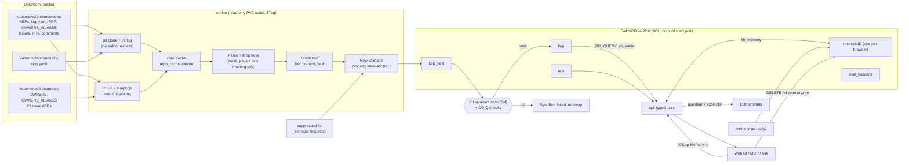

# KEP Brain · Data governance

| | |
|---|---|
| Status | Draft v1 (pre-kickoff note; Rule 8: no code, scripts or manifests in this file) |
| Date | 2026-10-12 (IST) |
| Owner | H-Data/Eval (template role; one person holds every role if the team is one) |
| Scope | Everything KEP Brain reads, stores, shows, hashes, strips, retains and deletes |
| Design sources | [01-recon](../design/01-recon-kubernetes-data.md) §3, §4, §5, §6.3, §9; [03-graph-model](../design/03-graph-model.md) §9 (G1-G4); ADR [0007](../design/adr/0007-ingestion-sources-git-clone-and-rest.md), [0011](../design/adr/0011-per-user-memory-graphs-not-graphiti.md), [0019](../design/adr/0019-data-scope-three-sigs.md), [0020](../design/adr/0020-personal-data-handling-rule-6.md); ADR 0017 and 0021 cited for hosting and write denylist |
| Stable IDs defined here | `TRD-DR-001`..`TRD-DR-014` (data requirements), `DG-Q-01`..`DG-Q-12` (data quality checks), `DG-OQ-01`..`DG-OQ-08` (open questions) |
| Decisions | Marked **DECISION (veto-able)** with the alternative. Counts are from the recon (2026-10-11) and are re-measured on Oct 15 (recon D12); they are not repeated as promises. |

## 1. Principles

1. Public data only. Nothing private, login-protected, paywalled, personal or otherwise restricted (hackathon Rule 6, wording re-read 2026-10-12 at https://www.wemakedevs.org/hackathons/falkordb/rules and recorded in the charter §12).
2. The GitHub login is the only person identifier. Names and companies come only from the public org chart (`sigs.yaml`) and sit behind one switch.
3. The graph is a rebuildable cache of upstream. Nothing in FalkorDB `kep` is authoritative; deleting it costs a reload, not data. Only `mem:*` and `ops` hold state that exists nowhere else.
4. Quote less, link more. Comment text is displayed as short attributed excerpts with a link to the original.
5. Every node carries `observed_at`/`fetched_at` so any row can be re-verified, purged or archived on request.

## 2. Data inventory

Upstream repositories and files, with licence, attribution and handling. Licence column was checked on 2026-10-12 against the GitHub licence endpoint (`GET /repos/kubernetes/{enhancements,community,kubernetes}/license` returned `spdx_id: Apache-2.0` for all three) and the `LICENSE` files:
- https://github.com/kubernetes/enhancements/blob/master/LICENSE
- https://github.com/kubernetes/community/blob/main/LICENSE
- https://github.com/kubernetes/kubernetes/blob/master/LICENSE

### 2.1 Inventory table

| ID | Source | Path / endpoint | Licence | Attribution and how we satisfy it | Fields stored (graph) | Stripped, hashed or never read | Fetch method (ADR 0007) |
|---|---|---|---|---|---|---|---|
| DS-01 | kubernetes/enhancements: KEP documents | `keps/<sig>/<dir>/README.md` (chunked into `Section`) | Apache-2.0 (repository content) | NOTICE crediting "The Kubernetes Authors"; each cited section links to the file at the ingested SHA; snapshot copy keeps the licence text | `Section.heading`, `Section.text` (scrubbed), position, `content_hash`, `observed_at`, source path + SHA | E-mail regex over text; `Signed-off-by`/`Co-authored-by` lines dropped; `mailto:` dropped | Local git clone, `git fetch`, parse at pinned `head_sha` |
| DS-02 | kubernetes/enhancements: KEP metadata | `keps/<sig>/<dir>/kep.yaml` | Apache-2.0 | As DS-01 | `KEP` (key = path, number, title, status, stage, milestones, feature gates, SIG links, `*_raw`, `metadata_invalid`), author/reviewer/approver logins as `Person` edges | Nothing beyond handles is in the file; commit e-mails never read | Clone; history via `git log -- <path>` reading `%H %at %ct %s` only |
| DS-03 | kubernetes/enhancements: production readiness | `keps/prod-readiness/<sig>/<n>.yaml` | Apache-2.0 | As DS-01 | PRR approver login, stage approvals | As DS-02 | Clone |
| DS-04 | kubernetes/enhancements: `OWNERS_ALIASES` | repo root | Apache-2.0 | As DS-01 | `Alias` nodes (`sig-<name>-leads`, `prod-readiness-approvers`, ...) and `MEMBER_OF` edges to logins | Nothing personal beyond handles | Clone |
| DS-05 | kubernetes/enhancements: tracking issues | Issues labelled `sig/<x>` + `kind/kep` (about 575 for the 3 SIGs) | **Not** the repo licence: author-owned user content on GitHub (see §3.2) | Each excerpt shows author login and links to the issue URL; NOTICE and README "Data statement" explain the basis; removal path (§3.4) | `Issue` (number, title, state, labels, milestone, `created_at`, `updated_at`, `closed_at`, author login, scrubbed `body`, URL), label/milestone events | E-mails scrubbed from title/body; no avatars, bios, locations, profile fields; `/users/{login}` never called | REST `issues?since=`, ETag; GraphQL `timelineItems` for label/milestone/cross-reference history |
| DS-06 | kubernetes/enhancements: PRs | About 1,600 KEP PRs for the 3 SIGs | As DS-05 | As DS-05 | `PullRequest` (number, title, state, merged_at, author login, scrubbed body, URL), changed paths, `Review` (state, reviewer login, scrubbed body) | As DS-05; commit trailers dropped | REST `pulls`, `pulls/{n}/files`, `pulls/{n}/reviews` |
| DS-07 | kubernetes/enhancements: comments | Issue and PR comments on DS-05/06 | As DS-05 | As DS-05; excerpt cap and link (TRD-DR-009) | `Comment` (id, author login, `created_at`, scrubbed `body`, URL) | As DS-05 | REST `issues/{n}/comments`; incremental via `issues/comments?since=` |
| DS-08 | kubernetes/community: org chart | `sigs.yaml` (24 SIGs, 9 working groups, 3 committees) | Apache-2.0 | As DS-01 | `SIG` (dir, name, label, mission scrubbed, charter link, public mailing-list group URL, Slack channel name, `archive_url`, `recordings_url`), `WorkingGroup`, `Committee`, `Subproject`, leadership edges with role; `Person.name`/`company` for leadership entries only while `KEPBRAIN_STORE_PERSON_NAME_COMPANY=true` | **Dropped at parse:** every `email` key (205 occurrences, 145 unique), every `private_mailing_list` (4), every meeting `url` (32 carry `pwd=`), `gb_rep.email`; e-mail regex over `mission_statement` and `calendar_url` | Contents API, raw media type, or clone |
| DS-09 | kubernetes/community: SIG charters (links only) | `sig-*/charter.md` | Apache-2.0 | Link only; not ingested in P0 | URL on `SIG` | Not fetched | none |
| DS-10 | kubernetes/kubernetes: root aliases | `OWNERS_ALIASES` (74 aliases, 154 unique handles) | Apache-2.0 | As DS-01; edges carry source path + SHA | `Alias` nodes and member logins | None beyond handles | Contents API |
| DS-11 | kubernetes/kubernetes: OWNERS files | The 95 `OWNERS` files labelled with a chosen SIG (of 578 non-vendor) | Apache-2.0 | As DS-01; `OwnersFile` node key = directory path | `OwnersFile`, `APPROVER`/`REVIEWER` edges to `Person` or `Alias`, `emeritus_approvers`, `no_parent_owners`, `filters_raw` (scrubbed) | None beyond handles | Raw URLs from `subprojects[].owners` and tree listing |
| DS-12 | kubernetes/kubernetes: issues and PRs (P1) | About 2,600 items that reference a tracking issue; P2 (all 8,510) out for the event | As DS-05 | As DS-05 | As DS-05/06/07, `source_repo = kubernetes/kubernetes` | As DS-05 | REST, same pacing; scope call at CP3 (CHR-OQ-11) |
| DS-13 | External links named in the data | Slack, Google Groups, Zoom, Google Docs (`see-also`) | n/a | Not fetched | `ExternalRef` URL only | Never fetched, never resolved | none |
| DS-14 | Kubernetes release dates | `kubernetes/kubernetes` releases | Apache-2.0 metadata | Cited by URL | `Release` (version, date) | none | REST releases |
| DS-15 | Users' own questions (memory) | `POST /v1/ask`, feedback | Created by the user; no third-party rights | Shown back to that user; see §6 | `mem:<ULID>`: `Session`, `Turn`, `Fact`, `Playbook`, `EntityRef` | No account, e-mail or IP stored; user id appears in logs only as SHA-256 prefix | Browser request |
| DS-16 | Evaluation questions, ground truth and runs | `evals/` (ours) | Ours (repository code licence MIT, hackathon-original work) | n/a | `EvalRun`, questions, answers, scores | Ground truth uses logins already in DS-02/04/11 | n/a |

Out of scope and never ingested: forks (for example `palnabarun/enhancements`), any `kubernetes-sigs/*` repository content beyond OWNERS files referenced from `sigs.yaml` for the 3 SIGs (ADR 0019 scopes graph content to the three named repositories; OWNERS in other orgs is a link only, **DECISION (veto-able)** pending DG-OQ-01), Slack, mailing-list archives, recordings, any non-public GitHub resource, any commit author or committer e-mail.

### 2.2 Person data model (what a `Person` can hold)

| Property | Source | Kept | Rationale |
|---|---|---|---|
| `login` (lower-cased) | GitHub handle in `kep.yaml`, OWNERS, `sigs.yaml`, issue/PR/comment author | Yes, always | The project's own public identifier; recon D2 |
| `name` | `sigs.yaml` leadership entries only | Switch `KEPBRAIN_STORE_PERSON_NAME_COMPANY` (default true) | Published org chart; the only field a reviewer could call personal |
| `company` | `sigs.yaml` leadership entries only (115 of 208 entries have one) | Same switch | Declared affiliation in the org chart; no inference from e-mail domain |
| anything else (e-mail, avatar URL, bio, location, social handles, phone, address, IP, meeting URL) | n/a | Never | Schema has no property for it (G1) |

"Who knows X" is a declared proxy (counts of approvals, reviews, comments), shown with its counts and never as a judgement of a person (charter CHR-ST-05).

## 3. Licences and terms: what each one lets us do

### 3.1 Repository content (Apache-2.0)

`kubernetes/enhancements`, `kubernetes/community` and `kubernetes/kubernetes` are Apache-2.0 (sources above). Apache-2.0 section 4 permits redistribution of copies with: a copy of the licence, retained copyright/attribution notices, and a statement of changes if modified. **Licence statement (stated once; README, `NOTICE` and `LICENSE` must agree, TST-189):** the repository's own code is MIT (`LICENSE`); the ingested Kubernetes data is Apache-2.0 and is credited in `NOTICE`. We satisfy section 4 by (a) shipping a `NOTICE` that references the Apache-2.0 text and credits "The Kubernetes Authors" and names the three source repositories and the pinned SHAs, (b) marking derived rows with source path and SHA, (c) stating in the README that graph rows are transformed (parsed, scrubbed, chunked) from the originals. Licence text: https://www.apache.org/licenses/LICENSE-2.0.

### 3.2 User-generated content (issues, PRs, comments, reviews)

Not repository files. Copyright stays with each author; the repository licence applies only to contributions the contributor agreed to licence under it (recon §9.1). Sources, quoted in the recon and linkable:
- GitHub Terms of Service, section D (User-Generated Content): https://docs.github.com/en/site-policy/github-terms/github-terms-of-service#d-user-generated-content ("You own content you create, but you allow us certain rights to it"; D.5 grants other users a licence to "use, display, perform and reproduce (by forking) Your Content through the Service as permitted by GitHub's functionality").
- GitHub Acceptable Use Policies section 7 (Information Usage Restrictions) and section 8 (Privacy): https://docs.github.com/en/site-policy/acceptable-use-policies/github-acceptable-use-policies. Section 7 excludes API collection from "scraping", allows use of public non-personal information for research if resulting publications are open access, and forbids using information for spamming. Section 8 requires that personal information be used only for the purpose the user authorised and that complaints and removal requests be answered promptly.
- Kubernetes contributions enter under the CNCF CLA (every sampled PR carried `cncf-cla: yes`).

Conclusion (not legal advice, **DECISION (veto-able)**, alternative in §3.3): we do not republish this content as a dataset. We read it through the official API under a read-only token, store it in a non-public FalkorDB for the purpose of answering questions about the project, and surface it only as short attributed excerpts with a link to the original. This is a use for the purpose of the project's own discussions, with a prompt removal path, which section 8 asks for.

### 3.3 Alternatives considered

| Alternative | Why not now |
|---|---|
| Publish the comment dataset (defensible under the open-access research clause) | Adds a takedown surface with no judging benefit (recon D11) |
| Ingest only repository files, no issues or comments | Loses the ticket and history layers that T03 needs ("why was this decided") |
| Quote full comments in answers | Higher copyright exposure; a link plus short excerpt serves the same judge check |

### 3.4 Removal and correction path

README "Data statement" gives an issue template/contact path. A request names a GitHub login, URL or text. Process: (1) record it in `docs/DECISIONS.md` without personal detail, (2) set `archived = true` on matching rows (login-level request: on the `Person` and every `Comment`/`Review` they authored) so the next sync excludes them from all tools, search and excerpts, (3) add the id to a `suppressed` list read by the writer so a re-sync does not recreate them (TRD-DR-012), (4) confirm in the issue. Target: honoured on the next scheduled sync (at most 15 minutes) and a full purge from the graph on the next blue/green rebuild. Once the schedule is frozen (after CP7, frozen snapshot mode) the operator runs a suppression sync instead (TRD-TR-073, TST-192); it re-applies the `suppressed` list without moving `head_sha`. Backups expire in 7 days, including the final decommission backup (OPS D11).

## 4. Data requirements (TRD-DR candidates)

These are the data-related requirements proposed for the TRD; the TRD may renumber and must keep the statements.

| ID | Requirement | Verification |
|---|---|---|
| TRD-DR-001 | The worker reads only repositories on an allow-list of exactly `kubernetes/enhancements`, `kubernetes/community`, `kubernetes/kubernetes`. A repository outside the list (including forks) is rejected before any request. | Unit test over the repo allow-list; DG-Q-10 |
| TRD-DR-002 | Ingestion is read-only against GitHub: a fine-grained PAT with read-only public-repository access, dedicated to the project (not a maintainer's), never baked into an image, never logged. No call to `/users/{login}`. No write verb is sent to any `kubernetes/*` repository (ADR 0021 denylist). | Request-log assertion in integration test; denylist test |
| TRD-DR-003 | All GitHub requests are serial (one in flight) and header-driven: read `X-RateLimit-Remaining`/`-Reset` after each response, sleep until reset when remaining is below a floor (default 200 of 5,000, **DECISION (veto-able)**), honour `Retry-After`, exponential backoff with jitter on 403/429/5xx. Limits quoted in the recon §6.3 from https://docs.github.com/en/rest/using-the-rest-api/rate-limits-for-the-rest-api and https://docs.github.com/en/graphql/overview/rate-limits-and-query-limits-for-the-graphql-api: REST 5,000 requests/hour, GraphQL 5,000 points/hour, secondary 900 points/minute REST and 2,000 points/minute GraphQL, search 30 requests/minute. | Fake-server test returning low-remaining and 429 headers; sync log shows sleeps |
| TRD-DR-004 | Conditional requests: store `ETag` and `since` cursor per list resource; send `If-None-Match`; a 304 does not count against the primary limit when authenticated (https://docs.github.com/en/rest/using-the-rest-api/best-practices-for-using-the-rest-api). `since` minus a 60 s overlap; merges are idempotent so overlap is harmless. | Replay test: second sync over unchanged fixture makes zero non-304 list calls |
| TRD-DR-005 | Raw-response cache: every response body used for a parse is kept on the `repo_cache` volume keyed by URL + ETag, so a rebuild or parser fix does not re-spend API budget. The cache is deletable; the clone is a cache (ADR 0007). | Rebuild from cache with the token removed produces an identical graph hash |
| TRD-DR-006 | GraphQL is used only for `timelineItems` history; at most 25 issues per query, cost read from the `rateLimit` field and logged; REST is not used for label history (recon §6.4: REST events omitted label events after 2022 on issue #1287). | Contract test on the tool list; GraphQL budget line in `SyncRun` |
| TRD-DR-007 | A public demo viewer never triggers an upstream call. Ask, Explore and Freshness read FalkorDB only; the "Data as of" chip shows `head_sha` and last successful `SyncRun`. | Network-egress test from `api` container: only the LLM provider host is reachable |
| TRD-DR-008 | The pipeline can pin the doc layer to a SHA (`KEPBRAIN_ENHANCEMENTS_PIN_SHA`) so published eval numbers are reproducible; the pinned SHA is shown on `/eval` and in the README. | Rebuild at pin yields the same node/edge counts |
| TRD-DR-009 | Display rule for user-generated text: an excerpt shows at most 400 characters (**DECISION (veto-able)**; alternative: 600), author login, date and a link to the original on GitHub; whole-comment export is not an API route. The repository contains no comment bodies (fixtures use synthetic text or short, attributed excerpts of 5 items at most). | Route list check; repo scan for `Comment` fixtures |
| TRD-DR-010 | Rule 6 guarantees G1-G4 of 03-graph-model §9 hold for every sync: property allow-list, un-mapped sensitive sources, scrub-before-hash, post-sync PII scan that fails the `SyncRun` and blocks the blue/green swap. | Fixture with planted addresses in every field type; scan reports zero hits on every `SyncRun` (charter PRD-G-07) |
| TRD-DR-011 | Provenance on every row: `source_repo`, `source_path` or URL, `source_sha` where applicable, `observed_at`/`fetched_at`, `content_hash` (of scrubbed text). | Schema test: provenance properties are `MANDATORY` where FalkorDB supports it, else checked by the writer |
| TRD-DR-012 | Suppression: a `suppressed` list (logins, URLs) is applied by the writer on every sync; suppressed rows are written `archived = true` and excluded by every tool intent. | Integration test: suppress a login, sync, tool output contains no row for it |
| TRD-DR-013 | Rebuild: full graph rebuild into `kep_next` and swap (`GRAPH.COPY`/rename blue-green, per ADR 0006/0017) from clone + cache in a documented time; the previous graph is kept until the new one passes the PII scan and DG-Q checks. | Runbook rehearsal at CP7 (`docs/RUNBOOK.md`) |
| TRD-DR-014 | Logs, traces and metrics carry no user text and no parameter values; user ids appear as a SHA-256 prefix only (ADR 0020). | Log-capture test during the load test |

## 5. Retention and rebuild

| Data | Where | Retention | Rebuild / loss |
|---|---|---|---|
| Git clone of `kubernetes/enhancements` | `repo_cache` volume | Until deleted; refreshed by `git fetch` | Re-clone (one clone) |
| Raw API cache | `repo_cache` volume | Until deleted or schema/parser change | Re-fetch within budget (below) |
| `kep` graph | FalkorDB (AOF) | Current head only plus derived history (`StatusChange`, label events) | Fully rebuildable; nightly backup is for speed, not for safety |
| `eval_baseline` graph | FalkorDB | Per frozen run | Rebuilt from the same fixtures |
| `ops` graph (tasks, leases, handoffs) | FalkorDB | Terminal tasks kept 7 days (**DECISION (veto-able)**; alternative 30) | Not rebuildable; in nightly backup |
| `mem:<ULID>` graphs | FalkorDB | See §6 | Not rebuildable by design; in nightly backup (see §6.5 on backup deletion) |
| Nightly backup (RDB/AOF dump) | VM disk then off-VM copy | 7 days (charter PRD-G-06, ADR 0017); the final private backup at decommission also 7 days (OPS D11) | Restore rehearsed at CP7 |
| `SyncRun` records | `kep` graph | Last 100 (**DECISION (veto-able)**) | n/a |
| LLM provider side | Anthropic API | Governed by the provider's terms; verify the retention setting for the key on Oct 15 (DG-OQ-04) | Out of our control |

Rebuild budget (INFERENCE from recon §6.3, re-measured Oct 15): the doc layer costs no API calls (git); tickets and chats fit inside one hour of a single-token budget with ETag caching on re-runs. If the Oct 15 measurement shows more comment volume than estimated, fall back to two SIGs (ADR 0019).

## 6. Per-user memory data (T02, ADR 0011)

### 6.1 What is stored

Graph `mem:<ULID>`: `Session`, `Turn` (question text, answer summary, tool names, timestamps), `Fact` (extracted interests with key, confidence, `last_seen`), `Playbook` (question kind plus ordered tool names, `success_count`), `EntityRef` (pointers to `kep` natural keys, no copies). No account, e-mail, IP or user agent. Memory is explicitly marked non-evidence when injected into the planner.

### 6.2 Isolation

| Mechanism | Detail |
|---|---|
| One graph per tenant | `select_graph("mem:" + id)`; no shared node or edge between tenants; no cross-graph join in any tool (ADR 0011) |
| Id validation | `^[0-9A-Z]{26}$` before any graph name is formed; the id never goes through string-built Cypher except as the graph name after validation |
| Credential separation | `kb_memory` ACL user may write only `mem:*`; `kb_reader` (all LLM-influenced reads) has `GRAPH.RO_QUERY` on `kep` only and no access to `mem:*`; the memory read for planning is done by `api` code, never by an LLM-callable tool |
| No enumeration | No route lists memory ids; `GRAPH.LIST` is reachable only by the `memory-gc` worker credential |
| No LLM tool takes a memory id | The id comes from the header, not from model output, so prompt injection cannot select another tenant's graph |
| Isolation test (TST candidate) | Two ids; write a distinctive fact in A; assert B's recall, B's `GET /v1/memory/me` and B's answers never contain it; repeat with 50 ids in the load test; try a malformed and a foreign id in a tool argument and assert rejection |

The id is a random key to non-personal memory, not an authentication credential (architecture §4.1). Anyone holding an id can read that memory; the id is shown only in that browser. **DECISION (veto-able):** no stronger auth for the demo; alternative: signed id (HMAC) so ids cannot be guessed or forged, which adds a server secret but little at the 80 random bits of a client ULID (the other 48 bits are a timestamp; 128 bits only for server-minted ids, TRD-SR-002) entropy for a time-ordered id (ULIDs are 48 bits time plus 80 bits random). Because ULIDs are time-prefixed, guessing is harder than a counter but easier than a UUIDv4; a signed id is the cheap upgrade (DG-OQ-03).

### 6.3 Deletion

- User-initiated: Memory page "Forget everything" calls `DELETE /v1/memory/me`, which deletes the graph (`GRAPH.DELETE mem:<id>`) as `kb_memory` and returns 204. "New identity" is client-side only (new ULID; the old graph is left to expire) and the page offers to delete the old one first.
- Selective deletion: Memory page can delete a single `Turn`, `Fact` or `Playbook` (TRD-DR candidate, P2, **DECISION (veto-able)**; alternative: all-or-nothing delete only).
- Automatic: see §7.
- Backups: a deleted graph persists in backups for at most the 7-day backup retention. Stated on the Memory page and in the README (DG-OQ-06 asks whether to exclude `mem:*` from backups; default is include, because T02 durability is a judged feature).

### 6.4 No cross-user leakage in derived data

Analytics (`algo.pageRank`, communities) run on `kep`/`ops` only. Aggregate usage metrics count requests, not content. The eval harness and judge page use synthetic ids. Playbooks are per-tenant; no global learning from tenants' questions in the event build (**DECISION (veto-able)**; alternative: opt-in global playbooks after the event).

### 6.5 Prompt and provider exposure

User questions and retrieved excerpts go to the LLM provider (Anthropic by default; claude-sonnet-5-5 answering, claude-haiku-5-5 extraction; open item CHR-OQ-01). The Ask page footer says so. Memory facts extracted by Haiku are inferred from the user's own questions only. No user text is sent to a third-party analytics service (none is used).

## 7. Demo-session policy (no sign-up)

| Aspect | Policy |
|---|---|
| Entry | No sign-up, no login, no cookie. A first visit creates a ULID in the browser (`localStorage`) and shows a one-line notice: what is stored, for how long, where to delete it |
| Graph creation | Lazy: `mem:<id>` is created on the first write after a validated answer, not on page load. A visitor who only browses Explore creates nothing. Requests without `X-Kep-Memory-Id` get no recall and no memory write (Ask still works) |
| Anonymous cap | Maximum concurrent memory graphs: 2,000 (**DECISION (veto-able)**; derived from the 50-user load test with margin, not measured); above the cap new ids get stateless Ask with a banner. Per-graph cap: 500 `Turn` nodes and 8 MB equivalent (`GRAPH.MEMORY USAGE`), oldest `Turn` evicted first |
| Rate limits | 30 asks per 10 minutes per memory id (architecture §11.4, `rate_limited` 429 with `Retry-After`) plus a global per-IP bucket in Caddy/API for requests without an id (IP not stored beyond the in-memory bucket) |
| Judge path | `/judge` uses a fresh id per browser like everyone else (no shared id), so judges also see isolation. The first four questions go through the normal Ask path with no special storage |
| Expiry | `memory-gc` runs daily. (a) `Turn` older than 90 days deleted (ADR 0011). (b) **DECISION (veto-able):** a graph with no write or read in 14 days is dropped whole; alternative: keep 90 days idle as in ADR 0011 (less privacy-protective, no benefit for judges who revisit within the judging window of unknown length, see DG-OQ-05). Last-activity is an `activity` property on the graph's single `Session` root, updated on each write and each `GET /v1/memory/me`. (c) Empty graphs (no `Turn`) older than 24 hours dropped |
| Judging window | Results date unpublished (charter CHR-OQ-08). Until it is known, the idle expiry is raised to 30 days from Oct 18 until the results date (a config value, recorded in `docs/DECISIONS.md`), so a judge returning later still finds their session |
| Visibility | The Memory page shows everything stored for that id, the expiry date and the delete button; the same data is available as JSON from `GET /v1/memory/me` |
| Abuse | Question length 3..1000 characters; rejection of ids that fail the regex; per-graph and global caps above; no free-text field that is rendered unescaped to other users (there is no cross-user display) |
| Shared state | `ops` (tasks, leases) is global and demo-seeded; it contains agent ids, never user ids |

## 8. Data quality checks

Run after every sync as part of `SyncRun`; a check marked **block** fails the run and prevents the swap, **warn** is recorded and shown on Freshness.

| ID | Check | Severity | Source of the expectation |
|---|---|---|---|
| DG-Q-01 | Every in-scope `kep.yaml` parses or is recorded with `metadata_invalid = true` and its `*_raw` values; zero silent drops (recon: 684 of 686 parseable, 11 invalid enum values) | block on silent drop, warn on invalid | recon §3.4, §3.5, D5 |
| DG-Q-02 | KEP count per chosen SIG matches `git ls-tree` count at `head_sha` (recon 139 / 58 / 35 on 2026-10-11, re-measured Oct 15) | block | recon §3.6 |
| DG-Q-03 | Key uniqueness: `KEP.key` (path) unique; `kep-number` collisions (2133, 0000) do not merge nodes; person key unique after lower-casing | block | recon D1, D2 |
| DG-Q-04 | Referential integrity: `replaces`/`superseded-by`/`see-also` resolve by path, old filename, bare number, else `ExternalRef`; unresolved share reported | warn | recon D6 |
| DG-Q-05 | One-sided supersession flagged (46 `replaces` vs 2 real `superseded-by` in recon) and inverse edge derived | warn | recon D7 |
| DG-Q-06 | Tracking label vs `kep.yaml` contradictions counted and surfaced on Freshness (for example gang scheduling 4671) | info | recon §8.6 |
| DG-Q-07 | Label/milestone history parity: for a sample of 20 tracking issues the count of label events from GraphQL is at least the REST count; issue #1287 returns 96 label events | warn | recon §6.4 |
| DG-Q-08 | OWNERS: the 95 labelled files parse with zero failures; every alias reference resolves to `OWNERS_ALIASES` or a handle | block on parse failure | recon §5.2 |
| DG-Q-09 | Dates: no `created_at` after `observed_at`; `StatusChange` events in non-decreasing order per KEP | warn | model |
| DG-Q-10 | Provenance: every row has source, `observed_at`; every `source_repo` is on the allow-list; no node from a fork | block | TRD-DR-001, 011 |
| DG-Q-11 | PII invariant scan (G4): zero e-mail matches in any text property; zero forbidden property keys in `db.propertyKeys()` | block | 03 §9 |
| DG-Q-12 | Hash stability: re-running the sync on the same SHA and cache changes no `content_hash` and creates no nodes | warn | TRD-DR-005, 008 |

Freshness SLO: "Data as of" chip no more than 30 minutes behind upstream head in steady state (charter CHR-SC-11, TRD-NFR-027); after CP7 the chip reads "frozen snapshot" and no lag applies.

## 9. Rule 6 compliance argument a judge can check

Claim: all data in the system is public, no e-mail or other personal detail beyond public handles and declared org-chart affiliations is stored, and nothing login-gated is accessed.

| # | Assertion | How a judge checks it in under five minutes |
|---|---|---|
| 1 | Only three public Apache-2.0 repositories are read | Open the three LICENSE links in §2; open README "Data statement" and `NOTICE`; allow-list is a constant in the settings module; `/about` lists source repos and pinned SHAs |
| 2 | No e-mail is stored | Property list: `GET /v1/schema` (or the schema table in 03-graph-model) shows no `email` property; Explore on any `Person` shows login (and name/company for leaders) only; ask "what is the e-mail of sig-node's chair" and see the refusal |
| 3 | Sources that carry e-mails are not mapped | Compare `sigs.yaml` upstream (205 e-mail strings) to the tool output for `SIG sig-node`; nothing matches |
| 4 | Scrubber is backstopped | CI shows the Hypothesis scrubber test and the planted-address integration test green; every `SyncRun` on Freshness shows `pii_scan: 0 hits` |
| 5 | Nothing login-gated is fetched | `ExternalRef` nodes hold URLs only; the worker's network log (sample in `docs/`) lists only `api.github.com`, `github.com` (clone) and the LLM host; Slack, Google and Zoom hosts never appear |
| 6 | Free of private or personal repositories | Fine-grained PAT is read-only for public repositories; allow-list refuses any other repo |
| 7 | User data is the user's own and deletable | Memory page lists everything stored; delete button; `DELETE /v1/memory/me` returns 204 and the page then shows empty |
| 8 | Comment text is not redistributed | `git grep` for comment bodies in the repository finds none; `/v1` has no bulk export route |
| 9 | Removal works | README path; the `suppressed` mechanism has an integration test |

Caveats stated honestly in the README: GitHub logins and display names are personal data in a broad legal sense even when public; we minimise them (TRD-DR section 4), make the name/company switch available, and provide a removal path. Whether public GitHub logins satisfy "strip personal details" is a judgement the organisers have not defined; the argument rests on Rule 6's public-data permission and the organisers' own use of public datasets in comparable events (not verified; DG-OQ-07).

## 10. Data-flow diagram

Trust boundaries: Upstream to Worker (untrusted text, scrubbed and validated); Worker to FalkorDB (writer credential, write-only to `kep_next`); API to FalkorDB (read-only credentials for LLM-influenced paths); Browser to API (anonymous, id from header only); API to LLM provider (user text leaves our system).

## 11. Open questions

| ID | Question | Default until answered |
|---|---|---|
| DG-OQ-01 | Are OWNERS files referenced from `sigs.yaml` that live outside the three source repositories (for example `kubernetes-sigs/*`) ingested? | No; stored as links only (Apache-2.0 repos but outside the stated allow-list) |
| DG-OQ-02 | Keep `Person.name`/`company` (charter CHR-OQ-10)? | Keep behind the switch; decide before CP4 |
| DG-OQ-03 | Sign the memory id (HMAC) to prevent guessing/forging? | No for the event; revisit if time remains |
| DG-OQ-04 | LLM provider data-retention/training setting for the key | Verify in the console on Oct 15 and state on `/about` |
| DG-OQ-05 | Idle expiry for anonymous memory graphs: 14 days (default), 30 days during judging, or 90 as in ADR 0011 | As in §7 |
| DG-OQ-06 | Exclude `mem:*` from backups? | Include; disclose 7-day lag on deletion |
| DG-OQ-07 | Do organisers read Rule 6 to allow public logins and org-chart names? | Assume yes; ask in the hackathon Discord on Oct 15; switch to logins-only if told otherwise |
| DG-OQ-08 | Excerpt length cap (400 characters) and fixture policy for comments | 400; synthetic fixtures |

Veto-able decisions introduced here: rate-limit floor (TRD-DR-003), excerpt cap (TRD-DR-009), `ops` retention 7 days, `SyncRun` keep 100, memory graph caps and 14-day idle expiry (extended during judging), per-item memory deletion, per-tenant playbooks only, OWNERS outside the three repos as links only.
