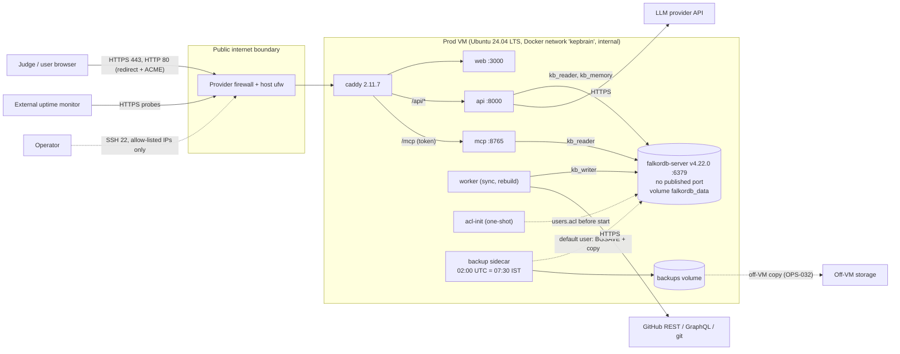
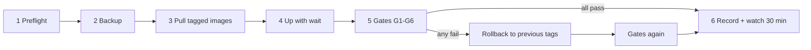

# KEP Brain · Deployment and operations

## 0. Document control
| | |
|---|---|
| Document | `docs/ops/deployment-and-operations.md` |
| Status | v0.1 draft for team sign-off (H-Lead). Pre-kickoff note (Rule 8 allows notes and diagrams before 2026-10-15 00:01 IST). It describes procedures in prose; it contains no code, scripts or manifests. |
| Date | 2026-10-12 (IST) |
| Owner | H-Lead. Operator roles are the template of `06-build-plan.md` §3.2 (H-Lead, H-Review, H-Data/Eval, H-Demo); one person holds every role if the team is alone. |
| Upstream | `docs/product/PRD.md` (PRD-G-02, G-03, G-06, G-07, FR-004, FR-007, FR-008, FR-016, FR-074, FR-075, FR-076), `docs/product/project-charter.md` (CHR-B-01..06, CHR-C-06..08, CHR-GOV-05, CHR-SC-11, CHR-SC-13), ADR 0017 (deployment), ADR 0015 (config, secrets, logging, health), ADR 0008 (upserts, rebuild), ADR 0002 (FalkorDB pin and ACL), ADR 0010 (LLM adapter), ADR 0020 (personal data), ADR 0021 (action safety) |
| Length cap | 500 lines |

**Identifiers.** `OPS-nnn` are operational requirements, each with a verification. Anything the sources leave open is marked **DECISION (veto-able)** with its alternative and collected in §14. Where this document departs from ADR 0017 it says so (D1, D2 in §14); the ADR is not edited. D1 and D2 are decided here and recorded in `docs/DECISIONS.md` on Oct 14 (TRD, test plan and charter follow). Risks live in `docs/ops/risk-register.md` (`RSK-*`).

**Defaults when the user has not decided:** LLM = Anthropic `claude-sonnet-5-5` (answering) and `claude-haiku-5-5` (extraction); team = 1-4 people; hosting = one VM, Docker Compose, Caddy (ADR 0017).

## 1. Topology

| Boundary | Rule |
|---|---|
| Public | Only Caddy, ports 80 and 443. `web`, `api`, `mcp`, `worker`, `backup` and FalkorDB have no `ports:` entries in the production Compose file. |
| Docker-internal | Network `kepbrain` only. FalkorDB listens on 6379 inside it; ports 6379 and 5432 are never used on any host (CHR-C-08). |
| Outbound | `api` to the LLM provider; `worker` to GitHub (git, REST, GraphQL); backup to the off-VM target; Caddy to Let's Encrypt. No other egress is needed. |
| Operator | SSH from allow-listed IPs only (OPS-009); provider web console as break-glass. |

| Id | Requirement | Verification |
|---|---|---|
| OPS-001 | Production topology is exactly the Compose services of `02-architecture.md` §13.3: `acl-init`, `falkordb`, `api`, `worker`, `mcp`, `web`, `caddy`, `backup`; FalkorDB is the only datastore (PRD-FR-072). | `docker compose config` lists no other image; CI no-second-store test (ADR 0016). |
| OPS-002 | Image `falkordb/falkordb-server:v4.22.0` (server only) in production; the Browser image is dev only. FalkorDB docs: "For production environments, use the server-only image with data persistence" (https://docs.falkordb.com/operations/docker). | Image tag in the deployed Compose file. |
| OPS-003 | All application images are pulled from GHCR by `sha-<short>` tag, never `latest`. | Deploy record (§5) lists tags. |

## 2. Environment matrix
| Aspect | Dev (Windows 11, Docker Desktop) | CI (GitHub Actions) | Judge-local (clean machine) | Production (VM) |
|---|---|---|---|---|
| Purpose | Build, debug | Tests, gitleaks, compose-up job (ADR 0016) | `docker compose up --build --wait` yields a loaded graph without a token (PRD-FR-051) | Public live demo (PRD-G-06) |
| Compose file | `deploy/compose.dev.yaml` | same stack, ephemeral | dev overlay | `deploy/compose.prod.yaml` |
| FalkorDB image | `falkordb/falkordb:v4.22.0` (Browser on 3000) | pinned server image | as dev | `falkordb-server:v4.22.0` |
| Host ports | 6380 (db), 3001 (Browser), loopback, as `docker-compose.yml` and ADR-0002/0003; never 6379 or 5432 | none | loopback only | 80, 443 (Caddy) |
| `maxmemory` | 1 GB | 1 GB | 1 GB | 3 GB, `noeviction` |
| Data | Cached Apache-2.0 doc layer; ticket layer only with a token | fixture subset | cached doc layer, zero API calls (PRD-FR-001) | full P0 ticket layer (PRD-FR-002) |
| GitHub token | dev fine-grained PAT, read-only | none | none | prod PAT, separate from dev (OPS-016) |
| LLM key | dev key under the shared cap | none (mocked) | none: Explore, Freshness and Eval work; Ask shows the degraded banner | prod key under the cap (OPS-056) |
| TLS | none | none | none | Caddy + Let's Encrypt |
| Backups | none | none | none | nightly + pre-deploy + pre-rebuild |
| Config source | `.env` (dev only, ADR 0015) | encrypted Actions secrets | `.env.example` defaults | `/opt/kepbrain/.env`, root-owned, mode 600 |

There is no separate staging VM (one-VM budget, CHR-B-05). The pre-production gate is a full compose-up in CI plus the post-deploy gates of §5; graph changes use blue/green `kep_next` (ADR 0008).

| Id | Requirement | Verification |
|---|---|---|
| OPS-004 | The same Compose service names, images and healthchecks run in dev, CI and prod; differences are limited to the rows above. | Review of the Compose files at CP4. |
| OPS-005 | A judge-local start requires no secret; features that need one degrade with a visible banner (PRD-FR-040). | CP4 clean-machine test. |

## 3. Provisioning
### 3.1 VM sizing from the graph scale
Inputs: core graph 21-25k nodes and 30-35k edges and full graph (P0+P1) 55-60k nodes and about 100k edges (`02` §9.6; INFERENCE). `03` §16 estimates the core at about 30k nodes and 60k edges instead; the design documents disagree and neither is measured (RSK-012). Sizing below uses the larger full-graph figure and is replaced by the counts and `GRAPH.MEMORY USAGE kep` measured on Oct 15. README text 5.9 + 2.8 + 1.3 = 10.0 MB (`01-recon` §3.11, VERIFIED). Comments and reviews 37,000 in the full graph. Vector blocks about 3,000 (charter A7). Embedding width 1,024 (charter timeline note on `04` E10).

| Component of the FalkorDB dataset (full graph) | Arithmetic | MB |
|---|---|---:|
| Section text | measured | 10 |
| Comment and review text | 37,000 x 2 KB (ASSUMPTION, deliberately high; no per-comment size was measured) | 74 |
| Node structure and properties | 60,000 x 0.5 KB (ASSUMPTION) | 30 |
| Edge structure and properties | 105,000 x 0.2 KB (ASSUMPTION) | 21 |
| Vector index | 3,000 x 1,024 x 4 B = 12.3 MB | 12 |
| Full-text index | about 1 x text = 10 + 74 (ASSUMPTION) | 84 |
| **Sum** | | **231** |

`02-architecture.md` §15 plans for 600 MB, a 2.6x margin over the sum (600 / 231). This document uses **600 MB** as the steady-state figure and records `GRAPH.MEMORY USAGE kep` after every sync (https://docs.falkordb.com/commands/graph.memory).

| Peak case | Arithmetic | GB |
|---|---|---:|
| Steady state | | 0.6 |
| Blue/green rebuild (`kep` and `kep_next` resident, ADR 0008 consequence) | 2 x 0.6 | 1.2 |
| Rebuild plus snapshot fork, worst case if every page is rewritten while the fork lives (general copy-on-write behaviour; FalkorDB docs only say "RDB forking can be slow on large datasets and may cause brief latency spikes", https://docs.falkordb.com/operations/durability) | 1.2 + 1.2 | 2.4 |

| VM memory budget (GB) | 4 GB class (ADR 0017) | 8 GB class (D1) |
|---|---:|---:|
| OS, Docker daemon, page cache (ASSUMPTION) | 0.6 | 0.6 |
| `caddy` 0.1 + `web` 0.3 + `api` 0.4 + `mcp` 0.2 + `worker` 0.5 + `backup` 0.05 (working-set ASSUMPTIONS inside the ADR's 512 MB-1 GB limits) | 1.55 | 1.55 |
| FalkorDB, steady | 0.6 | 0.6 |
| Total steady | **2.75 (69 %)** | **2.75 (34 %)** |
| Total with FalkorDB at rebuild (1.2) | 3.35 (84 %) | 3.35 (42 %) |
| Total with rebuild plus worst-case fork (2.4) | **4.55 (114 %, out-of-memory kill likely)** | 4.55 (57 %) |

The 4 GB class of ADR 0017 fits steady state and a rebuild but not a rebuild during a snapshot fork; the ADR's `falkordb` limit of 3.5 GB would also leave 0.5 GB for the OS and six other containers. **DECISION D1 (decided, veto-able):** provision the next size up, 4 vCPU / 8 GB / at least 80 GB NVMe, keep the ADR's `maxmemory 3gb`, `noeviction` and `THREAD_COUNT 3`, and set the `falkordb` container limit to 4.5 GB. TRD-TR-068/069, charter A8 and CHR-B-05 follow. Prices were not readable on the provider page on 2026-10-12 (charter A8, UNVERIFIED): if the console price breaks CHR-B-05's EUR 40 ceiling on Oct 14, the 4 GB alternative below is taken automatically. Alternative: stay on 4 GB with rules R1-R3: rebuild only when no deploy or backup is running; `falkordb` limit 2.5 GB with `maxmemory 2gb`; no rebuild after CP6.

Disk (80 GB):

| Item | Arithmetic | GB |
|---|---|---:|
| OS and Docker engine | ASSUMPTION | 10 |
| Images: six application images about 0.5 GB each, current plus two previous tags | 6 x 0.5 x 3 | 9 |
| `repo_cache` | `01-recon` measured cache 121 MB | 0.1 |
| `falkordb_data`: RDB 0.25 + AOF up to 2x during rewrite 0.5 | | 0.75 |
| `backups`: 7 nightly x (RDB 0.25 + AOF 0.5) = 5.25, plus 5 retained pre-deploy/pre-rebuild x 0.75 = 3.75 | | 9 |
| Container logs: 8 services x 3 files x 10 MB | | 0.24 |
| **Total** | | **about 29 (36 %)** |

| Id | Requirement | Verification |
|---|---|---|
| OPS-006 | Provision per D1 (or the 4 GB alternative with R1-R3), Ubuntu 24.04 LTS, Docker Engine with the Compose plugin, in the region nearest the expected judges, chosen Oct 14. | VM spec in `docs/DECISIONS.md`. |
| OPS-007 | FalkorDB settings: `REDIS_ARGS` = `--aclfile /var/lib/falkordb/data/users.acl --appendonly yes --appendfsync everysec --save 300 10 --maxmemory 3gb --maxmemory-policy noeviction`; `FALKORDB_ARGS` = `THREAD_COUNT 3 CACHE_SIZE 200 TIMEOUT_MAX 60000 TIMEOUT_DEFAULT 5000 QUERY_MEM_CAPACITY 268435456 RESULTSET_SIZE 20000 MAX_QUEUED_QUERIES 45` (TRD-SR-019; `02` §4.5 has 500). The docs' `allkeys-lru` example is not used because it would evict whole graphs. | Settings read back with `CONFIG GET`. |

### 3.2 Hardening and firewall
| Id | Requirement | Verification |
|---|---|---|
| OPS-008 | SSH: key authentication only, password and root login disabled, one named account per operator, no shared key. | `sshd -T` review; password login fails. |
| OPS-009 | SSH reachable only from operator IPs. **DECISION D2 (decided, veto-able):** port 22 is closed to the public internet at the provider firewall and allow-listed to the operators' current IPs, edited in the console when an IP changes; the provider web console is the break-glass path. Deploys are therefore operator-run over SSH, not the GitHub Actions `workflow_dispatch` job of ADR 0017 (hosted runners have no stable IPs); Actions builds and pushes images only and holds no SSH key (TRD-SR-033, TST-188). Alternative: ADR 0017's public port 22 with key-only login and `fail2ban`, which keeps the Actions deploy but breaks "only 80/443 public". | Outside scan (OPS-011). |
| OPS-010 | Unattended security updates on; one manual full update on Oct 14; no kernel or Docker engine upgrade after CP6 (reboots are an SLO risk). | Update log; freeze rule §11. |
| OPS-011 | Two firewall layers: provider firewall (default deny inbound; allow 80 and 443 from anywhere, 22 per OPS-009) and host `ufw` with the same rules. `ufw` alone is not enough: Docker publishes ports through its own iptables rules, which is why only Caddy may publish. | After every deploy a scan from outside the VM (phone hotspot or CI runner) shows 80 and 443 only; `ss -ltn` on the host shows no listener for 6379, 8000, 8765 or 3000 on a public address. |
| OPS-012 | FalkorDB is never exposed: no `ports:`, no host network mode, password and five ACL users (`default`, `kb_reader`, `kb_memory`, `kb_writer`, `kb_ops`; `02` §4.5, TRD-SR-049); `kb_reader` limited to `GRAPH.RO_QUERY` (PRD-FR-074). | Compose review; from outside, 6379 on the VM IP times out. |
| OPS-013 | Caddy: HSTS, gzip, `X-Request-ID` when missing, 503 page driven by Caddy's active health check on the `api` upstream (internal `/ready`; `/health`, `/ready`, `/healthz` are not routed publicly, TRD-SR-026). Admin and MCP tokens are required on `/v1/sync/run`, MCP and every write route; one sync at a time (a request while a Task is claimed returns the existing Task). | Header check; unauthenticated MCP call rejected (CP4). |
| OPS-014 | Containers run non-root where the image allows, `restart: unless-stopped`, memory limits, `json-file` rotation 10 MB x 3. | `docker inspect` review. |

### 3.3 DNS and TLS
Caddy obtains Let's Encrypt certificates automatically (ADR 0017). It needs an A record to the VM, ports 80 and 443 reachable, and a persistent `caddy_data` volume (losing it forces re-issuance and consumes Let's Encrypt rate limits, which matter most for the `<ip>.sslip.io` fallback, `02` §13.2).

| Id | Requirement | Verification |
|---|---|---|
| OPS-015 | Domain registered or reused Oct 14-15 with DNS TTL 300 s until the freeze. A second hostname (the `sslip.io` name of the VM IP) gets a certificate issued on Oct 16, so a hostname swap in the README is the TLS-failure fallback (§8.6). | Both hostnames serve valid certificates before CP4. |

## 4. Secrets handling
Rules from ADR 0015: environment only; production `.env` root-owned mode 600; no secrets in images, logs or traces; the ACL file stores hashes; `gitleaks` on every PR; structlog drops known key names and configured secret values.

| Secret | Holder | Scope and limit | Rotation or expiry |
|---|---|---|---|
| LLM provider key (Anthropic) | prod `.env`; a different key for dev and for the eval harness | Prod/dev key: cap $80; the eval key has its own $70 cap, so total exposure is $150 (CHR-B-06, OPS-056) | Revoke at the provider first on any leak |
| Fallback LLM key (OpenAI-compatible, ADR 0010) | prod `.env`, only if D4 is yes | Own cap; pricing UNVERIFIED | as above |
| GitHub PAT, prod worker | prod `.env` | Fine-grained, read-only, public repositories (charter ST-05); never a maintainer's. Expiry set past the retention date (OPS-061) | Regenerate, restart `worker` |
| GitHub PAT, dev worker | dev `.env` | As above. The primary limit is a "personal rate limit of 5,000 requests per hour" (`01-recon` §6.3), so two tokens of one account very probably share one budget (INFERENCE) | |
| Demo-actions PAT | prod `.env` | Write on `<team>/kep-brain-demo-actions` only; the ADR 0021 denylist still refuses `kubernetes/*` | Revoke when T01 judging ends |
| FalkorDB passwords (`default`, `kb_reader`, `kb_memory`, `kb_writer`, `kb_ops`) | prod `.env`; hashed in `users.acl` | Random, at least 24 characters | Change env, re-run `acl-init`, restart dependents (`02` §11.2) |
| MCP token, admin token | prod `.env` | Distinct values; the MCP token is published read-only and rate-limited (D5, TRD-SR-006); the admin token never | Change env, restart `mcp` and `api` |
| SSH keys, GHCR pull token, off-VM storage credential, monitor webhook | operator machines, VM | Least privilege; pull token read-only | At decommission |

| Id | Requirement | Verification |
|---|---|---|
| OPS-016 | Dev and prod use different GitHub PATs and different LLM keys. Because the GitHub budget is per account, dev full-loads and the prod initial load are sequenced, never concurrent (§6.1). | Secret inventory kept by H-Lead outside the repository: name, holder, scope, expiry. |
| OPS-017 | Backups contain no secrets: they copy `dump.rdb` and `appendonlydir/`, not `users.acl`; the graph holds no e-mails (PRD-FR-005). | Archive listing at the drill. |
| OPS-018 | Leak response: revoke at the provider, rotate, check provider usage for the exposure window, record in `docs/DECISIONS.md`; rewrite public history only as a last resort and with H-Lead. | Tabletop (OPS-055). |
| OPS-019 | The production `.env` is never committed, pasted into chat or printed in CI; the deploy record lists variable names only. | `gitleaks` green; record review. |

## 5. Deploy and rollback
Deploys are operator-run (D2). One deploy, one operator, one witness (H-Review; the same person if alone, with the checklist ticked in writing).

| Step | What happens |
|---|---|
| 1 Preflight | CI green on the commit; tags `sha-<short>` exist in GHCR; `gitleaks` green; disk below 70 %; no sync or rebuild running (`/v1/sync/status`); not inside a freeze (§11); one-line release note per change (from `docs/AI_USAGE.md` rows). |
| 2 Backup | Manual backup per OPS-030; record the folder name. This is the data rollback point. |
| 3 Pull | Pull the new tags; keep the previous two on disk. |
| 4 Up | Start the stack, Compose waiting for healthchecks. Order is fixed by `depends_on`: `acl-init`, `falkordb` healthy, `api`/`worker`/`mcp`, `web`, `caddy`. |
| 5 Gates | G1-G6 within 10 minutes of `up`. |
| 6 Record | Deploy record: time, operator, old and new tags, backup folder, gate results, request ids of gate calls. Watch the error rate for 30 minutes. |

| Gate | Check |
|---|---|
| G1 | All containers running and healthy; no restart-count increase in 5 minutes |
| G2 | web root 200 and `/api/v1/meta` 200 through Caddy (the monitor's routes); `/ready` 200 from inside the Docker network (`compose exec`); `kep` graph populated (ADR 0015) |
| G3 | Graph integrity: `kep` node count not below the previous `SyncRun`; constraints `OPERATIONAL` |
| G4 | Judge path without the LLM: a KEP, person and SIG page render; Freshness lists contradictions including KEP-583 |
| G5 | Judge path with the LLM: OWN-01 returns `abstained: false` with resolving evidence ids; ABS-05 returns `abstained: true`, `no_evidence`; `path` and `citation` events precede `token` (PRD-FR-014) |
| G6 | Edge: HTTPS valid with HSTS; MCP call without a token rejected; outside scan shows 80 and 443 only (OPS-011); external `/ready` and `/health` return the web 404 (TRD-SR-026) |

| Id | Requirement | Verification |
|---|---|---|
| OPS-020 | Every production deploy runs steps 1-6 and gates G1-G6; a deploy without a recorded backup or recorded gates counts as not done. | Deploy record reviewed by H-Review before the next deploy. |
| OPS-021 | **Rollback triggers:** a gate fails and is not explained within 10 minutes; error rate above 5 % of requests for 5 minutes in the 30-minute watch; `/ready` 503 (compose healthcheck or the Caddy upstream check) for more than 2 minutes outside a rebuild. The operator rolls back first and investigates afterwards. | Drill at the first production deploy (Oct 16: roll forward, back, forward). |
| OPS-022 | **Code rollback:** point Compose at the previous tags and bring the stack up; the previous two tags stay on disk; target 5 minutes. | Gates after rollback. |
| OPS-023 | **Data rollback** (only if a sync or rebuild corrupted the graph): restore per §6.5 from the step-2 backup. `SyncCursor` lives in the graph, so it travels with the data and the next sync catches up (`02` §13.4). | Restore drill (OPS-034). |
| OPS-024 | Config-only changes (Caddyfile, `.env`) follow the same steps; a secret change also follows §4 rotation. | Deploy record. |
| OPS-025 | At most one deploy per hour, and none within 60 minutes before a go/no-go (CP4 Oct 16 21:00, CP5 Oct 17 13:00, CP6 Oct 17 22:00, CP7 Oct 18 12:00) unless it is the checkpoint deploy itself. | Record timestamps. |

## 6. Data lifecycle
### 6.1 Initial ingestion
Order on Oct 16 (CP4 target 21:00; times veto-able):

1. Provision and harden the VM, issue certificates, start FalkorDB with ACL and the full stack on an empty graph (Oct 16 morning, earlier if the template stack is up on Oct 15).
2. Run the full load on the VM with the prod PAT (`kepbrain rebuild`, ADR 0008): document layer from the git tree with no API calls (PRD-FR-001), then P0 tracking issues, enhancements PRs and GraphQL `timelineItems`. Budget (`02` §9.4, INFERENCE): about 1,400 + 500 = 1,900 GraphQL points and 4,000-4,500 REST requests against 5,000 per hour each, so roughly one hour of paced requests. The worker sleeps when `remaining < 200` (TRD-DR-003).
3. No full load on dev during that hour (OPS-016).
4. Verify against the CP1 and CP3 smoke tests: zero PII hits on the `SyncRun`, constraints `OPERATIONAL`, counts versus the dev graph.

| Id | Requirement | Verification |
|---|---|---|
| OPS-026 | **DECISION D6 (veto-able):** the initial prod load runs on the VM, not from a dev dump. Fallback if it exceeds 90 minutes or fails twice: restore the latest dev `dump.rdb` into the prod volume (§6.5) and run an incremental sync. Alternative: always ship the dev snapshot (fastest, but the prod worker path stays untested until the first scheduled sync). | `SyncRun` with counts, duration, requests, memory, PII result (PRD-FR-007). |
| OPS-027 | The load is idempotent and resumable: a failed run keeps cursors (PRD-FR-008); re-running is a no-op if upstream is unchanged (PRD-FR-004). | `sync` twice gives identical counts (ADR 0008). |

### 6.2 Incremental sync
Every 15 minutes (`02` §9.3, CHR-SC-11), plus "Sync now" (a `Task` the worker claims).

| Window | Schedule | Why |
|---|---|---|
| Oct 16 21:00 (CP4) to Oct 18 12:00 (CP7) | every 15 minutes | Freshness is a product claim; "Data as of" within 30 minutes of upstream head |
| Oct 18 12:00 (CP7) to results | **frozen snapshot mode**: schedule paused and the public/admin "Sync now" disabled (TRD-SR-045); the only permitted sync is an operator-run suppression sync (TRD-TR-073); the chip reads "frozen snapshot" and the age-based stale rule S2 is suppressed while the head equals the frozen run's `head_sha` (TRD-TR-024, TST-058) | README, video and `/eval` quote numbers from a specific graph; upstream moves (release v1.38 in flight, CHR-C-09) would make the live site disagree with the frozen run |
| After results | every 15 minutes if the system is kept (§12) | CHR-SC-11 |

**DECISION D7 (veto-able):** frozen snapshot mode at CP7 ("manual only" means the suppression sync and restores, nothing else). Alternative: keep syncing and accept drift from the video. A sync that changes a judge-path answer (OWN-01, DEC-01, STA-04, MH-04, ABS-05) is a SEV2.

| Id | Requirement | Verification |
|---|---|---|
| OPS-028 | Each sync writes a `SyncRun` (counts, duration, requests, memory, PII scan). A run with any PII hit fails and the previous state keeps being served (PRD-G-07). | Latest run on the Freshness page. |
| OPS-029 | GitHub use stays serial and inside published limits (CHR-C-06); conditional requests use ETags and a `304` does not count against the authenticated primary limit (`02` §9.3). | Rate-limit remaining recorded per run. |

### 6.3 Backups
FalkorDB documents RDB ("point-in-time snapshots of your entire dataset") and AOF ("logs every write operation as it happens"); `appendfsync everysec` loses "up to 1 second of writes"; "On restart, FalkorDB uses the AOF file if it's available, since it provides stronger durability"; and "Regularly verify backups can be restored successfully" (https://docs.falkordb.com/operations/durability, read 2026-10-12). The data directory defaults to `/var/lib/falkordb/data` (https://docs.falkordb.com/operations/durability/persistence).

Consequence: because the AOF wins on restart, restoring only `dump.rdb` next to an existing `appendonlydir/` would silently load the AOF. The restore therefore replaces or removes both together. Copying a live AOF directory during a rewrite may be inconsistent, so the `BGSAVE` RDB is the **primary restore artifact** and the AOF copy secondary; the drill proves it. This is a design choice of this document (D3), not a FalkorDB statement.

| Id | Requirement | Verification |
|---|---|---|
| OPS-030 | Backups: nightly 02:00 UTC (07:30 IST), pre-deploy (§5 step 2), pre-rebuild (ADR 0008), and before any restore. Each is `BGSAVE`, wait until `rdb_bgsave_in_progress:0`, copy `dump.rdb` and `appendonlydir/` to `/backups/<UTC timestamp>/`. | Folder listing, sizes recorded. |
| OPS-031 | Retention: 7 nightly folders plus the last 5 pre-deploy/pre-rebuild folders (arithmetic §3.1). | Disk sheet. |
| OPS-032 | **DECISION D8 (veto-able):** the latest nightly backup is copied off the VM (destination is Q6), so loss of the VM does not lose the backups. Alternative: provider disk snapshots (cost, slower restore). | Remote listing after the first nightly run. |
| OPS-033 | RPO: up to 1 second for a process crash (AOF everysec); up to 24 hours if the volume or VM is lost. The public corpus is reproducible by a rebuild (about 1 hour, §6.1); only `mem:*` and `ops` graphs (T02) are not reproducible and are accepted as loss-tolerant demo state. RTO targets: 15 minutes from a local backup (pass limit 30, TRD-NFR-026), 60 minutes after VM loss (new VM plus the off-VM copy, or a rebuild; TRD-NFR-026). | Measured in the drill. |
| OPS-034 | Backup and restore drill before the submission (§6.4). | Result in `docs/RUNBOOK.md`, referenced at CP7. |
| OPS-035 | Dead-man's switch: a successful backup pings an external heartbeat URL; no ping for 26 hours raises SEV2. | Tested by skipping one run at the tabletop. |

### 6.4 Restore drill
| Drill | When (IST) | Procedure | Pass criteria |
|---|---|---|---|
| D-1 manual | Oct 17 after CP6 (22:00) until 23:30, earlier if CP6 is early | Take a manual backup. On the same VM start a second Compose project (different project name and volume, no published ports), restore into it per §6.5 (prod untouched), run G3-G5 against it. | Node and edge counts equal those recorded at backup time; constraints `OPERATIONAL`; OWN-01 and ABS-05 pass through the tool layer; time to healthy recorded (RTO); backup holds no `users.acl` |
| D-2 automated | Oct 18 07:45-09:30 | Repeat with the folder written by the 07:30 IST nightly job. | As D-1, plus the off-VM copy restores |
| D-3 abort | Oct 18 10:00 | If D-1 or D-2 still fail, H-Lead writes "restore untested" in the README rather than claim it | Honest statement |

The scratch project and its volume are deleted after each drill.

### 6.5 Restore procedure (summary; steps in `docs/RUNBOOK.md`)
1. Declare a SEV; back up the damaged state if the volume is readable.
2. Stop `api`, `mcp`, `worker`, `backup`, then `falkordb` (`02` §13.4).
3. Replace the data directory contents with the chosen folder: `dump.rdb` and either the matching `appendonlydir/` or none (RDB only, the drill-proven default); leave `users.acl` in place.
4. Start `falkordb`, wait healthy, start the rest.
5. Run G1-G5; run one incremental sync unless inside the pause window (§6.2), where only an operator-run suppression sync is allowed, and only if a removal request is pending.
6. Record time, backup used, data-loss window.

### 6.6 Full rebuild
`kepbrain rebuild` loads `kep_next`, verifies (counts within tolerance of the previous graph, constraints `OPERATIONAL`, 10 eval questions through the tool layer), deletes `kep`, copies `kep_next` to `kep`, deletes `kep_next`; `/ready` is 503 during the swap (ADR 0008).

| Id | Requirement | Verification |
|---|---|---|
| OPS-036 | A pre-rebuild backup is mandatory; the rebuild needs twice the graph memory (§3.1). | Backup folder named in the `SyncRun`. |
| OPS-037 | No rebuild after Oct 18 09:00; afterwards the only data operation is a restore (§11). | Freeze log. |
| OPS-038 | A human re-verifies ground truth on Oct 15 (HUM-03) and after any rebuild that follows a pinned-SHA change; a rebuild that changes a judge-path answer is a release event and re-runs the first-pass eval. | Eval run id. |

## 7. SLOs for the judging window and the monitoring behind them
**Windows.** Judging dates are unpublished (PRD-C-11), so two windows apply: the **event window**, Oct 16 21:00 (CP4) to Oct 19 23:59 IST (75 hours; TRD-NFR-018 uses the same window), and the **after window**, Oct 20 until the retention date (OPS-060). Judges may open the site at any time after the Oct 18 23:59 close.

Error budget: event window 75 h x 60 = 4,500 min x 1 % = **45 minutes**; after window 99 % of a 30-day month = 43,200 min x 1 % = **432 minutes (7.2 h)**.

| Id | SLI | Target (event / after) | Source |
|---|---|---|---|
| OPS-039 | **Availability:** external probe of the web root and `/api/v1/meta` through Caddy every 5 minutes; success = HTTP 200 on both (the health routes are not public) | 99 % (45 min) / 99 % | PRD-G-06; TRD-NFR-018 |
| OPS-040 | **Judge path works:** hourly synthetic check of an Explore page (no LLM) and of OWN-01 plus ABS-05 (with LLM) | every check passes; a miss is SEV2 or higher / checks every 6 hours | PRD-G-10, PRD-US-18 |
| OPS-041 | **Ask latency:** `/v1/ask` p95 from server timings | at most 12 s (30 s hard timeout) | PRD-G-04, `02` §15 |
| OPS-042 | **Tool read latency without LLM:** p95 from FalkorDB-side timings | under 300 ms; asserted by the load test (50 users, 60 s) and watched in logs | PRD-G-04, PRD-FR-071 |
| OPS-043 | **Ask success:** share of requests not ending `provider_error`, `graph_unavailable`, `graph_timeout` or `internal_error` (`abstained` counts as success) | at least 98 % per day (proposal) | `02` §11.4 |
| OPS-044 | **Freshness:** "Data as of" lag, measured as now minus the last successful sync start (TRD-NFR-027) | within 30 minutes until CP7; afterwards the chip says "frozen snapshot" and no lag SLO applies | CHR-SC-11, D7 |
| OPS-045 | **Spend:** cumulative LLM spend, both keys summed at each sweep | below the $150 combined cap; alerts at $75 and $120 | CHR-B-06 |
| OPS-046 | **Backups:** age of the latest successful backup | at most 26 hours | §6.3 |
| OPS-047 | **TLS:** days of validity left on the served certificate | at least 14 | OPS-015 |
| OPS-048 | **Personal data:** PII hits per `SyncRun` | 0 | PRD-G-07, ADR 0020 |

One outage longer than 45 minutes in the event window breaches OPS-039, which is why the SEV1 mitigation target is 15 minutes (OPS-049).

### Monitoring stack
No Prometheus (ADR 0015). The stack is health endpoints, structured logs, traces, FalkorDB introspection (`GRAPH.INFO`, `GRAPH.SLOWLOG`, `GRAPH.MEMORY USAGE`), the `SyncRun` and `ops` graph, and one external monitor.

| Layer | Mechanism | Feeds |
|---|---|---|
| Edge | External free-tier monitor, 5-minute interval: web root and `/api/v1/meta` status, `/` keyword "KEP Brain", certificate expiry, heartbeat URL for the backup | OPS-039, 046, 047 |
| Synthetic | Explore page keyword hourly; OWN-01 and ABS-05 through `/v1/ask` hourly in the event window, every 6 hours afterwards (from the monitor, or a scheduled CI workflow that touches only public URLs) | OPS-040 |
| App | JSON logs with `request_id`, tool, rows, FalkorDB time, `truncated`; error codes of `02` §11.4; spans `llm.call` with token counts (OTLP only if an endpoint is set) | OPS-041-043 |
| Database | `GRAPH.MEMORY USAGE kep` after each sync; `GRAPH.SLOWLOG` at each sweep; container restart count | §3.1, OPS-021 |
| Host | Provider console graphs (CPU, network); disk, memory and last-backup age checked by a person at each sweep | disk alerts |
| Cost | Provider console spend and usage; token totals from `llm.call` logs | §10 |

| Id | Requirement | Verification |
|---|---|---|
| OPS-049 | Alerts reach the team channel and the on-call phones through the monitor's push channel. **SEV1:** live site or judge path down or wrong. **SEV2:** degraded (Ask down while Explore works, stale data, missed backup, cost alert). **SEV3:** anything else. Acknowledge: SEV1 10 minutes by day; SEV2 60 minutes; SEV1 mitigation target 15 minutes. **At night** (the sleep windows of TEAM-WA-11) only a monitor push for "site down" wakes the Primary (on-call exception TEAM-WA-17), best effort 30 minutes; a team of fewer than 3 relies on `restart: unless-stopped`, that push and the freeze. **One scale:** SEV1-3 classify production incidents; the test plan's S1-S4 classify defects, and the mapping is test-plan §9.2 (a defect on the live site takes the higher of the two). | Alert test at CP4. |
| OPS-050 | **Ops sweep** three times a day on Oct 16-19 (08:00, 14:00, 20:00 IST), 10 minutes: containers healthy and no unexplained restarts; disk used (alert 70 %, act 85 %); `GRAPH.MEMORY USAGE kep` against 0.6 GB; last backup age; certificate days left; last `SyncRun`; provider spend; GitHub rate-limit remaining; `GRAPH.SLOWLOG`. One line in the ops log. | Ops log. |
| OPS-051 | **D9 (veto-able, TRD owns):** a status route also exposes disk-free percentage and last-backup age so the monitor can alert on them. Without it OPS-050 is the only disk and backup detector, with up to 6 hours of blindness. | TRD decision by Oct 14. |
| OPS-052 | Logs rotate at 10 MB x 3 per service and may cover only hours at judging traffic; at the start of any incident the operator copies `docker compose logs` for the window to a dated folder. | Incident record. |

## 8. Incident playbooks
Common start: note time and request ids (every answer shows its `request_id`, ADR 0015); copy logs (OPS-052); declare severity; post in the team channel; one incident lead (the on-call Primary). Every incident ends with a three-line record (cause, fix, follow-up) in the ops log, and a `docs/DECISIONS.md` row if a decision changed.

### 8.1 FalkorDB down
| | |
|---|---|
| Signals | `/api/v1/meta` or Ask returns `graph_unavailable` (503; `/ready` 503 inside); Ask returns `graph_unavailable`; Explore shows the unavailable banner (nothing works without the graph by design, `02` §14); container unhealthy or restart count rising |
| Severity | SEV1 |
| Triage | `docker compose ps` and `falkordb` logs. Out-of-memory kill (host kernel log, exit code 137) or `maxmemory` reached. Disk full (§8.4). Failure loading AOF/RDB at start. Authentication failure after a secret change (`acl-init` not re-run). |
| Mitigate | A stopped container is usually already restarted by `restart: unless-stopped`; start it by hand if not. Out-of-memory: stop `worker` and any rebuild first, start `falkordb`, then the rest; at `maxmemory`, look for a leftover `kep_next` from a failed rebuild and delete it. Load failure: restore the newest good backup (§6.5), RDB only. |
| Verify | G1-G5; confirm the data-loss window (AOF everysec: up to 1 second of writes) |
| Never | Delete the volume to "start clean"; switch `maxmemory-policy` to an evicting policy |

### 8.2 LLM outage or quota
| | |
|---|---|
| Signals | `provider_error` (502) or `provider_rate_limited` (503) in Ask; degraded banner; the hourly OWN-01 probe fails while Explore passes; provider status page; quota or cap message |
| Severity | SEV2 (Explore, Freshness and Eval keep working, PRD-FR-016, PRD-US-09); SEV1 if it lasts over 60 minutes during Oct 18 12:00-23:59 or during video recording |
| Triage | Provider status; key valid; spend cap reached; rate limit versus burst (Ask volume in logs); model id change |
| Mitigate | Transient: wait, the adapter reports `Retry-After` when known. Cap reached: H-Lead raises the cap by one fixed step (default $25, recorded) or leaves Ask down; the cap is never removed. Fallback: if D4 provisioned an OpenAI-compatible key, switch the adapter in `.env` and restart `api`, with a banner line "answered by fallback model" (the frozen eval does not apply to it). Without a fallback, the banner explains the outage and `/eval` and `/judge` still show the frozen run. |
| Verify | OWN-01 and ABS-05 on the live site |
| Prevent | Keep the fallback key and a $25 reserve (D4); never run the 672-run eval on the public site's key (OPS-016) |

### 8.3 GitHub rate limit or token failure
| | |
|---|---|
| Signals | `SyncRun` failed with rate-limit text; `remaining` near 0 in the run record; "Data as of" older than 30 minutes; `403` or `429` |
| Severity | SEV3 (the last good graph keeps serving; only freshness ages); SEV2 if the initial prod load is blocked before CP4 |
| Triage | `GET /rate_limit` with the prod PAT (primary versus secondary); did a dev job share the account (OPS-016); token expired or revoked; GraphQL timeouts that cost extra points (`01-recon` §6.3) |
| Mitigate | Primary exhausted: the worker sleeps until reset by design; stop any dev load and wait. Secondary limit: honour `retry-after`, then backoff 1, 2, 4, 8, 16, 32, 60 s, 7 attempts, then the run fails with cursors intact (`02` §9.4). Token bad: issue a new fine-grained read-only PAT, update `.env`, restart `worker`, run one sync. Never use a maintainer's token and never parallelise requests. |
| Verify | One `SyncRun` succeeds with zero PII hits; "Data as of" updates |
| Note | Inside the pause window (§6.2) a quiet sync is not an incident |

### 8.4 Disk full
| | |
|---|---|
| Signals | Sweep shows over 85 %; backups failing; FalkorDB logs a write or persistence error; image pulls fail |
| Severity | SEV2 at 85 %; SEV1 if FalkorDB or Caddy stops |
| Triage | Which directory: `docker system df`, backups folder, container logs, old images. AOF rewrite needs temporary space |
| Mitigate | In order: prune images older than the previous two tags; prune pre-deploy backup folders beyond 5, after confirming the off-VM copy exists (OPS-032); copy the oldest nightly backups off the VM and remove them; never truncate a live file by hand; last resort, grow the volume at the provider. Redis-family servers commonly stop accepting writes when background saving fails (default `stop-writes-on-bgsave-error`; UNVERIFIED for FalkorDB 4.22.0), so after freeing space confirm that a sync writes and a `BGSAVE` completes. |
| Prevent | §3.1 gives about 29 of 80 GB; alert at 70 %; no deploy above 70 % (OPS-020) |

### 8.5 Cost spike
| | |
|---|---|
| Signals | Provider spend above a threshold; `llm.call` token totals rising; many 429s from the per-id limit (30 asks / 10 min); abnormal Ask volume from few ids or one IP |
| Severity | SEV2; SEV1 if the cap is within $10 |
| Thresholds | Cumulative $75 (50 % of cap): inform H-Lead. $120 (80 %): decision needed. Day spend above $25 outside the eval day: investigate. $150: the provider stops the key (CHR-B-06) |
| Triage | Who is asking (log hash of the memory id, never the raw id); the eval harness or a dev loop pointed at prod (separate keys, OPS-016); a judge looping; the probes themselves (OWN-01 + ABS-05 hourly = 48 asks/day x $0.04 = about $1.92/day) |
| Mitigate | Stop the offending job; tighten the per-id limit (config, restart `api`); for abuse add a Caddy rule blocking the source or answering `/api/v1/ask` with a static 503 (config-only change, §5); last resort revoke the key (Ask shows the degraded banner, §8.2) |
| Verify | Spend slope returns to about $0.04 per Ask |
| Record | Cause and cost in the ops log and §10.2 |

### 8.6 TLS failure
| | |
|---|---|
| Signals | Monitor reports an invalid or expiring (under 14 days) certificate; browser warnings; Caddy ACME errors |
| Severity | SEV1 if expired or invalid (judges see a browser warning); SEV3 for the 14-day warning |
| Triage | DNS A record correct and propagated; 80 and 443 reachable from outside (firewall edits, OPS-011); `caddy_data` volume intact; Let's Encrypt rate limit (especially `sslip.io` names); clock drift |
| Mitigate | Fix DNS or firewall and reload Caddy, which retries issuance. If a rate limit blocks the primary hostname, switch the README, form and video description to the second hostname prepared in OPS-015. Never tell users to ignore a warning and never serve plain HTTP. |
| Verify | HTTPS valid with HSTS; G6 |
| Prevent | Never delete or recreate `caddy_data`; no Caddy image upgrade after CP6 |

## 9. On-call rota (template for Oct 17-19, 2026 IST)
Replace `<name>` per person. A team of one is Primary for everything and relies on automatic recovery, the freeze and honest degraded states; the monitor's SEV1 push is the only night wake-up (OPS-049).

| Team size | Assignment |
|---|---|
| 1 | Primary = H-Lead; no Secondary; Escalation = provider break-glass console |
| 2 | Alternate Primary and Secondary by block; H-Lead is Escalation |
| 3-4 | Primary rotates among H-Lead, H-Review, H-Data/Eval; H-Demo is Secondary during recording and video work (Oct 18) and is not Primary then |

| Date | Block (IST) | Primary | Secondary | Notes |
|---|---|---|---|---|
| Oct 17 | 07:00-15:00 | `<name>` | `<name>` | CP5 13:00; Primary is not on the T01 critical path where avoidable |
| Oct 17 | 15:00-23:00 | `<name>` | `<name>` | CP6 22:00; tabletop; drill D-1 |
| Oct 17 | 23:00-07:00 | `<name>` | none | Night: SEV1 "site down" push only (TEAM-WA-17), best effort |
| Oct 18 | 07:00-15:00 | `<name>` | `<name>` | Drill D-2 07:45; CP7 12:00; F1/F2 freeze |
| Oct 18 | 15:00-23:59 | `<name>` | `<name>` | CP8 18:00, hard stop 19:59, close 23:59; F3 hard freeze |
| Oct 19 | 00:00-07:00 | `<name>` | none | Night, SEV1 push only |
| Oct 19 | 07:00-15:00 | `<name>` | none | First post-close checks; confirm retention regime (§12) |
| Oct 19 | 15:00-23:59 | `<name>` | none | Rota ends; afterwards alerts go to H-Lead under the after-window SLO |

| Id | Requirement | Verification |
|---|---|---|
| OPS-053 | Rota filled in by Oct 16 21:00 (CP4), with a phone or push channel per Primary. Each handover covers: open incidents, last deploy and its backup folder, spend so far, what is paused (sync), next checkpoint time. | Rota page in `docs/RUNBOOK.md`. |
| OPS-054 | The Primary may roll back without asking (OPS-021) and declare SEV1; raising the LLM cap or changing a D-decision goes to H-Lead. | Walk-through at the tabletop. |
| OPS-055 | A 20-minute tabletop on Oct 17 afternoon rehearses one playbook (default §8.2) and the secret-leak response (OPS-018). | Ops log entry. |

## 10. Capacity and cost caps
### 10.1 Capacity limits
| Resource | Planning figure | Limit | Behaviour at limit |
|---|---|---|---|
| FalkorDB memory | 0.6 GB steady, 1.2 GB rebuild | `maxmemory 3gb`, `noeviction` | Writes fail, reads continue; investigate above 2 GB at the sweep |
| Concurrent queries | 50 users in the load test | 3 server threads, queue 45 (`MAX_QUEUED_QUERIES`, TRD-SR-019), tool timeout 2,000 ms, 200 rows | `graph_timeout` (504), not a hang |
| Ask volume | PRD-US-17 | 30 asks / 10 min per id; provider limits unknown | `rate_limited` 429 with `Retry-After`, or `provider_rate_limited` |
| GitHub | 5,000 REST/h and 5,000 GraphQL points/h per account | sleep at `remaining < 200` (TRD-DR-003) | Sync waits; only freshness ages |
| Disk | 29 of 80 GB | alert 70 % (56 GB), act 85 % (68 GB) | §8.4 |

### 10.2 Cost caps (charter figures, arithmetic restated)
| Line | Expected | Ceiling | Alert |
|---|---|---|---|
| LLM evaluation (CHR-B-01): 56 x 4 arms x 3 reps = 672 runs | $36 | $70 | any single eval run above $30 |
| LLM development (CHR-B-02): about 600 asks x $0.04 | $24 | $40 | day above $25 |
| LLM judging and probes (CHR-B-03): about 500 asks x $0.04 = $20, plus probes 75 h x 2 asks x $0.04 = $6 | $26 | $30 | weekly review |
| LLM extraction and embeddings (CHR-B-04) | under $1 | $5 | none |
| Hosting (CHR-B-05): VM about EUR 10-20 (UNVERIFIED); D1 may raise it | EUR 10-20 | EUR 40 | provider invoice |
| **Hard cap on the LLM keys, combined (CHR-B-06)** | | **$150** | $75, $120 (§8.5) |

Expected LLM sum 36 + 24 + 26 + 1 = $87 (Reviewed: partly rejected, since embeddings were already inside the CHR-B-04 line and are $0 on the Voyage path, charter A7; the real error was the probe count), against the **combined** $150 cap over both keys (prod/dev $80 + eval $70), which exists so a loop or abuse cannot exceed it. After the event window probes drop to every 6 hours: 4 x 2 asks x $0.04 = $0.32/day, about $9.60 per 30 days.

| Id | Requirement | Verification |
|---|---|---|
| OPS-056 | The hard cap is set in the provider console before the first request (Oct 15); the eval harness uses a separate key with its own $70 cap and the prod/dev key $80, so the combined exposure is $150 (CHR-B-06). | Console screenshot kept by H-Lead. |
| OPS-057 | Any change that raises a ceiling needs H-Lead and a `docs/DECISIONS.md` row. | Review. |

## 11. Freeze policy around the video and the submission
Times IST. The Rule 8 constraint (no commit before Oct 15 00:01) is unaffected.

| Phase | From | To | Allowed | Approval |
|---|---|---|---|---|
| F0 normal | Oct 16 21:00 | Oct 18 09:00 | Deploys per OPS-025; sync every 15 minutes; rebuilds | H-Review |
| F1 soft | Oct 18 09:00 | Oct 18 12:00 (CP7) | Deploys only for defects blocking the judge path or the eval freeze; no rebuild (OPS-037); no dependency, Docker or OS change | H-Lead |
| F2 content | Oct 18 12:00 | video upload (target 16:00) | No deploy (including key or config changes: the degraded-banner shot is recorded on the local Compose stack, DMO-REC-08). Sync frozen (D7). Frozen run id final. Only a SEV1 fix, with rollback ready | H-Lead + H-Review |
| F3 hard | video recording start (no later than 13:00) | Oct 18 19:59 hard stop | The deployed images are the images shown in the video: no deploy even if a bug is found; list it in the README under "Known issues". Rollback to the tagged release only if the site is down | H-Lead |
| F4 submitted | form sent | results | Ops sweeps, rollback, SEV1 restore, secret rotation, TLS/disk remediation, cost-control config. No feature change. Repository tagged `v1.0-submitted` (PRD §9 release table) | H-Lead |

**DECISION D10 (veto-able):** after the event closes (Oct 18 23:59) nothing is pushed to `main`; VM-only operations continue. The sources do not say whether post-deadline commits are acceptable, so avoidance is the safe default. Alternative: security and uptime fixes on a branch referenced in the README.

F2 checklist: the live URL passes the judge path from a clean browser; the video shows the frozen deployment with the URL bar visible; `/eval` quotes the run id the README quotes; drills D-1 and D-2 passed; monitor green for 12 hours (PRD §9.3 exit evidence); secret expiry confirmed; rota filled.

| Id | Requirement | Verification |
|---|---|---|
| OPS-058 | The phases are posted in the team channel and the README ops note; every exception is logged with its approval. | Ops log. |
| OPS-059 | During F2-F4 a rollback targets only a tag whose gates G1-G6 passed in the deploy record. | Deploy record. |

## 12. Decommission and retention
Charter DECISION (PRD-G-06): keep the site funded until results are published and not before **2026-11-15** (alternative: 14 days after submission). The results date is unpublished.

| Id | Requirement | Verification |
|---|---|---|
| OPS-060 | Retention: the site runs until the later of results and 2026-11-15; H-Lead re-reads the rules page on results day and records the date in `docs/DECISIONS.md`. After-window cost: VM EUR 10-20 per month plus probes about $9.60 per 30 days. | DECISIONS row. |
| OPS-061 | PATs and keys expire no earlier than the retention date plus 14 days (§4). | Secret inventory. |
| OPS-062 | **Decommission sequence:** (1) README and `/about` say "archived demo; run locally with `docker compose up`" and keep the video link; (2) final backup kept privately for 7 days (D11, same as OPS-063), then deleted; (2a) rotate the published MCP judge token first (TRD-SR-006); (3) delete every `mem:*` graph and the `ops` graph; (4) revoke LLM, GitHub, demo-actions, MCP and admin tokens; (5) remove DNS records and the second hostname; (6) destroy the VM and volumes; (7) delete provider snapshots, which are separate objects; (8) delete off-VM backups; (9) close the uptime monitor; (10) record the date in `docs/DECISIONS.md`. | Checklist initialled. |
| OPS-063 | Data obligations continue: a removal request from a Kubernetes contributor is honoured by the next sync, or inside the frozen window by an operator-run suppression sync (`archived = true`, CHR-SC-13, TRD-TR-073), and, while backups exist, by letting them expire (7 days nightly, OPS-031; the final backup also 7 days, D11). Memory can be emptied by the user (`DELETE /v1/memory/me`, PRD-FR-070). | Request log. |
| OPS-064 | If the system is kept (PRD-OQ-13): re-enable the 15-minute sync, re-verify model prices (ADR 0010), re-run the eval as a regression gate (CHR-SC-12), reset the budget table. | Handover note. |
| OPS-065 | The Apache-2.0 NOTICE, data statement and removal path stay in the repository after decommission (PRD-FR-009). | README check. |

## 13. Verification ledger
| Fact | Source | Checked | Status |
|---|---|---|---|
| RDB and AOF definitions; `appendfsync` options; `everysec` loses "up to 1 second of writes"; AOF used on restart if available; "Regularly verify backups can be restored successfully"; RDB forking latency warning | https://docs.falkordb.com/operations/durability | 2026-10-12 | VERIFIED |
| Default data directory `/var/lib/falkordb/data`; volume persistence; ACL users in memory unless `--aclfile` | https://docs.falkordb.com/operations/durability/persistence | 2026-10-12 | VERIFIED |
| Server-only image for production; `--appendonly yes`; `--appendfsync everysec`; use volumes; health checks; pin versions; the page has no backup guidance; its example mounts `/data` and uses `allkeys-lru` (not adopted, `02` §4.5) | https://docs.falkordb.com/operations/docker | 2026-10-12 | VERIFIED |
| Memory arithmetic inputs: per-comment size, per-node and per-edge overhead, full-text index size, container working sets, copy-on-write worst case | this document | n/a | ASSUMPTION; `GRAPH.MEMORY USAGE kep` recorded after each sync replaces it |
| Docker bypasses `ufw` for published ports | general Docker behaviour | n/a | UNVERIFIED here; OPS-011 tests the effect with an outside scan |
| `stop-writes-on-bgsave-error` behaviour on FalkorDB 4.22.0 | general Redis default | n/a | UNVERIFIED |
| Let's Encrypt rate-limit values; 8 GB VM price; GitHub sharing one primary limit across tokens of one account | not fetched | n/a | UNVERIFIED |

## 14. Open questions and veto-able decisions
Defaults apply until answered.

| Id | Decision or question | Default | Alternative | Needed by |
|---|---|---|---|---|
| D1 | VM size (decided) | 8 GB / 4 vCPU class, `falkordb` limit 4.5 GB, `maxmemory 3gb` (departs from ADR 0017's 4 GB) | 4 GB with R1-R3 (`maxmemory 2gb`, no rebuild after CP6) | Oct 14 18:00 |
| D2 | SSH exposure and deploy path (decided) | Port 22 closed publicly, allow-listed operator IPs, operator-run deploy (departs from ADR 0017's Actions SSH deploy) | Public 22, key-only, `fail2ban`, Actions deploy | Oct 14 |
| D3 | Restore artifact | RDB primary, AOF secondary, proven by drill D-1 | AOF-based restore | Oct 17 |
| D4 | Fallback LLM key; separate eval key | Separate eval key; fallback OpenAI-compatible key if affordable | Single key, no fallback | Oct 14 |
| D5 | Publish an MCP token in `docs/MCP.md` and the README | Yes: public read-only, rate-limited, rotated after results (TRD-SR-006; PRD-US-12 and the T01 proof need live `/mcp`) | No token; judges use local Compose | Oct 16 |
| D6 | Initial prod load method | Worker on the VM; dev snapshot as fallback | Always ship the dev snapshot | Oct 16 |
| D7 | Sync at CP7 | Frozen snapshot mode; suppression sync only | Keep 15-minute sync | Oct 17 |
| D8 | Off-VM backup copy | Yes, latest nightly only | Provider snapshots | Oct 15 |
| D9 | Disk-free and last-backup age on the status route | Yes (TRD owns) | Human sweeps only | Oct 14 |
| D10 | Commits after Oct 18 23:59 | None on `main`; VM-only operations | Branch for security/uptime fixes | Oct 17 |
| D11 | Retention of the final private backup | 7 days then delete (matches the removal promise, OPS-063) | 90 days after scrubbing suppressed items | Results day |
| Q1 | Who pays for the VM, domain and keys, and who holds the console login (CHR-OQ-01, CHR-OQ-03)? | Open | | Oct 14 |
| Q2 | Provider and region confirmed, prices readable? | Hetzner-class VM, else Railway (ADR 0017 plan B; this topology would split per service and the ACL-file init needs rework) | Fly.io | Oct 14 18:00 |
| Q4 | Team size and rota names | 1-4 people, template roles (PRD-OQ-02) | | Oct 14 |
| Q5 | Results date and judging window (PRD-C-11) | Unpublished; after window assumed through 2026-11-15 | | Oct 14, Oct 18 09:00 |
| Q6 | Off-VM backup destination | Not chosen | Private object storage or a private repository release asset | Oct 15 |
