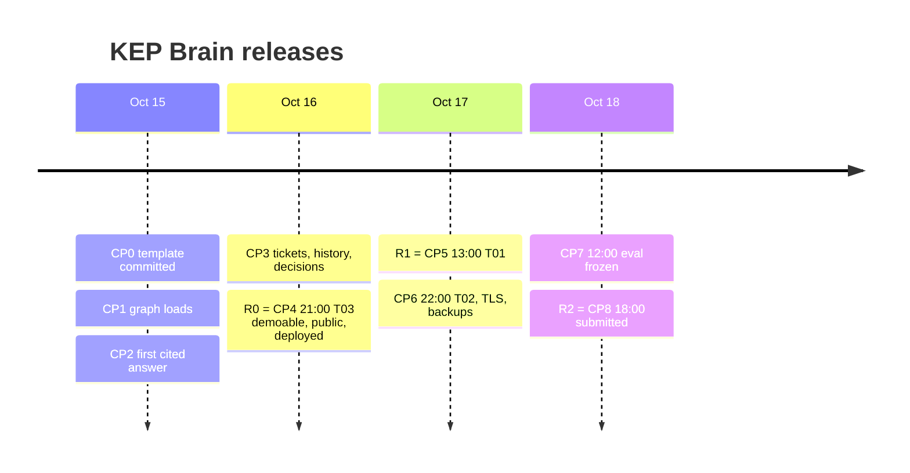

# KEP Brain · Product requirements document (PRD)

## 0. Document control

| | |
|---|---|
| Document | `docs/product/PRD.md` |
| Version / status | v0.1 draft for team sign-off (H-Lead). Pre-kickoff note only (Rule 8 allows notes, sketches and diagrams before 2026-10-15 00:01 IST); contains no source, scripts or manifests. |
| Date | 2026-10-12 (IST) |
| Owner | H-Lead (role template, 1-4 people; see PRD-OQ-02) |
| Reviewers | H-Review, H-Data/Eval, H-Demo |
| Upstream | `docs/product/project-charter.md` (canonical for goals PRD-G-01..07 and non-goals PRD-NG-01..06, per CHR-OQ-12); `E:\graph-hacks-prep\FABLE_CONTEXT.md` §1, §2, §4 |
| Design inputs | `docs/design/06-build-plan.md` (checkpoints CP0-CP8), `03-graph-model.md` §15 (tool catalog, numbered 1-29), `04-eval-set.md` §4, §7, §8 (question types, metrics, arms), `05-ui-brief.md` §2, §4 (screens), `01-recon-kubernetes-data.md` §7 (SIG choice) |
| Sibling documents | TRD (`TRD-*` ids), test plan (`TST-*`), operations (`OPS-*`), risks (`RSK-*`), all under `docs/` |
| Decisions | Anything the sources leave open is marked **DECISION (veto-able)** with its alternative and listed in §12 |
| Length cap | 700 lines |

### 0.1 Identifier scheme

| Prefix | Meaning | Defined in |
|---|---|---|
| `PRD-G-nn` | Goal with a measure and a date | §4 (01-07 from the charter, 08-10 added here) |
| `PRD-NG-nn` | Non-goal | §5 (01-06 from the charter, 07-10 added here) |
| `PRD-P-nn` | Persona | §3 |
| `PRD-US-nn` | User story with Given/When/Then | §6 |
| `PRD-FR-nnn` | Functional requirement | §7 |
| `PRD-OQ-nn` | Open question | §12 |
| `CHR-*`, `ADR-nnnn`, `TRD-*`, `TST-*`, `OPS-*`, `RSK-*` | Defined in their own documents; cited, not duplicated | |

Priority codes used throughout: **P0** = T03 core (master track), **P1** = T01 layer, **P2** = T02 layer. Order of delivery is strictly P0, then P1, then P2 (FABLE_CONTEXT.md §4: "Finish and polish T03 before adding the T01/T02 layers").

### 0.2 Change log

| Version | Date | Change |
|---|---|---|
| v0.1 | 2026-10-12 | First draft |
| v0.2 | 2026-10-12 | Review fixes: Rule 8 position (PRD-C-01), release table (§9.0), TLS and backups at CP4, 15-of-16 judge agreement, frozen snapshot mode, scale estimates unmeasured |

---

## 1. Problem statement

### 1.1 The problem

A large engineering organisation keeps its reasons in places that do not talk to each other. The current owner is in one file, the person who actually knows the subsystem is visible only in review history, the decision to change a status is in a pull request nobody linked from the design document, and the design document itself may disagree with the tracker. A newcomer, or an agent acting for one, asks four things and cannot get them answered in one place: **who owns this, who really knows it, why was it decided this way and by whom, and is that still true.**

Generic chat-with-your-docs tools answer these from similar-looking text. They cannot join two sources, cannot say which source is newer, and do not refuse when the evidence is absent. FABLE_CONTEXT.md §4 names this: most Track 03 entries "are generic Q&A bots with no ground truth".

### 1.2 Kubernetes as the public exemplar of a company (Rule 6)

Rule 6 allows only public, synthetic or the team's own data and forbids anything "private, login-protected, paywalled, personal, or otherwise restricted". A real company brain would need private data, so the product uses the nearest public equivalent: the Kubernetes project, treated as a company.

| Company concept | Kubernetes equivalent (public) | Source |
|---|---|---|
| Org chart, teams | SIGs, working groups, committees, chairs and tech leads, subprojects | `kubernetes/community` `sigs.yaml` (Apache-2.0) |
| Who owns what | `owning-sig`, `OWNERS`, `OWNERS_ALIASES` | `kubernetes/enhancements` (Apache-2.0), `kubernetes/kubernetes` |
| Decision records | KEPs: `kep.yaml`, README sections, production-readiness (PRR) approvals | `kubernetes/enhancements` |
| Tickets | Tracking issues, enhancements PRs, label and milestone history | GitHub REST and GraphQL |
| Chats | Issue and PR comments, reviews, Prow commands | GitHub |
| Policy change over time | Status transitions, replacements, withdrawals, release milestones | `kep.yaml` commit history and tracker timeline |

Scope for the event: `sig-node`, `sig-scheduling`, `sig-apps` (232 of 684 parseable `kep.yaml` files) at a pinned commit of `kubernetes/enhancements` (ADR 0019; `01-recon-kubernetes-data.md` §7.1). The design is SIG-agnostic, so widening is a configuration change after the event.

### 1.3 The product in one paragraph

KEP Brain is an agent whose context layer is one FalkorDB graph holding documents, tickets and discussion for three SIGs. It answers ownership, expertise, decision-provenance and currency questions by choosing among parameterized graph tools (ADR 0004), executes them read-only (ADR 0005), and returns a streamed answer whose every claim carries evidence ids, the graph path that produced it, source URLs and a freshness stamp. It refuses when the graph holds no evidence (ADR 0009). The same tools are exposed over MCP (T01), and per-user memory plus an agent task board sit on top (T02).

### 1.4 Not just a hackathon artefact

After the event the same system should scale to all `sig-*` directories by changing configuration, run a 15-minute incremental sync, and keep the eval as a regression gate (charter §4.2, CHR-SC-10 to CHR-SC-12). This PRD scopes only the hackathon release (§9); post-event items appear in §12 as questions.

---

## 2. Success in the judge's terms

FABLE_CONTEXT.md §2 gives the six-criterion template WeMakeDevs has used in 2026 (potential impact, creativity, technical excellence, best use of the sponsor, UX or theme-specific, presentation) with equal weights. Judging criteria for this event are unpublished (charter CHR-C-10), so this PRD optimises the template, not a guess.

| Template criterion | What the product shows | Requirement groups |
|---|---|---|
| Potential impact | A real question people ask about a real project; works on Kubernetes data anyone can check | FR-A, FR-C, FR-D, FR-E |
| Creativity and innovation | Company-brain framing on a public org; decisions, freshness and contradiction detection, not triage | FR-D, FR-E |
| Technical excellence | Read-only parameterized Cypher, idempotent `MERGE` imports, evaluated against a ground-truth answer key | FR-B, FR-G, FR-K |
| Best use of the sponsor | "Central rather than a thin wrapper": graph algorithms, full-text and vector indexes, per-user graphs, ACL users | FR-I, FR-J, FR-K |
| UX / theme | Ask, Explore, Freshness work without sign-up; paths and sources visible | FR-F, FR-H |
| Presentation | Demo video of at most 3 minutes, README a judge can run | FR-H |

Kunal Kushwaha's tips (FABLE_CONTEXT.md §2) become requirements: video at most 3 minutes; live demo works without sign-up; say exactly how FalkorDB was used and give feedback; say what each member did.

---

## 3. Personas

| Id | Persona | Goal | Constraint that shapes the product |
|---|---|---|---|
| PRD-P-01 | **Judge on a 3-minute budget** | Decide whether the project is real, graph-driven and verifiable | Has about 3 minutes in total (video ≤ 3:00) and about 60 seconds and five steps on the live site (click count stated after the final design, PRD-OQ-06); will not sign up; "If the video does not show it, it does not count." |
| PRD-P-02 | **Judge who clones and runs** | Verify the README claims: data model, queries, run instructions, eval numbers | Needs `docker compose up` to give a loaded graph without a GitHub token (build plan B11); reads Cypher and the depth table |
| PRD-P-03 | **FalkorDB reviewer** | See graph used "for patterns, not similarity" (FABLE_CONTEXT.md §2) | Looks for traceable outputs, `MERGE` re-runs, read-only connections with timeouts, answers only from returned rows, honesty about failures |
| PRD-P-04 | **New Kubernetes contributor** | Find who to talk to and why a feature is designed as it is | Does not know SIG names or KEP numbers; asks in free text |
| PRD-P-05 | **SIG chair or tech lead** | See which of their KEPs have stale or contradictory metadata | Wants a list with sources, not a score |
| PRD-P-06 | **Release or docs team member** | Know what changed since release X per SIG | Cares about milestone and stage accuracy |
| PRD-P-07 | **Agent client over MCP** (Claude Desktop or the MCP Inspector) | Pick a graph tool and get a path-bearing result | Needs typed tools with a token; no free-form Cypher (ADR 0004, ADR 0013) |
| PRD-P-08 | **Hackathon team member** (H-Lead, H-Review, H-Data/Eval, H-Demo) | Explain every choice (Rules 11-13) | Must be able to defend the model, queries, architecture and decisions |

---

## 4. Goals and measurable metrics

Goals PRD-G-01 to PRD-G-07 are adopted unchanged from the charter §2 (dates and checkpoints in `06-build-plan.md` §2.1, §6). Their measures are restated here only where this PRD adds a metric tied to the eval set.

| Id | Goal | Metric and target | Eval-set tie | Due (IST) |
|---|---|---|---|---|
| PRD-G-01 | First evidence-cited answer on the document layer of the three SIGs | OWN-01 via `POST /v1/ask` returns `abstained: false`, at least 2 evidence ids that resolve, URLs equal to stored `source_url`; ABS-05 returns `abstained: true, abstain_reason: no_evidence` | OWN-01, ABS-05 | Oct 15 23:00 (CP2) |
| PRD-G-02 | T03 complete, public, deployed | Repo public; live URL answers STA-04, DEC-07, DEC-01, MH-07 and abstains on ABS-10 without sign-up; first eval pass (arms N, L, G, H, 1 rep) served by `GET /v1/eval/latest`; tag `v0.1-t03` | The five judge-path questions | Oct 16 21:00 (CP4) |
| PRD-G-03 | T01 and T02 layers live (TLS and the nightly backup are live from CP4, FR-075; the restore drill passes by CP6) | `impact_of(4381, depth 1)` returns MH-04's 15 KEPs; one issue created in the demo repository with resolving evidence links; 20 concurrent claimers yield exactly one winner; 50-user x 60 s load test stored | MH-04, EXP-01 | Oct 17 13:00 (CP5) / 22:00 (CP6) |
| PRD-G-04 | Frozen 3-rep evaluation of 56 questions over five arms, losses published first | Pre-registered targets (`04-eval-set.md` §8.4): arm H at least 90 % on easy ownership; at least 70 % on expertise and multi-hop; at least 90 % abstention. Judge-human agreement on at least 15 of 16 calibration answers (93.75 %; 14 of 16 is 87.5 %, so one flip changes the verdict), Wilson interval reported. `/v1/ask` p95 at most 12 s. Tool reads p95 under 300 ms at 50 users without LLM. The latency figures (TRD-NFR-001, TRD-NFR-005) are unmeasured until CP2/CP7 and are published as measured if missed (TRD-OQ-04). Misses published as misses with the plus/minus 8-point noise floor | All 56 | Oct 18 12:00 (CP7) |
| PRD-G-05 | Video of at most 3:00 on YouTube; submission form naming T03, T01, T02 | Form sent by 18:00, hard stop 19:59 (four hours before close) | Video quotes the frozen run | Oct 18 18:00 (CP8) |
| PRD-G-06 | Live deployment stays up without sign-up until results | External ping every 5 minutes; funded until results are published and no earlier than 2026-11-15 (charter DECISION, veto-able) | n/a | Oct 16 onward |
| PRD-G-07 | Rule compliance checkable from the repository alone | No commit before 2026-10-15 00:01 IST; one `docs/AI_USAGE.md` row per PR; zero PII hits on every `SyncRun` | n/a | Continuous, CP8 |
| PRD-G-08 | The graph earns its place against retrieval baselines | Paired per-question difference H versus L (lexical RAG) with bootstrap 95 % interval; headline claim made on the overall difference and on the pooled multi-hop/temporal subset (DEC + MH + STA-hard, 21 questions, plus/minus 13 points). A difference inside the interval is reported as no difference. Arm V reported "not run" if cut | DEC, MH, STA | Oct 18 12:00 |
| PRD-G-09 | Every answer is checkable | Citation validity 100 % (measured, not assumed); citation precision and recall reported per type; false-abstention rate reported over the 45 answerable questions | All 56 | Oct 18 12:00 |
| PRD-G-10 | A judge reaches the hero moment fast | `/judge` completes in about 60 seconds across five steps (click count recorded after the final design, PRD-OQ-06); the first live answer is on screen without typing; Explore and Freshness work with the LLM key removed | OWN-01, DEC-01, STA-04, MH-04, ABS-05 | Oct 16 21:00 (CP4) |

Notes.
- Eval targets are predictions written before any run (`04-eval-set.md` §8.4). If an outcome contradicts a row, the README says so in that row's words.
- No metric here is a user-count or adoption number; none are available and none are invented.

---

## 5. Non-goals

| Id | Non-goal | Why |
|---|---|---|
| PRD-NG-01 | Issue triage, reviewer routing, duplicate detection | Taken by another team (FABLE_CONTEXT.md §3); this product is about decisions, freshness and organisational knowledge |
| PRD-NG-02 | Chat-with-your-docs UX or a generic company-brain platform | Organisers: "One narrow job done end to end scores better than a platform with three half-finished features." |
| PRD-NG-03 | Free-form text-to-Cypher in the judged path | ADR 0004 |
| PRD-NG-04 | Any write to `kubernetes/*`, `kubernetes-sigs/*`, `kubernetes-client/*`, `kubernetes-csi/*`, `cncf/*` | Built-in denylist, ADR 0021 |
| PRD-NG-05 | Login-gated sources (Slack, Google Groups, Zoom, Google Docs), forks, e-mail addresses, FalkorDB Cloud free tier for the judged demo, FalkorDB 6.x | Rule 6 (ADR 0020); ADR 0017; ADR 0002 |
| PRD-NG-06 | The blog-post side prize | Only if time remains after CP8 (charter DECISION, veto-able) |
| PRD-NG-07 | Code review of Kubernetes source, or answering questions about code behaviour | Product answers about people, documents, tickets and decisions; code is out of the graph except `OWNERS` and PR/commit metadata |
| PRD-NG-08 | User accounts, sign-up, roles, or multi-tenant administration | "A live demo must work without sign-up"; per-user memory uses an anonymous browser id (FR-081) |
| PRD-NG-09 | Whole-project coverage during the event (22 `sig-*` directories, all 8,510 SIG-labelled `kubernetes/kubernetes` items) | Three-SIG scope, ADR 0019; breadth is a post-event configuration change |
| PRD-NG-10 | A second datastore, Graphiti, GraphRAG-SDK or LangChain in the judged path | Rules 2-3; ADR 0006; ADR 0011; a CI dependency allowlist enforces it |

---

## 6. User stories and acceptance criteria

Each story names the persona, the track it serves and the eval question or checkpoint that proves it. Expected values are taken from `04-eval-set.md` and the checkpoint tests in `06-build-plan.md` §6; they are re-verified against the pinned SHA on Oct 15 (HUM-03), and a story's example may change then (release v1.38 is in flight, CHR-C-09).

### 6.1 T03 Company Brain (P0)

**PRD-US-01 · Who owns it** (PRD-P-04; OWN-01)
- Given the three SIGs are loaded at the pinned SHA,
- When the user asks "Which SIG owns KEP-1287 and who are its approvers?",
- Then the answer names `sig-node` and the five approvers `dchen1107`, `derekwaynecarr`, `ahg-g`, `mwielgus`, `thockin`, each claim carries an evidence id, the evidence panel shows the path `KEP -OWNED_BY-> SIG` and the approver edges, and every link opens the GitHub source (`kep.yaml`).

**PRD-US-02 · Alias expansion** (PRD-P-04; OWN alias questions)
- Given an `OWNERS` file refers to an alias defined in `OWNERS_ALIASES`,
- When the user asks who owns that directory,
- Then the answer lists the expanded logins, names the alias, and cites both files.

**PRD-US-03 · Who knows** (PRD-P-04; EXP-01)
- Given authored, reviewed and approved edges are loaded for the 21 DRA KEPs,
- When the user asks "Who knows most about Dynamic Resource Allocation?",
- Then the answer is a ranked list with counts (`pohly` 16, `johnbelamaric` 15, `dom4ha` 13 at the freeze), states the proxy used (counts of authored, reviewed and approved edges per `04-eval-set.md` §4.2), and links the KEPs behind each count.

**PRD-US-04 · Why was it decided** (PRD-P-04; DEC-01, DEC-02)
- Given status transitions and their commits and PRs are derived as `StatusChange` and `Decision` nodes,
- When the user asks "When was KEP-1287 marked implemented, by whom, and in which PR?",
- Then the answer states the date (2025-12-29 commit `d47a8df46c` by `natasha41575`), the PR (`kubernetes/enhancements#5761`, merged 2026-01-16) and the field change, each with a resolving link,
- And for DEC-02 (why classic DRA, KEP-3063, was withdrawn) the stated reasons come from the cited README section, not from model memory.

**PRD-US-05 · Is it still true** (PRD-P-05; STA-04)
- Given `kep.yaml` and the tracking-issue labels disagree for KEP-583,
- When the user asks "What is the status of KEP-583 Coscheduling, and is that metadata current?",
- Then the answer reports `status: provisional` from `kep.yaml` and the closed, `lifecycle/rotten` tracking issue, names both sources, shows a stale badge, and notes that 4671 and 5832 declare `replaces` 583 while 583 has no `superseded-by`.

**PRD-US-06 · What changed** (PRD-P-06; STA-06)
- Given milestone history is loaded,
- When the user asks which `sig-apps` KEPs went stable in v1.33 or later,
- Then the answer lists 3850, 3998 (v1.33), 3939 (v1.34), 4368 (v1.35) and 5440 (v1.38 target), and the Freshness page with `?release=v1.33&sig=sig-apps` shows the same set.

**PRD-US-07 · Multi-hop impact** (PRD-P-04; MH-04)
- Given `see-also` edges are loaded,
- When the user asks "If KEP-4381 were reverted, which KEPs that build on it would be affected, and which SIGs own them?",
- Then the answer lists 15 KEPs (sig-node 4817, 5304, 5677; sig-scheduling the other twelve) and the evidence panel shows the traversed subgraph.

**PRD-US-08 · Refusal** (PRD-P-01, PRD-P-03; ABS-05)
- Given no `9999-*` directory exists in `keps/`,
- When the user asks "What is the status of KEP-9999?",
- Then the answer is `abstained: true` with reason `no_evidence`, no claim is made, and the UI says what was searched.

**PRD-US-09 · Explore without the LLM** (PRD-P-01, PRD-P-05)
- Given the LLM key is invalid or removed,
- When the user opens a KEP, person or SIG page,
- Then the page renders from graph reads, a degraded banner explains that Ask is unavailable, and no error page is shown.

### 6.2 T01 Agents That Act on Connected Data (P1)

**PRD-US-10 · Algorithms as tools** (PRD-P-03; CP5)
- Given PageRank and betweenness are precomputed or run live (ADR 0014),
- When the user or an agent calls `rank_people(sig-node)`,
- Then the top three are `dchen1107`, `mrunalp`, `derekwaynecarr` in some order, each with the score and the edges that produced it.

**PRD-US-11 · Path to a decision** (PRD-P-03; CP5)
- Given PRR approvals are loaded,
- When `path_between(soltysh, 4671)` is called,
- Then it returns a path through `PRR_APPROVED` as `[key, REL, key, ...]` that the UI draws.

**PRD-US-12 · MCP tool selection** (PRD-P-07; CP4, CP5)
- Given the MCP server is running with a token,
- When an MCP client lists tools,
- Then all tools not removed by a cut line are listed and the count is recorded (27 in the TRD registry before cut lines), a missing token is rejected, and a client question about a SIG selects a tool whose result carries paths (screenshot saved for the README).

**PRD-US-13 · Act on what the graph shows** (PRD-P-05; CP5)
- Given a KEP's sources disagree or are stale,
- When the user presses "Draft issue" on the Freshness page and confirms,
- Then one issue appears in the team's demo repository with an evidence block whose links resolve; with `ACTION_REPO=kubernetes/enhancements` the request is refused (ADR 0021); without the confirm step nothing is posted.

### 6.3 T02 Agent Memory and Coordination (P2)

**PRD-US-14 · Separate memory** (PRD-P-04; CP6)
- Given two browsers with different anonymous memory ids,
- When each asks different questions,
- Then each `/memory` page shows only its own episodes, and no query by one id returns the other's nodes.

**PRD-US-15 · Memory shapes the next answer** (PRD-P-04; CP6)
- Given an earlier session asked about `sig-node`,
- When the same user returns and repeats a question,
- Then the answer lists `memory.recalled[]`, the Memory page links that recall to its source episode, and "Forget everything" empties the user's graph.

**PRD-US-16 · Agents hand work off** (PRD-P-08; CP6)
- Given ingest, freshness, QA and action agents share the `ops` graph,
- When "Sync now" is pressed,
- Then the Shared-state tab shows a task, its lease holder, heartbeat and a handoff row, and a 20-claimer test yields exactly one winner.

**PRD-US-17 · Concurrency** (PRD-P-03; CP6)
- Given 50 simulated users for 60 seconds,
- When the load test finishes,
- Then p50, p95 and p99 latency and error rate are stored, shown on the Eval page and quoted in the README.

### 6.4 Presentation and compliance (cross-track)

**PRD-US-18 · The 60-second judge path** (PRD-P-01)
- Given a clean browser with no cookies,
- When the judge opens the README link then `/judge`,
- Then they can run OWN-01, DEC-01, STA-04, MH-04 and watch ABS-05 refuse using one button each, see for each the expected evidence to look for, and reach the repository and video.

**PRD-US-19 · A judge can run it** (PRD-P-02)
- Given a clean machine with Docker,
- When the judge follows the README run section without a GitHub token,
- Then `docker compose up --build --wait` yields a healthy stack with a loaded graph and the same judge path works locally.

**PRD-US-20 · Explain-back** (PRD-P-08)
- Given the submission is one day away,
- When the team holds a 45-minute session (TEAM-WA-18),
- Then each member explains the graph model, the queries, the architecture and the decisions, and the outcome is recorded in `docs/AI_USAGE.md` (Rules 11-13).

---

## 7. Functional requirements

Columns: **Pri** P0 (T03 core), P1 (T01), P2 (T02). **Focus point** quotes the track focus in `FABLE_CONTEXT.md` §1, or the judge-facing template item for cross-cutting rows. Tool numbers refer to `03-graph-model.md` §15 (1-19 T03, 20-26 T01, 27-29 T02). Screens are those of `05-ui-brief.md` §2.1. Technical realisation belongs to the TRD.

### 7.A Data: sources into one graph

| Id | Requirement | Pri | Rationale | Focus point |
|---|---|---|---|---|
| PRD-FR-001 | Load `kep.yaml`, README sections, PRR files, `sigs.yaml`, labelled `OWNERS` and `OWNERS_ALIASES` for `sig-node`, `sig-scheduling`, `sig-apps` at a pinned `kubernetes/enhancements` commit, with zero GitHub API calls for this layer. | P0 | Gives the document layer and a judge-runnable first load | "Knowledge from docs, tickets, and chats in one graph" |
| PRD-FR-002 | Load tracking issues with comments and label and milestone history (GraphQL `timelineItems`), plus enhancements PRs with reviews and comments, for the same KEPs. | P0 | Tickets and chats are separate focus items; REST timelines truncate, GraphQL does not (R5) | "Knowledge from docs, tickets, and chats in one graph" |
| PRD-FR-003 | Every node and edge carries its source: repository, path or URL, commit SHA or fetch time. Every returned row carries `label`, `key`, `url`. | P0 | Basis of citations | "Answers with clear sources" |
| PRD-FR-004 | All imports are idempotent (`MERGE` on stable keys); re-running a sync changes nothing when upstream is unchanged and never duplicates a node. | P0 | FalkorDB judge praised `MERGE` re-runs; supports incremental sync (ADR 0008) | "Keeping knowledge current as things change" |
| PRD-FR-005 | Strip e-mail addresses and other personal contact details before hashing or storing; a post-sync invariant scan fails the run on any hit; keep GitHub login, and keep `name`/`company` only behind `STORE_PERSON_NAME_COMPANY=true` (ADR 0020). | P0 | Rule 6; breach is a disqualification risk | Rule 6 ("public, synthetic or your own data") |
| PRD-FR-006 | Resolve ownership aliases (`OWNERS_ALIASES`), KEP numbers, SIG directories and feature gates to graph entities; ambiguous KEP numbers return candidates, not a guess. | P0 | Tools take free text from an LLM | "Who owns what, and who knows what" |
| PRD-FR-007 | Record each sync as a `SyncRun` with counts, duration, request count, memory usage and PII scan result; the UI shows "Data as of" with the pinned SHA and the last upstream fetch. | P0 | Freshness and checkability | "Keeping knowledge current as things change" |
| PRD-FR-008 | Run an incremental sync using cursors, ETags and `since`, respecting GitHub limits (serial requests, sleeping near the limit), with a dedicated token; failed runs leave cursors intact and resume. | P0 | Knowledge must follow upstream without a rebuild | "Keeping knowledge current as things change" |
| PRD-FR-009 | Credit and licence: ship a `NOTICE` for Apache-2.0 sources, a data statement (what was loaded, what was stripped) and a removal-request path honoured on the next sync (`archived = true`). | P0 | Licences and Rule 6; community obligations | Rule 6 |

### 7.B Answering: evidence-first agent

| Id | Requirement | Pri | Rationale | Focus point |
|---|---|---|---|---|
| PRD-FR-010 | `POST /v1/ask` accepts a free-text question and returns claims, each with `evidence_ids`, plus `paths`, `freshness` and `abstained`. | P0 | The product's contract (ADR 0009) | "Answers with clear sources" |
| PRD-FR-011 | A deterministic validator rejects or downgrades any claim whose evidence ids do not resolve to nodes the tools actually returned in this request; the model answers only from returned rows. | P0 | FalkorDB judge praised "the LLM answering only from rows the graph returned" | "Answers with clear sources" |
| PRD-FR-012 | When no evidence supports an answer, return `abstained: true` with a reason (`no_evidence` or a documented alternative) and say what was searched; never fall back to model memory. | P0 | ABS questions are 11 of 56; refusal is a headline feature | "Answers with clear sources" |
| PRD-FR-013 | The agent chooses among the parameterized T03 tools (1-19) in a bounded loop; no tool accepts free-form Cypher; the LLM can reach FalkorDB only through typed tools executed with `GRAPH.RO_QUERY`, a read-only ACL user and a per-query timeout. | P0 | ADR 0004, ADR 0005; "Read-only connections with timeouts" | "Answers with clear sources" |
| PRD-FR-014 | Stream the answer: `path` and `citation` events precede the first `token` event, so evidence appears before prose finishes. | P0 | Shows the graph working; the demo's hero moment | "Answers with clear sources" |
| PRD-FR-015 | Every answer exposes its steps: tool name, parameters, the parameterized Cypher template, row counts and FalkorDB time. | P0 | Rule 10 asks for the Cypher the product depends on; "show how it got to each answer" (brief) | "Answers with clear sources" |
| PRD-FR-016 | The LLM sits behind a provider adapter (default Anthropic `claude-sonnet-5-5` answering and `claude-haiku-5-5` extraction, ADR 0010; OpenAI-compatible fallback); a provider failure returns `provider_error`, and Explore, Freshness and Eval keep working. | P0 | Cost, outage tolerance (RSK-001); provider is veto-able (PRD-OQ-01) | "Answers with clear sources" |
| PRD-FR-017 | Support scope filters (SIG, "as of release") on Ask and carry them into tool parameters. | P0 | Currency questions are release-relative | "Keeping knowledge current as things change" |

### 7.C Ownership and expertise

| Id | Requirement | Pri | Rationale | Focus point |
|---|---|---|---|---|
| PRD-FR-018 | `who_owns` (tool 5): owners of a KEP, directory or feature gate, with the file that says so, alias-expanded. | P0 | OWN questions (10 of 56) | "Who owns what, and who knows what" |
| PRD-FR-019 | `who_approves` (tool 6): approvers per stage from `kep.yaml`, PRR files and PR approvals, shown as three independent sources. | P0 | Distinguishes metadata from actual approval | "Who owns what, and who knows what" |
| PRD-FR-020 | `who_knows` (tool 7): rank people for a topic or KEP from authored, reviewed and approved edges over documents and tickets; state the proxy and counts. | P0 | EXP questions (7 of 56); "who knows" differs from "who owns" | "Who owns what, and who knows what" |
| PRD-FR-021 | `person_profile` (tool 15) and `sig_overview` (tool 14): a person's roles and involvement; a SIG's leaders, subprojects, directories, KEP portfolio. | P0 | Org-chart view of the "company" | "Who owns what, and who knows what" |
| PRD-FR-022 | `get_kep` (tool 2) returns the KEP card with one-hop context and an optional `as_of` release or date. | P0 | "Who approved this as of v1.30" from edge validity | "Who owns what, and who knows what" |
| PRD-FR-023 | `feature_gate_lookup` (tool 16): from a gate to its KEP, components, owners and history. | P0 | Gates are how engineers refer to features | "Who owns what, and who knows what" |

### 7.D Decision tracing

| Id | Requirement | Pri | Rationale | Focus point |
|---|---|---|---|---|
| PRD-FR-024 | Derive `StatusChange` nodes from `kep.yaml` commit history (field, from, to, commit, PR, actor, date) and from tracker label and milestone events; link both kinds to the KEP. | P0 | One label makes "since release X" one scan | "Tracing decisions back to their source" |
| PRD-FR-025 | Derive `Decision` nodes for status or stage transitions, PRR approvals, replacements and withdrawals, each with its evidence. Extracting free-text decisions with the LLM is off by default and is a cut line. | P0 | DEC questions (8 of 56); extraction is cost and risk | "Tracing decisions back to their source" |
| PRD-FR-026 | `trace_decision` (tool 8): why and by whom a KEP's state changed, with the PR, commit and actor; `status_history` (tool 9): the timeline of a field or of everything. | P0 | Core of the decision story (DEC-01) | "Tracing decisions back to their source" |
| PRD-FR-027 | `get_kep_section` (tool 3) and `search_sections` (tool 4): return README sections by heading or hybrid lexical plus semantic search, expanded through the graph, so "why" answers cite prose. | P0 | Reasons live in README prose and PR bodies; graph-only loses here (`04` §8.4) | "Tracing decisions back to their source" |
| PRD-FR-028 | `kep_relations` (tool 13): replaced, superseding, related, external references. | P0 | Decisions chain across KEPs (for example 4671 and 5832 replace 583) | "Tracing decisions back to their source" |
| PRD-FR-029 | `thread_digest` (tool 18): what was discussed around a change, with comment links, so decisions link to the chat that preceded them. | P0 (cut line L4) | Ties "chats" to decisions | "Knowledge from docs, tickets, and chats in one graph" |

### 7.E Keeping knowledge current

| Id | Requirement | Pri | Rationale | Focus point |
|---|---|---|---|---|
| PRD-FR-030 | `freshness` (tool 11): how current the graph and a KEP are, with `last-updated`, last tracker activity and last sync. | P0 | Answers carry a freshness stamp | "Keeping knowledge current as things change" |
| PRD-FR-031 | `find_contradictions` (tool 12): where `kep.yaml`, tracker labels and PRs disagree (for example KEP-583 and KEP-5978). | P0 | The differentiator: "is that still true" at corpus scale | "Keeping knowledge current as things change" |
| PRD-FR-032 | `whats_changed` (tool 10) and `release_scope` (tool 17): what changed, graduated or slipped since a release or date. | P0 (tool 17: cut line L4) | STA-06; release-note style questions | "Keeping knowledge current as things change" |
| PRD-FR-033 | Mark an answer **stale** (badge plus reason) when any cited node is older than the freshness threshold or contradicted by another source. Threshold set in TRD (default is veto-able). | P0 | "Flagging stale answers" (FABLE_CONTEXT.md §4) | "Keeping knowledge current as things change" |
| PRD-FR-034 | Freshness page: choose a release, list what changed, list contradictions, show sync status and a "Sync now" button. | P0 | Currency is visible without Ask | "Keeping knowledge current as things change" |
| PRD-FR-035 | Support a point-in-time view (`as_of` release) on `get_kep`, `who_approves` and Ask scope. | P0 | Temporal edges (ADR 0008) | "Keeping knowledge current as things change" |

### 7.F Explore, screens and UX

| Id | Requirement | Pri | Rationale | Focus point |
|---|---|---|---|---|
| PRD-FR-036 | Ask page `/`: composer with SIG and release filters and three suggested questions; streamed answer with inline citation buttons; evidence panel with Path, Steps and Sources tabs; "Data as of" and stale badges. | P0 | The hero page; `/` is Ask, not a landing page | "Answers with clear sources" |
| PRD-FR-037 | Explore: search, KEP page (facts, people, relationships, status history, ego graph), person page (roles, ownership, "knows" score), SIG page (mission, leaders, subprojects, KEP counts). | P0 | Works with the LLM off; shows the graph is the product | "Who owns what, and who knows what" |
| PRD-FR-038 | Graph view renders the traversed subgraph with a node cap of 200, server-side grouping above it, and a table fallback; 200 nodes are interactive within 2 s (TRD-NFR-009, the single layout threshold). | P0 | "Show how it got to each answer"; performance risk R14 | "Answers with clear sources" |
| PRD-FR-039 | Every screen is reachable without sign-up, login or cookie banner; only `localStorage` for theme and anonymous memory id. | P0 | Kunal Kushwaha: "A live demo must work without sign-up" | UX template criterion |
| PRD-FR-040 | Empty, loading and error states are defined for every screen; the degraded banner appears when the LLM provider fails. | P0 | Honest failure; a shot in the demo script | UX template criterion |
| PRD-FR-041 | Keyboard and accessibility basics per `05-ui-brief.md` §6; layout works at phone width. | P0 | Judges may open on a laptop or phone | UX template criterion |
| PRD-FR-042 | `/about`: data sources and licences, what was stripped, AI-assistance disclosure, team roles, FalkorDB depth table. | P0 | Rules 6 and 11-13; Rule 3 | Rules 3, 6, 11-13 |

### 7.G Evaluation and proof

| Id | Requirement | Pri | Rationale | Focus point |
|---|---|---|---|---|
| PRD-FR-043 | Ship `evals/questions.yaml` with 56 questions: ownership 10, expertise 7, decision provenance 8, status/freshness 10, multi-hop 10, abstention 11; each with ground truth, source and expected tools. | P0 | "Measured against an answer key"; question types from `04` §4.1 | "Answers with clear sources" |
| PRD-FR-044 | Deterministic graders for OWN, EXP, STA, MH and ABS; judge-model grading only for DEC and two STA clauses, calibrated on 16 human-labelled answers; ground truth re-verified by a human on Oct 15. | P0 | Rules 11-13: human contribution; trustworthy numbers | "Answers with clear sources" |
| PRD-FR-045 | Run five arms (N none, L lexical RAG, V vector RAG, G graph-only, H hybrid = product) with shared controls; report an arm not run as "not run". | P0 | Separates "the graph helped" from "the model already knew" | "Answers with clear sources" |
| PRD-FR-046 | Report accuracy by type with Wilson 95 % intervals, paired differences with bootstrap intervals, citation validity/precision/recall, abstention precision/recall, false-abstention rate, validator rescue rate, latency p50/p95/p99 per stage, tokens and cost, errors. | P0 | Metrics list of `04` §7 | "Answers with clear sources" |
| PRD-FR-047 | Eval page: results per type and arm, per-question table sorted with baseline wins first, a "where the graph lost" block, predictions versus outcomes, frozen run id. | P0 | Honest losses win (FABLE_CONTEXT.md §2, Lethe) | "Answers with clear sources" |
| PRD-FR-048 | Eval runs through the deployed instance; the frozen run (3 reps) is committed as `summary.json` and quoted by README and video; later releases re-run it as a regression gate. | P0 | Checkable numbers | "Answers with clear sources" |

### 7.H Presentation, judge path and submission

| Id | Requirement | Pri | Rationale | Focus point |
|---|---|---|---|---|
| PRD-FR-049 | `/judge`: scripted steps (STA-04, DEC-07, DEC-01, MH-07, then ABS-10) served from the eval file, each a one-click deep link with the expected evidence and the time it should take; links to Freshness, Eval, one Explore page, video and repository. | P0 | "60 seconds, four clicks"; Lethe and ScrapeSentry pattern | Presentation criterion |
| PRD-FR-050 | README top: video link, live link, judge path; then graph data-model diagram, the Cypher templates and algorithms exported from the tool registry, "Why a graph, not a vector database", FalkorDB depth table (at least twelve capabilities mapped to a file or route), Rule 3 "remove FalkorDB and see what breaks" table, evaluation section generated from `summary.json`, setup, data statement, AI disclosure, who did what. | P0 | Rule 10 requires data model and queries; winners did this | Rule 10; Presentation criterion |
| PRD-FR-051 | `docker compose up --build --wait` on a clean machine yields a loaded graph without a GitHub token. | P0 | "Judges clone the repo and run it" | Rule 10 ("complete local setup instructions") |
| PRD-FR-052 | Demo video of at most 3:00 on YouTube following the shot list in `05-ui-brief.md` §8 (problem, live hero answer, where FalkorDB does the work, an honest loss, proof), URL bar visible, FalkorDB's role stated at least twice. | P0 | "If the video does not show it, it does not count." | Presentation criterion |
| PRD-FR-053 | Submission form: detailed answers, all three tracks named with the focus points covered (table from `03-graph-model.md` §15.4), feedback on FalkorDB, each member's contribution. | P0 | Rule 5 and Rule 10; Kunal Kushwaha's tips | Rules 5 and 10 |
| PRD-FR-054 | Keep `docs/AI_USAGE.md` (one row per PR, humans versus AI) and `docs/DECISIONS.md` (one record per decision); README "Provenance" names the template boundary and pre-event notes. | P0 | Rules 8, 11-13 | Rules 8, 11-13 |

### 7.I T01: act on connected data

| Id | Requirement | Pri | Rationale | Focus point |
|---|---|---|---|---|
| PRD-FR-055 | `impact_of` (tool 20): given a KEP, return what depends on it (via `see-also`, replaces, participating SIGs, implementing PRs) to a stated depth, with owners per affected item. | P1 | MH-04; the reversal question | "Multi-hop reasoning" |
| PRD-FR-056 | `path_between` (tool 21) and `person_to_decision` (tool 22): shortest explainable connection between any two entities and between a person and a decision, returned as path arrays. | P1 | "Why is their name on this" | "Explainable results" |
| PRD-FR-057 | `rank_people` (tool 23) using `algo.pageRank` or `algo.betweenness`, scoped to a SIG or topic, with scores and supporting edges. | P1 | Uses FalkorDB algorithms; also feeds `who_knows` | "Graph queries and algorithms as agent tools" |
| PRD-FR-058 | `community_of` (tool 24, `algo.WCC` or CDLP) and `bridge_people` (tool 25, betweenness). Cut line L5 removes these first. | P1 | Finds clusters and brokers across SIGs | "Graph queries and algorithms as agent tools" |
| PRD-FR-059 | Expose the whole tool catalog through an own MCP server (ADR 0013): typed tool schemas, token authentication, the same validation and read-only path as the web agent; every tool not removed by a cut line is listed and the count is recorded. | P1 | MCP is a focus item; same code path means no divergence | "Tool selection through MCP" |
| PRD-FR-060 | Document MCP attach steps (`docs/MCP.md`) and capture a screenshot of a client selecting a tool. | P1 | Checkable by a judge | "Tool selection through MCP" |
| PRD-FR-061 | `draft_stale_doc_issue` (tool 26): draft an issue when a KEP's sources disagree or are stale, preview it, require human confirmation, then create it in the team's demo repository only; evidence links in the body; refuse any repository on the denylist. | P1 | Action tied to what the graph shows; ADR 0021 prevents harm to real repositories | "Actions based on what the graph shows" |
| PRD-FR-062 | Explore impact view: visualise `impact_of` and `path_between` results; the Freshness draft-issue dialog shows the exact body before posting. | P1 | Results must be visible, not only returned | "Explainable results" |
| PRD-FR-063 | `cross_sig_map` (tool 19): how two SIGs work together, from shared KEPs and participation. Cut line L4. A T03 tool that also serves T01. | P0 | Multi-hop across the SIG boundary | "Multi-hop reasoning" |

### 7.J T02: memory and coordination

| Id | Requirement | Pri | Rationale | Focus point |
|---|---|---|---|---|
| PRD-FR-064 | One FalkorDB graph per user (`mem:<ULID>`), created on first use from an anonymous browser id; memory tools can only reach the caller's graph. | P2 | Isolation by graph, not by a filter (ADR 0011) | "Separate memory per user or tenant" |
| PRD-FR-065 | Episodic memory: store each Q&A as an `Episode` in an ordered chain, with SIGs touched and the answer id; `GET /v1/answers/{id}` returns a stored answer. | P2 | Conversation history persists across sessions | "Persistent conversation history" |
| PRD-FR-066 | Semantic memory: learn facts about the user's interests (for example a SIG focus), with confidence and the source episode; never store names, e-mails or free text beyond a short label. | P2 | Rule 6 holds for memory too | "Episodic, semantic, and procedural memory" |
| PRD-FR-067 | Procedural memory: record tool sequences that answered a question pattern with use counts and success rate. Cut line L6 removes it. | P2 | Third memory type | "Episodic, semantic, and procedural memory" |
| PRD-FR-068 | `recall_memory` (tool 27, LLM-callable, read-only) feeds relevant memory into planning; the answer lists `memory.recalled[]`; `remember` (tool 28) is code-invoked after validation and never callable by the LLM. | P2 | Memory shapes behaviour but cannot be written by the model | "Persistent conversation history" |
| PRD-FR-069 | `coordinate` (tool 29) over the `ops` graph: claim, heartbeat, hand off and complete tasks with leases; the ingest, freshness, QA and action agents use it. Claims are atomic. | P2 | Shared state and handoffs between agents (ADR 0012) | "Shared state and handoffs between agents" |
| PRD-FR-070 | Memory page: Episodic, Semantic, Procedural, Shared-state and Graph tabs; delete per item; "Forget everything" (`DELETE /v1/memory/me`) empties the graph; "New identity". | P2 | Inspectable and deletable memory | "Separate memory per user or tenant" |
| PRD-FR-071 | Load test: 50 simulated users for 60 seconds against reads and memory writes; store p50, p95, p99 and error rate in the graph and on the Eval page. | P2 | Evidence for concurrency | "High-concurrency reads and writes" |

### 7.K Platform: FalkorDB use, security, deployment

| Id | Requirement | Pri | Rationale | Focus point |
|---|---|---|---|---|
| PRD-FR-072 | FalkorDB v4.22.0 holds four graph families (`kep`, `ops`, `mem:<ULID>`, `eval_baseline`) with no second datastore; a CI test fails if one appears (ADR 0002, ADR 0006). | P0 | Rules 2-3: FalkorDB must carry the product | Rules 2-3 |
| PRD-FR-073 | Use FalkorDB capabilities the product depends on: range, full-text and vector indexes; uniqueness and mandatory constraints; `MERGE`; `GRAPH.RO_QUERY` with timeouts; `algo.pageRank`, `algo.betweenness`, `algo.WCC`/CDLP, path queries; per-user graphs. Each appears in the depth table. | P0 (algorithms P1, per-user graphs P2) | "Central rather than a thin wrapper" | "Best use of the sponsor" criterion |
| PRD-FR-074 | FalkorDB protected by password and ACL users (`kb_reader` read-only for the agent), no published host port in production. | P0 | FalkorDB judge praised read-only connections | Technical excellence criterion |
| PRD-FR-075 | Live deployment on a single VM with Docker Compose and Caddy TLS (ADR 0017), `restart: unless-stopped`, nightly backup with 7-day retention, a tested restore, external uptime ping. | P0 | Live link preferred by Rule 10; must survive judging | Rule 10 ("a live deployment") |
| PRD-FR-076 | Health endpoints (`/health`, `/ready` with schema and graph-loaded state, `/healthz`); structured logs with request ids echoed in `X-Request-ID`; secrets only from environment (ADR 0015). | P0 | Debugging in a four-day build; checkpoint tests rely on them | Technical excellence criterion |
| PRD-FR-077 | Tests and CI gates (ADR 0016): unit, validator, tool-template, isolation, atomicity and no-second-store suites; gitleaks; compose-up job. | P0 | "Honesty about failures, and tests" | Technical excellence criterion |

Count: 77 requirements, PRD-FR-001 to PRD-FR-077. Groups A-H and K are P0 (plus FR-063); group I is P1; group J is P2.

---

## 8. Track coverage summary

| Track | Priority | Focus points covered | Requirements |
|---|---|---|---|
| T03 Company Brain | P0 | Docs/tickets/chats in one graph; who owns and who knows; tracing decisions; keeping knowledge current; answers with clear sources | FR-001 to FR-054, FR-063, FR-072 to FR-077 |
| T01 Agents That Act on Connected Data | P1 | Multi-hop; algorithms as tools; MCP; actions; explainable results | FR-055 to FR-062 (FR-063 is P0, serves both) |
| T02 Agent Memory and Coordination | P2 | Episodic/semantic/procedural; persistent history; shared state and handoffs; concurrency; per-user memory | FR-064 to FR-071 |

T01 and T02 are layers on the T03 core, not separate products: the T01 tools are the same catalog the T03 agent uses, and T02 memory and the `ops` board wrap the same Ask path. All three tracks are named at submission (Rule 5).

---

## 9. Release scope

Dates are IST; checkpoints are defined in `06-build-plan.md` §6 and pass only when every smoke-test line passes.

### 9.0 Release table

| Tag | Checkpoint | Time (IST) | Content |
|---|---|---|---|
| `v0.1-t03` | CP4 (R0) | Oct 16 21:00 | T03 public and deployed, HTTPS and first backup live |
| `v0.2-t01` | CP5 (R1) | Oct 17 13:00 | T01 layer |
| `v0.3-t02` | CP6 (R1) | Oct 17 22:00 | T02 layer; restore drill |
| `v1.0-submitted` | CP8 (R2) | Oct 18, tagged at the 17:30 freeze (DMO-RDY-34); form sent 18:00 | Frozen run, video, README, submission |

The frozen evaluation (CP7, 12:00) is a run id, not a tag. This table is the single definition: ENG-07, OPS §11 F4, DMO-RDY-34 and the team RACI cite it.

### 9.1 R0 · end of Oct 16 (CP4, 21:00): demoable core, public push

Includes all P0 requirements except those marked as cut lines below.

| Area | In R0 | Exit evidence |
|---|---|---|
| Data | FR-001 to FR-009 (document and ticket layers, PII scan, incremental sync) | CP1 and CP3 smoke tests; `SyncRun` shows zero PII hits |
| Answering | FR-010 to FR-017 | CP2 smoke test (OWN-01, ABS-05); streaming order verified |
| Tools | FR-018 to FR-035 (tools 1-16 and 17-19 unless cut) | `trace_decision(1287, status)` returns `kubernetes/enhancements#5761`; `whats_changed(since v1.33, sig-apps)` returns the STA-06 set; `find_contradictions` lists KEP-583 and KEP-5978 |
| Screens | FR-036 to FR-042 (Ask, Explore, Freshness, About) | Explore renders with the LLM key removed |
| Eval (first pass) | FR-043 to FR-046 with arms N, L, G, H, 1 rep | `GET /v1/eval/latest` serves it |
| Presentation | FR-049, FR-050 (skeleton), FR-051, FR-054 | README skeleton with judge path, model diagram, queries section; `AI_USAGE.md` row per merged PR |
| Platform | FR-072, FR-074 to FR-077 | Live URL serves Ask, Explore, Freshness after a full sync; MCP lists every non-cut tool (count recorded) and rejects a missing token (baseline of FR-059, as CP4 requires; full documentation and client proof in R1) |
| Public push | Repository made public; tag `v0.1-t03` | History starts at or after 2026-10-15 00:01 IST |

**Gate.** CP4 is the hard gate. If it fails, apply cut lines in order (`06-build-plan.md` §8.3: L1 P1 `kubernetes/kubernetes` tickets, L2 extracted decisions, L3 arm V, L4 tools 17-19, then the T01 and T02 items). The five judge-path questions and the "never cut" list (§8.2 of the build plan: evidence-only answers with abstention, read-only graph access, PII guarantees, `docker compose up` on a clean machine, the eval with its losses, README model/queries/run sections, the video, the early submission) are not negotiable.

### 9.2 R1 · Oct 17: T01 morning, T02 afternoon and evening

| Part | In R1 | Exit evidence |
|---|---|---|
| T01 (CP5, 13:00) | FR-055 to FR-062, FR-059 in full, FR-063 if not cut | `impact_of(4381, depth 1)` returns 15 KEPs; `path_between(soltysh, 4671)` goes through `PRR_APPROVED`; `rank_people(sig-node)` top three match; `community_of(4381)` spans two SIGs; one issue in the demo repository; `ACTION_REPO=kubernetes/enhancements` refused; MCP client screenshot; tag `v0.2-t01` |
| T02 (CP6, 22:00) | FR-064 to FR-071 | Two browser profiles show disjoint memories; repeat question shows `memory.recalled[]`; `DELETE /v1/memory/me` empties the graph; 20-claimer test yields one winner; Shared-state tab shows a handoff; 50-user x 60 s load test stored; restore drill D-1 (HTTPS and backups are live since CP4); tag `v0.3-t02` |
| Also | Full 3-rep eval started on the dev graph; TLS and nightly backups live (FR-075) | CP6 smoke tests |

### 9.3 R2 · Oct 18: proof, polish, submission

| Part | In R2 | Exit evidence |
|---|---|---|
| Freeze (CP7, 12:00) | FR-047, FR-048; README evaluation section generated; Eval page renders the frozen run; restore test recorded; explain-back held | Run id written in README and `docs/EVAL.md`; uptime monitor green for 12 hours; `git log` has no commit before 00:01 IST Oct 15 |
| Submit (CP8, 18:00) | FR-050 (final), FR-052, FR-053; video on YouTube by 16:00 | Form confirmation; YouTube link; live URL answers the five judge steps from a clean browser; hard stop for any fix 19:59 |

### 9.4 Not in any release

Post-event items listed in §1.4 and PRD-NG-06 (blog post, only if everything above landed early).

---

## 10. Constraints

| Id | Constraint | Source | Effect on the product |
|---|---|---|---|
| PRD-C-01 | **Rule 8.** "The main coding and design work must begin after the hackathon starts." Notes, sketches and diagrams before Oct 15 00:01 IST are allowed; no code, scaffolding, git repo or UI build for the product. **Position (decided, veto-able):** the generic template already in the working tree (`apps/`, Compose, CI, hooks, `LICENSE`, `README.md`) is pre-existing scaffolding disclosed under Rule 9, not hackathon work and not claimed as such; no `git init` and no commit before 00:01, and the template is the labelled first commit. The only FAQ text verified is "The submission and its main FalkorDB implementation must be new work completed during the event"; the template is not the FalkorDB implementation. Alternative: remove the template until 00:01. See CHR-C-01, CHR-CMP-01, CHR-OQ-05 | FABLE_CONTEXT.md §0 | All product requirements are implemented from Oct 15; commit history starts at 00:01; this PRD contains no code |
| PRD-C-02 | **Rules 2-3.** FalkorDB must carry the product: "If the product still works once FalkorDB is taken out, the graph is decoration." | FABLE_CONTEXT.md §0 | FR-072, FR-073; every tool is a Cypher template, so removing FalkorDB removes the tool |
| PRD-C-03 | **Rule 6.** Public, synthetic or own data only; nothing private, login-protected, paywalled, personal or restricted; strip e-mails and personal details. | FABLE_CONTEXT.md §0 | FR-005, FR-009, PRD-NG-05; memory stores no personal text (FR-066) |
| PRD-C-04 | **Rule 10.** Submission includes a public repo, README with setup and the graph data model, the Cypher queries or algorithms the product depends on, a demo video, a live deployment (preferred) or complete local setup, and the tracks entered. | FABLE_CONTEXT.md §1 | FR-049 to FR-053 |
| PRD-C-05 | **Rules 11-13.** AI use is allowed but disclosed; the team must be able to explain the model, queries, architecture and decisions; entirely AI-generated projects "may be rejected". | FABLE_CONTEXT.md §0 | FR-054, FR-044 (human-run ground truth and calibration), PRD-US-20 |
| PRD-C-06 | **Rule 5.** Up to 4 people per team, one team each; every track entered is named at submission. | FABLE_CONTEXT.md §0, charter CHR-C-05 | Roles are a template (PRD-OQ-02); FR-053 |
| PRD-C-07 | **Licences.** Source data is Apache-2.0 (`kubernetes/enhancements`, `kubernetes/community`); attribution via `NOTICE`; the repository's own code is MIT (`LICENSE`); libraries and public datasets are allowed (Rule 9). The template reuse boundary is disclosed in README "Provenance". | FABLE_CONTEXT.md §4; charter §10 | FR-009, FR-054 |
| PRD-C-08 | **Four days.** Oct 15 00:01 to Oct 18 23:59 IST; about 30 human-hours in total; internal submission target 18:00 Oct 18, hard stop 19:59. | Charter CHR-C-11, CHR-C-12 | Strict P0, P1, P2 order; cut lines; checkpoints at fixed times |
| PRD-C-09 | **GitHub API budget.** 5,000 REST requests and 5,000 GraphQL points per hour per token, 30 search requests per minute, serial requests. | Charter CHR-C-06 | FR-008; document layer needs zero API calls |
| PRD-C-10 | **Moving upstream.** Release v1.38 is in flight; ground truth is re-verified on Oct 15 and every number carries its SHA and fetch time. | Charter CHR-C-09 | Story examples may change at HUM-03 |
| PRD-C-11 | **Unpublished judging.** Judging criteria, judges, kickoff time and results date are not published (re-checked 2026-10-12). | Charter CHR-C-10 | Optimise the template (§2); re-check Oct 14 and Oct 18 09:00 |
| PRD-C-12 | **Pinned stack.** FalkorDB `v4.22.0`, password and ACL required; host ports 6379 and 5432 never used. | Charter CHR-C-07, CHR-C-08 | FR-072, FR-074 |
| PRD-C-13 | **Safe actions.** The only write the product performs on GitHub is a confirmed issue in the team's own demo repository. | ADR 0021 | FR-061 |

---

## 11. Assumptions

| Id | Assumption | If wrong |
|---|---|---|
| PRD-A-01 | `kubernetes/enhancements` at the pinned SHA and `sigs.yaml` stay available and Apache-2.0 for the event | Use the cached tree; the document layer needs no API calls |
| PRD-A-02 | A dedicated GitHub token loads the P0 ticket layer (about 575 tracking issues and 1,600 enhancements PRs) inside the hourly budget | Cut line L1 and a slower paced load; CP3 measures it |
| PRD-A-03 | Anthropic API access with a spend cap is available from Oct 15 (default; PRD-OQ-01) | Switch the adapter to an OpenAI-compatible provider (ADR 0010) |
| PRD-A-04 | A single VM with 3 GB for FalkorDB suffices for the core graph plus one vector index (size not yet measured: `02` §9.6 and `03` §16 give different estimates, TRD §2, RSK-012) | Raise `maxmemory`; rebuild outside demo hours |
| PRD-A-05 | FalkorDB 4.22 supports every feature relied on; items marked UNVERIFIED in the design are checked in hour one of Oct 15 with stated fallbacks | Use the fallbacks listed in the build plan (R2) |
| PRD-A-06 | The judge opens the live site in a modern desktop or phone browser and the README link first | `/judge` is also linked from the README top |
| PRD-A-07 | Reviewers value an honest loss more than a clean sweep (FABLE_CONTEXT.md §2 winner patterns) | Presentation still follows the shot list; the eval stays honest |
| PRD-A-08 | The team (1-4 people) can supply the human tasks that cannot be delegated: ground-truth re-verification, 16 calibration labels, frozen run sign-off, explain-back, form text | One person collapses roles at checkpoints (build plan §3.2) |
| PRD-A-09 | There is no existing user base to measure; success is judged on the submission, not on adoption | No adoption metrics are claimed |

---

## 12. Open questions and veto-able decisions

Defaults apply until answered. Charter open questions (CHR-OQ-01..12) are not repeated except where this PRD depends on them.

| Id | Question or decision | Default (veto-able) | Alternative | Needed by |
|---|---|---|---|---|
| PRD-OQ-01 | LLM provider and spend cap (undecided by the user) | Anthropic `claude-sonnet-5-5` answering, `claude-haiku-5-5` extraction, $150 cap (CHR-OQ-01, ADR 0010) | OpenAI-compatible provider through the same adapter; also enables a cross-family judge | Oct 14 |
| PRD-OQ-02 | Team size and roles (undecided) | 1-4 people on the H-Lead, H-Review, H-Data/Eval, H-Demo template (`06` §3.2) | Different split; the form must still state each member's contribution | Oct 14 |
| PRD-OQ-03 | Hosting (undecided) | Single VM, Docker Compose, Caddy (ADR 0017) | Railway (plan B in ADR 0017) or Fly.io | Oct 14 18:00 |
| PRD-OQ-04 | **DECISION.** Priority mapping: P0 = T03, P1 = T01, P2 = T02, delivered strictly in that order | As stated, from the task brief and FABLE_CONTEXT.md §4 | Swap T01 and T02 if the team prefers an MCP-first demo; costs no schedule but changes CP5/CP6 | Oct 14 |
| PRD-OQ-05 | **DECISION.** The tool catalog counts as a requirement, not a design detail, because tool names are what MCP clients and judges see | FRs name tools by number; the TRD owns Cypher | Keep tool names out of the PRD and cite only behaviour | Oct 14 |
| PRD-OQ-06 | **DECISION.** Judge path is five steps (four answerable questions plus one refusal), described as "60 seconds, four clicks" in the UI brief and the charter and as "five judge-path steps" in the build plan | Keep five steps; word the copy "about 60 seconds" and count clicks after the final design | Drop the ABS-05 step; cuts the refusal demo, which is a headline | CP4 |
| PRD-OQ-07 | **DECISION (resolved by TRD-TR-024: rules S1-S3, 90-day S3, veto-able).** Stale threshold for answers (FR-033) is not specified in the sources | Mark stale when a cited KEP is contradicted by another source, or its `last-updated` is older than its latest tracker activity; number of days left to the TRD | A fixed age in days | Oct 14 |
| PRD-OQ-08 | **DECISION.** Anonymous memory id in `localStorage` is the only "identity" for T02 (no sign-up) | As stated (FR-064, PRD-NG-08) | A shareable passphrase so memory survives a cleared browser | Oct 16 |
| PRD-OQ-09 | Does the final judge path use questions that are stable until Oct 18 (release v1.38 in flight)? | Re-verify at HUM-03 on Oct 15 and swap a step if upstream moved | Freeze a snapshot in the README only | Oct 15 |
| PRD-OQ-10 | Should P1 `kubernetes/kubernetes` tickets be in the event build (affects `who_knows` counts and `IMPLEMENTS` edges)? (CHR-OQ-11) | Decide at CP3 on measured P0 load time | Leave out (cut line L1) | Oct 16 14:00 |
| PRD-OQ-11 | Do judging criteria, kickoff time or results date appear before Oct 15? (CHR-OQ-08) | HUM-00c re-reads the rules page on Oct 14 evening and again Oct 18 09:00; this PRD's §2 is updated | Keep the template | Oct 14 |
| PRD-OQ-12 | Demo-actions repository name (CHR-OQ-04) | `<team>/kep-brain-demo-actions` created Oct 15 | Any team-owned repository outside the denylist | Oct 15 |
| PRD-OQ-13 | Post-event: which owner takes the system on if it is kept running (funding horizon is in PRD-G-06)? | Not decided; not needed for submission | Archive after results | After results |
