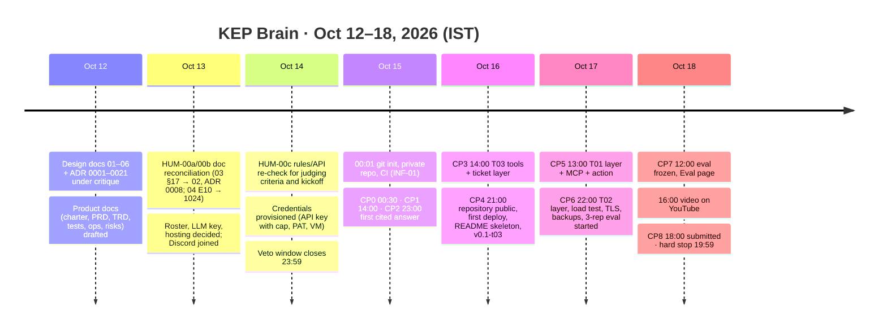

# KEP Brain · Project charter

| | |
|---|---|
| Status | Draft v1 for team sign-off (H-Lead). Pre-kickoff note only: Rule 8 allows notes, graph-model sketches and diagrams before 2026-10-15 00:01 IST; this file contains no source, scripts or manifests. |
| Date | 2026-10-12 (IST) |
| Event | WeMakeDevs × FalkorDB "Graph Hacks: Context for AI Agents", 2026-10-15 00:01 IST → 2026-10-18 23:59 IST (public API `start_date 2026-10-14T18:31:00Z`, `end_date 2026-10-18T18:29:00Z`, `max_team_size 4`, `registration_count 4724` on 2026-10-12; https://wemakedevs-server.onrender.com/hackathons/falkordb) |
| Master track | **T03 Company Brain (prize: M6 Mac Mini)**, with T01 Agents That Act on Connected Data (iPhone 18 Pro) and T02 Agent Memory and Coordination (PS5 with GTA VI) entered as genuine secondary layers built on the T03 core. Track names and prizes re-read at https://www.wemakedevs.org/hackathons/falkordb on 2026-10-12; the page says "Build for one, or for all three at once. Each track has its own prize." |
| Source documents | `E:\graph-hacks-prep\FABLE_CONTEXT.md` (judging research); `docs/design/01`–`06` and `docs/design/adr/0001`–`0021` (scope, architecture, graph model, eval, UI, schedule). Where this charter and a design document disagree, the design document wins and the disagreement is listed in §11. |
| ID conventions | `PRD-G-nn` goals, `PRD-NG-nn` non-goals (defined here; the PRD refines them without renumbering), `CHR-SC-nn` success criteria, `CHR-ST-nn` stakeholders, `CHR-M-nn` milestones, `CHR-B-nn` budget lines, `CHR-C-nn` constraints, `CHR-GOV-nn` governance rules, `CHR-CMP-nn` compliance statements, `CHR-OQ-nn` open questions. Decisions made in this file because the design is silent are marked **DECISION (veto-able)** with the alternative. |

---

## 1. Vision

Treat the Kubernetes project as a company with a public org chart and public decision records, and give it the long-tenured colleague it does not have: an agent that answers *who owns this, who actually knows it, why was it decided this way and by whom, and is that still true*, over KEP documents, tickets and discussion threads held in one FalkorDB graph, with every answer carrying the graph path and the GitHub sources it came from, and refusing when the graph holds no evidence. The hackathon product covers three SIGs; the design is SIG-agnostic so the same system can grow to the whole project by configuration (ADR 0019).

## 2. Objectives (SMART, IST dates; checkpoint ids from `06-build-plan.md` §2.1)

| Id | Objective | Measure | Due |
|---|---|---|---|
| PRD-G-01 | First evidence-cited answer over `POST /v1/ask` on the document layer (KEP text, `kep.yaml`, PRR, `sigs.yaml`, OWNERS) of `sig-node`, `sig-scheduling`, `sig-apps` at the pinned SHA | CP2 smoke test passes; answer carries `claims[].evidence_ids`, `paths`, `freshness` (ADR 0009) | Oct 15 23:00 (CP2) |
| PRD-G-02 | T03 complete, public and deployed: ticket and history layers, `StatusChange`/`Decision` derivation, the 19 T03 tools (`03-graph-model.md` §15.1), Ask, Explore and Freshness pages, first eval pass (arms N, L, G, H × 1 rep), README skeleton with judge path | Repository public (`gh repo edit --visibility public`), live URL answers OWN-01 without sign-up, tag `v0.1-t03` | Oct 16 21:00 (CP4) |
| PRD-G-03 | T01 layer (`impact_of`, `path_between`, `person_to_decision`, `rank_people`, `community_of`, `bridge_people`, MCP server, `draft_stale_doc_issue` with human confirm into the team's demo repository) and T02 layer (`mem:<ULID>` graphs with episodic, semantic and procedural memory; `ops` task/lease coordination board; 50-user load test); TLS and the nightly backup are live from the first public deploy (CP4, PRD-FR-075); the restore drill passes by CP6/CP7 | CP5 and CP6 smoke tests; one issue posted to the demo repository with an evidence block; 20-claimer test yields exactly one winner | Oct 17 13:00 (CP5) / 22:00 (CP6) |
| PRD-G-04 | Frozen 3-rep evaluation of the 56-question set over five arms on the deployed instance, published losses first | Headline targets are the pre-registered predictions of `04-eval-set.md` §8.4: arm H ≥ 90 % on easy ownership, ≥ 70 % on expertise and multi-hop, ≥ 90 % abstention; judge–human agreement of at least 15 of 16 calibration answers (93.75 %; 14 of 16 is 87.5 %), Wilson interval reported (§6.3); `/v1/ask` p95 ≤ 12 s (`02-architecture.md` §15); tool reads p95 < 300 ms at 50 users without LLM (§10.3). Latency targets are unmeasured until CP2/CP7 and are published as measured if missed. Misses are published as misses, with the ±8-point noise floor stated | Oct 18 12:00 (CP7) |
| PRD-G-05 | Demo video ≤ 3:00 on YouTube following the shot list in `05-ui-brief.md` §8; submission form sent naming T03, T01 and T02 with detailed answers, FalkorDB feedback and per-member contributions | Video uploaded by 16:00; form submitted by 18:00; hard stop 19:59 (four hours before close) | Oct 18 18:00 (CP8) |
| PRD-G-06 | Live deployment stays up, without sign-up, from CP4 until results are announced | 5-minute external uptime ping; `restart: unless-stopped`; FalkorDB behind ACL users with no published port; nightly backup with 7-day retention (ADR 0017). **DECISION (veto-able):** keep it funded until results are published and no earlier than 2026-11-15; alternative: 14 days after submission | Oct 16 → results |
| PRD-G-07 | Rule compliance is checkable from the repository alone | No commit dated before 2026-10-15 00:01 IST; one `docs/AI_USAGE.md` row per PR; one ADR per decision in `docs/DECISIONS.md`; README "Provenance" names the template boundary; the post-sync PII invariant scan (`03-graph-model.md` §9 G4) reports zero hits on every `SyncRun` | continuous, verified at CP8 |

## 3. Scope summary and non-goals

**In scope (P0 → P2, strictly in this order; `02-architecture.md` §1, §8; ADR 0019).** Three SIGs (`sig-node` 139 KEPs, `sig-scheduling` 58, `sig-apps` 35: 232 of 684 parseable `kep.yaml` files) at a pinned `kubernetes/enhancements` commit, their 212 PRR files, the matching `sigs.yaml` entries (all 24 SIGs loaded as org chart, three `in_scope`), the 95 SIG-labelled `OWNERS` files and root `OWNERS_ALIASES`; P0 tickets and chats = ≈575 tracking issues with comments and GraphQL label/milestone history plus ≈1,600 enhancements PRs; P1 = ≈2,600 `kubernetes/kubernetes` items referencing a tracking issue (scope call on Oct 16); P2 (all 8,510 SIG-labelled k/k items) is out for the event. Four graph families in one FalkorDB v4.22.0 (`kep`, `ops`, `mem:<ULID>`, `eval_baseline`; ADR 0006), core and full graph sizes not yet measured (the estimates of `03` §16 and `02` §9.6 disagree; counts are measured on Oct 15 and only then quoted), 29 parameterized tool intents behind typed tools over `GRAPH.RO_QUERY` (ADR 0004, 0005), the web routes of `05-ui-brief.md` §2.1, an own MCP server (ADR 0013), the 56-question eval with five arms (`04-eval-set.md`).

| Id | Non-goal | Why |
|---|---|---|
| PRD-NG-01 | Issue triage, reviewer routing, duplicate detection | Another entry (RAJ-A58/NodeOps) covers it; `FABLE_CONTEXT.md` §3 |
| PRD-NG-02 | Chat-with-your-docs UX or a generic "company brain" platform | Organiser guidance: one narrow job finished end to end |
| PRD-NG-03 | Free-form text-to-Cypher anywhere in the judged path | Fixed team decision (ADR 0004) |
| PRD-NG-04 | Any write to `kubernetes/*`, `kubernetes-sigs/*`, `kubernetes-client/*`, `kubernetes-csi/*`, `cncf/*` | Built-in denylist (ADR 0021) |
| PRD-NG-05 | Login-gated sources (Slack, Google Groups, Zoom, Google Docs), forks, e-mail addresses, FalkorDB Cloud free tier for the judged demo, FalkorDB 6.x | Rule 6 (ADR 0020); ADR 0017; ADR 0002 |
| PRD-NG-06 | The blog-post side prize | **DECISION (veto-able):** only if time remains after CP8; alternative: assign it to H-Demo on Oct 18 afternoon |

## 4. Success criteria

### 4.1 Hackathon: what "won T03" requires in judge-visible terms

Judging criteria are not published (rules page and public API re-read 2026-10-12). The criteria below are drawn from the 2026 WeMakeDevs six-criterion template, the organisers' and FalkorDB's own published advice, and verified winner patterns (`FABLE_CONTEXT.md` §2).

| Id | Criterion (what a judge sees) | Where it lives |
|---|---|---|
| CHR-SC-01 | **Deep FalkorDB use, not a thin wrapper.** The Rule 3 table (`02-architecture.md` §14) in the README; a depth table of at least twelve FalkorDB capabilities each mapped to a file or route (range, full-text and vector indexes; `UNIQUE`/`MANDATORY` constraints; `MERGE` idempotency; `GRAPH.RO_QUERY` + ACL `kb_reader` + per-query `timeout` + `TIMEOUT_MAX`; `algo.pageRank`, `algo.betweenness`, `algo.WCC`, `algo.labelPropagation`, `algo.SPpaths`; graph-per-user via `select_graph`; `GRAPH.COPY` blue/green rebuild; AOF persistence); the degraded-LLM banner with Explore, Freshness and Eval still working | README, `/about`, `/judge`, the recorded video |
| CHR-SC-02 | **One narrow job done end to end.** Four question families (owns, knows, decided, current) over three SIGs; every T03 focus bullet maps to named tools and screens (`03-graph-model.md` §15.4); the 56 questions all run in the frozen eval | `/judge`, `/eval`, README |
| CHR-SC-03 | **Evidence, including losses.** Five arms, Wilson intervals, paired difference, baseline wins sorted first, "where the graph lost", predictions versus outcomes, arms not run named, judge calibration figure, latency p50/p95/p99, load-test table | `/eval`, README "Evaluation" (generated from `summary.json`) |
| CHR-SC-04 | **Demo ≤ 3 minutes** on YouTube, real data, URL bar visible, no sign-up, timestamps inside the window, FalkorDB's role stated at least twice | `05-ui-brief.md` §8 shot list |
| CHR-SC-05 | **Live link without sign-up**, `/judge` path in about 60 seconds; five steps (STA-04, DEC-07, DEC-01, MH-07, then ABS-10 "watch it refuse"), with the click count stated after the final design (PRD-OQ-06), up through judging | Deployment per ADR 0017 |
| CHR-SC-06 | **README a judge can run and check.** Top: video, live link, judge path; `docker compose up` yields a loaded graph without a GitHub token (`06-build-plan.md` B11); graph data model diagram; the Cypher templates and algorithms exported from the tool registry (Rule 10); "Why a graph, not a vector database"; data statement (Rule 6, Apache-2.0 NOTICE, removal-request path); AI-assistance disclosure; who did what; feedback on FalkorDB | README, `docs/AI_USAGE.md`, `docs/DECISIONS.md` |
| CHR-SC-07 | **Submission form** with detailed answers, all three tracks named with the focus points covered, FalkorDB feedback, per-member contributions; sent by 18:00 IST | CP8 |
| CHR-SC-08 | **Explain-back.** Every member can explain the graph model, the queries, the architecture and the decisions (Rules 11-13) in a 45-minute session before submission (TEAM-WA-18; TST-206) | Oct 18, before the form |

### 4.2 Product beyond the hackathon

| Id | Criterion |
|---|---|
| CHR-SC-10 | Scope widens to all 22 `sig-*` directories by changing `SIGS` only; initial load stays inside the GitHub budget of one authenticated token per hour per three SIGs (`02-architecture.md` §9.4), so the full project loads in roughly a working day of paced requests (INFERENCE) |
| CHR-SC-11 | Freshness: incremental sync every 15 minutes; the "Data as of" chip is never more than 30 minutes behind the upstream head in steady state (measured per TRD-NFR-027; after CP7 the chip reads "frozen snapshot"); contradictions between `kep.yaml` and tracking-issue labels surface within one sync |
| CHR-SC-12 | The eval is a regression gate: every release re-runs the 56 questions and no question type falls outside its interval relative to the frozen hackathon run |
| CHR-SC-13 | Community obligations hold in operation: a removal request is honoured on the next sync, or by an operator-run suppression sync once the schedule is frozen (`archived = true`; TRD-TR-073); no e-mail ever appears in the graph (G1–G4) |
| CHR-SC-14 | FalkorDB 6.x evaluated after the event behind the same integration suite (ADR 0002) and the findings fed back to FalkorDB |

## 5. Stakeholders and obligations

| Id | Stakeholder | Interest | Our obligations |
|---|---|---|---|
| CHR-ST-01 | **Team** (1–4 people; roles template from `06-build-plan.md` §3.2: H-Lead, H-Review, H-Data/Eval, H-Demo; one person holds every role at the checkpoints if alone; ≈30 human-hours) | Win T03; cover T01 and T02; a repository worth keeping | Each member on one team only; each member's contribution stated; each member able to pass the explain-back |
| CHR-ST-02 | **WeMakeDevs** (organiser) | Rule-abiding, well-presented entries | Follow Rules 1–14 as re-read on 2026-10-12; disclose AI use; name every track entered; detailed form answers; join the Discord servers |
| CHR-ST-03 | **FalkorDB** (sponsor; its engineers judge) | Products where the graph does real work; product feedback | FalkorDB is the only store (ADR 0006); honest written feedback in the form and README, including the v4.22.0 pin and what blocked 6.x; day-one findings on ACL and multi-label behaviour reported as issues if real |
| CHR-ST-04 | **Judges** (unknown; criteria unpublished) | Clone, run, check in minutes | One command brings up a loaded graph; judge path; every cited fact links to the file at the ingested commit |
| CHR-ST-05 | **Kubernetes community** (contributors named in `sigs.yaml`, `kep.yaml`, OWNERS, issues and comments; the data we use) | Not to be spammed, misrepresented or exposed | Never post to real Kubernetes repositories (ADR 0021 denylist); strip all e-mails, private lists and password-bearing meeting URLs (ADR 0020, G1–G4); login is the only identity, name/company only from the public org chart and switchable off; Apache-2.0 NOTICE crediting the Kubernetes Authors; no comment dump in the repository, excerpts attributed and linked, removal-request path in the README; a dedicated read-only fine-grained PAT, serial requests inside published rate limits; nothing login-gated fetched; "who knows" shown as a declared proxy with its counts, never as a judgement of people |
| CHR-ST-06 | **LLM provider** (Anthropic by default; OpenAI-compatible fallback, ADR 0010) | Terms of use; spend | Key held in `.env`/CI secrets only; hard spend cap (CHR-B-06); prices re-verified on Oct 15 and recorded in `docs/DECISIONS.md` |
| CHR-ST-07 | **Hosting provider** (single VM per ADR 0017; Railway/Fly alternatives) | Paid use within terms | Firewall 22/80/443 only; no database port published; backups |

## 6. Milestones, 2026-10-12 → 2026-10-18 (IST)

| Id | Milestone | When | Exit evidence |
|---|---|---|---|
| CHR-M-01 | Docs and design complete; every pre-event veto-able default accepted or overturned in an ADR | Oct 14 23:59 | `docs/design/*` and `docs/product/*` consistent; `FABLE_CONTEXT.md` §1 updated by HUM-00c |
| CHR-M-02 | Coding starts; template committed as baseline | Oct 15 00:01–00:30 (CP0) | First commit timestamp ≥ 00:01 IST; CI green on the private repository |
| CHR-M-03 | First cited answer (PRD-G-01) | Oct 15 23:00 (CP2) | CP2 smoke test |
| CHR-M-04 | Public push and first deployment with HTTPS and a first backup (PRD-G-02) | Oct 16 21:00 (CP4) | Public repository with full history; live URL |
| CHR-M-05 | T01 and T02 layers; restore drill (PRD-G-03) | Oct 17 22:00 (CP6) | CP5/CP6 smoke tests |
| CHR-M-06 | Numbers frozen; restore runbook rehearsed; explain-back held (PRD-G-04, CHR-SC-08) | Oct 18 12:00 (CP7) | `evals/runs/<utc>/summary.json` committed; `docs/RUNBOOK.md` records the test |
| CHR-M-07 | Submission (PRD-G-05) | Oct 18 18:00 (CP8); hard stop 19:59 | Form confirmation; YouTube link; live link checked from a clean browser |

## 7. Budget

Assumptions, all written out so a reader can redo the arithmetic:

- **A1 prices** (VERIFIED 2026-10-12 at https://platform.claude.com/docs/en/about-claude/pricing): `claude-sonnet-5-5` $2 input / $10 output per MTok, 5-minute cache write $2.50, cache hit $0.10 (0.05× base, footnote 2 on that page); `claude-haiku-5-5` $0.10 / $0.50 per MTok for prompts ≤ 100,000 tokens, $0.50 / $2.50 above; Batch API −50 % (not used: the product is interactive). Note: `04-eval-set.md` §7 and `02-architecture.md` §6.1 assume a Sonnet 5.5 cache-read price of $0.20 from a 2026-10-06 cache; the live page says $0.10, so those estimates are slightly conservative (CHR-OQ-07).
- **A2 per answered question** (from `04-eval-set.md` §9.2): ≈3 planner turns, ≈10k fresh input tokens, ≈15k cache-read tokens, ≈1.5k output tokens → $0.020 + $0.0015 + $0.015 ≈ **$0.04**; Haiku classification, entity and fact extraction ≈ 3 calls × 2k tokens ≈ $0.001, negligible.
- **A3 evaluation**: 56 questions × 4 LLM-answering retrieval arms × 3 reps = 672 runs ≈ $27; arm N 168 runs ≈ $3; judge 180 calls ≈ $3; calibration and self-tests ≈ $3 → ≈ $36, carried at **$70** with a 2× margin for re-runs (`04` §9.2).
- **A4 development asks** Oct 15–18 (team and build agents exercising `/v1/ask`): ≈600 asks × $0.04 ≈ $24, carried at **$40**.
- **A5 judging and public traffic** Oct 18 → results: ≈500 asks × $0.04 ≈ $20, carried at **$30**; the per-memory-id rate limit (30 asks / 10 min) and the hard cap bound the exposure.
- **A6 extracted decisions** (P1, `EXTRACT_DECISIONS=false` by default): ≈2,200 sections × ≈1.5k input / ≈0.3k output on Haiku ≈ $0.33 + $0.33 < **$1**.
- **A7 embeddings** (vector baseline and optional hybrid leg): ≈3,000 blocks × ≈500 tokens ≈ 1.5M tokens. `voyage-4` is $0.06 per MTok with the first 200 million tokens free (VERIFIED 2026-10-12, https://docs.voyageai.com/docs/pricing) → **$0** on the Anthropic/Voyage path; the OpenAI-compatible `text-embedding-3-small` path is not priced in this document (UNVERIFIED).
- **A8 hosting**: ADR 0017 default is a 3 vCPU / 4 GB / 80 GB class VM; OPS D1 (decided) provisions 4 vCPU / 8 GB / 80 GB because the 4 GB class does not survive a rebuild during a snapshot fork, falling back to 4 GB if the price breaks the CHR-B-05 ceiling. Hetzner CPX21 is 3 vCPU AMD / 4 GB / 80 GB NVMe in the US locations HIL1/ASH1; the EU equivalent is CPX22 (2 vCPU / 4 GB / 80 GB) (specs VERIFIED 2026-10-12 at https://www.hetzner.com/cloud/regular-performance/; **prices did not render on the page and are UNVERIFIED**; ADR 0017 estimates the class at ≈ €10/month). One to two months needed (Oct 16 → results). Domain optional (fallback `<ip>.sslip.io`, free); Let's Encrypt free; an external uptime monitor on a free tier; GitHub public repository and Actions minutes expected at $0 (UNVERIFIED here).

| Id | Line | Expected | Ceiling |
|---|---|---|---|
| CHR-B-01 | LLM: evaluation (A3) | $36 | $70 |
| CHR-B-02 | LLM: development (A4) | $24 | $40 |
| CHR-B-03 | LLM: judging traffic (A5) | $20 | $30 |
| CHR-B-04 | LLM: extraction and embeddings (A6, A7) | < $1 | $5 |
| CHR-B-05 | Hosting, domain, monitoring (A8) | ≈ €10–20 (4 GB class; the 8 GB class price is UNVERIFIED) | €40 |
| CHR-B-06 | **DECISION (veto-able):** a hard spend limit of **$150 combined** for Oct 15 → results, split across two keys ($80 on the prod/dev key, $70 on the separate eval key; OPS-056), each set in the provider console before the first request; alternative: no cap, rely on the per-user rate limit only | — | $150 |
| | **Total** | ≈ $80 + ≈ €15 | $150 + €40 |

Who pays the key and the VM is open (CHR-OQ-01, CHR-OQ-03). No sponsor LLM credits were found (`FABLE_CONTEXT.md` §5).

## 8. Top constraints

| Id | Constraint | Source |
|---|---|---|
| CHR-C-01 | No product code, no git repository and no UI build before 2026-10-15 00:01 IST; notes, graph-model sketches and diagrams only. **Position (decided, veto-able):** the generic template already in the working tree (`apps/`, `docker-compose.yml`, `.github/`, hooks, `LICENSE`, `README.md`) is pre-existing scaffolding disclosed under Rule 9, not hackathon work and not claimed as such (CHR-CMP-01); it is committed as the first, labelled commit at or after 00:01 and no `git init` happens earlier. Alternative: remove the template from the tree until 00:01 and add it then | Rule 8 and Rule 9 (re-read 2026-10-12); `FABLE_CONTEXT.md` §0 |
| CHR-C-02 | FalkorDB must carry the product; "a visualisation drawn on top of ordinary storage does not qualify"; no second datastore | Rules 2–3; ADR 0006; `02` §14 |
| CHR-C-03 | Public data only; nothing "private, login-protected, paywalled, personal, or otherwise restricted"; e-mails and personal details stripped | Rule 6; ADR 0020 |
| CHR-C-04 | AI assistance disclosed; the team understands and can explain the graph model, queries, architecture and decisions; entirely AI-generated work may be rejected | Rules 11–13; `docs/AI_USAGE.md`; ADR 0001 |
| CHR-C-05 | Team ≤ 4, each person on one team; every track entered is named at submission | Rule 5; public API `max_team_size 4` |
| CHR-C-06 | GitHub API: 5,000 REST requests/hour and 5,000 GraphQL points/hour per token, 30 search requests/minute, serial requests; a dedicated PAT, not a maintainer's | `01-recon` §6.3; `02` §9.4 |
| CHR-C-07 | FalkorDB pinned to `v4.22.0` (C engine); 6.x only after the event; password and ACL users required | ADR 0002 |
| CHR-C-08 | Host ports 6379 and 5432 are never used (other projects' containers); dev FalkorDB on loopback 6380/3001 | `docs/DECISIONS.md` ADR-0002/0003; `06` §1.1 |
| CHR-C-09 | Release v1.38 is in flight: `latest-milestone`, `stage/*` and `tracked/*` values will move between Oct 11 and Oct 18; ground truth is re-verified on Oct 15 and every number carries its SHA and fetch time | `04` §3.3 |
| CHR-C-10 | Judging criteria, judges, kickoff time and results date are unpublished (re-checked 2026-10-12); the plan optimises the published template and advice, and HUM-00c re-reads the pages on Oct 14 | `FABLE_CONTEXT.md` §1; §11 below |
| CHR-C-11 | About 30 human-hours across four days; the plan must still close with one person at the checkpoints | `06` §3.2 |
| CHR-C-12 | Hard internal stop: submission by 18:00 IST Oct 18, no later than 19:59 IST | `06` header |

## 9. Governance

| Id | Rule |
|---|---|
| CHR-GOV-01 | **Who decides.** H-Lead decides after discussion with the people affected; where the team is one person, that person is H-Lead. Pre-event veto-able defaults (every row marked veto-able in `docs/design/*`, the ADRs and this charter) may be overturned by any member until the veto window closes. **DECISION (veto-able):** the window closes 2026-10-14 23:59 IST; alternative: keep it open until CP1 (Oct 15 14:00) at the cost of re-planning during the build. After that, a change is a new decision record, never an edit. |
| CHR-GOV-02 | **Where decisions are recorded.** Pre-event product-design decisions: `docs/design/adr/0001`–`0021` (MADR, never edited after acceptance except Status; ADR 0001). Template and event decisions: `docs/DECISIONS.md`, ADR-0001–0003 for the template, ADR-0004 onward from Oct 15, starting with the twelve reconciliation decisions B1–B12 of `06-build-plan.md` §1.3 (task HUM-02). A record is never deleted; a changed decision gets status "Superseded by ADR-nnnn". Each record states context, decision, reason, alternatives, consequences and whether it was veto-able. |
| CHR-GOV-03 | **Contracts are read-only for build agents** (C1–C10 in `06` §4: graph names, tool signatures, HTTP and SSE shapes, settings, worker CLI, MCP, eval file, web routes, Compose, disclosure). A contract problem is written into the PR description under "Contract issue"; a human decides; the outcome becomes an ADR before the code changes. |
| CHR-GOV-04 | **Checkpoints.** CP0–CP8 each have smoke tests; H-Lead with H-Review gives go/no-go; a critical-path slip above three hours triggers the cut lines of `06` §8 (CHR-OQ-06 notes that section is not yet in the file read on 2026-10-12). |
| CHR-GOV-05 | **Never cut**, whatever slips: evidence-only answers with abstention; read-only graph access for everything the LLM influences; the Rule 6 guarantees; `docker compose up` working for a judge without a token; the eval with its losses; the video; the README judge path. |
| CHR-GOV-06 | **Sign-offs.** Every PR: H-Review, with a `docs/AI_USAGE.md` row and, when a decision was made, a `docs/DECISIONS.md` record (PR template). Frozen eval run and the Oct 15 ground-truth re-verification: H-Data/Eval (these are human-only tasks, `04` §12). Video and form text: H-Demo. Submission: H-Lead, after the explain-back (CHR-SC-08). The who-did-what statement: every member. |
| CHR-GOV-07 | **Eval change control.** No question is removed or reworded after a scoring run has been seen; changes only in the Oct 15 re-verification pass and only with a changelog entry; errored rows are reported, never scored; arms not run are named, never estimated (`04` §10). |
| CHR-GOV-08 | **Rule 8 discipline.** Commits start at or after 2026-10-15 00:01 IST, at least hourly, with the task id in the message; no squashing of `main` history beyond the PR squash; nothing is back-dated onto the template. |

## 10. Compliance statement: template reuse and AI assistance

| Id | Statement |
|---|---|
| CHR-CMP-01 | **Template reuse.** The repository was bootstrapped before the event from a generic FastAPI + Next.js + FalkorDB template (Docker Compose, CI, Dependabot, hooks, environment handling, licence, documentation skeleton, a status page and layout shell). It contains no product logic: no graph model, no Cypher beyond a connectivity check, no ingestion, prompts, tools, memory, evaluation or product UI. It is pre-existing scaffolding disclosed under Rule 9 as re-read on 2026-10-12: "You may use frameworks, open-source libraries, public APIs, templates, third-party tools, and publicly available datasets and assets. The original work completed during the hackathon will be judged." The only FAQ text verified is "The submission and its main FalkorDB implementation must be new work completed during the event" (`FABLE_CONTEXT.md` §0): the template is not the FalkorDB implementation, and every graph, query, tool, prompt and screen is new work. The FAQ sentence quoted in `README.md` "Provenance" and ADR-0001 ("You may reuse general libraries, templates, and infrastructure") could not be located on the rules page on 2026-10-11 or 2026-10-12 (UNVERIFIED; CHR-OQ-05) and is not relied on. The organisers are asked in Discord on Oct 14 whether a pre-event template is acceptable, and the answer is recorded as an ADR before Oct 15. |
| CHR-CMP-02 | **Pre-event notes.** `docs/design/` and `docs/product/` hold notes, graph-model sketches, diagrams and plans written before kickoff, which Rule 8 permits verbatim ("You may discuss ideas, create notes, sketch the graph model, or prepare diagrams beforehand"). They contain no source files, scripts, manifests or paste-ready query catalog; the DDL and procedure forms quoted in `03-graph-model.md` are documented FalkorDB syntax with our names substituted, for review. Everything KEP-specific that executes is written from 2026-10-15 00:01 IST. |
| CHR-CMP-03 | **AI assistance.** Claude Code (Anthropic) wrote the template, the design notes, the ADRs and this charter, with the stack, the master track, the data source and the template boundary fixed by the team beforehand; the model ids of every session are recorded once, from the actual sessions, in `docs/AI_USAGE.md` and are cited from there, never restated (CHR-OQ-13). During the event, AI build agents write code inside contracts they may not change (CHR-GOV-03); humans decide, review and merge every PR, re-verify the ground truth by hand, hand-label the judge calibration set, run the eval, record the video and submit. Every contribution is logged at the time it happens in `docs/AI_USAGE.md` (date, area, what AI did, what humans did, how it was verified), and every decision in `docs/DECISIONS.md`. The product itself also discloses this on `/about` and in the README, together with the LLM model ids in use. |
| CHR-CMP-04 | **Understanding (Rules 11-13).** The ADR series exists so that any member can defend each choice; the explain-back session (CHR-SC-08) is held before submission and its outcome is recorded in `docs/AI_USAGE.md`. |
| CHR-CMP-05 | **Data (Rule 6).** Only the three public Apache-2.0 repositories named in `01-recon-kubernetes-data.md` are read; e-mails, private lists and password-bearing meeting URLs are dropped at parse time, free text is scrubbed before hashing, forbidden property names cannot exist in the schema, and a post-sync invariant scan fails the sync on any hit (`03` §9). The README carries the data statement, the NOTICE and the removal-request path. |

## 11. Open questions (owner: team unless stated; defaults apply until answered)

| Id | Question | Default until decided |
|---|---|---|
| CHR-OQ-01 | Which LLM API key is paid for, by whom, and with what spend cap? | Anthropic: `claude-sonnet-5-5` planner/answerer, `claude-haiku-5-5` extraction (ADR 0010); $150 cap (CHR-B-06); OpenAI-compatible key enables the fallback path and a cross-family judge |
| CHR-OQ-02 | Team roster and roles (the submission must state each member's contribution) | 1–4 people on the H-Lead / H-Review / H-Data/Eval / H-Demo template (`06` §3.2) |
| CHR-OQ-03 | Hosting provider, VM size, domain and payer | Single VM with Docker Compose and Caddy (ADR 0017); Hetzner CPX21-class (US) or CPX22 (EU); price and availability to be confirmed in the provider console by Oct 14 18:00 IST, else Railway per ADR 0017 plan B (**DECISION, veto-able**; alternative: Fly.io) |
| CHR-OQ-04 | Name of the demo-actions repository | `<team>/kep-brain-demo-actions`, created on Oct 15 (ADR 0021) |
| CHR-OQ-05 | `README.md` "Provenance" and `docs/DECISIONS.md` ADR-0001 quote an FAQ sentence not found on the rules page on Oct 11 or Oct 12; both files are outside this document set | Re-check on Oct 14 (HUM-00c); ask the organisers in Discord and record the answer as an ADR; reword both files to Rule 9's verified text and the verified FAQ line (CHR-C-01, CHR-CMP-01) and state the pre-existing-scaffolding position in the README "Provenance" |
| CHR-OQ-06 | `06-build-plan.md` §0 refers to §5 task cards, §6 checkpoint smoke tests, §7 human tasks, §8 risk register and cut lines, §9 README checklist; the file read on 2026-10-12 ends at §4 | Sibling workflow to confirm the sections land before Oct 14 23:59; CHR-GOV-04/05 state the cut-line policy at charter level meanwhile |
| CHR-OQ-07 | Sonnet 5.5 cache-read price is $0.10/MTok on the live pricing page, not the $0.20 assumed in `04` §7 and `02` §6.1 | Re-verify all model prices on Oct 15 (ADR 0010) and update the eval price table; estimates here already use $0.10 |
| CHR-OQ-08 | Do judging criteria, a kickoff time or a results date appear before Oct 15? | HUM-00c re-reads the rules page and public API on Oct 14 evening; `FABLE_CONTEXT.md` §1 is updated; PRD-G-06's funding horizon follows the results date once known |
| CHR-OQ-09 | Should the README publish the full 56 × 5 per-question table or link to it? | Publish the table on `/eval` and link from the README (`04` §12) |
| CHR-OQ-10 | `Person.name`/`company` from `sigs.yaml`: keep (default) or store logins only? | Keep, behind `STORE_PERSON_NAME_COMPANY=true` (ADR 0020); decide before the first public deploy (CP4) |
| CHR-OQ-11 | P1 `kubernetes/kubernetes` tickets in or out of the event build? | Scope call at CP3 (Oct 16 14:00) on the measured P0 load time (ADR 0019) |
| CHR-OQ-12 | Goal numbering: this charter defines PRD-G-01–07 and PRD-NG-01–06; the PRD must adopt them or the orchestrating workflow renumbers one side | Charter numbering is canonical (**DECISION, veto-able**; alternative: the PRD owns goals and the charter cites them) |
| CHR-OQ-13 | Model names for the AI disclosure differ between the charter draft, ENG-11 and `docs/AI_USAGE.md` ("Fable 5" and "Fable 5.1" both appear there) | Humans take the ids from the actual sessions and fix `docs/AI_USAGE.md` once; this charter, ENG-11 and form text C.6 cite that record (**DECISION, veto-able**; alternative: restate the ids in each place) |

## 12. Verification ledger (facts checked for this charter)

| Fact | Source | Checked | Status |
|---|---|---|---|
| Rule 8, 9, 6, 2–3, 10, 11–13 wording; no judging criteria, judges or results date; Oct 15 12:01 AM → Oct 18 11:59 PM IST | https://www.wemakedevs.org/hackathons/falkordb/rules | 2026-10-12 | VERIFIED |
| Track names, prizes (T03 = M6 Mac Mini), focus bullets, "Build for one, or for all three at once. Each track has its own prize." | https://www.wemakedevs.org/hackathons/falkordb | 2026-10-12 | VERIFIED |
| `start_date 2026-10-14T18:31:00Z`, `end_date 2026-10-18T18:29:00Z`, `registration_count 4724`, `max_team_size 4`, `submission_questions null`, no judging fields | https://wemakedevs-server.onrender.com/hackathons/falkordb | 2026-10-12 | VERIFIED |
| Sonnet 5.5 and Haiku 5.5 prices, cache multipliers, Batch discount, 1M context at standard pricing | https://platform.claude.com/docs/en/about-claude/pricing | 2026-10-12 | VERIFIED |
| `voyage-4` $0.06/MTok, first 200M tokens free | https://docs.voyageai.com/docs/pricing | 2026-10-12 | VERIFIED |
| Hetzner CPX21 / CPX22 specifications | https://www.hetzner.com/cloud/regular-performance/ | 2026-10-12 | specs VERIFIED; prices and availability UNVERIFIED (not rendered) |
| FAQ clause "You may reuse general libraries, templates, and infrastructure" | rules page | 2026-10-11, 2026-10-12 | UNVERIFIED (not found) |
| Judging template, winner patterns, organiser and FalkorDB judge advice, Kunal Kushwaha's tips | `FABLE_CONTEXT.md` §2 (its own sources) | 2026-10-11 | adopted |
| Scope, counts, checkpoints, roles, eval design, price assumptions | `docs/design/01`–`06`, `adr/0001`–`0021` | 2026-10-12 | adopted; §11 lists the deltas found |
| GitHub Actions minutes free on public repositories; OpenAI embedding price | — | — | UNVERIFIED (not relied on) |
